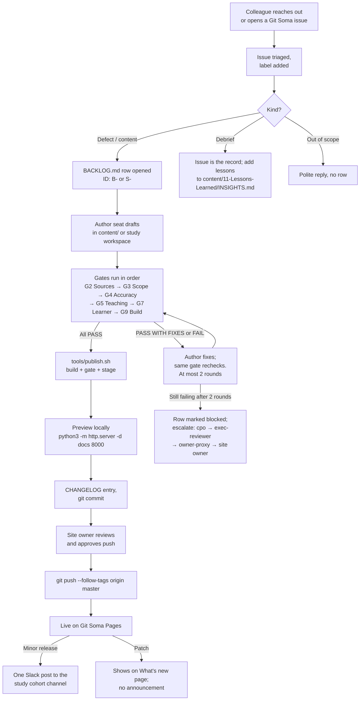

# Handover guide — Claude certifications study site

> **If you're taking over this site and have no other context, start here.**
> Then read `MAINTAINING.md` for day-to-day message handling.

---

## What this is and who it's for

This is a study site for Salesforce colleagues preparing for Anthropic's four Claude certifications:

- **CCAO-F** — Claude Certified Associate (Foundations)
- **CCAR-F** — Claude Certified Architect (Foundations)
- **CCAR-P** — Claude Certified Architect (Professional)
- **CCDV-F** — Claude Certified Developer (Foundations)

The site is served on Git Soma Pages at:
`https://git.soma.salesforce.com/pages/akumthekar/claude-certifications-training/`

It requires a Salesforce Git Soma login. Every Salesforce employee with SSO access can reach it.

The site covers **Claude and Anthropic only**.
Never Salesforce Agentforce, Einstein, Data Cloud or Salesforce certifications.
It contains no real exam questions and no personal scores.

---

## Glossary (terms used in this document)

| Term | Plain meaning |
|---|---|
| **seat** | An AI reviewer role with one job — for example, the `teaching-coach` seat checks that a lesson actually teaches |
| **crew** | The full set of seats that build and review the site together |
| **gate** | A review checkpoint a piece of work must pass before moving on; labeled G0–G11 (see the Gates table below) |
| **pipeline** | An ordered sequence of gates for a type of work; labeled P1–P9 (see `content/CREW-WORKFLOW.md`) |
| **NFR** | Non-functional requirement — an automatic site check run by `tools/gate.py` (NFR-01 to NFR-10) |
| **RASIC** | Who does what: Responsible, Accountable, Supporting, Informed, Consulted — defined per pipeline in `content/CREW-WORKFLOW.md` §3c |
| **backlog row** | One item in `content/BACKLOG.md`; IDs starting with `B-` are content items, `S-` are site items |
| **fix round** | One recheck by the same gate after the author has fixed the findings; recorded as e.g. `G4 r1 FAIL (3) → r2 PASS` |

---

## The whole loop in one picture

G-numbers are review checkpoints, defined in the Gates table below.



---

## Where everything lives

| Location | What it is | Generated or hand-edited? | Stays private? |
|---|---|---|---|
| `docs/` | The published site (HTML, CSS, JS) | **Generated** by `site/build.py` — do not edit by hand | No — this is what Pages serves |
| `content/` | Anonymized page sources; exported on every publish | **Generated** from the study workspace, **or** hand-edited if the repo is the master copy | No — this is the repo's source of truth for new owners |
| `content/crew/` | The 10 project-specific AI seat definitions | Generated from the study workspace | No |
| `content/BACKLOG.md` | Every work item and its status — the one status list | Generated (personal study rows removed) | No |
| `content/DECISIONS.md` | Every decision, append-only | Generated (personal rows removed) | No |
| `content/CREW-WORKFLOW.md` | Gates G0–G11, pipelines P1–P9, fix loop, RASIC | Generated | No |
| `site/` | Build script (`site/build.py`) and design assets | Hand-edited | No |
| `tools/` | `gate.py`, `publish.sh`, `backlog_check.py`, `make_blocklist.py`, `build_practice.py` | Hand-edited | No |
| `practice/` | Offline practice tool: `index.html`, `question-bank.json`, `src/template.html`, Amey Thakur's MIT licence, `README.md` | `index.html` generated by `tools/build_practice.py`; `FIXES` and `EXCLUDE` in that script hold answer-key corrections | No, but outside `docs/`, so not on the site pages |
| `.githooks/pre-commit` | Refuses private files and reruns the gate before every commit | Hand-edited | No |
| `.github/ISSUE_TEMPLATE/` | Three issue forms: report a problem, content request, exam debrief | Hand-edited | No |
| `tools/blocklist.sha256` | Hashes of private colleague names (not the names themselves) | Generated by `tools/make_blocklist.py` from the study workspace's names file | No — hashes only |
| **Study workspace (Google Drive)** | Lessons, simulations, labs, progress logs, private tracker | Hand-edited by the site owner | **Yes — never in the repo** |
| `TRACKER.md`, `12-Progress/`, `session-logs/`, `09-Proof/`, `private/` | Personal study files | Hand-edited | **Yes — gitignored and blocked by pre-commit** |
| `content/11-Lessons-Learned/INSIGHTS.md` | Anonymized lessons from colleagues who passed | Hand-edited (in the repo) | No — but never include names or exam questions |

---

## Build, check, publish and rollback commands

### If you have the original study workspace

Set `CERT_SRC` to the path of the study workspace folder, then run:

```
CERT_SRC="<workspace path>" bash tools/publish.sh
```

This does six things in order:

1. **Blocklist** — hashes private colleague names from the names file in the workspace.
2. **Build and export** — runs `site/build.py --src "$CERT_SRC" --export content`, which writes `docs/` and exports anonymized sources to `content/`. Then `tools/build_practice.py --src "$CERT_SRC"` refreshes `practice/` with shareable questions only.
3. **Gate G9** — runs `python3 tools/gate.py` (NFR-01 to NFR-10 must all pass).
4. **Handover check** — rebuilds from `content/` alone into a temp folder and diffs it against `docs/`. They must match exactly.
5. **Stage** — `git add` by explicit named paths only (never `git add -A`).
6. **Backlog check** — `python3 tools/backlog_check.py --src content`; fails if any `doing` or `blocked` row is in the build. Use `--allow B-12` (comma-separated) for owner-approved exceptions.

### If you do NOT have the original study workspace (new owner, repo-as-master mode)

`content/` becomes your master copy. Edit files there directly. **Do not run `tools/publish.sh`** — it re-exports from the old Drive workspace and would overwrite your edits in `content/`.

Your full publish loop is:

```
# 1. Edit files in content/ (page sources, BACKLOG.md, etc.)

# 2. Build docs/ from content/
python3 site/build.py --src content

# 2b. Rebuild the practice tool (edit practice/question-bank.json, or FIXES/EXCLUDE in the script)
python3 tools/build_practice.py

# 3. Run the quality gate (must pass before committing)
python3 tools/gate.py

# 4. Check the backlog (must have no doing/blocked rows in the build)
python3 tools/backlog_check.py --src content
# To allow an approved exception: python3 tools/backlog_check.py --src content --allow B-12,S-06

# 5. Stage by explicit path (never git add -A)
git add content docs practice CHANGELOG.md README.md HANDOVER.md MAINTAINING.md CONTRIBUTING.md .gitignore .githooks site tools .github

# 6. Commit (the pre-commit hook reruns the gate automatically)
git commit -m "vX.Y: <what changed>"

# 7. Tag
git tag -a vX.Y -m "vX.Y: <what changed>"

# 8. Push (after the gates and the backlog check pass)
git push --follow-tags origin master
```

**What you lose in repo-as-master mode — and how to handle it:**

- **Colleague names:** `content/` is already anonymized. Write any new colleague reference as `a colleague` by hand (you have no names file to automate this).
- **Question-bank leak check:** skipped when building from `content/`. Do not add third-party question text to any page. New practice questions go only in `practice/question-bank.json`, and only when their author allows sharing; the gate accepts only the two sources in `tools/gate.py`, so a new source needs an owner decision and a gate change.
- **Private study tracker:** lives in the Drive workspace and is never published. Keep your own notes outside the repo.
- **Reviewed dates:** when building from `content/`, a page's `reviewed` date in `content/EXPORT.json` updates automatically when the content file changes. You do not need to update it manually.
- **Blocklist:** if you ever create a names file, regenerate `tools/blocklist.sha256` with `python3 tools/make_blocklist.py --src <names-file-folder>`.

### Preview locally

```
python3 -m http.server -d docs 8000
```

Then open `http://localhost:8000` in your browser.

### Commit

```
git commit -m "vX.Y: <what changed>"
```

The pre-commit hook reruns the gate and refuses any staged private files automatically.

### Push

Only after the site owner (you) reviews and approves:

```
git push --follow-tags origin master
```

Pages serves `docs/` from `master`. Never force-push.

### Rollback

```
git revert <release-commit-hash>
git push --follow-tags origin master
```

Find the release commit with `git log --oneline`. Never use `git reset --hard` or `git push --force`.

### Arm the hooks (once per clone)

```
git config core.hooksPath .githooks
```

---

## Release rules

| Type | When | Announcement |
|---|---|---|
| **Patch** (e.g. `v0.4.1`) | Fixes only — broken links, wrong display, privacy leaks | Shows on the "What's new" page. No Slack post. |
| **Minor** (e.g. `v0.5`) | New pages or exercises, or a changed fact or correct answer | One Slack post in the study cohort channel. The crew drafts it; the site owner sends it. |

Every release needs:

1. A `CHANGELOG.md` entry (newest first).
2. An annotated git tag: `git tag -a v0.5 -m "v0.5: what changed"`; the tag is included automatically when you use `git push --follow-tags origin master`.
3. Passing gates and a clean backlog check before the push (gate G10). The site owner gave standing approval to push once they pass.

---

## Governance — gates, roles, fix loop, decisions, status

### Who does what

| Role | What they own |
|---|---|
| **Site owner** | Final say on all pushes, outward actions (announcements), anything irreversible |
| **cpo** (AI seat, shared) | Integrator: sequences the backlog, resolves review conflicts, signs off each release (G10) |
| **exec-reviewer** (AI seat, shared) | Approves forks the cpo escalates |
| **owner-proxy** (AI seat, shared) | The owner's stand-in at the top of the escalation chain. A new owner replaces this with their own proxy seat. |

The 10 project-specific AI seats are defined in `content/crew/`. These run on the repo's own definitions. The shared seats listed below are borrowed from the site owner's global AI setup (not in the repo). A new owner needs to recreate them or use equivalent tools:

| Shared seat | One-line role |
|---|---|
| `cpo` | Integrator; sequences and decides operating forks |
| `exec-reviewer` | Approves escalations from the cpo |
| `amar-proxy` / owner-proxy | Owner's judgment stand-in; top of the escalation chain |
| `code-review` | Gate G9 code and build checks |
| `creative-director` | Gate G8 visual taste verdict |
| `design-system-engineer` | `site.css` tokens and the style guide generator |
| `site-publisher` | Publish lifecycle (build, gate, stage, commit, push, live check) |
| `voice-drafter` / `voice-validator` | Outward prose such as Slack announcements |
| `information-designer` | Exhibits on pages |
| `ux-experience-lead` | Learner journeys and acceptance criteria |
| `sf-quality-analyst` | Test strategy; what "it works" means for the site |
| `defect-rca-analyst` | Root cause of any defect, by class, before a fix is written |
| `strategic-advisor` | Periodic north-star check |

### The gates (G0 to G11)

| Gate | Held by | Passes when |
|---|---|---|
| G0 Frame | owner-proxy | The work serves a charter objective and the backlog item exists |
| G1 Blueprint | learning-architect | All official exam objectives are covered and weighted correctly |
| G2 Sources | content-steward | Every fact cites a source with its tier; Tier 1 used where it exists |
| G3 Scope and rights | content-steward | Claude and Anthropic only; no exam questions; no colleague names; no secrets |
| G4 Accuracy | a different seat from the author (see `CREW-WORKFLOW.md` §1 table) | Facts match Tier 1 today |
| G5 Teaching | teaching-coach | Plain language, worked example, traps, Try it, Done when |
| G6 Assessment | assessment-designer (or exam specialist when designer wrote it) | One best answer, plausible wrong options, tied to an official objective |
| G7 Learner | learner-advocate | The next step is obvious; links work; time estimates are realistic |
| G8 Design | information-designer then creative-director | Exhibits read in seconds; verdict is "ship" |
| G9 Build | `tools/gate.py` + code-review for code changes | NFR-01 to NFR-10 pass with zero failures |
| G10 Release | cpo signs off, site owner approves the push | Release notes list what changed and why |
| G11 Live | site-publisher | Every changed page loads on Pages |

**The author never holds a gate on their own work.** This rule has no exceptions.

### Fix loop

1. A gate returns `PASS WITH FIXES` or `FAIL` with numbered findings.
2. The **author** fixes; the **same gate seat** rechecks. The gate seat never edits the item itself.
3. **At most 2 fix rounds per gate.** Stop if the finding count doesn't drop.
4. Still failing → mark the row `blocked` → escalate: `cpo` → `exec-reviewer` → owner-proxy → site owner.
5. Record every round in the backlog row, e.g. `G4 r1 FAIL (3) → r2 PASS`.
6. A changed fact reopens G2 and G4. A changed exhibit reopens G8.

### Where status lives

| What | Where |
|---|---|
| Every work item and its status | `content/BACKLOG.md` — the only status list |
| Why a decision was made | `content/DECISIONS.md` — append only, never edit old rows |
| What changed and why | `CHANGELOG.md` |
| Incoming requests | Git Soma issues (labels: `defect`, `enhancement`, `debrief`) |

---

## Weekly routine (about 15 minutes)

1. **Triage new issues.** Add a label (`defect`, `enhancement`, or `debrief`). Reply briefly. Open a `BACKLOG.md` row if the issue is accepted. Close the issue when its row ships.
2. **Check the backlog.** Move `todo` items to `doing` when you start them. Record gate rounds.
3. **Check page freshness.** Gate NFR-06 fails any exam page not reviewed within 60 days. Check `content/EXPORT.json` for `reviewed` dates. Update and republish pages that are going stale.
4. **Handle Slack asks.** Reply with the link to the site's Contribute page. That page has the three issue forms (report a problem, content request, exam debrief) and explains what happens to each one.

---

## Handover checklist

Use this list when transferring ownership of the site:

- [ ] **Repo ownership** — transfer the Git Soma repo to the new owner, or add them as an admin.
- [ ] **Pages settings** — confirm Pages is still set to serve from `master` branch, `/docs` folder, with `.nojekyll` present.
- [ ] **Issue labels** — confirm the three labels exist on the repo: `defect`, `enhancement`, `debrief`.
- [ ] **Slack channel role** — hand over the posting role for the study cohort channel, or introduce the new owner to the channel.
- [ ] **Shared AI seats** — the new owner recreates the shared seats (listed in the Governance section above) in their own AI workspace, and replaces `amar-proxy` / owner-proxy with their own proxy seat.
- [ ] **Decide: workspace or repo as master** — if the new owner does not have the original Google Drive study workspace, the repo's `content/` folder becomes the master copy. See the build section above for what this means.
- [ ] **Update README owner line** — change the Pages URL in `README.md` to reflect the new owner's username if the repo is transferred.
- [ ] **Blocklist** — if the new owner keeps a names file for the anonymizer, regenerate `tools/blocklist.sha256` with `python3 tools/make_blocklist.py --src <names-file-folder>`.
- [ ] **Arm the pre-commit hook** — `git config core.hooksPath .githooks` in every fresh clone.

---

## Known gaps (open backlog items at handover)

These items were open when this document was written. Check `content/BACKLOG.md` for the current status.

| ID | What's missing |
|---|---|
| B-01 | CCDV-F lessons written; G4–G6 review still running |
| B-02 | CCAR-P lessons written; G4–G6 review still running |
| B-03 | CCDV-F scenario simulations written; G4–G6 review still running |
| B-04 | CCAR-P scenario simulations written; G4–G6 review still running |
| B-12 | Full crew re-review of every exam: CCAR-F done except B-14 follow-up; CCAO-F, CCDV-F, CCAR-P not started |
| B-13 | AUTHOR/REVIEW sections for the six remaining project seats not yet written |
| B-14 | Three decisions in CCAR-F SIM-04 still need fixing after round 3 |
| B-15 | CCAR-F objective 4.2 thin in simulations; needs one more decision in a sim other than SIM-04 |
| S-16 | Practice tool shipped with batch 1 (15 Anthropic + 319 Amey Thakur). A colleague's 300 questions wait for their OK (DECISIONS row 17) |
| S-27 | One low-contrast dark-theme token from the design style guide gate |
