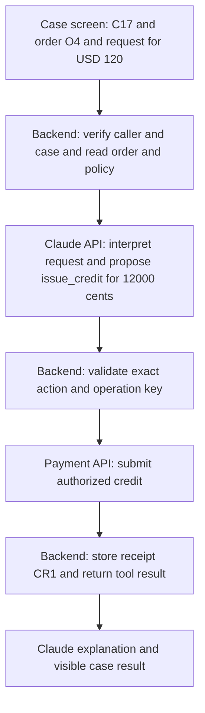

# Application architecture before Claude terminology

**Time:** 30–45 minutes, including your own drawing. **Next:** [the first action-service scenario](AS-01-action-service.md). This is an original introductory lesson; the examples and service policies are fictional.

## How to study this course

Read this primer to picture the parts; no setup is required. Then choose [one application case](README.md). Each case shows a small working version, introduces a failure, asks a technical exam-style decision and explains the repair simply after you choose. Open a diagram or term explanation without leaving the story. The question language will be technical because you need practice recognizing it; the teaching around it will explain what it means in ordinary words.

A practice answer is not a software installation task. Read or inspect examples unless a clearly marked runnable lab gives prerequisites and tells you to execute something. If you cannot explain who sends the data, who checks it and what proves the outcome, replay that layer before moving on.

## Start with something you can picture: a customer refund assistant

A support representative opens a damaged-delivery case. The customer says, **“Order O4 arrived damaged. Can you credit $120?”** The representative wants the system to find the order, check the rules, issue an authorized credit and show the result. Call the whole solution **Customer Refund Assistant**.

**That whole solution is the application.** The screen, program behind it, model, integrations and records work together to deliver one useful outcome. Claude is one component of this application; Claude is not the entire application. An application need not contain AI: a fixed returns form plus ordinary rules could solve a simpler version of this problem.

If Salesforce is familiar, picture a representative working from a **Case in a Service Console**, with customer/order information and an approval workflow. This is an analogy to that kind of business solution, not a claim that a configured Salesforce org or payment integration exists here. In a real design, some coordination might be implemented in Flow/Apex or an external service. Here we use fictional components to make the responsibility and data flow visible; no setup is required.

**Business name first:** Customer Refund Assistant. **Technical pattern afterward:** a backend service that can investigate a request and execute a guarded business action. The course calls this an **action service**. That label describes what part of the solution does; it is not another product you need to install.

## Name the parts and the data they exchange

Keep one fictional case throughout: `C17`, account reference `A9`, order `O4`, proposed credit **USD 120 = 12000 integer cents**, and eventual receipt `CR1`. IDs locate records; an ID supplied in a message does not prove identity or authority.

| What you can picture | Technical name | Example data entering → leaving |
|---|---|---|
| The representative's case/chat screen | Client or user interface (UI) | Case C17, order O4 and the customer's message → a visible credit result |
| The program coordinating the request | Application backend/service | Request and authenticated session → checked facts, model requests and controlled API calls |
| Customer, order, policy and operation records | Database or system of record | Order O4 lookup → owner A9; policy lookup → limit 18000 cents; operation lookup → prior receipt or none |
| Claude reading the complaint and proposing the next useful step | Model called through the Claude API | Relevant message, facts and available tool descriptions → a proposed tool call or explanation |
| A named function exposed to Claude, such as `issue_credit` | Client tool and its application implementation | Proposed case/order/amount → validated execution or rejection, then a correlated result |
| The interface to the payment provider | Downstream business API | An authorized credit request and operation key → receipt CR1 or an explicit failure/unknown outcome |

An **API** is an interface between programs: a request goes in and a response comes back. The Claude API and payment API have different jobs. A **tool** is a capability offered to the model; your client-tool implementation may call the payment API only after enforcing its own checks. They are not all names for the same component.

## Follow the same request from the screen to the receipt

Read the normal successful path first. You are inspecting the data, not being asked to write or run an application.

| Step | Who sends what to whom? | Concrete example and what it establishes |
|---|---|---|
| 1. Capture the request | Screen → backend | `{case_id: C17, order_id: O4, message: "O4 arrived damaged. Can you credit $120?"}`. This captures the request, not permission to act. |
| 2. Load trusted records | Backend ↔ records | The backend verifies the authenticated caller/case binding to A9, checks that O4 belongs to A9, reads the applicable policy and checks prior operation state. In this fixture the authorized policy permits this credit up to 18000 cents. Trusted checks come from the backend, not a model-supplied `verified=true`. |
| 3. Ask for interpretation | Backend → Claude API → backend | The backend supplies relevant complaint/order facts and the available tool descriptions. Claude proposes `issue_credit` with C17, A9, O4, `amount_minor: 12000`, `currency: USD` and operation key `C17:damage-credit`. A proposal is not an executed payment. |
| 4. Enforce, then act | Backend tool code → payment API | The service rechecks the exact account, amount, policy and duplicate-operation state at execution. Only if these checks permit the action does it submit the credit. |
| 5. Retain the actual outcome | Payment API → backend record | Successful outcome: receipt CR1 for this operation and 12000 USD cents. Save it so the application can distinguish a completed effect from an uncertain or repeated request. |
| 6. Explain what happened | Backend → Claude API → screen | Return the matching tool result with the receipt. Claude can now explain that the credit was issued. The application's visible result is grounded in CR1, not just a confident sentence. |

The braces above are abbreviated data sketches, not complete API payloads. Step 3 may include additional model/read-tool exchanges when investigation is needed. This first pass follows the already-supplied facts so you can see the whole application before adding complexity.

**Read the drawing:** the two backend boxes are responsibilities in the same application, not two required products. The diagram shows one successful path; if a check fails, do not send the payment. If submission times out, preserve an unknown outcome and reconcile its status before replaying. [AS-01](AS-01-action-service.md) teaches those branches in detail.

Connect this story to the actual Claude tool messages

A user-defined client tool has a `name`, `description` and `input_schema`. A model response can request that tool through a `tool_use` block; your application executes it and returns a `tool_result` carrying the matching `tool_use_id`. The returned content describes what actually happened. These protocol names connect the story to implementation; the fictional `issue_credit` function is not a built-in Anthropic refund API. See [tool definitions](https://platform.claude.com/docs/en/agents-and-tools/tool-use/define-tools) and [handling client-tool calls](https://platform.claude.com/docs/en/agents-and-tools/tool-use/handle-tool-calls). Server tools have a different execution owner.

## A cloud application is a chain of responsibilities

Now attach the general names to the example you have just followed. **State** is the application's current record of the operation: proposed, authorized, submitted, unknown or confirmed. **Observability** is the evidence showing what ran: case/operation IDs, checks, tool results and receipt or error. A **queue and worker** add a place to wait and a process to handle deferred work; this immediate refund example does not need one merely because cloud systems can have queues.

A cloud provider supplies places to run programs and store data. The architect first decides responsibilities and data flow, then chooses products. You do not need an AWS or Azure account to reason about this application.

**One-minute check before more terminology:** “C17 is the case; O4 is the order; Claude proposes; the backend checks and executes; CR1 is the recorded outcome.” Point to those five things in the drawing. The fictional IDs are tracking labels, not facts to memorize. If you cannot yet picture them, stay with this example and ask your coach to walk one row at a time; the general decision list below can wait.

## Probabilistic and deterministic describe different responsibilities

**Probabilistic judgment** is useful when inputs are messy: interpreting language, extracting candidate facts, drafting an explanation or choosing an investigation. The same prompt can produce different outputs, and an answer that looks certain may still be wrong.

**Deterministic control** executes a declared rule against given inputs: require a valid identity binding, reject an amount above an authorized limit, validate a field's type or match an operation ID. It only guarantees the predicate you correctly implemented under its assumptions. Bad input data, stale policy, faulty code, races or an unavailable dependency can still produce failure. Deterministic does not mean infallible.

**Human ownership** supplies policies, approvals, exception decisions and evaluations of ambiguous meaning. It does not mean a person must manually read every request. A person can define a rule that application code subsequently enforces.

In the same case, Claude proposes crediting **12000 cents (USD 120)**. Code checks that the current policy or approval covers this account, order, amount and action. A JSON schema can require `amount_minor` to be an integer; it cannot prove that 12000 is supported by the right evidence. [Structured output documentation](https://platform.claude.com/docs/en/build-with-claude/structured-outputs).

## How an architect sequences a decision

Start with the outcome, then ask these questions in order. Revisit earlier answers when new evidence changes them.

1. **What happens if this is wrong?** A draft can be revised; an external write may have a lasting effect. Decide the effect boundary before handing tools to a model.
2. **What is already known?** If all transformations are explicit rules, ordinary code may suffice. If the input requires interpretation, a model may help within that boundary.
3. **Which design is sufficient?** Compare a single model call, a fixed workflow, a routing step, parallel independent tasks and an adaptive agent. Additional agents are justified by the task, not by a desire for sophistication.
4. **Which steps depend on others?** Identity must precede an identity-dependent effect. Independent document analyses may run together. Asking for a particular tool does not enforce every later prerequisite.
5. **Where is the truth stored?** Save operation state, source identity and important constraints outside an ephemeral explanation when they must survive failure.
6. **What does success look like in evidence?** A model stopping, an API accepting a request and a business transaction completing are different observations.
7. **How does failure recover?** Separate no matching record, malformed input, denied permission, transient read failure and an uncertain write. They require different responses.
8. **How will we test the design?** Check outputs, traces and failure handling, including uncommon but consequential cases. Compare alternatives on quality, latency, cost and operational risk.

Anthropic distinguishes predefined workflows from agents that choose steps dynamically, and recommends adding complexity only when needed. Its engineering examples support this design progression; this course's eight applications and mnemonic are original teaching structures. [Building effective agents](https://www.anthropic.com/engineering/building-effective-agents).

## Four distinctions that prevent common mistakes

- **Tool choice versus enforcement:** forcing an extraction tool can constrain the selected capability; it does not establish a valid approval, a truthful amount or a whole workflow's ordering.
- **Model completion versus business completion:** `end_turn` can finish the model's turn while a payment is still unknown. An operation-status check is a separate responsibility.
- **Normal termination versus safety budget:** recognize the normal stop signal. Also bound resource use and route an exhausted budget to a visible stop or handoff. Reaching a turn cap is not evidence the task succeeded.
- **Saved conversation versus current truth:** retaining a session does not refresh an expired approval, changed source or modified repository. Revalidate mutable assumptions before continuing.

For long work, small relevant context and structured notes can help, but do not restore facts that were never retained. [Context engineering](https://www.anthropic.com/engineering/effective-context-engineering-for-ai-agents). For testing, inspect both outcomes and the run's evidence; an appealing final answer can conceal a wrong action. [Agent evaluations](https://www.anthropic.com/engineering/demystifying-evals-for-ai-agents).

## Try it before moving on

Draw the refund service yourself. Label the place that interprets the request, the place that authorizes the effect, the durable operation record and the human exception path. Then change the requirement to “draft a suggested reply, with no action tool.” Explain which controls remain necessary and which parts of the design can be simplified.

**Conversation prompt:** “Begin with Customer Refund Assistant and the C17/O4/12000/CR1 example. Ask me to identify the whole application, its parts and one message moving between them before asking architecture-choice questions. Teach me as someone new to application architecture. Give me one requirement at a time. Ask me who owns its decision, what the prerequisite is, and how I would know it succeeded. Wait for my answer. Use the fictional case, not remembered exam questions. If I say ‘a prompt guarantees it,’ ask me to identify the executable predicate and its assumptions.”

[Continue to the eight-application route](README.md).

## How to read technical examples in this course

Start in reading mode: no software setup is required for the primer or application paper exercises. A **contract** defines accepted inputs, outcomes and responsibilities; a **schema** expresses structural rules; a **prompt** guides model behavior; **pseudocode** describes logic without being executable. An **illustrative invocation** shows how options fit together but may require files, authentication and version checks before it can run. Only an explicitly runnable lab supplies execution instructions and prerequisites.

For every artifact ask: why is it here, who consumes it, what fields or switches express the design, what enforces the rule, and what evidence would show it worked? Keep the ordinary-language purpose beside the technical mechanism. For example, “return the lookup outcome to the right request” becomes matching a `tool_result` to its `tool_use_id`; “the model finished speaking” becomes inspecting the stop reason, while a business receipt is separate evidence of completion.

A proposed call is not a tool definition. In a user-defined Claude client tool, `name`, `description` and `input_schema` describe the available capability; a model request selects the tool and supplies inputs; your client executes it and returns the correlated outcome. Compare these roles rather than memorizing a fictional wrapper. [Official tool definitions](https://platform.claude.com/docs/en/agents-and-tools/tool-use/define-tools) and [handling calls](https://platform.claude.com/docs/en/agents-and-tools/tool-use/handle-tool-calls) describe the actual interface. Current documentation may include mechanisms beyond the saved exam guide; the saved objective remains the scope anchor.