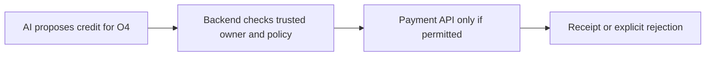
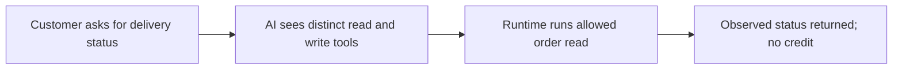
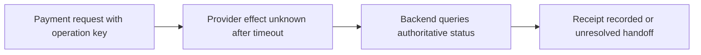
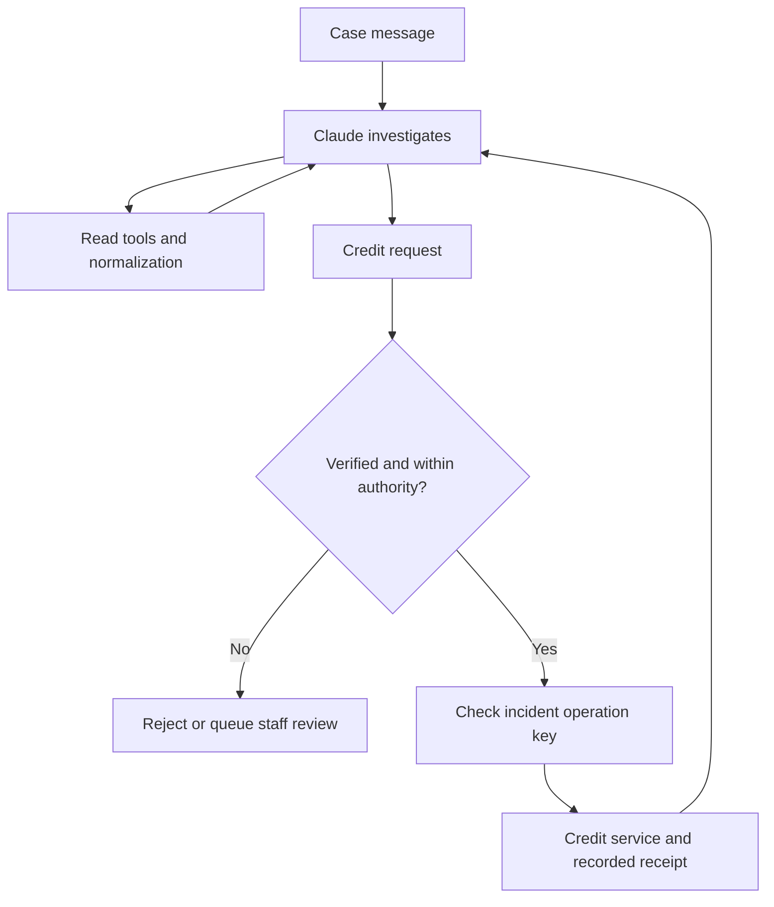

# AS-01 — Architect a support action service

**Picture the application: Help a customer with a damaged order.** A representative receives case C17: order O4 arrived damaged and the customer asks for USD 120. This application turns the complaint plus trusted order/policy records into a credit receipt or an explicit blocked/review outcome. “Action service” is the pattern name for the guarded action, not a separate product.


**Original application teaching case.** The layered reading path is part of the current teaching revision; independent review of this revision is tracked separately. Foundation → applied design → production failure recovery. Allow 60 minutes plus a two-minute explanation. All data are fictional. No external service or payment is executed. Production controls below enrich the saved exam objectives; they are not promises about a particular SDK version.


## Before you begin — study mode and prerequisites

**Mode: guided reading and paper reasoning.** No installation, API key, cloud account, repository checkout or terminal command is required to read this lesson or complete its supplied paper exercise. Read the [application primer](00-foundations.md) first if client, backend, tool, state or authorization is unfamiliar. You may open this case directly; earlier application cases are helpful, not a hidden setup dependency.

**Your task:** explain the design and trace the supplied examples. Code-shaped blocks are labeled below so you can distinguish a proposed request, schema, prompt, pseudocode and an illustrative invocation. The optional [local companion lab](../../../06-Labs/08-CCAR-F-architecture-decisions/README.md) has its own Python prerequisites. The separate API/MCP labs require their own setup; completing this reading does not imply running those integrations.

## Start with the application

A small outdoor-equipment retailer asks: “Explain delivery problems and credit an eligible customer without making them repeat their story.” The website sends a case message to your service, a program running behind the chat interface. Claude can interpret the complaint; tools are named functions your program exposes. A database stores authoritative account and order records. A queue holds cases awaiting a person.

Constraints: credits above 180 USD require staff approval; account verification must precede any credit; one credit per incident; carrier data have inconsistent dates. Inputs are case `C17`, claimed account `A9`, order `O4`, a delivered-but-damaged complaint, and a candidate credit of 120 USD. The model's text is neither proof of identity nor a transaction receipt.

## Learn this application one failure at a time

**Reading exercise — no setup or execution.** These are original exam-style practice decisions, not live exam questions or newly graded bank items. Read the situation, choose A/B/C aloud or on paper, then open the explanation. These checks do not update your stored practice score. Plain explanations follow the technical question; the reference material below remains available for a deeper pass.

### First, picture the simple version

The representative asks about damaged order O4. The backend reads the order and policy; Claude explains the evidence. A read-only explanation works before any money-moving capability exists.

**Follow the data:** Case C17 and order O4 → trusted ownership/policy lookup → explanation. Later layers add guarded credit execution and recovery; the customer message never becomes proof of permission.

<figure class="concept-flow"><figcaption>Keep this same application in view as each failure adds one justified repair. Read the detailed traces below before opening the existing full architecture drawing.</figcaption><ol><li><strong>Small success</strong><span>One request and an observable result</span></li><li><strong>New failure</strong><span>One assumption no longer holds</span></li><li><strong>Your decision</strong><span>Compare technical mechanisms</span></li><li><strong>Repair and replay</strong><span>Inspect evidence, not assurance</span></li></ol></figure>

### Layer 1 — A request becomes an unsafe action

The first demo exposes issue_credit beside lookup_order. The message claims account A9, but the login has not established ownership. Claude proposes a USD 120 credit.

**AS01-LAYER-1 — Original exam-style practice. Choose ONE.** Which design most reliably enforces account verification before a side-effecting credit tool executes?

A. Require the prompt to state that verification precedes credit and let the model maintain the verified flag.

B. Enforce trusted ownership and current policy predicates in the execution handler; expose dependent capabilities only when appropriate.

C. Force issue_credit through tool_choice because the requested operation is unambiguous.

<details><summary>What is this asking? — optional plain-language aid</summary>

Identify the specific problem in this scene, then compare what each proposed change actually controls. Explain which option fixes that problem without assuming a completed action, trustworthy fact or permission that the evidence has not established. Choose before opening the worked answer.

</details>

<details><summary>I have chosen — reveal layer 1, its repair and proof</summary>

**Answer: B.** The program that can move money must check the real account records immediately before doing so. B enforces that boundary. A is guidance that can be missed or supplied with false state. C selects a proposed call; it neither verifies the account nor authorizes payment.

**Replay the changed path:** Before: claimed A9 → proposed issue_credit(O4,12000) → would execute. After: session owner differs from O4 owner → rejected, zero payment calls; matching owner plus eligible policy → one submitted credit. Inspect the backend rejection and payment-call count, not Claude’s assurance.

**See the repaired path — AI proposes; software executes the stated checks:**



**Connect the terms:** Execution-time authorization = the money-moving program checks permission at the moment of action. tool_choice = control over which tool the model may request.

**Name the owner:** Say which part proposes or explains, which part checks or executes, and which record demonstrates the result. Point to the changed step in the trace before moving to the next layer.

</details>

### Layer 2 — Two similar tools invite the wrong choice

After access checks, the model must decide between lookup_order and issue_credit. Their old descriptions both say “handle an order.” A customer asks only whether the damaged order was delivered.

**AS01-LAYER-2 — Original exam-style practice. Choose ONE.** What is the most appropriate first remediation for repeated selection of the write tool on read-only delivery questions?

A. Give each tool a distinct purpose, input contract, side-effect description and usage boundary, and limit tools to the agent’s task.

B. Always force issue_credit so the model does not have to choose.

C. Add more examples while keeping identical descriptions and all tools universally available.

<details><summary>What is this asking? — optional plain-language aid</summary>

Identify the specific problem in this scene, then compare what each proposed change actually controls. Explain which option fixes that problem without assuming a completed action, trustworthy fact or permission that the evidence has not established. Choose before opening the worked answer.

</details>

<details><summary>I have chosen — reveal layer 2, its repair and proof</summary>

**Answer: A.** A makes the available choices distinguishable: one fetches evidence; the other changes a financial record. B forces the wrong capability for this request. C can help only after the interface makes sense; it leaves the central ambiguity and excess access intact.

**Replay the changed path:** Read question: “Was O4 delivered?” → lookup_order → delivered/damaged evidence → answer, zero credits. Action request: “Credit the eligible loss” → policy and permission checks → proposed credit. The same order ID can support different jobs.

**See the repaired path — AI proposes; software executes the stated checks:**



**Connect the terms:** Tool interface = the name, explanation and allowed inputs shown to the model. Side effect = a change outside the conversation.

**Name the owner:** Say which part proposes or explains, which part checks or executes, and which record demonstrates the result. Point to the changed step in the trace before moving to the next layer.

</details>

### Layer 3 — A timeout leaves the outcome unknown

The provider accepts an eligible credit but the network response is lost. The backend sees a timeout and has no receipt yet.

**AS01-LAYER-3 — Original exam-style practice. Choose ONE.** Which recovery strategy best avoids duplicating a potentially completed financial operation?

A. Treat every timeout as failure and create a fresh operation identifier.

B. Ask Claude whether it thinks the payment probably succeeded.

C. Retain the operation identity and reconcile provider status before deciding whether a supported idempotent replay is safe.

<details><summary>What is this asking? — optional plain-language aid</summary>

Identify the specific problem in this scene, then compare what each proposed change actually controls. Explain which option fixes that problem without assuming a completed action, trustworthy fact or permission that the evidence has not established. Choose before opening the worked answer.

</details>

<details><summary>I have chosen — reveal layer 3, its repair and proof</summary>

**Answer: C.** A lost reply does not tell us whether the payment happened. C asks the system holding the transaction record. A can create a second credit. B has no new transaction evidence. A replay is safe only under the receiving system’s actual operation-key rules.

**Replay the changed path:** Operation credit-C17-O4 → timeout → status lookup → receipt CR1 → mark confirmed and return that receipt. If status remains unknown, keep a pending/review state; do not say “refunded.”

**See the repaired path — AI proposes; software executes the stated checks:**



**Connect the terms:** Reconciliation = checking authoritative records to learn what happened. Idempotency = a supported rule that repeated requests for one logical operation do not create repeated effects.

**Name the owner:** Say which part proposes or explains, which part checks or executes, and which record demonstrates the result. Point to the changed step in the trace before moving to the next layer.

</details>

### Change one constraint — transfer the decision

**AS01-TRANSFER — Original exam-style practice. Choose ONE.** The next request is only a fixed order-status screen, with no open-ended investigation. Which architecture should be considered first?

A. A deterministic authenticated lookup and rendering workflow.

B. The full coordinator/specialist architecture used for a disputed refund.

C. A model-only answer from past conversation.

<details><summary>Reveal the changed-constraint reasoning</summary>

**Answer: A.** A solves the bounded job with fewer moving parts. B needs a demonstrated investigation requirement; C lacks current trusted order facts.

Before continuing, name the condition that changed and explain why the previous design should be retained, simplified or replaced. A remembered answer letter is not the transferable skill.

</details>

### Explain it back and continue

Close the answers. In one minute, tell the story as **request → failure → choice → repair → evidence**. Use ordinary words, then name the technical mechanism. If a step is unclear, revisit that layer before attempting the independent practice below.

**Exact objective drilldowns:** [1.4](../objectives/objective-1.4.md) · [2.1](../objectives/objective-2.1.md) · [2.3](../objectives/objective-2.3.md). These links identify relevant tasks; they do not assert that this single story assesses every knowledge/skill bullet.

**Continue the application:** [next connected case](AS-02-document-pipeline.md). [Return to the application gallery](../architecture-studio/README.md) · [CCAR-F starting page](../../../01-Curriculum/02-Architect-Track/CCAR-F.md). The existing lab/SIM and reference links later on this page provide the deeper and independent checks.

## Reference and deeper walkthrough

The sections below retain the detailed mechanisms, artifacts and exercises. Use them to inspect a layer after trying its decision; they are not prerequisites to understanding the first scene.


## Connect the simple explanation to technical design choices

Read each row left to right, then explain the technical choice back in plain language. These are original training contrasts using documentation terminology, not quotations or predictions of exam answers. Mechanisms outside the saved objectives are production context, not newly asserted exam requirements.

| In plain language | Technical terms to recognize | Choose between mechanisms using this signal |
|---|---|---|
| Let the model investigate, but keep money movement guarded | Agentic tool selection within an application-enforced workflow | Compare a fixed workflow, an adaptive agent and a prompt-only restriction. Variable investigation supports an agent; authorization remains a backend predicate. |
| Make verification a prerequisite, rather than a suggestion | State-dependent tool exposure; execution-time authorization; tool_choice | Choosing or forcing a tool controls a model request. It does not prove a successful verification or authorize its dependent write. |
| Clean up returned dates; block an unsafe action before it happens | PostToolUse normalization versus PreToolUse/in-tool validation | After-execution transformation cannot prevent the effect just performed. Use an adapter for one integration; a shared hook for cross-tool policy. |
| Check what happened before repeating an uncertain payment | Idempotency key, reconciliation and tool-result correlation | Distinguish a failed attempt from an unknown remote effect. A tool_result with matching tool_use_id connects evidence to a call; a receipt establishes the business outcome. |


## Decide the boundaries in order

1. **Choose a fixed action boundary with adaptive investigation.** Option A lets Claude choose helpful read tools but sends mutations through a guarded service. Option B is a fully fixed form workflow. Choose A because complaint details vary; choose B instead if only one standardized return reason is supported and a form is sufficient. More autonomy would add investigation cost without improving that narrower task. [Workflow/agent distinction](https://www.anthropic.com/engineering/building-effective-agents) (primary source).
2. **Put identity in trusted case state.** `verify_account` records a verified account/case binding. `issue_credit` checks that binding itself. A prompt saying “verify first” teaches the agent; executable rejection enforces the prerequisite. Hiding the credit tool until verification reduces accidental choices but does not replace the server-side check if the tool remains reachable elsewhere. Tool-choice configuration concerns what the model requests; even a forced first call does not establish verified identity or enforce every later step. Application state checks own that ordering guarantee. Staff own exceptional identity resolution.
3. **Normalize after reads, guard before writes.** A result adapter converts carrier epoch seconds and vendor status codes into documented fields while preserving raw evidence. This is the purpose of a PostToolUse-style normalization stage; see [SDK hook timing](https://code.claude.com/docs/en/agent-sdk/hooks) for the implementation boundary, whose callback fields remain version-sensitive. It cannot stop a credit already executed. A pre-action guard checks identity, amount, policy and duplicate incident state. Choose a simple in-tool adapter over a hook when only one integration needs conversion; use a shared hook boundary when several tools need the same normalization policy.
4. **Make retries state-aware.** A timeout after credit submission may mean the credit succeeded remotely. Look up the incident's operation key before retrying; never infer failure from missing acknowledgement. Staff own unresolved reconciliation. The application owns the audit record and rejection logic; Claude owns explanation and investigation choices within that boundary.



Text procedure: receive the case; gather relevant facts; normalize successful reads; validate the proposed action at execution; deduplicate by incident; execute or reject; return the actual receipt or unresolved status; let Claude explain the result.

## Read the tool contract — connect the design to its interface

**Why this appears here:** This example makes the guarded credit decision concrete: what the model may request, and what the service must independently check. A contract is an agreement about accepted inputs, outcomes and responsibility; it is not a legal contract. Read the JSON as a proposed request, not code to run.

**What to do now:** Trace case_id/account_id to the trusted binding, amount_minor to the policy check, and operation_key to duplicate detection. Predict rejection before verification and the same receipt after a safe repeat. The names and wrapper are fictional application fields; a real Claude tool definition separately uses name, description and input_schema.

**Mode: inspect and trace; no execution required.** Identify the input, the rule applied by its owner, and the observable outcome. The worked paper exercise below supplies the data.

**Example proposed application request.** This abbreviated wrapper is not a Claude API message or a complete tool definition:

```json
{"tool":"issue_credit","input":{"case_id":"C17","account_id":"A9","order_id":"O4","amount_minor":12000,"currency":"USD","operation_key":"C17:damage-credit"}}
```

The amount is integer cents. The service reads verification and policy from trusted state, not model-supplied booleans. A useful prompt fragment is: “Investigate each concern. Explain blocked actions honestly. Do not state that a credit occurred unless a successful receipt identifies this operation.” Tools return results linked to the original request; the model then decides what to do next. [Tool-call handling](https://platform.claude.com/docs/en/agents-and-tools/tool-use/handle-tool-calls) (primary source). That continuation is an agent loop, not a fixed count of three calls. A budget or maximum-iteration safeguard may halt a runaway loop, but marks interruption or handoff rather than successful business settlement. Normal model completion, budget halt and confirmed credit settlement are separate states. Correct guards depend on tested code and trustworthy policy inputs, not a magic guarantee of semantic correctness.

## LAB — safe fixture execution on paper

This section is a paper design/trace exercise. [Run the separate local Python companion](../../../06-Labs/08-CCAR-F-architecture-decisions/README.md) to observe a small deterministic boundary; then use the existing API/MCP labs for real tool-call practice.


Use these complete fixtures: verified bindings initially empty; policy maximum 18000 cents; receipts empty. Request R1 is the JSON above. R2 sets the same request after verification records `(C17,A9)`. R3 repeats R2. R4 requests 21000 cents with a different incident key. Carrier fixture `{epoch_seconds:0,status_code:7}` has a supplied vendor contract: UTC epoch seconds, code 7 means delivered.

Produce a table of input, state change and output. Expected: R1 returns `prerequisite_missing`, no receipt. R2 returns one synthetic receipt `CR1`, adding the operation key. R3 returns the same receipt, no second credit. R4 returns `staff_review_required`, no additional receipt. Carrier output is `1970-01-01T00:00:00Z`, `delivered`, plus original fields. Unknown code 8 stays unknown; never guess its meaning. Record this trace as evidence of reasoning, not a live implementation test.

## SIM — blind transfer, close the LAB first

A repair-parts distributor now permits credits up to 9000 cents. Verification for case `C22` belongs to account `A2`; a credit request names `A3`. An invoice timestamp is milliseconds; its adapter expects seconds.

**AS01-Q1 — choose one:** What happens first? A: Execute because amount is below limit. B: Reject the identity mismatch before the side effect. C: Let the model set `verified=true`.

**AS01-Q2 — ordering:** Arrange: A append linked result; B inspect tool request; C validate and execute or reject; D ask Claude for the next decision. Give four letters.

**AS01-Q3 — select exactly two:** A normalize units using the vendor contract; B use PostToolUse to prevent an already-issued credit; C check receipt state before retrying an uncertain write; D stop the loop whenever assistant prose exists.

<details><summary>Coach key — open after committing answers</summary>

Q1: **B**. A ignores account binding; C lets an untrusted assertion create authority. Counterfactual: a matching trusted binding and valid policy permit execution, not automatic rejection.

Q2: **B,C,A,D**. Inspect identifies requested execution; validation precedes effects; the linked result informs the next model turn. A cannot precede the outcome and D without A loses evidence. Counterfactual: `end_turn` normally completes the turn without dispatching a new tool.

Q3: **A,C**. A fixes a representation error; C handles ambiguous remote outcome. B has the wrong timing; D confuses presentation with protocol. Counterfactual: for an entirely read-only reporting assistant, no credit guard is needed, but accurate normalization remains necessary.

</details>

## Connect and explain

Objectives: [1.1 loop](../objectives/objective-1.1.md), [1.4 gates/handoffs](../objectives/objective-1.4.md), [1.5 hooks](../objectives/objective-1.5.md), [2.2 errors](../objectives/objective-2.2.md). Variant: [support walkthrough](../scenario-walkthroughs/WT-01-customer-support-agent.md). Revisit [hard drills](../HARD-DRILLS.md) by these objective tags; no result here establishes readiness.

**Two-minute conversation coach:** Ask a partner, “Where could money move without verification?” Listen before explaining. In 30 seconds distinguish judgment, executable checks and staff ownership; in 60 seconds trace the ambiguous timeout; in 30 seconds explain when a fixed form is better. The listener should be able to name the authoritative receipt and the pre-action boundary. Checked primary references 2026-10-17; SDK wiring requires separate validation.


[Previous: architecture foundations](00-foundations.md) · [Application route](README.md) · [Next application](AS-02-document-pipeline.md)