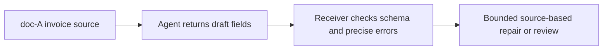
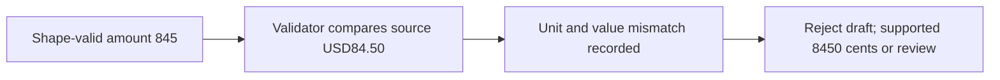
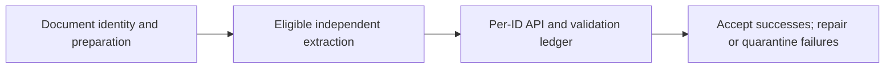
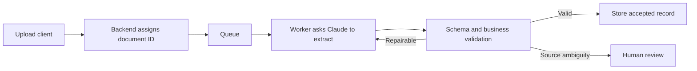

# AS-02 — Architect an invoice-intake pipeline

**Picture the application: Turn an invoice into a record someone can review.** An uploaded invoice EL-8 says USD 84.50 and shows no purchase-order number. This application proposes 8450 cents and an explicit missing PO, then checks whether the record can be accepted or needs review. That sequence is the “document pipeline”; it does not pay the invoice.


**Original application teaching case.** The layered reading path is part of the current teaching revision; independent review of this revision is tracked separately. Allow 60 minutes: foundation, applied fixture, then production failure analysis. All invoices and policies are fictional. No payment, API or customer system is used. The saved exam's structured extraction and validation objectives are the baseline; queue recovery and operation reconciliation are production enrichment.


## Before you begin — study mode and prerequisites

**Mode: guided reading and paper reasoning.** No installation, API key, cloud account, repository checkout or terminal command is required to read this lesson or complete its supplied paper exercise. Read the [application primer](00-foundations.md) first if client, backend, tool, state or authorization is unfamiliar. You may open this case directly; earlier application cases are helpful, not a hidden setup dependency.

**Your task:** explain the design and trace the supplied examples. Code-shaped blocks are labeled below so you can distinguish a proposed request, schema, prompt, pseudocode and an illustrative invocation. The optional [local companion lab](../../../06-Labs/08-CCAR-F-architecture-decisions/README.md) has its own Python prerequisites. The separate API/MCP labs require their own setup; completing this reading does not imply running those integrations.

## Understand the application before choosing a model

A facilities company asks: “Turn incoming invoices into reviewable accounting records.” Its client is the upload screen. The backend receives documents and records a document identifier. A worker is a background program that processes queued jobs without making the browser wait. Claude proposes extracted fields. A database stores records and review status. A staff reviewer resolves ambiguity; a separate authorized process, outside this lesson, makes payments.

Inputs: invoice text `Vendor: Example Lamps; Invoice: EL-8; Total: USD 84.50; PO: not shown`. Constraints: preserve missing purchase orders, never infer tax from total, prevent duplicate intake, and do not accept unsupported currency. The output must distinguish “absent on source” from “not yet extracted.” Syntax alone cannot settle those meanings.

## Learn this application one failure at a time

**Reading exercise — no setup or execution.** These are original exam-style practice decisions, not live exam questions or newly graded bank items. Read the situation, choose A/B/C aloud or on paper, then open the explanation. These checks do not update your stored practice score. Plain explanations follow the technical question; the reference material below remains available for a deeper pass.

### First, picture the simple version

One invoice EL-8 says USD 84.50 and shows no purchase-order number. An extraction proposes a draft accounting record. The clerk can inspect it; no payment is made.

**Follow the data:** Source doc-A → extraction proposal → receiving validator → accepted record or named review reason. The receiving program, not the sending agent, decides acceptance.

<figure class="concept-flow"><figcaption>Keep this same application in view as each failure adds one justified repair. Read the detailed traces below before opening the existing full architecture drawing.</figcaption><ol><li><strong>Small success</strong><span>One request and an observable result</span></li><li><strong>New failure</strong><span>One assumption no longer holds</span></li><li><strong>Your decision</strong><span>Compare technical mechanisms</span></li><li><strong>Repair and replay</strong><span>Inspect evidence, not assurance</span></li></ol></figure>

### Layer 1 — The handoff cannot be read

The extraction agent hands its result to the intake worker. The worker requires invoice_id, integer total_minor, currency and a purchase_order key that permits null. It receives a missing PO key and total_minor 84.5.

**AS02-LAYER-1 — Original exam-style practice. Choose ONE.** Which receiving-boundary design best addresses the contract violation without fabricating invoice data?

A. Round 84.5 to 85 and replace missing purchase_order with an invented placeholder.

B. Validate the output contract, return field-specific repair feedback with the source, and cap repair attempts.

C. Accept any parseable JSON because the extraction agent completed successfully.

<details><summary>What is this asking? — optional plain-language aid</summary>

Identify the specific problem in this scene, then compare what each proposed change actually controls. Explain which option fixes that problem without assuming a completed action, trustworthy fact or permission that the evidence has not established. Choose before opening the worked answer.

</details>

<details><summary>I have chosen — reveal layer 1, its repair and proof</summary>

**Answer: B.** B tells the sender exactly what is unusable and allows a bounded correction against the invoice. The document supports 8450 cents and an explicit null PO. A changes money and invents a value. C confuses a readable notation with an acceptable record.

**Replay the changed path:** Received: {invoice_id: EL-8, total_minor: 84.5, currency: USD}. Validator: integer cents required; purchase_order key missing. Corrected from doc-A: {invoice_id: EL-8, total_minor: 8450, currency: USD, purchase_order: null}. No accounting record is accepted before checks pass.

**See the repaired path — AI proposes; software executes the stated checks:**



**Connect the terms:** Schema = agreed keys and allowed value types. Required nullable property = the key must exist, while its value may explicitly mean absent.

**Name the owner:** Say which part proposes or explains, which part checks or executes, and which record demonstrates the result. Point to the changed step in the trace before moving to the next layer.

</details>

### Layer 2 — A readable handoff is still wrong

The next result has all required keys and integer cents, but it says 845 rather than the invoice’s 8450 cents. Another source shows both USD 30 and a correction to USD 35 without indicating which governs.

**AS02-LAYER-2 — Original exam-style practice. Choose ONE.** What additional acceptance policy is most appropriate after schema validation succeeds?

A. Treat a valid integer as evidence that the amount was extracted correctly.

B. Force a specific extraction tool and accept its result without further checks.

C. Check source agreement and units, and route unresolved source conflicts for review rather than selecting a plausible value.

<details><summary>What is this asking? — optional plain-language aid</summary>

Identify the specific problem in this scene, then compare what each proposed change actually controls. Explain which option fixes that problem without assuming a completed action, trustworthy fact or permission that the evidence has not established. Choose before opening the worked answer.

</details>

<details><summary>I have chosen — reveal layer 2, its repair and proof</summary>

**Answer: C.** C checks meaning: 845 cents is USD 8.45, not USD 84.50. A shape check cannot prove that relation. B controls selection, not source truth. When the source itself is unclear, another generation is not permission to guess.

**Replay the changed path:** EL-8: source USD 84.50 → expected 8450 → proposed 845 → reject unit/value mismatch. EL-10: competing totals → needs_review with both source locations → no accepted total until a person resolves the governing value.

**See the repaired path — AI proposes; software executes the stated checks:**



**Connect the terms:** Semantic validation = checking what values mean against evidence and business rules. A source conflict differs from a formatting defect.

**Name the owner:** Say which part proposes or explains, which part checks or executes, and which record demonstrates the result. Point to the changed step in the trace before moving to the next layer.

</details>

### Layer 3 — The intake grows from one file to many

Tomorrow’s archive contains many documents. A clear PDF, an unreadable scan and a valid source whose API request failed need different next steps.

**AS02-LAYER-3 — Original exam-style practice. Choose ONE.** Which recovery design best preserves completed work while handling heterogeneous document failures?

A. Maintain per-source preparation, API, validation and downstream states; preserve successes and repair, retry or quarantine by failure cause.

B. Resubmit the entire archive after any item fails and identify outputs by returned position.

C. Mark the archive complete when the batch reaches a terminal processing status.

<details><summary>What is this asking? — optional plain-language aid</summary>

Identify the specific problem in this scene, then compare what each proposed change actually controls. Explain which option fixes that problem without assuming a completed action, trustworthy fact or permission that the evidence has not established. Choose before opening the worked answer.

</details>

<details><summary>I have chosen — reveal layer 3, its repair and proof</summary>

**Answer: A.** A retains what worked and describes the remaining work honestly. An unreadable scan needs preparation or review; a temporary service failure may permit bounded retry; a validated result still needs downstream acceptance. B risks duplicate work and mismatching results. C hides individual failures.

**Replay the changed path:** doc-A: validated/accepted. doc-B: unreadable/quarantined. doc-C: transient API error/retry_pending. Three sources remain three ledger rows; only A is downstream-complete. Match API results by stable request identifiers, not their order.

**See the repaired path — AI proposes; software executes the stated checks:**



**Connect the terms:** Per-item ledger = a small record of where each file stands. Terminal batch status = processing stopped, not every invoice succeeded.

**Name the owner:** Say which part proposes or explains, which part checks or executes, and which record demonstrates the result. Point to the changed step in the trace before moving to the next layer.

</details>

### Change one constraint — transfer the decision

**AS02-TRANSFER — Original exam-style practice. Choose ONE.** The receiving application changes its contract so an absent purchase order may be omitted. What should change?

A. Keep claiming omission is always invalid JSON.

B. Version and validate the agreed consumer contract; allow omission only under the new documented rule.

C. Invent PO values to avoid both null and omission.

<details><summary>Reveal the changed-constraint reasoning</summary>

**Answer: B.** B follows the real agreement. Omission is not inherently malformed JSON; it was invalid under the earlier required-property contract. C fabricates evidence.

Before continuing, name the condition that changed and explain why the previous design should be retained, simplified or replaced. A remembered answer letter is not the transferable skill.

</details>

### Explain it back and continue

Close the answers. In one minute, tell the story as **request → failure → choice → repair → evidence**. Use ordinary words, then name the technical mechanism. If a step is unclear, revisit that layer before attempting the independent practice below.

**Exact objective drilldowns:** [4.3](../objectives/objective-4.3.md) · [4.4](../objectives/objective-4.4.md) · [4.5](../objectives/objective-4.5.md) · [5.5](../objectives/objective-5.5.md). These links identify relevant tasks; they do not assert that this single story assesses every knowledge/skill bullet.

**Continue the application:** [next connected case](AS-03-grounded-assistant.md). [Return to the application gallery](../architecture-studio/README.md) · [CCAR-F starting page](../../../01-Curriculum/02-Architect-Track/CCAR-F.md). The existing lab/SIM and reference links later on this page provide the deeper and independent checks.

## Reference and deeper walkthrough

The sections below retain the detailed mechanisms, artifacts and exercises. Use them to inspect a layer after trying its decision; they are not prerequisites to understanding the first scene.


## Connect the simple explanation to technical design choices

Read each row left to right, then explain the technical choice back in plain language. These are original training contrasts using documentation terminology, not quotations or predictions of exam answers. Mechanisms outside the saved objectives are production context, not newly asserted exam requirements.

| In plain language | Technical terms to recognize | Choose between mechanisms using this signal |
|---|---|---|
| Keep a stable column without inventing a value | Required property versus optional property; nullable type | A required nullable field is present with null when unsupported. Omission is suitable only if the consumer permits an absent property. |
| Ask for valid structure, then check meaning | Schema-constrained output versus semantic/business validation | A conforming schema does not establish source agreement, arithmetic consistency or authorization. |
| Choose which tool may be requested | tool_choice auto / any / named tool, where supported | Selection policy is different from prerequisite ordering. Force a named tool only when that specific call is appropriate and the selected API/model supports it. |
| Repair a specific defect without looping indefinitely | Targeted validation feedback and bounded repair | Retry a recoverable formatting defect with concrete feedback; preserve unresolved source conflict for review rather than repeatedly generating a plausible value. |


## Make the architecture decisions

1. **Choose an asynchronous worker over a chat agent.** Extraction has a known sequence: identify document, extract, validate, review or store. A worker can retry a job and retain state. A chat loop is a credible alternative when staff need to ask interactive follow-up questions about one document. Reverse the decision for that small interactive workflow; do not build conversational orchestration merely to process a fixed folder. [Fixed workflows](https://www.anthropic.com/engineering/building-effective-agents) support predictable stages, while adaptive agents address unknown steps.
2. **Separate shape from truth.** A schema defines field names and allowed values. An explicit `null` communicates that a field lacks a supported value under the contract; omission means the property is absent. If a consumer requires a stable column, require that property while permitting null. Strict schema-constrained generation helps enforce structure but does not prove that 8450 cents matches the invoice. Application validation and source evidence still matter. [Structured outputs](https://platform.claude.com/docs/en/build-with-claude/structured-outputs) (primary source; supported schemas and interfaces are version-sensitive).
3. **Validate independently before acceptance.** The model judges source meaning and flags uncertainty. Code checks currency, integer units, required properties and duplicate document identity. A reviewer owns conflicting totals or unreadable text. Code only guarantees the checks actually implemented against correct inputs; a bad exchange-rate table or wrong document identity still produces wrong business behavior.
4. **Repair selectively.** If a field fails validation, return that field, source excerpt and error for a targeted correction. Do not repeatedly extract the entire corpus after one malformed record. If the source truly lacks a PO, another prompt cannot manufacture it. Accept the missing state or route it according to policy, rather than treating every null as an extraction failure.



Text procedure: save source identity; queue one job; extract with evidence; validate structure and business constraints; repair only supported errors; store an accepted record or a specific review reason. Keep job completion separate from invoice approval.

## Read the extraction contract and prompt

**Why this appears here:** The invoice design needs a precise definition of an acceptable record. This schema turns “usable fields” into a checkable structure; the prompt explains how to interpret missing evidence. Neither proves that the invoice was read correctly.

**What to do now:** Compare required presence with nullable value, then trace total cents to the supplied source and business validation. Predict a structurally valid but factually conflicting record.

**Mode: inspect and trace; no execution required.** Identify the input, the rule applied by its owner, and the observable outcome. The worked paper exercise below supplies the data.

This is an application schema illustration; check current provider schema support before deployment:

```json
{"type":"object","properties":{"invoice_id":{"type":"string"},"total_minor":{"type":"integer"},"currency":{"type":"string","enum":["USD"]},"purchase_order":{"type":["string","null"]}},"required":["invoice_id","total_minor","currency","purchase_order"],"additionalProperties":false}
```

Prompt artifact: “Extract only from the supplied invoice. Report total in cents. For a purchase order absent from the source, return null. Never derive an unstated tax amount. Return only the fields in the declared extraction schema.” A production contract should explicitly define extraction-failed status rather than overloading null to mean both absence and failure. The backend retains the source record and a separate evidence association so a person can check the interpretation. If the model must return an evidence map, add that map explicitly to its output contract rather than requesting undeclared fields from this minimal schema.

## Tool selection is not prerequisite ordering

Suppose intake exposes `extract_invoice` and `enrich_vendor`. With `tool_choice: {"type":"auto"}`, Claude may answer without requesting a tool. With `tool_choice: {"type":"any"}`, supported configurations require some available tool, but not necessarily extraction. Named selection requests a specific tool:

```json
{"tool_choice":{"type":"tool","name":"extract_invoice"}}
```

This is an illustrative request fragment, not a complete API call. On compatible models it can select extraction first. The worker still executes it, receives and validates the result, and only then exposes or invokes enrichment in a subsequent step. The enrichment handler checks trusted `validated_extraction_id`; the model cannot create that state by supplying a plausible identifier. Thus selection chooses a request, while application state enforces the dependency. Under our invoice constraints, the fixed worker sequence is simpler and safer than relying solely on forced selection.

**When the choice reverses:** For an exploratory assistant where either explanation or lookup is acceptable, `auto` fits. If any one of several supported extraction tools is acceptable, `any` can fit. If a particular first tool is required and supported, named choice can reduce selection ambiguity. Current models and thinking configurations differ in forced-tool support: check [Define tools](https://platform.claude.com/docs/en/agents-and-tools/tool-use/define-tools) before using `any` or named selection. An unsupported setting is a configuration error, not an ordering guarantee. [Objective 2.3](../objectives/objective-2.3.md) covers this distinction.

## Paper lab — supplied inputs and expected outcomes

This section is a paper design/trace exercise. [Run the separate local Python companion](../../../06-Labs/08-CCAR-F-architecture-decisions/README.md) to observe a small deterministic boundary; then use the existing API/MCP labs for real tool-call practice.


Use three complete synthetic inputs:

- `doc-A`: `Example Lamps; Invoice EL-8; Total USD 84.50; no PO shown`.
- `doc-B`: `Example Lamps; Invoice EL-9; Total USD 20.00; PO P-7`.
- `doc-C`: `Example Lamps; Invoice EL-10; Total USD 30.00; Correction: total USD 35.00; no indication which line governs`.

Write records and routing states. Expected A: invoice `EL-8`, `total_minor:8450`, `currency:USD`, `purchase_order:null`, accepted extraction under this lesson's missing-PO policy. Expected B: `EL-9`, 2000, USD, `P-7`, accepted. Expected C: review for conflicting total; do not select 3500 merely because it appears later. A repeat of document A with the same source identity returns the existing intake result, not a second record. This demonstrates intake deduplication, not payment deduplication.

Inject `{"invoice_id":"EL-8","total_minor":84.5,"currency":"USD"}`. It fails integer shape and required PO presence. Correct against source; do not “fix” by rounding 84.5 to 85. The evidence supports 8450 cents and an explicit null PO.

## SIM — unseen fixture, no LAB lookup

A new team requires the `discount_code` property, permitting null when absent. Source `doc-X` says `Total USD 12.40; no discount displayed`. A queue delivery duplicates this source identity.

**AS02-Q1 — choose one:** Best field representation? A: omit discount_code. B: return null. C: invent `NONE-0`.

**AS02-Q2 — ordering:** A store accepted record; B extract source fields; C establish source identity; D validate units, shape and source consistency. Order four letters.

**AS02-Q3 — select exactly two:** A enforce required-property presence in validation; B schema validity proves monetary correctness; C return the previous intake outcome for the same source identity; D interpret missing discount as permission to calculate one.

<details><summary>Coach key — commit answers first</summary>

Q1: **B** meets the explicit stable-property contract. A violates required presence; C invents data. Counterfactual: if the consumer intentionally accepts optional omission, omission can be valid, but that is a different contract.

Q2: **C,B,D,A**. Source identity establishes the job, extraction proposes values, validation determines acceptance, and storage records that outcome. Storing before D bypasses the acceptance boundary; B before C loses reliable job association. Counterfactual: source files can be stored before extraction, but that is source storage, not acceptance of extracted facts.

Q3: **A,C**. They implement the stated contract and intake duplicate behavior. B confuses structure with evidence; D creates unsupported meaning. Counterfactual: uncertain duplicate identity should go to reconciliation rather than automatically merging two potentially distinct invoices.

</details>

## Reuse and teach it aloud

Objectives: [4.3 schemas](../objectives/objective-4.3.md), [4.4 validation](../objectives/objective-4.4.md), [4.5 asynchronous processing](../objectives/objective-4.5.md), [5.5 review](../objectives/objective-5.5.md). Variant: [structured extraction](../scenario-walkthroughs/WT-06-structured-data-extraction.md). Target [hard-drill](../HARD-DRILLS.md) tags 4.3/4.4; this formative exercise enters no graded bank.

**Two-minute conversation coach:** Ask a listener to explain the difference between absent, null and failed extraction. Listen for conflation, then trace doc-C from upload through review. Finish by explaining why a valid JSON record can still be factually wrong. Passing these checks is useful feedback, not a mastery or exam-readiness claim. Primary references checked 2026-10-17; no live implementation tested.


[Previous application](AS-01-action-service.md) · [Application route](README.md) · [Next application](AS-03-grounded-assistant.md)