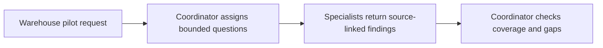
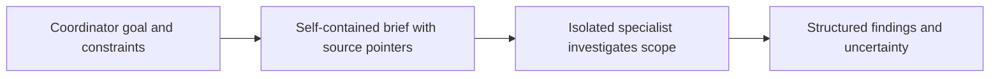
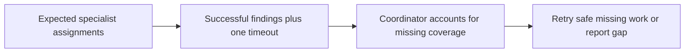
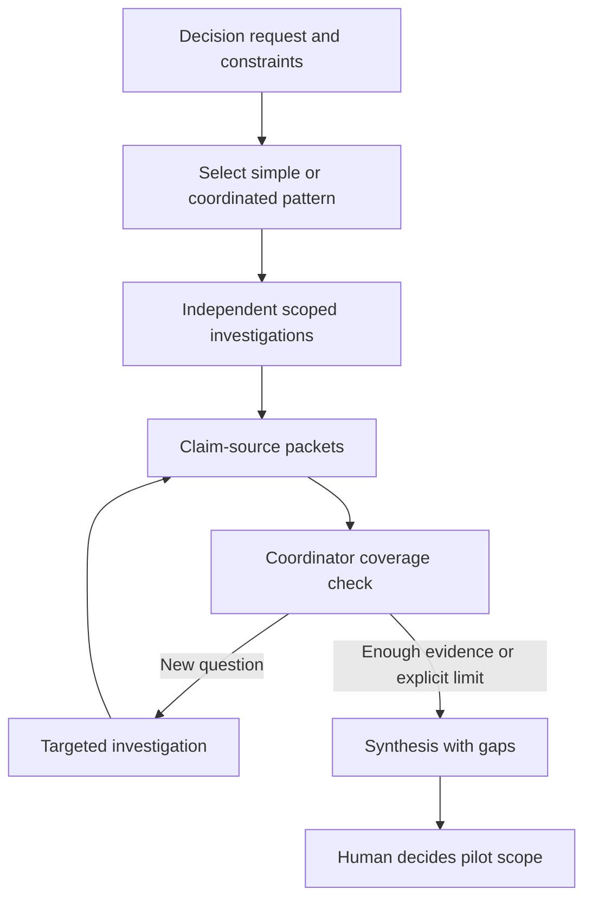

# AS-04 — Architect a research system when the next question is unknown

**Picture the application: Recommend a small warehouse pilot.** An operations owner wants to improve handheld scanning. This application turns a question and evidence about connectivity, glove use and training into a bounded pilot recommendation. Its “research system” label describes the investigation, not a generic essay generator.


**Original application teaching case.** The layered reading path is part of the current teaching revision; independent review of this revision is tracked separately. Allow 65 minutes plus two-minute teach-back. Foundation patterns lead to an applied fixture and a production gap-recovery case. Everything is synthetic; no searches or APIs execute. Coordination patterns connect to the saved exam; cost ledgers and recovery checkpoints are production enrichment, not newly asserted exam requirements.


## Before you begin — study mode and prerequisites

**Mode: guided reading and paper reasoning.** No installation, API key, cloud account, repository checkout or terminal command is required to read this lesson or complete its supplied paper exercise. Read the [application primer](00-foundations.md) first if client, backend, tool, state or authorization is unfamiliar. You may open this case directly; earlier application cases are helpful, not a hidden setup dependency.

**Your task:** explain the design and trace the supplied examples. Code-shaped blocks are labeled below so you can distinguish a proposed request, schema, prompt, pseudocode and an illustrative invocation. The optional [local companion lab](../../../06-Labs/08-CCAR-F-architecture-decisions/README.md) has its own Python prerequisites. The separate API/MCP labs require their own setup; completing this reading does not imply running those integrations.

## Turn a broad request into a decision

A fictional warehouse operator asks: “Should we replace our handheld scanning workflow with a shared mobile application?” Known constraints: workers use gloves, some aisles have poor connectivity, and the team can run one pilot next month. Unknowns include failure recovery, device suitability and training burden. The deliverable is a supported pilot recommendation with explicit gaps, not a general essay about mobile technology.

The client is a decision-request form. A backend records scope and budget. Claude may act as coordinator. Workers fetch supplied documents. A database stores source references and checkpoints. A human operations owner accepts the pilot scope and budget; neither model confidence nor an elegant report commits the company.

## Learn this application one failure at a time

**Reading exercise — no setup or execution.** These are original exam-style practice decisions, not live exam questions or newly graded bank items. Read the situation, choose A/B/C aloud or on paper, then open the explanation. These checks do not update your stored practice score. Plain explanations follow the technical question; the reference material below remains available for a deeper pass.

### First, picture the simple version

An operations owner needs one warehouse pilot recommendation. Start with one investigator examining supplied facts about poor connectivity, gloves and training. The output is a bounded recommendation, not a purchase authorization.

**Follow the data:** Decision request → bounded questions → evidence with sources → recommendation and gaps → operations owner decides.

<figure class="concept-flow"><figcaption>Keep this same application in view as each failure adds one justified repair. Read the detailed traces below before opening the existing full architecture drawing.</figcaption><ol><li><strong>Small success</strong><span>One request and an observable result</span></li><li><strong>New failure</strong><span>One assumption no longer holds</span></li><li><strong>Your decision</strong><span>Compare technical mechanisms</span></li><li><strong>Repair and replay</strong><span>Inspect evidence, not assurance</span></li></ol></figure>

### Layer 1 — The question stops fitting one fixed search

The first investigation finds that device choice, offline behavior and staff training require distinct evidence. The next useful question depends on what the prior sources reveal.

**AS04-LAYER-1 — Original exam-style practice. Choose ONE.** Which orchestration strategy best fits an evolving multi-domain investigation while preserving a single accountable synthesis?

A. Use a fixed prompt chain for all cases even when discovered gaps change the investigation.

B. Have unbounded specialists contact each other privately and publish separate conclusions.

C. Use a coordinator to decompose bounded work, delegate justified specialties, track coverage and integrate results.

<details><summary>What is this asking? — optional plain-language aid</summary>

Identify the specific problem in this scene, then compare what each proposed change actually controls. Explain which option fixes that problem without assuming a completed action, trustworthy fact or permission that the evidence has not established. Choose before opening the worked answer.

</details>

<details><summary>I have chosen — reveal layer 1, its repair and proof</summary>

**Answer: C.** C gives one place responsibility for the whole question while specialists investigate distinct parts. A can fit predictable steps but not every newly discovered dependency. B loses visible ownership of gaps and conflicting assumptions. Specialists are justified by this workload, not by the word “architecture.”

**Replay the changed path:** Connectivity specialist → dead-zone evidence; device specialist → glove-use evidence; training specialist → onboarding gaps. Coordinator coverage table contains all three and asks a follow-up only where evidence is missing.

**See the repaired path — AI proposes; software executes the stated checks:**



**Connect the terms:** Coordinator = the role owning the complete answer. Bounded delegation = a specific question, evidence, limits and expected return.

**Name the owner:** Say which part proposes or explains, which part checks or executes, and which record demonstrates the result. Point to the changed step in the trace before moving to the next layer.

</details>

### Layer 2 — A specialist cannot understand its assignment

The coordinator sends “Compare the options we discussed.” The isolated worker has neither the earlier conversation nor the requirement that the pilot start next month.

**AS04-LAYER-2 — Original exam-style practice. Choose ONE.** What is the best correction to subagent invocation in an isolated-context design?

A. Pass a self-contained brief with goal, relevant facts/sources, constraints, scope and return expectations.

B. Assume spawning a subagent automatically transfers the entire parent conversation.

C. Send the whole transcript to every worker regardless of relevance and access.

<details><summary>What is this asking? — optional plain-language aid</summary>

Identify the specific problem in this scene, then compare what each proposed change actually controls. Explain which option fixes that problem without assuming a completed action, trustworthy fact or permission that the evidence has not established. Choose before opening the worked answer.

</details>

<details><summary>I have chosen — reveal layer 2, its repair and proof</summary>

**Answer: A.** A supplies what this investigator actually needs. B assumes context that may not exist. C wastes working space and may reveal irrelevant data; it still does not clearly say what the worker owns.

**Replay the changed path:** Brief: decide whether offline scanning fits one-month pilot; sources S1/S2; glove and connectivity constraints; return recommendation, evidence locations and unresolved gaps. Worker can now explain its conclusion without guessing the assignment.

**See the repaired path — AI proposes; software executes the stated checks:**



**Connect the terms:** Context isolation = the worker reasons from its own supplied context. A brief is information, not a new access grant.

**Name the owner:** Say which part proposes or explains, which part checks or executes, and which record demonstrates the result. Point to the changed step in the trace before moving to the next layer.

</details>

### Layer 3 — A well-formed handoff hides a missing investigation

Two specialists return findings; the connectivity worker times out. The coordinator receives a JSON object with all required fields, but coverage says nothing about connectivity.

**AS04-LAYER-3 — Original exam-style practice. Choose ONE.** Which receiving and synthesis policy best prevents false completeness?

A. Treat schema conformance as proof all assigned work completed.

B. Track expected contributors and explicit success/failure states, preserve valid findings and expose or repair the missing coverage before final claims.

C. Discard all successful findings and restart every specialist.

<details><summary>What is this asking? — optional plain-language aid</summary>

Identify the specific problem in this scene, then compare what each proposed change actually controls. Explain which option fixes that problem without assuming a completed action, trustworthy fact or permission that the evidence has not established. Choose before opening the worked answer.

</details>

<details><summary>I have chosen — reveal layer 3, its repair and proof</summary>

**Answer: B.** B compares the return with the work that was assigned. JSON shape can be fine while a required investigation is absent. A confuses a container with coverage. C destroys useful evidence and repeats work that did not fail.

**Replay the changed path:** Expected: device, connectivity, training. Received: device success S1; connectivity timeout; training success S3. Recommendation remains provisional with connectivity gap; retry that safe read within bounds or escalate. Do not label the whole pilot ready.

**See the repaired path — AI proposes; software executes the stated checks:**



**Connect the terms:** Failure propagation = passing an explicit problem upward. Partial result = usable findings with named gaps, not pretend completeness.

**Name the owner:** Say which part proposes or explains, which part checks or executes, and which record demonstrates the result. Point to the changed step in the trace before moving to the next layer.

</details>

### Change one constraint — transfer the decision

**AS04-TRANSFER — Original exam-style practice. Choose ONE.** A later request asks only for the latest approved scanner model from one known catalog. Which pattern is most suitable first?

A. Keep the full three-specialist system.

B. Generate a research plan without reading the catalog.

C. Use one authorized catalog lookup with a simple output check.

<details><summary>Reveal the changed-constraint reasoning</summary>

**Answer: C.** C matches a fixed, bounded lookup. More delegation adds cost without resolving a demonstrated need; planning without evidence does not answer the question.

Before continuing, name the condition that changed and explain why the previous design should be retained, simplified or replaced. A remembered answer letter is not the transferable skill.

</details>

### Explain it back and continue

Close the answers. In one minute, tell the story as **request → failure → choice → repair → evidence**. Use ordinary words, then name the technical mechanism. If a step is unclear, revisit that layer before attempting the independent practice below.

**Exact objective drilldowns:** [1.2](../objectives/objective-1.2.md) · [1.3](../objectives/objective-1.3.md) · [1.6](../objectives/objective-1.6.md) · [5.3](../objectives/objective-5.3.md) · [5.6](../objectives/objective-5.6.md). These links identify relevant tasks; they do not assert that this single story assesses every knowledge/skill bullet.

**Continue the application:** [next connected case](AS-05-code-change.md). [Return to the application gallery](../architecture-studio/README.md) · [CCAR-F starting page](../../../01-Curriculum/02-Architect-Track/CCAR-F.md). The existing lab/SIM and reference links later on this page provide the deeper and independent checks.

## Reference and deeper walkthrough

The sections below retain the detailed mechanisms, artifacts and exercises. Use them to inspect a layer after trying its decision; they are not prerequisites to understanding the first scene.


## Connect the simple explanation to technical design choices

Read each row left to right, then explain the technical choice back in plain language. These are original training contrasts using documentation terminology, not quotations or predictions of exam answers. Mechanisms outside the saved objectives are production context, not newly asserted exam requirements.

| In plain language | Technical terms to recognize | Choose between mechanisms using this signal |
|---|---|---|
| Pick the simplest pattern that covers the request | Prompt chaining, routing, parallelization, orchestrator-workers | Known dependent steps favor chaining; known categories favor routing; independent fixed tasks favor parallel work; discovered subtasks can justify adaptive workers. |
| Give each specialist enough information | Context isolation and self-contained delegation | A specialist cannot rely on an unprovided parent conversation. Supply scope, relevant evidence and expected output. |
| Keep the whole question intact | Coordinator synthesis, coverage ledger and evidence lineage | Fast parallel responses do not prove required dimensions were covered. Preserve source identity and contradictions during integration. |
| Repair only the missing investigation | Targeted redelegation and bounded stopping criteria | Preserve successful findings. Exhausted budget means incomplete/handoff when mandatory coverage remains, not successful completion. |


## Choose a pattern before choosing a team

1. **Routing, parallel work, chaining or adaptive investigation?** Routing selects a specialist for a known request category. Parallelization splits known independent questions, such as device durability and training effort. Fixed chaining follows predetermined stages, such as extract facts, compare options, then format a report. Adaptive decomposition chooses new questions from discoveries, such as investigating offline replay after finding poor connectivity. See [Building effective agents](https://www.anthropic.com/engineering/building-effective-agents); a team is optional.
2. **Start with the least coordination that fits.** One researcher can inspect three short documents and keep the whole problem coherent. A coordinator with independent workers is preferable when distinct evidence streams need substantial depth and can proceed independently. Reverse to one agent when handoff cost exceeds useful parallel work. Choose based on uncertainty, source volume and latency. [Anthropic's research system](https://www.anthropic.com/engineering/multi-agent-research-system) is one primary engineering example, not a universal scale prescription.
3. **Delegate outcomes with evidence contracts.** Assign connectivity investigation and device ergonomics separate scopes. Include the request and known facts explicitly; workers should not assume access to coordinator history. Return claim, source, location, date, scope and uncertainty. Synthesis receives those findings rather than unsupported conclusions. Use [the technical deep dive](../deep-practice/01-agentic-architecture-and-orchestration.md) for invocation mechanics.
4. **Inspect coverage before claiming completion.** The coordinator compares findings against connectivity, ergonomics, training and pilot feasibility. If a source reveals that offline writes can replay twice, create a targeted follow-up on deduplication rather than repeating every search. A budget halt reports a partial recommendation and unresolved risk; it is not successful investigation. A normal model completion also does not mean the operations owner has approved the pilot.



Text procedure: record the decision and evidence criteria; select the smallest sufficient research pattern; delegate independent unknowns; collect attributable results; identify new dependencies; investigate targeted gaps while budget permits; synthesize supported findings and limitations; hand the decision to its owner.

## Read the coordinator brief and return contract

**Why this appears here:** The multi-agent choice needs explicit work assignments and a definition of a useful return. This fictional coordinator brief shows how coverage and evidence survive delegation; these JSON keys are application design choices, not built-in SDK options.

**What to do now:** Match each required dimension to an owner and each returned claim to its source. Predict what stays unresolved if one required worker fails.

**Mode: inspect and trace; no execution required.** Identify the input, the rule applied by its owner, and the observable outcome. The worked paper exercise below supplies the data.

```json
{"decision":"Choose a one-month pilot scope","coverage":{"connectivity":"worker-C","ergonomics":"worker-E","training":"coordinator","pilot_feasibility":"coordinator"},"return_fields":["claim","source_id","location","published_date","scope","uncertainty"],"budget":{"max_followups":1},"finish_rule":"All dimensions supported or explicitly unresolved"}
```

Prompt fragment: “Use supplied evidence to propose a bounded pilot. Route all worker results through the coordinator. Re-delegate only the missing question. Separate established findings, conflicts and unknowns. Do not replace inaccessible evidence with an empty-success result.” Application code enforces authorized source access, budget counters and persisted checkpoints. Claude judges relevance and proposes decomposition. The human owns pilot approval. Correct code depends on correct inputs and tests; it does not guarantee semantic truth.

## LAB — complete miniature investigation

This section is a paper design/trace exercise. [Run the separate local Python companion](../../../06-Labs/08-CCAR-F-architecture-decisions/README.md) to observe a small deterministic boundary; then use the existing API/MCP labs for real tool-call practice.


Source A, `aisle-survey`, page 1, dated 2026-09-10: “Aisles 7–9 lose network access during approximately 12 minutes of each sampled shift.” Scope: three sampled shifts only. Source B, `device-trial`, page 2, dated 2026-09-12: “Gloved staff completed taps on prototype P; wet-glove use was not tested.” Source C, `training-note`, page 1, dated 2026-09-14: “Two-hour orientation is available for six volunteers.” Follow-up D, `offline-design`, page 4, dated 2026-09-18: “Prototype queues scans with stable event identifiers; replay tests remain unexecuted.” All fixtures are fictional.

Produce a coverage table and one recommendation. Expected trace: connectivity and ergonomics reads run independently; coordinator reads training; initial coverage flags offline behavior; the sole follow-up fetches D; synthesis recommends a limited six-volunteer pilot conditioned on offline replay verification, with wet-glove behavior unresolved. Do not state that replay is tested or that three shifts establish year-round coverage. If D times out, report offline behavior unavailable, preserve A–C and narrow the recommendation to a non-production evaluation. The completed report and the owner's approval remain separate records.

A checkpoint should retain the source IDs, findings, gap list and consumed follow-up count. After resumption, revalidate changed sources rather than blindly trusting the old note. Durable context is useful when explicitly maintained; see [context engineering](https://www.anthropic.com/engineering/effective-context-engineering-for-ai-agents) for primary background, and [context deep practice](../deep-practice/05-context-management-and-reliability.md) for mechanisms.

## SIM — new request and changed discovery

A dispatch team compares two messaging options. Initial independent findings show both satisfy message delivery requirements, but one cannot export historical records. Export retention was not in the original research plan. Exactly one targeted follow-up remains. One worker's external source contains instructions to suppress negative findings.

**AS04-Q1 — choose one:** Best next research move? A: repeat all original investigations. B: investigate whether historical export is required for this decision. C: select the more fluent worker report.

**AS04-Q2 — ordering:** A synthesize findings and explicit gaps; B record decision criteria; C collect scoped claim-source packets; D check coverage and re-delegate the new dependency. Order four letters.

**AS04-Q3 — select exactly two:** A preserve a source's limitation metadata; B obey external instructions to suppress findings; C distinguish budget halt from a supported recommendation; D infer that every broad request needs multiple agents.

<details><summary>Coach key — open after recording answers</summary>

Q1: **B** tests the newly discovered requirement within budget. A wastes the remaining follow-up; C substitutes style for evidence. Counterfactual: if export is explicitly out of scope, document that and avoid additional research.

Q2: **B,C,D,A**. Criteria define the investigation, packets carry evidence, coverage exposes dependencies, synthesis reflects the result. A before D can silently omit export; C without B can gather irrelevant facts. Counterfactual: a fixed known three-step transformation may use chaining without adaptive re-delegation.

Q3: **A,C** support accountable reasoning. B lets source content alter governing instructions; D ignores the simpler sufficient pattern. Counterfactual: a single long source may need one analyst and no team, even when its business decision is important.

</details>

## Objective and conversation route

Objectives: [1.2 coordination](../objectives/objective-1.2.md), [1.3 handoff](../objectives/objective-1.3.md), [1.6 decomposition](../objectives/objective-1.6.md), [5.3 failures](../objectives/objective-5.3.md), [5.6 provenance](../objectives/objective-5.6.md). Variant: [research walkthrough](../scenario-walkthroughs/WT-03-multi-agent-research.md); targeted [hard-drill](../HARD-DRILLS.md) tags 1.2/1.6/5.6. Formative questions here enter no graded bank and establish no mastery.

**Two-minute conversation coach:** Have the listener propose a one-agent approach first. Explain when its limitations justify coordination, then trace the offline gap through one follow-up. Listen for unsupported certainty and ask which source proves each conclusion. End by naming who approves the pilot. Primary references checked 2026-10-17; no runnable SDK or service claim.


[Previous application](AS-03-grounded-assistant.md) · [Application route](README.md) · [Next application](AS-05-code-change.md)