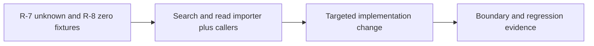
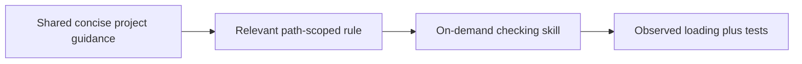
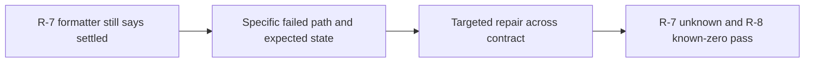

# AS-05 — Change an unfamiliar application safely

**Picture the application: Correct a booking report without changing live bookings.** A missing deposit is being reported as zero. This exercise uses importer files, caller behavior and tests to propose a code change that preserves the distinction. The output is a reviewed proposal and evidence, not a claim that production was changed.


**Apprenticeship:** 45–60 minutes. Synthetic business, code and outcomes; learner status unassessed. Draw your design; attempt lab/simulation before opening the key. The local fixture lab needs no Claude account; no CLI/API execution is claimed here.


## Before you begin — study mode and prerequisites

**Mode: guided reading and paper reasoning.** No installation, API key, cloud account, repository checkout or terminal command is required to read this lesson or complete its supplied paper exercise. Read the [application primer](00-foundations.md) first if client, backend, tool, state or authorization is unfamiliar. You may open this case directly; earlier application cases are helpful, not a hidden setup dependency.

**Your task:** explain the design and trace the supplied examples. Code-shaped blocks are labeled below so you can distinguish a proposed request, schema, prompt, pseudocode and an illustrative invocation. The optional [local companion lab](../../../06-Labs/08-CCAR-F-architecture-decisions/README.md) has its own Python prerequisites. The separate API/MCP labs require their own setup; completing this reading does not imply running those integrations.

## The request and the application

Harbor Rentals asks: “Preserve missing deposits as unknown; retain legitimate zero deposits. Do not change production bookings.” Today missing becomes zero, making incomplete bookings look settled. Tomorrow is the reporting deadline. You may propose a patch in a disposable checkout; the release owner controls deployment.

A **repository** is versioned application files. A **module** is a code component; a **caller** uses its output. A **fixture** is repeatable input. A **contract** defines result meaning. A laptop can hold these files; production is the separate live service.

```text
importer.py: deposit = record.get("deposit") or 0
report.py: balance_known = deposit is not None
fixture A: {booking:"R-7", deposit:null} -> deposit:null; balance_known:false
fixture B: {booking:"R-8", deposit:0} -> deposit:0; balance_known:true
```

## Learn this application one failure at a time

**Reading exercise — no setup or execution.** These are original exam-style practice decisions, not live exam questions or newly graded bank items. Read the situation, choose A/B/C aloud or on paper, then open the explanation. These checks do not update your stored practice score. Plain explanations follow the technical question; the reference material below remains available for a deeper pass.

### First, picture the simple version

Harbor’s importer changes an absent deposit into zero. A report then calls the balance known. Read the supplied files as a small application: import data → calculate report → show status. Your paper change never touches production.

**Follow the data:** Booking R-7 deposit:null → importer → report. Compare with R-8 deposit:0, a legitimate known zero. Both paths must survive the patch.

<figure class="concept-flow"><figcaption>Keep this same application in view as each failure adds one justified repair. Read the detailed traces below before opening the existing full architecture drawing.</figcaption><ol><li><strong>Small success</strong><span>One request and an observable result</span></li><li><strong>New failure</strong><span>One assumption no longer holds</span></li><li><strong>Your decision</strong><span>Compare technical mechanisms</span></li><li><strong>Repair and replay</strong><span>Inspect evidence, not assurance</span></li></ol></figure>

### Layer 1 — A one-line patch changes a shared meaning

The obvious edit removes “or 0” in importer.py. The engineer does not yet know which callers assume a number or whether null is permitted downstream.

**AS05-LAYER-1 — Original exam-style practice. Choose ONE.** Which Claude Code workflow is most appropriate before modifying this unfamiliar cross-file behavior?

A. Use Write to replace the module from the issue description alone.

B. Search candidate paths and uses with Glob/Grep, inspect relevant code with Read, and form a scoped plan before targeted edits.

C. Read every repository file into the context before choosing a boundary.

<details><summary>What is this asking? — optional plain-language aid</summary>

Identify the specific problem in this scene, then compare what each proposed change actually controls. Explain which option fixes that problem without assuming a completed action, trustworthy fact or permission that the evidence has not established. Choose before opening the worked answer.

</details>

<details><summary>I have chosen — reveal layer 1, its repair and proof</summary>

**Answer: B.** B finds the actual chain without flooding the conversation. A skips the callers whose behavior may break. C spends context on unrelated material. The need to investigate comes from uncertain cross-file impact, not a rule that every edit needs a long plan.

**Replay the changed path:** Grep deposit → importer.py and report.py → Read both → identify null versus zero contract → Edit narrow lines → test R-7 unknown and R-8 known-zero. Passing only R-7 would miss the regression.

**See the repaired path — AI proposes; software executes the stated checks:**



**Connect the terms:** Caller = code that uses another component’s output. A targeted edit changes an understood place while preserving surrounding code.

**Name the owner:** Say which part proposes or explains, which part checks or executes, and which record demonstrates the result. Point to the changed step in the trace before moving to the next layer.

</details>

### Layer 2 — The new convention loads in the wrong places

The team wants Python importers to preserve unknown financial values. Placing all importer rules in every session also distracts work on documentation and unrelated components.

**AS05-LAYER-2 — Original exam-style practice. Choose ONE.** Which instruction organization best scopes shared importer conventions while keeping a reusable checking procedure separate?

A. Put every task, private preference and importer rule into one always-loaded root file.

B. Use only a developer’s personal instruction file for team-required behavior.

C. Keep shared project guidance concise, use path-specific rules for importer files, and use a skill for the repeatable review procedure.

<details><summary>What is this asking? — optional plain-language aid</summary>

Identify the specific problem in this scene, then compare what each proposed change actually controls. Explain which option fixes that problem without assuming a completed action, trustworthy fact or permission that the evidence has not established. Choose before opening the worked answer.

</details>

<details><summary>I have chosen — reveal layer 2, its repair and proof</summary>

**Answer: C.** C separates team background, conditional file rules and a procedure you deliberately use. A makes irrelevant instructions compete for attention. B leaves collaborators without the shared rule. Instructions still need tests; they do not enforce runtime financial correctness.

**Replay the changed path:** Importer file session → relevant null/zero rule loaded. Documentation edit → importer-specific rule not needed. Review skill → repeatable steps checking R-7/R-8 and downstream status. Inspect actual loading in the selected Claude Code version.

**See the repaired path — AI proposes; software executes the stated checks:**



**Connect the terms:** Path-specific rule = guidance selected by file scope. Skill = a reusable procedure rather than all-session background.

**Name the owner:** Say which part proposes or explains, which part checks or executes, and which record demonstrates the result. Point to the changed step in the trace before moving to the next layer.

</details>

### Layer 3 — Tests pass but the customer report is wrong

A unit test confirms null is retained. A report formatter still renders null as 0 and labels the booking settled. The first patch therefore passes a narrow test but misses the original problem.

**AS05-LAYER-3 — Original exam-style practice. Choose ONE.** What feedback loop most directly addresses the surviving cross-component defect?

A. Provide the failing R-7 end-to-end trace, expected unknown state and relevant formatter location, then revise the patch and rerun boundary/regression checks.

B. Repeat “make the code correct” with the same narrow unit test.

C. Accept the patch because a model reviewer approved the importer.

<details><summary>What is this asking? — optional plain-language aid</summary>

Identify the specific problem in this scene, then compare what each proposed change actually controls. Explain which option fixes that problem without assuming a completed action, trustworthy fact or permission that the evidence has not established. Choose before opening the worked answer.

</details>

<details><summary>I have chosen — reveal layer 3, its repair and proof</summary>

**Answer: A.** A tells the assistant what still fails and where the evidence points. B adds no information, so it can repeat the same incomplete fix. C treats an opinion about one file as proof of user-visible behavior.

**Replay the changed path:** R-7 null → importer null → formatter “0 settled” FAIL. Repair formatter → “deposit unknown / needs clarification” PASS. R-8 zero → “0 known” still PASS. Inspect final diff so unrelated booking behavior is unchanged.

**See the repaired path — AI proposes; software executes the stated checks:**



**Connect the terms:** Iterative refinement = improve a proposal using specific observed feedback. Regression check = verify an existing correct behavior still works.

**Name the owner:** Say which part proposes or explains, which part checks or executes, and which record demonstrates the result. Point to the changed step in the trace before moving to the next layer.

</details>

### Change one constraint — transfer the decision

**AS05-TRANSFER — Original exam-style practice. Choose ONE.** The next request is a typo in one known help-text string with no behavior change. Which workflow is appropriate?

A. Always run a repository-wide multi-agent investigation.

B. Use a bounded direct edit and inspect the rendered wording.

C. Skip verification because the change is small.

<details><summary>Reveal the changed-constraint reasoning</summary>

**Answer: B.** B scales effort to a clear low-impact task. The earlier planning choice came from uncertain behavior dependencies; A adds unnecessary ceremony and C omits the relevant check.

Before continuing, name the condition that changed and explain why the previous design should be retained, simplified or replaced. A remembered answer letter is not the transferable skill.

</details>

### Explain it back and continue

Close the answers. In one minute, tell the story as **request → failure → choice → repair → evidence**. Use ordinary words, then name the technical mechanism. If a step is unclear, revisit that layer before attempting the independent practice below.

**Exact objective drilldowns:** [2.5](../objectives/objective-2.5.md) · [3.1](../objectives/objective-3.1.md) · [3.2](../objectives/objective-3.2.md) · [3.3](../objectives/objective-3.3.md) · [3.4](../objectives/objective-3.4.md) · [3.5](../objectives/objective-3.5.md) · [5.4](../objectives/objective-5.4.md). These links identify relevant tasks; they do not assert that this single story assesses every knowledge/skill bullet.

**Continue the application:** [next connected case](AS-06-ci-review.md). [Return to the application gallery](../architecture-studio/README.md) · [CCAR-F starting page](../../../01-Curriculum/02-Architect-Track/CCAR-F.md). The existing lab/SIM and reference links later on this page provide the deeper and independent checks.

## Reference and deeper walkthrough

The sections below retain the detailed mechanisms, artifacts and exercises. Use them to inspect a layer after trying its decision; they are not prerequisites to understanding the first scene.


## Connect the simple explanation to technical design choices

Read each row left to right, then explain the technical choice back in plain language. These are original training contrasts using documentation terminology, not quotations or predictions of exam answers. Mechanisms outside the saved objectives are production context, not newly asserted exam requirements.

| In plain language | Technical terms to recognize | Choose between mechanisms using this signal |
|---|---|---|
| Locate evidence before editing | Glob/Grep/Read versus Edit/Write | Search locates candidate paths/symbols; reading checks meaning. A patch tool is appropriate after identifying the actual boundary. |
| Place guidance where it applies | CLAUDE.md, .claude/rules and SKILL.md | Shared persistent guidance, path-scoped conventions and reusable on-demand procedures serve different needs; do not make every task an always-loaded instruction. |
| Explore separately when context is large | Subagent context isolation and context: fork | A bounded explorer needs a self-contained brief; it does not automatically share the parent history. |
| Use failures to refine the hypothesis | Test-driven feedback and iterative refinement | A passing local test does not prove callers accept a changed contract. Investigate integration evidence instead of rerunning the same vague prompt. |


## Assign responsibility before choosing tools

Claude can judge where the defect might be, explain caller dependencies and propose alternatives. Executable tests check the supplied contract; permission controls limit available actions. The human owner decides whether unknown deposits should block settlement and authorizes release. “Never edit production” in a prompt communicates intent; it is not a substitute for withholding production credentials and restricting the working environment. Instruction scope and permission configuration are separate mechanisms. [Current memory guidance](https://code.claude.com/docs/en/memory) and [settings scopes](https://code.claude.com/docs/en/settings) (Tier 1, checked 2026-10-17).

## Make the architecture decisions

1. **Map before editing.** Read the importer, report caller and existing tests using file-read/search tools. A search tool locates symbols; reading establishes their actual contract. An isolated exploration task is useful if discovery is verbose; three tiny files can stay in the main session. Tool purpose follows the question, not the tool's availability.
2. **Choose bounded execution or planning.** Here the supplied contract and two callers justify a small plan followed by a narrow patch. If “unknown” changes billing, database columns and API consumers, stop and compare migration approaches first. Conversely, a confirmed spelling error needs no architectural ceremony. [Claude Code best practices](https://code.claude.com/docs/en/best-practices) (Tier 1).
3. **Place shared guidance correctly.** Commit the fixture-reuse standard in project instructions; keep personal explanation style in user instructions. A distributed test convention can use a path-scoped rule. Moving everything into a private home folder fixes only one developer's session.
4. **Test meaning, then refine.** Replace truthiness with an explicit missing-value check. If tests still fail, inspect the reported mismatch and callers; do not repeat “try harder.” The nearest alternative—keeping zero as the missing marker—wins only if the owner explicitly changes the business contract and migration consequences are handled.
5. **Review and hand off.** Compare the diff, run relevant tests when available, and give the release owner evidence and limitations. A passing fixture suite is evidence for those cases, not proof of deployment or every production behavior.

In Claude Code vocabulary, **Glob** finds path patterns, **Grep** searches content, **Read** inspects evidence, **Edit** changes existing text and **Write** creates/replaces file content. Discover before changing; creating a file is not verification. Shared facts belong in CLAUDE.md; a reusable multi-step audit can be a skill; a rule scoped to `**/*test*` addresses distributed tests. A known sequence favors a workflow, while uncertain investigation may justify agent-selected next steps.


Equivalent text: contract → referenced code evidence → tests → proposed patch → results/diff → authorized release decision. Failed checks return to the relevant hypothesis before the handoff.

## Read the instruction artifact — choose its scope

**Why this appears here:** The code-change design needs a home for reusable instructions. This SKILL.md example shows one possible artifact and why its scope differs from project guidance or a one-off request. You are inspecting it, not installing it.

**What to do now:** Compare what belongs in CLAUDE.md, path-scoped rules and a reusable skill. Read the example invocation as a demonstration, not a command required to continue.

**Mode: inspect and trace; no execution required.** Identify the input, the rule applied by its owner, and the observable outcome. The worked paper exercise below supplies the data.

CLAUDE.md holds the shared fixture/unknown-versus-zero standard; a path rule supplies test-specific conventions; an ad hoc task supplies today's defect. Repeated caller audits warrant a reusable procedure, illustrated at `.claude/skills/deposit-audit/SKILL.md`:

```markdown
---
name: deposit-audit
description: Trace deposit callers and unknown-value assumptions.
argument-hint: "[module-path]"
disable-model-invocation: true
context: fork
agent: Explore
---
Audit $ARGUMENTS. If the path is missing, ask before investigating.
Find callers; read their contracts; return paths, null/zero examples,
unknowns and evidence. Do not patch or infer settlement policy.
```

Invoke `/deposit-audit importer.py`. The hint assists invocation; the body handles missing input. Forking suits verbose discovery and requires a self-contained task, not assumed parent history. For this tiny one-off defect, the ad hoc request is simpler. The skill is **not an authorization boundary**: verify actual tool/permission configuration and withhold production credentials. This is an illustrative current Claude Code artifact, not an installed skill or July exam guarantee. [Official skills documentation](https://code.claude.com/docs/en/skills) (Tier 1, checked 2026-10-17).

## Paper lab — supplied inputs and expected outcomes

This section is a paper design/trace exercise. [Run the separate local Python companion](../../../06-Labs/08-CCAR-F-architecture-decisions/README.md) to observe a small deterministic boundary; then use the existing API/MCP labs for real tool-call practice.


On paper, evaluate the original expression for A, B and `{booking:"R-9",deposit:125}`. It returns 0, 0 and 125; A is the defect. Propose `deposit = record.get("deposit")`, preserving null/None. Expected report states are false, true and true. Add a missing-key fixture: expected unknown, not zero. Then inject a caller that executes `deposit + 10`: expected **new contract incompatibility**, requiring explicit unknown handling rather than claiming the importer fix completes the change.

Save the input/output table, caller evidence, proposed correction and changed-caller test. Actual execution of a companion fixture demonstrates only that local behavior; it does not execute Claude or deploy Harbor's application.

## Blind simulation — answer before expanding

**AS05-Q1, ordering:** Put these in order: A hand off reviewed patch; B inspect caller contracts; C verify fixture results/diff; D define null/zero boundary tests and patch.

**AS05-Q2, select exactly two:** Which support this bounded change? A commit shared fixture standards at project scope; B treat prompt wording as a production access block; C withhold production access from the checkout; D replace every null with zero to simplify callers.

**AS05-Q3, one best:** A new API consumer rejects null. Next: A rerun the same prompt; B declare success because importer tests pass; C inspect the consumer contract and expand the plan if needed; D remove the failing test.

<details><summary>Coach key — open after committing answers</summary>

Q1: **B→D→C→A**. Inspect first; tests express the contract before a patch; verification precedes handoff. A first lacks evidence; C before D cannot verify the new change.

Q2: **A and C**. A distributes shared guidance; C establishes the environment boundary. B confuses probabilistic guidance with enforcement. D contradicts the supplied business meaning.

Q3: **C**. A adds no new diagnostic evidence; B ignores integration; D conceals a legitimate failure. An explicitly revised owner contract could change the patch, but the agent cannot invent it.

</details>

## Two-minute listen and converse

Read aloud: “Unknown and zero mean different things. I establish the contract, inspect callers and preserve meaning with examples. Instructions guide; permissions govern access. Failed tests change my hypothesis. I hand off evidence, not a production-change claim.”

Coach prompts: Explain this without using “AI.” Why does adding a caller change the plan? What evidence would you need before saying implemented? Answer, then ask the coach to challenge one unsupported assumption.

Targeted practice from the existing 30 variants: [scope/FV-13](../objectives/objective-3.1.md#variant-fv-13), [skills/FV-14](../objectives/objective-3.2.md#variant-fv-14), [planning/FV-16](../objectives/objective-3.4.md#variant-fv-16), [iteration/FV-17](../objectives/objective-3.5.md#variant-fv-17), [code ledger/FV-28](../objectives/objective-5.4.md#variant-fv-28). Objectives: 3.1, 3.2, 3.3, 3.4, 3.5, 5.4. These three original questions are formative self-checks, not graded-bank imports or mastery evidence. Certification scope remains the saved July v1.0 guide; current documentation describes implementation behavior separately.


[Previous application](AS-04-research-system.md) · [Application route](README.md) · [Next application](AS-06-ci-review.md)