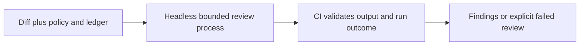
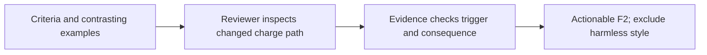
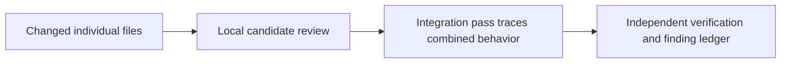
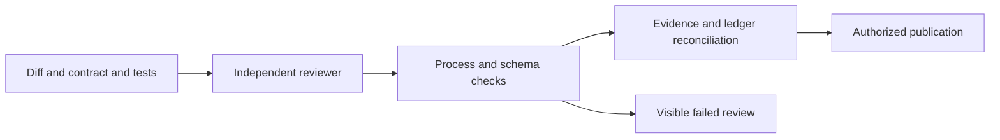

# AS-06 — Design an unattended review that can fail honestly

**Picture the application: Review a code change when nobody is waiting at the keyboard.** A developer proposes a payment-code change. The automated reviewer receives changed code, requirements and tests; it returns specific findings or a visible failure. CI means the surrounding software runs checks automatically. A completed review is not permission to merge.


**Apprenticeship:** 45–60 minutes; synthetic inputs and proposed architecture. No actual CLI/API execution or PR publication is claimed. Attempt the fixture and blind simulation before opening the coach key.


## Before you begin — study mode and prerequisites

**Mode: guided reading and paper reasoning.** No installation, API key, cloud account, repository checkout or terminal command is required to read this lesson or complete its supplied paper exercise. Read the [application primer](00-foundations.md) first if client, backend, tool, state or authorization is unfamiliar. You may open this case directly; earlier application cases are helpful, not a hidden setup dependency.

**Your task:** explain the design and trace the supplied examples. Code-shaped blocks are labeled below so you can distinguish a proposed request, schema, prompt, pseudocode and an illustrative invocation. The optional [local companion lab](../../../06-Labs/08-CCAR-F-architecture-decisions/README.md) has its own Python prerequisites. The separate API/MCP labs require their own setup; completing this reading does not imply running those integrations.

## The business request

Harbor's engineering lead wants a review after each proposed code change. Developers complain that the current bot repeats resolved comments and flags harmless style. “Report actionable payment defects, finish without asking someone questions, and never approve or merge a change.” The pipeline has read access to the checkout; a separate service may post approved findings. A human owns release approval.

**CI**, continuous integration, is software that runs checks automatically when code changes. A **pull request** proposes changes; its **diff** shows changed lines. A **process** is one running program, with an exit status that reports success or failure. A **JSON schema** defines an output's shape. Correct shape does not prove that the finding is true.

Supplied evidence:

```text
src/charge.py:18: currency = invoice.get("currency") or "USD"
Business contract: missing currency must block charge preparation.
Existing test: 12.50 USD is accepted; fixture invoice(overrides) exists.
Ledger F1: resolved, former duplicate-conversion complaint.
Ledger F2: unaddressed, missing currency defaults to USD at charge.py:18.
```

## Learn this application one failure at a time

**Reading exercise — no setup or execution.** These are original exam-style practice decisions, not live exam questions or newly graded bank items. Read the situation, choose A/B/C aloud or on paper, then open the explanation. These checks do not update your stored practice score. Plain explanations follow the technical question; the reference material below remains available for a deeper pass.

### First, picture the simple version

A proposed code change defaults missing currency to USD. Harbor wants an automatic reviewer to report actionable defects without chatting with a person, approving or merging the change.

**Follow the data:** Diff + policy + existing finding ledger → unattended reviewer → checked findings → CI consumer. The CI program owns run status; the release owner owns deployment.

<figure class="concept-flow"><figcaption>Keep this same application in view as each failure adds one justified repair. Read the detailed traces below before opening the existing full architecture drawing.</figcaption><ol><li><strong>Small success</strong><span>One request and an observable result</span></li><li><strong>New failure</strong><span>One assumption no longer holds</span></li><li><strong>Your decision</strong><span>Compare technical mechanisms</span></li><li><strong>Repair and replay</strong><span>Inspect evidence, not assurance</span></li></ol></figure>

### Layer 1 — The unattended run waits for a person

The first automation starts an interactive session and blocks asking which files to inspect. No one is present in the CI runner.

**AS06-LAYER-1 — Original exam-style practice. Choose ONE.** Which execution design best fits a non-interactive CI review job?

A. Use headless/print execution with explicit diff, project context, bounded permissions, output contract and process outcome handling.

B. Keep an interactive terminal and assume a developer will eventually approve each request.

C. Grant unrestricted write and deployment access so questions are unnecessary.

<details><summary>What is this asking? — optional plain-language aid</summary>

Identify the specific problem in this scene, then compare what each proposed change actually controls. Explain which option fixes that problem without assuming a completed action, trustworthy fact or permission that the evidence has not established. Choose before opening the worked answer.

</details>

<details><summary>I have chosen — reveal layer 1, its repair and proof</summary>

**Answer: A.** A supplies the information and constraints up front and lets CI recognize failure. B is a collaborative workflow, not unattended operation. C removes safeguards without providing review evidence or dependable output.

**Replay the changed path:** Input packet: diff, missing-currency policy, known fixture and ledger F1/F2 → run → exit status plus result. Nonzero exit, absent result or invalid payload → review failed, not “zero defects.”

**See the repaired path — AI proposes; software executes the stated checks:**



**Connect the terms:** Headless = running without a conversational terminal. A process exit status describes execution; it does not by itself prove finding correctness.

**Name the owner:** Say which part proposes or explains, which part checks or executes, and which record demonstrates the result. Point to the changed step in the trace before moving to the next layer.

</details>

### Layer 2 — Machine-readable output still says something false

The reviewer returns valid JSON claiming a style issue is a payment defect. The real defect is charge.py:18 accepting missing currency.

**AS06-LAYER-2 — Original exam-style practice. Choose ONE.** Which review specification best improves precision while retaining actionable defect detection?

A. Require more severe wording for all comments.

B. Define inclusion/exclusion criteria and contrasting examples, and require a triggering input, changed location and demonstrated consequence for each finding.

C. Accept all schema-valid findings because the result is machine-readable.

<details><summary>What is this asking? — optional plain-language aid</summary>

Identify the specific problem in this scene, then compare what each proposed change actually controls. Explain which option fixes that problem without assuming a completed action, trustworthy fact or permission that the evidence has not established. Choose before opening the worked answer.

</details>

<details><summary>I have chosen — reveal layer 2, its repair and proof</summary>

**Answer: B.** B makes “actionable” inspectable: missing currency violates a stated rule and has an actual path. Harmless style lacks that consequence. A changes tone, not evidence. C checks the package while ignoring whether its contents are true.

**Replay the changed path:** Missing-currency fixture → default USD → charge preparation wrongly continues → report F2 with location and evidence. Cosmetic spacing → no behavior violation → exclude. Resolved F1 remains resolved unless new evidence shows it recurred.

**See the repaired path — AI proposes; software executes the stated checks:**



**Connect the terms:** False positive = a reported defect that the evidence does not establish. Precision = how often reported findings are real under the evaluation criteria.

**Name the owner:** Say which part proposes or explains, which part checks or executes, and which record demonstrates the result. Point to the changed step in the trace before moving to the next layer.

</details>

### Layer 3 — Local reviews miss the combined change

One file changes currency defaulting and another removes the blocking validation. Reviewed separately, each appears reasonable; together they allow an unsupported charge.

**AS06-LAYER-3 — Original exam-style practice. Choose ONE.** Which architecture most directly addresses both file-local defects and cross-file inconsistencies in a large pull request?

A. Use the same context-free prompt on every file and concatenate results.

B. Ask the implementation author to approve its own change with no additional evidence.

C. Use bounded local review plus an integration pass over contracts/data paths, with independent verification of candidate findings.

<details><summary>What is this asking? — optional plain-language aid</summary>

Identify the specific problem in this scene, then compare what each proposed change actually controls. Explain which option fixes that problem without assuming a completed action, trustworthy fact or permission that the evidence has not established. Choose before opening the worked answer.

</details>

<details><summary>I have chosen — reveal layer 3, its repair and proof</summary>

**Answer: C.** C adds the missing view: how changed parts interact. A never sees the joint failure. B offers neither independence nor a cross-file test. Separate review can still err, so candidate claims need evidence and tests where useful.

**Replay the changed path:** Pass 1: file-local candidates. Pass 2: invoice input → defaulting → validation → charge path. Verify missing currency blocks; explicit USD remains accepted. Record dismissed/fixed/remaining findings rather than reposting every old comment.

**See the repaired path — AI proposes; software executes the stated checks:**



**Connect the terms:** Multi-pass review = different passes with explicit jobs. Independence = a fresh check rather than assuming the generating assistant’s conclusion is proof.

**Name the owner:** Say which part proposes or explains, which part checks or executes, and which record demonstrates the result. Point to the changed step in the trace before moving to the next layer.

</details>

### Change one constraint — transfer the decision

**AS06-TRANSFER — Original exam-style practice. Choose ONE.** A valid run returns zero findings, but the evaluation fixture contains the known missing-currency defect. What should the team do?

A. Treat the empty list as proof the code is safe.

B. Investigate a missed defect, revise criteria/context as needed and regression-test before trusting the reviewer.

C. Change the schema so every run must report at least one finding.

<details><summary>Reveal the changed-constraint reasoning</summary>

**Answer: B.** B tests whether the reviewer can recognize the known problem. A confuses empty output with safety; C encourages invented findings instead of sensitivity to real defects.

Before continuing, name the condition that changed and explain why the previous design should be retained, simplified or replaced. A remembered answer letter is not the transferable skill.

</details>

### Explain it back and continue

Close the answers. In one minute, tell the story as **request → failure → choice → repair → evidence**. Use ordinary words, then name the technical mechanism. If a step is unclear, revisit that layer before attempting the independent practice below.

**Exact objective drilldowns:** [3.6](../objectives/objective-3.6.md) · [4.1](../objectives/objective-4.1.md) · [4.2](../objectives/objective-4.2.md) · [4.6](../objectives/objective-4.6.md). These links identify relevant tasks; they do not assert that this single story assesses every knowledge/skill bullet.

**Continue the application:** [next connected case](AS-07-work-queue.md). [Return to the application gallery](../architecture-studio/README.md) · [CCAR-F starting page](../../../01-Curriculum/02-Architect-Track/CCAR-F.md). The existing lab/SIM and reference links later on this page provide the deeper and independent checks.

## Reference and deeper walkthrough

The sections below retain the detailed mechanisms, artifacts and exercises. Use them to inspect a layer after trying its decision; they are not prerequisites to understanding the first scene.


## Connect the simple explanation to technical design choices

Read each row left to right, then explain the technical choice back in plain language. These are original training contrasts using documentation terminology, not quotations or predictions of exam answers. Mechanisms outside the saved objectives are production context, not newly asserted exam requirements.

| In plain language | Technical terms to recognize | Choose between mechanisms using this signal |
|---|---|---|
| Run without an interactive conversation | Print/headless mode (-p) and explicit input packet | Headless execution removes a conversational dependency; it does not grant permissions or prove a valid review. |
| Make the result checkable | Structured output contract and schema validation | Parseable JSON is weaker than a validated payload; a validated payload is weaker than an evidenced finding. |
| Keep independent judgment | Separate reviewer context and evidence-based findings | A fresh reviewer must receive requirements and code evidence. Independence reduces shared assumptions; it is not a correctness guarantee. |
| Keep deployment authority separate | Tool permissions, credentials and downstream release gate | Prompt restrictions and output formatting do not remove capabilities. The pipeline must enforce the allowed actions and release decision. |


## Separate the three owners

The reviewer model judges whether code violates the contract and supplies reproducible evidence. The pipeline mechanically checks process outcome, response shape, locations and duplicate identities. The engineering owner decides severity policy and accepts change risk. Publication credentials belong to a distinct approved stage. A fresh reviewing instance gets code and requirements, rather than the author's persuasive explanation. Independent review is an additional perspective, not an infallible verdict.

## Decision sequence

1. **Define reportability.** Require a reachable input, wrong consequence and location; exclude style alone. “Be conservative” leaves the boundary unclear. If the team's purpose becomes style consistency, a deterministic formatter may become the better tool.
2. **Assemble context.** Supply the diff, relevant callers, existing tests, fixture names and prior findings. Do not ask a reviewer to infer currency policy. Give a fresh instance sufficient evidence without generation reasoning. If the same tiny session is merely checking a spelling correction, this extra reviewer may cost more than it contributes.
3. **Run unattended.** Current Claude Code supports print-mode invocation; the documented structured response lives within an envelope. Bare mode skips automatically discovered context, so required instructions must be explicitly supplied. Verify installed behavior before implementation. [Programmatic usage](https://code.claude.com/docs/en/headless) (Tier 1, checked 2026-10-17).
4. **Validate before use.** Parse the envelope and required findings; reject malformed output, failure results and impossible locations. A valid empty findings list differs from a crashed process. A schema cannot establish that missing currency really reaches a charge; verify code evidence.
5. **Reconcile, then publish if authorized.** Suppress resolved F1; retain still-supported F2. Stable IDs and current evidence prevent duplicates when line numbers move. The publisher receives validated findings only; the review worker cannot merge the PR.

If review needs local searches or test results between model turns, its application must execute that dependent tool loop. Independent, fully supplied document reviews can instead be deferred batch jobs when latency permits. A batch is not an unattended local tool executor; [AS-07](AS-07-work-queue.md) teaches the routing and deadline distinction. A turn budget can stop review as incomplete, never manufacture a successful review result.



Equivalent text: evidence packet → independent review → process/schema gate → evidence and duplicate checks → authorized publication. Failed review becomes a visible failure, never “no defects.” Human merge approval remains outside this flow.

## Read the unattended invocation and output contract

**Why this appears here:** The CI design must produce a machine-checkable result without waiting for a person. This illustrative command connects unattended execution, injected standards and an output schema. It is not a setup step or a command tested by this lesson.

**What to do now:** Identify execution mode, standards input, output shape and the input packet. Then name the separate checks for exit status, payload validity and finding evidence. review-standards.txt and review-packet.txt are illustrative files, not downloads supplied here.

**Mode: inspect and trace; no execution required.** Identify the input, the rule applied by its owner, and the observable outcome. The worked paper exercise below supplies the data.

Illustrative invocation, not a tested command in this project:

```sh
claude --bare -p "Review the stdin packet against its business contract." \
  --append-system-prompt-file review-standards.txt --output-format json \
  --json-schema '{"type":"object","properties":{"findings":{"type":"array","items":{"type":"object","properties":{"id":{"type":"string"},"path":{"type":"string"},"line":{"type":"integer"},"issue":{"type":"string"}},"required":["id","path","line","issue"]}}},"required":["findings"]}' \
  < review-packet.txt
```

Standards file: “Report reachable contract violations with evidence. Preserve existing fixture conventions. Return new or still-unaddressed findings; omit resolved F1. Never infer publication or approval.” Authentication, actual exit status and payload validation require separate implementation checks. Prompt text does not remove merge tools: omit those capabilities and credentials, and verify permissions independently. [Settings and permission scopes](https://code.claude.com/docs/en/settings) (Tier 1).

## Paper lab — supplied inputs and expected outcomes

This section is a paper design/trace exercise. [Run the separate local Python companion](../../../06-Labs/08-CCAR-F-architecture-decisions/README.md) to observe a small deterministic boundary; then use the existing API/MCP labs for real tool-call practice.


Classify these synthetic outcomes:

| Input | Expected pipeline output |
| --- | --- |
| Exit failure, no valid payload | review_failed; no publication |
| Success envelope, structured_output.findings=[] | reviewed_no_findings; record scope |
| Finding with path but no line or issue | invalid_payload; no publication |
| F1 resolved and F2 supported | discard F1; retain F2 with current evidence |

Expected retained payload: `{id:"F2",path:"src/charge.py",line:18,issue:"Missing currency becomes USD despite the block contract; invoice({currency:null}) reproduces it."}`. Reject another ordinary 12.50-USD test: already covered. Valuable new criterion: `invoice({currency:null})` must not produce charge preparation. Test generation uses the supplied fixture rather than inventing a parallel setup.

Save four consumer decisions, the reduced payload and a proposed test. A local companion can validate these fixtures without calling Claude. To claim integrated CI, separately observe an authenticated run, failed-process behavior and publication authorization.

## Blind simulation

**AS06-Q1, ordering:** A reconcile prior ledger; B gather requirements/diff/tests; C run independent review; D validate process/envelope/schema; E authorized posting. Order all five.

**AS06-Q2, select exactly two:** A accept every valid JSON finding as true; B distinguish failure from valid empty output; C include generator reasoning to force agreement; D provide prior finding status and current code.

**AS06-Q3, one best:** Developers dismiss one category's alerts repeatedly. A increase all confidence cutoffs; B disable all review; C analyze category-level labeled dismissals and refine criteria/examples; D post duplicates until developers respond.

<details><summary>Closed coach key</summary>

Q1 **B→C→D→A→E**. The packet precedes judgment, mechanics precede use, reconciliation precedes posting. Posting early exposes unchecked output; reconciliation without current findings cannot determine what's still supported.

Q2 **B,D**. B preserves operational honesty; D enables useful reruns. A mistakes format for truth. C encourages correlated reasoning instead of independent assessment.

Q3 **C**. A may suppress genuine defects without repairing noisy criteria. B discards useful categories. D erodes trust. Temporary containment of the noisy category can accompany evidence-based repair; broad suppression is not justified by this evidence.

</details>

## Two-minute listen and converse

Say: “My review system can fail, and its failure must look different from a successful review with no findings. The model proposes evidence-backed defects. Code validates the envelope, locations and ledger. The owner retains approval. Existing tests tell the model what adds value. A fresh reviewer receives requirements, not instructions to agree with the author.”

Ask your coach: What is one false positive here? Why doesn't a schema solve it? When would a formatter replace the reviewer? Explain the permission boundary before naming any CLI flag.

Targeted existing variants: [CI/FV-18](../objectives/objective-3.6.md#variant-fv-18), [criteria/FV-19](../objectives/objective-4.1.md#variant-fv-19), [shape/truth/FV-21](../objectives/objective-4.3.md#variant-fv-21), [independence/FV-24](../objectives/objective-4.6.md#variant-fv-24). These are objective links into the existing 30-variant set. AS06-Q1–Q3 are original formative self-checks, not graded-bank imports. The July v1.0 blueprint provides exam scope; current CLI docs provide runtime details.


[Previous application](AS-05-code-change.md) · [Application route](README.md) · [Next application](AS-07-work-queue.md)