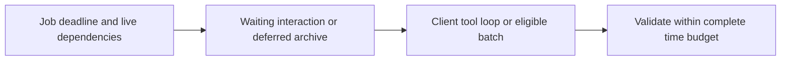
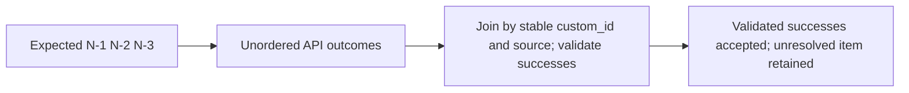
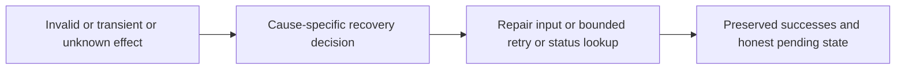
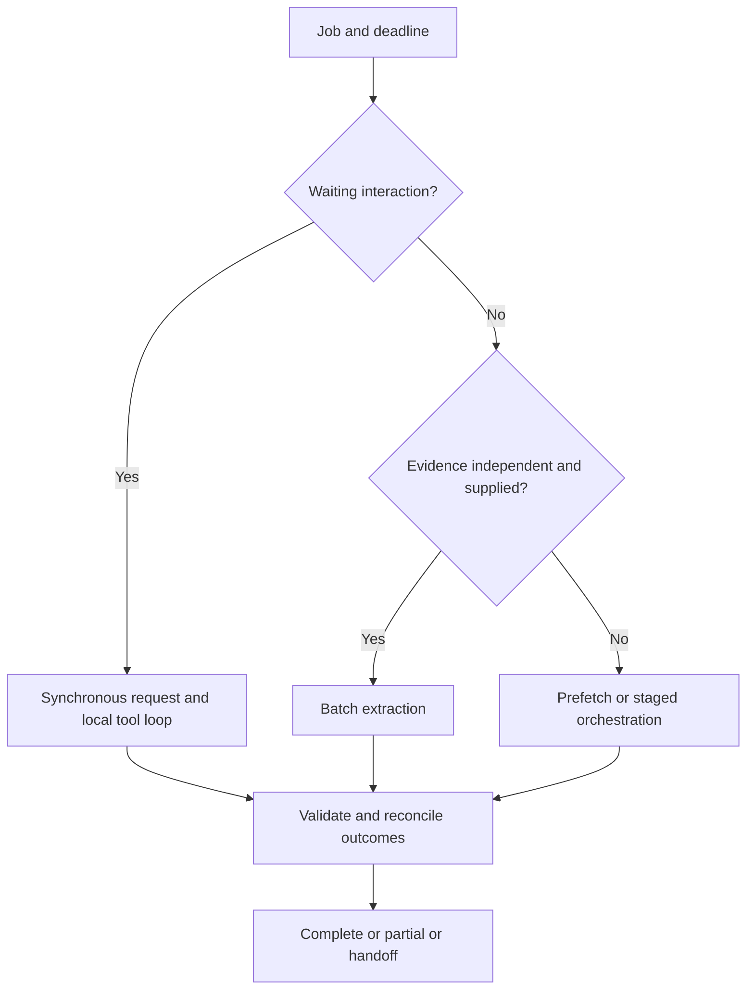

# AS-07 — Route urgent work and overnight work deliberately

**Picture the application: Separate the clerk who is waiting from the overnight pile.** A clerk needs invoice U-1 clarified within two minutes while 500 archived invoices can be processed later. The application routes those two workloads differently and tracks each outcome. A queue is the waiting list of work, not an AI model.


**Apprenticeship:** 45–60 minutes. Synthetic Harbor inputs and architecture; no real API call, transfer or batch submission is claimed. Paper and local Python fixtures test scheduling/reconciliation decisions, not cloud execution. Commit simulation answers before opening the key.


## Before you begin — study mode and prerequisites

**Mode: guided reading and paper reasoning.** No installation, API key, cloud account, repository checkout or terminal command is required to read this lesson or complete its supplied paper exercise. Read the [application primer](00-foundations.md) first if client, backend, tool, state or authorization is unfamiliar. You may open this case directly; earlier application cases are helpful, not a hidden setup dependency.

**Your task:** explain the design and trace the supplied examples. Code-shaped blocks are labeled below so you can distinguish a proposed request, schema, prompt, pseudocode and an illustrative invocation. The optional [local companion lab](../../../06-Labs/08-CCAR-F-architecture-decisions/README.md) has its own Python prerequisites. The separate API/MCP labs require their own setup; completing this reading does not imply running those integrations.

## Business request and starting inputs

Harbor Rentals receives two requests: “Tell a waiting clerk whether invoice U-1 needs clarification within two minutes,” and “Extract 500 archived invoices for tomorrow's reconciliation report.” The report target is 30 hours after document arrival; allow two hours for validation/report assembly. The clerk's workflow can read a booking and ask for missing evidence, but cannot pay an invoice. Archive documents are already available; independent extractions do not need live database tools.

A **queue** stores work waiting for processing. A **worker** takes an item and performs it. A **synchronous** API request returns as part of the waiting interaction; a **batch** holds independent requests for deferred processing. A **tool loop** is different: the model asks your application to execute a tool, your application returns its result, and another model turn can reason about it. Submitting a batch does not execute your local tools mid-request.

```text
U-1: deadline120seconds; missing booking status; needs live read.
N-1..N-500: deadline30hours; source PDFs supplied; independent extraction.
Tool outcome read_booking(U-1): timeout, no side effect.
Separate payment operation PAY-9: timeout, completion unknown.
```

## Learn this application one failure at a time

**Reading exercise — no setup or execution.** These are original exam-style practice decisions, not live exam questions or newly graded bank items. Read the situation, choose A/B/C aloud or on paper, then open the explanation. These checks do not update your stored practice score. Plain explanations follow the technical question; the reference material below remains available for a deeper pass.

### First, picture the simple version

A clerk waits up to two minutes for U-1; 500 independent supplied archive invoices can wait for tomorrow’s report. First route one waiting request through an immediate interaction and one supplied document through deferred extraction.

**Follow the data:** Job identity + deadline + evidence dependency → immediate interaction or deferred lane → per-item validation → report completeness check.

<figure class="concept-flow"><figcaption>Keep this same application in view as each failure adds one justified repair. Read the detailed traces below before opening the existing full architecture drawing.</figcaption><ol><li><strong>Small success</strong><span>One request and an observable result</span></li><li><strong>New failure</strong><span>One assumption no longer holds</span></li><li><strong>Your decision</strong><span>Compare technical mechanisms</span></li><li><strong>Repair and replay</strong><span>Inspect evidence, not assurance</span></li></ol></figure>

### Layer 1 — One cheap lane misses an urgent deadline

The first design puts both the waiting clerk and overnight archive into Message Batches because deferred processing is attractive on cost.

**AS07-LAYER-1 — Original exam-style practice. Choose ONE.** Which routing policy best satisfies latency and dependency constraints?

A. Use asynchronous batches for all jobs because independent work is always urgent-safe.

B. Route by model confidence alone.

C. Keep the waiting interaction synchronous/client-orchestrated; consider eligible independent archive requests for deferred batches after budgeting the full completion path.

<details><summary>What is this asking? — optional plain-language aid</summary>

Identify the specific problem in this scene, then compare what each proposed change actually controls. Explain which option fixes that problem without assuming a completed action, trustworthy fact or permission that the evidence has not established. Choose before opening the worked answer.

</details>

<details><summary>I have chosen — reveal layer 1, its repair and proof</summary>

**Answer: C.** C starts with what the user needs and when. An archive job can wait; a clerk blocked for two minutes cannot rely on a deferred processing window. A ignores time, and B does not establish a deadline or supply missing evidence.

**Replay the changed path:** U-1: 120-second target + live booking read → immediate tool loop. N-1..N-500: supplied PDFs + independent extraction + 30-hour target → evaluate batch window plus validation/report time. A deadline budget is not a guarantee of success.

**See the repaired path — AI proposes; software executes the stated checks:**



**Connect the terms:** Synchronous = the current interaction waits for a response. Deferred = results are collected later. Independent = one request does not require another’s newly produced result.

**Name the owner:** Say which part proposes or explains, which part checks or executes, and which record demonstrates the result. Point to the changed step in the trace before moving to the next layer.

</details>

### Layer 2 — Results come back in a different order

The collector submitted N-1, N-2 and N-3. It receives N-3 success, N-1 error and N-2 success. A positional join attaches the successful amount to the wrong invoice.

**AS07-LAYER-2 — Original exam-style practice. Choose ONE.** Which result ingestion design is most appropriate?

A. Correlate each result using a stable custom_id linked to source/version, then record outcome and validation separately for each job.

B. Zip result positions with submission positions.

C. Assume a terminal batch means all requests succeeded and load all amounts.

<details><summary>What is this asking? — optional plain-language aid</summary>

Identify the specific problem in this scene, then compare what each proposed change actually controls. Explain which option fixes that problem without assuming a completed action, trustworthy fact or permission that the evidence has not established. Choose before opening the worked answer.

</details>

<details><summary>I have chosen — reveal layer 2, its repair and proof</summary>

**Answer: A.** A asks which job this result belongs to, rather than where it sits in a file. B is unsafe when results are unordered. C hides failed items and skips content validation. The application’s ledger must still represent every expected item.

**Replay the changed path:** N-3 → success → validate → accepted; N-1 → errored → classify cause; N-2 → success → validate → accepted. Expected 3 = accepted 2 + unresolved 1. This reconciliation exposes the gap before report publication.

**See the repaired path — AI proposes; software executes the stated checks:**



**Connect the terms:** custom_id = your stable request label. Reconciliation = expected work accounted for by named outcomes, not merely counting returned lines.

**Name the owner:** Say which part proposes or explains, which part checks or executes, and which record demonstrates the result. Point to the changed step in the trace before moving to the next layer.

</details>

### Layer 3 — Different failures need different remedies

One request has an invalid input, one suffers a temporary service error and a separate payment operation PAY-9 times out with unknown completion.

**AS07-LAYER-3 — Original exam-style practice. Choose ONE.** Which recovery policy best matches failure cause and side-effect risk?

A. Retry all three immediately using fresh operation identifiers.

B. Repair invalid requests, retry eligible transient failures with bounds, and reconcile unknown payment effects before any replay.

C. Ask the model to replace missing outputs with likely values.

<details><summary>What is this asking? — optional plain-language aid</summary>

Identify the specific problem in this scene, then compare what each proposed change actually controls. Explain which option fixes that problem without assuming a completed action, trustworthy fact or permission that the evidence has not established. Choose before opening the worked answer.

</details>

<details><summary>I have chosen — reveal layer 3, its repair and proof</summary>

**Answer: B.** B distinguishes bad input, temporary inability to process and uncertain real-world effects. A can repeat a bad request and duplicate a payment. C substitutes invented records for missing work. Preserve successful extractions and keep unresolved states visible.

**Replay the changed path:** Invalid request → correct preparation/configuration before resubmit. Transient read/extraction failure → bounded retry if safe. PAY-9 unknown → provider status lookup using retained operation identity → confirmed receipt or unresolved handoff. No invented completion.

**See the repaired path — AI proposes; software executes the stated checks:**



**Connect the terms:** Retry eligibility = whether repeating this particular operation is safe and likely to help. Backoff = spacing retries rather than repeatedly hammering the service.

**Name the owner:** Say which part proposes or explains, which part checks or executes, and which record demonstrates the result. Point to the changed step in the trace before moving to the next layer.

</details>

### Change one constraint — transfer the decision

**AS07-TRANSFER — Original exam-style practice. Choose ONE.** Each archive request now needs a model-selected live lookup before its final extraction can proceed. What changes?

A. An application must execute the dependency and stage/prefetch evidence where appropriate; a submitted batch does not execute local client tools for you.

B. Nothing; the batch collector automatically runs local tools.

C. Use returned result order to infer which tool should run next.

<details><summary>Reveal the changed-constraint reasoning</summary>

**Answer: A.** A assigns execution to the actual client/runtime. Batch requests may contain supported tool declarations, but a tool proposal is not execution of your local function. B invents orchestration; C invents dependency evidence.

Before continuing, name the condition that changed and explain why the previous design should be retained, simplified or replaced. A remembered answer letter is not the transferable skill.

</details>

### Explain it back and continue

Close the answers. In one minute, tell the story as **request → failure → choice → repair → evidence**. Use ordinary words, then name the technical mechanism. If a step is unclear, revisit that layer before attempting the independent practice below.

**Exact objective drilldowns:** [1.1](../objectives/objective-1.1.md) · [2.2](../objectives/objective-2.2.md) · [4.5](../objectives/objective-4.5.md) · [5.3](../objectives/objective-5.3.md). These links identify relevant tasks; they do not assert that this single story assesses every knowledge/skill bullet.

**Continue the application:** [next connected case](AS-08-resumable-case.md). [Return to the application gallery](../architecture-studio/README.md) · [CCAR-F starting page](../../../01-Curriculum/02-Architect-Track/CCAR-F.md). The existing lab/SIM and reference links later on this page provide the deeper and independent checks.

## Reference and deeper walkthrough

The sections below retain the detailed mechanisms, artifacts and exercises. Use them to inspect a layer after trying its decision; they are not prerequisites to understanding the first scene.


## Connect the simple explanation to technical design choices

Read each row left to right, then explain the technical choice back in plain language. These are original training contrasts using documentation terminology, not quotations or predictions of exam answers. Mechanisms outside the saved objectives are production context, not newly asserted exam requirements.

| In plain language | Technical terms to recognize | Choose between mechanisms using this signal |
|---|---|---|
| Choose immediate or deferred work | Synchronous request versus asynchronous Message Batches | A waiting interaction favors immediate processing. Deferred independent requests may suit batch when the actual processing window fits the deadline. |
| Separate tool dependencies from independent requests | Client-managed tool loop versus prefetched/staged batch work | If a later input depends on executing a model-selected client tool, orchestrate that dependency. Do not generalize this to “batch supports no tools.” |
| Match results to jobs, not their position | custom_id correlation and per-request outcome handling | Result order is not a reliable identity. Preserve successes and handle errors/expiry by individual identity. |
| Budget the full path | Queue delay, processing window, downstream validation and deadline | An advertised processing window is not proof of success before a tighter deadline. Include collection and downstream time. |


## Decide ownership and guarantees

Claude can classify ambiguous document content and decide which evidence is missing. The application owns queue identity, deadlines, retry eligibility, reconciliation and validation. Operations owns report completeness and whether to accept partial coverage. A model's “done” ends neither a pending business transaction nor a mandatory coverage requirement. Mechanical guarantees apply only to the coded checks under their stated assumptions—for example, rejecting publication unless all required IDs have validated outcomes.

## Numbered decision sequence

1. **Separate latency from complexity.** U-1 uses a synchronous interaction plus a bounded read/tool loop. The archive can use independent batch extraction. “It is easy” does not make a two-minute task batch-safe. **Changed phrase:** “needed before the clerk continues” reverses the overnight choice toward interactive processing.
2. **Separate dependencies from independence.** If each archive extraction requires a live booking lookup based on a model-selected identifier, prefetch verified evidence or orchestrate stages outside the batch. A predictable sequence of known reads is a workflow; uncertainty about the next investigation can justify agentic selection. A simple extraction need not become a multi-agent system.
3. **Budget time honestly.** Current Message Batches documentation describes discounted asynchronous processing, possible expiry at its processing window and per-request outcomes. Do not promise success from a nominal window. [Batch processing](https://platform.claude.com/docs/en/build-with-claude/batch-processing) (Tier 1, checked 2026-10-17). Planning with 24 hours processing and two downstream hours leaves four hours for collection under the synthetic 30-hour target. A tighter eight-hour target reverses the batch assumption; merely submitting more frequently cannot remove that processing-window risk.
4. **Use stable identity.** Correlate results by custom_id and processing version, not output order. Preserve successes; retry only eligible failed/expired records with cause-specific changes. The source is part of identity so a revised PDF does not accidentally reuse an old extraction.
5. **Recover by effect type.** A cheap read timeout may justify bounded retry. PAY-9's unknown write requires status/idempotency reconciliation before replay. The cheaper alternative—blind retry—wins only for an operation established as safe to repeat, not because the model is impatient.
6. **Stop with an honest state.** A cost/time budget may end further model turns and trigger handoff. It does not transform incomplete required IDs into success. Report partial coverage or invoke an authorized fallback when the deadline is threatened.



Equivalent text: classify deadline → waiting interaction or deferred work → establish evidence dependencies → choose synchronous, batch or staged execution → validate each identity → complete, partial or handoff. Unknown write effects branch to reconciliation before any replay.

## Read the routing policy and result contract

**Why this appears here:** The queue design needs explicit routing and completion rules. This pseudocode makes those rules inspectable; it is neither a runnable program nor a Message Batches request.

**What to do now:** Trace urgency/dependency to route selection, custom_id to result matching, and required/validation to publication. Predict why an unknown write must not be blindly replayed.

**Mode: inspect and trace; no execution required.** Identify the input, the rule applied by its owner, and the observable outcome. The worked paper exercise below supplies the data.

```text
job = {id, source_version, deadline, needs_live_tool, required}
route urgent -> synchronous; deferred independent -> batch_candidate
result = {custom_id, status, payload, validation, processing_version}
publish_complete only if every required id is succeeded AND validated
read_timeout -> bounded_retry_or_handoff
write_unknown -> reconcile_operation_status_before_any_replay
budget_exhausted -> incomplete_handoff, never fabricated completion
```

This is illustrative application policy, not an SDK signature. The model extraction prompt says: “Use supplied document evidence; return unknown for absent fields with their evidence state. Do not invent booking status. Retain source/page references.” Tool descriptions specify read purpose and empty-versus-failed outcomes.

## Fixture lab: reconcile out-of-order outcomes

This section is a paper design/trace exercise. [Run the separate local Python companion](../../../06-Labs/08-CCAR-F-architecture-decisions/README.md) to observe a small deterministic boundary; then use the existing API/MCP labs for real tool-call practice.


Input: N-3 succeeded/valid; N-1 failed/context-too-large; N-4 expired; N-2 succeeded/valid; U-1 booking read timed out; PAY-9 write timed out.

Expected: retain N-2/N-3; chunk N-1 with page identity; retry/fallback N-4 only within deadline policy; bounded retry U-1's read or hand off; query PAY-9 status before replay. Required N-1/N-4 missing means **partial**, not complete. If status later says PAY-9 committed, record its receipt and do not resend. If the status service itself is unavailable, preserve unknown and escalate. Save route table, deadline arithmetic and recovery ledger. A local fixture can assert these decisions without submitting any job.

## Blind simulation

**AS07-Q1, ordering:** A choose route; B identify deadline/dependencies; C validate ID-correlated outcomes; D reconcile failed/unknown work; E report coverage. Order them.

**AS07-Q2, select exactly two:** A a two-minute live lookup belongs in the overnight batch; B preserve successful custom_ids during partial retry; C batch completion guarantees all records succeeded; D unknown payment completion requires reconciliation before replay.

**AS07-Q3, one best:** The archive target becomes eight hours. A keep the batch and promise it; B use a synchronous/staged design with explicit capacity/fallback assessment; C remove validation; D retry all successes to speed results.

<details><summary>Closed coach key</summary>

Q1 **B→A→C→D→E**. Requirements determine routing; ID validation identifies recovery needs; honest coverage follows recovery. Reporting complete before reconciliation hides gaps.

Q2 **B,D**. B avoids duplicate work; D protects uncertain effects. A violates the interaction budget. C confuses batch terminal state with individual success.

Q3 **B**. A promises unsupported timing. C sacrifices required correctness without solving delivery. D wastes capacity and cannot accelerate failed items. B still needs measured capacity; synchronous is a route choice, not a deadline guarantee.

</details>

## Two-minute listen and converse

Say: “I route by deadline and dependency, not by a fashionable agent pattern. A waiting clerk needs an interaction; independent archives can wait. Every result keeps its identity. A read failure and an unknown payment effect need different recovery. A budget stop means incomplete handoff when work remains. Completeness is a predicate over validated outcomes, not a reassuring model sentence.”

Ask the coach to tighten one deadline, introduce one missing live tool and change one read into a write. Explain each architecture reversal before choosing a product.

Targeted variants: [tool errors/FV-09](../objectives/objective-2.2.md#variant-fv-09), [batch/FV-23](../objectives/objective-4.5.md#variant-fv-23), [partial failures/FV-27](../objectives/objective-5.3.md#variant-fv-27). For unattended consumers see [AS-06](AS-06-ci-review.md). Objectives 1.1, 2.2, 4.5, 5.3; original AS07-Q1–Q3 are formative self-checks, not graded bank/mastery claims. The July v1.0 guide defines certification scope; current API documentation governs implementation details.


[Previous application](AS-06-ci-review.md) · [Application route](README.md) · [Next application](AS-08-resumable-case.md)