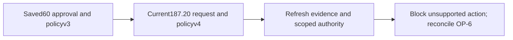
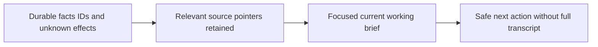
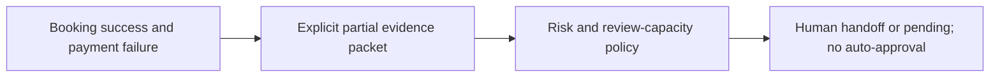
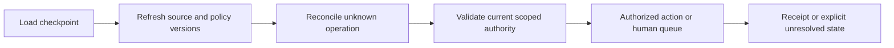

# AS-08 — Resume a long-running case without inheriting false authority

**Picture the application: Pick up a dispute after the world has changed.** Case C-41 resumes after the policy and proposed refund changed; operation OP-6 has an unknown outcome. The application refreshes evidence and reconciles prior work before any newly authorized action. “Resumable” means it can continue work; it does not mean yesterday’s permission is automatically valid.


**Apprenticeship:** 45–60 minutes. Synthetic support records, policies and counts; no actual account, cloud operation or human handoff occurs. Attempt the local fixture and simulation before reading the closed key.


## Before you begin — study mode and prerequisites

**Mode: guided reading and paper reasoning.** No installation, API key, cloud account, repository checkout or terminal command is required to read this lesson or complete its supplied paper exercise. Read the [application primer](00-foundations.md) first if client, backend, tool, state or authorization is unfamiliar. You may open this case directly; earlier application cases are helpful, not a hidden setup dependency.

**Your task:** explain the design and trace the supplied examples. Code-shaped blocks are labeled below so you can distinguish a proposed request, schema, prompt, pseudocode and an illustrative invocation. The optional [local companion lab](../../../06-Labs/08-CCAR-F-architecture-decisions/README.md) has its own Python prerequisites. The separate API/MCP labs require their own setup; completing this reading does not imply running those integrations.

## Request, pause and changed world

Harbor's dispute team asks an assistant to investigate case C-41 across several sessions. A customer disputes a $187.20 charge on booking B-52. The assistant may gather evidence and draft a recommendation; a human must authorize any refund. Yesterday's approval covered a $60 goodwill adjustment under policy v3. The session paused before execution. Today policy v4 applies, the proposed refund is $187.20, the booking record changed and operation OP-6 has unknown completion.

A **checkpoint** saves work state outside conversation. A **manifest** locates those saved records and their status. A **version** identifies which evidence/policy was used. **Idempotency** prevents repeating one logical operation from creating duplicate effects, when the receiving system supports and honors its key. An **approval** grants a specific action to a specific actor under conditions; remembering it is not permission for every future action.

## Learn this application one failure at a time

**Reading exercise — no setup or execution.** These are original exam-style practice decisions, not live exam questions or newly graded bank items. Read the situation, choose A/B/C aloud or on paper, then open the explanation. These checks do not update your stored practice score. Plain explanations follow the technical question; the reference material below remains available for a deeper pass.

### First, picture the simple version

Yesterday’s case C-41 concerned booking B-52. The assistant gathered evidence, saved a checkpoint and paused. Today the user wants to continue. Reading the checkpoint is only the start of resuming safely.

**Follow the data:** Saved facts and pointers → refresh changed sources/authority → reconcile OP-6 → current recommendation → scoped human approval where required.

<figure class="concept-flow"><figcaption>Keep this same application in view as each failure adds one justified repair. Read the detailed traces below before opening the existing full architecture drawing.</figcaption><ol><li><strong>Small success</strong><span>One request and an observable result</span></li><li><strong>New failure</strong><span>One assumption no longer holds</span></li><li><strong>Your decision</strong><span>Compare technical mechanisms</span></li><li><strong>Repair and replay</strong><span>Inspect evidence, not assurance</span></li></ol></figure>

### Layer 1 — The world changed while the session slept

Policy changed from v3 to v4. A saved approval covers a USD 60 goodwill adjustment, but the resumed proposal is USD 187.20.

**AS08-LAYER-1 — Original exam-style practice. Choose ONE.** Which resume policy best preserves useful work without treating stale context as current authorization?

A. Restore the transcript and execute any amount mentioned after the word approved.

B. Reload the checkpoint, preserve exact unresolved state, refresh applicable evidence/policy and revalidate authorization for the current action.

C. Delete all history and ask the customer to repeat everything.

<details><summary>What is this asking? — optional plain-language aid</summary>

Identify the specific problem in this scene, then compare what each proposed change actually controls. Explain which option fixes that problem without assuming a completed action, trustworthy fact or permission that the evidence has not established. Choose before opening the worked answer.

</details>

<details><summary>I have chosen — reveal layer 1, its repair and proof</summary>

**Answer: B.** B keeps useful facts while checking what may have changed. An approval is for a particular action under conditions; USD 60 under v3 does not automatically cover USD 187.20 under v4. A broadens authority without evidence. C discards valid work unnecessarily.

**Replay the changed path:** Checkpoint: approved60/policyv3, OP-6 unknown. Current: requested187.20/policyv4. Result: new action not authorized by old approval; pending reconciliation and current decision, not auto-execute.

**See the repaired path — AI proposes; software executes the stated checks:**



**Connect the terms:** Freshness = whether evidence still applies now. Scoped approval = permission tied to action, amount, actor and conditions.

**Name the owner:** Say which part proposes or explains, which part checks or executes, and which record demonstrates the result. Point to the changed step in the trace before moving to the next layer.

</details>

### Layer 2 — The summary loses the one fact that matters

A long transcript is shortened to “refund discussed, customer verified.” It drops the unknown outcome of OP-6 and the precise approved amount.

**AS08-LAYER-2 — Original exam-style practice. Choose ONE.** Which context-management strategy best supports safe continuation?

A. Preserve all raw logs in every prompt regardless of size.

B. Keep only the latest model conclusion because it is shortest.

C. Retain exact decision-critical IDs, amounts, commitments, unknown effects and source pointers in durable state; provide a focused current working brief.

<details><summary>What is this asking? — optional plain-language aid</summary>

Identify the specific problem in this scene, then compare what each proposed change actually controls. Explain which option fixes that problem without assuming a completed action, trustworthy fact or permission that the evidence has not established. Choose before opening the worked answer.

</details>

<details><summary>I have chosen — reveal layer 2, its repair and proof</summary>

**Answer: C.** C shortens repetition without deleting the details that govern the next action. A crowds out relevant reasoning. B can preserve a conclusion while losing its limitations. Durable business state must remain available even when conversational context is compacted.

**Replay the changed path:** Brief: C-41/B-52; requested187.20; approved60/v3 now stale; OP-6 unknown; next safe step status lookup; source pointers retained. A new session can identify the blocked action without rereading every chat turn.

**See the repaired path — AI proposes; software executes the stated checks:**



**Connect the terms:** Compaction = reducing working conversation. Durable checkpoint = application-owned state that records what actually remains true, uncertain or pending.

**Name the owner:** Say which part proposes or explains, which part checks or executes, and which record demonstrates the result. Point to the changed step in the trace before moving to the next layer.

</details>

### Layer 3 — A partial specialist return looks final

A booking specialist supplies evidence, a payment specialist fails, and the summary still says “complete investigation.” Review capacity is also limited today.

**AS08-LAYER-3 — Original exam-style practice. Choose ONE.** What is the most appropriate finalization policy for the unresolved high-impact payment decision?

A. Preserve successful evidence, explicitly propagate the payment gap and use a risk/capacity-aware human handoff or pending policy rather than auto-approval.

B. Treat the successful specialist as majority evidence that all work is complete.

C. Lower the confidence threshold until the review queue empties.

<details><summary>What is this asking? — optional plain-language aid</summary>

Identify the specific problem in this scene, then compare what each proposed change actually controls. Explain which option fixes that problem without assuming a completed action, trustworthy fact or permission that the evidence has not established. Choose before opening the worked answer.

</details>

<details><summary>I have chosen — reveal layer 3, its repair and proof</summary>

**Answer: A.** A tells the next owner what remains unknown and why action is blocked. B turns partial evidence into false completion. C changes workload by silently accepting more risk. If human review is full, the system needs an explicit hold/overflow policy.

**Replay the changed path:** Handoff packet: question, source-linked booking findings, payment timeout/OP-6 state, checks performed, current policy, decision requested. Queue full → pending with owner/escalation, no refund inferred from a missing reviewer.

**See the repaired path — AI proposes; software executes the stated checks:**



**Connect the terms:** Calibration = comparing stated confidence with observed accuracy on representative labeled examples. Capacity is an operational constraint, not evidence of correctness.

**Name the owner:** Say which part proposes or explains, which part checks or executes, and which record demonstrates the result. Point to the changed step in the trace before moving to the next layer.

</details>

### Change one constraint — transfer the decision

**AS08-TRANSFER — Original exam-style practice. Choose ONE.** A stale source is only a nonessential narrative detail and cannot affect the current decision. Must the application restart every investigation?

A. Yes, any age requires deleting all work.

B. No; assess applicability, refresh decision-critical evidence and retain unaffected verified work.

C. No; ignore freshness for every source.

<details><summary>Reveal the changed-constraint reasoning</summary>

**Answer: B.** B makes refresh proportionate to what can change the decision. A wastes valid work; C risks acting on changed policy, ownership or transaction facts.

Before continuing, name the condition that changed and explain why the previous design should be retained, simplified or replaced. A remembered answer letter is not the transferable skill.

</details>

### Explain it back and continue

Close the answers. In one minute, tell the story as **request → failure → choice → repair → evidence**. Use ordinary words, then name the technical mechanism. If a step is unclear, revisit that layer before attempting the independent practice below.

**Exact objective drilldowns:** [1.7](../objectives/objective-1.7.md) · [5.1](../objectives/objective-5.1.md) · [5.2](../objectives/objective-5.2.md) · [5.3](../objectives/objective-5.3.md) · [5.5](../objectives/objective-5.5.md) · [5.6](../objectives/objective-5.6.md). These links identify relevant tasks; they do not assert that this single story assesses every knowledge/skill bullet.

**Continue the application:** [next connected case](README.md). [Return to the application gallery](../architecture-studio/README.md) · [CCAR-F starting page](../../../01-Curriculum/02-Architect-Track/CCAR-F.md). The existing lab/SIM and reference links later on this page provide the deeper and independent checks.

## Reference and deeper walkthrough

The sections below retain the detailed mechanisms, artifacts and exercises. Use them to inspect a layer after trying its decision; they are not prerequisites to understanding the first scene.


## Connect the simple explanation to technical design choices

Read each row left to right, then explain the technical choice back in plain language. These are original training contrasts using documentation terminology, not quotations or predictions of exam answers. Mechanisms outside the saved objectives are production context, not newly asserted exam requirements.

| In plain language | Technical terms to recognize | Choose between mechanisms using this signal |
|---|---|---|
| Remember work without trusting stale facts | Durable checkpoint versus conversation context and source freshness | Reloading history restores observations, not current truth. Refresh changed source/policy evidence. |
| Check the old effect before issuing a new one | Operation reconciliation and idempotent recovery | Unknown is neither failed nor successful. Authorized status lookup establishes what happened before replay. |
| Validate permission for this exact action | Scoped authorization and execution-time revalidation | Old approval may remain valid only if action, actor, policy and validity conditions still match. Resume itself is not approval. |
| Send the right uncertainty to people | Calibrated evaluation, holdout data and capacity-aware handoff | Model confidence is a signal, not a proven correctness probability. Review capacity needs an explicit overflow policy, not silent auto-approval. |


## Allocate the decisions

The model can summarize evidence, identify contradictions and recommend investigation. Application code checks approval scope, current policy version and transaction status before enabling action. The human owns exceptions and financial authorization. Stored state supports reasoning; it cannot confer authority. Durable notes and careful compaction help retain important context, but neither establishes current truth. [Anthropic context engineering](https://www.anthropic.com/engineering/effective-context-engineering-for-ai-agents) (Tier 1, checked 2026-10-17).

## Decision sequence and reversals

1. **Checkpoint exact facts.** Save IDs, amount, customer expectation, sources/dates, unresolved contradictions, policy/repository versions and pending operation. A short summary saying “refund approved” destroys the approval boundary. Keep a source-linked ledger plus concise narrative.
2. **Resume by validation.** Load the manifest, confirm referenced records exist, compare versions and reload changed evidence. A resumed session is convenient when earlier facts remain valid. A fresh session with a structured evidence packet wins when old tool results are broadly stale.
3. **Reconcile OP-6.** Unknown completion requires status/receipt investigation, not another refund. If committed, preserve receipt and stop replay. If definitively not committed, verify current authority before retrying. A read-only evidence lookup can use bounded transient retries; it does not carry the same duplicate-effect risk. Status reads must themselves be authorized; reconciliation does not grant permission for a new effect.
4. **Recheck authority before effect.** Yesterday's $60/v3 approval does not authorize today's $187.20/v4 recommendation. Obtain fresh scoped approval or hand off. If the exact action, actor, policy and approval validity remain unchanged, a valid existing authorization may suffice; “resume” alone is neither automatic approval nor automatic invalidation.
5. **Route review using measured risk.** A model's confidence is a signal. Compare labeled outcomes by document type/field, reserve holdout data and keep random high-confidence sampling. Clear criteria and representative examples improve judgment; arbitrary confidence thresholds do not create safety. [Evaluation guidance](https://platform.claude.com/docs/en/test-and-evaluate/develop-tests) (Tier 1).
6. **Respect capacity and user preference.** Explicit human requests go to handoff. If review demand exceeds capacity, preserve a visible queue or reduce intake; do not auto-approve merely to empty it. Cost/time limits can stop investigation with a structured incomplete handoff rather than falsely marking the case resolved.



Equivalent text: reload saved state → verify freshness → reconcile uncertain prior effect → check current authorization → authorized action or human queue → record evidence-backed outcome. A missing state file or inaccessible status source preserves uncertainty and may block action.

## Read the checkpoint and resume contract

**Why this appears here:** The resume design needs a durable record of what was observed, approved and still unknown. This fictional checkpoint shows those distinctions; saving JSON does not implement persistence, freshness or authorization by itself.

**What to do now:** Compare the saved and current policy versions, approval scope and pending operation. Predict which facts must be refreshed and which uncertain effect must be reconciled before another action.

**Mode: inspect and trace; no execution required.** Identify the input, the rule applied by its owner, and the observable outcome. The worked paper exercise below supplies the data.

```json
{
  "case_id":"C-41","booking_id":"B-52","requested_amount":187.20,
  "facts_source":"booking-snapshot-12","observed_at":"2026-10-16",
  "policy_version":"v3","current_policy_seen":"v4",
  "approval":{"amount":60,"policy":"v3","actor":"reviewer-A"},
  "pending_operation":{"id":"OP-6","status":"unknown"},
  "phase":"resume_requires_refresh_and_authority_check"
}
```

Prompt for the resumed investigator: “Use saved facts as dated evidence. Re-read changed booking/policy records. Preserve contradictions and unknown operation state. Return recommendation, sources, unresolved questions and authorization needed; do not describe a refund as completed without its receipt.” The executable gate separately compares action amount/policy/actor/approval validity and blocks when mismatched. This is original application architecture, not a claimed built-in manifest or authorization API.

## Paper lab — supplied inputs and expected outcomes

This section is a paper design/trace exercise. [Run the separate local Python companion](../../../06-Labs/08-CCAR-F-architecture-decisions/README.md) to observe a small deterministic boundary; then use the existing API/MCP labs for real tool-call practice.


**Input A:** the checkpoint above plus policy v4 and OP-6 status unavailable. Expected output: refresh evidence; approval mismatch; operation unknown; no refund; human-ready handoff containing C-41, B-52, $187.20, old approval scope, source dates and failed status attempt.

**Input B:** OP-6 later returns committed with receipt R-6. Expected: retain receipt; do not issue another payment; investigate whether the committed amount/authority requires human follow-up. A receipt proves the effect, not that its historical authorization was correct.

**Review fixture:** high-confidence printed IDs have 49/50 correct labels (98%); high-confidence handwritten amounts have 14/20 (70%). No global “confidence ≥0.9” auto-route is justified. Keep weak amounts in review; evaluate any printed-ID automation on separate holdout and continue sampling. These small counts do not establish a universally safe threshold. Five mandatory cases need review; capacity is three: queue two explicitly or reduce intake, never silently approve them. Save the state-transition table, updated checkpoint, handoff and measured-risk explanation. Local fixtures can check these predicates without executing a payment.

## Blind simulation

**AS08-Q1, ordering:** A check scoped authority for proposed action; B reload checkpoint; C refresh changed facts/policy and reconcile unknown effect; D authorized action or explicit handoff; E record receipt/unresolved outcome. Order them.

**AS08-Q2, select exactly two:** A retain exact amount, sources and old approval scope; B treat last session's “approved” summary as universal authority; C prioritize review using measured segment errors and preserve overflow; D equate model confidence with measured correctness.

**AS08-Q3, one best:** OP-6 returns committed while your new approval request is pending. A resend with a new ID; B hide the receipt because approval is pending; C record the effect, avoid replay and send the discrepancy for human resolution; D declare the whole case properly authorized.

<details><summary>Closed coach key</summary>

Q1 **B→C→A→D→E**. Saved state must be refreshed before authority is evaluated against the current action. Acting first risks duplicated or unauthorized effects; recording alone cannot repair that ordering.

Q2 **A,C**. A preserves the facts needed for recovery; C uses evidence and exposes capacity limits. B broadens a scoped approval without authority. D mistakes a model signal for validation.

Q3 **C**. A risks duplication; B suppresses material evidence; D confuses settlement with authorization. C establishes the actual effect while preserving the unresolved governance question.

</details>

## Two-minute listen and converse

Say: “A checkpoint remembers what we believed, not what is true today. I refresh evidence, reconcile uncertain effects and check authorization for this exact action. A receipt proves an effect; it does not prove that approval was correct. Confidence becomes useful through labeled outcomes. Review overflow remains visible. If investigation stops, my handoff says what is known, missing and owned by a human.”

Ask the coach to change the approval amount, expire a source and remove one state file. Explain which checks block action and which facts can still be reused.

Targeted existing variants: [context/FV-25](../objectives/objective-5.1.md#variant-fv-25), [handoff/FV-26](../objectives/objective-5.2.md#variant-fv-26), [state/FV-28](../objectives/objective-5.4.md#variant-fv-28), [review/FV-29](../objectives/objective-5.5.md#variant-fv-29), [provenance/FV-30](../objectives/objective-5.6.md#variant-fv-30). Objectives 1.4, 1.7, 5.1–5.6. Original AS08-Q1–Q3 are formative self-checks, not graded-bank imports/mastery claims. The July v1.0 guide remains the exam-scope baseline; current documentation informs mechanisms without expanding certification claims.


[Previous application](AS-07-work-queue.md) · [Application route](README.md) · [Continue: full learning journey](../learning-journey.md)