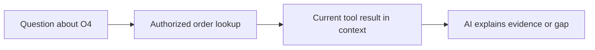
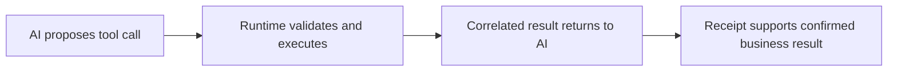
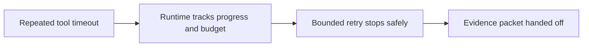

# 1 — Follow a refund from the screen to a receipt

[Course home](README.md) · [Next: tool contracts](02-tools-and-mcp.md)

**Prerequisite:** recognize a web page sending a request to an application. No programming experience or setup is required. Allow 25 minutes, including answering aloud. **You will be able to:** name the owner of interpretation, authorization, execution and completion.

## Picture the application

A service representative opens case C17 and asks, “Refund the damaged order O4 for $120.” The **application** is the whole working service: case screen, backend code, records, model connection and payment integration. Claude is one component. The backend is the program behind the screen that reads records, checks permissions and calls other services.

The starting data is a request, case ID, authenticated representative identity and order ID. The desired result is a recorded, authorized payment action and an explanation. A sentence saying “refunded” is insufficient evidence of payment.

## Learn this application one failure at a time

**Reading exercise — no setup or execution.** These are original exam-style practice decisions, not live exam questions or newly graded bank items. Read the situation, choose A/B/C aloud or on paper, then open the explanation. These checks do not update your stored practice score. Plain explanations follow the technical question; the reference material below remains available for a deeper pass.

### First, picture the simple version

A representative wants an explanation for a damaged order. Start with screen → backend → current order lookup → visible explanation. A fixed lookup works before the job requires open-ended investigation.

**Follow the data:** Customer message → backend supplies relevant facts/tools → Claude proposes a next step → runtime executes allowed tool → matching result returns → Claude continues or concludes.

<figure class="concept-flow"><figcaption>Keep this same application in view as each failure adds one justified repair. Read the detailed traces below before opening the existing full architecture drawing.</figcaption><ol><li><strong>Small success</strong><span>One request and an observable result</span></li><li><strong>New failure</strong><span>One assumption no longer holds</span></li><li><strong>Your decision</strong><span>Compare technical mechanisms</span></li><li><strong>Repair and replay</strong><span>Inspect evidence, not assurance</span></li></ol></figure>

### Layer 1 — The model knows the question but not the order

The first chatbot answers from general knowledge. It has never read order O4, yet says the package was delivered yesterday.

**CC01-LAYER-1 — Original exam-style practice. Choose ONE.** Which design most directly supplies the missing factual basis for this response?

A. Use an authorized order lookup and include its result in the model context before an evidence-based answer.

B. Ask the model to be more certain.

C. Add a coordinator with no access to order data.

<details><summary>What is this asking? — optional plain-language aid</summary>

Identify the specific problem in this scene, then compare what each proposed change actually controls. Explain which option fixes that problem without assuming a completed action, trustworthy fact or permission that the evidence has not established. Choose before opening the worked answer.

</details>

<details><summary>I have chosen — reveal layer 1, its repair and proof</summary>

**Answer: A.** A fetches the fact from the system that holds it. B changes wording without new evidence. C adds a role but leaves the same missing information. The backend still limits whose order can be read.

**Replay the changed path:** Before: complaint → invented delivery date. After: lookup_order(O4) → delivered_at/source timestamp → explain that observation. Failed lookup → explicit unavailable state, not an invented date.

**See the repaired path — AI proposes; software executes the stated checks:**



**Connect the terms:** Model knowledge is not live application data. A tool is an application capability that can supply current evidence.

**Name the owner:** Say which part proposes or explains, which part checks or executes, and which record demonstrates the result. Point to the changed step in the trace before moving to the next layer.

</details>

### Layer 2 — A proposed call is mistaken for work completed

Claude requests issue_credit. The UI immediately says “credited,” although the application has not executed the request.

**CC01-LAYER-2 — Original exam-style practice. Choose ONE.** What is the correct client-tool loop behavior before claiming a confirmed credit?

A. Treat a tool_use response as a provider receipt.

B. Execute the allowed call in the runtime, return a correlated tool result, and establish the business outcome before a success claim.

C. Stop whenever the assistant emits any text.

<details><summary>What is this asking? — optional plain-language aid</summary>

Identify the specific problem in this scene, then compare what each proposed change actually controls. Explain which option fixes that problem without assuming a completed action, trustworthy fact or permission that the evidence has not established. Choose before opening the worked answer.

</details>

<details><summary>I have chosen — reveal layer 2, its repair and proof</summary>

**Answer: B.** B separates proposing, executing and proving. A tool request says what the model wants the application to do; it does not show the payment happened. C can interrupt an unfinished investigation or mix text with pending work.

**Replay the changed path:** tool request → runtime checks → provider result → matching tool_result → next model turn. Receipt CR1 supports “credited”; timeout supports “not yet confirmed.” Inspect the receipt and unresolved state.

**See the repaired path — AI proposes; software executes the stated checks:**



**Connect the terms:** Correlation = linking the result to the specific requested call. A model stop condition differs from a business completion condition.

**Name the owner:** Say which part proposes or explains, which part checks or executes, and which record demonstrates the result. Point to the changed step in the trace before moving to the next layer.

</details>

### Layer 3 — The investigation never stops

The order service repeatedly fails. The agent keeps selecting the same read tool with no additional evidence and no progress.

**CC01-LAYER-3 — Original exam-style practice. Choose ONE.** Which control best bounds this non-progressing agentic loop?

A. Tell the model to continue indefinitely until confident.

B. Report success when the turn budget is exhausted.

C. Use explicit completion/error states, turn/time budgets and bounded retry/escalation with preserved evidence.

<details><summary>What is this asking? — optional plain-language aid</summary>

Identify the specific problem in this scene, then compare what each proposed change actually controls. Explain which option fixes that problem without assuming a completed action, trustworthy fact or permission that the evidence has not established. Choose before opening the worked answer.

</details>

<details><summary>I have chosen — reveal layer 3, its repair and proof</summary>

**Answer: C.** C prevents endless activity without pretending the job succeeded. A can consume time and money without new facts. B relabels failure as success. A bound is a reason to stop or hand off, not a receipt.

**Replay the changed path:** Read attempt1 timeout; attempt2 timeout; retry budget reached → handoff containing order ID, observed errors and missing fact. Successful earlier ownership check stays available.

**See the repaired path — AI proposes; software executes the stated checks:**



**Connect the terms:** Agentic loop = the application repeatedly supplies results so the model can choose the next action. A budget limits activity; evidence determines completion.

**Name the owner:** Say which part proposes or explains, which part checks or executes, and which record demonstrates the result. Point to the changed step in the trace before moving to the next layer.

</details>

### Change one constraint — transfer the decision

**CC01-TRANSFER — Original exam-style practice. Choose ONE.** The new job always needs the same authenticated balance lookup and fixed rendering. Which starting design fits?

A. A fixed workflow, introducing agentic reasoning only if variable investigation is actually needed.

B. Unbounded multi-agent research.

C. Model-only recall of past balances.

<details><summary>Reveal the changed-constraint reasoning</summary>

**Answer: A.** A follows predictable steps. B adds complexity without need; C lacks authoritative current data.

Before continuing, name the condition that changed and explain why the previous design should be retained, simplified or replaced. A remembered answer letter is not the transferable skill.

</details>

### Explain it back and continue

Close the answers. In one minute, tell the story as **request → failure → choice → repair → evidence**. Use ordinary words, then name the technical mechanism. If a step is unclear, revisit that layer before attempting the independent practice below.

**Exact objective drilldowns:** [1.1](../objectives/objective-1.1.md) · [1.4](../objectives/objective-1.4.md). These links identify relevant tasks; they do not assert that this single story assesses every knowledge/skill bullet.

**Continue the application:** [next connected case](../architecture-studio/AS-01-action-service.md). [Return to the application gallery](../architecture-studio/README.md) · [CCAR-F starting page](../../../01-Curriculum/02-Architect-Track/CCAR-F.md). The existing lab/SIM and reference links later on this page provide the deeper and independent checks.

## Reference and deeper walkthrough

The sections below retain the detailed mechanisms, artifacts and exercises. Use them to inspect a layer after trying its decision; they are not prerequisites to understanding the first scene.


## Four checks before delegating

Anthropic, Rick Dakan and Joseph Feller's [AI Fluency framework](https://academy.claude.com/courses/ai-fluency-framework-foundations) names four competencies: **Delegation, Description, Discernment and Diligence**. The following refund application is our own teaching example. It connects the framework to architectural responsibility; it does not add an official CCAR-F objective.

| Check | Apply it to case C17 | Architectural consequence |
|---|---|---|
| Delegation | Should Claude interpret the customer's wording, or is this already a fixed lookup? | A deterministic screen/API may suffice for a known operation. Delegate interpretation where it adds value. |
| Description | What does “refund $120” mean, with which currency, order, policy and constraints? | State the task and tool contract precisely; keep required authorization in application code. |
| Discernment | Did the payment tool actually return receipt CR1, or only a timeout? | Check the observed result and evidence; a plausible answer is insufficient. |
| Diligence | Who is responsible for permitted data use, review, disclosure and the resulting action? | Keep access controls, human authority, accountable ownership and appropriate records explicit. |

**Explain aloud:** why would a beautifully described prompt still fail to enforce a required refund prerequisite? Description helps the model understand the task; the backend must still block an unauthorized action. For a guided official companion and the next practice step, return to [the CCAR-F course chooser](../../../01-Curriculum/02-Architect-Track/CCAR-F.md#choose-official-courses-by-the-decision-you-need-to-learn).

## Trace the data and ownership

<figure class="concept-flow"><figcaption>Follow the responsibility and data, left to right; on a phone, top to bottom.</figcaption><ol><li><strong>Screen</strong><span>Customer requests $120</span></li><li><strong>Backend</strong><span>Verify customer and order</span></li><li><strong>Claude</strong><span>Propose a tool call</span></li><li><strong>Runtime gate</strong><span>Authorize exact action</span></li><li><strong>Payment tool</strong><span>Return receipt or uncertainty</span></li><li><strong>Backend</strong><span>Record outcome before reply</span></li></ol></figure>

```text
Representative / case C17: refund order O4, USD 120
  → Backend: authenticate caller; retrieve order ownership and policy
  → Claude: interpret the request using permitted evidence and tool descriptions
  → Tool-use request: propose issue_credit(order O4, amount 12000 cents)
  → Backend: validate arguments, caller authority and duplicate-operation key
  → Payment service: execute approved request; return receipt CR1
  → Backend: record receipt and return the tool outcome to Claude
  → Claude: explain the recorded result or unresolved failure
  → Case screen: show receipt CR1 and current case state
```

**Why cents?** A currency amount needs an explicit unit. USD 120 and 120 cents are different requests. An operation key identifies one intended action so a network retry does not accidentally create a second credit. Those are application design choices; the model does not establish them merely by mentioning them.

## Translate understanding into technical choices

| Plain decision | Technical mechanism | When the alternative fits |
|---|---|---|
| Let Claude interpret an unfamiliar description; make code enforce the refund ceiling. | Probabilistic reasoning plus deterministic authorization and validation. | A fixed lookup can skip model interpretation entirely when inputs already identify an exact permitted operation. |
| Read the requested action, execute it, then return evidence. | Client `tool_use` and matching `tool_result` blocks in the Messages API. | A server tool has its own execution lifecycle; do not assume every tool runs in your backend. |
| Continue after tool evidence; finish when the model ends its turn. | Inspect `stop_reason`, distinguishing `tool_use`, `end_turn` and exceptional outcomes. | A budget watchdog interrupts runaway work; it is not the normal success condition. |
| Have verification finish before payment; investigate independent policy questions concurrently. | Sequential dependency versus parallel independent work. | A coordinator is useful when separate investigations require integration; extra agents are unnecessary for one simple lookup. |

A response can contain readable text and still request a tool. Do not terminate because text exists or because it contains “done.” Preserve the assistant tool request and return results linked by request ID. See [the official tool-call lifecycle](https://platform.claude.com/docs/en/agents-and-tools/tool-use/handle-tool-calls). Handle interrupted generation separately from successful completion; see [stop reasons](https://platform.claude.com/docs/en/build-with-claude/handling-stop-reasons).

## Read a small contract before building anything

**Illustrative application contract, not an SDK signature.** This is a paper description of responsibility; you are not being asked to configure a service.

```text
Input: authenticated actor, case_id, order_id, currency, amount_in_cents, operation_key
Preconditions: actor may act on case; order belongs to verified customer; amount within authority
Success evidence: payment receipt + stored case update
Failure evidence: category, whether execution is known, safe next action
```

A prompt can explain a policy. A hook may intercept a tool in a supported runtime. The payment backend must still enforce its business authorization boundary. A prompt, hook and backend permission check are distinct controls, not interchangeable names.

## Change the constraint — decide before revealing

<details><summary>The payment request times out after submission. Should the agent immediately submit it again?</summary>

No. The action may have succeeded while its response was lost. Reconcile using the operation key or payment status, then retry only under the service's safe retry contract. “Transient error” does not by itself prove a write is safe to repeat.

</details>

<details><summary>The user now asks only “Where is my order?” Should you retain the refund workflow?</summary>

Use a read-only lookup and explanation. Remove unnecessary write authority from that path. The desired outcome changed, so the smallest suitable architecture changed too.

</details>

<details><summary>The model reaches its token limit before returning a usable final response. Is the case complete?</summary>

No. Treat the generation as interrupted and inspect what actions actually occurred. Do not infer business completion from the generation stopping.

</details>

## Recall and apply

**Mnemonic: I-V-A-E — Interpret, Validate, Act, Evidence.** It is a teaching reminder, not an official framework. Explain which component owns each verb without looking above. Then describe why a tool request is not a payment receipt.

Continue with [objective 1.1: loop protocol](../objectives/objective-1.1.md), [1.4: enforced handoffs](../objectives/objective-1.4.md) and [1.2: coordinator patterns](../objectives/objective-1.2.md). Apply it in [the action-service case](../architecture-studio/AS-01-action-service.md), then [customer-support SIM](../../../04-Simulations/02-CCAR-F-Architect-Foundations/SIM-02-customer-support-agent.md) and [Lab 08](../../../06-Labs/08-CCAR-F-architecture-decisions/README.md). Return to [the decision atlas](../decision-atlas.md) to compare failure paths.

## Drill into the exact mechanism

[Trace the exact loop lifecycle](../objectives/objective-1.1.md#lifecycle) · [Inspect the prerequisite gate](../objectives/objective-1.4.md#gate)