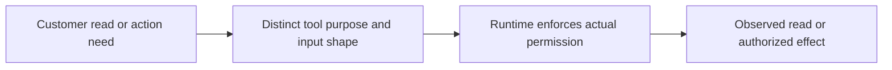
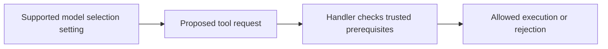
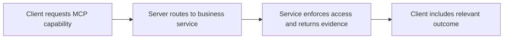

# 2 — Give the assistant tools it can distinguish

[Previous: application loop](01-application-and-agent-loop.md) · [Course home](README.md) · [Next: code workflow](03-code-workflows-and-ci.md)

**Prerequisite:** Lesson 1's distinction between a tool request and execution. No setup is required; this is a 25-minute reading and reasoning exercise. **You will be able to:** distinguish routing guidance, interface validation, execution permission and error recovery.

## The scene: three buttons behind one support conversation

The representative asks, “What did the customer buy, and can we refund it?” Imagine three application buttons: find customer, retrieve order, issue credit. The assistant sees tool definitions instead of buttons. If every tool is described as “process customer data,” it has little basis for selecting the right operation.

Start with a specific read tool: `get_order` retrieves a known order's customer ID, payment status, currency and refundable balance. It does not issue a credit. A separate `issue_credit` performs an authorized action. Its description should explain its prerequisites and boundary; its implementation must enforce them.

## Learn this application one failure at a time

**Reading exercise — no setup or execution.** These are original exam-style practice decisions, not live exam questions or newly graded bank items. Read the situation, choose A/B/C aloud or on paper, then open the explanation. These checks do not update your stored practice score. Plain explanations follow the technical question; the reference material below remains available for a deeper pass.

### First, picture the simple version

Behind the support conversation are three capabilities: read an order, read a policy and issue an eligible credit. Start by reading one order. These names describe program functions, not buttons Claude can magically press without a runtime.

**Follow the data:** Need → tool description and input schema → proposed call → runtime permissions/business checks → actual execution → explicit result → response.

<figure class="concept-flow"><figcaption>Keep this same application in view as each failure adds one justified repair. Read the detailed traces below before opening the existing full architecture drawing.</figcaption><ol><li><strong>Small success</strong><span>One request and an observable result</span></li><li><strong>New failure</strong><span>One assumption no longer holds</span></li><li><strong>Your decision</strong><span>Compare technical mechanisms</span></li><li><strong>Repair and replay</strong><span>Inspect evidence, not assurance</span></li></ol></figure>

### Layer 1 — The names do not tell the model what is safe

Two tools both say “manage customer request.” One only reads an order; the other issues money. Read-only questions repeatedly select the write tool.

**CC02-LAYER-1 — Original exam-style practice. Choose ONE.** Which tool-interface change is most appropriate before tuning selection prompts?

A. Retain vague descriptions but make the output more verbose.

B. Use distinct task-oriented descriptions, explicit input schemas, side-effect boundaries and task-appropriate tool availability.

C. Force the write tool on every turn.

<details><summary>What is this asking? — optional plain-language aid</summary>

Identify the specific problem in this scene, then compare what each proposed change actually controls. Explain which option fixes that problem without assuming a completed action, trustworthy fact or permission that the evidence has not established. Choose before opening the worked answer.

</details>

<details><summary>I have chosen — reveal layer 1, its repair and proof</summary>

**Answer: B.** B tells the model what each choice is for and limits unnecessary capabilities. A does not remove ambiguity. C selects a capability regardless of the user’s actual need. A schema explains inputs; it does not grant permission to execute them.

**Replay the changed path:** lookup_order: read status for verified order; no changes. issue_credit: propose eligible credit, requires backend enforcement. “Where is O4?” → lookup_order → status, zero payment calls.

**See the repaired path — AI proposes; software executes the stated checks:**



**Connect the terms:** Tool description = when to use a capability. Input schema = what arguments it accepts. Execution policy = whether this call may actually run.

**Name the owner:** Say which part proposes or explains, which part checks or executes, and which record demonstrates the result. Point to the changed step in the trace before moving to the next layer.

</details>

### Layer 2 — A selection setting is used as an authorization rule

The team configures a supported named tool_choice for extraction, then assumes the later credit must be safe because the model followed that choice.

**CC02-LAYER-2 — Original exam-style practice. Choose ONE.** Which distinction correctly describes tool_choice and dependent-action enforcement?

A. tool_choice authorizes the account and proves prior checks passed.

B. Forcing one tool eliminates the need to validate its arguments.

C. tool_choice constrains selection where supported; trusted application state and execution checks enforce prerequisites and authorization.

<details><summary>What is this asking? — optional plain-language aid</summary>

Identify the specific problem in this scene, then compare what each proposed change actually controls. Explain which option fixes that problem without assuming a completed action, trustworthy fact or permission that the evidence has not established. Choose before opening the worked answer.

</details>

<details><summary>I have chosen — reveal layer 2, its repair and proof</summary>

**Answer: C.** C separates the model request from the program’s authority. A invents verification that the setting does not perform. B confuses selecting a function with giving it correct input. Validate support for the actual model/configuration before using a forced setting.

**Replay the changed path:** Named read tool selected → read executes → verified result stored by runtime → later write handler checks that trusted state. An invented verified:true argument cannot create it.

**See the repaired path — AI proposes; software executes the stated checks:**



**Connect the terms:** Selection = which capability the model may request. Prerequisite = a real condition that must already be established before a dependent action.

**Name the owner:** Say which part proposes or explains, which part checks or executes, and which record demonstrates the result. Point to the changed step in the trace before moving to the next layer.

</details>

### Layer 3 — A reusable connection becomes a confusing boundary

Several agents need the same approved order lookup. The team introduces an MCP server and assumes it now owns all business permissions and history.

**CC02-LAYER-3 — Original exam-style practice. Choose ONE.** What responsibility allocation is most appropriate after adopting MCP?

A. Use MCP for interoperable capability/content exposure while retaining client context handling and underlying service authorization/outcome checks.

B. Move permission decisions into tool descriptions alone.

C. Assume registering the server automatically includes every record in every agent’s context.

<details><summary>What is this asking? — optional plain-language aid</summary>

Identify the specific problem in this scene, then compare what each proposed change actually controls. Explain which option fixes that problem without assuming a completed action, trustworthy fact or permission that the evidence has not established. Choose before opening the worked answer.

</details>

<details><summary>I have chosen — reveal layer 3, its repair and proof</summary>

**Answer: A.** A changes the integration interface while keeping actual owners visible. B is a prompt-only permission boundary. C confuses connection setup with reading records and passing relevant content. MCP is useful when shared integration earns its place; a single direct tool can be sufficient.

**Replay the changed path:** Client → MCP tool call → order service authorization → result → client includes relevant result. Server connected but call failed → no order evidence; unrelated agent receives no automatic full history.

**See the repaired path — AI proposes; software executes the stated checks:**



**Connect the terms:** MCP = a protocol for exposing tools/content to clients. A connection does not prove access, execution or context inclusion.

**Name the owner:** Say which part proposes or explains, which part checks or executes, and which record demonstrates the result. Point to the changed step in the trace before moving to the next layer.

</details>

### Change one constraint — transfer the decision

**CC02-TRANSFER — Original exam-style practice. Choose ONE.** The request needs no external facts: explain what the already supplied receipt means. Is a tool always required?

A. Yes; force any tool.

B. No; explanation may use supplied evidence, provided it does not claim unverified fresh facts or new execution.

C. Yes; issue another credit for confirmation.

<details><summary>Reveal the changed-constraint reasoning</summary>

**Answer: B.** B follows the actual information need. A wastes a call; C creates an unrelated unsafe side effect.

Before continuing, name the condition that changed and explain why the previous design should be retained, simplified or replaced. A remembered answer letter is not the transferable skill.

</details>

### Explain it back and continue

Close the answers. In one minute, tell the story as **request → failure → choice → repair → evidence**. Use ordinary words, then name the technical mechanism. If a step is unclear, revisit that layer before attempting the independent practice below.

**Exact objective drilldowns:** [2.1](../objectives/objective-2.1.md) · [2.2](../objectives/objective-2.2.md) · [2.3](../objectives/objective-2.3.md) · [2.4](../objectives/objective-2.4.md). These links identify relevant tasks; they do not assert that this single story assesses every knowledge/skill bullet.

**Continue the application:** [next connected case](../architecture-studio/AS-01-action-service.md). [Return to the application gallery](../architecture-studio/README.md) · [CCAR-F starting page](../../../01-Curriculum/02-Architect-Track/CCAR-F.md). The existing lab/SIM and reference links later on this page provide the deeper and independent checks.

## Reference and deeper walkthrough

The sections below retain the detailed mechanisms, artifacts and exercises. Use them to inspect a layer after trying its decision; they are not prerequisites to understanding the first scene.


## The route from description to result

<figure class="concept-flow"><figcaption>Follow the responsibility and data, left to right; on a phone, top to bottom.</figcaption><ol><li><strong>Discover</strong><span>Find the tool contract</span></li><li><strong>Authorize</strong><span>Restrict accessible records</span></li><li><strong>Retrieve</strong><span>Call the appropriate tool</span></li><li><strong>Observe</strong><span>Data, empty result or failure</span></li><li><strong>Use evidence</strong><span>Include relevant result in context</span></li></ol></figure>

```text
User question
  → Available tool names, descriptions and argument schemas
  → Claude selects get_order with order_id O4
  → Runtime validates request and calls order service
  → Structured result: found order / not found / access denied / service unavailable
  → Claude uses evidence, asks a question, or proposes the next permitted tool
```

**Illustrative tool contract, not SDK configuration:**

```text
get_order
Use when: a known order ID needs current order evidence
Do not use for: issuing refunds or searching public web pages
Input: order_id
Result: order_id, customer_id, currency, refundable_cents, record_version
Failure: category + safe recovery guidance; no invented empty-success record
```

A clear contract answers four questions: what it does, when it fits, what it expects, and what evidence comes back. Improve descriptions when errors arise from overlapping meanings. Investigate validation, permissions or backend defects when the correct tool is selected but fails. Prompt edits cannot repair every execution fault.

## Choose the mechanism for the problem

| What you notice | Suitable design | Plausible alternative and its limit |
|---|---|---|
| Claude confuses internal policy search with public web search. | Explain source scope and distinguishing use cases in tool descriptions. | Forcing one named tool fits a deliberately constrained step, but hides a general routing problem. |
| A specialist only reviews invoices. | Expose the tools its role needs; enforce permissions at execution. | A broad catalog may fit a general coordinator but adds irrelevant choices to this specialist. |
| Multiple clients need the same order integration. | Put the integration behind an MCP server where appropriate. | A direct function is simpler for one small application; MCP does not remove the underlying API. |
| A tool returned no rows because the service was down. | Return an explicit error with category and recovery information. | An empty successful list means a completed search found nothing; it changes the interpretation. |

**MCP in plain language:** a shared connection contract lets a host discover and call tools from servers. The server adapts the underlying application. Tools, resources and prompts are different protocol capabilities. A resource is not automatically free context, and connecting a private server does not establish every downstream data-sharing permission. See [MCP tools and error handling](https://modelcontextprotocol.io/specification/2025-06-18/server/tools).

Keep protocol layers distinct: MCP tool-result `isError` and an API tool-result error indicator belong to their respective envelopes. Copying one field into another protocol without adaptation does not establish correct error handling.

<a id="mcp-before-after"></a>
## Before and after MCP — what moves, and what stays

Return to the bank example: the customer asks for the available balance. With a **direct integration**, the application's own adapter calls the account API and converts its response into tool evidence. This is valid architecture; a shared integration library can also be reusable without MCP. The difficulty grows when multiple hosts duplicate adapter contracts and maintenance.

With **MCP**, the host application manages model interaction and permitted context. An MCP client inside that host connects to an MCP server. The server exposes the account adapter through standard protocol messages; it still calls the bank's API. The model is not itself the MCP client, and the API has not disappeared. A server may be a local process using standard input/output or a remote service; it is not always a URL. See the [host/client/server architecture](https://modelcontextprotocol.io/specification/2025-06-18/architecture).

**Illustrative bank message trace, not SDK code or deployable configuration:**

```text
Before: host adapter → account API → adapter result → model context

After: host creates an MCP client connection
  → client sends initialize: supported version and capabilities
  → server returns compatible version and capabilities
  → client sends notifications/initialized
  → client requests tools/list; server describes available tools and input schemas
  → host supplies relevant permitted tool definitions to Claude
  → Claude requests get_account_balances for the permitted account
  → host/client adapts that request to tools/call
  → MCP server calls account API under enforced customer/account scope
  → server returns tool evidence or an explicit failure
  → host adapts result into model context, linked to the model's tool request
  → Claude explains balance type, currency and source time
```

Initialization establishes protocol compatibility and negotiated features; discovering the actual tool catalog is a separate operation. Consult [the connection lifecycle](https://modelcontextprotocol.io/specification/2025-06-18/basic/lifecycle) and [tool discovery/invocation](https://modelcontextprotocol.io/specification/2025-06-18/server/tools).

| Design question | What MCP standardizes | What still needs engineering |
|---|---|---|
| How does a client discover and invoke the account tool? | Messages such as `tools/list` and `tools/call`, with defined envelopes. | Useful descriptions, supported capabilities, access approval and model-facing adaptation. |
| Who handles an upstream API timeout? | A way to communicate outcomes and failures. | Implemented timeout/retry policies, safe recovery and observability; these are not automatic protocol guarantees. |
| Can another bank provider replace this one? | The same protocol can carry the replacement tool. | Verify argument meanings, units, balance definitions, permissions, errors and result semantics. Matching field names alone do not establish compatibility. |

Choose MCP when its shared interface and host ecosystem help the integration. Choose a direct API adapter when that is sufficient. In either design, account authorization, validation and any business-critical prerequisites remain enforced controls; relocating the adapter does not remove them.

## Decide under changed constraints

<details><summary>The tool returns “not authorized.” Should the assistant retry with another customer ID?</summary>

No. Treat an authorization failure as a boundary. Clarify or escalate through the permitted path. Retrying guessed identities is not recovery.

</details>

<details><summary>The workflow must invoke one extraction tool. Does forcing tool choice prove the extracted values are true?</summary>

No. Tool choice controls selection behavior within supported API options. Argument shape and source correctness need their own validation. A requested tool also still requires execution by the appropriate runtime. See [tool use](https://platform.claude.com/docs/en/agents-and-tools/tool-use/overview).

</details>

<details><summary>An internal policy service times out on a read-only query. What changes from a payment timeout?</summary>

A bounded retry may be appropriate for a transient read failure under the service contract. Preserve the category and retry count, and escalate if evidence remains unavailable. Unlike a potentially completed payment, the read does not itself create a duplicate financial action.

</details>

## Recall and continue

**Mnemonic: Name, Need, Input, Evidence.** Explain these four parts of `get_order`, then identify which part guides selection and which part must be enforced by code.

Deepen through [2.1: interfaces](../objectives/objective-2.1.md), [2.2: structured errors](../objectives/objective-2.2.md), [2.3: tool distribution and choice](../objectives/objective-2.3.md), [2.4: MCP integration](../objectives/objective-2.4.md) and [2.5: built-in tools](../objectives/objective-2.5.md). Apply the concepts in [the grounded assistant](../architecture-studio/AS-03-grounded-assistant.md), [Lab 03: MCP server](../../../06-Labs/03-CCAR-F-mcp-server-claude-code/README.md) and [customer-support SIM](../../../04-Simulations/02-CCAR-F-Architect-Foundations/SIM-02-customer-support-agent.md). Use [the decision atlas](../decision-atlas.md) as your comparison reference.

## Drill into the exact mechanism

[Inspect a complete tool contract](../objectives/objective-2.1.md#contract) · [Inspect the structured error payload](../objectives/objective-2.2.md#payload)