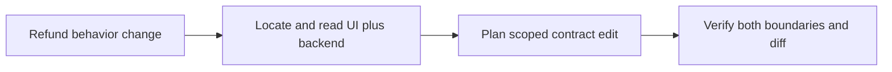
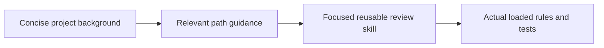
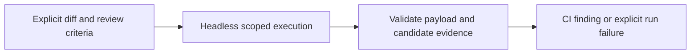

# 3 — Change a refund rule without losing the architecture

[Previous: tools](02-tools-and-mcp.md) · [Course home](README.md) · [Next: extraction](04-prompts-extraction-and-batch.md)

**Prerequisite:** a repository is a versioned collection of application files; a test checks expected behavior. No repository or terminal setup is needed for this 30-minute lesson. **You will be able to:** choose exploration, planning, scoped instructions and independent review for a code change.

## Start with the business change

Finance changes the automatic refund ceiling from USD 100 to USD 150. The case screen displays the ceiling, a backend validates it, and tests check boundary amounts. Changing a single visible number could leave the backend enforcing the old rule. The architecture problem is consistency across dependent components.

<figure class="concept-flow"><figcaption>Follow the responsibility and data, left to right; on a phone, top to bottom.</figcaption><ol><li><strong>Understand</strong><span>Request, constraints and scope</span></li><li><strong>Investigate</strong><span>Search → read relevant files</span></li><li><strong>Plan</strong><span>Compare boundaries if ambiguous</span></li><li><strong>Implement</strong><span>Targeted edit and tests</span></li><li><strong>Review</strong><span>Independent evidence and findings</span></li></ol></figure>

```text
Requirement: authorized automatic credit ≤ USD 150
  → Discover files and existing policy source
  → Read callers, validation, UI display and boundary tests
  → Plan one source of truth and compatibility changes
  → Make targeted edits
  → Run boundary and regression checks
  → Independent review of the diff and cross-file consistency
  → Human/release gate receives evidence, not “looks fine”
```

## Learn this application one failure at a time

**Reading exercise — no setup or execution.** These are original exam-style practice decisions, not live exam questions or newly graded bank items. Read the situation, choose A/B/C aloud or on paper, then open the explanation. These checks do not update your stored practice score. Plain explanations follow the technical question; the reference material below remains available for a deeper pass.

### First, picture the simple version

An engineer changes a refund ceiling in a repository. Think of the repository as the connected files that implement screen, backend rules and checks. Start by locating the current rule and one supplied boundary test.

**Follow the data:** Change request → locate/read relevant files → scoped plan/edit → tests and diff → independent evidence-based review → release owner.

<figure class="concept-flow"><figcaption>Keep this same application in view as each failure adds one justified repair. Read the detailed traces below before opening the existing full architecture drawing.</figcaption><ol><li><strong>Small success</strong><span>One request and an observable result</span></li><li><strong>New failure</strong><span>One assumption no longer holds</span></li><li><strong>Your decision</strong><span>Compare technical mechanisms</span></li><li><strong>Repair and replay</strong><span>Inspect evidence, not assurance</span></li></ol></figure>

### Layer 1 — The right-looking edit misses a caller

The assistant updates the backend ceiling but the screen still validates the old amount. A unit test of the backend passes while the customer is rejected.

**CC03-LAYER-1 — Original exam-style practice. Choose ONE.** Which workflow most directly addresses an unfamiliar cross-file contract change?

A. Write a replacement backend file without inspecting callers.

B. Use path/content search and selective reading to trace the UI-to-backend contract, plan the bounded change and verify both boundaries.

C. Read every file in the repository before considering the requested behavior.

<details><summary>What is this asking? — optional plain-language aid</summary>

Identify the specific problem in this scene, then compare what each proposed change actually controls. Explain which option fixes that problem without assuming a completed action, trustworthy fact or permission that the evidence has not established. Choose before opening the worked answer.

</details>

<details><summary>I have chosen — reveal layer 1, its repair and proof</summary>

**Answer: B.** B traces the behavior the customer actually experiences. A risks a locally correct but incomplete change. C floods context with unrelated files. Search finds candidates; reading and tests establish what those files mean.

**Replay the changed path:** UI limit → request value → backend policy → payment eligibility. New threshold accepted at both layers; above-threshold rejected; existing lower values remain correct. Review changed files for unexpected edits.

**See the repaired path — AI proposes; software executes the stated checks:**



**Connect the terms:** Glob finds paths; Grep finds matching content; Read inspects evidence; Edit changes a targeted portion. Choose by the job, not a blanket preference.

**Name the owner:** Say which part proposes or explains, which part checks or executes, and which record demonstrates the result. Point to the changed step in the trace before moving to the next layer.

</details>

### Layer 2 — Team guidance is confused with a procedure

Every session loads long CI-review steps, personal preferences and unrelated language rules. The actual refund policy is buried.

**CC03-LAYER-2 — Original exam-style practice. Choose ONE.** Which organization best separates persistent project conventions, conditional file guidance and a reusable review task?

A. Keep concise project CLAUDE.md guidance, relevant path-scoped rules and a focused skill for the repeatable procedure.

B. Place every instruction in a single globally loaded file.

C. Rely exclusively on one engineer’s user-level configuration for required team conventions.

<details><summary>What is this asking? — optional plain-language aid</summary>

Identify the specific problem in this scene, then compare what each proposed change actually controls. Explain which option fixes that problem without assuming a completed action, trustworthy fact or permission that the evidence has not established. Choose before opening the worked answer.

</details>

<details><summary>I have chosen — reveal layer 2, its repair and proof</summary>

**Answer: A.** A makes relevant rules easier to find and reuse. B creates competing clutter. C does not reliably share the team’s requirements. Guidance still needs concrete checks; it is not an enforcement substitute.

**Replay the changed path:** Backend edit → relevant business rule guidance. Test edit → testing rule. Review task → skill steps with diff and evidence. Compare actual loaded scope before assuming a rule was active.

**See the repaired path — AI proposes; software executes the stated checks:**



**Connect the terms:** Always-needed background and on-demand procedure have different roles. A path rule applies only where its configured scope matches.

**Name the owner:** Say which part proposes or explains, which part checks or executes, and which record demonstrates the result. Point to the changed step in the trace before moving to the next layer.

</details>

### Layer 3 — The CI reviewer is both noisy and unattended

The first review bot waits for permission, reports style opinions as critical bugs and emits prose the CI consumer cannot parse.

**CC03-LAYER-3 — Original exam-style practice. Choose ONE.** Which combination most appropriately addresses these distinct failures?

A. Only require JSON and assume every finding becomes correct.

B. Grant deployment rights and request a more confident tone.

C. Use unattended execution with scoped permissions, a validated output contract and explicit evidence-based finding criteria with examples.

<details><summary>What is this asking? — optional plain-language aid</summary>

Identify the specific problem in this scene, then compare what each proposed change actually controls. Explain which option fixes that problem without assuming a completed action, trustworthy fact or permission that the evidence has not established. Choose before opening the worked answer.

</details>

<details><summary>I have chosen — reveal layer 3, its repair and proof</summary>

**Answer: C.** C repairs execution, consumption and review meaning separately. A repairs only the container. B grants irrelevant power and changes tone. The CI consumer must distinguish a failed review from a successful run reporting no findings.

**Replay the changed path:** Known violating diff → actionable finding with trigger/location/consequence. Clean fixture → no finding. Execution failure or invalid output → failed review state. No finding is automatically permission to merge.

**See the repaired path — AI proposes; software executes the stated checks:**



**Connect the terms:** Headless operation removes conversational dependencies. A schema checks structure; evaluation fixtures check whether the reviewer recognizes actual defects.

**Name the owner:** Say which part proposes or explains, which part checks or executes, and which record demonstrates the result. Point to the changed step in the trace before moving to the next layer.

</details>

### Change one constraint — transfer the decision

**CC03-TRANSFER — Original exam-style practice. Choose ONE.** The code change is a single unambiguous spelling correction. What should the workflow do?

A. Always require a multi-pass architecture plan.

B. Make the bounded edit and inspect the result, expanding investigation only if evidence warrants it.

C. Skip reading the original file.

<details><summary>Reveal the changed-constraint reasoning</summary>

**Answer: B.** B matches effort to uncertainty and impact. A adds ceremony without purpose; C can still change the wrong location.

Before continuing, name the condition that changed and explain why the previous design should be retained, simplified or replaced. A remembered answer letter is not the transferable skill.

</details>

### Explain it back and continue

Close the answers. In one minute, tell the story as **request → failure → choice → repair → evidence**. Use ordinary words, then name the technical mechanism. If a step is unclear, revisit that layer before attempting the independent practice below.

**Exact objective drilldowns:** [2.5](../objectives/objective-2.5.md) · [3.1](../objectives/objective-3.1.md) · [3.2](../objectives/objective-3.2.md) · [3.3](../objectives/objective-3.3.md) · [3.4](../objectives/objective-3.4.md) · [3.5](../objectives/objective-3.5.md) · [3.6](../objectives/objective-3.6.md) · [4.6](../objectives/objective-4.6.md). These links identify relevant tasks; they do not assert that this single story assesses every knowledge/skill bullet.

**Continue the application:** [next connected case](../architecture-studio/AS-05-code-change.md). [Return to the application gallery](../architecture-studio/README.md) · [CCAR-F starting page](../../../01-Curriculum/02-Architect-Track/CCAR-F.md). The existing lab/SIM and reference links later on this page provide the deeper and independent checks.

## Reference and deeper walkthrough

The sections below retain the detailed mechanisms, artifacts and exercises. Use them to inspect a layer after trying its decision; they are not prerequisites to understanding the first scene.


## Translate the workflow into Claude Code concepts

| Decision | Technical expression | When another choice fits |
|---|---|---|
| Find likely files before reading everything. | `Glob` finds paths; `Grep` searches contents; `Read` inspects relevant code. | A known exact file may be read directly. Text search alone does not prove all semantic dependencies. |
| Investigate a multi-file behavior change before editing. | Plan Mode and scoped exploration. | A clear, bounded typo fix can use direct execution; planning is not a mandatory ceremony for every edit. |
| Share repository conventions with the team. | Project `CLAUDE.md`, with focused path-specific rules where relevant. | User instructions fit personal preferences; a skill fits a reusable procedure rather than always-loaded background. |
| Review on every pull request without interactive chat. | Programmatic Claude Code execution with explicit inputs, output format, permissions and CI status handling. | An interactive session fits collaborative investigation; it is unsuitable when unattended execution waits for unavailable input. |

`Edit` supports targeted changes; `Write` replaces or creates content. Neither substitutes for understanding the original file or verifying the result. `Bash` can run project tools and tests when permitted. Select the smallest suitable operation; do not memorize “Bash is always wrong.”

[Claude Code memory documentation](https://code.claude.com/docs/en/memory) explains project and user instruction scopes and conditional rules. These instructions guide model behavior; they are not a backend security boundary. Native Claude Code hooks have runtime-specific contracts. A custom application's callback is not automatically a native `PreToolUse` hook.

## Make the review precise

**Illustrative review instruction, not a runnable command:**

```text
Review this diff for refund-policy behavior defects.
Report: a concrete changed path that violates the approved ceiling or bypasses authorization.
Skip: style preferences and hypothetical defects without a traceable changed path.
For each finding: file/location, triggering input, actual consequence, supporting evidence.
Inspect both individual files and the complete UI → backend → payment path.
If an earlier finding is supplied, state whether it remains, is fixed, or changed.
```

The instruction creates a testable review standard. It does not make the reviewer infallible. Use independent review context to reduce author anchoring, while supplying the same requirement, relevant files and test evidence. A fresh reviewer without the requirement is merely uninformed. See [programmatic execution](https://code.claude.com/docs/en/headless) for supported non-interactive interfaces; exact flags and permissions depend on the installed version.

## Change a constraint

<details><summary>The request is only to correct “refnud” in a help label. Do you need a broad architecture plan?</summary>

Usually no. Confirm scope, edit the exact label and inspect the result. Increase investigation when evidence reveals generated text, shared strings or wider behavior dependencies.

</details>

<details><summary>A review produces 40 generic warnings and misses the amount boundary. Should you only increase review length?</summary>

First clarify report/skip criteria and add concrete boundary examples: 15000 cents allowed, 15001 requires another path. Then check precision and missed defects against known examples. More prose is not itself better review.

</details>

<details><summary>The author says tests passed, but no execution evidence is available. Can CI mark the change verified?</summary>

No. Execute required checks in the trusted pipeline and retain their results. Distinguish a model assertion from an actual process outcome and from release approval.

</details>

## Recall and apply

**Mnemonic: Find → Understand → Change → Prove.** Name the evidence you would gather at each stage. Explain why a per-file review alone may miss mismatched ceilings between UI and backend.

Study [3.1: instructions](../objectives/objective-3.1.md), [3.2: skills](../objectives/objective-3.2.md), [3.3: conditional rules](../objectives/objective-3.3.md), [3.4: planning](../objectives/objective-3.4.md), [3.5: refinement](../objectives/objective-3.5.md), [3.6: CI](../objectives/objective-3.6.md) and [4.6: independent review](../objectives/objective-4.6.md). Apply them in [code-change case](../architecture-studio/AS-05-code-change.md), [CI-review case](../architecture-studio/AS-06-ci-review.md), [CI SIM](../../../04-Simulations/02-CCAR-F-Architect-Foundations/SIM-06-claude-code-ci-cd.md) and [Lab 08](../../../06-Labs/08-CCAR-F-architecture-decisions/README.md). Compare decisions in [the atlas](../decision-atlas.md).

## Drill into the exact mechanism

[Inspect a conditional rule](../objectives/objective-3.3.md#illustrative-conditional-rule) · [Trace the supplied CI review packet](../objectives/objective-3.6.md#supplied-ci-review-packet-and-worked-output)