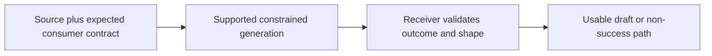
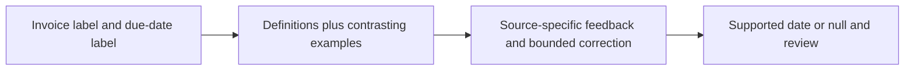
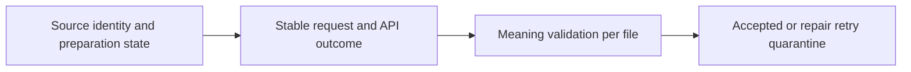

# 4 — Turn an invoice into a checked record

[Previous: code workflow](03-code-workflows-and-ci.md) · [Course home](README.md) · [Next: reliability](05-context-reliability-and-evaluation.md)

**Prerequisite:** distinguish a tool request from its result. No API account or setup is needed. Allow 30 minutes. **You will be able to:** separate an understandable instruction, an allowed data shape, a true value and a completed processing job.

## Picture the application

An accounts-payable clerk receives supplier invoice INV-42. The PDF shows an invoice date, payment terms and several amounts. A processing application extracts a draft record for review. If it uses the due date as the invoice date, the output may be perfectly valid JSON and still be financially wrong.

<figure class="concept-flow"><figcaption>Follow the responsibility and data, left to right; on a phone, top to bottom.</figcaption><ol><li><strong>Document</strong><span>Invoice and source identity</span></li><li><strong>Specify</strong><span>Field definitions and examples</span></li><li><strong>Extract</strong><span>Constrained draft record</span></li><li><strong>Validate</strong><span>Shape AND source meaning</span></li><li><strong>Route</strong><span>Accept, repair or review</span></li></ol></figure>

```text
PDF + document identity
  → Extraction instruction and representative examples
  → Model produces a constrained draft record
  → Validator checks shape, arithmetic and source evidence
  → Bounded repair for identified defects / review for unresolved ambiguity
  → Accepted record with source references
  → Accounts-payable queue
```

**Illustrative record contract, not an SDK schema:**

```text
invoice_id: INV-42
invoice_date: date printed beside “Invoice date”; null if absent
total: amount + currency, tied to a source page/location
status: draft / validated / needs_review
issues: missing fields, conflicting values, failed checks
```

“Required” can mean the key must appear; it need not mean the source contains a value. A nullable field can represent an absent value without inventing it. The application's schema must deliberately permit that representation.

## Learn this application one failure at a time

**Reading exercise — no setup or execution.** These are original exam-style practice decisions, not live exam questions or newly graded bank items. Read the situation, choose A/B/C aloud or on paper, then open the explanation. These checks do not update your stored practice score. Plain explanations follow the technical question; the reference material below remains available for a deeper pass.

### First, picture the simple version

An accounts-payable clerk reads invoice INV-42. The source has an invoice date, a due date and money amounts. The application drafts a record for review; extracting a record does not authorize payment.

**Follow the data:** Source plus identity → field instructions/examples → model proposal → receiving schema and meaning checks → accepted draft or review → per-file collection when scaled.

<figure class="concept-flow"><figcaption>Keep this same application in view as each failure adds one justified repair. Read the detailed traces below before opening the existing full architecture drawing.</figcaption><ol><li><strong>Small success</strong><span>One request and an observable result</span></li><li><strong>New failure</strong><span>One assumption no longer holds</span></li><li><strong>Your decision</strong><span>Compare technical mechanisms</span></li><li><strong>Repair and replay</strong><span>Inspect evidence, not assurance</span></li></ol></figure>

### Layer 1 — A successful agent handoff has the wrong shape

The extraction agent returns prose or a date field with an invalid type. The receiving program needs the agreed record contract before it can continue.

**CC04-LAYER-1 — Original exam-style practice. Choose ONE.** Which mechanism most directly improves machine-consumable structure while preserving explicit non-success handling?

A. Only ask for “JSON please” and treat every reply as complete.

B. Use a supported constrained output/tool-input schema mechanism at the correct boundary, then validate and handle refusal, truncation or other non-success outcomes.

C. Assume strict structure establishes all extracted facts as true.

<details><summary>What is this asking? — optional plain-language aid</summary>

Identify the specific problem in this scene, then compare what each proposed change actually controls. Explain which option fixes that problem without assuming a completed action, trustworthy fact or permission that the evidence has not established. Choose before opening the worked answer.

</details>

<details><summary>I have chosen — reveal layer 1, its repair and proof</summary>

**Answer: B.** B specifies the usable package and recognizes that not every API outcome is a completed usable record. A is weaker guidance. C overclaims: a correctly shaped date can still come from the wrong label. Check actual feature/model support before implementation.

**Replay the changed path:** Expected invoice_date field → received prose → do not load downstream. Supported constrained result → shape check → continue to source meaning checks. Non-success result → explicit failed/pending path, not empty accepted record.

**See the repaired path — AI proposes; software executes the stated checks:**



**Connect the terms:** Structured output controls representation at a documented boundary. A receiving consumer still decides whether the record is acceptable.

**Name the owner:** Say which part proposes or explains, which part checks or executes, and which record demonstrates the result. Point to the changed step in the trace before moving to the next layer.

</details>

### Layer 2 — The valid date came from the wrong label

The record’s invoice_date is validly formatted, but its source label was “Due date.” A missing invoice date was guessed from payment terms.

**CC04-LAYER-2 — Original exam-style practice. Choose ONE.** Which repair best addresses this extraction-quality failure?

A. Define the field against its source label, include contrasting examples, give exact validation feedback and preserve an allowed missing/review state when unsupported.

B. Retry indefinitely until the model emits a plausible date.

C. Remove source references so mismatches are less visible.

<details><summary>What is this asking? — optional plain-language aid</summary>

Identify the specific problem in this scene, then compare what each proposed change actually controls. Explain which option fixes that problem without assuming a completed action, trustworthy fact or permission that the evidence has not established. Choose before opening the worked answer.

</details>

<details><summary>I have chosen — reveal layer 2, its repair and proof</summary>

**Answer: A.** A fixes the interpretation and preserves absence rather than manufacturing a fact. B offers no stopping condition or new evidence. C hides the defect. A few representative examples should show ordinary, missing and easily confused cases, not imply a magic example count.

**Replay the changed path:** Source “Invoice date: absent; Due date: 12 Nov” → invoice_date:null under the declared contract, source evidence retained. If the required business process cannot accept that absence, route to review rather than guessing.

**See the repaired path — AI proposes; software executes the stated checks:**



**Connect the terms:** A valid type is a shape property. Correct source interpretation is a separate meaning property. Null must be deliberately allowed by the consumer’s contract.

**Name the owner:** Say which part proposes or explains, which part checks or executes, and which record demonstrates the result. Point to the changed step in the trace before moving to the next layer.

</details>

### Layer 3 — Ten thousand documents produce mixed outcomes

Some files are unreadable, one request is invalid, some API work fails and some extracted records are wrong. The collector receives results out of order.

**CC04-LAYER-3 — Original exam-style practice. Choose ONE.** Which architecture best supports complete accounting and cause-specific recovery?

A. Join results by line position and resubmit all documents whenever one fails.

B. Accept all items when processing ends.

C. Track stable source/request identities and separate preparation, API outcome, validation and downstream state; preserve successes and recover failed items by cause.

<details><summary>What is this asking? — optional plain-language aid</summary>

Identify the specific problem in this scene, then compare what each proposed change actually controls. Explain which option fixes that problem without assuming a completed action, trustworthy fact or permission that the evidence has not established. Choose before opening the worked answer.

</details>

<details><summary>I have chosen — reveal layer 3, its repair and proof</summary>

**Answer: C.** C knows which work succeeded and what each unresolved item needs. An unreadable file needs preparation/review, invalid requests need repair, transient failures may permit bounded retry, and wrong extracted meaning needs evidence-based correction. A mismatches identities; B hides failures.

**Replay the changed path:** Ledger: D1 accepted; D2 unreadable/review; D3 invalid request/repair; D4 transient/retry; D5 API success but amount conflict/review. Five expected = one accepted + four named unresolved; successful API response is not accepted accounting data.

**See the repaired path — AI proposes; software executes the stated checks:**



**Connect the terms:** Message Batches handles deferred independent requests. The application owns file preparation, stable ID mapping, validation and downstream duplicate prevention.

**Name the owner:** Say which part proposes or explains, which part checks or executes, and which record demonstrates the result. Point to the changed step in the trace before moving to the next layer.

</details>

### Change one constraint — transfer the decision

**CC04-TRANSFER — Original exam-style practice. Choose ONE.** A user is waiting for an answer in seconds and the next step needs a live tool result. What is the appropriate first design?

A. Use a deferred batch because volume is high elsewhere.

B. Use the immediate client-managed workflow/tool loop for this request; reserve eligible deferred independent work for another lane.

C. Infer the missing tool result to avoid waiting.

<details><summary>Reveal the changed-constraint reasoning</summary>

**Answer: B.** B follows this interaction’s deadline and dependency. A applies the archive’s constraints to the wrong request; C invents evidence.

Before continuing, name the condition that changed and explain why the previous design should be retained, simplified or replaced. A remembered answer letter is not the transferable skill.

</details>

### Explain it back and continue

Close the answers. In one minute, tell the story as **request → failure → choice → repair → evidence**. Use ordinary words, then name the technical mechanism. If a step is unclear, revisit that layer before attempting the independent practice below.

**Exact objective drilldowns:** [4.1](../objectives/objective-4.1.md) · [4.2](../objectives/objective-4.2.md) · [4.3](../objectives/objective-4.3.md) · [4.4](../objectives/objective-4.4.md) · [4.5](../objectives/objective-4.5.md). These links identify relevant tasks; they do not assert that this single story assesses every knowledge/skill bullet.

**Continue the application:** [next connected case](../architecture-studio/AS-02-document-pipeline.md). [Return to the application gallery](../architecture-studio/README.md) · [CCAR-F starting page](../../../01-Curriculum/02-Architect-Track/CCAR-F.md). The existing lab/SIM and reference links later on this page provide the deeper and independent checks.

## Reference and deeper walkthrough

The sections below retain the detailed mechanisms, artifacts and exercises. Use them to inspect a layer after trying its decision; they are not prerequisites to understanding the first scene.


## Four choices that are easy to confuse

| Requirement | Mechanism | Alternative and its limit |
|---|---|---|
| Distinguish invoice date from due date. | Explicit field definitions and boundary examples. | “Extract all relevant information” leaves the distinction underspecified. |
| Produce a machine-readable shape. | Supported structured output or strict tool-input schema features. | Merely saying “JSON only” is weaker shape control; even constrained output needs outcome handling. |
| Prove the amount matches the document. | Semantic validation, source references and applicable arithmetic checks. | Schema validation checks allowed structure/types; it does not prove source truth. |
| Process tomorrow's archive rather than block a clerk now. | Deferred Message Batches processing with result tracking. | Interactive processing fits a user waiting now; a batch is not a low-latency guarantee. |

The [structured-output documentation](https://platform.claude.com/docs/en/build-with-claude/structured-outputs) describes supported constraints and exceptional outcomes. Choose features supported by your API/model combination. Keep that mechanism separate from factual correctness.

## Examples teach boundaries, not a magic count

Show an ordinary invoice, one with distinct invoice/due dates, and one missing a date. Explain the desired field selection in each. Add a conflicting-currency example if that error appears in evaluation. The right example set depends on the failure modes and context budget; there is no universal “two to four” law.

A repair instruction should name the observed defect: “The extracted date came from the Due date label; locate Invoice date or return null.” Cap attempts. Repeating “try again” without new evidence can reproduce the same error and hide the unresolved source problem.

## Batch is a job, not a live conversation

For 10,000 independent invoices, assign each request an identifier and map each returned result to that identifier rather than submission order. Track successful, failed and unresolved items. Retrying only the appropriate failures preserves completed work. Prepare evidence beforehand if a stage needs client tools; a submitted batch does not give your backend an interactive opportunity to execute arbitrary client calls during each request. See [Message Batches](https://platform.claude.com/docs/en/build-with-claude/batch-processing).

## Decide before revealing

<details><summary>The schema validates, but the invoice date is tomorrow's due date. Should the system accept it?</summary>

No. The shape passed; the source interpretation failed. Add label-aware validation or a review rule, supply targeted feedback, and measure this error on examples with both dates.

</details>

<details><summary>The clerk must approve payment within 20 seconds. Is deferred batch processing the best choice because it costs less?</summary>

No. Start with the latency constraint. Choose a suitable synchronous workflow and a defined timeout/review path. Deferred savings do not satisfy a blocking deadline.

</details>

<details><summary>One invoice has two contradictory totals. Should a third retry pick the more confident answer?</summary>

Preserve both values and locations, mark the conflict and route for clarification or review. Repetition and model confidence do not resolve contradictory source evidence.

</details>

## Recall and apply

**Mnemonic: Shape ≠ Source ≠ Success.** A schema can pass while the value is wrong; a correct draft can exist while the overall batch remains incomplete. Explain all three states using INV-42.

Continue through [4.1: criteria](../objectives/objective-4.1.md), [4.2: examples](../objectives/objective-4.2.md), [4.3: structured output](../objectives/objective-4.3.md), [4.4: validation](../objectives/objective-4.4.md) and [4.5: batch strategy](../objectives/objective-4.5.md). Apply them in [the document pipeline](../architecture-studio/AS-02-document-pipeline.md), [work queue](../architecture-studio/AS-07-work-queue.md), [extraction SIM](../../../04-Simulations/02-CCAR-F-Architect-Foundations/SIM-07-structured-data-extraction.md) and [Lab 02](../../../06-Labs/02-CCAR-F-coordinator-extraction/README.md). Use [decision charts in the atlas](../decision-atlas.md) for additional contrasts.

## Drill into the exact mechanism

[Inspect the output contract](../objectives/objective-4.3.md#illustrative-output-contract) · [Study validation and repair](../objectives/objective-4.4.md#44-s1)