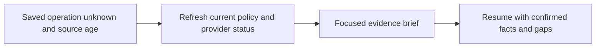
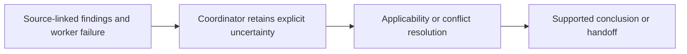
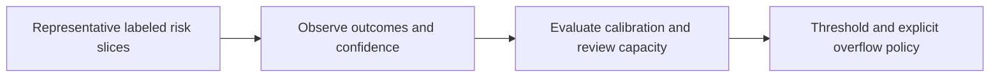

# 5 — Resume a case without losing what is known

[Previous: extraction](04-prompts-extraction-and-batch.md) · [Course home](README.md) · [Next: put it together](06-putting-it-together.md)

**Prerequisite:** Lessons 1 and 4, or familiarity with tool outcomes and source validation. No setup is required. Allow 30 minutes. **You will be able to:** preserve exact facts, recover safely, integrate partial evidence and decide where human review belongs.

## Picture a resumed investigation

Yesterday a representative investigated case C17. The order system returned O4, the payment system timed out, and a policy document changed this morning. Today a new session must continue. “Customer had a refund issue; probably resolved” is a dangerous summary: it loses identity, uncertain execution and policy age.

The application needs a durable case record; the model needs a relevant working brief. Those are related but different. A conversation window is not the payment ledger or the system of record.

<figure class="concept-flow"><figcaption>Follow the responsibility and data, left to right; on a phone, top to bottom.</figcaption><ol><li><strong>Persist</strong><span>Facts, evidence and operation state</span></li><li><strong>Refresh</strong><span>Current policy and permission</span></li><li><strong>Recover</strong><span>Partial results and safe retries</span></li><li><strong>Review</strong><span>Measured risk and contradictions</span></li><li><strong>Report</strong><span>Sources, dates and unresolved gaps</span></li></ol></figure>

```text
Original sources and tool outcomes
  → Durable case checkpoint: exact IDs, receipts, unknowns, timestamps
  → Freshness / authority recheck before resuming
  → Focused working brief for coordinator
  → Specialists receive bounded question + relevant evidence + return contract
  → Coordinator integrates successes, failures and conflicts
  → Decision with source links or explicit human handoff
```

## Learn this application one failure at a time

**Reading exercise — no setup or execution.** These are original exam-style practice decisions, not live exam questions or newly graded bank items. Read the situation, choose A/B/C aloud or on paper, then open the explanation. These checks do not update your stored practice score. Plain explanations follow the technical question; the reference material below remains available for a deeper pass.

### First, picture the simple version

A representative resumes yesterday’s refund investigation. Keep the order ID, evidence and unknown payment outcome visible. The first goal is continuity without asking the customer to repeat valid facts.

**Follow the data:** Durable checkpoint → refreshed current evidence → focused brief → specialist returns with sources/failure states → reviewed decision or handoff.

<figure class="concept-flow"><figcaption>Keep this same application in view as each failure adds one justified repair. Read the detailed traces below before opening the existing full architecture drawing.</figcaption><ol><li><strong>Small success</strong><span>One request and an observable result</span></li><li><strong>New failure</strong><span>One assumption no longer holds</span></li><li><strong>Your decision</strong><span>Compare technical mechanisms</span></li><li><strong>Repair and replay</strong><span>Inspect evidence, not assurance</span></li></ol></figure>

### Layer 1 — A short summary loses the uncertain payment

The old conversation says “refund handled,” but the actual provider request timed out and no receipt was recorded. Today’s policy may also differ.

**CC05-LAYER-1 — Original exam-style practice. Choose ONE.** Which state and context strategy best supports safe resumption?

A. Treat the old natural-language summary as current business truth.

B. Retain exact operation states/IDs and source pointers durably, refresh applicable authority/evidence and provide a focused current working brief.

C. Delete all prior facts whenever the context becomes long.

<details><summary>What is this asking? — optional plain-language aid</summary>

Identify the specific problem in this scene, then compare what each proposed change actually controls. Explain which option fixes that problem without assuming a completed action, trustworthy fact or permission that the evidence has not established. Choose before opening the worked answer.

</details>

<details><summary>I have chosen — reveal layer 1, its repair and proof</summary>

**Answer: B.** B preserves the uncertainty that governs the next step. A can duplicate a payment or cite stale policy. C loses useful completed work. Restoring conversation is helpful, but a chat window is not the payment ledger.

**Replay the changed path:** Saved: O4, operation unknown, no receipt, policy timestamp. Resume: refresh policy, query operation status, update checkpoint. Brief says “reconcile before new action,” not “refund completed.”

**See the repaired path — AI proposes; software executes the stated checks:**



**Connect the terms:** Working context is what the model currently sees. Durable state is what the application can retrieve and verify across sessions.

**Name the owner:** Say which part proposes or explains, which part checks or executes, and which record demonstrates the result. Point to the changed step in the trace before moving to the next layer.

</details>

### Layer 2 — A partial team result becomes an overconfident conclusion

One specialist returns cited order evidence; another times out. Two available sources also disagree on the applicable limit.

**CC05-LAYER-2 — Original exam-style practice. Choose ONE.** What synthesis policy best preserves provenance and uncertainty?

A. Average the disputed limits and assume the failed specialist agrees.

B. Discard all evidence because one worker failed.

C. Keep source-linked claims and explicit failure/gap states, resolve authority where possible and escalate unresolved decision-critical conflicts.

<details><summary>What is this asking? — optional plain-language aid</summary>

Identify the specific problem in this scene, then compare what each proposed change actually controls. Explain which option fixes that problem without assuming a completed action, trustworthy fact or permission that the evidence has not established. Choose before opening the worked answer.

</details>

<details><summary>I have chosen — reveal layer 2, its repair and proof</summary>

**Answer: C.** C preserves useful evidence without pretending missing work succeeded. A invents a rule and a vote. B throws away valid findings. The coordinator must know expected work as well as received work.

**Replay the changed path:** Order evidence S1 retained; payment worker timeout named; policy S2 limit180 versus S3 limit150 with dates/scopes → applicability check or review. No silent “complete” flag when required payment evidence remains absent.

**See the repaired path — AI proposes; software executes the stated checks:**



**Connect the terms:** Provenance = where a claim came from. A source conflict and an unavailable source need different next steps.

**Name the owner:** Say which part proposes or explains, which part checks or executes, and which record demonstrates the result. Point to the changed step in the trace before moving to the next layer.

</details>

### Layer 3 — A green average hides the risky failures

Overall accuracy looks high, but the small group of ambiguous high-value disputes is frequently wrong. Model confidence is also high on those cases.

**CC05-LAYER-3 — Original exam-style practice. Choose ONE.** Which evaluation and human-review strategy is most appropriate?

A. Evaluate risk slices and confidence calibration on representative labeled examples, inspect trajectories/outcomes, and set an explicit review/overflow policy.

B. Trust overall average accuracy and self-reported confidence alone.

C. Automatically approve difficult cases whenever the human queue is full.

<details><summary>What is this asking? — optional plain-language aid</summary>

Identify the specific problem in this scene, then compare what each proposed change actually controls. Explain which option fixes that problem without assuming a completed action, trustworthy fact or permission that the evidence has not established. Choose before opening the worked answer.

</details>

<details><summary>I have chosen — reveal layer 3, its repair and proof</summary>

**Answer: A.** A asks whether the system succeeds on the cases where failure matters and whether confidence matches observed correctness. B can hide rare serious mistakes. C converts lack of capacity into permission without evidence. Human review itself also needs quality checks.

**Replay the changed path:** Evaluation slices: ordinary known-source cases versus conflicting high-impact cases. Report each slice, review error types, hold back unseen tests, and record whether the review queue can actually handle expected cases. Queue full → explicit hold/escalation, not silent acceptance.

**See the repaired path — AI proposes; software executes the stated checks:**



**Connect the terms:** Calibration = comparing confidence with observed outcomes. A holdout is a test set not used to tune the prompt or threshold.

**Name the owner:** Say which part proposes or explains, which part checks or executes, and which record demonstrates the result. Point to the changed step in the trace before moving to the next layer.

</details>

### Change one constraint — transfer the decision

**CC05-TRANSFER — Original exam-style practice. Choose ONE.** The only stale item is a nonessential narrative note that cannot affect the current decision. What is appropriate?

A. Restart the whole case.

B. Retain verified work and refresh evidence according to decision impact, not age alone.

C. Ignore all stale policies too.

<details><summary>Reveal the changed-constraint reasoning</summary>

**Answer: B.** B avoids unnecessary restart without relaxing decision-critical freshness. A wastes good work; C ignores genuinely changed authority.

Before continuing, name the condition that changed and explain why the previous design should be retained, simplified or replaced. A remembered answer letter is not the transferable skill.

</details>

### Explain it back and continue

Close the answers. In one minute, tell the story as **request → failure → choice → repair → evidence**. Use ordinary words, then name the technical mechanism. If a step is unclear, revisit that layer before attempting the independent practice below.

**Exact objective drilldowns:** [1.3](../objectives/objective-1.3.md) · [1.7](../objectives/objective-1.7.md) · [5.1](../objectives/objective-5.1.md) · [5.2](../objectives/objective-5.2.md) · [5.3](../objectives/objective-5.3.md) · [5.5](../objectives/objective-5.5.md) · [5.6](../objectives/objective-5.6.md). These links identify relevant tasks; they do not assert that this single story assesses every knowledge/skill bullet.

**Continue the application:** [next connected case](../architecture-studio/AS-08-resumable-case.md). [Return to the application gallery](../architecture-studio/README.md) · [CCAR-F starting page](../../../01-Curriculum/02-Architect-Track/CCAR-F.md). The existing lab/SIM and reference links later on this page provide the deeper and independent checks.

## Reference and deeper walkthrough

The sections below retain the detailed mechanisms, artifacts and exercises. Use them to inspect a layer after trying its decision; they are not prerequisites to understanding the first scene.


## Build the handoff on paper

**Illustrative application checkpoint, not a session API signature:**

```text
case_id C17; order_id O4; requested USD 120
payment_state unknown: submission timed out; no confirmed receipt
operation_key retained in durable store
policy_source version/date; refresh required before a new decision
completed: ownership lookup; pending: payment reconciliation
next_safe_action: query payment status; do not blindly repeat credit
```

Preserve exact identifiers, amounts, commitments and failure states. Shorten verbose logs and irrelevant text while keeping retrievable source pointers. An isolated specialist cannot use evidence it was never given. A useful brief includes goal, scope, facts, constraints, source identity and expected output. Session resumption may recover prior conversational context; it still does not prove old files or policies remain current.

## Choose by the failure you actually have

| Problem | Appropriate response | Alternative and its limit |
|---|---|---|
| Context is crowded with repeated tool logs. | Keep decision-critical facts and structured outcomes; summarize redundant detail with evidence pointers. | Deleting all earlier history can erase the actual user constraint or unresolved failure. |
| One research specialist fails; two succeed. | Preserve partial findings and explicit coverage gaps; retry locally when safe or escalate. | Returning an empty final report throws away valid work; claiming full coverage hides the failure. |
| Sources disagree about a policy limit. | Preserve each claim, date, scope and location; determine authority/applicability or mark unresolved. | Averaging values manufactures a rule that neither source states. |
| A high-impact field is uncertain. | Route according to risk and confidence calibrated on labeled examples. | A model's untested “95% confident” is not an observed 95% accuracy guarantee. |

For long-context and compaction mechanisms, consult [Claude Code context documentation](https://code.claude.com/docs/en/how-claude-code-works). Working-context reduction must remain compatible with durable application state. For evaluating actual performance rather than assuming it, see [define measurable success criteria](https://platform.claude.com/docs/en/test-and-evaluate/define-success).

## Evaluate the decisions, not only the final sentence

Create a labeled sample including routine cases, missing information, conflicting evidence, unusual formats and consequential errors. Check the fields or decisions separately: correct customer binding, amount, tool choice, safe retry, source attribution and escalation. A convenient random sample can underrepresent rare but costly errors; use meaningful strata and report their results separately.

For a Legal transfer case, preserve which contract clause supports each conclusion and whether it applies to the current party/version. For Marketing, distinguish observed consent from an inferred preference and retain the evidence date. For Finance, keep currency, amount units and the authority for an approval decision. These examples change risk and evidence requirements; they are not claims about official industry emphasis.

## Changed constraints

<details><summary>A session was resumed successfully. May you execute yesterday's approved action immediately?</summary>

Recheck the relevant assumptions: current authorization, policy version, payment state and duplicate-operation protection. Resuming context is not a freshness or business-authorization check.

</details>

<details><summary>A report has ten claims and a bibliography of ten URLs. Is provenance complete?</summary>

Not necessarily. Each consequential claim needs a usable connection to its supporting source and location, with relevant date and scope. A bibliography alone cannot show which source supports which claim or expose conflicting interpretations.

</details>

<details><summary>The overall accuracy is high, but one invoice format often corrupts account numbers. What should change?</summary>

Report the weak format separately, add targeted evaluation and route affected records to review until corrected. Aggregate accuracy can conceal a concentrated failure. Judge the error's cost as well as its frequency.

</details>

## Recall and complete the arc

**Mnemonic: Facts, Gaps, Sources, Next.** Give a 30-second handoff of C17 preserving those four things. Then state what would justify saying the payment completed. Use the evidence, not the fluency of the summary.

Study [5.1: context](../objectives/objective-5.1.md), [5.2: escalation](../objectives/objective-5.2.md), [5.3: failures](../objectives/objective-5.3.md), [5.4: codebase exploration](../objectives/objective-5.4.md), [5.5: calibrated review](../objectives/objective-5.5.md), [5.6: provenance](../objectives/objective-5.6.md) and [1.7: session lifecycle](../objectives/objective-1.7.md). Practice [the resumable-case application](../architecture-studio/AS-08-resumable-case.md), [multi-agent research SIM](../../../04-Simulations/02-CCAR-F-Architect-Foundations/SIM-04-multi-agent-research.md) and [Lab 08](../../../06-Labs/08-CCAR-F-architecture-decisions/README.md). Close with [flashcards](../FLASHCARDS.md) and use the [objective map](../objectives/README.md) to choose your next depth lesson.

## Drill into the exact mechanism

[Trace the context-preservation fixture](../objectives/objective-5.1.md#supplied-context-preservation-fixture) · [Inspect calibration and stratified review](../objectives/objective-5.5.md#supplied-calibration-and-stratified-review-fixture)