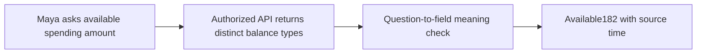
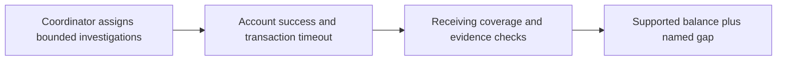
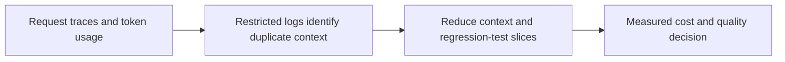
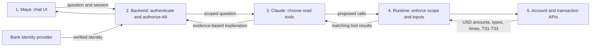
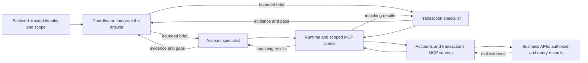
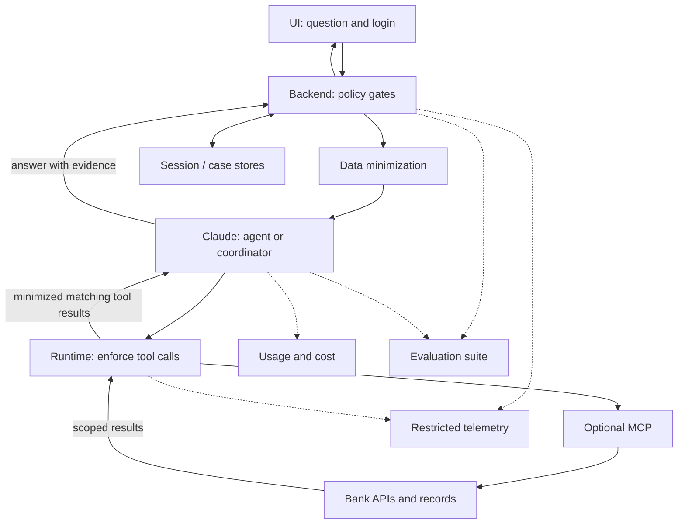

# 6 — Put it together: a bank balance and transaction assistant

[Previous: context and evidence](05-context-reliability-and-evaluation.md) · [Course home](README.md) · [Continue: application cases](../architecture-studio/README.md)

**Prerequisite:** the five concept-coaching lessons, or their equivalent concepts. **Setup:** none; this is a paper-first architecture walkthrough, not a request to build or connect a real banking system. Allow 35 minutes for the original walkthrough plus 25-35 minutes for the integrated map and transfer exercises. **Scope:** an original enterprise transfer exercise connecting existing CCAR-F mechanisms, not an additional official objective or an assertion about exam industry weighting.

## Start with one customer and one useful outcome

A fictional customer, Maya, signs into her bank application and asks, “How much can I spend, and what were my last three transactions?” The screen is the **UI**. The **backend** is the application code behind that screen. The bank's account and transaction services hold the authoritative records. Claude interprets the question and explains permitted evidence; it does not hold Maya's bank balance in its model knowledge.

For this exercise, the trusted login session maps to customer C17 and account A9. The account service returns **available balance USD 182.00** and **ledger balance USD 523.40**, observed at 10:00 UTC. Available balance is the amount this service says is available for spending; ledger balance reflects the posted-account view. Holds and other bank-specific rules can make them differ. The exact business definitions belong to the bank's service contract, not an assumption made by Claude.

The transaction service returns T31, T32 and T33 with amounts, currency, posted/pending status and timestamps. All names and records are fictional. Keep these fields explicit as the architecture grows.

## Learn this application one failure at a time

**Reading exercise — no setup or execution.** These are original exam-style practice decisions, not live exam questions or newly graded bank items. Read the situation, choose A/B/C aloud or on paper, then open the explanation. These checks do not update your stored practice score. Plain explanations follow the technical question; the reference material below remains available for a deeper pass.

### First, picture the simple version

Maya asks for her available balance and latest three transactions. First picture one screen, one backend, one Claude interaction and two authorized read tools. This can work before MCP or specialist agents are justified.

**Follow the data:** Login session → backend account scope → account/transaction reads → amounts, types and timestamps → explanation. Later layers add bounded delegation, controlled data handling, evaluation and cost measurement.

<figure class="concept-flow"><figcaption>Keep this same application in view as each failure adds one justified repair. Read the detailed traces below before opening the existing full architecture drawing.</figcaption><ol><li><strong>Small success</strong><span>One request and an observable result</span></li><li><strong>New failure</strong><span>One assumption no longer holds</span></li><li><strong>Your decision</strong><span>Compare technical mechanisms</span></li><li><strong>Repair and replay</strong><span>Inspect evidence, not assurance</span></li></ol></figure>

### Layer 1 — The demo answers the wrong financial question

The account API provides available USD 182.00 and ledger USD 523.40. The answer says Maya can spend USD 523.40 because it chose the larger number.

**CC06-LAYER-1 — Original exam-style practice. Choose ONE.** Which remediation most directly addresses the unsupported spending answer?

A. Add another coordinator without changing field definitions.

B. Define available versus ledger balance using the bank service contract, preserve amounts/types/timestamps and evaluate the question-to-field choice against evidence.

C. Ask for valid JSON and accept either numeric balance.

<details><summary>What is this asking? — optional plain-language aid</summary>

Identify the specific problem in this scene, then compare what each proposed change actually controls. Explain which option fixes that problem without assuming a completed action, trustworthy fact or permission that the evidence has not established. Choose before opening the worked answer.

</details>

<details><summary>I have chosen — reveal layer 1, its repair and proof</summary>

**Answer: B.** B tells the application and model which fact answers “can spend.” A adds orchestration without fixing meaning. C checks formatting, not the chosen financial concept. The authoritative service, not model intuition, owns these definitions.

**Replay the changed path:** API A9 at10:00: available182.00, ledger523.40 → spending answer182.00 with observation context. If the available field is missing, keep the gap rather than substituting ledger balance.

**See the repaired path — AI proposes; software executes the stated checks:**



**Connect the terms:** Available balance and ledger balance are different business fields. Schema validity does not establish that the right field was used.

**Name the owner:** Say which part proposes or explains, which part checks or executes, and which record demonstrates the result. Point to the changed step in the trace before moving to the next layer.

</details>

### Layer 2 — The larger architecture loses a specialist’s evidence

Distinct account and transaction investigations now justify specialists. The transaction worker fails, but the coordinator receives a well-formed object and announces a complete answer.

**CC06-LAYER-2 — Original exam-style practice. Choose ONE.** Which coordinator policy best addresses receiving-boundary completeness?

A. Validate expected work, returned structure, source-linked meaning and explicit failure states; answer supported parts with a named gap or obtain missing evidence.

B. Accept the object if all required JSON keys exist.

C. Treat the coordinator’s access as permission for every specialist to read every account.

<details><summary>What is this asking? — optional plain-language aid</summary>

Identify the specific problem in this scene, then compare what each proposed change actually controls. Explain which option fixes that problem without assuming a completed action, trustworthy fact or permission that the evidence has not established. Choose before opening the worked answer.

</details>

<details><summary>I have chosen — reveal layer 2, its repair and proof</summary>

**Answer: A.** A checks both the return package and the actual assignment. B misses an empty or unsupported transaction claim. C broadens permissions without need; each read remains bounded by backend authorization. One agent with two read tools remains valid when it handles the workload well.

**Replay the changed path:** Account worker: A9/available182/source timestamp success. Transactions: timeout, no T31–T33 evidence. Coordinator: supported balance plus transactions-unavailable notice, or retry/handoff according to policy; no invented three transactions.

**See the repaired path — AI proposes; software executes the stated checks:**



**Connect the terms:** Receiving-boundary validation checks what the consumer needs. Multi-agent coordination does not replace permission checks or source evidence.

**Name the owner:** Say which part proposes or explains, which part checks or executes, and which record demonstrates the result. Point to the changed step in the trace before moving to the next layer.

</details>

### Layer 3 — A working system becomes expensive and hard to trust

The token bill triples after full transcripts are sent to all workers. Logs contain excessive account details, while a high overall evaluation score hides wrong available-balance answers.

**CC06-LAYER-3 — Original exam-style practice. Choose ONE.** Which sequence most appropriately addresses the production regressions?

A. Switch models immediately and remove all evaluation to save money.

B. Keep all raw sensitive payloads indefinitely because observability requires them.

C. Measure per-stage usage/latency/error traces with restricted data, reduce redundant context, and regression-test affected risk slices before accepting changes.

<details><summary>What is this asking? — optional plain-language aid</summary>

Identify the specific problem in this scene, then compare what each proposed change actually controls. Explain which option fixes that problem without assuming a completed action, trustworthy fact or permission that the evidence has not established. Choose before opening the worked answer.

</details>

<details><summary>I have chosen — reveal layer 3, its repair and proof</summary>

**Answer: C.** C connects cost to the actual work and checks whether a cheaper design remains correct. A guesses at a cause and removes evidence. B turns logging into unnecessary disclosure. Redaction is only one control; data minimization, access, retention and approved processing boundaries still matter.

**Replay the changed path:** Trace one request: coordinator tokens + specialist tokens + repeated history → identify duplicate input. Replace full transcript with bounded evidence briefs → compare usage, wrong-balance rate and missing-transaction handling on holdout fixtures. Log identifiers/outcomes with restricted access, not unrestricted raw statements.

**See the repaired path — AI proposes; software executes the stated checks:**



**Connect the terms:** Observability = evidence for diagnosing what happened. Evaluation = deliberate tests of quality. Cost tracking = measured consumption by stage, not a reason to drop required safeguards.

**Name the owner:** Say which part proposes or explains, which part checks or executes, and which record demonstrates the result. Point to the changed step in the trace before moving to the next layer.

</details>

### Change one constraint — transfer the decision

**CC06-TRANSFER — Original exam-style practice. Choose ONE.** A legal assistant instead summarizes contract clauses with conflicting effective dates. Which parts of the bank reasoning transfer?

A. Copy the available-balance field and USD rules.

B. Retain source identity, date/applicability checks, bounded delegation and explicit unresolved conflicts; use the legal domain’s actual field meanings.

C. Assume valid JSON proves the governing clause.

<details><summary>Reveal the changed-constraint reasoning</summary>

**Answer: B.** B transfers architecture while changing business meaning. A copies the wrong data model; C repeats the shape-versus-truth mistake.

Before continuing, name the condition that changed and explain why the previous design should be retained, simplified or replaced. A remembered answer letter is not the transferable skill.

</details>

### Explain it back and continue

Close the answers. In one minute, tell the story as **request → failure → choice → repair → evidence**. Use ordinary words, then name the technical mechanism. If a step is unclear, revisit that layer before attempting the independent practice below.

**Exact objective drilldowns:** [1.2](../objectives/objective-1.2.md) · [2.4](../objectives/objective-2.4.md) · [4.3](../objectives/objective-4.3.md) · [5.3](../objectives/objective-5.3.md) · [5.5](../objectives/objective-5.5.md) · [5.6](../objectives/objective-5.6.md). These links identify relevant tasks; they do not assert that this single story assesses every knowledge/skill bullet.

**Continue the application:** [next connected case](../architecture-studio/README.md). [Return to the application gallery](../architecture-studio/README.md) · [CCAR-F starting page](../../../01-Curriculum/02-Architect-Track/CCAR-F.md). The existing lab/SIM and reference links later on this page provide the deeper and independent checks.

## Reference and deeper walkthrough

The sections below retain the detailed mechanisms, artifacts and exercises. Use them to inspect a layer after trying its decision; they are not prerequisites to understanding the first scene.


## Read the whole architecture in three reveals

**Reading mode:** no installation, credentials or cloud account. Read the reveals in order. These are three views of the same application as requirements grow, not three required deployment templates. Use **Fit diagram**, zoom and **Open larger** inside each drawing. Follow the component names in the guide below; dotted arrows mean supporting controls or evidence, not a business request. Return tool results to Claude before it explains the result to the customer.

### Reveal 1 — Follow one authorized request



**Say it aloud:** identity proves who Maya is; authorization permits A9; the API provides the balance; Claude explains it. For a fixed balance lookup, remove Claude and render the authenticated API response directly.

### Reveal 2 — Add integration and delegation only when needed



**Why this reveal exists:** shared integration contracts may justify MCP; distinct investigations may justify specialists. A single agent with two direct read tools is still the simpler valid baseline. A specialist's access must remain independently bounded; its brief is not a permission grant. The coordinator may be application orchestration plus model reasoning; it is not a replacement for the runtime.

### Reveal 3 — Surround the request path with production controls



**Read the boundaries:** redaction is a data control, not authorization. Session history is not the account ledger. Evaluation tests behavior; observability diagnoses an actual run; cost accounting explains resource use. Sensitive tool results also need minimization before reaching the model. The drawing collapses adapters for readability: direct APIs remain an option, and no control must exist as a separate microservice merely because it has a box.

[Return to the request story](#start-with-one-customer-and-one-useful-outcome) · [Review the complete learning journey](../learning-journey.md)

## Component guide — name it, trace it, justify it

| Plain meaning and technical name | Data flowing and accountable owner | Add it for this reason; decision to defend |
|---|---|---|
| Customer screen — UI/client | Question and trusted session reference; application team | Conversational interaction. Never accept a typed customer ID as proof of identity. |
| Bank login — identity provider | Verified identity/session assertions to backend; identity team | Authentication. Separate it from per-account and per-operation authorization. |
| Execution host — backend/runtime | Identity-derived scope, tool proposals, validated results; application owner | Enforce permissions, prerequisites and result routing in code. Model guidance supports these controls. |
| Reasoning service — Claude model endpoint | Necessary instructions, question and approved evidence; application/model-service owners | Interpret, select supported tools and explain. It has no authoritative live balance by itself. |
| Work manager and investigators — coordinator/subagents | Bounded briefs, exact IDs, evidence and partial outcomes; orchestration owner | Separate investigations only when context, permission or complexity warrants overhead. |
| Standard connection — MCP host/client/server | Discovered tool contracts and scoped requests/results; integration owner | Reuse protocol integrations. MCP neither replaces underlying APIs nor grants business access. |
| System of record — account/transaction API | A9, available/ledger amounts, USD, as-of time, T31-T33; bank service owner | Retrieve authoritative evidence; preserve freshness and business definitions. |
| Working memory — session store | Selected history and referents; application owner | Resolve follow-up questions. Keep durable dispute/action state separately and recheck access on resume. |
| Sensitive-data filter — minimization/redaction | Necessary fields or masked identifiers; data-control owner | Reduce disclosure. Test false negatives and lost context; apply controls to inputs, results and logs. |
| Flight recorder — observability | Correlation IDs, redacted references, outcomes, durations; operations owner | Diagnose the failing boundary with restricted retention/access. Raw prompts are not a default logging requirement. |
| Quality checks — evaluation suite | Labeled inputs, expected decisions/evidence, subgroup results; quality owner | Detect regressions and consequential failures before rollout. Runtime controls still enforce access. |
| Usage ledger — cost accounting | Model/token categories, calls, tool duration, fan-out, retries; application/operations owner | Explain a rising bill per successful outcome before changing model or architecture. |

These are logical responsibilities; one deployed service may implement several. Actual platform identity, network and deployment controls depend on the chosen environment. This is Claude application architecture preparation, not a claim to cover an entire cloud-provider architect certification.


## Stage 1 — A screen and a model are enough for explanation, not live facts

The first version sends the user's text from UI to backend to Claude and displays an answer. This can explain “What is a pending transaction?” It cannot truthfully retrieve A9's current balance without a source.

**Why add a component?** The requirement is live, private account evidence. **Simpler alternative:** if the user only wants one known balance, a normal authenticated balance screen can call the account service directly and render its value. A conversational model is useful when interpreting mixed questions or explaining terminology adds value; it is not mandatory for a lookup.

## Stage 2 — Add narrowly scoped read tools and retain ownership in the backend

Expose `get_account_balances` and `list_recent_transactions`. The backend derives permitted customer/account scope from the authenticated session and validates any requested account against it. An ID typed into chat is a lookup hint, not proof of ownership. Authentication establishes who is signed in; authorization determines which account and operation that identity may access.

<figure class="concept-flow"><figcaption>Follow the actors and their evidence. The backend owns access checks; Claude owns interpretation and explanation.</figcaption><ol><li><strong>UI</strong><span>Maya's question and trusted login session</span></li><li><strong>Backend</strong><span>Resolve C17 → permitted account A9</span></li><li><strong>Claude</strong><span>Request balance and transaction tools</span></li><li><strong>Scoped APIs</strong><span>Return USD values, balance types, times and T31–T33</span></li><li><strong>Backend → Claude → UI</strong><span>Validate outcomes, return evidence, explain with its time and scope</span></li></ol></figure>

```text
UI: “How much can I spend, and what were my last three transactions?”
  → Backend: authenticate session; authorize account A9 for C17
  → Claude: request the two permitted read tools
  → Backend/API boundary: enforce scope; query account and transaction services
  → Account evidence: available USD 182.00; ledger USD 523.40; as_of 10:00 UTC
  → Transaction evidence: T31, T32, T33; amounts, currency, state and timestamps
  → Backend: return results tied to the tool request IDs
  → Claude: explain available versus ledger; list transactions; preserve unresolved gaps
  → UI: show the answer and evidence freshness
```

This is an **illustrative application trace, not SDK code**. For client tools, application code executes requested calls and returns matching results; see the [official tool-call lifecycle](https://platform.claude.com/docs/en/agents-and-tools/tool-use/handle-tool-calls).

A statement such as “Only show the customer's own balance” belongs in guidance, but backend authorization must enforce it. If the service later adds a credit-limit change or checkbook request, it needs its own permission, validation and required-confirmation state. A prompt reminder does not enforce a critical prerequisite.

## Stage 3 — Add MCP or specialists only for a demonstrated need

MCP can offer a shared protocol around account and transaction integrations when several clients need them. It does not replace those APIs, their business rules or their account-level authorization. See [MCP authorization](https://modelcontextprotocol.io/specification/2025-06-18/basic/authorization) for the protocol boundary; authenticating to an MCP server does not by itself establish access to every bank record.

A single agent can use both read tools. Add a coordinator and specialists when distinct responsibilities, contexts, permissions or investigation complexity justify the overhead. For example, an account specialist explains balance definitions while a transaction specialist investigates a disputed charge. Give each a bounded brief and require evidence-bearing results. The coordinator integrates them, including missing outcomes.

| Changed need | Addition and reason | Simpler alternative |
|---|---|---|
| Two independent reads answer one short question. | Parallel tool calls when supported and appropriate. | One agent with two tools; multiple agents are not required. |
| Many clients maintain duplicate bank adapters. | An MCP adapter can standardize discovery/calling. | Direct API integration remains reasonable for one small client. |
| A dispute needs separate policy and transaction investigation. | Scoped specialists plus a coordinator may isolate work and improve integration. | One agent is sufficient if the investigation remains manageable. |

## Stage 4 — Remember the conversation without confusing it with account truth

Maya follows up, “Was the second one the transaction I flagged yesterday?” Preserve the referenced transaction ID and an authorized case record rather than guessing which item “second” means. A session store can retain conversational context; a durable dispute store records whether a transaction was actually flagged. Neither replaces a fresh account query when current balance is required.

If a specialist receives only “check the second one,” it lacks the needed referent. Pass T32, the relevant question, permitted evidence and requested result. Keep unrelated customer records out of that brief.

## Stage 5 — Minimize sensitive data and make the path diagnosable

Send only the fields needed for the task to an approved model endpoint under the organization's actual controls and agreements. Tokenize or mask unnecessary identifiers; keep credentials and full card numbers out of model context and ordinary logs. Redaction can fail and can remove useful context, so validate it against representative inputs. Authorized external processing is not inherently a data leak. Provider choice requires a real policy and architecture decision. This lesson does **not** propose self-hosting Claude weights.

Observability should retain a correlation ID, tool name/version, authorization outcome, redacted account reference, balance type, currency, source timestamp, status, duration and error category as needed. Restrict access and retention. Ordinary traces should avoid raw credentials, full customer messages and unrestricted tool payloads; approved restricted evidence may be needed for investigations. “Log everything” is not the objective.

## Diagnose a wrong balance in order

If Maya sees USD 182.00 here but USD 523.40 elsewhere, do not immediately label it hallucination or fix it with a stronger prompt. First align the question and both displays: available versus ledger balance, C17/A9 versus another account, USD versus another currency, dollars versus minor units, source time, pending versus posted transactions, and cached versus fresh records. Then inspect the actual tool result and the displayed explanation. The API could be wrong, the binding could be wrong, or Claude could have selected or described the wrong field. Each diagnosis requires different evidence and a different repair.

## Three checkpoints — decide before revealing

<details><summary>1. Maya types another customer ID and asks for its balance. What must stop disclosure?</summary>

Backend account authorization tied to the authenticated actor must reject the unauthorized scope before retrieval/disclosure. Model refusal guidance is supplementary. Hiding an account ID in the UI is not the permission boundary.

</details>

<details><summary>2. Available balance succeeds but transaction history times out. What should appear?</summary>

Return the available balance with its type, currency and time, and explicitly state that history could not be retrieved. A bounded read retry may be safe under the API contract. Do not invent transactions or discard valid balance evidence. Track the partial outcome for recovery.

</details>

<details><summary>3. The tool returned ledger USD 523.40 and available USD 182.00 correctly; the answer calls USD 523.40 “available to spend.” What changes?</summary>

Repair field selection and explanation, clarify definitions in the tool contract/prompt, and add this contrast to evaluation. Replacing the account API or adding specialists is not justified by this evidence. Verify the fix on other balance types, currencies and timestamps, not just this one record.

</details>

## Stage 6 — A bill triples: measure before changing the design

The bank's daily request volume and provider rates are unchanged. Yesterday each completed request used **2 model calls, 2,000 input tokens and 300 output tokens in total**. Today it uses **6 calls, 6,000 input tokens and 900 output tokens**. Assume the same model, uncached input category and no other billable category for this illustrative comparison. Input and output quantities both tripled, so token charges triple under these assumptions. Do not add a per-call model fee unless the actual provider contract has one; tool/cloud costs are separate.

First join request IDs to token usage, retries and specialist calls. A new coordinator invokes two specialists, replays an oversized history to each, then reruns both on every partial failure. The cost increase has a plausible trace; adding a cost dashboard alone does not repair it.

1. Compare **cost per successful, authorized answer**, not only cost per request. Include completion, correctness and latency; a cheap wrong answer is not an improvement.
2. Keep one-agent/two-tool handling for routine reads; reserve specialist fan-out for actual investigations. Pass bounded briefs instead of full histories.
3. Retry the failed branch when the operation contract makes that safe; retain successful results and avoid unbounded whole-workflow replay.
4. Consider prompt caching only for eligible repeated prefixes under current provider rules; changing content may reduce reuse. Consider deferred batches for independent offline work, not a customer waiting for a live balance.
5. Re-run the quality and latency evaluation before adopting a smaller model, shorter context or fewer calls. Inspect actual provider usage categories and tool/cloud charges; do not assume token count alone explains the whole invoice.

**Changed constraint:** overnight statement classification can wait; the live balance answer cannot. Batch processing may suit the former. The deadline decides the processing pattern, not a general preference for cheaper requests.

[Drill into batch decisions](../objectives/objective-4.5.md) · [Prompt/context foundations](04-prompts-extraction-and-batch.md) · [Return to the full architecture](#reveal-3--surround-the-request-path-with-production-controls)

## Stage 7 — A green dashboard hides a serious failure

An evaluation has **100 labeled cases**: 90 routine authorized lookups and 10 attempts to access another customer's account. The candidate system passes all routine cases but leaks data in all 10 cross-account cases. Its aggregate result is 90%; that number does not establish acceptable authorization behavior. Access enforcement is a hard requirement and belongs in executable controls, not only in an evaluation score.

| Test slice | Expected behavior and evidence | What to measure or repair |
|---|---|---|
| Other-account ID | Deny retrieval/disclosure under C17's scope; inspect policy outcome and downstream call trace | Unauthorized disclosures and unauthorized calls; repair access enforcement before release |
| Available versus ledger | Say available USD 182.00, with type and time; do not relabel USD 523.40 | Field/definition accuracy; inspect source contract, tool selection and explanation |
| Stale balance | Re-query when freshness is required or state the limitation | Source age and freshness-policy compliance; compare like balance types and times |
| Transaction specialist timeout | Preserve valid balance evidence, identify unavailable history and follow bounded recovery | Partial-outcome accuracy, branch retries and recovery ownership |
| Sensitive data in trace | Keep secrets/full account details out of ordinary logs | Leakage by field and sink, redaction failures, restricted evidence policy |
| Cost/latency regression | Preserve acceptable quality within the actual service constraints | End-to-end latency distribution and cost per successful outcome, not average tokens alone |

Keep a held-out regression set containing these cases and realistic variations. Compare candidates on the same labeled inputs. Where human judgment is needed, specify a rubric and review disagreements. Model self-confidence is not calibrated correctness. Avoid choosing a convenient aggregate threshold as a universal release rule; hard security constraints and consequence severity matter.

[Evaluation and calibration lesson](05-context-reliability-and-evaluation.md) · [Human review objective 5.5](../objectives/objective-5.5.md) · [Provenance objective 5.6](../objectives/objective-5.6.md)

## Six transfer decisions — choose, reject, change one constraint

Original formative exercises; these do not reproduce exam questions or predict exam topic frequency. Answer before opening the explanation.

<details><summary>1. Maya supplies a different customer's account ID. A: stronger refusal prompt; B: backend authorization before retrieval; C: more specialists.</summary>

**Choose B.** A is supplementary guidance; C adds no access boundary. **Change:** Maya has a newly authorized joint account. Re-evaluate permission from trusted policy and allow only the granted scope; do not reject merely because the ID differs from the previous account. Repair: [enforced workflows 1.4](../objectives/objective-1.4.md).

</details>

<details><summary>2. The displayed balance is old. A: bigger model; B: compare balance type/time and refresh evidence; C: force a tool call without checking its result.</summary>

**Choose B.** A cannot supply missing live facts; C does not establish freshness or correct field selection. **Change:** the user asks for yesterday's posted balance. Query the appropriate historical source/time rather than replace it with today's available balance. Repair: [provenance 5.6](../objectives/objective-5.6.md).

</details>

<details><summary>3. Balance succeeds and history fails. A: replay everything forever; B: invent likely transactions; C: retain the balance and expose/recover the failed branch.</summary>

**Choose C.** A wastes resources and may create duplicate effects in write workflows; B fabricates evidence. **Change:** a payment write timed out instead of a read. Reconcile durable operation state under the API contract before retrying. Repair: [failure propagation 5.3](../objectives/objective-5.3.md).

</details>

<details><summary>4. Support logs contain full customer messages and account details. A: log more for debugging; B: minimize/redact, restrict evidence access and test the controls; C: trust login to make all logs safe.</summary>

**Choose B.** A increases exposure; C confuses authorized interaction with unrestricted secondary use. **Change:** an approved investigation needs detailed evidence. Use the defined restricted evidence path, access and retention policy rather than publishing raw payloads to ordinary telemetry. Repair: [the data-control stage](#stage-5--minimize-sensitive-data-and-make-the-path-diagnosable).

</details>

<details><summary>5. The bill triples after fan-out. A: immediately choose the cheapest model; B: add more agents; C: attribute calls/tokens/retries to successful outcomes, then simplify and evaluate.</summary>

**Choose C.** A may damage quality without fixing repeated work; B can increase the cause. **Change:** independent overnight records replace live customer questions. Compare batch processing as well as context/fan-out changes. Repair: [cost walkthrough](#stage-6--a-bill-triples-measure-before-changing-the-design).

</details>

<details><summary>6. Aggregate evaluation is 90%, but every cross-account case fails. A: ship on the average; B: repair access control and require the critical slice to pass; C: ask the model to report higher confidence.</summary>

**Choose B.** A hides a consequential concentrated failure; C changes neither permission nor evidence. **Change:** security cases pass but one harmless formatting category fails. Assess the actual acceptance criteria and consequence; do not apply the same treatment to all errors. Repair: [evaluation walkthrough](#stage-7--a-green-dashboard-hides-a-serious-failure).

</details>

Technical reference: [current pricing and usage categories](https://platform.claude.com/docs/en/about-claude/pricing), [prompt caching](https://platform.claude.com/docs/en/build-with-claude/prompt-caching), and [measurable success criteria](https://platform.claude.com/docs/en/test-and-evaluate/define-success). The numeric examples and choices above are original teaching exercises, not provider prices or official exam questions.

## Complete the teaching-to-practice loop

1. **Draw and explain:** reconstruct the three reveals without looking. Name the data, owner and justification for each component. Use [the component guide](#component-guide--name-it-trace-it-justify-it) to repair missing pieces.
2. **Apply:** in [Lab08](../../../06-Labs/08-CCAR-F-architecture-decisions/README.md), reuse its supplied exercises and add a paper trace for Maya's request. Label that extension as your design, not a runnable banking integration. Identify a denied account, partial read failure and timed-out write separately.
3. **Simulate:** apply the same boundaries in [customer-support SIM](../../../04-Simulations/02-CCAR-F-Architect-Foundations/SIM-02-customer-support-agent.md). Compare a refund action with a bank read: what extra confirmation and durable action evidence does the write need?
4. **Practise and repair:** open [CCAR-F practice](site:practice/index.html?exam=CCAR-F), select a related domain/objective using the app's controls, then return to the exact objective linked above. These exercises are page-local; this update does not add or claim dedicated bank questions in the shared bank.
5. **Recall:** use [the last-minute checklist](../last-minute-prep.md), especially orchestration, tools, error recovery and provenance. Tomorrow, change the industry to a legal matter search or a marketing audience query and explain which identity, source, data-use and action boundaries change.

[Back to the CCAR-F starting page](site:exams/ccar-f.html) · [Course home](README.md) · [Previous concept lesson](05-context-reliability-and-evaluation.md)

## Recall and continue

**Mnemonic: Who → What → Where → When → Proof.** Who may access the account? What balance type is requested? Where is its authoritative source? When was it observed? What result supports the answer? Explain the full trace in two minutes, then identify one component you would remove for a plain balance screen and one you would add for a multi-day dispute.

Continue to [1.1: loop](../objectives/objective-1.1.md), [1.2: orchestration](../objectives/objective-1.2.md), [2.1: contracts](../objectives/objective-2.1.md), [2.4: MCP](../objectives/objective-2.4.md), [5.1: context](../objectives/objective-5.1.md), [5.3: recovery](../objectives/objective-5.3.md) and [5.6: provenance](../objectives/objective-5.6.md). Try [the resumable-case application](../architecture-studio/AS-08-resumable-case.md), [customer-support SIM](../../../04-Simulations/02-CCAR-F-Architect-Foundations/SIM-02-customer-support-agent.md) and [Lab 08](../../../06-Labs/08-CCAR-F-architecture-decisions/README.md). Use [the decision atlas](../decision-atlas.md) for additional constraint changes.