# Architecture decision atlas

**Picture the application:** A customer asks a support assistant to refund a duplicate charge. The request names an order and an amount; the application must return a confirmed receipt or a clear unresolved status. Start with D01 to trace who verifies identity, who checks approval and what happens if the result is unknown. Use the other drawings when the constraint changes.

Use these original drawings to choose, explain and recover. Arrows express the fictional workflow, not automatic behavior of every Claude host. Each diagram includes an equivalent procedure and assumptions. Expand or pan through the shared viewer; the text remains the accessible alternative.

[Objective map](objectives/README.md) · [Conversation scripts](decision-conversation.md)

## D01 — Authorize the exact action

**Purpose:** Choose the mechanism and identify its recovery boundary. **Legend:** numbered nodes mark order; diamonds ask a condition; labelled arrows show the selected branch. Sequence lanes name separate owners.

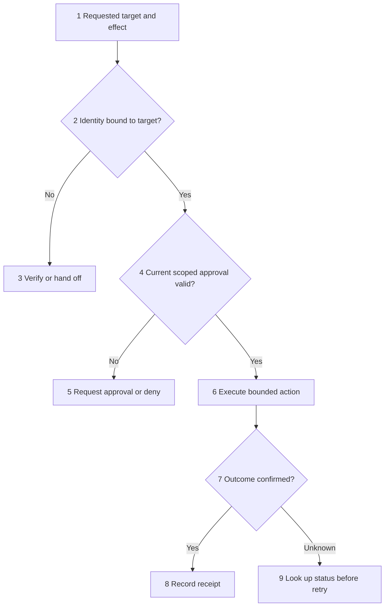

**Equivalent decision procedure:** Identify target and effect. Verify identity binding. Check current scoped approval. Block failed checks. Execute only the authorized effect. Record a receipt; unknown outcome requires status reconciliation before retry.

**Assumptions and exception:** The fictional application defines which reads and effects require approval; a prompt does not enforce this boundary.

**Inspect and practice:** [FV-04 Bind approval to this action](objectives/objective-1.4.md#variant-fv-04) · [FV-08 Make capabilities distinguishable](objectives/objective-2.1.md#variant-fv-08) · [FV-26 Honor explicit escalation with context](objectives/objective-5.2.md#variant-fv-26)

## D02 — Choose the agent structure

**Purpose:** Choose the mechanism and identify its recovery boundary. **Legend:** numbered nodes mark order; diamonds ask a condition; labelled arrows show the selected branch. Sequence lanes name separate owners.

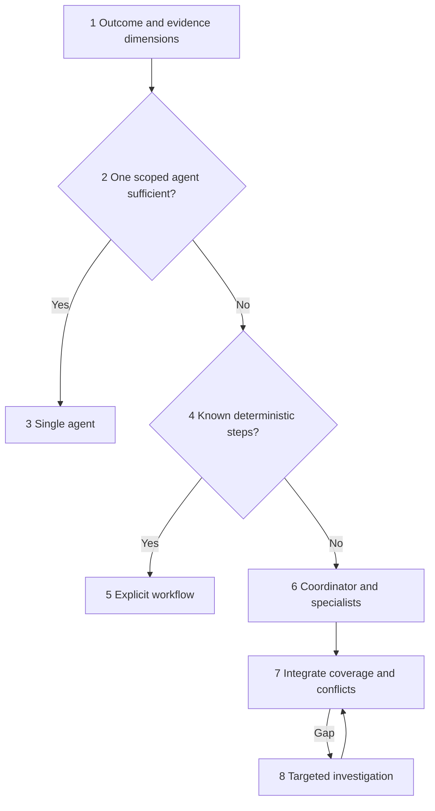

**Equivalent decision procedure:** Define required evidence dimensions. Prefer a sufficient scoped single agent. Use a deterministic workflow for known dependencies; use bounded specialists for independent investigations. The coordinator checks coverage and conflicts, then dispatches targeted gaps.

**Assumptions and exception:** Tool count alone is not the deciding criterion; costs and real evidence boundaries matter.

**Inspect and practice:** [FV-02 Cover dimensions before synthesizing](objectives/objective-1.2.md#variant-fv-02) · [FV-06 Choose decomposition by uncertainty](objectives/objective-1.6.md#variant-fv-06) · [FV-10 Scope tools to the assigned role](objectives/objective-2.3.md#variant-fv-10) · [FV-16 Plan when uncertainty crosses boundaries](objectives/objective-3.4.md#variant-fv-16)

## D03 — Pass evidence and propagate partial results

**Purpose:** Choose the mechanism and identify its recovery boundary. **Legend:** numbered nodes mark order; diamonds ask a condition; labelled arrows show the selected branch. Sequence lanes name separate owners.

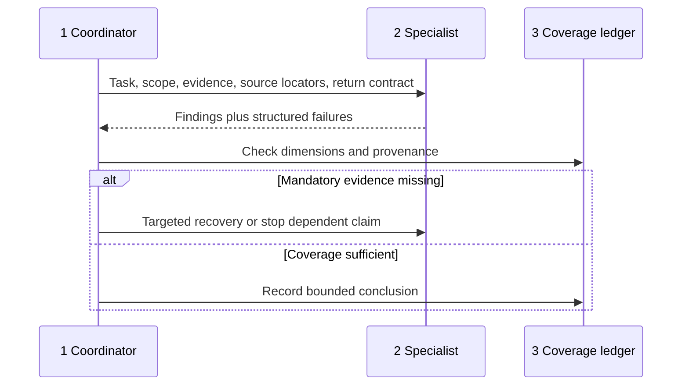

**Equivalent decision procedure:** Send an explicit brief to the isolated specialist. Require source-tagged findings and structured failures. Check mandatory dimensions. Preserve successes while recovering gaps or stopping dependent claims.

**Assumptions and exception:** A specialist does not automatically inherit another agent’s conversation; optional and mandatory gaps require different dispositions.

**Inspect and practice:** [FV-03 Send an attributable handoff](objectives/objective-1.3.md#variant-fv-03) · [FV-27 Propagate partial success without hiding failure](objectives/objective-5.3.md#variant-fv-27)

## D04 — Recover according to the result

**Purpose:** Choose the mechanism and identify its recovery boundary. **Legend:** numbered nodes mark order; diamonds ask a condition; labelled arrows show the selected branch. Sequence lanes name separate owners.

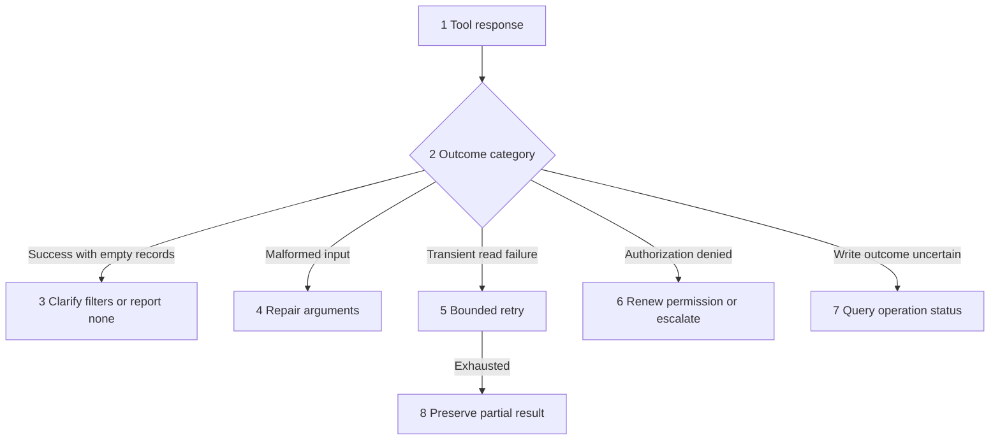

**Equivalent decision procedure:** Separate protocol outcome from application payload. Empty successful records mean no match. Repair invalid arguments. Retry only eligible transient operations within a budget. Authorization needs changed permission. Uncertain writes need status lookup.

**Assumptions and exception:** A retryable transport failure does not prove a repeated write is safe.

**Inspect and practice:** [FV-09 Route the actual error category](objectives/objective-2.2.md#variant-fv-09)

## D05 — Preserve lineage across systems

**Purpose:** Choose the mechanism and identify its recovery boundary. **Legend:** numbered nodes mark order; diamonds ask a condition; labelled arrows show the selected branch. Sequence lanes name separate owners.

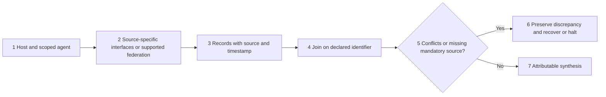

**Equivalent decision procedure:** Inspect host discovery and inclusion separately. Retrieve records with origin and timestamps. Join under a declared key. Validate conflicts and missing sources. Preserve unresolved discrepancies rather than inventing consistency.

**Assumptions and exception:** Federation must actually be supported by the chosen host/interface; it does not establish source accuracy.

**Inspect and practice:** [FV-11 Separate connection from inclusion](objectives/objective-2.4.md#variant-fv-11) · [FV-30 Keep sources through a join](objectives/objective-5.6.md#variant-fv-30)

## D06 — Select the runtime by dependency

**Purpose:** Choose the mechanism and identify its recovery boundary. **Legend:** numbered nodes mark order; diamonds ask a condition; labelled arrows show the selected branch. Sequence lanes name separate owners.

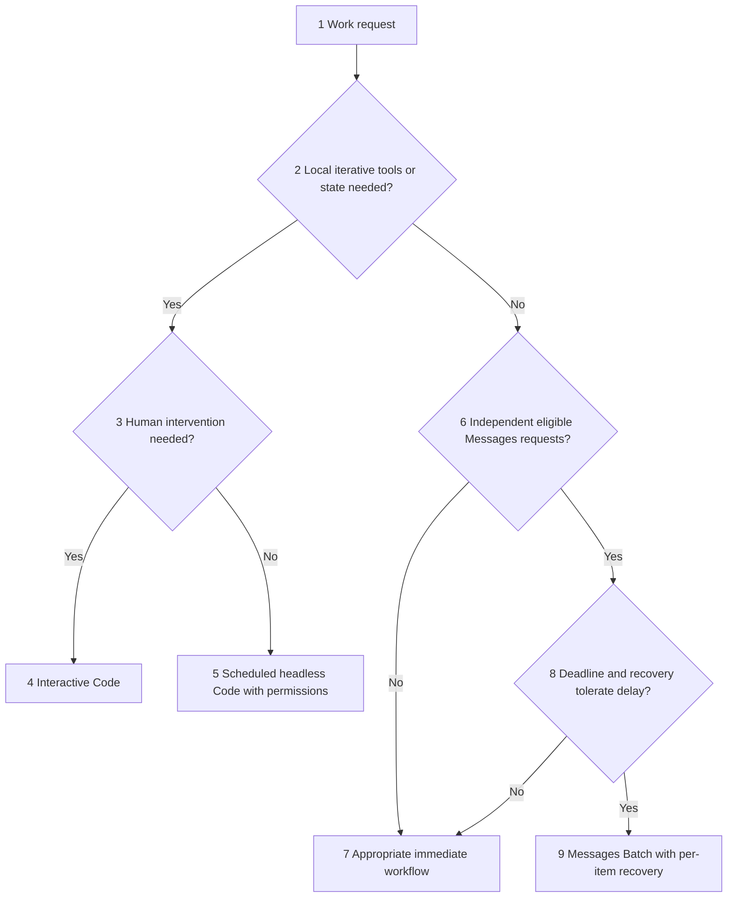

**Equivalent decision procedure:** Check local state and iterative dependencies first. Select interactive or unattended Code according to intervention needs. Only independent eligible Messages requests are batch candidates. Check deadline tolerance and recovery before choosing batch.

**Assumptions and exception:** Nonblocking alone is insufficient; batch completion is not guaranteed by the processing window.

**Inspect and practice:** [FV-23 Choose batch by dependencies and deadline](objectives/objective-4.5.md#variant-fv-23)

## D07 — Understand side-effect timing

**Purpose:** Choose the mechanism and identify its recovery boundary. **Legend:** numbered nodes mark order; diamonds ask a condition; labelled arrows show the selected branch. Sequence lanes name separate owners.

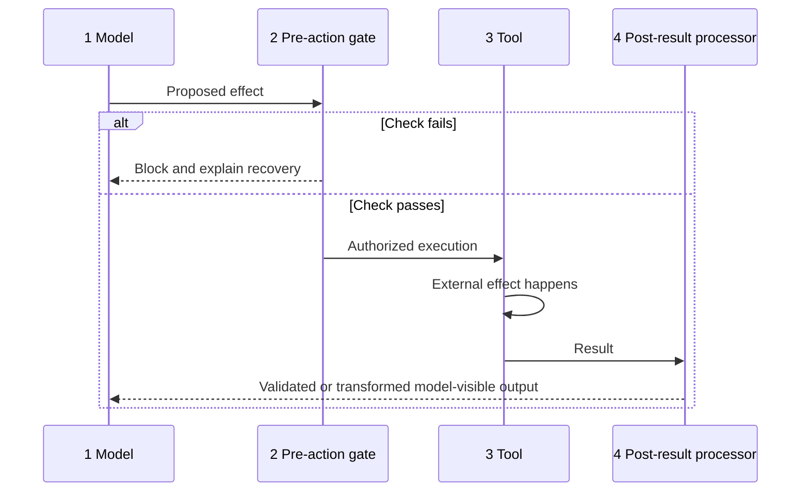

**Equivalent decision procedure:** Check permission and constraints before the effect. Execute only the permitted call. Post-result validation or normalization operates after execution. If it discovers an error, record the effect and use an explicit compensation/escalation policy.

**Assumptions and exception:** Result replacement changes what the model sees where supported; it does not undo prior writes or guarantee all telemetry is redacted.

**Inspect and practice:** [FV-05 Separate prevention from detection](objectives/objective-1.5.md#variant-fv-05)

## D08 — Validate a CI report before gating

**Purpose:** Choose the mechanism and identify its recovery boundary. **Legend:** numbered nodes mark order; diamonds ask a condition; labelled arrows show the selected branch. Sequence lanes name separate owners.

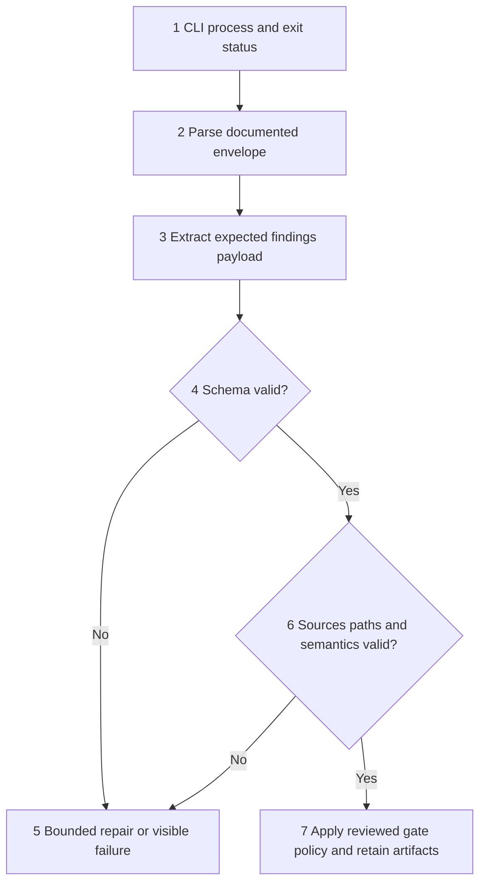

**Equivalent decision procedure:** Check process status and required artifacts. Parse the CLI envelope. Extract the declared payload. Validate its schema and source/path semantics. Only then apply a reviewed gate policy. Missing credentials, parse errors or empty unexpected payloads remain visible failures.

**Assumptions and exception:** JSON output is a transport format; it is not proof of valid findings or a successful review.

**Inspect and practice:** [FV-18 Run CI with observable failure](objectives/objective-3.6.md#variant-fv-18)

## D09 — Keep invocation, shape and truth separate

**Purpose:** Choose the mechanism and identify its recovery boundary. **Legend:** numbered nodes mark order; diamonds ask a condition; labelled arrows show the selected branch. Sequence lanes name separate owners.

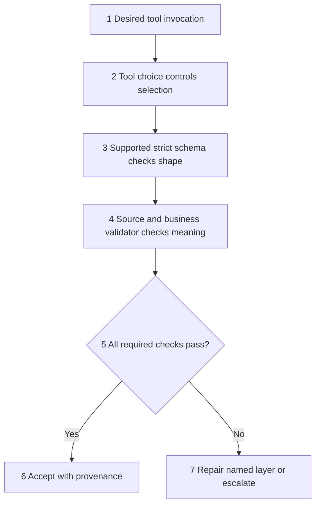

**Equivalent decision procedure:** Use the appropriate invocation mechanism to request a call. Use supported structural enforcement for fields and types. Independently check source grounding and business constraints. Failure at one layer requires its own repair.

**Assumptions and exception:** Schema-valid values can be factually wrong. Runtime support must be checked for the actual API and model.

**Inspect and practice:** [FV-21 Validate shape and truth separately](objectives/objective-4.3.md#variant-fv-21)

## D10 — Handle missing values and wrong values differently

**Purpose:** Choose the mechanism and identify its recovery boundary. **Legend:** numbered nodes mark order; diamonds ask a condition; labelled arrows show the selected branch. Sequence lanes name separate owners.

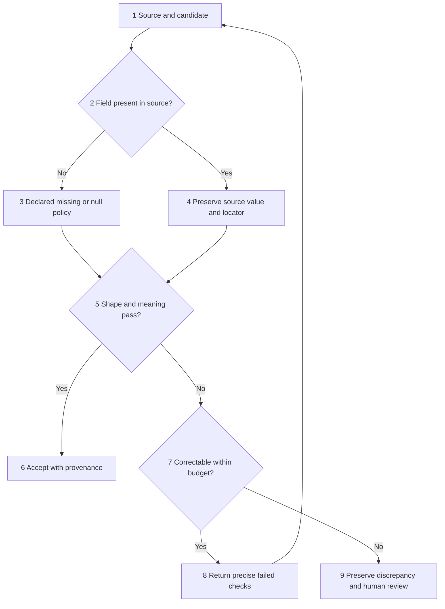

### D10 criterion lane — FV-19

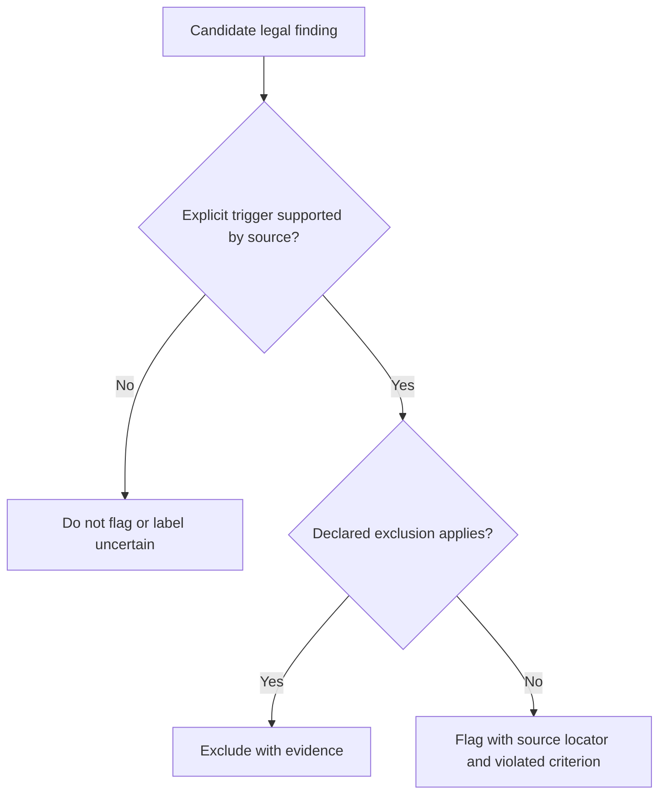

**Criterion procedure:** Define trigger, threshold and exclusions before assessing candidate text. Check source evidence, apply exclusions and preserve uncertainty when policy is ambiguous. This precision lane precedes extraction field validation; schema alone cannot supply the finding criterion.

**Equivalent decision procedure:** Locate the field in source evidence. Apply declared absence policy only to truly missing data. Check schema and meaning. Correct extraction errors with bounded failed-check feedback. Preserve source conflicts and exhausted retries for review.

**Assumptions and exception:** Making a schema nullable does not fix a wrong non-null value. Numeric thresholds are synthetic application policy.

**Inspect and practice:** [FV-19 Define a finding with evidence criteria](objectives/objective-4.1.md#variant-fv-19) · [FV-20 Teach the edges with representative examples](objectives/objective-4.2.md#variant-fv-20) · [FV-22 Repair the failed check within a budget](objectives/objective-4.4.md#variant-fv-22)

## D11 — Recover from verified checkpoints

**Purpose:** Choose the mechanism and identify its recovery boundary. **Legend:** numbered nodes mark order; diamonds ask a condition; labelled arrows show the selected branch. Sequence lanes name separate owners.

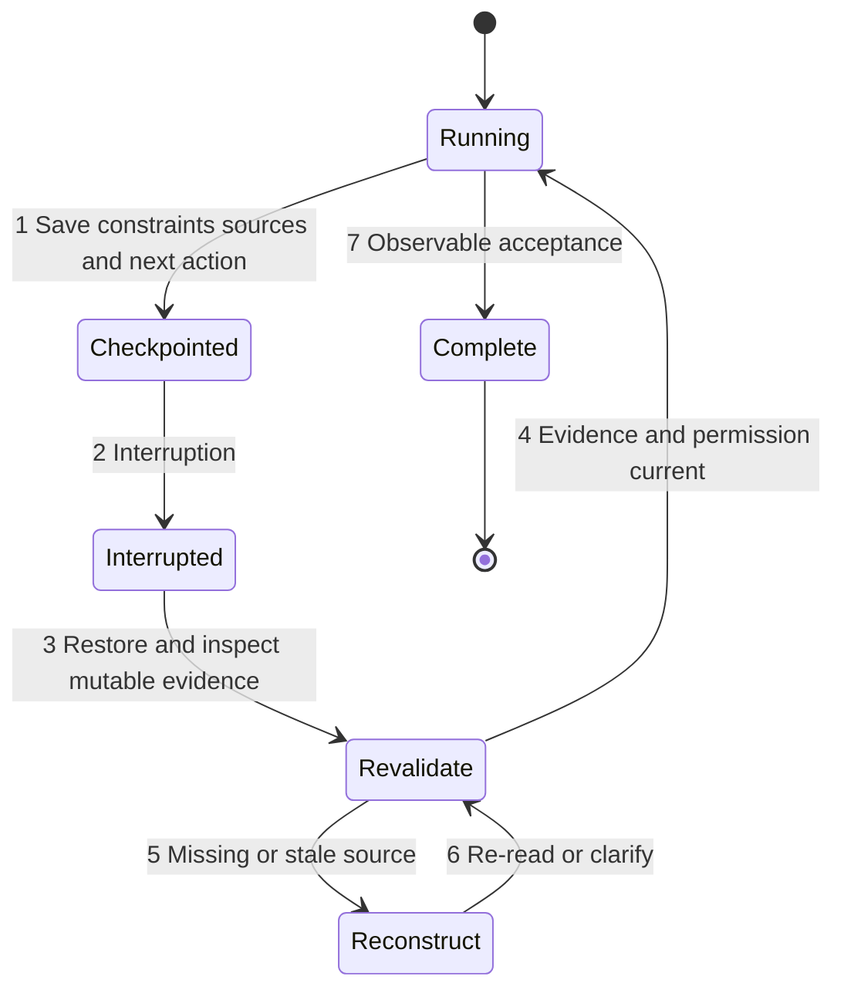

**Equivalent decision procedure:** Save decisions, exceptions, pointers and next action. Restore after interruption. Revalidate mutable files, access and targets. Reconstruct missing evidence from sources. Resume only when the relevant assumptions are current.

**Assumptions and exception:** Resume/fork does not renew permission or undo side effects; compaction is not proof that a critical exception survived.

**Inspect and practice:** [FV-01 Confirm the effect before retrying](objectives/objective-1.1.md#variant-fv-01) · [FV-07 Resume with fresh permissions](objectives/objective-1.7.md#variant-fv-07) · [FV-12 Search before making a scoped edit](objectives/objective-2.5.md#variant-fv-12) · [FV-13 Put instructions at their real scope](objectives/objective-3.1.md#variant-fv-13) · [FV-14 Give reusable skills a contract](objectives/objective-3.2.md#variant-fv-14) · [FV-15 Load rules for the affected paths](objectives/objective-3.3.md#variant-fv-15) · [FV-25 Compact the decision state, not just prose](objectives/objective-5.1.md#variant-fv-25) · [FV-28 Build a minimal code evidence ledger](objectives/objective-5.4.md#variant-fv-28)

### D11 companion lanes — protocol and instruction state

For FV-01, checkpointing alone does not explain the model protocol. This lane separates model continuation from business completion:

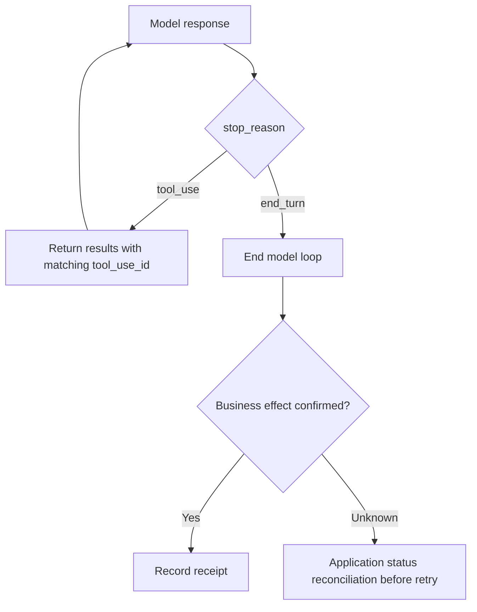

For FV-13/FV-15, inspect actual instruction scope and loading, not a generic session checkpoint:

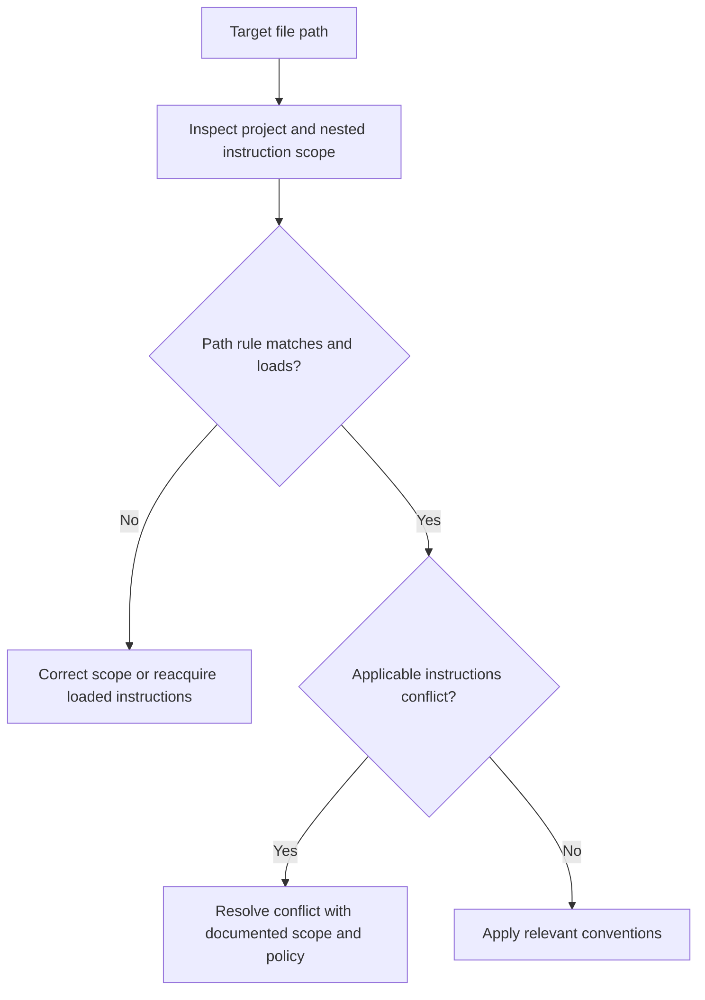

For FV-14, a reusable skill has an invocation contract separate from permission:

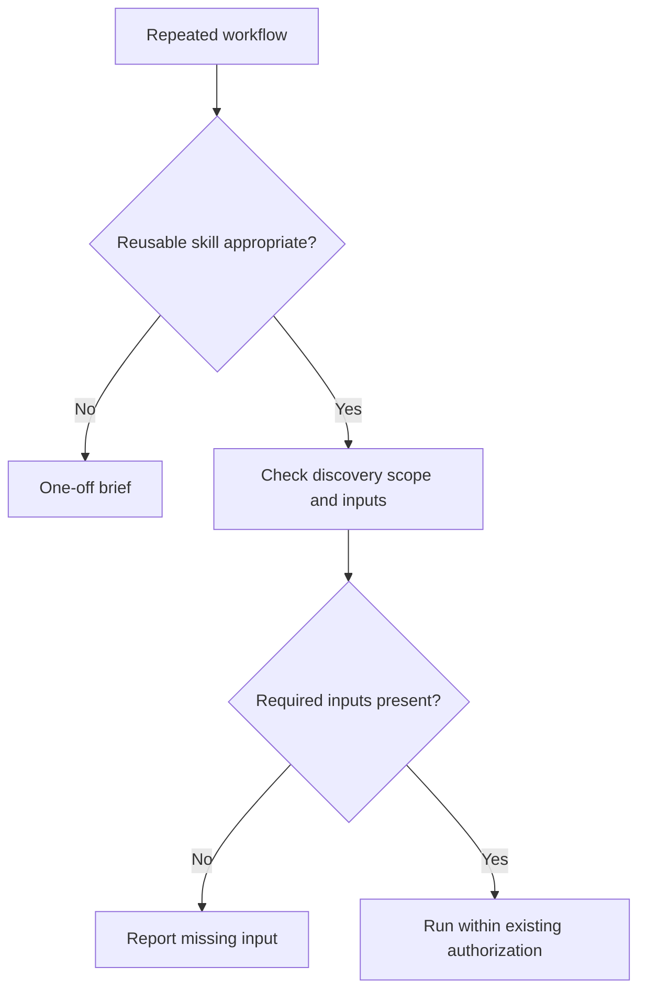

**Equivalent companion procedures:** Match tool results before the next model request; end_turn ends the model loop while the application reconciles unknown effects. For instruction decisions, inspect path scope, actual loading and conflicts. For skill decisions, establish repeated need, discovery and inputs, then preserve downstream authorization. These companion lanes add no new automatic runtime guarantee.

## D12 — Evaluate important slices and resolve review disagreements

**Purpose:** Choose the mechanism and identify its recovery boundary. **Legend:** numbered nodes mark order; diamonds ask a condition; labelled arrows show the selected branch. Sequence lanes name separate owners.

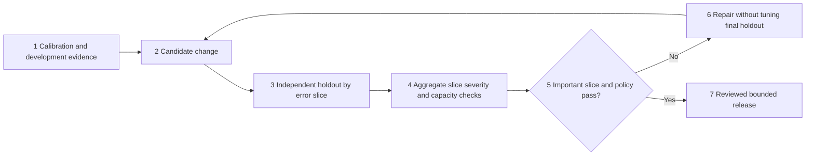

**Equivalent decision procedure:** Develop on appropriate calibration evidence. Evaluate independent holdout slices and severity, not only the average. Check human review capacity and overflow. Resolve producer/reviewer disagreements with original evidence. A failed important slice blocks its dependent release claim.

**Assumptions and exception:** Repeated agreement is not independent validation. Practice accuracy does not convert to an official exam scaled score.

**Inspect and practice:** [FV-17 Change the hypothesis after repeated failure](objectives/objective-3.5.md#variant-fv-17) · [FV-24 Give the critic independent evidence](objectives/objective-4.6.md#variant-fv-24) · [FV-29 Test risk slices and review capacity](objectives/objective-5.5.md#variant-fv-29)