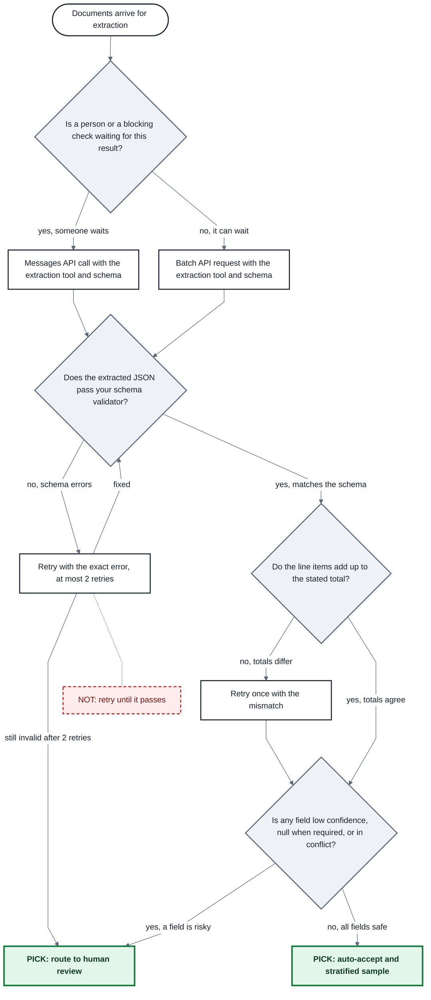
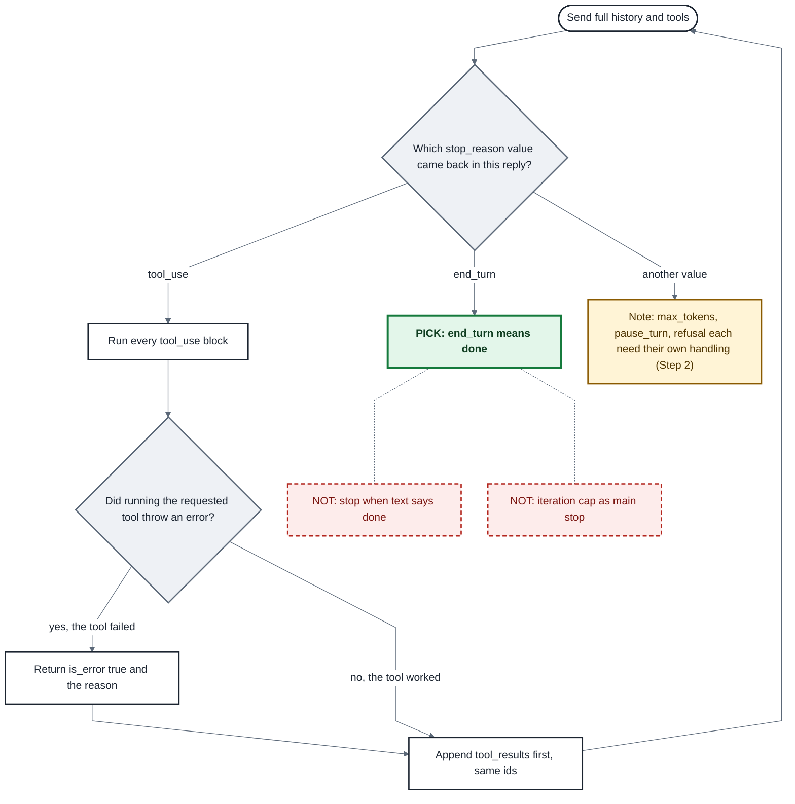
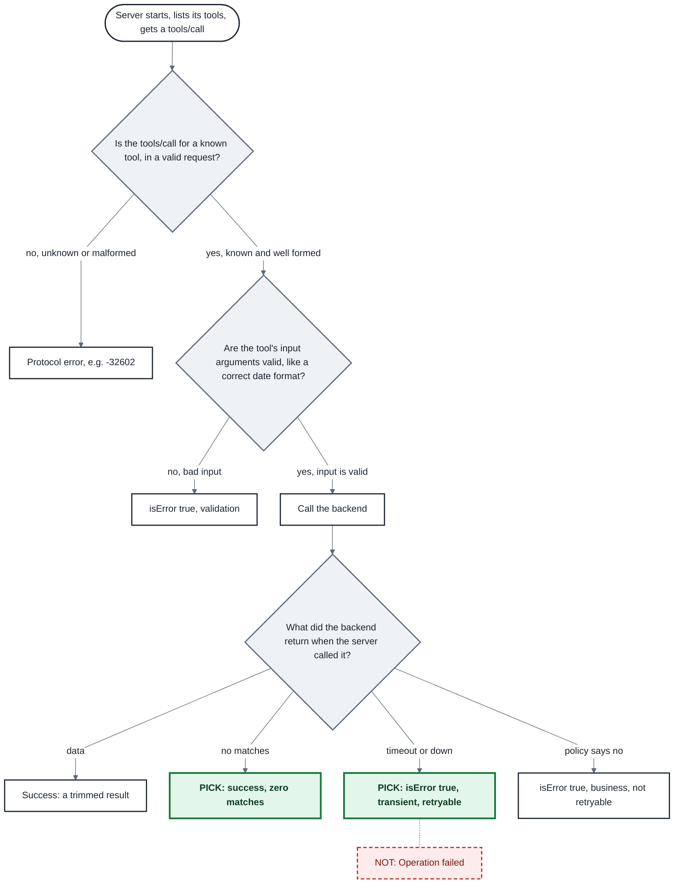
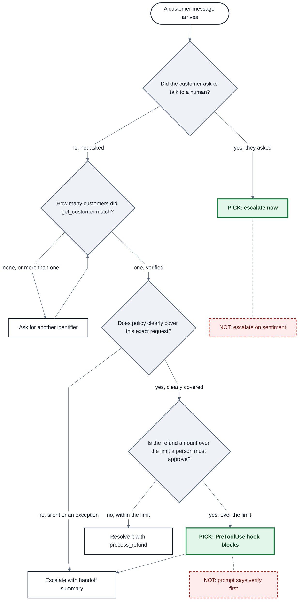
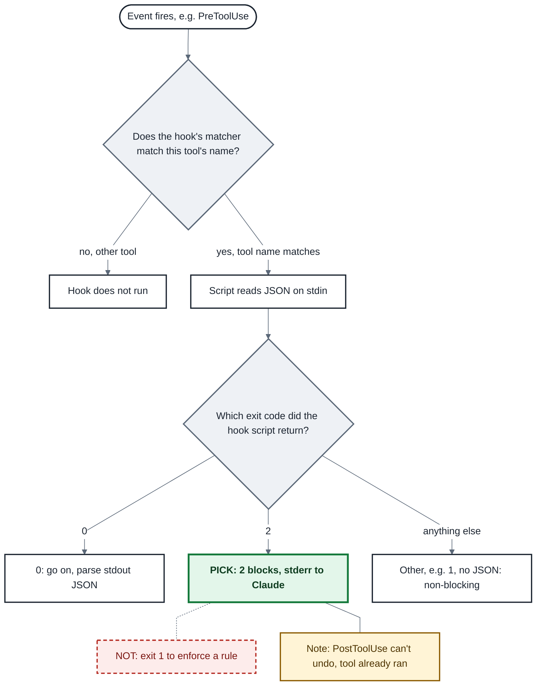
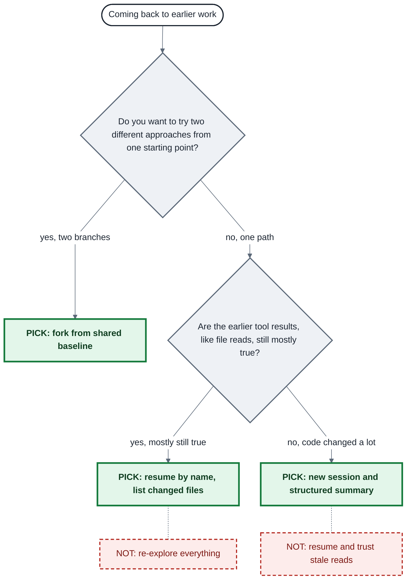
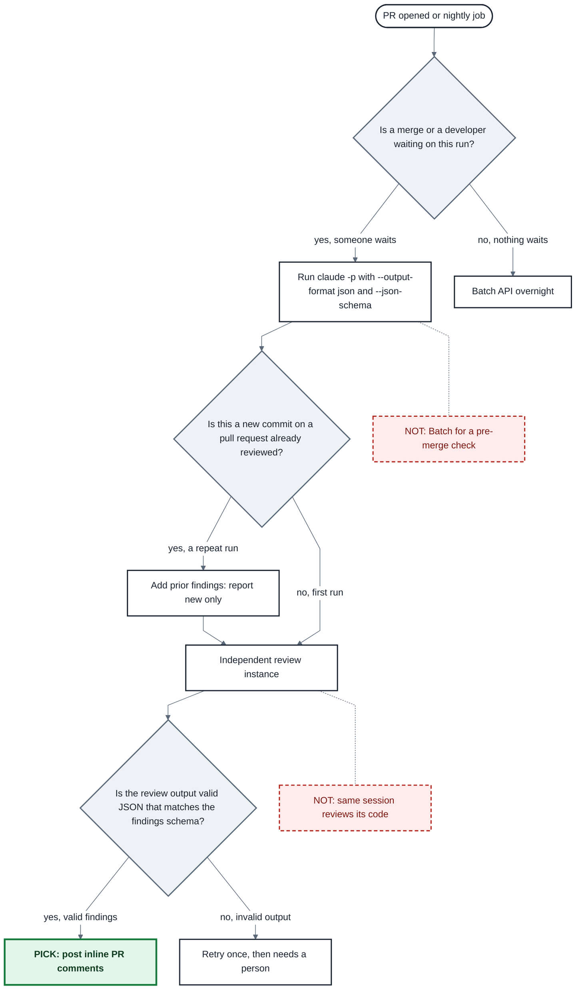
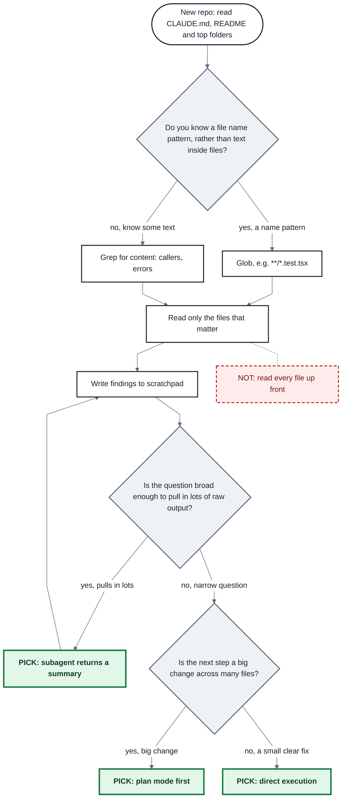

# Code-level flows

**Picture the application:** A support assistant says it will look up an order, but the customer never receives a grounded answer. Trace the request from your application to Claude, through the tool call and back with its result. These code-level flows show which program checks each condition and what should happen next.

## What this file is

Most study pages answer "which option?" in one look. This file goes
one level down. It walks each system the way you would build it in code. Every step says:

- **Checks:** what the code looks at.
- **Results:** each possible answer, and where it sends you next.
- **Exact:** the field, code, flag or setting, word for word, with its source in brackets.
- **Right / Wrong:** what a right exam answer at this step looks like, and the tempting wrong one.

Some exam questions show you a message, a config file or a hook script and ask "what happens next?"
or "what is broken?". These flows are how you answer those fast.

**Exam answer vs today's docs.** The exam guide is version 1.0 from July 2026. Where today's docs say
something different, you get **the exam's answer first**, then a short "What changed since" note that
ends with what to pick on the exam.

**Background, not tested.** The exam guide's Out-of-Scope list includes API authentication, billing,
rate limiting and quotas. Lines marked "background, not tested" are there so the code makes sense. Don't
spend study time on them.

**Source tags used below.** `[Guide 4.3]` means the official exam guide, task statement 4.3 (the exact exam
wording). Doc tags like `[errors]` are links listed at the bottom of the page. `(practice, not doc)`
means a common design habit the exam tests but no Anthropic page states as a rule.

**Chart key.** Know Mermaid flowcharts already? Skip to
[Flow 1](#flow-1-how-does-an-extraction-pipeline-decide-what-a-person-checks). Grey diamond = a question
the code asks. Each arrow out of it says what the answer means. White box = a step. Green box starting
"PICK" = the right move. Pink dashed box starting "NOT" = the tempting wrong move. Amber box starting
"Note" = a version warning or a case handled in the steps below. A dotted line joins a right move to the
wrong move that looks like it. Click a green PICK box to open the lesson section that teaches it.

**Three task statements are easy to miss here:**

- **3.2** (skills and slash commands) shows up in Flow 8 only, step 7.
- **5.6** (provenance) is one line in Flow 2, step 5: keep the source and date with each claim, and flag
  conflicts rather than averaging them.
- **3.5** (iterative refinement) has no flow. It's a working habit, not a system; see
  [deep practice 3, section 3.5](03-claude-code-configuration-and-workflows.md#35-iterative-refinement).

## Flow 1: How does an extraction pipeline decide what a person checks?

**Scenario: Structured Data Extraction · Task statements 4.1, 4.2, 4.3, 4.4, 4.5, 5.5, 2.3**

The job: take messy documents (text, digital PDFs, scans), pull out fields as JSON, check them, and
send only the risky ones to a person.



**Remember it as:** Schema fixes shape, code checks meaning, people check the risky fields.

### Step 1. Authenticate

- **Checks:** the API response status before anything else.
- **Results (background, not tested):**
  - `401` `authentication_error` (bad, revoked or expired key) → stop, alert a person. A retry cannot fix it. [errors]
  - `403` `permission_error` (key lacks access) → stop, fix access. [errors]
  - Works → Step 2.
- **Tested part:** where the secret lives (next bullet). That is TS 2.4.
- **Exact:** the key comes from an environment variable or a secret store, never from code or the repo.
  MCP servers get secrets with `${VAR}` expansion in `.mcp.json`, for example `${GITHUB_TOKEN}`. [Guide 2.4] [mcp]
- **Right:** "Read the key from an environment variable; on `401`, fail fast and alert."
- **Wrong:** "Retry `401` with exponential backoff." Backoff is for `429`, `500`, `529`. A bad key never heals.
  (Background, not tested: a `429` with no `retry-after` header may be a tier spend cap, which keeps failing
  until access resumes, so fail and alert. A spend limit you set yourself returns a `400`, not a `429`. [errors])

### Step 2. Pick the API by who is waiting

- **Checks:** is a person or a pipeline blocked until the answer comes back?
- **Results:**
  - Yes (a user is waiting, a merge is blocked) → synchronous Messages API.
  - No (overnight report, weekly audit, a big backlog) → Message Batches API.
- **Exact:**
  - Batch: `50% cost savings, up to 24-hour processing window, no guaranteed latency SLA` (exam wording). [Guide 4.5]
  - A batch holds up to 100,000 requests or 256 MB, whichever comes first. Results stay for 29 days. [batch]
  - Each request has a `custom_id`: 1 to 64 letters, digits, `-` or `_`. Results can come back in any order, so you match on `custom_id`. [batch]
  - Each result is `succeeded`, `errored`, `canceled` or `expired`. [batch]
  - Batch `does not support multi-turn tool calling within a single request (cannot execute tools
    mid-request and return results)` (exam wording). [Guide 4.5] What that means: a batch request can carry
    a multi-turn message history, and server tools run inside it. What it can't do is stop for **your**
    tool, wait for your result, and carry on in the same request. [batch]
- **Timing math (exam skill):** the rule is **cycle + 24 h + safety margin ≤ deadline**. With a 30-hour
  promise and batches that can take up to 24 hours, submit **every 4 hours, not 6** (6 is the ceiling:
  30 − 24): 4 + 24 = 28, which leaves 2 hours of safety margin (most batches finish within an hour, but a
  resend can take up to 24 hours too). Expired requests return no output, so the margin must cover resubmitting them or running them synchronously (Anthropic docs, Message Batches, Tier 1, checked 2026-10-12). A 6-hour cycle hits exactly 30 with no room. This matches the guide's own
  example, `4-hour windows to guarantee 30-hour SLA with 24-hour batch processing` (exam wording). [Guide 4.5]
- **Right:** "Nightly batch for the backlog; synchronous calls for the upload screen."
- **Wrong:** "Batch everything to save 50%", including a blocking step. Or "use Batch for a loop that needs
  tool results mid-request".

### Step 3. Prepare the input by file type

- **Checks:** what kind of file is this?
- **Results:**
  - Plain text → send the text.
  - Any PDF, digital or scanned → a PDF document block. Each page is read as **text plus an image** of the
    page, so a digital PDF isn't text only. [pdf]
  - Photo → an image block, or OCR first.
  - Keep this short in your head: image analysis itself is on the guide's Out-of-Scope list.
  - Poor scan → expect lower certainty. Ask for a confidence value **per field**, not one score per document.
  - Word or Excel → convert to PDF or text first (practice, not doc).
- **Right:** "Ask for field-level confidence so the review step can route by field." [Guide 5.5]
- **Wrong:** "One overall confidence score for the document." It hides which field is unreliable.

### Step 4. Call with an extraction tool and a JSON schema

- **Checks:** how do we make sure the reply is JSON in our shape?
- **Results (most reliable first):**
  1. A tool whose `input_schema` is your JSON schema. **This is the exam's answer.** Add `tool_choice`
     only if Claude sometimes answers in text. [Guide 4.3]
  2. "Reply only in JSON" in the prompt: can break syntax.
  3. Prefilling the reply with `{`: weakest.
- **Exact (exam wording, [Guide 4.3] and [Guide 2.3]):**
  - `tool_choice: "auto"`: model may return text instead of calling a tool.
  - `tool_choice: "any"`: model must call a tool but can choose which. Use it when **several extraction
    schemas exist and the document type is unknown**.
  - `tool_choice: {"type": "tool", "name": "extract_metadata"}`: model must call a specific named tool. Use it to
    make one step run first (for example metadata before enrichment), then do later steps in follow-up turns.
  - Read the data from the `tool_use` block's `input` field. [handle-tools]
- **What changed since:** today you can add `strict: true` to the tool to guarantee the shape, or use JSON
  outputs with `output_config.format`. [structured] On Claude Opus 5.5, Sonnet 5.5, Fable 5.1 and
  Mythos 5.1, `any` and a forced `tool_choice` (a named tool) return a `400`, so today's docs say use
  `auto` with `strict: true`. Manual extended thinking also blocks `any` and a named tool. [define-tools]
  Prefill is gone too: on Claude 4.6 and later models, a prefilled last assistant message returns a `400`
  `invalid_request_error` ("This model does not support assistant message prefill"). [errors] See
  [exam answer vs today](conditions-and-errors.md#exam-answer-vs-today).
  **On the exam: pick tool use with a JSON schema. Add `tool_choice` (`any`, or the named tool) only when
  no tool gets called or one must run first. Rank prefill last.**
- **Right:** "Define `extract_invoice` with the schema as its `input_schema`. If Claude sometimes replies
  in text instead, add `tool_choice`."
- **Wrong:** "Add 'respond only with valid JSON' to the system prompt." Or "use a bigger model."

### Step 5. Design the schema so Claude never has to invent

- **Checks:** can every required field always be filled honestly from the source?
- **Results:**
  - Field is always in the document → `required`, normal type.
  - Field may be missing → make it nullable, for example `"type": ["string", "null"]` (allowed in strict
    schemas; `anyOf` with a `null` branch also works) [structured], and say "use null if not present". `Designing schema fields as optional (nullable) ... preventing the model from fabricating
    values to satisfy required fields` (exam wording). [Guide 4.3]
  - Category list may grow → enum plus `"other"` and a free-text detail field. Add `"unclear"` for
    ambiguous cases. [Guide 4.3]
  - Formats vary (dates, currencies) → put format rules in the prompt next to the strict schema. [Guide 4.3]
- **Exact:** a strict schema stops syntax errors. It does **not** stop meaning errors, such as line items
  that don't add up to the total or a value in the wrong field. [Guide 4.3] Today's structured outputs also
  don't support `minimum`, `maximum`, `multipleOf`, `minLength`, `maxLength`. Some SDK helpers strip them and
  re-check them after the reply; not every helper validates (the TypeScript JSON-schema helper doesn't, and
  Java rejects them). So check ranges in your own code. [structured]
- **Right:** "Make `po_number` nullable so the model can return `null` when the receipt has none."
- **Wrong:** "Keep it required and add 'never leave fields blank'." That pushes the model to make one up.

### Step 6. Check the schema in code, retry with the exact error

- **Checks:** run a JSON Schema validator on the tool input.
- **Results:**
  - Pass → Step 7.
  - Fail → retry. The follow-up includes `the original document, the failed extraction, and specific
    validation errors` (exam wording). Cap the retries (for example at most 2 retries). Still failing → human review. [Guide 4.4]
  - No tool call at all (under `auto`, Claude replied in text) → retry with feedback asking it to call the
    tool; this uses one of the same retries. [define-tools]
- **The limit of retry:** retries fix format and structure errors. They **don't** fix data that is not in
  the document (for example, it lives in a separate file you never sent). [Guide 4.4]
- **Right:** "Retry with the validator's exact message, for example `line_items[2].amount: expected number`."
- **Wrong:** "Retry with 'please try again'", or "retry five times hoping the missing PO number appears".

### Step 7. Check meaning in code

- **Checks:** do the numbers agree with each other?
- **Results:**
  - Ask the model for both `stated_total` (as printed) and `calculated_total` (sum of lines), plus a
    `conflict_detected` boolean. These field names are exam wording. [Guide 4.4]
  - Your code adds the lines too. Match → Step 8.
  - Mismatch → retry once with the specific mismatch (it may be a misread digit). Still off → keep **both**
    values, flag the field, send to review. Never overwrite the printed total.
- **Right:** "Extract both totals and flag the conflict for a reviewer."
- **Wrong:** "Tell the model to make the totals match." That teaches it to fake data.

### Step 8. Route to review

- **Checks:** is this extraction risky?
- **Results:** send to a person when any field's confidence is under its threshold, a required field is
  `null`, totals conflict, or the source is ambiguous or contradictory. Everything else is auto-accepted.
- **Exact (exam wording, [Guide 5.5]):**
  - `Field-level confidence scores calibrated using labeled validation sets`.
  - `Stratified random sampling for measuring error rates in high-confidence extractions and detecting
    novel error patterns`.
  - `aggregate accuracy metrics (e.g., 97% overall) may mask poor performance on specific document types
    or fields`. Check accuracy by document type and by field before cutting human review.
- **Right:** "Route low-confidence fields to reviewers; stratified-sample the auto-accepted ones by document type."
- **Wrong:** "97% overall, so remove human review." Or "review a plain random 5% of everything." Or
  "trust the model's raw confidence without calibrating it against labeled data."

### Step 9. Close the loop

- **Checks:** what kinds of errors keep happening?
- **Results:** log each error with document type, field and error type. Add a `detected_pattern` field:
  `Adding detected_pattern fields to structured findings to enable analysis of false positive patterns
  when developers dismiss findings` (exam wording). [Guide 4.4] Fix the schema, prompt or few-shot
  examples from the pattern.
- **Few-shot rule:** 2 to 4 targeted examples, showing varied document layouts, fix empty or `null`
  extraction of required fields. [Guide 4.2] Write explicit criteria, not "be conservative". [Guide 4.1]
- **Before a big batch:** refine the prompt on a sample set first, so the big run passes first time. [Guide 4.5]
- **On batch failures:** resubmit only the failed ones by `custom_id`, changed as needed (for example,
  split a document that was too long). [Guide 4.5]

```python
def extract(doc, waiting: bool):
    client = Anthropic(api_key=os.environ["ANTHROPIC_API_KEY"])   # never hard-coded
    if not waiting:
        return submit_batch(doc, custom_id=doc.id)                # match results by custom_id later

    feedback, retried_total = None, False
    for attempt in range(MAX_TRIES):                              # first try plus up to 2 retries, e.g. MAX_TRIES = 3
        resp = client.messages.create(
            model=MODEL, max_tokens=MAX_TOKENS,
            tools=[EXTRACT_INVOICE],                          # schema = input_schema; today also "strict": True
            # tool_choice={"type": "tool", "name": "extract_invoice"},  # exam add-on if Claude skips the tool
            # today newest models (Opus 5.5, Sonnet 5.5) return a 400 for a forced tool_choice: use auto with strict: true
            messages=build_messages(doc, feedback),
        )
        block = first_tool_use(resp)
        if block is None:                                     # auto can answer in text
            feedback = (doc, None, "reply by calling the extract_invoice tool")
            continue
        data = block.input
        errors = json_schema_errors(data, SCHEMA)
        if errors:
            feedback = (doc, data, errors)                        # doc + failed output + exact errors
            continue
        if data["calculated_total"] != data["stated_total"]:
            if not retried_total:                                 # retry once: it may be a misread digit
                feedback, retried_total = (doc, data, "line items do not add up to stated_total"), True
                continue
            data["conflict_detected"] = True                      # still off: keep BOTH values
        break
    else:
        return send_to_review(doc, reason="still failing after retries")

    if needs_review(data):   # low field confidence, required null, conflict, ambiguous source
        return send_to_review(doc, data)
    accept(data)
    maybe_stratified_sample(data, by=doc.type)                    # keep measuring high-confidence
```

---

## Flow 2: How does the agent loop know when to stop?

**Scenarios: Customer Support, Multi-Agent Research, Developer Productivity · Task statements 1.1, 1.2, 1.3, 2.3, 5.1, 5.3**

The job: send a request, let Claude ask for tools, run them, send results back, and stop at the right time.



**Remember it as:** `stop_reason` decides. Every `tool_use` gets a matching `tool_result`.

### Step 1. Build the request with the full history

- **Checks:** does `messages` hold every earlier turn, including every `tool_use` and `tool_result`?
- **Results:** yes → call. No → the model loses track. The API keeps no memory between calls; you send
  `complete conversation history in subsequent API requests` (exam wording). [Guide 5.1]
- **Keep it lean:** trim big tool results to the fields that matter (for example 5 of 40 order fields), and
  keep key facts (amounts, dates, IDs) in a "case facts" block that never gets summarised away. [Guide 5.1]
- **Right:** "Append the assistant turn and the tool results to `messages`, then call again."
- **Wrong:** "Send only the latest user message; the API remembers the session."

### Step 2. Branch on `stop_reason`

- **Checks:** the `stop_reason` field of the response. Never the text.
- **Results:** [stop-reasons]
  - `tool_use` → Step 3. Continue the loop. [Guide 1.1]
  - `end_turn` → done. Return the answer. [Guide 1.1]
  - `max_tokens` → the reply was cut off. If it stopped inside a tool call, the `tool_use` block is
    incomplete: **don't run it**. Retry with a higher `max_tokens`.
  - `stop_sequence` → one of your stop strings was hit; handle as your design says.
  - `pause_turn` → a server-tool loop hit its limit. Send the assistant content back to continue.
  - `refusal` → Claude declined. Read `stop_details`; today's docs suggest a fallback model. Don't loop blindly.
  - `model_context_window_exceeded` → treat the reply as truncated.
- **Right:** "Continue while `stop_reason == "tool_use"`; stop on `"end_turn"`."
- **Wrong (exam wording for the anti-patterns, [Guide 1.1]):** `parsing natural language signals to determine
  loop termination`, `setting arbitrary iteration caps as the primary stopping mechanism`, or `checking
  for assistant text content as a completion indicator`. A cap as a **backstop** for runaway loops is fine;
  as the main stop it is wrong.

### Step 3. Run every tool block and send results back

- **Checks:** every `tool_use` block in the response, by `id`.
- **Results:**
  - Each one gets a `tool_result` with the matching `tool_use_id`. [handle-tools]
  - All `tool_result` blocks go **first** in the next user message; any text goes after. Text first is a
    `400`. [handle-tools]
  - Parallel calls: every result goes back in one single user message, with no text before the results. [parallel]
  - Edge case: if the same assistant turn also called a server tool that has no result yet, the user message
    must hold **only** `tool_result` blocks. Text after them then gives a `400` naming the unfinished server
    tool. [handle-tools]
  - A missing result gives an error like `tool_use ids were found without tool_result blocks immediately
    after`. [handle-tools]
- **If a tool fails:** return `"is_error": true` with a useful message ("Rate limit exceeded. Retry after
  60 seconds."), not a crash and not a bare "failed". [handle-tools]
- **Right:** "Return a `tool_result` with `is_error: true` and the reason; let Claude decide what to do."
- **Wrong:** "Throw an exception and end the loop", or "drop the failed call and send only the good results".

### Step 4. Model-driven vs scripted order

- **Checks:** must the steps always happen in one fixed order?
- **Results:**
  - Claude may choose → model-driven: Claude picks the next tool from context. [Guide 1.1]
  - One step must run first → force it with `tool_choice` (exam answer) or a code gate. [Guide 2.3]
  - A rule must **always** hold (identity before refund) → enforce in code: a hook or a prerequisite
    gate (Flow 4). [Guide 1.4]

### Step 5. Multi-agent branch (coordinator and subagents)

- **Checks:** is one agent enough, or does the task split into specialist parts?
- **Results:**
  - Split → hub and spoke: the coordinator manages all communication, errors and routing. [Guide 1.2]
  - Subagents start empty. They `do not automatically inherit parent context` (exam wording). Put prior
    findings into the subagent's prompt, as structured data that keeps source URLs, document names and
    page numbers apart from the content. [Guide 1.3] [Guide 5.6]
  - Parallel work → emit several Task tool calls **in one** coordinator response, not across turns. [Guide 1.3]
  - The coordinator needs `"Task"` in `allowedTools`: the guide states `the requirement that allowedTools
    must include "Task" for a coordinator to invoke subagents` (exam wording). [Guide 1.3]
    On the exam, `Task` in `allowedTools`. Today the tool is `Agent` (renamed in Claude Code v2.1.63;
    `Task` still works as an alias), and `allowedTools` only pre-approves tools; see
    [exam answer vs today](conditions-and-errors.md#exam-answer-vs-today). [sub-agents]
  - Keep provenance: each claim travels with its source and date. When two sources disagree, flag the
    conflict with both sources; don't average them or quietly pick one. [Guide 5.6]
  - Give each subagent only its role's tools (4 to 5, not 18). [Guide 2.3]
  - Coordinator prompts state goals and quality criteria, not step-by-step procedures. [Guide 1.3]
- **When a subagent fails:** it retries transient errors itself. It passes up only what it can't fix, with
  failure type, what it tried, partial results and alternatives. Tell an access failure apart from a valid
  empty result. [Guide 5.3]
- **Right:** "Pass the web results and document analysis into the synthesis subagent's prompt."
- **Wrong:** "The synthesis subagent can read the coordinator's history." Or "return empty results as
  success when the search timed out." Or "kill the whole run on one subagent failure."

```python
messages = [{"role": "user", "content": task}]
for turn in range(SAFETY_CAP):                     # backstop only, not the real stop
    resp = client.messages.create(model=M, tools=TOOLS, messages=messages, max_tokens=MAX)
    messages.append({"role": "assistant", "content": resp.content})

    if resp.stop_reason == "end_turn":
        return final_text(resp)
    if resp.stop_reason == "max_tokens":
        if has_incomplete_tool_use(resp):          # never run a half-written call
            messages.pop(); MAX *= 2; continue
        return continue_or_flag(resp)
    if resp.stop_reason == "pause_turn":
        continue                                   # content already appended; call again
    if resp.stop_reason == "refusal":
        return handle_refusal(resp.stop_details)
    if resp.stop_reason == "tool_use":
        results = []
        for block in tool_use_blocks(resp):
            try:
                out = run_tool(block.name, block.input)
                results.append({"type": "tool_result", "tool_use_id": block.id, "content": out})
            except ToolError as e:
                results.append({"type": "tool_result", "tool_use_id": block.id,
                                "content": e.helpful_message, "is_error": True})
        messages.append({"role": "user", "content": results})   # results first, no text before them
else:
    hand_off_to_person(messages)                   # cap hit: safe exit, not silent success
```

---

## Flow 3: How should an MCP tool report each kind of result?

**Scenarios: Customer Support, Multi-Agent Research, Developer Productivity · Task statements 2.1, 2.2, 2.3, 2.4, 5.3**

The job: build an MCP server whose tools Claude picks correctly, whose errors Claude can act on, and
which teammates can install safely.



**Remember it as:** Empty is success. Down is a retryable error.

### Step 1. Configure and start the server

- **Checks:** where does the config live, and are its secrets set?
- **Results:**
  - Shared with the team → project scope, `.mcp.json` in the project root, checked into git. [mcp] [Guide 2.4]
  - Personal or experimental → user scope in `~/.claude.json` (exam wording). [Guide 2.4] Today's docs also
    have a **local** scope (the default, this project only, also stored in `~/.claude.json`). [mcp]
  - Secrets → `${VAR}` expansion, for example `${GITHUB_TOKEN}`; `${VAR:-default}` gives a fallback. [mcp]
  - Exception today: in a **remote** server's `url` and `headers`, Claude Code reads its own and
    cloud-provider credential variables (for example `ANTHROPIC_API_KEY`, `AWS_BEARER_TOKEN_BEDROCK`) as
    empty, with no warning. Use a variable name of your own. The doc's list says "such as", so whether
    `GITHUB_TOKEN` is covered is (unconfirmed). [mcp] **On the exam: pick `${GITHUB_TOKEN}` in
    `.mcp.json`.**
  - Standard integration (for example Jira) → use an existing community server, not a custom one. [Guide 2.4]
- **When a tool doesn't show up or doesn't work, check in this order:**
  - `claude mcp list` status. `⏸ Pending approval` means a project server from `.mcp.json` you haven't
    approved yet; run `claude` to approve. `✘ Failed to connect` means it didn't start. [mcp]
  - An unset `${VAR}` with no `:-default`: Claude Code warns in `claude mcp list` and `/mcp`, naming the
    variable, **and still loads the server with the `${VAR}` text unexpanded**. So the usual symptom is
    not a missing server. It's failed auth or failed calls, plus that warning. [mcp]
  - Wrong scope (it's in your user config, so a teammate doesn't have it).
- **Right:** "Put the server in `.mcp.json` with `${GITHUB_TOKEN}` and have each developer export the token."
- **Wrong:** "Commit the token in `.mcp.json`", or "put the shared server in each person's `~/.claude.json`".

### Step 2. Describe each tool so Claude picks the right one

- **Checks:** could Claude confuse this tool with another one?
- **Results:**
  - Description too short → misrouting. Descriptions are `the primary mechanism LLMs use for tool
    selection` (exam wording). Include input formats, example queries, edge cases, and when to use this
    tool **versus** the similar one. [Guide 2.1]
  - Two tools overlap (`analyze_content` vs `analyze_document`) → rename and narrow, for example
    `extract_web_results`. [Guide 2.1]
  - One generic tool does many jobs → split it (`extract_data_points`, `summarize_content`,
    `verify_claim_against_source`). [Guide 2.1]
  - Claude keeps using built-in Grep instead of your better MCP tool → improve the MCP tool's
    description. [Guide 2.4]
  - The system prompt has a keyword that pulls Claude to the wrong tool → fix the prompt wording. [Guide 2.1]
  - Many read-only catalogs (issue lists, schemas) → expose them as **MCP resources** so Claude sees what
    exists without exploratory calls. [Guide 2.4]
- **Right:** "Rewrite both descriptions to say what each is for and when to use the other."
- **Wrong:** "Add few-shot examples first", "add a routing classifier", or "merge everything into one tool".
  Fixing descriptions comes first.

### Step 3. Check the call, then classify every failure

- **Checks:** is the request well formed, is the input valid, and what did the backend say?
- **Results (MCP spec 2025-11-25, [mcp-spec]):**
  - Unknown tool or a request that breaks the `CallToolRequest` schema → **protocol error** (JSON-RPC),
    for example `"code": -32602`.
  - Bad input (wrong date format, value out of range), API failures, business-rule failures → a normal
    result with `"isError": true` and an actionable message, so the model can fix and retry.
- **Exam metadata (exam wording, [Guide 2.2]):** return `errorCategory` (transient / validation / permission;
  the guide also names business errors), an `isRetryable` boolean, and a human-readable description. For
  policy violations, `retriable: false` plus a customer-friendly explanation. These field names are the
  exam guide's pattern, not fields defined by the MCP spec (practice, not doc). The guide spells it both
  `isRetryable` and `retriable`; treat them as the same idea.
- **Empty is not an error:** a search that worked and found nothing is a **success with zero results**.
  A timeout is an **access failure**. Mixing them up breaks the coordinator's decisions. [Guide 2.2] [Guide 5.3]
- **Spec history (no conflict with the exam):** the older spec, 2025-06-18, listed invalid arguments as a
  protocol error. From 2025-11-25 on, they are tool execution errors with `isError: true`. That change came
  before the July 2026 guide, so the exam and today's spec agree. [mcp-spec]
  **On the exam: pick `isError: true` with structured metadata.**
- **Right:** `isError: true`, `errorCategory: "transient"`, `isRetryable: true`, "Inventory service timed
  out after 5 s; retry in 30 s."
- **Wrong:** `"Operation failed"` for everything. Or returning `[]` with no error when the backend was down.

### Step 4. Keep results small

- **Checks:** how big is the response?
- **Results:** page through results, return only needed fields, cap the size. Claude Code warns above
  10,000 tokens of MCP output and caps it at 25,000 by default; `MAX_MCP_OUTPUT_TOKENS` changes the cap. [mcp]
- **Right:** "Return the 5 return-relevant fields, not all 40." [Guide 5.1]

### Step 5. Give each agent the right tools

- **Checks:** how many tools does each agent see?
- **Results:** 4 to 5 per role, not 18. Replace risky generic tools with narrow ones (`fetch_url` →
  `load_document` that checks the URL). Give a narrow cross-role tool for a frequent need (`verify_fact`
  for synthesis) and send complex cases through the coordinator. [Guide 2.3]
- **Exact:** all tools from all configured MCP servers are found at connection time and are available at
  once. [Guide 2.4] That is why too many servers can flood tool choice.

```python
@server.tool("lookup_order", description=ORDER_DESC)   # says when to use it vs search_orders
def lookup_order(args):
    if not valid_order_id(args.get("order_id")):
        return error("validation", retryable=False,
                     msg="order_id must look like ORD-123456; got '%s'" % args.get("order_id"))
    try:
        rows = backend.get_order(args["order_id"], timeout=5)
    except Timeout:
        return error("transient", retryable=True, msg="Order service timed out; retry in 30 s")
    except Forbidden:
        return error("permission", retryable=False, msg="Agent lacks access to this region's orders")
    if not rows:
        return ok({"matches": 0})                       # valid empty result, NOT an error
    return ok(trim(rows, FIELDS_NEEDED))                # small, readable, no internal IDs only

def error(category, retryable, msg):
    return {"isError": True,
            "content": [{"type": "text", "text": json.dumps(
                {"errorCategory": category, "isRetryable": retryable, "message": msg})}]}
# Unknown tool name never reaches this code: the MCP layer answers with JSON-RPC -32602.
```

---

## Flow 4: How does a support agent enforce rules and hand off?

**Scenario: Customer Support Resolution Agent · Task statements 1.4, 1.5, 5.1, 5.2**

The job: resolve returns, billing and account issues, with rules that can't be skipped and clean handoffs.



**Remember it as:** Asked: escalate. Must hold: hook. Policy silent: escalate.

### Step 1. Did the customer ask for a person?

- **Checks:** an explicit request for a human.
- **Results:**
  - Yes → escalate **right away**, without investigating first. [Guide 5.2]
  - Frustrated but the issue is simple → acknowledge, offer to resolve; escalate if they ask again. [Guide 5.2]
- **Wrong:** "Escalate when sentiment turns negative" or "when the model's confidence is low".
  `sentiment-based escalation and self-reported confidence scores are unreliable proxies` (exam wording). [Guide 5.2]

### Step 2. Identify the customer, with a code gate

- **Checks:** did `get_customer` return exactly one verified customer ID?
- **Results:**
  - Several matches → ask for another identifier. Never pick by a guess. [Guide 5.2] No match → ask
    again too, rather than going on without a verified ID (practice, not doc).
  - One verified ID → unlock money tools.
  - Not yet → `process_refund` is **blocked in code** until `get_customer` returns a verified ID. [Guide 1.4]
- **Exact:** `prompt instructions alone have a non-zero failure rate` when compliance must be
  deterministic (exam wording). [Guide 1.4]
- **Right:** "A programmatic prerequisite blocks `process_refund` until a verified ID exists."
- **Wrong:** "Add 'always verify identity first' in bold to the system prompt."

### Step 3. Enforce business rules with hooks

- **Checks:** does the tool call break a hard rule (for example a refund over $500)?
- **Results:**
  - Breaks it → a hook that intercepts the outgoing call blocks it and redirects to human escalation. [Guide 1.5]
  - Fine → allow.
- **Exact:** in Claude Code, a `PreToolUse` hook can return `hookSpecificOutput.permissionDecision: "deny"`
  or exit with code `2` to block the call. [hooks] In the Agent SDK, a `PreToolUse` callback returns
  `hookSpecificOutput.permissionDecision` (`"allow"`, `"deny"`, `"ask"` or `"defer"`) plus
  `permissionDecisionReason`, which tells the model why. [sdk-hooks] (`defer` works only in `-p` and
  Agent SDK runs; it pauses the call for the calling app, and in the SDK the turn ends with `stop_reason:
  "tool_deferred"`. [hooks] On the exam, the answers are `allow`, `deny` and `ask`.)
- **Normalising data:** a `PostToolUse` hook changes tool results **before** the model reads them, for
  example turning Unix timestamps, ISO 8601 strings and numeric status codes into one format. [Guide 1.5]
- **Right:** "Block refunds over $500 in a hook and route them to `escalate_to_human`."
- **Wrong:** "Tell the model the limit in the prompt and audit refunds weekly."

### Step 4. Is policy clear?

- **Checks:** does policy cover this exact request?
- **Results:**
  - Covered and within limits → resolve.
  - Policy silent or ambiguous (for example competitor price matching when policy only covers your own
    site) → escalate. [Guide 5.2]
  - Can't make progress → escalate. [Guide 5.2]
- **Several problems in one message** → split into separate items, investigate each in parallel with shared
  context, then give one combined answer. [Guide 1.4]

### Step 5. Keep facts and hand off cleanly

- **Checks:** will the facts survive a long chat, and can a person pick it up cold?
- **Results:**
  - Keep a "case facts" block (amounts, dates, order numbers, statuses) outside the summarised history. [Guide 5.1]
  - Handoff summary: customer ID, root cause, refund amount, recommended action. The human agent can't see
    the transcript. [Guide 1.4]
- **Wrong:** "Paste the whole transcript into the ticket" or "summarise as 'customer wants a refund'".

```python
def on_message(msg, state):
    if explicitly_asks_for_human(msg):
        return escalate(handoff(state))                        # immediately, no investigation

def pre_tool_use(call, state):                                 # hook: runs before every tool call
    if call.name == "process_refund":
        if not state.verified_customer_id:
            return deny("Verify the customer with get_customer first")
        if call.input["amount"] > 500:
            return deny("Over $500: escalate_to_human with a handoff summary")
    return allow()

def post_tool_use(result):                                     # hook: normalise before Claude sees it
    return to_iso8601_and_named_statuses(trim(result, RETURN_FIELDS))

def handoff(state):
    return {"customer_id": state.verified_customer_id, "root_cause": state.root_cause,
            "refund_amount": state.amount, "recommended_action": state.next_step}
```

---

## Flow 5: How does a hook block a tool call?

**Scenarios: Code Generation, Developer Productivity, CI · Task statements 1.4, 1.5, 3.1**

The job: make sure a rule always runs, instead of hoping Claude remembers a line in `CLAUDE.md`.



**Remember it as:** Exit 2 blocks. Exit 1 with plain text does not.

### Step 1. Decide: hook, setting, or `CLAUDE.md`?

- **Checks:** must this rule hold every time, or is it advice?
- **Results:**
  - Must always hold (never edit `.env`, always run the formatter) → a hook or a permission rule in
    settings. Code enforcement beats prompt instructions (practice, not doc; the exam guide says hooks give
    `deterministic guarantees` vs prompts' `probabilistic compliance`, [Guide 1.5]).
  - Team conventions and context → `CLAUDE.md` (project level, in git). [Guide 3.1]
  - Only for some file types → `.claude/rules/` with `paths:` (Flow 8, step 7). [Guide 3.3]
- **Right:** "A `PreToolUse` hook that blocks writes to `migrations/`."
- **Wrong:** "Add 'NEVER edit migrations' in capitals to `CLAUDE.md`."

### Step 2. The event fires and the matcher filters

- **Checks:** which event, and does the `matcher` match the tool name?
- **Results:**
  - `PreToolUse` → before the tool runs. Can block.
  - `PostToolUse` → after the tool ran. Can't undo it, but can feed problems back to Claude.
  - `UserPromptSubmit` → before Claude sees a prompt. Can block the prompt.
  - `Stop` / `SubagentStop` → when Claude is about to stop. Exit `2` keeps it working.
  - `SessionStart` → adds context only. Can't block. [hooks]
  - Matcher example: `"Edit|Write"` is a **list of exact tool names**, so it runs only for `Edit` and
    `Write`. A matcher made only of letters, digits, `_`, `-`, spaces, `,` and `|` is read as exact names;
    one with any other character (for example `mcp__memory__.*`) is read as a regex. [hooks]
- **Where configured:** the `hooks` key in a settings file. `.claude/settings.json` is shared with the team
  through git; `.claude/settings.local.json` is just you. [settings]

### Step 3. The script runs and returns an exit code

- **Checks:** the exit code, then stdout.
- **Results (exact, [hooks]):**
  - `0` → go on. If stdout is valid JSON, Claude Code reads its fields. Exit `0` with no output is **not**
    approval; the call just continues through normal permissions.
  - `2` → block. The reason (your JSON's reason, or stderr) goes back. `PreToolUse` blocks the call.
    `PostToolUse`: "Shows stderr to Claude; the tool already ran" (doc wording).
  - Any other code, including `1`, **when stdout has no valid JSON** → **non-blocking error**. The action
    goes ahead. (If stdout does hold a valid JSON decision, its fields are honoured on any exit code, so
    exit `1` plus a JSON `deny` does block.) The docs say plainly: if your hook is meant to enforce a
    policy, use `exit 2`.
  - Script path wrong or not executable → shell exits like `127` → non-blocking. A typo in `settings.json`
    leaves the gate silently off.
- **JSON control instead of exit codes (exact, [hooks]):**
  - `PreToolUse`: `hookSpecificOutput.permissionDecision` = `"allow"`, `"deny"`, `"ask"` or `"defer"`,
    plus `updatedInput` to rewrite the tool's arguments. When several hooks answer, `deny` beats `defer`,
    which beats `ask`, which beats `allow`. `defer` works only in `-p` and Agent SDK runs: it pauses the
    call for the app that launched Claude. On the exam, the answers are `allow`, `deny` and `ask`.
  - `PostToolUse`, `Stop`, `UserPromptSubmit`: top-level `"decision": "block"` with a `reason`.
  - `additionalContext` adds a note to Claude's context.
- **Right:** "The script exits `2` and writes the reason to stderr."
- **Wrong:** "The script exits `1`" (with plain-text output). Claude Code treats that as a non-blocking
  error; the edit goes through.

### Step 4. The PostToolUse quality loop

- **Checks:** after `Edit` or `Write`, does the code still pass formatter, linter and tests?
- **Results:**
  - Pass → exit `0`.
  - Fail → exit `2` with the failures on stderr (or `"decision": "block"` with a reason). Claude sees them
    and fixes the code. The edit already happened; the hook makes sure Claude hears about the problem.
- **Right:** "A `PostToolUse` hook on `Edit|Write` runs the linter and returns failures to Claude."
- **Wrong:** "Ask Claude in `CLAUDE.md` to run the linter after every change."

### Step 5. Check what's loaded

- **Checks:** is Claude even seeing the instructions you think it sees?
- **Results:** `/memory` shows which memory files are loaded. A teammate missing rules usually means the
  rules are in `~/.claude/CLAUDE.md` (user level, not shared) instead of the project's `CLAUDE.md`. [Guide 3.1] On the exam, `/memory`. Today `/context` lists, under
  Memory files, the `CLAUDE.md` files loaded at launch; see
  [exam answer vs today](conditions-and-errors.md#exam-answer-vs-today). [memory]
- **`@` references:** `@path/to/file` in `CLAUDE.md` imports a file; in a prompt it pulls one known file
  into this turn. Use `@` when you know the exact file; use `CLAUDE.md` when every session needs it. [memory] [Guide 3.1]

```python
# .claude/hooks/block_migrations.py  (registered under hooks.PreToolUse, matcher "Edit|Write")
import json, sys
event = json.load(sys.stdin)                       # tool_name, tool_input, ...
path = event["tool_input"].get("file_path", "")
if path.startswith("migrations/"):
    print("Migrations are generated. Edit models/ and run make migrate.", file=sys.stderr)
    sys.exit(2)                                    # 2 = block; 1 with plain text would NOT block
sys.exit(0)                                        # 0 = no objection, normal permissions apply

# .claude/hooks/post_edit_quality.py  (hooks.PostToolUse, matcher "Edit|Write")
r = run(["npm", "run", "lint", "--", path])
if r.returncode != 0:
    print(r.stdout[-4000:], file=sys.stderr)       # Claude reads this and fixes
    sys.exit(2)                                    # tool already ran; this feeds back, can't undo
```

---

## Flow 6: Resume, fork or start fresh when you come back?

**Scenarios: Code Generation, Developer Productivity, Multi-Agent Research · Task statements 1.7, 5.1, 5.4**

The job: pick up yesterday's investigation without trusting stale facts.



**Remember it as:** Two paths: fork. Still true: resume. Stale: fresh plus summary.

### Step 1. Find the session

- **Checks:** which earlier conversation do you want?
- **Results (exact, [cli]):**
  - The most recent one in this folder → `--continue` (`-c`). Interactive `--continue` skips sessions made
    with `claude -p` or the Agent SDK; `claude -p --continue` includes `-p`, SDK and `/loop` sessions, which
    matters for CI jobs that pick up where they left off. [cli]
  - A specific one → `--resume <session-name>` (exam wording, [Guide 1.7]). Today's docs: `--resume` / `-r`
    takes an ID or a name, or opens a picker. [cli]
  - Name sessions up front with `--name` / `-n` so you can find them (today's docs). [cli]
- **Right:** "`claude --resume auth-refactor-investigation`."
- **Wrong:** "`--continue`", when you need a session that isn't the latest.

### Step 2. Fork when you want to compare

- **Checks:** do you want two independent paths from the same analysis?
- **Results:**
  - Yes → `fork_session` (exam wording, [Guide 1.7]). In the Python Agent SDK it is `fork_session=True` with
    `resume=`; in TypeScript, `forkSession: true`. [sdk-sessions] In the CLI: `--fork-session` with
    `--resume` or `--continue` makes a new session ID instead of reusing the original. [cli]
  - No → Step 3.
- **Right:** "Fork the baseline twice to compare two testing strategies."
- **Wrong:** "Run both strategies one after the other in the same session." The second one is biased by
  the first.

### Step 3. Resume or start fresh?

- **Checks:** are the earlier tool results (file reads, test runs) still true?
- **Results (exam wording, [Guide 1.7]):**
  - Mostly valid → resume, and tell the agent exactly which files changed, for `targeted re-analysis
    rather than requiring full re-exploration`.
  - Stale → start a new session with a structured summary. `starting a new session with a structured
    summary is more reliable than resuming with stale tool results`.
- **How code knows what changed:** compare file hashes, timestamps or `git diff` since the last session
  (practice, not doc). Re-read only those files.

### Step 4. Make the work survive

- **Checks:** what if the context fills or a run crashes?
- **Results:**
  - Context filling → `/compact`. [Guide 5.4]
  - Key findings → a scratchpad file the agent writes and re-reads. [Guide 5.4]
  - Crash recovery → each agent exports state to a known place; the coordinator loads a manifest on
    resume and puts it into agent prompts. [Guide 5.4]
  - Long chats → keep numbers, dates and promises in a facts block; summaries blur them. [Guide 5.1]

```python
def come_back(task):
    if task.compare_two_approaches:
        a = sdk.query(prompt=plan_a, options={"resume": base_id, "fork_session": True})
        b = sdk.query(prompt=plan_b, options={"resume": base_id, "fork_session": True})
        return compare(a, b)

    changed = files_changed_since(task.last_run)       # hashes, mtimes or git diff
    if share_changed(changed) < STALE_LIMIT:
        return resume(task.session_name,               # claude --resume <name>
                      prompt=f"Since last time these files changed: {changed}. Re-read only these.")
    summary = read("scratchpad/findings.md")           # written during the earlier session
    return new_session(prompt=f"Earlier findings (verify before trusting):\n{summary}\n\n{task.goal}")
```

The `options` keys above use the Python spelling (`resume`, `fork_session`); TypeScript uses
`forkSession`. [sdk-sessions]

---

## Flow 7: How does Claude Code review a pull request in CI?

**Scenario: Claude Code for Continuous Integration · Task statements 3.6, 4.1, 4.5, 4.6, 1.6, 1.7**

The job: review pull requests and generate tests automatically, with useful comments and few false alarms.



**Remember it as:** Blocking: `-p` now. Not blocking: batch. Never self-review.

### Step 1. Is it blocking?

- **Checks:** is a merge or a developer waiting on this?
- **Results:**
  - Yes (pre-merge check) → synchronous: headless Claude Code or the Messages API. [Guide 4.5]
  - No (nightly test generation, weekly audit) → Message Batches API for 50% savings. [Guide 4.5]
- **Wrong:** "Use Batch for the pre-merge review to cut cost." Batch has no latency promise.

### Step 2. Run headless with machine-readable output

- **Checks:** will the job hang waiting for input, and can the pipeline parse the result?
- **Results (exact, [cli] and [Guide 3.6]):**
  - `-p` / `--print` → non-interactive. Without it, CI can hang waiting for input.
  - `--output-format json` → parseable output (`text`, `json`, `stream-json`).
  - `--json-schema '<schema>'` → validated JSON matching your schema (print mode only). With
    `--output-format json`, the answer sits in the `structured_output` field of the JSON reply, next to
    metadata, so the pipeline reads `.structured_output`. [headless]
  - Limits: `--max-turns N` (print mode only; exits with an error at the limit; **no limit by default**, so
    a CI job has no cap unless you set one), `--max-budget-usd`, `--permission-mode`. [cli]
  - `--allowedTools` pre-approves tools so they run without a prompt; for Glob and Grep, which are off by
    default on macOS, Linux and WSL, naming them also turns them back on. `--tools` is what restricts the
    set. [cli] [tools]
  - The API key comes from the CI secret store as an environment variable.
  - GitHub Actions has an official Claude Code integration (setup details not re-checked today).
- **What changed since:** today's docs say "In CI or other scripted environments, add `--bare`", and it
  will become the default for `-p` later. `--bare` skips hooks, skills, custom commands, subagents,
  plugins, MCP servers, auto memory **and `CLAUDE.md`**, so with it you pass standards in explicitly (for
  example `--append-system-prompt-file`). Without `--bare`, a `-p` run uses the project's
  `.claude/settings.json` hooks and `.mcp.json` servers even in a folder you've never trusted, which is
  unsafe for untrusted code. [headless] [cli]
  **On the exam: pick `-p` with `CLAUDE.md` in the repo as the way CI gets project context.**
- **Right:** `claude -p "Review this diff" --output-format json --json-schema "$(cat findings.schema.json)"`
- **Wrong:** "Run `claude` interactively in the CI container", or "parse the free-text reply with a regex".

### Step 3. Give it project context through the repo

- **Checks:** where does CI Claude learn the team's standards?
- **Results:** `CLAUDE.md` in the repo holds testing standards, fixture conventions and review criteria.
  [Guide 3.6] `.claude/settings.json` (shared) is in the repo; `settings.local.json` and user settings are not
  on the CI machine. [settings] (Under `--bare`, `CLAUDE.md` is not loaded; see the note in Step 2.)
- **For test generation:** put existing test files in context so it doesn't suggest tests that already
  exist. [Guide 3.6]

### Step 4. Pick what to read

- **Checks:** what changed?
- **Results:** start from `git diff`. Read the changed files, Grep for callers and tests of changed
  functions. Don't load the whole repo (practice, not doc; see Flow 8).
- **Big PR:** split into per-file passes for local issues plus a separate cross-file integration pass. This
  avoids `attention dilution` (exam wording). [Guide 4.6] [Guide 1.6]

### Step 5. New commit on the same PR

- **Checks:** have we reviewed this PR before?
- **Results:** yes → include the earlier findings and tell Claude to report only new or still-unaddressed
  issues, so it doesn't post duplicates. [Guide 3.6]
- **Wrong:** "Re-run the full review from scratch and post everything again."

### Step 6. Review with an independent instance

- **Checks:** is the reviewer the same session that wrote the code?
- **Results:** it must not be. A model `retains reasoning context from generation, making it less likely
  to question its own decisions` (exam wording). Use a second, independent instance. That beats
  "review yourself carefully" and beats extended thinking. [Guide 4.6] [Guide 3.6]

### Step 7. Write criteria that cut false positives

- **Checks:** are developers ignoring the comments?
- **Results (exam wording, [Guide 4.1]):**
  - Use explicit criteria: what to report (bugs, security) and what to skip (minor style, local patterns).
  - "Be conservative" or "only report high-confidence findings" does **not** improve precision.
  - Temporarily turn off a high-false-positive category while you fix its prompt, to win back trust.
  - Define each severity with concrete code examples.
  - Few-shot examples of acceptable code vs real issues help Claude generalise. [Guide 4.2]

### Step 8. Gate on facts, output, and failures

- **Checks:** did tests actually pass, and is the output valid?
- **Results:**
  - Pass/fail comes from real test exit codes, not from Claude saying "tests pass" (practice, not doc).
  - Schema-valid findings (file, line, severity, message) → post as inline PR comments. [Guide 3.6]
  - Invalid → retry once with the error, then mark "needs a person". Never auto-approve.
  - Background, not tested: `429`, `500`, `529` → retry with backoff (the SDK retries twice by default,
    honouring `retry-after`). A `429` with no `retry-after` may be a spend cap; backoff won't fix it, so fail
    and alert. [errors]
  - Max turns hit → the run exits with an error; fail the job visibly. [cli]

```bash
# pre-merge job (blocking, so synchronous)
claude -p "Review the changes in this PR. Report only bugs and security issues per CLAUDE.md.
Earlier findings (report only new or still-open ones): $(cat prior_findings.json)" \
  --output-format json \
  --json-schema "$(cat findings.schema.json)" \
  --max-turns 15 \
  --allowedTools "Read" "Grep" "Glob" "Bash(git diff *)" \
  > review_raw.json || { echo "review failed or hit max turns"; exit 1; }
# naming Grep and Glob here also brings them back on macOS/Linux/WSL, where they're off by default

jq '.structured_output' review_raw.json > review.json   # the schema-valid findings live here
python post_inline_comments.py review.json      # validates again, then posts
npm test                                        # merge gate = real exit code, not Claude's opinion
```

```python
# nightly job (not blocking, so Batch)
batch = client.messages.batches.create(requests=[
    {"custom_id": f"testgen-{slug(path)}", "params": testgen_params(path, existing_tests(path))}
    for path in changed_this_week()])
# later: for each result, match on custom_id; resubmit only errored/expired ones, adjusted
```

---

## Flow 8: How do you explore a big codebase without flooding context?

**Scenario: Developer Productivity with Claude (also Code Generation) · Task statements 2.5, 5.4, 3.3, 3.4, 1.6**

The job: understand a big legacy repo without flooding the context window.



**Remember it as:** Names: Glob. Text: Grep. Big question: subagent.

### Step 1. Read the map first

- **Checks:** does the repo already explain itself?
- **Results:** read `CLAUDE.md`, the README and the top-level folder list before searching (practice, not doc).

### Step 2. Glob or Grep?

- **Checks:** do you know a **file name** pattern, or some **text inside** files?
- **Results (exam wording, [Guide 2.5]):**
  - Name or extension → **Glob**, `file path pattern matching`, for example `**/*.test.tsx`.
  - Text inside files (function names, error messages, imports) → **Grep**, `content search`.
  - First see which files match, then look at content in the few that matter. The Grep tool's default
    mode is `files_with_matches` (file paths only); ask for content mode with a few lines of context
    after that. [tools]
- **What changed since:** today Glob and Grep are absent by default on macOS, Linux and WSL (Claude
  searches through Bash instead). They come back when you name them in `--tools` or `--allowedTools`, or
  when Bash is removed. [tools] **On the exam: pick Glob for names and Grep for content.**
- **Right:** "Grep for `processRefund(` to find every caller."
- **Wrong:** "Glob for `*refund*`" when the question is who **calls** a function. Glob only sees names.

### Step 3. Read selectively and build up

- **Checks:** do you need the whole file?
- **Results:** start with Grep to find entry points, then Read to follow imports and trace the flow,
  `rather than reading all files upfront` (exam wording). [Guide 2.5] For big files, read a line range.
- **Wrapper modules:** first list every name the wrapper exports, then Grep for each name across the
  codebase. [Guide 2.5]

### Step 4. Editing: Edit, or Read + Write?

- **Checks:** is the text you want to change unique in the file?
- **Results:** unique → **Edit** (targeted change by unique text match). Not unique, so Edit fails →
  **Read** the full file, then **Write** it back changed. [Guide 2.5]
- **What changed since:** today's Edit tool has two more options: a longer `old_string` with enough
  surrounding text to be unique, or `replace_all: true` when you really want every match changed. [tools]
  **On the exam: pick Read + Write when Edit can't find unique text.**
- **Wrong:** "Use Bash `sed` to force it" or "keep retrying Edit with the same text".

### Step 5. Write things down

- **Checks:** will today's findings survive a long session or a new one?
- **Results:** keep a scratchpad file of entry points, key classes and open questions; re-read it for later
  questions. This fights `Context degradation in extended sessions: models start giving inconsistent
  answers and referencing "typical patterns" rather than specific classes discovered earlier` (exam
  wording). [Guide 5.4] Use `/compact` when discovery output piles up. [Guide 5.4]

### Step 6. Split broad questions

- **Checks:** will this question pull in lots of raw output?
- **Results:** spawn a subagent per question ("find all test files", "trace refund flow dependencies").
  Each returns a short summary; the main agent keeps the big picture. Summarise one phase before starting
  the next and put that summary into the new subagents' first prompt. [Guide 5.4] The **Explore subagent**
  isolates verbose discovery and returns summaries. [Guide 3.4]
- **Wrong:** "Switch to a model with a bigger context window." That delays the problem; it doesn't fix it.

### Step 7. Load the right conventions

- **Checks:** do the rules apply everywhere, in one folder, or to one file type spread everywhere?
- **Results:**
  - Everywhere → project `CLAUDE.md`. [Guide 3.1]
  - One file type across many folders (tests, Terraform) → `.claude/rules/` file with YAML front matter
    `paths:` glob patterns, for example `paths: ["terraform/**/*"]` or `**/*.test.tsx`. Loads only when
    editing matching files. [Guide 3.3] [memory]
  - A task you run on demand → a skill in `.claude/skills/` with `SKILL.md`. `context: fork` runs it in an
    isolated sub-agent; `allowed-tools` limits its tools (exam answer; today it only pre-approves and `disallowed-tools` blocks;
    see [exam answer vs today](conditions-and-errors.md#exam-answer-vs-today)); `argument-hint` prompts for missing
    arguments. [Guide 3.2] [skills]
- **Wrong:** "A `CLAUDE.md` in every test folder" for a test rule. Path rules handle spread-out files.

### Step 8. Plan or just do it?

- **Checks:** how big and how open is the change?
- **Results (exam wording, [Guide 3.4]):**
  - Large-scale, many valid approaches, architecture choices, multi-file (for example a migration touching
    45+ files) → **plan mode** first, then execute the plan.
  - Simple, clear scope (one-file bug fix with a clear stack trace) → **direct execution**.
- **Open-ended tasks** ("add tests to a legacy codebase") → map structure, find high-impact areas, make a
  prioritised plan that changes as you learn. [Guide 1.6]

```python
def explore(question):
    read("CLAUDE.md"); read("README.md"); list_dir(".")
    if knows_name_pattern(question):
        files = glob("**/*payment*.ts")                     # names only
    else:
        files = grep("processRefund\\(", output="files")    # count first
    if len(files) > TOO_MANY or is_broad(question):
        summary = spawn_subagent(f"Answer: {question}. Return a 10-line summary with file:line refs.")
        append("scratchpad/findings.md", summary)
        return summary
    for f in rank(files)[:5]:
        hits = grep("processRefund\\(", path=f, context=3)
        read(f, offset=hits.first_line - 20, limit=80)      # a slice, not the whole file
    append("scratchpad/findings.md", notes())               # survives /compact and new sessions
```

---

## Sources

Tier 1 only. Pages checked on 2026-10-06; [structured], [define-tools], [handle-tools] and [tools] re-checked 2026-10-07.

- `[Guide x.y]` Official CCAR-F exam guide v1.0 (July 2026, Anthropic), task statement x.y.
- `[errors]` <https://platform.claude.com/docs/en/api/errors>
- `[stop-reasons]` <https://platform.claude.com/docs/en/build-with-claude/handling-stop-reasons>
- `[handle-tools]` <https://platform.claude.com/docs/en/agents-and-tools/tool-use/handle-tool-calls>
- `[define-tools]` <https://platform.claude.com/docs/en/agents-and-tools/tool-use/define-tools> (the old
  `implement-tool-use` URL redirects here)
- `[parallel]` <https://platform.claude.com/docs/en/agents-and-tools/tool-use/parallel-tool-use>
- `[pdf]` <https://platform.claude.com/docs/en/build-with-claude/pdf-support>
- `[headless]` <https://code.claude.com/docs/en/headless>
- `[tools]` <https://code.claude.com/docs/en/tools-reference>
- `[sdk-hooks]` <https://code.claude.com/docs/en/agent-sdk/hooks>
- `[sdk-sessions]` <https://code.claude.com/docs/en/agent-sdk/sessions>
- `[structured]` <https://platform.claude.com/docs/en/build-with-claude/structured-outputs>
- `[batch]` <https://platform.claude.com/docs/en/build-with-claude/batch-processing>
- `[mcp]` <https://code.claude.com/docs/en/mcp>
- `[mcp-spec]` <https://modelcontextprotocol.io/specification/2025-11-25/server/tools>
- `[hooks]` <https://code.claude.com/docs/en/hooks>
- `[cli]` <https://code.claude.com/docs/en/cli-reference>
- `[settings]` <https://code.claude.com/docs/en/settings> (not re-fetched today)
- `[memory]` <https://code.claude.com/docs/en/memory> (not re-fetched today)
- `[skills]` <https://code.claude.com/docs/en/skills> (not re-fetched today)
- `[sub-agents]` <https://code.claude.com/docs/en/sub-agents> (the subagent tool is now named `Agent`)