# Decision charts: which option fits?

**Picture the application:** A team must choose between a background document job and an immediate response for a waiting customer. Begin with the deadline and dependencies, then follow the matching decision chart. The drawings make the choice path visible; they do not replace the application constraints or its source evidence.

**One-look charts for the "which option?" moments in CCAR-F. Chart 0 is a map that sends you to the right chart. The decision charts are numbered 1 to 14, plus 1b, 5a, 5b, 8a, 8b and 10b. The shape key is a small drawing that only explains the box shapes; it is not a chart to study. Each decision chart takes 2 to 3 minutes. Start at [chart 0](#0-which-chart-do-i-need), or jump to the [index](#index), which lists every chart.**

None of these are real exam questions. Charts 1 and 10 use facts from the guide's public sample questions, but don't copy them.

**Where every chart's facts come from:** Anthropic's official CCAR-F exam guide (version 1.0). Each chart's "Source" line names the exam task it covers, and each task links to its objective page. The [exam objectives page](../objectives/README.md) lists all of the guide's tasks in plain words.

## What does each shape mean?

*Already know the shapes? Skip to [chart 0](#0-which-chart-do-i-need).*

Every chart uses the same key. Each meaning is carried by a shape or a word as well as a colour, so it still works printed in black and white.

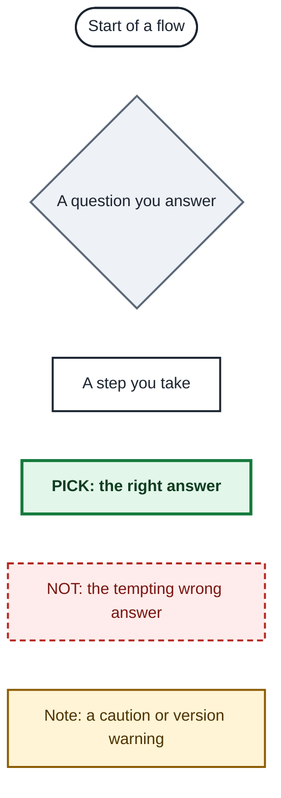

| Look | Means | Word cue |
| --- | --- | --- |
| Pale-grey diamond (never blue, because blue on this site means a link) | A full, plain question you can answer from the exam question alone | Ends in "?" |
| White rectangle | A step on the way | none |
| Green box, thick border, bold | **The pick that wins**, named by the exact feature or flag | Starts with "PICK:" |
| Pink box, dashed border | The tempting wrong answer | Starts with "NOT:" |
| Amber box | A caution or version warning | Starts with "Note:" |

**A dotted line joins a right answer to the wrong answer that looks like it.** Read it as "this, NOT that".

**Arrow labels say what your answer means** (for example "yes, someone is waiting"), not just yes or no.

**Which boxes are clickable.** A box with an arrow badge in its corner is a link; a box without the badge is not. On chart 0, every box opens its chart. On charts 1 to 14, every green PICK box opens the lesson section that teaches it. Diamonds, steps, NOT and Note boxes are not links. The "Learn it / Practise it / Next" links under each chart are always there too.

**How to read a chart**

1. **3 seconds:** the title (the question) and the green PICK boxes.
2. **30 seconds:** follow the diamonds top to bottom. Solid arrows are your path.
3. **2 to 3 minutes:** the lines under the chart: "Read it as text" (every question in words, with where each answer goes), Remember it as, Trap, Source, and "Learn it / Practise it / Next".

**One habit that solves most items:** if the question says "must", "always" or "guaranteed", the answer is in code or config (a hook, a flag, a schema), not a sentence in the prompt.

**Words used across all charts, defined once**

- **Agent:** Claude running in a loop, calling tools until a job is done.
- **Tool:** a function you give Claude that it can ask to run (for example `get_customer`).
- **Coordinator / subagent:** the main agent that splits up the work / a helper agent it starts for one piece.
- **Hook:** your own code that runs automatically before or after a tool call, and can block or change it.
- **Schema:** a description of the exact shape the output must have (which fields, which types).
- **Synchronous:** you send a request and wait for the answer right away.
- **CI:** the automatic system that builds and tests code on every change, with nobody at the keyboard.

---

## 0. Which chart do I need?

This is a map, not a decision. Its boxes point to other charts, so it has no PICK or NOT box. Exam weights: agents 27%, tools and MCP 18%, Claude Code 20%, prompts and output 20%, context and reliability 15%.

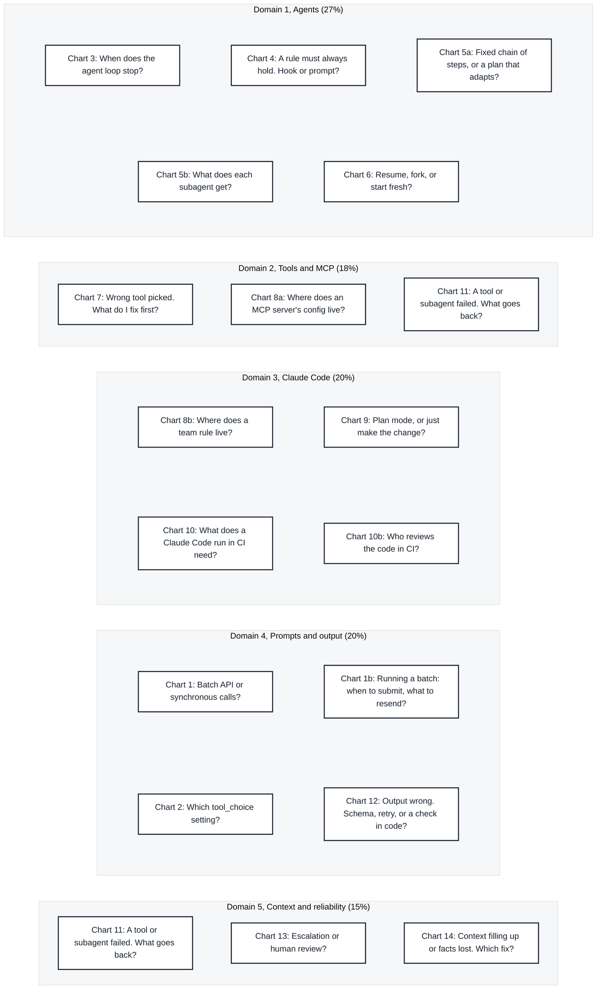

**On a phone?** Skip the picture and use the "Read it as text" list below; every chart name in it is a link.

**How to use this map:** find the group for the area the question is about, then click the chart whose question matches. Every box opens its chart. If none fit, reread the question and name the main problem first.

Two kinds of "rule" appear here. In Domain 1 a rule is something that must hold every single time (enforced by a hook in code). In Domain 3 a rule is a team instructions file for Claude Code (CLAUDE.md or `.claude/rules/`).

**Read it as text**

1. Domain 1, Agents (27%): does the question ask how an agent loops, splits work between subagents, or enforces a rule that must always hold? Yes means agent design → go to [chart 3](#3-when-does-the-agent-loop-stop) loop stop, [chart 4](#4-a-rule-must-always-hold-hook-or-prompt) must-hold rules, [chart 5a](#5a-fixed-chain-of-steps-or-a-plan-that-adapts) and [chart 5b](#5b-what-does-each-subagent-get) splitting work, [chart 6](#6-resume-the-old-session-fork-it-or-start-fresh) sessions. No means not agents → go to question 2.
2. Domain 2, Tools and MCP (18%): is it about which tool Claude picks, setting up an MCP server, or tool errors? Yes means tools → go to [chart 7](#7-claude-keeps-picking-the-wrong-tool-what-do-i-fix-first) wrong tool, [chart 8a](#8a-where-does-an-mcp-servers-config-live) MCP config, [chart 11](#11-a-tool-or-subagent-failed-what-should-it-send-back) tool failures. No → go to question 3.
3. Domain 3, Claude Code (20%): is it about team rule files, plan mode, or Claude Code runs in CI? Yes means Claude Code → go to [chart 8b](#8b-where-does-a-team-rule-live) rule files, [chart 9](#9-plan-mode-or-just-make-the-change) plan mode, [chart 10](#10-what-does-a-claude-code-run-in-ci-need) and [chart 10b](#10b-who-reviews-the-code-in-ci) CI. No → go to question 4.
4. Domain 4, Prompts and output (20%): is it about prompt wording, output format, or batch cost? Yes means prompts and output → go to [chart 1](#1-batch-api-or-synchronous-calls) and [chart 1b](#1b-running-a-batch-when-to-submit-what-to-resend) batches, [chart 2](#2-which-tool_choice-setting) `tool_choice`, [chart 12](#12-the-output-is-wrong-schema-retry-or-a-check-in-code) wrong output. No → go to question 5.
5. Domain 5, Context and reliability (15%): is Claude losing facts in a long task, must work be handed to a person, or must errors be passed back across agents? Yes means context, handoff or errors → go to [chart 11](#11-a-tool-or-subagent-failed-what-should-it-send-back) errors across agents, [chart 13](#13-hand-it-to-a-person-escalation-or-human-review) hand to a person, [chart 14](#14-context-is-filling-up-or-facts-are-getting-lost-which-fix) context filling up. No means none fit → reread the question and name the main problem first.

*Key: each labelled group = one exam domain, with its weight · each box with an arrow badge in its corner = one chart; click it to open that chart. Chart 11 sits in two groups because the guide tests it in both.*

*Terms in the boxes:* the `tool_choice` settings `auto`, `any` and forced tool are defined at the top of [chart 2](#2-which-tool_choice-setting).

- **Remember it as:** pick your area, then follow that chart.
- **Trap:** jumping to a favourite feature before naming the area; the area decides which chart applies.
- **Source:** the domain weights and the full task list in the official exam guide v1.0; see the [exam objectives page](../objectives/README.md).
- **Learn it:** [Lesson 0, orientation](../L00-orientation.md) · **Next:** [chart 1](#1-batch-api-or-synchronous-calls)

## Index

"Exam tasks" are the task numbers in the official exam guide (for example 4.5 = Domain 4, task 5). "Taught in" is the lesson and section that teaches the chart; each one is a link.

| Chart | Question | Exam tasks | Taught in |
| --- | --- | --- | --- |
| 0 | [Which chart do I need?](#0-which-chart-do-i-need) | all | [Lesson 0, orientation](../L00-orientation.md) |
| 1 | [Batch API or synchronous calls?](#1-batch-api-or-synchronous-calls) | 4.5 | [Lesson 4, section 4.5 (Batch processing)](../L04-prompt-engineering-and-structured-output.md#45-batch-processing) |
| 1b | [Running a batch: when to submit, what to resend?](#1b-running-a-batch-when-to-submit-what-to-resend) | 4.5 | [Lesson 4, section 4.5 (Batch processing)](../L04-prompt-engineering-and-structured-output.md#45-batch-processing) |
| 2 | [Which `tool_choice` setting?](#2-which-tool_choice-setting) | 4.3, 2.3 | [Lesson 4, section 4.3 (Structured output through tool use)](../L04-prompt-engineering-and-structured-output.md#43-structured-output-through-tool-use) and [Lesson 2, section 2.3 (How many tools, and which ones)](../L02-tool-design-and-mcp-integration.md#23-how-many-tools-and-which-ones) |
| 3 | [When does the agent loop stop?](#3-when-does-the-agent-loop-stop) | 1.1 | [Lesson 1, section 1.1 (The agentic loop)](../L01-agentic-architecture-and-orchestration.md#11-the-agentic-loop) |
| 4 | [Hook or prompt?](#4-a-rule-must-always-hold-hook-or-prompt) | 1.4, 1.5 | [Lesson 1, section 1.5 (Agent SDK hooks)](../L01-agentic-architecture-and-orchestration.md#15-agent-sdk-hooks) |
| 5a | [Fixed chain or adaptive plan?](#5a-fixed-chain-of-steps-or-a-plan-that-adapts) | 1.6, 1.2, 4.6 | [Lesson 1, section 1.6 (Breaking the task down)](../L01-agentic-architecture-and-orchestration.md#16-breaking-the-task-down) |
| 5b | [What does each subagent get?](#5b-what-does-each-subagent-get) | 1.3, 1.2 | [Lesson 1, section 1.3 (Spawning subagents and passing context)](../L01-agentic-architecture-and-orchestration.md#13-spawning-subagents-and-passing-context) |
| 6 | [Resume, fork or start fresh?](#6-resume-the-old-session-fork-it-or-start-fresh) | 1.7 | [Lesson 1, section 1.7 (Sessions: resume and fork)](../L01-agentic-architecture-and-orchestration.md#17-sessions-resume-and-fork) |
| 7 | [Wrong tool picked: fix what first?](#7-claude-keeps-picking-the-wrong-tool-what-do-i-fix-first) | 2.1, 2.3, 2.4 | [Lesson 2, section 2.1 (Tool descriptions are how the model chooses)](../L02-tool-design-and-mcp-integration.md#21-tool-descriptions-are-how-the-model-chooses) |
| 8a | [Where does MCP config live?](#8a-where-does-an-mcp-servers-config-live) | 2.4 | [Lesson 2, section 2.4 (MCP servers in Claude Code and agents)](../L02-tool-design-and-mcp-integration.md#24-mcp-servers-in-claude-code-and-agents) |
| 8b | [Where does a team rule live?](#8b-where-does-a-team-rule-live) | 3.1, 3.2, 3.3 | [Lesson 3, section 3.1 (The CLAUDE.md hierarchy)](../L03-claude-code-configuration-and-workflows.md#31-the-claudemd-hierarchy) |
| 9 | [Plan mode or direct?](#9-plan-mode-or-just-make-the-change) | 3.4 | [Lesson 3, section 3.4 (Plan mode or direct execution)](../L03-claude-code-configuration-and-workflows.md#34-plan-mode-or-direct-execution) |
| 10 | [What does a CI run need?](#10-what-does-a-claude-code-run-in-ci-need) | 3.6, 4.6 | [Lesson 3, section 3.6 (Claude Code in CI/CD)](../L03-claude-code-configuration-and-workflows.md#36-claude-code-in-cicd) |
| 10b | [Who reviews code in CI?](#10b-who-reviews-the-code-in-ci) | 3.6 | [Lesson 3, section 3.6 (Claude Code in CI/CD)](../L03-claude-code-configuration-and-workflows.md#36-claude-code-in-cicd) |
| 11 | [What does a failure send back?](#11-a-tool-or-subagent-failed-what-should-it-send-back) | 5.3, 2.2 | [Lesson 5, section 5.3 (Passing errors between agents)](../L05-context-management-and-reliability.md#53-passing-errors-between-agents) |
| 12 | [Schema, retry or code check?](#12-the-output-is-wrong-schema-retry-or-a-check-in-code) | 4.3, 4.4 | [Lesson 4, section 4.4 (Validate, retry, feed back)](../L04-prompt-engineering-and-structured-output.md#44-validate-retry-feed-back) |
| 13 | [Escalation or human review?](#13-hand-it-to-a-person-escalation-or-human-review) | 5.2, 5.5, 1.4 | [Lesson 5, section 5.2 (Escalation and ambiguity)](../L05-context-management-and-reliability.md#52-escalation-and-ambiguity) |
| 14 | [Context filling or facts lost?](#14-context-is-filling-up-or-facts-are-getting-lost-which-fix) | 5.1, 5.4 | [Lesson 5, section 5.1 (Keeping the facts that matter in long conversations)](../L05-context-management-and-reliability.md#51-keeping-the-facts-that-matter-in-long-conversations) |

Not covered by a chart on this page (fewer look-alikes). Where each one is taught instead:

- task 2.5 (built-in tools: Read, Write, Edit, Bash, Grep, Glob): see the [sequence diagrams page, Tree A (which built-in tool for this file job?)](sequence-diagrams.md#tree-a-which-built-in-tool-for-this-file-job); taught in [Lesson 2, section 2.5 (Built-in tools)](../L02-tool-design-and-mcp-integration.md#25-built-in-tools).
- task 3.5 (iterative refinement): the interview pattern (let Claude ask questions first when needs are unclear); taught in [Lesson 3, section 3.5 (Refining step by step)](../L03-claude-code-configuration-and-workflows.md#35-refining-step-by-step).
- task 4.1 (explicit criteria): see the [sequence diagrams page, Tree B (noisy or uneven review comments)](sequence-diagrams.md#tree-b-review-comments-are-noisy-or-uneven-which-prompt-fix); taught in [Lesson 4, section 4.1 (Explicit criteria reduce false positives)](../L04-prompt-engineering-and-structured-output.md#41-explicit-criteria-reduce-false-positives).
- task 4.2 (few-shot examples, meaning 2 to 4 worked examples of good and bad cases): see the [sequence diagrams page, Tree B (noisy or uneven review comments)](sequence-diagrams.md#tree-b-review-comments-are-noisy-or-uneven-which-prompt-fix); taught in [Lesson 4, section 4.2 (Few-shot examples)](../L04-prompt-engineering-and-structured-output.md#42-few-shot-examples).
- task 5.6 (provenance, meaning keeping track of where each claim came from): when two sources disagree, keep both with their sources; taught in [Lesson 5, section 5.6 (Provenance and uncertainty)](../L05-context-management-and-reliability.md#56-provenance-and-uncertainty).

---

## 1. Batch API or synchronous calls?

The **Message Batches API** sends many requests for half the price. Most batches finish within an hour; 24 hours is the maximum, with no speed promise (Anthropic docs, [Batch processing](https://platform.claude.com/docs/en/build-with-claude/batch-processing), Tier 1, checked 2026-10-03; current values in the [conditions sheet, section 4](conditions-and-errors.md#4-message-batches-api)).

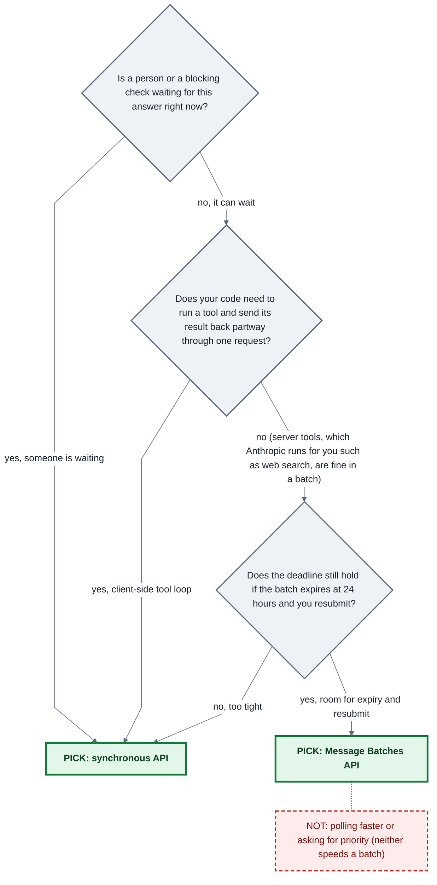

**Read it as text**

1. Is a person or a blocking check waiting for this answer right now? Yes means someone is waiting → PICK the synchronous API. No means it can wait → go to question 2.
2. Does your code need to run a tool and send its result back partway through one request (a client-side tool loop)? Yes → PICK the synchronous API. (Batches do support tools, including server tools.) No → go to question 3.
3. Can the work wait, and does the deadline still hold if the batch expires at 24 hours and you resubmit? Yes → PICK the Message Batches API (NOT polling faster or asking for priority). No means it is needed sooner → PICK the synchronous API.

*Key: green PICK = the right answer · pink dashed NOT = the tempting wrong answer · dotted line joins a right answer to its look-alike · amber Note = a caution · click a green PICK box to open the lesson section that teaches it (other boxes are not links).*

*Terms in the boxes:* Message Batches API and the 24-hour window (defined above the chart); synchronous (in the word list at the top of the page); tools partway through one request = a tool loop, which a batch request can't run.

- **Remember it as:** nobody waiting, no client-side tool loop, deadline survives an expiry and resubmit: batch.
- **Trap:** polling faster doesn't shorten the 24-hour window, and the guide names no priority option.
- **Source:** official exam guide v1.0, task 4.5 ([objective 4.5](../objectives/objective-4.5.md)); Anthropic docs, [Batch processing](https://platform.claude.com/docs/en/build-with-claude/batch-processing) (Tier 1, checked 2026-10-12). Price and window today: [conditions sheet, section 4](conditions-and-errors.md#4-message-batches-api).
- **Learn it:** [Lesson 4, section 4.5 (Batch processing)](../L04-prompt-engineering-and-structured-output.md#45-batch-processing) · **Practise it:** [SIM-07, decision 8](../../../04-Simulations/02-CCAR-F-Architect-Foundations/SIM-07-structured-data-extraction.md) and [SIM-06, decision 10](../../../04-Simulations/02-CCAR-F-Architect-Foundations/SIM-06-claude-code-ci-cd.md) · **Next:** [chart 1b](#1b-running-a-batch-when-to-submit-what-to-resend)

## 1b. Running a batch: when to submit, what to resend?

**SLA** (service-level agreement) = the promised finish time. **Interval** = the time between batch submissions. A batch can take up to 24 hours, so the worst case is the interval plus 24 hours ([Lesson 4, section 4.5 (Batch processing)](../L04-prompt-engineering-and-structured-output.md#45-batch-processing)).

- SLA − 24 hours is the **ceiling**, not the answer. Pick an interval below it, to leave a safety margin.
- The guide's example (official exam guide v1.0, task 4.5): a 30-hour SLA, submitting every 4 hours. The ceiling is 30 − 24 = 6 hours; 4 + 24 = 28 hours leaves a 2-hour margin.
- Most batches finish within an hour, but a resend can also take up to 24 hours, so the margin helps but doesn't guarantee a resend lands in time. A batch that hits 24 hours ends with those requests `expired` and no output, so plan the time to resubmit them, or a synchronous fallback for them, inside the SLA (Anthropic docs, Message Batches, Tier 1, checked 2026-10-12).

**`custom_id`** = the ID you give each request, so you can match results and find failures.

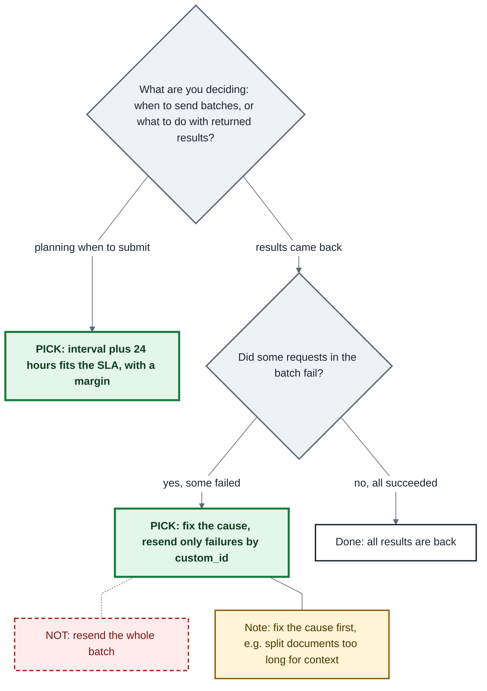

**Read it as text**

1. What are you deciding: when to send batches, or what to do with results that came back? Planning when to submit → PICK an interval where interval plus 24 hours, with a margin, fits the SLA (30-hour SLA: the ceiling is 6 hours; the guide's example submits every 4). Results came back → go to question 2.
2. Did some requests in the batch fail? Yes means some failed → PICK fix the cause first (for example, split documents that were too long for the context), then resend only the failures, matched by `custom_id` (NOT the whole batch). No means all succeeded → done, all results are back.

*Key: green PICK = the right answer · pink dashed NOT = the tempting wrong answer · dotted line joins a right answer to its look-alike · amber Note = a caution · click a green PICK box to open the lesson section that teaches it (other boxes are not links).*

*Terms in the boxes:* SLA, interval and `custom_id` (defined above the chart).

- **Remember it as:** leave room for the 24 hours. Resend only what failed.
- **Trap:** resending the whole batch pays twice for work that already succeeded.
- **Source:** official exam guide v1.0, task 4.5 ([objective 4.5](../objectives/objective-4.5.md)); Anthropic docs, [Batch processing](https://platform.claude.com/docs/en/build-with-claude/batch-processing). Window today: [conditions sheet, section 4](conditions-and-errors.md#4-message-batches-api).
- **Learn it:** [Lesson 4, section 4.5 (Batch processing)](../L04-prompt-engineering-and-structured-output.md#45-batch-processing) · **Practise it:** [SIM-07, decision 8](../../../04-Simulations/02-CCAR-F-Architect-Foundations/SIM-07-structured-data-extraction.md) and [SIM-06, decision 10](../../../04-Simulations/02-CCAR-F-Architect-Foundations/SIM-06-claude-code-ci-cd.md) · **Next:** [chart 2](#2-which-tool_choice-setting)

---

## 2. Which `tool_choice` setting?

`tool_choice` is the API setting that says whether Claude may answer in plain text, must call some tool, or must call one named tool. **`auto`** = Claude decides, plain text allowed. **`any`** = it must call some tool. **Forced tool** = it must call the one you name, in the form `{"type": "tool", "name": "extract_metadata"}`; run the next tools in later turns. A fourth value, `none`, stops Claude using tools at all. The chart gives the exam answer from the guide. Outside the exam, two limits apply today: with manual extended thinking on, only `auto` or `none` work; and on Claude Opus 5.5, Sonnet 5.5, Fable 5.1 and Mythos 5.1, `any` and forced tool return a 400, so use `auto` with `strict: true` or structured outputs (Anthropic docs, [define tools](https://platform.claude.com/docs/en/agents-and-tools/tool-use/define-tools); see [exam answer vs today](conditions-and-errors.md#exam-answer-vs-today)). On the exam, pick the guide's answer.

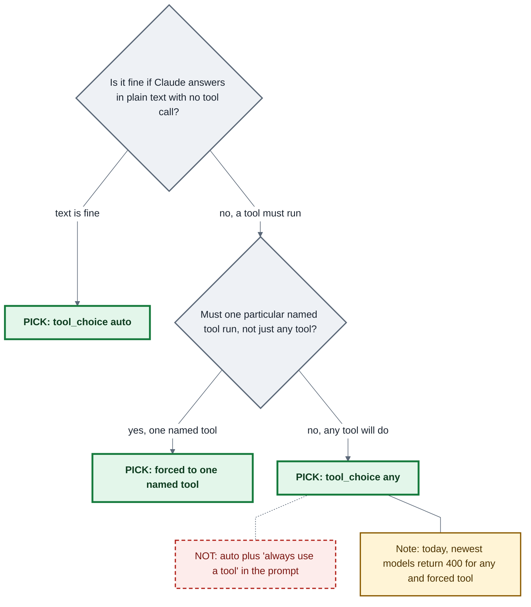

**Read it as text**

1. Is it fine if Claude answers in plain text with no tool call? Yes means text is fine → PICK `tool_choice` `auto`. No means a tool must run → go to question 2.
2. Must one particular named tool run, not just any tool? Yes means one named tool → PICK forced `tool_choice` naming that tool. No means any tool will do → PICK `tool_choice` `any` (NOT `auto` plus "always use a tool" in the prompt). Note (today, not the exam): on the newest models `any` and forced tool return a 400, and with manual extended thinking on, only `auto` or `none` work.

*Key: green PICK = the right answer · pink dashed NOT = the tempting wrong answer · dotted line joins a right answer to its look-alike · amber Note = a caution · click a green PICK box to open the lesson section that teaches it (other boxes are not links).*

*Terms in the boxes:* `auto`, `any` and forced tool (defined above the chart).

- **Remember it as:** text OK: auto. Some tool: any. This tool: forced.
- **Trap:** `auto` plus "always use a tool" in the prompt still allows text; forcing one tool on an unknown document picks the wrong schema.
- **Source:** official exam guide v1.0, task 4.3 ([objective 4.3](../objectives/objective-4.3.md)) and task 2.3 ([objective 2.3](../objectives/objective-2.3.md)); the note: Anthropic docs, [define tools](https://platform.claude.com/docs/en/agents-and-tools/tool-use/define-tools). Syntax today: [conditions sheet, section 2](conditions-and-errors.md#2-tool-use-rules).
- **Learn it:** [Lesson 4, section 4.3 (Structured output through tool use)](../L04-prompt-engineering-and-structured-output.md#43-structured-output-through-tool-use) (the `tool_choice` values are defined in [Lesson 2, section 2.3 (How many tools, and which ones)](../L02-tool-design-and-mcp-integration.md#23-how-many-tools-and-which-ones)) · **Practise it:** [SIM-07, decisions 2 and 3](../../../04-Simulations/02-CCAR-F-Architect-Foundations/SIM-07-structured-data-extraction.md) · **Next:** [chart 3](#3-when-does-the-agent-loop-stop)

---

## 3. When does the agent loop stop?

`stop_reason` is the field in each API reply that says why Claude stopped. Other values exist: `max_tokens` (the reply hit its length cap), `stop_sequence` (Claude produced a stop string you set), `pause_turn` (a server tool that Anthropic runs, such as web search, hit its step limit; send the reply back to continue) and `refusal` (Claude declined to answer), but the exam tests `tool_use` against `end_turn`; the amber box stands for the rest. This is the only chart with an arrow back to the top, because the loop is the point.

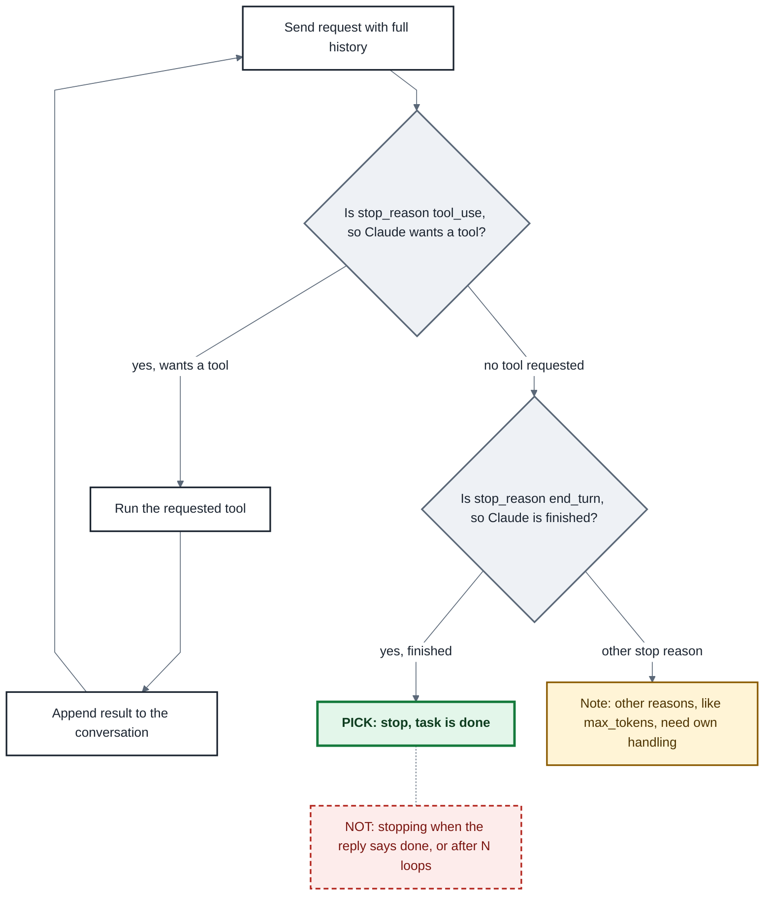

**Read it as text**

1. Is `stop_reason` `tool_use`, meaning Claude wants a tool run? Yes means Claude wants a tool → run the requested tool, append the result to the conversation, and send the request again (back to the top). No means no tool was requested → go to question 2.
2. Is `stop_reason` `end_turn`, meaning Claude says it is finished? Yes means Claude is finished → PICK stop, the task is done (NOT stopping when the reply says "done" or after N loops). No means some other stop reason, like `max_tokens` → handle it separately.

*Key: green PICK = the right answer · pink dashed NOT = the tempting wrong answer · dotted line joins a right answer to its look-alike · amber Note = a caution · click a green PICK box to open the lesson section that teaches it (other boxes are not links).*

*Terms in the boxes:* `stop_reason` = why Claude stopped · `tool_use` = it wants a tool run · `end_turn` = it is finished · `max_tokens` = the reply hit its length cap.

- **Remember it as:** `stop_reason` drives the loop. Not words, not counts, not text.
- **Trap:** stopping on "done" in the reply, on an iteration cap as the main stop, or on any reply text are all named anti-patterns.
- **Source:** official exam guide v1.0, task 1.1 ([objective 1.1](../objectives/objective-1.1.md)).
- **Learn it:** [Lesson 1, section 1.1 (The agentic loop)](../L01-agentic-architecture-and-orchestration.md#11-the-agentic-loop) · **Practise it:** [SIM-02, decision 1](../../../04-Simulations/02-CCAR-F-Architect-Foundations/SIM-02-customer-support-agent.md) and [SIM-06, decision 1](../../../04-Simulations/02-CCAR-F-Architect-Foundations/SIM-06-claude-code-ci-cd.md) · **Next:** [chart 4](#4-a-rule-must-always-hold-hook-or-prompt)

---

## 4. A rule must always hold. Hook or prompt?

A **prerequisite gate** = code that refuses tool B until tool A has run. **`PostToolUse`** = a hook that runs after a tool returns, before Claude sees the result. An **intercept hook** = a hook that checks a tool call before it runs and can block it.

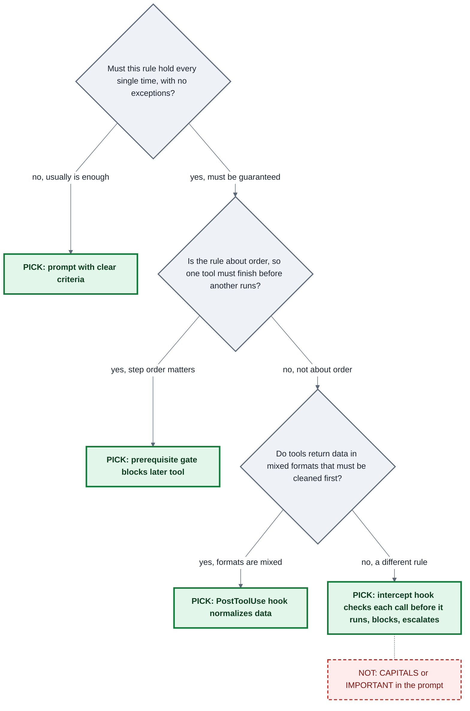

**Read it as text**

1. Must this rule hold every single time, with no exceptions? No means usually is enough → PICK a prompt with clear criteria. Yes means it must be guaranteed → go to question 2.
2. Is the rule about order, so one tool must finish before another runs? Yes means step order matters → PICK a prerequisite gate that blocks the later tool. No → go to question 3.
3. Do tools return data in mixed formats that must be cleaned first? Yes means formats are mixed → PICK a `PostToolUse` hook that normalizes the data. No means it is a different must-hold rule → PICK an intercept hook that checks each tool call before it runs, blocks it and escalates (NOT CAPITALS or "IMPORTANT" in the prompt).

*Key: green PICK = the right answer · pink dashed NOT = the tempting wrong answer · dotted line joins a right answer to its look-alike · amber Note = a caution · click a green PICK box to open the lesson section that teaches it (other boxes are not links).*

*Terms in the boxes:* prerequisite gate, `PostToolUse` hook and intercept hook (defined above the chart).

- **Remember it as:** must always goes in code. Should usually goes in prompt.
- **Trap:** capitals or "IMPORTANT" in the prompt; prompts alone have "a non-zero failure rate" (guide wording).
- **Source:** official exam guide v1.0, task 1.4 ([objective 1.4](../objectives/objective-1.4.md)) and task 1.5 ([objective 1.5](../objectives/objective-1.5.md)).
- **Learn it:** [Lesson 1, section 1.5 (Agent SDK hooks)](../L01-agentic-architecture-and-orchestration.md#15-agent-sdk-hooks) (step-order branch also [Lesson 1, section 1.4 (Enforcement and handoff)](../L01-agentic-architecture-and-orchestration.md#14-enforcement-and-handoff)) · **Practise it:** [SIM-02, decisions 3 and 4](../../../04-Simulations/02-CCAR-F-Architect-Foundations/SIM-02-customer-support-agent.md) · **Next:** [chart 5a](#5a-fixed-chain-of-steps-or-a-plan-that-adapts)

---

## 5a. Fixed chain of steps, or a plan that adapts?

**Prompt chaining** = a fixed list of steps, each feeding the next. **Dynamic decomposition** = a plan that changes as you discover things.

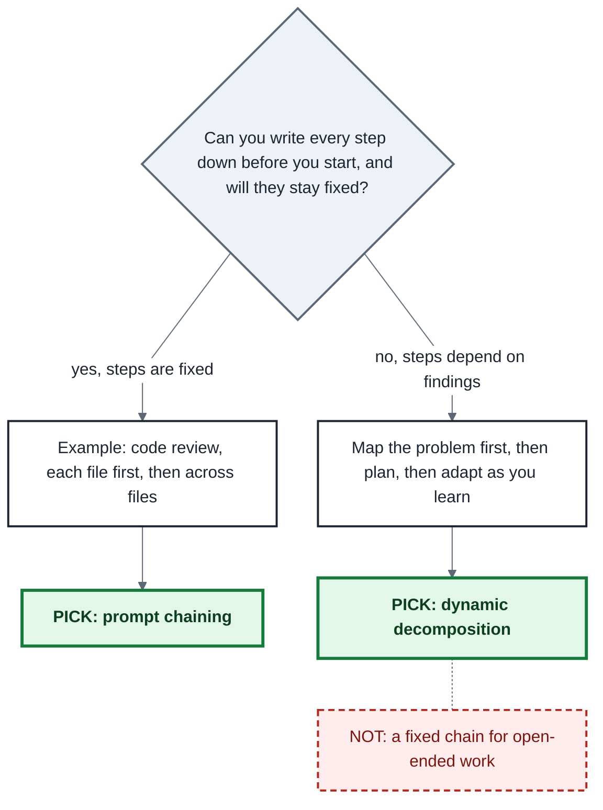

**Read it as text**

1. Can you write every step down before you start, and will they stay fixed? Yes means the steps are fixed (example: code review, each file first, then across files) → PICK prompt chaining. No means the steps depend on what you find → map the problem first, then plan, then adapt → PICK dynamic decomposition (NOT a fixed chain for open-ended work).

*Key: green PICK = the right answer · pink dashed NOT = the tempting wrong answer · dotted line joins a right answer to its look-alike · an "Example:" box is an illustration, not a step · click a green PICK box to open the lesson section that teaches it (other boxes are not links).*

*Terms in the boxes:* prompt chaining and dynamic decomposition (defined above the chart).

- **Remember it as:** known steps: chain. Unknown steps: map first, then adapt.
- **Trap:** a fixed chain can't adapt to what open-ended work turns up; and a coordinator that splits a broad topic too narrowly leaves whole areas unresearched.
- **Source:** official exam guide v1.0, task 1.6 ([objective 1.6](../objectives/objective-1.6.md)), task 1.2 ([objective 1.2](../objectives/objective-1.2.md)) and task 4.6 ([objective 4.6](../objectives/objective-4.6.md)).
- **Learn it:** [Lesson 1, section 1.6 (Breaking the task down)](../L01-agentic-architecture-and-orchestration.md#16-breaking-the-task-down) · **Practise it:** [SIM-05, decision 9](../../../04-Simulations/02-CCAR-F-Architect-Foundations/SIM-05-developer-productivity.md) · **Next:** [chart 5b](#5b-what-does-each-subagent-get)

## 5b. What does each subagent get?

**`Task`** = the tool a coordinator uses to start a subagent. **`allowedTools`** = the coordinator's tool list in the guide's wording. Both names are the guide's words. On the exam, `Task` in `allowedTools`. Today the tool is `Agent` (renamed in Claude Code v2.1.63; `Task` still works as an alias), and `allowedTools` only pre-approves tools (they run without asking for permission; it doesn't limit which tools exist); see [exam answer vs today](conditions-and-errors.md#exam-answer-vs-today).

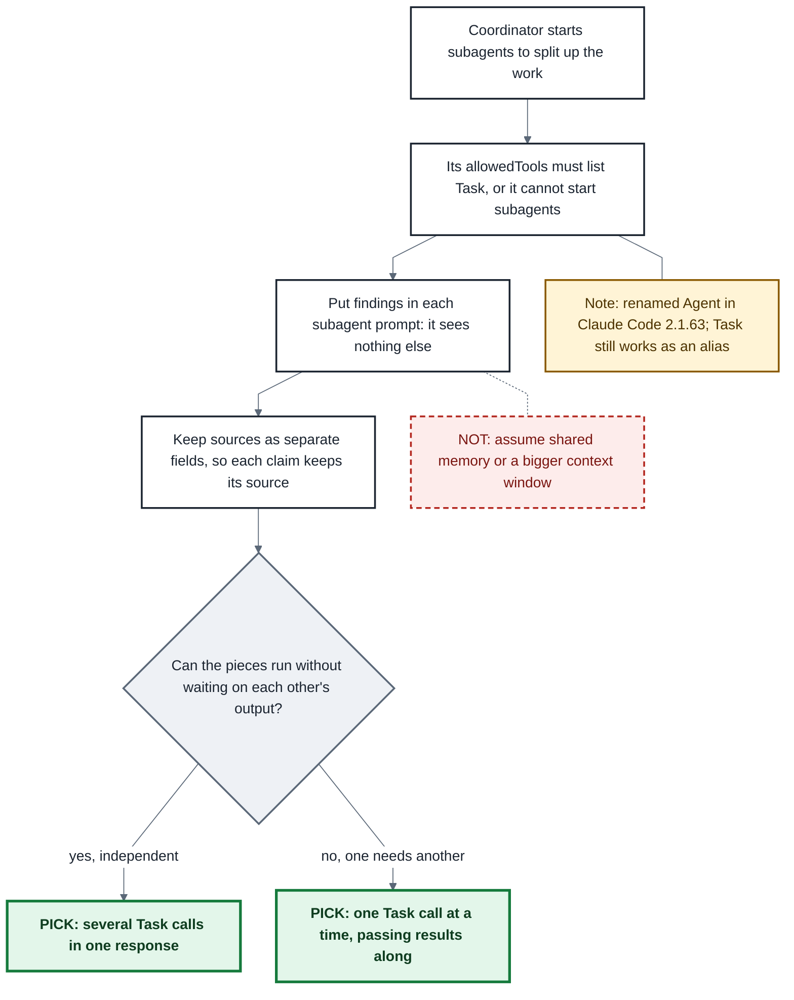

**Read it as text**

Steps in order, each with its reason:

- The coordinator starts subagents to split up the work.
- Its `allowedTools` must list `Task`, or it cannot start subagents (today the Agent tool; `Task` still works as an alias).
- Put the findings each subagent needs into its prompt, because it sees nothing else (NOT shared memory or a bigger context window).
- Keep sources as separate fields, so each claim keeps its source.

1. Can the pieces run without waiting on each other's output? Yes means they are independent → PICK several `Task` calls in one response, so they run in parallel. No means one needs another's output → PICK one `Task` call at a time, passing results along.

*Key: green PICK = the right answer · pink dashed NOT = the tempting wrong answer · dotted line joins a right answer to its look-alike · amber Note = a caution · click a green PICK box to open the lesson section that teaches it (other boxes are not links).*

*Terms in the boxes:* `Task` and `allowedTools` (defined above the chart); several `Task` calls in one response = the subagents run at the same time.

- **Remember it as:** a subagent knows only what you put in its prompt.
- **Trap:** subagents don't inherit the coordinator's history or share memory, so a bigger window or "shared memory" fixes nothing.
- **Source:** official exam guide v1.0, task 1.3 ([objective 1.3](../objectives/objective-1.3.md)) and task 1.2 ([objective 1.2](../objectives/objective-1.2.md)).
- **Learn it:** [Lesson 1, section 1.3 (Spawning subagents and passing context)](../L01-agentic-architecture-and-orchestration.md#13-spawning-subagents-and-passing-context) · **Practise it:** [SIM-04, decisions 2 and 3](../../../04-Simulations/02-CCAR-F-Architect-Foundations/SIM-04-multi-agent-research.md) · **Next:** [chart 6](#6-resume-the-old-session-fork-it-or-start-fresh)

---

## 6. Resume the old session, fork it, or start fresh?

`--resume <name>` continues a named past session. `fork_session` copies a session so you can try a different path from the same starting point.

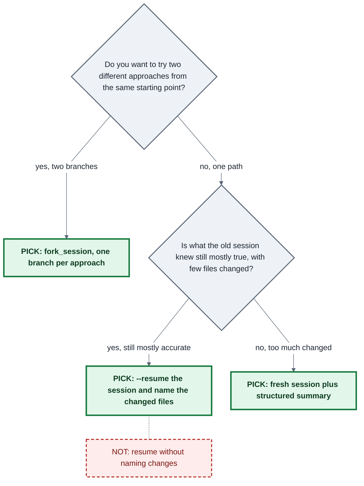

**Read it as text**

1. Do you want to try two different approaches from the same starting point? Yes means two branches → PICK `fork_session`, one branch per approach. No means one path → go to question 2.
2. Is what the old session knew still mostly true, with few files changed? Yes means still mostly accurate → PICK `--resume` the session and name the changed files (NOT resuming without naming changes). No means too much changed → PICK a fresh session plus a structured summary.

*Key: green PICK = the right answer · pink dashed NOT = the tempting wrong answer · dotted line joins a right answer to its look-alike · amber Note = a caution · click a green PICK box to open the lesson section that teaches it (other boxes are not links).*

*Terms in the boxes:* `--resume` and `fork_session` (defined above the chart).

- **Remember it as:** two paths: fork. Still valid: resume. Stale: fresh plus summary.
- **Trap:** resuming without naming changed files means reasoning from stale reads; forking is for different approaches, not catching up.
- **Source:** official exam guide v1.0, task 1.7 ([objective 1.7](../objectives/objective-1.7.md)). CLI flags today: [conditions sheet, section 12](conditions-and-errors.md#12-sessions-and-headless-runs).
- **Learn it:** [Lesson 1, section 1.7 (Sessions: resume and fork)](../L01-agentic-architecture-and-orchestration.md#17-sessions-resume-and-fork) · **Practise it:** [SIM-04, decision 5](../../../04-Simulations/02-CCAR-F-Architect-Foundations/SIM-04-multi-agent-research.md) and [SIM-05, decision 10](../../../04-Simulations/02-CCAR-F-Architect-Foundations/SIM-05-developer-productivity.md) · **Next:** [chart 7](#7-claude-keeps-picking-the-wrong-tool-what-do-i-fix-first)

---

## 7. Claude keeps picking the wrong tool. What do I fix first?

**MCP** (Model Context Protocol) = a standard way to plug outside tools and data into Claude.

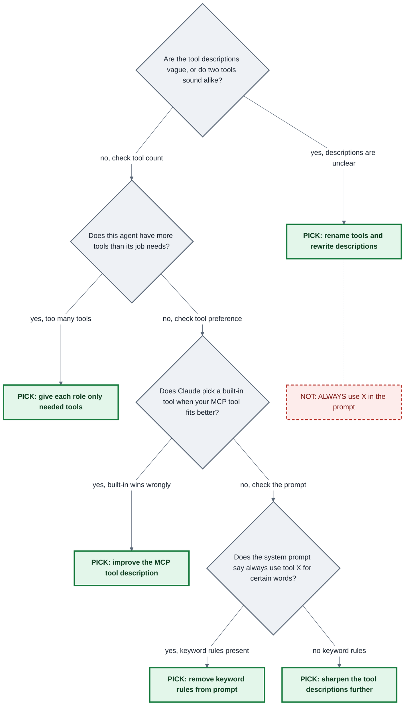

**Read it as text**

1. Are the tool descriptions vague, or do two tools sound alike? Yes means the descriptions are unclear → PICK rename the tools and rewrite their descriptions (NOT "ALWAYS use X" in the prompt). No → go to question 2.
2. Does this agent have more tools than its job needs? Yes means too many tools → PICK give each role only the tools it needs. No → go to question 3.
3. Does Claude pick a built-in tool when your MCP tool fits better? Yes means the built-in wins wrongly → PICK improve the MCP tool's description. No → go to question 4.
4. Does the system prompt say "always use tool X" for certain words? Yes means keyword rules are present → PICK remove the keyword rules from the prompt. No → PICK sharpen the tool descriptions further.

*Key: green PICK = the right answer · pink dashed NOT = the tempting wrong answer · dotted line joins a right answer to its look-alike · amber Note = a caution · click a green PICK box to open the lesson section that teaches it (other boxes are not links).*

*Terms in the boxes:* MCP (defined above the chart) · tool description = the text that tells Claude what a tool does and when to use it.

- **Remember it as:** wrong tool picked? Fix the descriptions first.
- **Trap:** "ALWAYS use tool X" in the system prompt creates unintended tool links. A router model is an over-build (our reasoning, not guide wording). The guide's tool-count example is 4-5 tools per role, not 18.
- **Source:** official exam guide v1.0, task 2.1 ([objective 2.1](../objectives/objective-2.1.md)), task 2.3 ([objective 2.3](../objectives/objective-2.3.md)) and task 2.4 ([objective 2.4](../objectives/objective-2.4.md)).
- **Learn it:** [Lesson 2, section 2.1 (Tool descriptions are how the model chooses)](../L02-tool-design-and-mcp-integration.md#21-tool-descriptions-are-how-the-model-chooses) (tool-count branch also [Lesson 2, section 2.3 (How many tools, and which ones)](../L02-tool-design-and-mcp-integration.md#23-how-many-tools-and-which-ones)) · **Practise it:** [SIM-05, decision 7](../../../04-Simulations/02-CCAR-F-Architect-Foundations/SIM-05-developer-productivity.md) and [SIM-04, decision 6](../../../04-Simulations/02-CCAR-F-Architect-Foundations/SIM-04-multi-agent-research.md) · **Next:** [chart 8a](#8a-where-does-an-mcp-servers-config-live)

---

## 8a. Where does an MCP server's config live?

**Env var expansion** = writing `${GITHUB_TOKEN}` in the file, so the real secret is filled in from your machine and never committed. Claude Code also has a "local" scope (just you, just this project), which is the default and is also stored in `~/.claude.json`.

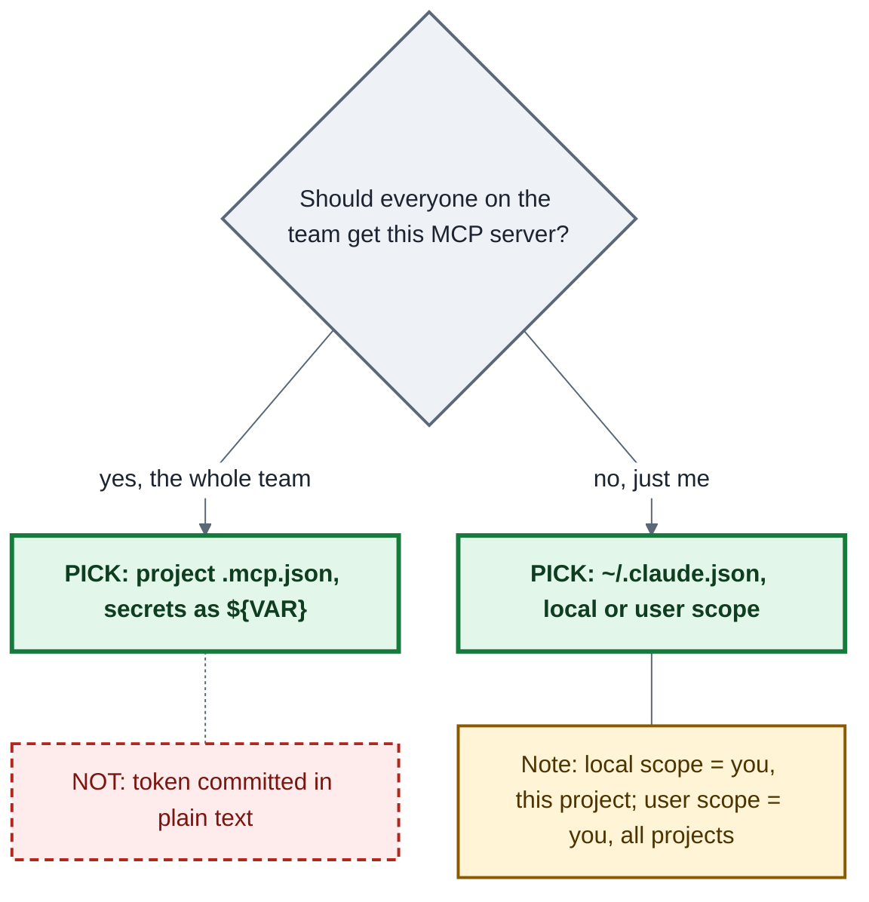

**Read it as text**

1. Should everyone on the team get this MCP server? Yes means team-wide → PICK the project `.mcp.json`, with secrets written as `${VAR}` (NOT a token committed in plain text). No means just me → PICK `~/.claude.json` (local scope = you, this project; user scope = you, all projects).

*Key: green PICK = the right answer · pink dashed NOT = the tempting wrong answer · dotted line joins a right answer to its look-alike · amber Note = a caution · click a green PICK box to open the lesson section that teaches it (other boxes are not links).*

*Terms in the boxes:* `.mcp.json` = the project's shared MCP config file, committed · `~/.claude.json` = your personal config · `${VAR}` = env var expansion (defined above the chart).

- **Remember it as:** team server: `.mcp.json`. Just me: `~/.claude.json`.
- **Trap:** the right file with the token committed in plain text, or sharing a server by copying your personal config.
- **Source:** official exam guide v1.0, task 2.4 ([objective 2.4](../objectives/objective-2.4.md)). File locations today: [conditions sheet, section 10](conditions-and-errors.md#10-settingsjson-vs-settingslocaljson-and-mcp-scopes).
- **Learn it:** [Lesson 2, section 2.4 (MCP servers in Claude Code and agents)](../L02-tool-design-and-mcp-integration.md#24-mcp-servers-in-claude-code-and-agents) · **Practise it:** [SIM-05, decisions 5 and 6](../../../04-Simulations/02-CCAR-F-Architect-Foundations/SIM-05-developer-productivity.md) · **Next:** [chart 8b](#8b-where-does-a-team-rule-live)

## 8b. Where does a team rule live?

A **glob** = a file-name pattern with wildcards, like `**/*.test.tsx`. Always-needed rules go in CLAUDE.md. On-demand ones go in a skill (`.claude/skills/`) or a command (`.claude/commands/`). Personal ones go in your home folder (`~/.claude/`). A rule for one folder goes in a CLAUDE.md inside that folder. Custom commands are now part of skills, but `.claude/commands/` still works (see [exam answer vs today](conditions-and-errors.md#exam-answer-vs-today)).

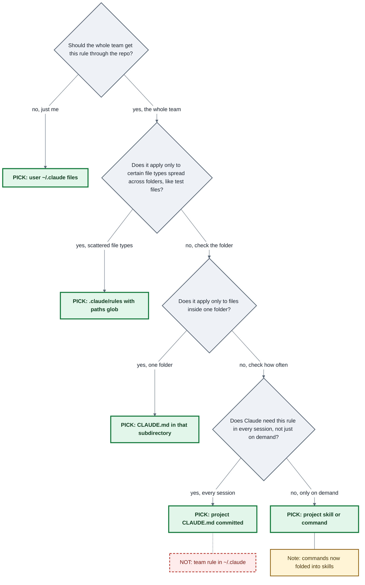

**Read it as text**

1. Should the whole team get this rule through the repo? No means just me → PICK the user files in `~/.claude`. Yes means the whole team → go to question 2.
2. Does it apply only to certain file types spread across folders, like test files? Yes means scattered file types → PICK `.claude/rules` with a `paths` glob. No → go to question 3.
3. Does it apply only to files inside one folder? Yes means one folder → PICK a CLAUDE.md in that subdirectory. No → go to question 4.
4. Does Claude need this rule in every session, not just on demand? Yes means every session → PICK the project CLAUDE.md, committed (NOT a team rule in `~/.claude`). No means only on demand → PICK a project skill or command (commands are now folded into skills).

*Key: green PICK = the right answer · pink dashed NOT = the tempting wrong answer · dotted line joins a right answer to its look-alike · amber Note = a caution · click a green PICK box to open the lesson section that teaches it (other boxes are not links).*

*Terms in the boxes:* glob (defined above the chart) · `.claude/rules` with a `paths` glob = a rule file that loads only for files matching the pattern · skill = an on-demand instruction file in `.claude/skills/`.

- **Remember it as:** team: repo. Me: home. Some files: rules. Always: CLAUDE.md. Else: skill.
- **Trap:** a team rule in `~/.claude/CLAUDE.md` is never shared through version control; one CLAUDE.md copied into many folders drifts.
- **Source:** official exam guide v1.0, task 3.1 ([objective 3.1](../objectives/objective-3.1.md)), task 3.2 ([objective 3.2](../objectives/objective-3.2.md)) and task 3.3 ([objective 3.3](../objectives/objective-3.3.md)). File locations today: [conditions sheet, section 11](conditions-and-errors.md#11-claudemd-load-order--imports-clauderules).
- **Learn it:** [Lesson 3, section 3.1 (The CLAUDE.md hierarchy)](../L03-claude-code-configuration-and-workflows.md#31-the-claudemd-hierarchy) (also [Lesson 3, section 3.2 (Slash commands and skills)](../L03-claude-code-configuration-and-workflows.md#32-slash-commands-and-skills) and [Lesson 3, section 3.3 (Path-specific rules)](../L03-claude-code-configuration-and-workflows.md#33-path-specific-rules)) · **Practise it:** [SIM-03, decisions 1 to 3](../../../04-Simulations/02-CCAR-F-Architect-Foundations/SIM-03-code-generation-claude-code.md) · **Next:** [chart 9](#9-plan-mode-or-just-make-the-change)

---

## 9. Plan mode, or just make the change?

**Plan mode** = Claude explores and proposes a plan before it changes any files. **Explore subagent** = a helper that searches the code and reports back a summary, so its output doesn't fill your context.

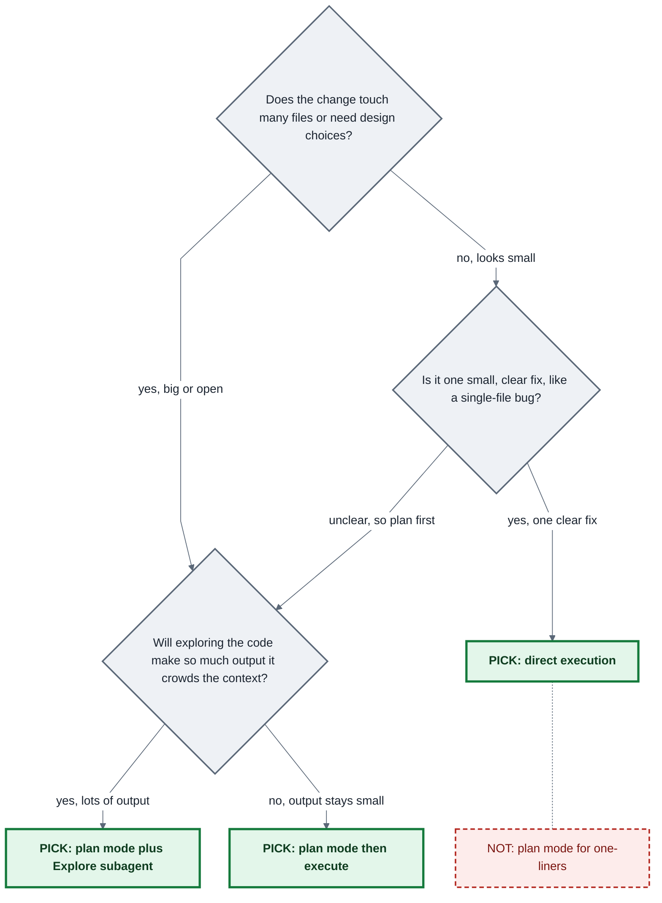

**Read it as text**

1. Does the change touch many files or need design choices? Yes means big or open → go to question 3. No means it looks small → go to question 2.
2. Is it one small, clear fix, like a single-file bug? Yes means one clear fix → PICK direct execution (NOT plan mode for one-liners). No means it is unclear, so plan first → go to question 3.
3. Will exploring the code make so much output it crowds the context? Yes means lots of output → PICK plan mode plus an Explore subagent. No means the output stays small → PICK plan mode, then execute.

*Key: green PICK = the right answer · pink dashed NOT = the tempting wrong answer · dotted line joins a right answer to its look-alike · amber Note = a caution · click a green PICK box to open the lesson section that teaches it (other boxes are not links).*

*Terms in the boxes:* plan mode and Explore subagent (defined above the chart) · direct execution = just make the change · `-p` = non-interactive mode.

- **Remember it as:** big or uncertain: plan first. One clear fix: just do it.
- **Trap:** plan mode "to be safe" on a one-line fix is pure overhead; `-p` (non-interactive mode: runs with nobody at the keyboard) is for CI runs, not planning.
- **Source:** official exam guide v1.0, task 3.4 ([objective 3.4](../objectives/objective-3.4.md)).
- **Learn it:** [Lesson 3, section 3.4 (Plan mode or direct execution)](../L03-claude-code-configuration-and-workflows.md#34-plan-mode-or-direct-execution) · **Practise it:** [SIM-03, decisions 4 and 8](../../../04-Simulations/02-CCAR-F-Architect-Foundations/SIM-03-code-generation-claude-code.md) · **Next:** [chart 10](#10-what-does-a-claude-code-run-in-ci-need)

---

## 10. What does a Claude Code run in CI need?

**Non-interactive** = runs with nobody at the keyboard. `-p` is the same as `--print`.

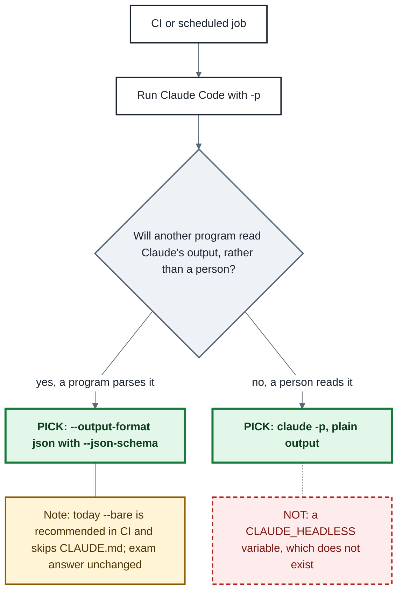

**Read it as text**

Start: a CI or scheduled job runs Claude Code with `-p`.

1. Will another program read Claude's output, rather than a person? Yes means a program parses it → PICK `--output-format json` with `--json-schema`. No means a person reads it → PICK `claude -p` with plain output (NOT a `CLAUDE_HEADLESS` variable, which does not exist). Note (today, not the exam): the docs recommend `--bare` in CI, and it skips CLAUDE.md, so pass standards in explicitly; the exam answer is unchanged.

*Key: green PICK = the right answer · pink dashed NOT = the tempting wrong answer · dotted line joins a right answer to its look-alike · amber Note = a caution · click a green PICK box to open the lesson section that teaches it (other boxes are not links).*

*Terms in the boxes:* `-p` (defined above the chart) · `--output-format json` = machine-readable output · `--json-schema` = makes that output match your schema.

- **Remember it as:** CI: `-p`. Program reads it: JSON flags.
- **Trap:** `CLAUDE_HEADLESS` is a made-up flag (the guide calls it non-existent).
- **Source:** official exam guide v1.0, task 3.6 ([objective 3.6](../objectives/objective-3.6.md)) and task 4.6 ([objective 4.6](../objectives/objective-4.6.md)), plus one of the guide's public sample questions. CLI flags today: [conditions sheet, section 12](conditions-and-errors.md#12-sessions-and-headless-runs).
- **Learn it:** [Lesson 3, section 3.6 (Claude Code in CI/CD)](../L03-claude-code-configuration-and-workflows.md#36-claude-code-in-cicd) · **Practise it:** [SIM-06, decisions 2 and 3](../../../04-Simulations/02-CCAR-F-Architect-Foundations/SIM-06-claude-code-ci-cd.md) · **Next:** [chart 10b](#10b-who-reviews-the-code-in-ci)

## 10b. Who reviews the code in CI?

A separate session, never the one that wrote the code, does the review. On re-runs, pass the earlier findings in and ask for only new or unresolved issues. Team standards live in the project CLAUDE.md.

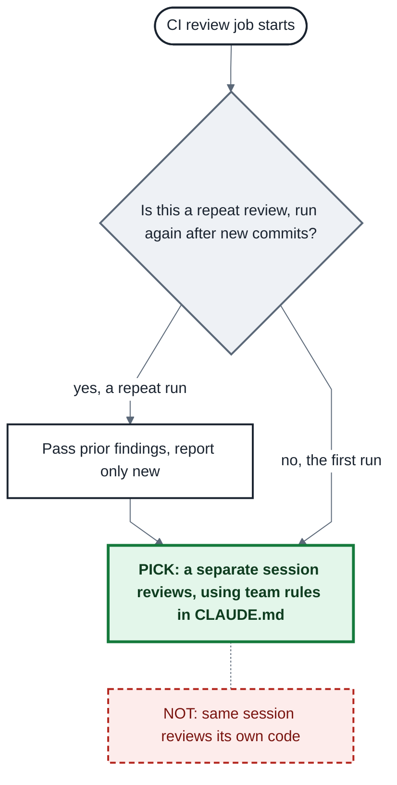

**Read it as text**

1. Is this a repeat review, run again after new commits? Yes means a repeat run → pass in the earlier findings and report only new or unresolved issues, then PICK a separate session that reviews, using the team rules in CLAUDE.md. No means the first run → PICK the same separate reviewer straight away (NOT the same session reviewing its own code).

*Key: green PICK = the right answer · pink dashed NOT = the tempting wrong answer · dotted line joins a right answer to its look-alike · amber Note = a caution · click a green PICK box to open the lesson section that teaches it (other boxes are not links).*

*Terms in the boxes:* CLAUDE.md = the project's instruction file for Claude Code, committed to the repo · prior findings = the comments from the earlier review run.

- **Remember it as:** the writer never reviews. Re-runs report only what's new.
- **Trap:** a session reviewing its own code misses bugs; re-reviewing everything repeats old findings.
- **Source:** official exam guide v1.0, task 3.6 ([objective 3.6](../objectives/objective-3.6.md)).
- **Learn it:** [Lesson 3, section 3.6 (Claude Code in CI/CD)](../L03-claude-code-configuration-and-workflows.md#36-claude-code-in-cicd) · **Practise it:** [SIM-06, decisions 7 and 9](../../../04-Simulations/02-CCAR-F-Architect-Foundations/SIM-06-claude-code-ci-cd.md) · **Next:** [chart 11](#11-a-tool-or-subagent-failed-what-should-it-send-back)

---

## 11. A tool or subagent failed. What should it send back?

**Transient** = a short-lived failure, like a timeout, that might work on a retry. A structured error uses MCP's `isError` flag, plus the content the guide recommends: `errorCategory`, `isRetryable`, what was tried and any partial results.

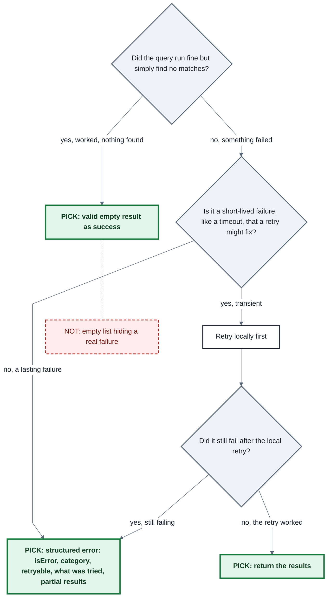

**Read it as text**

1. Did the query run fine but simply find no matches? Yes means it worked and found nothing → PICK a valid empty result, returned as success (NOT an empty list hiding a real failure). No means something failed → go to question 2.
2. Is it a short-lived failure, like a timeout, that a retry might fix? Yes means transient → retry locally first, then go to question 3. No means a lasting failure → PICK a structured error: `isError`, category, retryable, what was tried, partial results.
3. Did it still fail after the local retry? Yes means still failing → PICK the structured error. No means the retry worked → PICK return the results.

*Key: green PICK = the right answer · pink dashed NOT = the tempting wrong answer · dotted line joins a right answer to its look-alike · amber Note = a caution · click a green PICK box to open the lesson section that teaches it (other boxes are not links).*

*Terms in the boxes:* transient and `isError` (defined above the chart) · category = the kind of error, like transient or validation · retryable = whether trying again could help.

- **Remember it as:** say what failed, what you tried, what you have.
- **Trap:** an empty list marked "success" hides the failure, and a generic "Operation failed" leaves the agent unable to choose a retry.
- **Source:** official exam guide v1.0, task 5.3 ([objective 5.3](../objectives/objective-5.3.md)) and task 2.2 ([objective 2.2](../objectives/objective-2.2.md)).
- **Learn it:** [Lesson 5, section 5.3 (Passing errors between agents)](../L05-context-management-and-reliability.md#53-passing-errors-between-agents) (error fields also [Lesson 2, section 2.2 (Structured errors)](../L02-tool-design-and-mcp-integration.md#22-structured-errors)) · **Practise it:** [SIM-02, decision 5](../../../04-Simulations/02-CCAR-F-Architect-Foundations/SIM-02-customer-support-agent.md) and [SIM-04, decision 7](../../../04-Simulations/02-CCAR-F-Architect-Foundations/SIM-04-multi-agent-research.md) · **Next:** [chart 12](#12-the-output-is-wrong-schema-retry-or-a-check-in-code)

---

## 12. The output is wrong. Schema, retry, or a check in code?

**Semantic error** = the shape is right but the meaning is wrong (numbers don't add up, a value is in the wrong field). **Nullable** = a field allowed to be empty (`null`). A retry sends the document, the failed output and the exact error. The code check compares a calculated total with the stated total. Today the API also offers structured outputs and strict tool use, which enforce the shape for you; on the exam, tool use with a JSON schema is the answer (see [exam answer vs today](conditions-and-errors.md#exam-answer-vs-today)).

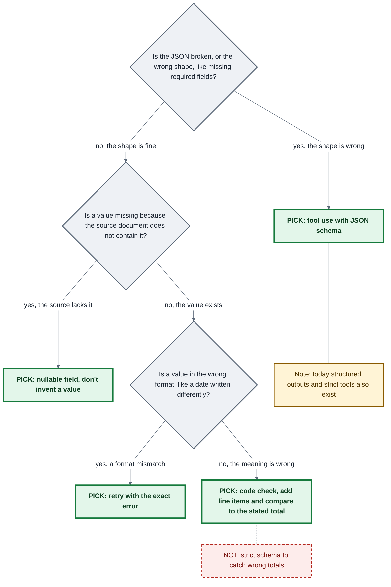

**Read it as text**

1. Is the JSON broken, or the wrong shape, like missing required fields? Yes means the shape is wrong → PICK tool use with a JSON schema (today: strict tools; see [exam answer vs today](conditions-and-errors.md#exam-answer-vs-today)). No means the shape is fine → go to question 2.
2. Is a value missing because the source document does not contain it? Yes means the source lacks it → PICK a nullable field; don't invent a value. No means the value exists → go to question 3.
3. Is a value in the wrong format, like a date written differently? Yes means a format mismatch → PICK retry with the exact error. No means the meaning is wrong (a semantic error) → PICK a code check: add the line items and compare to the stated total (NOT a stricter schema to catch wrong totals).

*Key: green PICK = the right answer · pink dashed NOT = the tempting wrong answer · dotted line joins a right answer to its look-alike · amber Note = a caution · click a green PICK box to open the lesson section that teaches it (other boxes are not links).*

*Terms in the boxes:* semantic error and nullable (defined above the chart) · tool use with JSON schema = a tool whose input schema is the shape you want, so Claude's answer has to fit it.

- **Remember it as:** schema fixes shape. Retry fixes format. Neither creates missing facts.
- **Trap:** strict schemas don't stop semantic errors, and a required field the source lacks pushes Claude to invent a value.
- **Source:** official exam guide v1.0, task 4.3 ([objective 4.3](../objectives/objective-4.3.md)) and task 4.4 ([objective 4.4](../objectives/objective-4.4.md)).
- **Learn it:** [Lesson 4, section 4.4 (Validate, retry, feed back)](../L04-prompt-engineering-and-structured-output.md#44-validate-retry-feed-back) (schema branch also [Lesson 4, section 4.3 (Structured output through tool use)](../L04-prompt-engineering-and-structured-output.md#43-structured-output-through-tool-use)) · **Practise it:** [SIM-07, decisions 1 and 4 to 7](../../../04-Simulations/02-CCAR-F-Architect-Foundations/SIM-07-structured-data-extraction.md) · **Next:** [chart 13](#13-hand-it-to-a-person-escalation-or-human-review)

---

## 13. Hand it to a person: escalation or human review?

These two get confused. **Escalation** = a live support agent passes a customer to a person. **Human review** = people spot-check extracted data before it is trusted. **Calibrate** = check the model's confidence scores against answers people have already labelled. A "segment" is one document type or field. To keep resolving, the agent follows explicit criteria with a few worked examples, not its own sense of the mood.

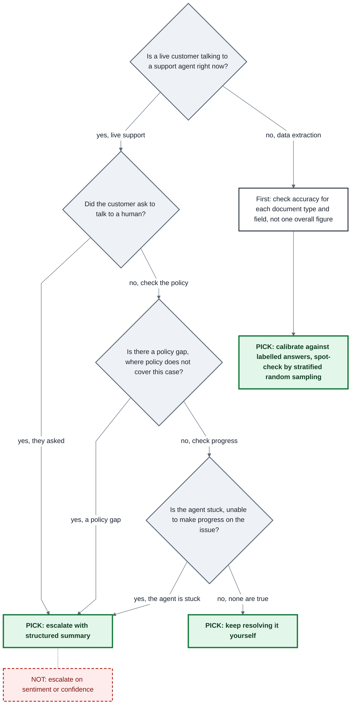

**Read it as text**

1. Is a live customer talking to a support agent right now? Yes means live support → go to question 2. No means data extraction → go to the data extraction step after question 4.
2. Did the customer ask to talk to a human? Yes means they asked → PICK escalate with a structured summary (NOT escalating on sentiment or confidence). No → go to question 3.
3. Is there a policy gap, where policy does not cover this case? Yes means a policy gap → PICK escalate with a structured summary. No → go to question 4.
4. Is the agent stuck, unable to make progress on the issue? Yes means the agent is stuck → PICK escalate with a structured summary. No means none of the three is true → PICK keep resolving it yourself.

Data extraction step (one step, no choice, so no question): first check accuracy for each document type and field, because one overall figure can hide a weak one. Then PICK calibrate confidence against labelled answers and spot-check with stratified random sampling (sample from each type, so rare types still get checked).

*Key: green PICK = the right answer · pink dashed NOT = the tempting wrong answer · dotted line joins a right answer to its look-alike · amber Note = a caution · click a green PICK box to open the lesson section that teaches it (other boxes are not links).*

*Terms in the boxes:* escalation, human review and calibrate (defined above the chart) · stratified random sampling = sampling from each document type, so rare types still get checked.

- **Remember it as:** support: escalate on ask, gap or stuck. Extraction: break accuracy down first.
- **Trap:** sentiment and self-rated confidence are unreliable escalation triggers; one overall accuracy figure can hide a weak segment.
- **Source:** official exam guide v1.0, task 5.2 ([objective 5.2](../objectives/objective-5.2.md)), task 5.5 ([objective 5.5](../objectives/objective-5.5.md)) and task 1.4 ([objective 1.4](../objectives/objective-1.4.md)).
- **Learn it:** [Lesson 5, section 5.2 (Escalation and ambiguity)](../L05-context-management-and-reliability.md#52-escalation-and-ambiguity) (review branch also [Lesson 5, section 5.5 (Human review and confidence)](../L05-context-management-and-reliability.md#55-human-review-and-confidence)) · **Practise it:** [SIM-02, decisions 7 and 8](../../../04-Simulations/02-CCAR-F-Architect-Foundations/SIM-02-customer-support-agent.md); [SIM-07, decisions 9 and 10](../../../04-Simulations/02-CCAR-F-Architect-Foundations/SIM-07-structured-data-extraction.md) · **Next:** [chart 14](#14-context-is-filling-up-or-facts-are-getting-lost-which-fix)

---

## 14. Context is filling up or facts are getting lost. Which fix?

**Context** = everything Claude can see in one request. **Lost in the middle** = models read the start and end of long inputs best, and can miss the middle. **Offload state** (for long codebase exploration) = scratchpad files, subagents, `/compact`, and manifests (saved state files the coordinator reloads after a crash).

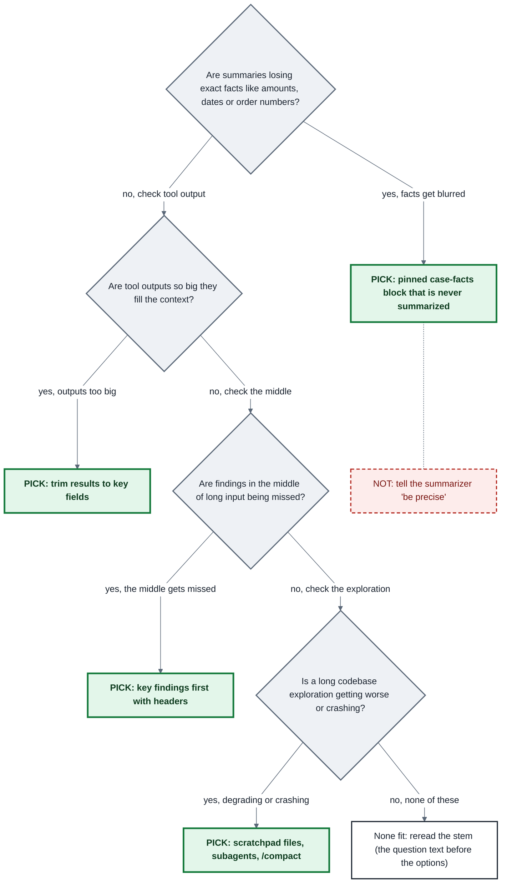

**Read it as text**

1. Are summaries losing exact facts like amounts, dates or order numbers? Yes means facts get blurred → PICK a pinned case-facts block that is never summarized (NOT telling the summarizer "be precise"). No → go to question 2.
2. Are tool outputs so big they fill the context? Yes means the outputs are too big → PICK trim results to the key fields. No → go to question 3.
3. Are findings in the middle of long input being missed? Yes means the middle gets missed → PICK put key findings first, with headers. No → go to question 4.
4. Is a long codebase exploration getting worse or crashing? Yes means degrading or crashing → PICK scratchpad files, subagents and `/compact`. No means none of these fit → reread the stem (the question text before the options) for the symptom.

*Key: green PICK = the right answer · pink dashed NOT = the tempting wrong answer · dotted line joins a right answer to its look-alike · amber Note = a caution · click a green PICK box to open the lesson section that teaches it (other boxes are not links).*

*Terms in the boxes:* context and offload state (defined above the chart) · pinned case-facts block = a section of the prompt that holds exact facts and is never summarized · `/compact` = a Claude Code command that shrinks the context by summarizing it.

- **Remember it as:** hard facts get pinned. Tool output gets trimmed on entry.
- **Trap:** telling the summarizer to "be precise" is a prompt tweak against a known weakness. A vector database is an over-build (our reasoning, not guide wording).
- **Source:** official exam guide v1.0, task 5.1 ([objective 5.1](../objectives/objective-5.1.md)) and task 5.4 ([objective 5.4](../objectives/objective-5.4.md)).
- **Learn it:** [Lesson 5, section 5.1 (Keeping the facts that matter in long conversations)](../L05-context-management-and-reliability.md#51-keeping-the-facts-that-matter-in-long-conversations) (exploration branch also [Lesson 5, section 5.4 (Exploring a large codebase)](../L05-context-management-and-reliability.md#54-exploring-a-large-codebase)) · **Practise it:** [SIM-02, decision 9](../../../04-Simulations/02-CCAR-F-Architect-Foundations/SIM-02-customer-support-agent.md), [SIM-03, decision 10](../../../04-Simulations/02-CCAR-F-Architect-Foundations/SIM-03-code-generation-claude-code.md) and [SIM-06, decision 8](../../../04-Simulations/02-CCAR-F-Architect-Foundations/SIM-06-claude-code-ci-cd.md) · **Next:** back to [chart 0](#0-which-chart-do-i-need)

---

## Sources

- **Tier 1:** CCAR-F Exam Guide v1.0 (July 2026); each chart's Source line names the task statement it covers. Checked by G4 on 2026-10-03.
- Objective ids from `01-Curriculum/02-Architect-Track/CCAR-F-objectives.md`. Lesson section numbers checked against the L01 to L05 headings on 2026-10-03.
- **Tier 1, chart 2 note only:** <https://platform.claude.com/docs/en/agents-and-tools/tool-use/define-tools> (tool_choice restrictions table), checked 2026-10-07.
- **Tier 1, batch facts in charts 1 and 1b:** <https://platform.claude.com/docs/en/build-with-claude/batch-processing>.
- No Tier 2 or Tier 3 sources.
- Version-sensitive: CLI flags, config file locations, `tool_choice` syntax, Batch API price and window. Where today's product differs from the exam answer, see [exam answer vs today](conditions-and-errors.md#exam-answer-vs-today); check current docs before relying on them outside the exam.