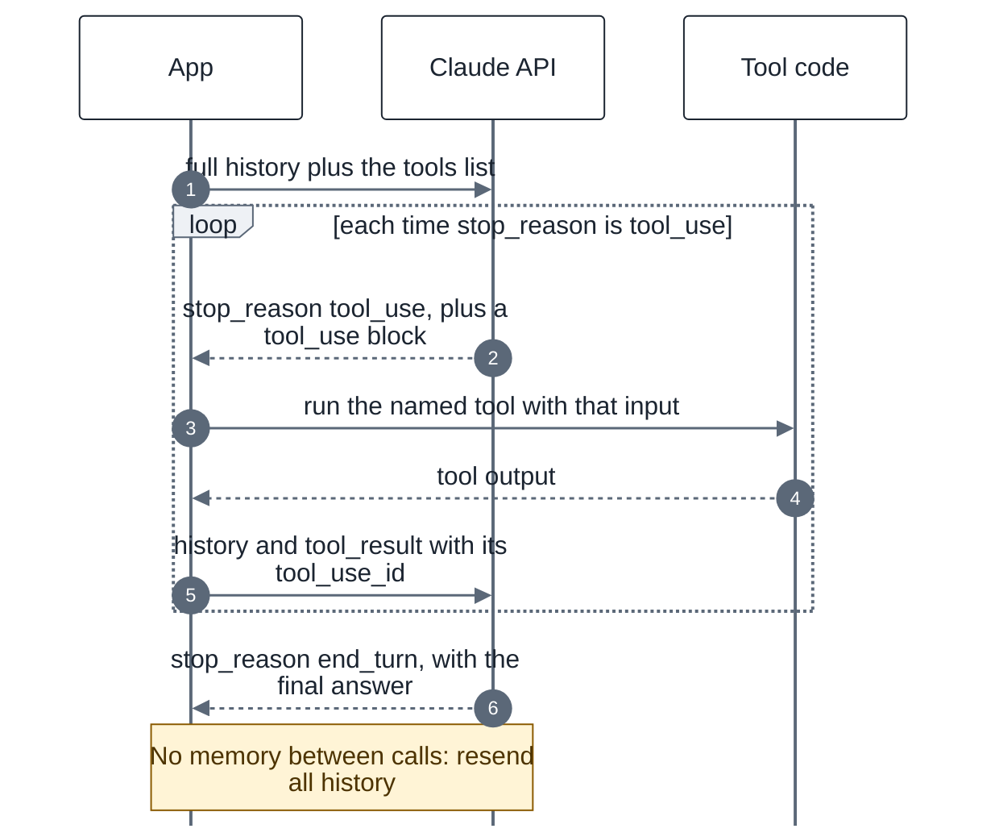
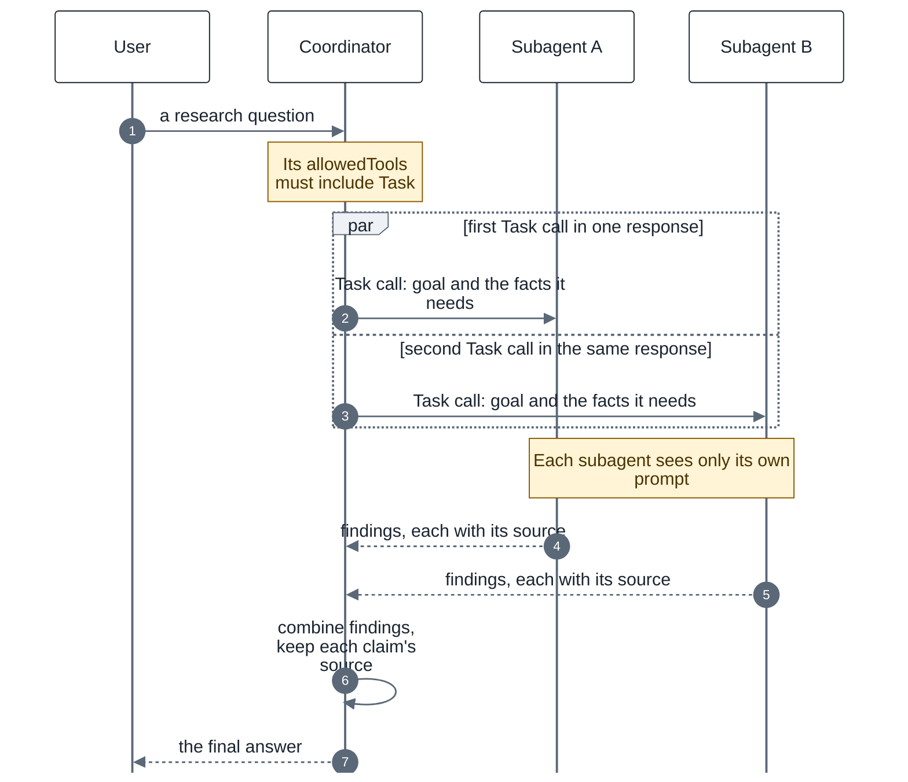
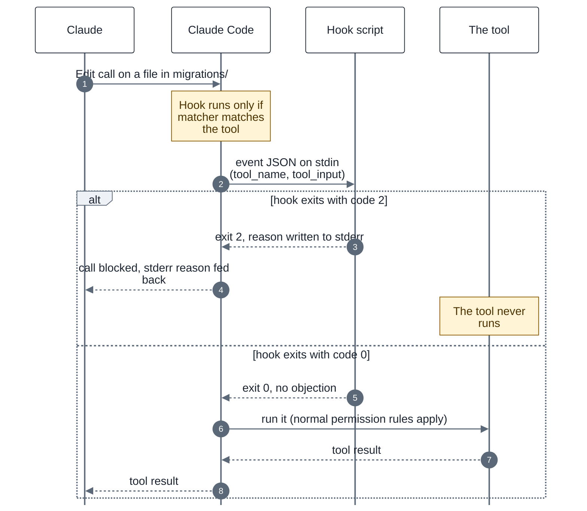
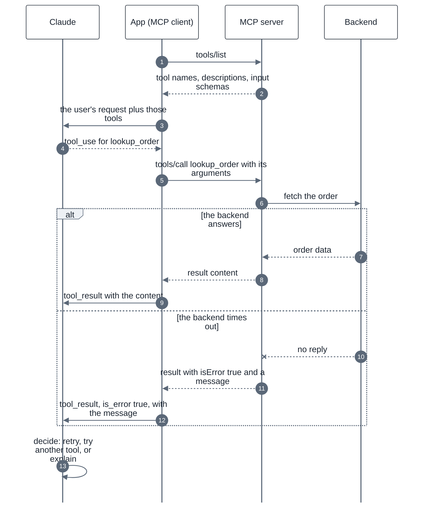
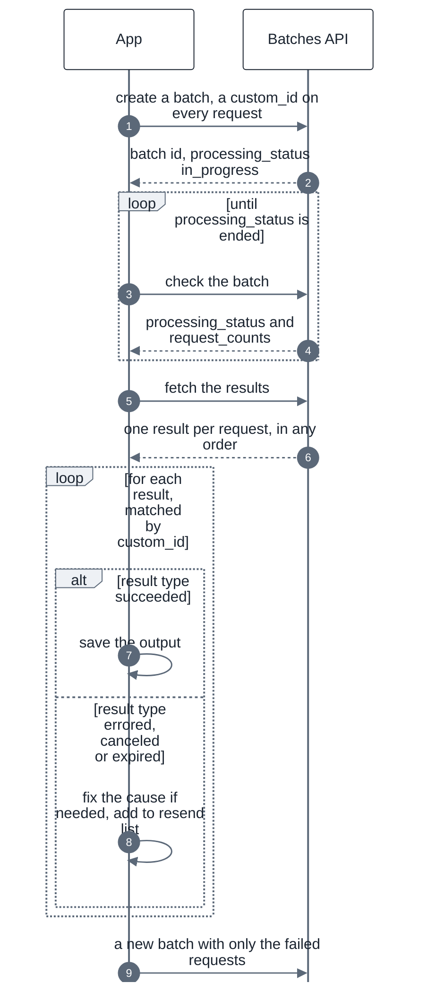
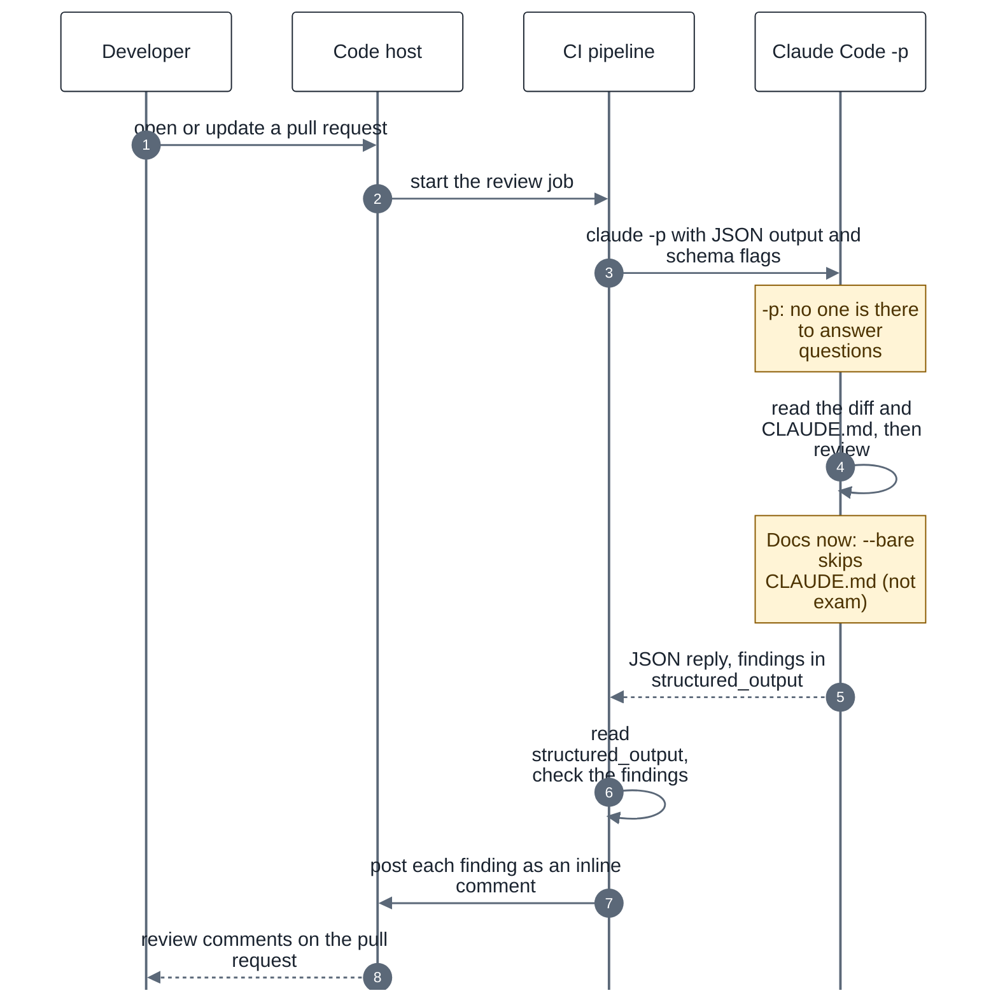
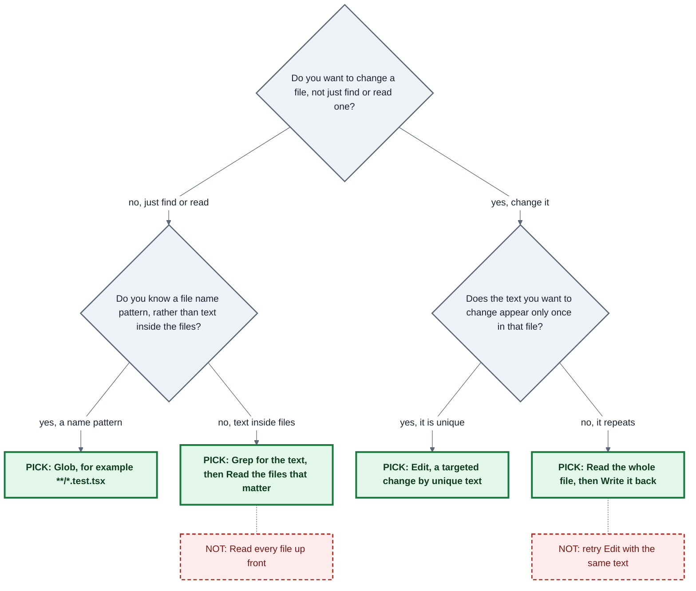
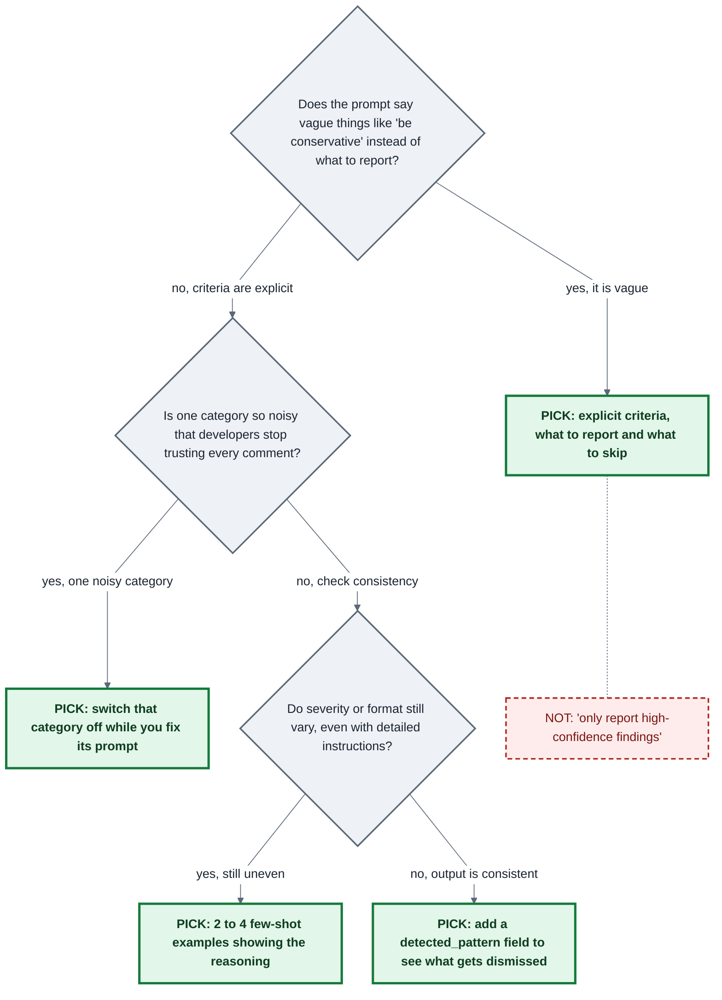

# Sequence diagrams: who talks to whom, in order

**Picture the application:** A customer asks about an order; your application sends the question to Claude, runs a requested lookup and returns its result. The expected answer depends on those messages reaching the right participant in order. Read the diagrams below as that conversation between programs, rather than as a list of tool names.

*Know Mermaid sequence diagrams? Skip to [chart 1](#1-the-agent-loop-who-sends-what-until-claude-is-done).*

## How to read a sequence diagram

A sequence diagram is a picture of a conversation between programs. It shows who sends what to whom, and in what order.

- **The boxes along the top are the players.** Each one is a person or a program, like your app, Claude or a tool. A line runs down from each box.
- **Time runs downwards.** The higher arrow happens first. The small numbers on the arrows give the order too.
- **A solid arrow is a message or request.** A dashed arrow is a reply to an earlier message.
- **An arrow ending in an X** means the message was lost: no reply came back.
- **An arrow that loops back to the same box** means that player does something by itself, like checking or combining results.
- **A labelled frame groups some arrows:**
  - `loop` means "repeat these arrows while the label is true".
  - `alt` and `else` mean "only one of these blocks happens", depending on its label.
  - `par` and `and` mean "these blocks happen at the same time".
- **A note** is an amber box with a comment. It doesn't send anything.

These charts go with the [code-level flows](code-level-flows.md), which walk the same systems step by step in code. None of them are real exam questions.

---

## 1. The agent loop: who sends what until Claude is done?

**What this shows:** your app and Claude pass messages back and forth, with your tool code in the middle, until `stop_reason` says Claude has finished.

**Read it like this**

- Your app starts by sending the conversation and the list of tools Claude may ask for, using the Messages API.
- When Claude wants a tool, the reply has `stop_reason` set to `tool_use` and a `tool_use` block with an `id`, the tool's name and its input.
- Claude never runs the tool itself. Your app runs it, then sends the full history back plus a user message holding a `tool_result` whose `tool_use_id` matches that `id`.
- The API keeps no memory between calls, so your app resends the whole history every time.
- The loop repeats until a reply comes back with `stop_reason` set to `end_turn`. That is the signal to stop.

- **Remember it as:** your app runs tools and resends everything; `end_turn` ends it.
- **Trap:** stopping the loop because the reply text says "done", or using a turn limit as the main way to stop. The guide names both as wrong; `stop_reason` decides.
- **Source:** official exam guide v1.0, task 1.1 ([objective 1.1](../objectives/objective-1.1.md)) and task 5.1 ([objective 5.1](../objectives/objective-5.1.md)) for resending the full history; Anthropic docs, [How to implement tool use: handling tool calls](https://platform.claude.com/docs/en/agents-and-tools/tool-use/handle-tool-calls).
- **Learn it:** [Lesson 1, section 1.1 (The agentic loop)](../L01-agentic-architecture-and-orchestration.md#11-the-agentic-loop) · **Practise it:** [SIM-02, decisions 1 and 2](../../../04-Simulations/02-CCAR-F-Architect-Foundations/SIM-02-customer-support-agent.md) · **Next:** [chart 2](#2-coordinator-and-subagents-what-does-each-helper-see)

---

## 2. Coordinator and subagents: what does each helper see?

**What this shows:** a coordinator agent starts two subagents at once with the `Task` tool. Each one sees only its own prompt, and each result goes back to the coordinator.

**Read it like this**

- The coordinator is the hub. Every message goes through it; the subagents never talk to each other. In this example, subagent A does web search and subagent B does document analysis.
- The coordinator's `allowedTools` must include `Task` (the guide's wording), or it cannot start subagents. Today's version is in the Source line.
- A subagent starts empty: it never sees the coordinator's history. Anything it needs, like earlier findings, must be written into its prompt.
- Two `Task` calls in **one** coordinator response run at the same time. That is how you get parallel work.
- The results come back to the coordinator, which combines them and answers the user.

- **Remember it as:** subagents see only their prompt; Task calls in one reply run together.
- **Trap:** assuming a subagent can read the coordinator's conversation or shares its memory. Subagents "do not automatically inherit parent context" (exam wording), so a bigger context window fixes nothing.
- **Source:** official exam guide v1.0, task 1.2 ([objective 1.2](../objectives/objective-1.2.md)) and task 1.3 ([objective 1.3](../objectives/objective-1.3.md)); Anthropic docs, [Claude Code subagents](https://code.claude.com/docs/en/sub-agents). The guide calls the tool `Task`; current Claude Code calls it the Agent tool (renamed in Claude Code 2.1.63; `Task` still works as an alias. On the exam, pick `Task`.) Today `allowedTools` only pre-approves tools; see [exam answer vs today](conditions-and-errors.md#exam-answer-vs-today).
- **Learn it:** [Lesson 1, section 1.3 (Spawning subagents and passing context)](../L01-agentic-architecture-and-orchestration.md#13-spawning-subagents-and-passing-context) · **Practise it:** [SIM-04, decisions 2 and 3](../../../04-Simulations/02-CCAR-F-Architect-Foundations/SIM-04-multi-agent-research.md) · **Next:** [chart 3](#3-a-pretooluse-hook-how-does-it-block-a-tool-call)

---

## 3. A PreToolUse hook: how does it block a tool call?

**What this shows:** before a tool runs, Claude Code hands the call to your hook script. Exit code 2 blocks it and sends the reason back to Claude; exit code 0 lets it run.

**Read it like this**

- Claude asks for a tool, here Edit on a file in `migrations/`. Before it runs, Claude Code passes the details to your script as JSON.
- The hook runs only if its matcher matches the tool name. No matcher, or `*`, matches every tool.
- Exit code `2` means "block". The tool never runs, and Claude reads your reason so it can change course.
- Exit code `0` means "no objection". The tool still goes through the normal permission rules.
- Any other exit code, such as `1`, with no JSON decision on stdout, is a non-blocking error: the tool runs anyway.

- **Remember it as:** exit 2 blocks and tells Claude why.
- **Trap:** writing a "never do this" rule in `CLAUDE.md` or the prompt when it must hold every time. Prompts are followed most of the time, not always; a hook is code, so it holds every time.
- **Source:** official exam guide v1.0, task 1.4 ([objective 1.4](../objectives/objective-1.4.md)) and task 1.5 ([objective 1.5](../objectives/objective-1.5.md)); Anthropic docs, [Claude Code hooks reference](https://code.claude.com/docs/en/hooks).
- **Learn it:** [Lesson 1, section 1.5 (Agent SDK hooks)](../L01-agentic-architecture-and-orchestration.md#15-agent-sdk-hooks) · **Practise it:** [SIM-02, decision 3](../../../04-Simulations/02-CCAR-F-Architect-Foundations/SIM-02-customer-support-agent.md) · **Next:** [chart 4](#4-mcp-how-does-a-tool-error-get-back-to-claude)

---

## 4. MCP: how does a tool error get back to Claude?

**What this shows:** your agent app (the MCP client) gets the tool list from an MCP server, runs the tool Claude picks, and passes a failure back as a result with `isError` set to true, so Claude can decide what to do next.

**Read it like this**

- Claude never talks to the MCP server directly. Your agent app sits in the middle and makes every call.
- The tool list comes from the server at the start. The descriptions in that list are what Claude uses to pick a tool.
- When the tool fails, the server still sends a normal result, with `isError` set to true and a message that says what went wrong.
- Your app turns the server's `isError: true` into a `tool_result` with `is_error: true` (the API's spelling), so Claude knows the call failed. Two spellings, one idea: MCP says `isError`, the Messages API says `is_error`.
- Claude reads that message and decides: retry, use another tool, or tell the user. A clear message makes a good choice possible.
- The exam guide adds its own fields to the error message: an error category (for example transient or validation), whether it is retryable, and a readable description.

- **Remember it as:** a failed tool still returns a result, with `isError` true.
- **Trap:** sending back an empty result marked as success when the backend was down, or a bare "Operation failed". The first hides the failure; the second leaves Claude unable to choose a retry.
- **Source:** official exam guide v1.0, task 2.2 ([objective 2.2](../objectives/objective-2.2.md)) and task 2.4 ([objective 2.4](../objectives/objective-2.4.md)); [MCP specification 2025-11-25, server tools](https://modelcontextprotocol.io/specification/2025-11-25/server/tools); Anthropic docs, [handling tool calls](https://platform.claude.com/docs/en/agents-and-tools/tool-use/handle-tool-calls) for `is_error`.
- **Learn it:** [Lesson 2, section 2.2 (Structured errors)](../L02-tool-design-and-mcp-integration.md#22-structured-errors) · **Practise it:** [SIM-02, decision 5](../../../04-Simulations/02-CCAR-F-Architect-Foundations/SIM-02-customer-support-agent.md) · **Next:** [chart 5](#5-message-batches-how-do-you-get-results-and-resend-failures)

---

## 5. Message Batches: how do you get results and resend failures?

**What this shows:** you send many requests in one batch, each with its own `custom_id`, check until the batch has ended, match each result by `custom_id`, and resend only the ones that failed.

**Read it like this**

- One batch carries many requests to the Message Batches API. Each request gets a `custom_id` you choose, so you can tell the results apart.
- You check the batch until its `processing_status` is `ended`. A batch can take up to 24 hours, with no speed promise.
- `processing_status` is `in_progress`, then `ended`; it shows `canceling` only if you cancel the batch.
- Results can come back in any order, so you match each one by `custom_id`, never by position.
- Each result says `succeeded`, `errored`, `canceled` or `expired`. You resend only the failures, after fixing the cause (for example, splitting a document that was too long).

- **Remember it as:** match by `custom_id`; resend only failures.
- **Trap:** resending the whole batch when a few requests failed. That pays again for work that already succeeded. Checking more often doesn't make a batch finish sooner either.
- **Source:** official exam guide v1.0, task 4.5 ([objective 4.5](../objectives/objective-4.5.md)); Anthropic docs, [Batch processing](https://platform.claude.com/docs/en/build-with-claude/batch-processing). Window and limits today: [conditions sheet, section 4](conditions-and-errors.md#4-message-batches-api).
- **Learn it:** [Lesson 4, section 4.5 (Batch processing)](../L04-prompt-engineering-and-structured-output.md#45-batch-processing) · **Practise it:** [SIM-06, decision 10](../../../04-Simulations/02-CCAR-F-Architect-Foundations/SIM-06-claude-code-ci-cd.md) · **Next:** [chart 6](#6-a-ci-review-how-does-claude-code-run-with-nobody-at-the-keyboard)

---

## 6. A CI review: how does Claude Code run with nobody at the keyboard?

**What this shows:** a CI pipeline runs `claude -p` with `--output-format json` and `--json-schema`, reads the structured findings from the reply, and posts them as review comments. Nothing waits for a person to type.

**Read it like this**

- The pipeline, not a person, starts Claude Code, for example `claude -p "Review this diff" --output-format json --json-schema <findings schema>`. `-p` (short for `--print`) makes it run once and exit, with no questions asked.
- `--output-format json` makes the reply machine-readable. `--json-schema` makes the findings match the shape your script expects.
- With both flags, the findings sit in the reply's `structured_output` field, so the script reads that field instead of guessing from free text.
- The project's `CLAUDE.md` in the repo is how the run learns the team's review rules.
- Today's docs recommend `--bare` for CI runs. It skips `CLAUDE.md`, hooks, skills, subagents and MCP servers, so you pass the standards in yourself. On the exam, `CLAUDE.md` in the repo is still the answer.
- On a re-run after new commits, pass in the earlier findings and ask for only new or unresolved issues.

- **Remember it as:** `-p` plus JSON flags; read `structured_output`.
- **Trap:** a `CLAUDE_HEADLESS` environment variable. It does not exist (the guide calls it non-existent); `-p` is the way to run without a person.
- **Source:** official exam guide v1.0, task 3.6 ([objective 3.6](../objectives/objective-3.6.md)); Anthropic docs, [Run Claude Code programmatically](https://code.claude.com/docs/en/headless) and [CLI reference](https://code.claude.com/docs/en/cli-reference). Flags today: [conditions sheet, section 12](conditions-and-errors.md#12-sessions-and-headless-runs).
- **Learn it:** [Lesson 3, section 3.6 (Claude Code in CI/CD)](../L03-claude-code-configuration-and-workflows.md#36-claude-code-in-cicd) · **Practise it:** [SIM-06, decisions 2 and 9](../../../04-Simulations/02-CCAR-F-Architect-Foundations/SIM-06-claude-code-ci-cd.md) · **Next:** [Tree A](#tree-a-which-built-in-tool-for-this-file-job)

---

## Two decision trees the other charts don't cover

The [decision charts](decision-charts.md#index) list two exam tasks with no chart: built-in tools (task 2.5) and explicit criteria with few-shot examples (tasks 4.1 and 4.2). These two trees fill that gap. They use the same key: grey diamond = a question, green box starting "PICK" = the right answer, pink dashed box starting "NOT" = the tempting wrong answer. A dotted line joins a right answer to its look-alike. Click a green PICK box to open the lesson section that teaches it.

## Tree A. Which built-in tool for this file job?

**Glob** finds files by name pattern. **Grep** searches the text inside files. **Edit** changes one exact piece of text, which must appear only once in the file. **Read** and **Write** load and save a whole file.

Today's docs leave Glob and Grep out by default on macOS, Linux and WSL; on the exam, pick Glob for names and Grep for content.

**Read it as text**

1. Do you want to change a file, not just find or read one? No means just find or read → go to question 2. Yes means change it → go to question 3.
2. Do you know a file name pattern, rather than text inside the files? Yes means a name pattern → PICK Glob, for example `**/*.test.tsx`. No means text inside files → PICK Grep for the text, then Read only the files that matter (NOT reading every file up front).
3. Does the text you want to change appear only once in that file? Yes means it is unique → PICK Edit. No means it repeats → PICK Read the whole file, then Write it back (NOT retrying Edit with the same text).

*Key: green PICK = the right answer · pink dashed NOT = the tempting wrong answer · dotted line joins a right answer to its look-alike · click a green PICK box to open the lesson section that teaches it (other boxes are not links).*

*Terms in the boxes:* Glob, Grep, Edit, Read and Write (defined above the chart).

- **Remember it as:** names: Glob. Contents: Grep. Unique text: Edit. Otherwise: Read, then Write.
- **Trap:** Glob for "who calls this function?" only sees file names, not what is inside; that is a Grep job.
- **Source:** official exam guide v1.0, task 2.5 ([objective 2.5](../objectives/objective-2.5.md)).
- **Learn it:** [Lesson 2, section 2.5 (Built-in tools)](../L02-tool-design-and-mcp-integration.md#25-built-in-tools) · **Practise it:** [SIM-05, decisions 1 to 4](../../../04-Simulations/02-CCAR-F-Architect-Foundations/SIM-05-developer-productivity.md) · **Next:** [Tree B](#tree-b-review-comments-are-noisy-or-uneven-which-prompt-fix)

## Tree B. Review comments are noisy or uneven. Which prompt fix?

A **false positive** is a comment that flags a problem that isn't really there. **Few-shot examples** are 2 to 4 worked examples in the prompt that show the right answer, and why.

**Read it as text**

1. Does the prompt say vague things like "be conservative" instead of what to report? Yes means it is vague → PICK explicit criteria: which issues to report (bugs, security) and which to skip (minor style, local patterns) (NOT "only report high-confidence findings"). No → go to question 2.
2. Is one category so noisy that developers stop trusting every comment? Yes means one noisy category → PICK switch that category off for now, while you improve its prompt. No → go to question 3.
3. Do severity or format still vary, even with detailed instructions? Yes means still uneven → PICK 2 to 4 few-shot examples that show the reasoning, including examples of acceptable code next to real issues. No means the output is consistent → PICK add a `detected_pattern` field to findings, so you can see which kinds developers keep dismissing.

*Key: green PICK = the right answer · pink dashed NOT = the tempting wrong answer · dotted line joins a right answer to its look-alike · click a green PICK box to open the lesson section that teaches it (other boxes are not links).*

*Terms in the boxes:* false positive and few-shot examples (defined above the chart); `detected_pattern` = a field on each finding that names the kind of pattern it flagged.

- **Remember it as:** say what counts. Mute the noisy one. Show, don't just tell.
- **Trap:** "be conservative" or "only report high-confidence findings" sounds strict but doesn't improve precision (exam guide's point); specific categories do.
- **Source:** official exam guide v1.0, task 4.1 ([objective 4.1](../objectives/objective-4.1.md)), task 4.2 ([objective 4.2](../objectives/objective-4.2.md)) and task 4.4 ([objective 4.4](../objectives/objective-4.4.md)).
- **Learn it:** [Lesson 4, section 4.1 (Explicit criteria reduce false positives)](../L04-prompt-engineering-and-structured-output.md#41-explicit-criteria-reduce-false-positives), [Lesson 4, section 4.2 (Few-shot examples)](../L04-prompt-engineering-and-structured-output.md#42-few-shot-examples) and [Lesson 4, section 4.4 (Validate, retry, feed back)](../L04-prompt-engineering-and-structured-output.md#44-validate-retry-feed-back) · **Practise it:** [SIM-06, decisions 4 to 6](../../../04-Simulations/02-CCAR-F-Architect-Foundations/SIM-06-claude-code-ci-cd.md) · **Next:** back to the [decision charts](decision-charts.md)

---

## Try it

1. Cover chart 1. Write its six arrows in order, then check.
2. Cover chart 4. Say what Claude receives when the backend times out.
3. Cover chart 5. Say what you resend and how you match results.

**Done when:** you can redraw charts 1 and 2 from memory and name the trap under each without looking.

---

## Sources

Tier 1 only. Links checked 2026-10-07.

- Official CCAR-F exam guide v1.0 (July 2026, Anthropic), the tasks named under each chart.
- <https://platform.claude.com/docs/en/agents-and-tools/tool-use/handle-tool-calls>
- <https://code.claude.com/docs/en/sub-agents>
- <https://code.claude.com/docs/en/hooks>
- <https://modelcontextprotocol.io/specification/2025-11-25/server/tools>
- <https://platform.claude.com/docs/en/build-with-claude/batch-processing>
- <https://code.claude.com/docs/en/headless>
- <https://code.claude.com/docs/en/cli-reference>

Version-sensitive: tool names, CLI flags, hook behaviour and Batch limits. Where today's product differs from the exam answer, see [exam answer vs today](conditions-and-errors.md#exam-answer-vs-today); check current docs before relying on them outside the exam.