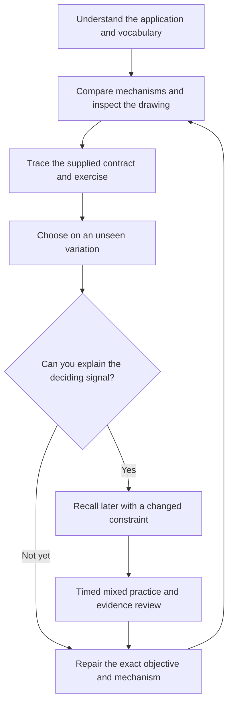

# Your CCAR-F learning journey — understand, decide, practise, repair

**Start with a situation you can picture:** [Read the application primer](architecture-studio/00-foundations.md), then [choose one complete case](architecture-studio/README.md). Each case grows when a concrete failure requires another layer. [Concept explanations](concept-course/README.md) help at the point you need them; they are not a separate prerequisite course. Reading mode needs no setup.

**Start here when the application context is unfamiliar.** You do not need to take a mock exam to discover what the lesson should have taught. Read and explain first; use questions afterward to test transfer. Reading and paper exercises need no installation. Runnable labs state their own prerequisites.

## What the scenario counts actually mean

| Layer | What exists here | How to use it |
|---|---|---|
| Saved official guide | Six named workplace families in the saved July 2026 blueprint | Scope anchor, not a claim that every future application story is identical |
| Whole applications | Eight original coached cases | Learn components, ownership, order, artifacts and recovery before testing |
| Worked walkthroughs | Six family walkthroughs | See those decisions sequenced inside the saved-guide stories |
| Objective variants | 30 original decision variants across 30 objective lessons | Change one condition and justify why the winning mechanism changes |
| Industry transfer | Finance, Legal, Marketing and other fictional contexts | Vary authority, evidence, consequences and deadlines; no official industry weighting is claimed |
| Simulations and mocks | Six family SIMs plus a full-mock plan | Rehearse after teaching; separate familiar-item recall from fresh decisions |

**These are overlapping representations, not numbers to add into a total of unique scenarios.** There is no established exhaustive count of possible stories. [Orientation](L00-orientation.md) lists the saved-guide families. [Coverage](skill-coverage.md) tracks objective teaching and assessment separately.

## Follow one complete arc

Text route: learn → compare → trace → decide → explain → repair if needed → recall later → mix and time. An opened page, a passing fixture or a repeated correct answer is not the same as an independent architectural decision.

| Stage | Go here | What you should produce before moving on |
|---|---|---|
| 1. Build the mental picture | [Plain-language primer](architecture-studio/00-foundations.md) | Explain client, backend, model, tool, durable state and human owner |
| 2. Learn a complete application | [Eight coached application cases](architecture-studio/README.md) | State the outcome, deciding constraint, alternatives and sequence in ordinary language and technical terms |
| 3. Drill into the mechanism | [30 objective lessons](objectives/README.md) · [Decision drawings](decision-atlas.md) | Identify the actual tool/protocol/schema/instruction/control and why the nearest alternative fails |
| 4. Trace and execute separately | [Local Lab08](../../06-Labs/08-CCAR-F-architecture-decisions/README.md) · [API Lab02](../../06-Labs/02-CCAR-F-coordinator-extraction/README.md) · [MCP Lab03](../../06-Labs/03-CCAR-F-mcp-server-claude-code/README.md) | Keep paper trace, local fixture output and actual API/MCP transcript evidence distinct |
| 5. Try unfamiliar conditions | [Decision variants](scenario-studio.md) · [Walkthroughs](scenario-walkthroughs/README.md) · [SIMs](../../04-Simulations/02-CCAR-F-Architect-Foundations/README.md) | Commit to an option before opening the key; explain why other mechanisms lose and when one could win |
| 6. Repair and remember | [Exact skill teaching links](skill-coverage.md) · [Recall cards](FLASHCARDS.md) · [Your progress](objectives/progress.md) | Record the missed signal, corrected mechanism and a delayed attempt with a changed constraint |
| 7. Rehearse under time | [Close-answer and pacing method](deep-practice/tie-breaker-rules.md) · [Mock plan](../../04-Simulations/02-CCAR-F-Architect-Foundations/SIM-01-full-mock.md) · [Practice tool](site:practice/index.html?exam=CCAR-F) | Review fresh timed decisions, domain/objective gaps and explanations; do not convert local accuracy into an official scaled score |

## Check the decisions, not just the story name

Use the following changes to create a meaningful new variation. Choose one change first; do not combine everything into an unrealistic puzzle. The linked cases teach the mechanism before you test it.

| Change this condition | Architectural contrast | Start with |
|---|---|---|
| Fixed steps become an investigation with unknown next evidence | Fixed workflow / routing / parallel work / adaptive agent | [Research case](architecture-studio/AS-04-research-system.md) · [1.6](objectives/objective-1.6.md) |
| Read becomes a consequential write, or approved amount/account changes | Prompt guidance / tool selection / executable authorization | [Action case](architecture-studio/AS-01-action-service.md) · [1.4](objectives/objective-1.4.md) |
| Returned data are missing, malformed, conflicting or unavailable | Omission / null / structural repair / evidence review / operational error | [Document case](architecture-studio/AS-02-document-pipeline.md) · [4.3](objectives/objective-4.3.md) |
| Source is accessible but stale, restricted or instruction-like | Discovery / authorized retrieval / context inclusion / source authority | [Grounded assistant](architecture-studio/AS-03-grounded-assistant.md) · [5.3](objectives/objective-5.3.md) |
| Convention applies everywhere, scattered paths or only one recurring job | CLAUDE.md / path rule / skill / task brief; permissions separately | [Code-change case](architecture-studio/AS-05-code-change.md) · [3.1](objectives/objective-3.1.md) |
| Review runs unattended or returns a plausible unsupported finding | Invocation / output contract / evidence / independent review | [CI case](architecture-studio/AS-06-ci-review.md) · [3.6](objectives/objective-3.6.md) |
| User is waiting, evidence is dependent, deadline tightens or some jobs expire | Synchronous loop / staged workflow / batch; correlation and recovery | [Work queue](architecture-studio/AS-07-work-queue.md) · [4.5](objectives/objective-4.5.md) |
| Session resumes after policy, source, permission or review capacity changed | Saved context / durable state / freshness / current scoped authority | [Resumable case](architecture-studio/AS-08-resumable-case.md) · [1.7](objectives/objective-1.7.md) |

Also ask: is the action safe to repeat, is the evidence sufficient, what does completion actually prove, and what happens when the model or tool cannot proceed? These axes transfer across Finance, Legal, Marketing, Education and Government; changing an industry label without changing a constraint adds little practice.

## A repeatable exam-decision method

**OUTCOME → CONSTRAINT → MECHANISM → EVIDENCE.** This is an original study mnemonic, not an official scoring method.

1. Say what the business needs, including the required number of selected answers.
2. Underline the deciding constraint: mandatory prerequisite, missing evidence, dependency, scope, latency or uncertain effect.
3. Classify what each option actually changes: prompt guidance, tool selection, input/output structure, context, runtime control or business authority.
4. Eliminate options that act at the wrong time, solve only shape when truth is missing, or claim success without evidence. Do not eliminate a tool, hook, retry or larger model solely because its name appears on an anti-pattern list.
5. Choose the smallest sufficient supported mechanism and name the condition that would reverse the choice. Follow actual exam navigation rules; do not assume you can revisit an earlier scenario.

Practise untimed first. Then use timed mixed attempts and the [pacing reference](deep-practice/tie-breaker-rules.md#timing-rule-exam-day). Faster recognition should follow understanding, not replace reading the constraint.

## What is still a gap

All 30 objective pages and 240 saved knowledge/skill teaching paths exist. The current independent mapping reports **44 bullets with dedicated reviewed diagnostics and 196 without**. The 24 apprenticeship questions are formative and are not 24 automatically validated bullet mappings or additions to the hosted mock bank. See the [exact coverage ledger](skill-coverage.md), including what remains unassessed.

Keep actual execution evidence for API loops, MCP/configuration/hooks and CLI failure handling. Paper design and the local rule fixture cannot establish that those integrations ran. No page count, industry count, fixed accuracy target or three-week schedule guarantees a pass. Book based on your evidence and remaining gaps; confirm current official exam requirements with the provider.

## Use help without losing your place

Technical terms have short contextual explanations where available: hover the term with a pointer, or focus/click its **?** button by keyboard or touch. Essential instructions remain in the page. Use the page-section links for drill-down. Diagrams support their own zoom, fit, larger view, drag/scroll and arrow-key navigation; the text version preserves the sequence if a drawing is hard to read. Each application links back to its route and forward to the next case.

[Return to the CCAR-F starting page](../../01-Curriculum/02-Architect-Track/CCAR-F.md) · [Start the primer](architecture-studio/00-foundations.md) · [Choose a coached case](architecture-studio/README.md)