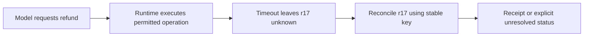

# Objective 1.1 — Build an agentic loop that knows when to continue

[Test this decision with a supplied example](#benchmark-exercise-1-1) — predict first, then compare the fixed-fixture evidence.

**Picture the application:** A warehouse customer asks why parcel P-84 has not arrived. The assistant starts with an order reference and should return an explanation supported by shipment and carrier records, including any unresolved detail. This lesson calls the request, lookup, result and next-decision cycle an agentic loop.

**Exam:** CCAR-F · **Domain 1:** 27% of exam; no separate objective weight is published here.  
**Time:** 45–65 minutes including practice; allow another 20 minutes for the production challenge.  
**Prerequisites:** Understand a request, response, and conversation history. New to the Claude API? Start with the [five-minute primer in Lesson 0](../L00-orientation.md#five-minute-primer-how-a-claude-app-works).  
**Continue from:** [Domain lesson](../L01-agentic-architecture-and-orchestration.md) · [Objective map](../../../01-Curriculum/02-Architect-Track/CCAR-F-objectives.md).  
**Scenario setting:** Logistics; all organizations, records and amounts in examples are fictional.

**Official task statement:** Design and implement agentic loops for autonomous task execution  


<!-- layered-episode:FV-01:start -->
<a id="learn-fv-01"></a>
### Learn the decision in context — FV-01

**Picture the job.** A customer wants a refund. The payment service has stopped replying; you cannot tell whether money moved. This is an original fictional teaching scene, not a recalled live exam question. Read and trace it; no account, installation or API call is required.

**Start small.** Follow the ordinary route: a person supplies a request or record, software passes the needed evidence to the assistant, and a receiving service or person checks the result. The first demonstration assumes the input, access and evidence are suitable. Now remove that assumption in the situation above. Predict what the receiver would see before choosing a repair.

**Original exam-style practice — choose ONE.** A payment mutation timed out after submission. Which recovery preserves agent-loop correctness and prevents an unsafe duplicate effect?

A. Reconcile the operation using its operation identifier before considering another mutation; keep tool-result correlation separate from settlement state.

B. Repeat the refund immediately because the model returned end_turn.

C. Treat end_turn as evidence that the payment committed.

<details>
<summary>What is this asking? Plain-language help, without the answer</summary>

Identify what the application needs to trust, what has actually been observed, and what remains unknown. Compare the choices against this situation, rather than choosing the most complicated design. A proposal is an intended action; evidence is what you can point to; a contract says what the receiving part expects. Decide which option fixes the stated failure without pretending another requirement has also been solved.

</details>

**Choose before opening the walkthrough.** Say your answer and the closest alternative aloud, or record them in your own notes.

<details>
<summary>Reveal the repair, evidence and changed condition</summary>

**Answer: A.** Reconcile the operation using its operation identifier before considering another mutation; keep tool-result correlation separate from settlement state.

**Walk it through.** The operation ledger reports r17 committed with receipt PAY17. One refund exists; the customer sees that receipt. If status remains unknown, report uncertainty rather than sending another credit.

**Why the alternatives fail here.** Repeat the refund immediately because the model returned end_turn. This leaves the stated boundary or evidence requirement unsatisfied. Treat end_turn as evidence that the payment committed. This also fails to establish the required result. The closest competing mechanism fails for this specific reason: A blind refund retry can duplicate a committed transaction. Model termination is not proof of settlement.

**Inspect the small artifact.** This is an illustrative application-state note for reading, not an SDK signature or executable configuration. The application or workflow owner creates it; the receiver uses it to distinguish what is known from what still needs checking. Its labels describe this scene; do not paste it into Claude settings.

```text
stop_reason=tool_use; pending_id=t17; operation_id=r17; business_status=unknown
```

**Layer added.** AI reasoning proposes, selects or summarizes where the job needs judgment. Ordinary software checks identifiers, permissions, required fields, recorded outcomes and stop conditions where applicable. A human resolves a policy or evidence gap when the story requires it. Inspect which owner actually supplies the evidence in this scene.



**Change one condition.** Keep the application in mind and consider the new situation below. Choose before opening its explanation.

**Technical transfer question — choose ONE.** The model returns end_turn while a submitted payment remains unconfirmed. Which state transition is appropriate?

A. End the model turn while retaining payment status unknown and reconciling the business operation.

B. Mark the business operation committed because the model finished.

<details>
<summary>Transfer check</summary>

**A.** The model returns end_turn, but the payment request timed out. Stop the model loop; do not describe the refund as committed. Name the changed fact before naming a tool. Preserve unrelated access, source-validation and result checks.

</details>

**Recall in ordinary language.** What broke? Who can fix it? What observable result proves the repair? If you cannot answer all three, replay the concrete scene rather than memorize the option letter.

</details>

**Continue from this decision:** [objective 1.1](objective-1.1.md) · [inspect its decision map](../decision-atlas.md#diagram-d11) · [targeted practice](../../../practice/index.html?exam=CCAR-F&objective=1.1). Existing mapped question IDs: `cct-fv-01-base-v1`, `cct-fv-01-retry-v1`. The new guided question above is separate from those stored items and does not change their answers or progress.
<!-- layered-episode:FV-01:end -->

## Read this objective in both vocabularies

For reading and paper reasoning, no installation or credentials are needed. Keep this page's stated concept prerequisites; any runnable challenge still needs its own setup. If an implementation example feels abrupt, first read [how to interpret its artifact type](../architecture-studio/00-foundations.md#how-to-read-technical-examples-in-this-course), then use the relevant application bridge: [AS-01 decision bridge](../architecture-studio/AS-01-action-service.md#connect-the-simple-explanation-to-technical-design-choices) · [AS-03 decision bridge](../architecture-studio/AS-03-grounded-assistant.md#connect-the-simple-explanation-to-technical-design-choices).

Explain the business purpose first, name the precise mechanism second, and distinguish it from the nearest plausible alternative using the stated constraint. Return here for the objective-specific protocol, options and practice. The bridges are teaching aids, not additional official objectives.


## Big idea

The model chooses the next useful action; your runtime executes it and preserves the evidence needed for the next decision.


<a id="lifecycle"></a>
## Read the lifecycle as a protocol

Start by sending the current conversation and tool definitions to Claude. Inspect the response's control information before deciding what your program does next. A `tool_use` stop reason means the assistant has requested tool execution. Run the requested calls and send their results back. An `end_turn` means the model has completed its turn. The visible text is for the user; it is not a reliable control signal. A response may explain its intentions and still request a tool.

Separate the normal completion path from abnormal exits. A tool timeout is a result the model may need to reason about. A token-limit interruption requires deliberate handling rather than being labeled successful completion. A budget or iteration watchdog can stop runaway execution, but report that as interrupted work. It must not replace the protocol's ordinary completion condition.

**Current primary-source reading:** [Stop reasons](https://platform.claude.com/docs/en/build-with-claude/handling-stop-reasons) supports handling exceptional outcomes separately from normal completion. (Tier 1; checked 2026-10-02).

Source: [Saved official guide, section 6 task 1.1](https://anthropic-partners.skilljar.com/page/partner-certifications) (Tier 1; July 2026 blueprint).

<a id="history"></a>
## Return evidence with its identity

Keep the assistant message containing tool requests in history, then append a user message containing the corresponding tool results. Each result must identify the request it answers through the matching tool-use ID. If the model asked for two lookups, return both outcomes; an error is still an outcome. Do not replace the conversation with just the last tool's text, because the next reasoning step depends on the original question and earlier findings.

Think of history as an evidence ledger. The model can change its plan after reading a result, but only if the result is actually present. A request saying “check delivery” is not evidence that delivery occurred. Likewise, a successful tool execution is not automatically proof that the user's whole task is complete.

Source: [Saved official guide, section 6 task 1.1](https://anthropic-partners.skilljar.com/page/partner-certifications) (Tier 1; July 2026 blueprint).

<a id="decisions"></a>
## Separate adaptive decisions from fixed workflows

In a model-driven loop, Claude selects a tool using the user's request and accumulated context. Your dispatcher validates and executes that selection. In a fixed decision tree, application code selects a predefined branch or sequence. Both patterns can be useful: a deterministic application may own a required approval step while Claude investigates the surrounding issue.

Do not implement a loop by searching for phrases such as “done,” by stopping whenever any assistant text exists, or by always running exactly three iterations. Those methods confuse presentation or implementation convenience with completion. The basic controller is: request → inspect reason → execute all requested calls → append results → request again; finish on `end_turn`, and separately handle exceptional reasons.

**Illustrative controller pseudocode — not an SDK signature:**

```text
history = initial_messages
while budget_available:
    response = request_claude(history, tools)
    history.append(response.assistant_message)
    if response.stop_reason == "end_turn": return completed(response)
    if response.stop_reason != "tool_use": return handle_exception(response)
    results = []
    for call in response.tool_calls:
        outcome = validate_and_execute_or_report_error(call)
        results.append(tool_result(call.id, outcome))
    history.append(user_message(results))
return interrupted("budget exhausted", history)
```

Test the two-tool case as well as the error case. The dispatcher must not drop a requested call merely because another call succeeded.

Source: [Saved official guide, section 6 task 1.1](https://anthropic-partners.skilljar.com/page/partner-certifications) (Tier 1; July 2026 blueprint).

<a id="worked"></a>
## Worked example: decision, alternative, and trade-off

A warehouse assistant must explain why parcel P-84 has not arrived. Claude first requests a shipment lookup. The tool returns “delayed” and a carrier reference. Claude then requests carrier events and finds a depot closure; only after receiving that evidence does it answer. The runtime keeps both assistant requests and both linked results. A credible alternative is a fixed two-tool pipeline, which is simpler when every parcel always needs both lookups. The adaptive loop avoids an unnecessary carrier call for a parcel already delivered, at the cost of extra runtime control and logging. Neither approach may claim completion after the first sentence “I'll investigate.”

This example applies [Saved official guide, section 6 task 1.1](https://anthropic-partners.skilljar.com/page/partner-certifications) (Tier 1; July 2026 blueprint); it is original teaching material, not an exam item.

**Transfer — manufacturing:** A machine-status assistant runs the same evidence loop, but its catalog is read-only because the workflow prohibits equipment control. Compare this with the parcel workflow: the controller can finish an explanation, yet must never infer permission to reset equipment from a diagnostic result. The outcome is a source-linked status report with unresolved sensor readings labeled.


<a id="decision-variants"></a>
<a id="variant-fv-01"></a>
## Decision variant FV-01 — Confirm the effect before retrying

This is original fictional practice, not an official exam question. All policies, amounts and records below are synthetic.

**Choose in the base case.** A support agent has one refund tool call pending. Return tool_result with its matching tool_use_id and continue the conversation; keep the business transaction status separately.

**Change one constraint.** The model returns end_turn, but the payment request timed out. Stop the model loop; do not describe the refund as committed.

**What failed, and who recovers?** A network timeout leaves operation r-17 unknown. Query r-17 status or reconcile by idempotency key before sending another refund.

**Inspect the artifact — illustrative contract, not a drop-in SDK implementation:**

```text
stop_reason=tool_use; pending_id=t17; operation_id=r17; business_status=unknown
```

**Why not the nearest alternative?** A blind refund retry can duplicate a committed transaction. Model termination is not proof of settlement.

**Memory cue with its condition:** Stop the loop on its signal; settle the effect from its receipt.

**Proof before accepting success:** Produce a trace or artifact showing the decisive constraint, the selected mechanism, rejected alternative and observable result. Preserve unresolved status; a plausible explanation alone is not completion.

[Inspect D11 and its equivalent decision procedure](../decision-atlas.md#diagram-d11) · [See this decision at walkthrough step 1](../scenario-walkthroughs/WT-01-customer-support-agent.md#variant-fv-01) · [Return to the objective map](README.md).

**Blind transfer:** Before opening practice, explain which single change in the scene would reverse your choice and which would only require revalidation. Write the failure signal and the next safe action. The practice app provides separately authored base and later-retry items, with a free-response transfer rubric; assistance/exposure must remain visible in learning history.

**Current mechanism reference:** https://platform.claude.com/docs/en/agents-and-tools/tool-use/overview (reviewed 2026-10-14). The saved blueprint remains the exam coverage source; application policy in this packet is invented teaching context.

<a id="try"></a>
## Try it

Write a response trace for: shipment lookup requested; lookup succeeds; carrier lookup requested; carrier lookup times out; model explains the unresolved carrier detail and ends its turn. Annotate each continuation and each appended history message.

**Expected output and self-check:** The first two tool-request responses continue the loop. Their assistant messages stay in history and each gets its linked tool result, including the timeout marked as failure. The final `end_turn` ends normally. State the unresolved detail in the user answer; do not convert the timeout into confirmed delivery. Before checking yourself, write the evidence that supports each control-flow or tool decision. If your answer differs, identify whether the difference changes correctness, reliability, or only implementation style.

<a id="production"></a>
## Production challenge and traps

Introduce a delayed carrier response and a budget limit. Compare retrying a read with ending in a documented partial answer. Your trace must distinguish normal completion, tool failure, and budget interruption.

A convincing extension names the failure condition, who owns recovery, and the evidence that proves recovery succeeded. Do not mistake a tool request for execution, an execution for full completion, or a plausible summary for verified evidence. Compare the added reliability with its latency, maintenance, and coordination costs.

<a id="done"></a>
## Done when

- [ ] Draw and implement the `tool_use` continuation and `end_turn` exit branches.
- [ ] Show a history trace with matching IDs for two results, including an error.
- [ ] Explain why text parsing and fixed iteration counts fail, and label watchdog exits as interruptions.

Save your explanation, trace or design output in your own notes (or skip this step). Mark any failed check as a practice gap and revisit the mapped teaching section. These checks are observable learning tasks, not a claim that a score predicts certification success.

## Coverage checklist

The identifiers below follow the official Knowledge and Skills bullet order for this task. Each points to its teaching subsection; practice and completion checks above assess application.

| Blueprint bullet | Teaching section |
| --- | --- |
| 1.1-K1 | [Read the lifecycle as a protocol](#lifecycle) |
| 1.1-K2 | [Return evidence with its identity](#history) |
| 1.1-K3 | [Separate adaptive decisions from fixed workflows](#decisions) |
| 1.1-S1 | [Read the lifecycle as a protocol](#lifecycle) |
| 1.1-S2 | [Return evidence with its identity](#history) |
| 1.1-S3 | [Separate adaptive decisions from fixed workflows](#decisions) |

**Source boundary:** The July guide defines the assessed coverage. Current documentation notes describe implementation freshness and must be rechecked when a runtime changes.

## Sources

- [Official guide v1.0, July 2026](https://anthropic-partners.skilljar.com/page/partner-certifications), section 6 task 1.1 (Tier 1; saved blueprint; latest revision not certified).
- [Stop reasons](https://platform.claude.com/docs/en/build-with-claude/handling-stop-reasons) (Tier 1; accessed 2026-10-02; implementation details can change).
- [Existing domain lesson](../L01-agentic-architecture-and-orchestration.md) (project-authored synthesis, not independent primary evidence).

**Go deeper:** [Deep practice 1, section 1.1](../deep-practice/01-agentic-architecture-and-orchestration.md#11-agentic-loops)


<a id="benchmark-exercise-1-1"></a>
## Worked evidence task — 1.1: test the boundary

**Original technical decision.** A response contains text, a tool-use request, then a timeout and a truncated continuation. Which lifecycle policy preserves correlation without treating generation interruption as business completion?

**In everyday terms:** A readable sentence is not a transaction receipt. A timeout still belongs to the requested tool; do not lose its identity.

**Before you start:** No account, API key or package installation is needed for the paper task. Optional replay needs Python 3 and the two provided lab files in the same directory. This local inspector models the stated fixture; it does not call Claude, load Claude Code rules or run an MCP server.

### Inspect the supplied input

All identifiers and business rules here are fictional application data. This is **not an SDK request schema**. Keep the input separate from your proposed decision.

```json
{
  "responses": [
    {
      "text": "I will check",
      "stop_reason": "tool_use",
      "id": "t17"
    },
    {
      "tool_result_for": "t17",
      "status": "timeout"
    },
    {
      "stop_reason": "max_tokens"
    }
  ],
  "task_complete": false
}
```

### Break, choose, repair, prove

1. **Break:** Replay mixed text and tool requests, correlated tool results and interrupted generation. Name the exact failed assumption before proposing another component.
2. **Choose:** Keep assistant tool requests and matching results together; classify interruption separately from a finished model turn. Write the nearest alternative you would reject and the requirement it fails.
3. **Repair:** Write the corrected contract or recovery step, keeping successful evidence and unknowns separate.
4. **Prove:** In this fixture end_turn ends the normal model turn. Define separate policies for paused continuation, truncation, refusal, stop sequence and budget/cancellation exits; none alone proves business task completion. Record `decision`, `reason`, `rejected_alternative`, `evidence` and `remaining_unknowns`.

[Open this actual task in the existing LAB](../../../06-Labs/02-CCAR-F-coordinator-extraction/README.md#benchmark-exercise-1-1) · [Return to the teaching subsection](#lifecycle)

<details><summary>Compare the offline evidence — after making your decision</summary>

The local inspector presents **controlled-fixture calculations and authored reference decisions** below. Some fields are calculated (such as counts or arithmetic); policy labels and recovery choices are supplied worked answers for this fixed example, not executed policies or a general-purpose validator. No Claude, rule loader, service or reviewer was run. `false` or `null` observations remain unresolved when no corresponding live test was performed.

```json
{
  "tool_request_ids": [
    "t17"
  ],
  "failed_result_ids": [
    "t17"
  ],
  "last_stop": "max_tokens",
  "business_complete": false,
  "next_policy": "bounded continuation or documented partial stop; not success"
}
```

**Why this matters:** A readable sentence is not a transaction receipt. A timeout still belongs to the requested tool; do not lose its identity. The output is a self-check for this controlled example, not certification-score evidence. To test the real mechanism, perform the existing LAB’s integration steps in a fresh disposable context and keep its actual trace beside this prediction.

**Primary-source leads for mechanism review:** [Claude Agent SDK Overview](https://platform.claude.com/docs/en/agent-sdk/overview) · [Messages API Reference](https://platform.claude.com/docs/en/api/messages). The external benchmark helped identify the exercise gap; this task and its data were authored here. Current implementation details must be verified against the installed runtime and those primary sources.

</details>