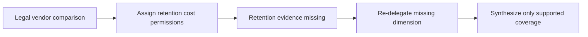

# Objective 1.2 — Coordinate specialists without losing the whole question

[Test this decision with a supplied example](#benchmark-exercise-1-2) — predict first, then compare the fixed-fixture evidence.

**Picture the application:** A team wants to know whether an internal document assistant is worth adopting. Its question spans technical feasibility, governance and operating ownership; the expected output is one recommendation covering all three. The technical decision is coordinator-subagent orchestration: divide investigation without losing parts of the original business question.

**Exam:** CCAR-F · **Domain 1:** 27% of exam; no separate objective weight is published here.  
**Time:** 45–65 minutes including practice; allow another 20 minutes for the production challenge.  
**Prerequisites:** Complete 1.1; understand isolated agent contexts. New to the Claude API? Start with the [five-minute primer in Lesson 0](../L00-orientation.md#five-minute-primer-how-a-claude-app-works).  
**Continue from:** [Domain lesson](../L01-agentic-architecture-and-orchestration.md) · [Objective map](../../../01-Curriculum/02-Architect-Track/CCAR-F-objectives.md).  
**Scenario setting:** Professional services; all organizations, records and amounts in examples are fictional.

**Official task statement:** Orchestrate multi-agent systems with coordinator-subagent patterns  


<!-- layered-episode:FV-02:start -->
<a id="learn-fv-02"></a>
### Learn the decision in context — FV-02

**Picture the job.** A legal team needs a vendor comparison. Two sections are ready, but nobody has checked how long records are retained. This is an original fictional teaching scene, not a recalled live exam question. Read and trace it; no account, installation or API call is required.

**Start small.** Follow the ordinary route: a person supplies a request or record, software passes the needed evidence to the assistant, and a receiving service or person checks the result. The first demonstration assumes the input, access and evidence are suitable. Now remove that assumption in the situation above. Predict what the receiver would see before choosing a repair.

**Original exam-style practice — choose ONE.** A coordinator has results for cost and deployment permissions but no retention evidence. Which orchestration change best addresses the coverage gap?

A. Publish the comparison because most specialists completed.

B. Delegate the missing retention dimension with an explicit evidence contract, then reconcile all required dimensions before synthesis.

C. Ask each specialist for a longer summary without identifying the missing dimension.

<details>
<summary>What is this asking? Plain-language help, without the answer</summary>

Identify what the application needs to trust, what has actually been observed, and what remains unknown. Compare the choices against this situation, rather than choosing the most complicated design. A proposal is an intended action; evidence is what you can point to; a contract says what the receiving part expects. Decide which option fixes the stated failure without pretending another requirement has also been solved.

</details>

**Choose before opening the walkthrough.** Say your answer and the closest alternative aloud, or record them in your own notes.

<details>
<summary>Reveal the repair, evidence and changed condition</summary>

**Answer: B.** Delegate the missing retention dimension with an explicit evidence contract, then reconcile all required dimensions before synthesis.

**Walk it through.** The coverage table changes retention from pending to complete only after a sourced result arrives. Until then, the report marks that dimension unresolved.

**Why the alternatives fail here.** Publish the comparison because most specialists completed. This leaves the stated boundary or evidence requirement unsatisfied. Ask each specialist for a longer summary without identifying the missing dimension. This also fails to establish the required result. The closest competing mechanism fails for this specific reason: Assigning one vendor to each specialist can hide inconsistent criteria unless the return contracts enforce the same dimensions.

**Inspect the small artifact.** This is an illustrative application-state note for reading, not an SDK signature or executable configuration. The application or workflow owner creates it; the receiver uses it to distinguish what is known from what still needs checking. Its labels describe this scene; do not paste it into Claude settings.

```text
coverage={retention:pending,cost:complete,permissions:complete}; owner=coordinator
```

**Layer added.** AI reasoning proposes, selects or summarizes where the job needs judgment. Ordinary software checks identifiers, permissions, required fields, recorded outcomes and stop conditions where applicable. A human resolves a policy or evidence gap when the story requires it. Inspect which owner actually supplies the evidence in this scene.



**Change one condition.** Keep the application in mind and consider the new situation below. Choose before opening its explanation.

**Technical transfer question — choose ONE.** The multi-dimensional comparison becomes one authorized price lookup. Which architecture is proportionate?

A. Retain all specialists even though they add no required evidence.

B. Use a scoped single-agent lookup with source validation.

<details>
<summary>Transfer check</summary>

**B.** The task becomes one known price lookup from an authorized source. One scoped agent is sufficient; decomposition overhead adds no evidence. Name the changed fact before naming a tool. Preserve unrelated access, source-validation and result checks.

</details>

**Recall in ordinary language.** What broke? Who can fix it? What observable result proves the repair? If you cannot answer all three, replay the concrete scene rather than memorize the option letter.

</details>

**Continue from this decision:** [objective 1.2](objective-1.2.md) · [inspect its decision map](../decision-atlas.md#diagram-d02) · [targeted practice](../../../practice/index.html?exam=CCAR-F&objective=1.2). Existing mapped question IDs: `cct-fv-02-base-v1`, `cct-fv-02-retry-v1`. The new guided question above is separate from those stored items and does not change their answers or progress.
<!-- layered-episode:FV-02:end -->

## Read this objective in both vocabularies

For reading and paper reasoning, no installation or credentials are needed. Keep this page's stated concept prerequisites; any runnable challenge still needs its own setup. If an implementation example feels abrupt, first read [how to interpret its artifact type](../architecture-studio/00-foundations.md#how-to-read-technical-examples-in-this-course), then use the relevant application bridge: [AS-04 decision bridge](../architecture-studio/AS-04-research-system.md#connect-the-simple-explanation-to-technical-design-choices).

Explain the business purpose first, name the precise mechanism second, and distinguish it from the nearest plausible alternative using the stated constraint. Return here for the objective-specific protocol, options and practice. The bridges are teaching aids, not additional official objectives.


## Big idea

A coordinator owns coverage and integration, while specialists own bounded investigations.


<a id="hub"></a>
## Make the coordinator the communication hub

In a hub-and-spoke architecture, a specialist returns findings and failures to the coordinator. The coordinator routes relevant findings to other specialists, aggregates results, and keeps an observable record. This prevents hidden side conversations from changing conclusions without appearing in the main evidence trail. It also gives recoverable errors one consistent owner.

An isolated specialist does not automatically know the coordinator's prior conversation. Its initial brief must include the question, the scope, relevant findings, sources, and the expected return format. “Use what the other agent found” is insufficient when those findings were never included. Context isolation is useful because verbose investigation can remain outside the coordinator's working context, but it requires deliberate handoffs.

Source: [Saved official guide, section 6 task 1.2](https://anthropic-partners.skilljar.com/page/partner-certifications) (Tier 1; July 2026 blueprint).

<a id="scope"></a>
## Select agents and partition the full scope

First list the outcome dimensions the user needs. For a short factual lookup, one investigator may be enough. For a comparison involving security, operating cost, and migration effort, choose specialists whose scopes collectively cover all three. Invoking the entire agent pipeline for every question adds overhead and can manufacture irrelevant work.

Partition by distinct subtopic or source type, and state exclusions so two agents do not repeat the same search. However, narrow scopes must add up to the whole request. Three specialists on implementation details can still miss the user's business constraints. Keep a coverage matrix: requested dimension, assigned owner, returned evidence, unresolved question. Scope partitioning reduces duplication; the matrix reveals omission.

**Current primary-source reading:** [Multi-agent research system](https://www.anthropic.com/engineering/multi-agent-research-system) supplies a primary engineering example of scoped delegation and coordination costs. (Tier 1; checked 2026-10-02).

Source: [Saved official guide, section 6 task 1.2](https://anthropic-partners.skilljar.com/page/partner-certifications) (Tier 1; July 2026 blueprint).

<a id="refine"></a>
## Refine until the synthesis meets explicit criteria

An initial synthesis is a draft, not automatic completion. Compare it with the coverage matrix and quality criteria. A missing cost estimate should produce a targeted re-delegation about costs, not a repeat of every search. Return the new evidence through the coordinator, then ask synthesis to revise only the affected conclusions while preserving source attribution.

The refinement loop needs a finish condition: all requested dimensions have adequate evidence or an explicit, justified gap, and conflicts are visible. “Continue until perfect” is not actionable. Also avoid endlessly broadening the request. The coordinator can close with a documented limitation when a source is unavailable, while clearly distinguishing that limit from a supported conclusion.

Source: [Saved official guide, section 6 task 1.2](https://anthropic-partners.skilljar.com/page/partner-certifications) (Tier 1; July 2026 blueprint).

<a id="worked"></a>
## Worked example: decision, alternative, and trade-off

A team asks whether to adopt an internal document assistant. The coordinator assigns technical feasibility to one agent and governance to another, keeping a simple licensing lookup itself. The first synthesis covers access controls but omits operational ownership. The coordinator sends a focused follow-up to governance, supplies the existing findings, and re-synthesizes with ownership included. An alternative is one generalist agent, suitable for a small, familiar decision; it has less coordination cost. Specialists pay off when distinct evidence streams need independent depth. The decision is driven by query complexity, not an assumption that more agents always improve quality.

This example applies [Saved official guide, section 6 task 1.2](https://anthropic-partners.skilljar.com/page/partner-certifications) (Tier 1; July 2026 blueprint); it is original teaching material, not an exam item.

**Transfer — healthcare administration, synthetic:** A scheduling comparison adds a privacy constraint: specialists receive aggregate capacity and policy descriptions rather than patient records. The coordinator must preserve scope coverage while reducing shared data. Explain why blindly passing the full transcript is inappropriate here and identify the minimal context each role needs.


<a id="decision-variants"></a>
<a id="variant-fv-02"></a>
## Decision variant FV-02 — Cover dimensions before synthesizing

This is original fictional practice, not an official exam question. All policies, amounts and records below are synthetic.

**Choose in the base case.** A legal team compares three vendors on evidence retention, integration cost and deployment permissions. Assign dimensions, require source-tagged findings and let the coordinator integrate the comparison.

**Change one constraint.** The task becomes one known price lookup from an authorized source. One scoped agent is sufficient; decomposition overhead adds no evidence.

**What failed, and who recovers?** Cost returns, but retention is missing. Re-delegate retention with an explicit gap; do not publish a complete comparison.

**Inspect the artifact — illustrative contract, not a drop-in SDK implementation:**

```text
coverage={retention:pending,cost:complete,permissions:complete}; owner=coordinator
```

**Why not the nearest alternative?** Assigning one vendor to each specialist can hide inconsistent criteria unless the return contracts enforce the same dimensions.

**Memory cue with its condition:** Split by evidence need; count coverage before conclusion.

**Proof before accepting success:** Produce a trace or artifact showing the decisive constraint, the selected mechanism, rejected alternative and observable result. Preserve unresolved status; a plausible explanation alone is not completion.

[Inspect D02 and its equivalent decision procedure](../decision-atlas.md#diagram-d02) · [See this decision at walkthrough step 2](../scenario-walkthroughs/WT-03-multi-agent-research.md#variant-fv-02) · [Return to the objective map](README.md).

**Blind transfer:** Before opening practice, explain which single change in the scene would reverse your choice and which would only require revalidation. Write the failure signal and the next safe action. The practice app provides separately authored base and later-retry items, with a free-response transfer rubric; assistance/exposure must remain visible in learning history.

**Current runtime reference:** [https://platform.claude.com/docs/en/agent-sdk/subagents](https://platform.claude.com/docs/en/agent-sdk/subagents) (reviewed 2026-10-14). The saved blueprint remains the exam coverage source; application policy in this packet is invented teaching context.

<a id="try"></a>
## Try it

Design a coordinator brief for comparing two fictional support platforms across reliability, privacy, price, and migration. Give each dimension an owner, define return fields, and describe one possible refinement.

**Expected output and self-check:** A strong plan uses non-overlapping research scopes, passes shared requirements explicitly, routes results through the coordinator, and checks all four dimensions. If price evidence is absent, reassign a price-specific query and revise the synthesis. It does not pretend that a reliability report covers migration. Before checking yourself, write the evidence that supports each control-flow or tool decision. If your answer differs, identify whether the difference changes correctness, reliability, or only implementation style.

<a id="production"></a>
## Production challenge and traps

Add a source outage and a new migration dependency to the platform comparison. Revise ownership and coverage without restarting all research; show which gaps remain explicitly unresolved.

A convincing extension names the failure condition, who owns recovery, and the evidence that proves recovery succeeded. Do not mistake a tool request for execution, an execution for full completion, or a plausible summary for verified evidence. Compare the added reliability with its latency, maintenance, and coordination costs.

<a id="done"></a>
## Done when

- [ ] Choose a smaller or larger specialist set based on the actual query.
- [ ] Partition scope with owners and exclusions while covering the whole request.
- [ ] Run a gap-check, targeted re-delegation, and revised synthesis.
- [ ] Demonstrate that results, failures, and handoffs pass through the coordinator.

Save your explanation, trace or design output in your own notes (or skip this step). Mark any failed check as a practice gap and revisit the mapped teaching section. These checks are observable learning tasks, not a claim that a score predicts certification success.

## Coverage checklist

The identifiers below follow the official Knowledge and Skills bullet order for this task. Each points to its teaching subsection; practice and completion checks above assess application.

| Blueprint bullet | Teaching section |
| --- | --- |
| 1.2-K1 | [Make the coordinator the communication hub](#hub) |
| 1.2-K2 | [Make the coordinator the communication hub](#hub) |
| 1.2-K3 | [Select agents and partition the full scope](#scope) |
| 1.2-K4 | [Select agents and partition the full scope](#scope) |
| 1.2-S1 | [Select agents and partition the full scope](#scope) |
| 1.2-S2 | [Select agents and partition the full scope](#scope) |
| 1.2-S3 | [Refine until the synthesis meets explicit criteria](#refine) |
| 1.2-S4 | [Make the coordinator the communication hub](#hub) |

**Source boundary:** The July guide defines the assessed coverage. Current documentation notes describe implementation freshness and must be rechecked when a runtime changes.

## Sources

- [Official guide v1.0, July 2026](https://anthropic-partners.skilljar.com/page/partner-certifications), section 6 task 1.2 (Tier 1; saved blueprint; latest revision not certified).
- [Multi-agent research system](https://www.anthropic.com/engineering/multi-agent-research-system) (Tier 1; accessed 2026-10-02; implementation details can change).
- [Existing domain lesson](../L01-agentic-architecture-and-orchestration.md) (project-authored synthesis, not independent primary evidence).

**Go deeper:** [Deep practice 1, section 1.2](../deep-practice/01-agentic-architecture-and-orchestration.md#12-coordinator-subagent-orchestration)


<a id="benchmark-exercise-1-2"></a>
## Worked evidence task — 1.2: test the boundary

**Original technical decision.** A coordinator receives security and cost findings for a comparison that also requires migration analysis. Which completion condition should govern synthesis?

**In everyday terms:** Two useful reports can still leave one part of the question unanswered.

**Before you start:** No account, API key or package installation is needed for the paper task. Optional replay needs Python 3 and the two provided lab files in the same directory. This local inspector models the stated fixture; it does not call Claude, load Claude Code rules or run an MCP server.

### Inspect the supplied input

All identifiers and business rules here are fictional application data. This is **not an SDK request schema**. Keep the input separate from your proposed decision.

```json
{
  "required": [
    "security",
    "cost",
    "migration"
  ],
  "returned": [
    "security",
    "cost"
  ],
  "deadline_minutes": 15
}
```

### Break, choose, repair, prove

1. **Break:** Give three requested dimensions but only two specialist reports. Name the exact failed assumption before proposing another component.
2. **Choose:** Compare returned dimensions with the required coverage set, and request only the missing investigation. Write the nearest alternative you would reject and the requirement it fails.
3. **Repair:** Write the corrected contract or recovery step, keeping successful evidence and unknowns separate.
4. **Prove:** Coordinator identifies the missing dimension before claiming a complete comparison. Record `decision`, `reason`, `rejected_alternative`, `evidence` and `remaining_unknowns`.

[Open this actual task in the existing LAB](../../../06-Labs/02-CCAR-F-coordinator-extraction/README.md#benchmark-exercise-1-2) · [Return to the teaching subsection](#scope)

<details><summary>Compare the offline evidence — after making your decision</summary>

The local inspector presents **controlled-fixture calculations and authored reference decisions** below. Some fields are calculated (such as counts or arithmetic); policy labels and recovery choices are supplied worked answers for this fixed example, not executed policies or a general-purpose validator. No Claude, rule loader, service or reviewer was run. `false` or `null` observations remain unresolved when no corresponding live test was performed.

```json
{
  "missing": [
    "migration"
  ],
  "complete": false
}
```

**Why this matters:** Two useful reports can still leave one part of the question unanswered. The output is a self-check for this controlled example, not certification-score evidence. To test the real mechanism, perform the existing LAB’s integration steps in a fresh disposable context and keep its actual trace beside this prediction.

**Primary-source leads for mechanism review:** [Claude Agent SDK Overview](https://platform.claude.com/docs/en/agent-sdk/overview). The external benchmark helped identify the exercise gap; this task and its data were authored here. Current implementation details must be verified against the installed runtime and those primary sources.

</details>