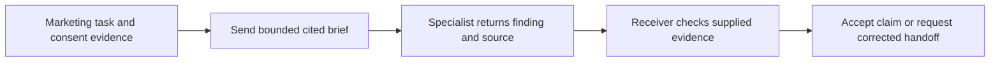

# Objective 1.3 — Spawn agents with complete, attributable context

[Test this decision with a supplied example](#benchmark-exercise-1-3) — predict first, then compare the fixed-fixture evidence.

**Picture the application:** A storage team compares two designs using capacity information and cost findings collected separately. The final report must preserve what each source actually said and where it came from. This lesson examines subagent invocation and context passing: what each helper receives, what can run together, and what must wait.

**Exam:** CCAR-F · **Domain 1:** 27% of exam; no separate objective weight is published here.  
**Time:** 45–65 minutes including practice; allow another 20 minutes for the production challenge.  
**Prerequisites:** Complete 1.2; recognize a tool allowlist and an agent definition. New to the Claude API? Start with the [five-minute primer in Lesson 0](../L00-orientation.md#five-minute-primer-how-a-claude-app-works).  
**Continue from:** [Domain lesson](../L01-agentic-architecture-and-orchestration.md) · [Objective map](../../../01-Curriculum/02-Architect-Track/CCAR-F-objectives.md).  
**Scenario setting:** Technology infrastructure; all organizations, records and amounts in examples are fictional.

**Official task statement:** Configure subagent invocation, context passing, and spawning  


<!-- layered-episode:FV-03:start -->
<a id="learn-fv-03"></a>
### Learn the decision in context — FV-03

**Picture the job.** A marketing researcher is asked to use an earlier finding, but that finding was never sent to the researcher. This is an original fictional teaching scene, not a recalled live exam question. Read and trace it; no account, installation or API call is required.

**Start small.** Follow the ordinary route: a person supplies a request or record, software passes the needed evidence to the assistant, and a receiving service or person checks the result. The first demonstration assumes the input, access and evidence are suitable. Now remove that assumption in the situation above. Predict what the receiver would see before choosing a repair.

**Original exam-style practice — choose ONE.** A subagent cites upstream evidence absent from its invocation context. Which change makes the handoff attributable and bounded?

A. Rely on the agents having the same task name to share conversation history.

B. Ask the subagent to infer the missing evidence from its conclusion.

C. Resend the exact question, allowed scope, relevant cited evidence and required return contract; reject unsupported claims.

<details>
<summary>What is this asking? Plain-language help, without the answer</summary>

Identify what the application needs to trust, what has actually been observed, and what remains unknown. Compare the choices against this situation, rather than choosing the most complicated design. A proposal is an intended action; evidence is what you can point to; a contract says what the receiving part expects. Decide which option fixes the stated failure without pretending another requirement has also been solved.

</details>

**Choose before opening the walkthrough.** Say your answer and the closest alternative aloud, or record them in your own notes.

<details>
<summary>Reveal the repair, evidence and changed condition</summary>

**Answer: C.** Resend the exact question, allowed scope, relevant cited evidence and required return contract; reject unsupported claims.

**Walk it through.** The returned finding cites CRM42, states its permitted scope and records a limitation. A claim referring to an absent source fails the receiving check.

**Why the alternatives fail here.** Rely on the agents having the same task name to share conversation history. This leaves the stated boundary or evidence requirement unsatisfied. Ask the subagent to infer the missing evidence from its conclusion. This also fails to establish the required result. The closest competing mechanism fails for this specific reason: Shared task naming is not shared conversation context; a bare “use the earlier findings” instruction is insufficient.

**Inspect the small artifact.** This is an illustrative application-state note for reading, not an SDK signature or executable configuration. The application or workflow owner creates it; the receiver uses it to distinguish what is known from what still needs checking. Its labels describe this scene; do not paste it into Claude settings.

```text
brief={question:segment_fit,scope:consented_records,evidence:[source:CRM42],return:[finding,source,limits]}
```

**Layer added.** AI reasoning proposes, selects or summarizes where the job needs judgment. Ordinary software checks identifiers, permissions, required fields, recorded outcomes and stop conditions where applicable. A human resolves a policy or evidence gap when the story requires it. Inspect which owner actually supplies the evidence in this scene.



**Change one condition.** Keep the application in mind and consider the new situation below. Choose before opening its explanation.

**Technical transfer question — choose ONE.** New consent evidence invalidates the audience assumption after delegation. What should happen?

A. Send the changed evidence and require revised findings.

B. Keep the prior audience conclusion because the task identifier is unchanged.

<details>
<summary>Transfer check</summary>

**A.** New consent evidence invalidates the audience assumption. Send the changed evidence and require a revised conclusion. Name the changed fact before naming a tool. Preserve unrelated access, source-validation and result checks.

</details>

**Recall in ordinary language.** What broke? Who can fix it? What observable result proves the repair? If you cannot answer all three, replay the concrete scene rather than memorize the option letter.

</details>

**Continue from this decision:** [objective 1.3](objective-1.3.md) · [inspect its decision map](../decision-atlas.md#diagram-d03) · [targeted practice](../../../practice/index.html?exam=CCAR-F&objective=1.3). Existing mapped question IDs: `cct-fv-03-base-v1`, `cct-fv-03-retry-v1`. The new guided question above is separate from those stored items and does not change their answers or progress.
<!-- layered-episode:FV-03:end -->

## Read this objective in both vocabularies

For reading and paper reasoning, no installation or credentials are needed. Keep this page's stated concept prerequisites; any runnable challenge still needs its own setup. If an implementation example feels abrupt, first read [how to interpret its artifact type](../architecture-studio/00-foundations.md#how-to-read-technical-examples-in-this-course), then use the relevant application bridge: [AS-04 decision bridge](../architecture-studio/AS-04-research-system.md#connect-the-simple-explanation-to-technical-design-choices).

Explain the business purpose first, name the precise mechanism second, and distinguish it from the nearest plausible alternative using the stated constraint. Return here for the objective-specific protocol, options and practice. The bridges are teaching aids, not additional official objectives.


## Big idea

A good subagent invocation combines an appropriate capability boundary with a self-contained evidence packet.


<a id="config"></a>
## Define the agent and enable invocation

The July blueprint calls the spawning mechanism `Task`, and requires it in the coordinator's `allowedTools`. An agent definition describes when a specialist is useful, gives its system prompt, and restricts its tools. The description helps selection; the system prompt defines behavior; the restrictions bound capabilities. A name alone does not establish any of those properties.

Treat configuration as part of the architecture. A synthesis specialist can be defined to merge supplied findings while an investigator can search approved sources. If the coordinator cannot invoke the spawning tool, a prompt asking it to delegate will not create that missing capability. Current implementations use version-sensitive names: preserve `Task` when studying this saved exam guide, and check the installed SDK or Claude Code documentation before writing runnable configuration.

**Current primary-source reading:** [SDK subagents](https://code.claude.com/docs/en/agent-sdk/subagents) is the implementation reference for definitions, explicit context and invocation. (Tier 1; checked 2026-10-02).

**Illustrative definition and packet — not a runnable SDK signature:**

```text
agent: evidence_synthesizer
  description: Merge supplied findings; preserve claim-source links.
  system_prompt: Return supported conclusions, conflicts, and coverage gaps.
  restricted_tools: [merge_findings, verify_fact]
invocation:
  goal: Compare design A and B under the supplied constraints.
  quality: Cover capacity, cost, risks; cite every material factual claim.
  findings: [{claim, evidence, source_url, document, page, date, uncertainty}]
```

Complete the findings array with actual supplied content before invocation. An empty placeholder is a template, not a finished context handoff.

Source: [Saved official guide, section 6 task 1.3](https://anthropic-partners.skilljar.com/page/partner-certifications) (Tier 1; July 2026 blueprint).

<a id="packet"></a>
## Pass findings and preserve their sources

A specialist's context must be explicitly supplied; do not assume shared parent memory or automatic access to earlier specialist results. When synthesis depends on search and document analysis, include the complete relevant findings from both, not merely a sentence saying that those agents finished. Complete means all material needed for this decision, not every raw log ever produced.

Separate content from metadata. A useful packet contains `claim`, `evidence_excerpt`, `source_url`, `document_name`, `page`, and `observed_date`. Keep uncertainty and conflicts attached to the claim. This allows the recipient to cite a finding and judge freshness. A prose summary with stripped URLs may sound clear but cannot support attributable synthesis. Check that every consequential claim has a retrievable origin before delegating.

Source: [Saved official guide, section 6 task 1.3](https://anthropic-partners.skilljar.com/page/partner-certifications) (Tier 1; July 2026 blueprint).

<a id="parallel"></a>
## Spawn independent work together with outcome criteria

For independent subtasks, the blueprint's parallel pattern emits multiple Task calls in one coordinator response. Starting one agent, waiting for its result, and only then starting another is sequential, even if both are called subagents. If agent B needs agent A's findings, that dependency justifies sequencing; parallelism is not a universal goal.

Write briefs around outcomes: investigate the stated dimension, use the supplied sources, return supporting evidence and limitations, and meet specified quality criteria. Avoid prescribing every search step when discoveries should guide the specialist. Fork-based exploration instead starts independent branches from a shared analysis baseline, useful for comparing divergent approaches. It does not make newly produced branch findings automatically shared; integration still needs an explicit handoff.

Source: [Saved official guide, section 6 task 1.3](https://anthropic-partners.skilljar.com/page/partner-certifications) (Tier 1; July 2026 blueprint).

Current-doc note: On the exam, `Task` in `allowedTools`. Today the tool is `Agent` (renamed in Claude Code v2.1.63; `Task` still works as an alias), and `allowedTools` only pre-approves tools; see [exam answer vs today](../deep-practice/conditions-and-errors.md#exam-answer-vs-today). [Subagents](https://code.claude.com/docs/en/sub-agents) (Tier 1; checked 2026-10-07).

<a id="worked"></a>
## Worked example: decision, alternative, and trade-off

A report compares two fictional storage designs. The coordinator defines an evidence investigator and a cost analyst, each with tools suited to its role, then invokes both in the same response because neither depends on the other. The later synthesis prompt embeds both result packets with source locations and dates. A credible alternative is a sequential investigation when the cost analyst needs the discovered storage volumes first. Parallelism reduces latency only where independence exists; premature parallel calls may duplicate work or use guessed inputs. Forking two design approaches is useful after both share a verified baseline, but their conclusions remain separate until reviewed.

This example applies [Saved official guide, section 6 task 1.3](https://anthropic-partners.skilljar.com/page/partner-certifications) (Tier 1; July 2026 blueprint); it is original teaching material, not an exam item.

**Transfer — financial operations, synthetic:** Independent invoice-policy and schema investigations can run together, but a payment-analysis worker waits for the normalized amount and verified document identity. The context packet preserves currency, source location and uncertainty. Compare the latency benefit of parallel independent reads with the correctness cost of spawning a dependent analysis too early.


<a id="decision-variants"></a>
<a id="variant-fv-03"></a>
## Decision variant FV-03 — Send an attributable handoff

This is original fictional practice, not an official exam question. All policies, amounts and records below are synthetic.

**Choose in the base case.** A marketing specialist checks audience evidence. Send the precise question, permitted data, exclusions, cited upstream findings and output contract, not a reference to another unseen chat.

**Change one constraint.** New consent evidence invalidates the audience assumption. Send the changed evidence and require a revised conclusion.

**What failed, and who recovers?** The specialist claims it used a result never included in its brief. Reject that claim and resend the bounded evidence packet.

**Inspect the artifact — illustrative contract, not a drop-in SDK implementation:**

```text
brief={question:segment_fit,scope:consented_records,evidence:[source:CRM42],return:[finding,source,limits]}
```

**Why not the nearest alternative?** Shared task naming is not shared conversation context; a bare “use the earlier findings” instruction is insufficient.

**Memory cue with its condition:** Send scope, source and shape; never assume shared memory.

**Proof before accepting success:** Produce a trace or artifact showing the decisive constraint, the selected mechanism, rejected alternative and observable result. Preserve unresolved status; a plausible explanation alone is not completion.

[Inspect D03 and its equivalent decision procedure](../decision-atlas.md#diagram-d03) · [See this decision at walkthrough step 3](../scenario-walkthroughs/WT-03-multi-agent-research.md#variant-fv-03) · [Return to the objective map](README.md).

**Blind transfer:** Before opening practice, explain which single change in the scene would reverse your choice and which would only require revalidation. Write the failure signal and the next safe action. The practice app provides separately authored base and later-retry items, with a free-response transfer rubric; assistance/exposure must remain visible in learning history.

**Current runtime reference:** [https://platform.claude.com/docs/en/agent-sdk/subagents](https://platform.claude.com/docs/en/agent-sdk/subagents) (reviewed 2026-10-14). The saved blueprint remains the exam coverage source; application policy in this packet is invented teaching context.

<a id="try"></a>
## Try it

Use the following self-contained synthetic evidence. The locators are fictional source identifiers for this paper exercise; do not browse them or treat them as verified external documents.

**Input A — Capacity table:** Document `capacity-plan-2026-09-28`, page 2, published 2026-09-28, observed 2026-10-02, locator `https://fixtures.example.com/capacity-plan`. Rows: Design A retains 30 days of operational logs; Design B retains 90 days. Both hold 800 GB of current business documents. No price or backup-capacity figures are supplied.

**Input B — Retention memo:** Document `retention-policy-2026-09-30`, page 1, published 2026-09-30, observed 2026-10-02, locator `https://fixtures.example.com/retention-policy`. Relevant excerpt: “Operational logs must be retained for at least 60 days. This memo does not set retention rules for business documents.” The memo is authoritative only within this fictional exercise.

Write an outcome-oriented brief and invocation packet for a synthesis agent comparing retention fit. Include the complete relevant findings, separate claim/source fields, publication and observation dates, and the missing cost information. Then draw the coordinator's invocation trace. Capacity reading and retention-policy reading are independent; synthesis depends on both. Finally state what changes if cost analysis requires the capacity reader's output.

**Expected structured output — illustrative data, not an SDK signature:**

```json
{
  "goal": "Compare log-retention fit for designs A and B; preserve attribution and gaps.",
  "qualityCriteria": ["Evaluate both designs against the 60-day minimum", "Do not infer cost", "Do not apply log rules to business documents"],
  "findings": [
    {"claim": "A retains logs 30 days; B retains logs 90 days; both hold 800 GB of current business documents", "document": "capacity-plan-2026-09-28", "page": 2, "source_url": "https://fixtures.example.com/capacity-plan", "published": "2026-09-28", "observed": "2026-10-02", "uncertainty": "Price and backup capacity absent"},
    {"claim": "Operational logs require at least 60 days; business-document retention unspecified", "evidence_excerpt": "Operational logs must be retained for at least 60 days.", "document": "retention-policy-2026-09-30", "page": 1, "source_url": "https://fixtures.example.com/retention-policy", "published": "2026-09-30", "observed": "2026-10-02", "uncertainty": "No rule for business documents"}
  ],
  "expectedConclusion": "B meets the stated log-retention minimum; A requires a change. Cost and business-document retention remain unevaluated."
}
```

**Parallel invocation test:** Coordinator response 1 contains both `Task(capacity_reader, Input A)` and `Task(policy_reader, Input B)`. After both return, coordinator response 2 invokes synthesis with both complete packets. If the capacity call is in response 1 and the policy call is only started after capacity returns, you have drawn a sequential trace and fail the parallel test. A cost analyst that depends on returned capacity must wait for that result; do not guess the missing prices. Blueprint Task capability must be available, with current runtime naming verified separately.

**Self-check:** Trace each conclusion to its fixture and scope. B's log retention fits; this does not prove lower cost or a complete storage recommendation. Both dates and page references must survive handoff. Before checking yourself, write the evidence that supports each control-flow or tool decision. If your answer differs, identify whether the difference changes correctness, reliability, or only implementation style.

<a id="production"></a>
## Production challenge and traps

Give the cost analyst a dependency on discovered volumes and remove a source URL from one packet. Correct concurrency and attribution before synthesis, then compare alternative designs from a checked baseline.

A convincing extension names the failure condition, who owns recovery, and the evidence that proves recovery succeeded. Do not mistake a tool request for execution, an execution for full completion, or a plausible summary for verified evidence. Compare the added reliability with its latency, maintenance, and coordination costs.

<a id="done"></a>
## Done when

- [ ] Specify description, system prompt, and role-specific tools for each agent type.
- [ ] Pass complete relevant prior findings with separate claim-source metadata.
- [ ] Emit independent spawning calls together and sequence dependent calls.
- [ ] Use goal-and-quality briefs and explain a fork from a shared baseline.

Save your explanation, trace or design output in your own notes (or skip this step). Mark any failed check as a practice gap and revisit the mapped teaching section. These checks are observable learning tasks, not a claim that a score predicts certification success.

## Coverage checklist

The identifiers below follow the official Knowledge and Skills bullet order for this task. Each points to its teaching subsection; practice and completion checks above assess application.

| Blueprint bullet | Teaching section |
| --- | --- |
| 1.3-K1 | [Define the agent and enable invocation](#config) |
| 1.3-K2 | [Pass findings and preserve their sources](#packet) |
| 1.3-K3 | [Define the agent and enable invocation](#config) |
| 1.3-K4 | [Spawn independent work together with outcome criteria](#parallel) |
| 1.3-S1 | [Pass findings and preserve their sources](#packet) |
| 1.3-S2 | [Pass findings and preserve their sources](#packet) |
| 1.3-S3 | [Spawn independent work together with outcome criteria](#parallel) |
| 1.3-S4 | [Spawn independent work together with outcome criteria](#parallel) |

**Source boundary:** The July guide defines the assessed coverage. Current documentation notes describe implementation freshness and must be rechecked when a runtime changes.

## Sources

- [Official guide v1.0, July 2026](https://anthropic-partners.skilljar.com/page/partner-certifications), section 6 task 1.3 (Tier 1; saved blueprint; latest revision not certified).
- [SDK subagents](https://code.claude.com/docs/en/agent-sdk/subagents) (Tier 1; accessed 2026-10-02; implementation details can change).
- [Claude Code subagents](https://code.claude.com/docs/en/sub-agents) (Tier 1; accessed 2026-10-02; implementation details can change).
- [Existing domain lesson](../L01-agentic-architecture-and-orchestration.md) (project-authored synthesis, not independent primary evidence).

**Go deeper:** [Deep practice 1, section 1.3](../deep-practice/01-agentic-architecture-and-orchestration.md#13-subagent-invocation-context-passing-and-spawning)


<a id="benchmark-exercise-1-3"></a>
## Worked evidence task — 1.3: test the boundary

**Original technical decision.** A fresh synthesis specialist receives a claim without a source locator. Which handoff contract makes its output attributable under isolated context?

**In everyday terms:** The next specialist cannot read a conversation it never received.

**Before you start:** No account, API key or package installation is needed for the paper task. Optional replay needs Python 3 and the two provided lab files in the same directory. This local inspector models the stated fixture; it does not call Claude, load Claude Code rules or run an MCP server.

### Inspect the supplied input

All identifiers and business rules here are fictional application data. This is **not an SDK request schema**. Keep the input separate from your proposed decision.

```json
{
  "specialist": "synthesizer",
  "prior_context": null,
  "finding": {
    "claim": "unit cost 8",
    "locator": null
  },
  "allowed_tools": [
    "merge"
  ]
}
```

### Break, choose, repair, prove

1. **Break:** Pass a finding first without, then with, its source locator and explicit tool boundary. Name the exact failed assumption before proposing another component.
2. **Choose:** Send the bounded task, source locator and capability boundary explicitly; flag unsupported claims. Write the nearest alternative you would reject and the requirement it fails.
3. **Repair:** Write the corrected contract or recovery step, keeping successful evidence and unknowns separate.
4. **Prove:** Fresh specialist can identify the source and task without inheriting parent conversation. Record `decision`, `reason`, `rejected_alternative`, `evidence` and `remaining_unknowns`.

[Open this actual task in the existing LAB](../../../06-Labs/02-CCAR-F-coordinator-extraction/README.md#benchmark-exercise-1-3) · [Return to the teaching subsection](#packet)

<details><summary>Compare the offline evidence — after making your decision</summary>

The local inspector presents **controlled-fixture calculations and authored reference decisions** below. Some fields are calculated (such as counts or arithmetic); policy labels and recovery choices are supplied worked answers for this fixed example, not executed policies or a general-purpose validator. No Claude, rule loader, service or reviewer was run. `false` or `null` observations remain unresolved when no corresponding live test was performed.

```json
{
  "source_attributable": false,
  "parent_context_available": false,
  "allowed_tools": [
    "merge"
  ],
  "repair_required": [
    "task",
    "source locator",
    "tool boundary"
  ]
}
```

**Why this matters:** The next specialist cannot read a conversation it never received. The output is a self-check for this controlled example, not certification-score evidence. To test the real mechanism, perform the existing LAB’s integration steps in a fresh disposable context and keep its actual trace beside this prediction.

**Primary-source leads for mechanism review:** [sessions guide](https://code.claude.com/docs/en/agent-sdk/sessions) · [Claude Agent SDK Overview](https://platform.claude.com/docs/en/agent-sdk/overview). The external benchmark helped identify the exercise gap; this task and its data were authored here. Current implementation details must be verified against the installed runtime and those primary sources.

</details>