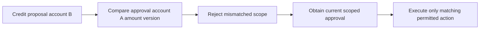

# Objective 1.4 — Enforce prerequisites and hand off a complete case

[Test this decision with a supplied example](#benchmark-exercise-1-4) — predict first, then compare the fixed-fixture evidence.

**Picture the application:** A subscription customer reports duplicate billing and inaccessible downloads in the same conversation. The service should return a joined-up resolution, with any proposed account action tied to the correct customer and any unresolved issue ready for staff. The technical decisions concern prerequisite enforcement, parallel investigation and structured handoff.

**Exam:** CCAR-F · **Domain 1:** 27% of exam; no separate objective weight is published here.  
**Time:** 45–65 minutes including practice; allow another 20 minutes for the production challenge.  
**Prerequisites:** Complete 1.1–1.3; distinguish an instruction from a runtime check. New to the Claude API? Start with the [five-minute primer in Lesson 0](../L00-orientation.md#five-minute-primer-how-a-claude-app-works).  
**Continue from:** [Domain lesson](../L01-agentic-architecture-and-orchestration.md) · [Objective map](../../../01-Curriculum/02-Architect-Track/CCAR-F-objectives.md).  
**Scenario setting:** Subscription retail; all organizations, records and amounts in examples are fictional.

**Official task statement:** Implement multi-step workflows with enforcement and handoff patterns  


<!-- layered-episode:FV-04:start -->
<a id="learn-fv-04"></a>
### Learn the decision in context — FV-04

**Picture the job.** A credit was approved for one account. Before the button is pressed, the request changes to another account. This is an original fictional teaching scene, not a recalled live exam question. Read and trace it; no account, installation or API call is required.

**Start small.** Follow the ordinary route: a person supplies a request or record, software passes the needed evidence to the assistant, and a receiving service or person checks the result. The first demonstration assumes the input, access and evidence are suitable. Now remove that assumption in the situation above. Predict what the receiver would see before choosing a repair.

**Original exam-style practice — choose ONE.** An approved proposal changes its target account before execution. Which enforcement prevents the stale approval from authorizing the new mutation?

A. Validate current identity, target, amount and proposal version in the action handler; reject the mismatch and obtain newly scoped approval.

B. Keep the original approval because the business purpose is unchanged.

C. Add a stronger reminder to the system prompt and allow execution.

<details>
<summary>What is this asking? Plain-language help, without the answer</summary>

Identify what the application needs to trust, what has actually been observed, and what remains unknown. Compare the choices against this situation, rather than choosing the most complicated design. A proposal is an intended action; evidence is what you can point to; a contract says what the receiving part expects. Decide which option fixes the stated failure without pretending another requirement has also been solved.

</details>

**Choose before opening the walkthrough.** Say your answer and the closest alternative aloud, or record them in your own notes.

<details>
<summary>Reveal the repair, evidence and changed condition</summary>

**Answer: A.** Validate current identity, target, amount and proposal version in the action handler; reject the mismatch and obtain newly scoped approval.

**Walk it through.** The handler receives account B while approval names account A. It records blocked, produces no credit receipt and routes the revised proposal for approval.

**Why the alternatives fail here.** Keep the original approval because the business purpose is unchanged. This leaves the stated boundary or evidence requirement unsatisfied. Add a stronger reminder to the system prompt and allow execution. This also fails to establish the required result. The closest competing mechanism fails for this specific reason: A prompt reminding Claude to verify cannot enforce the backend boundary. Read-only investigation follows its own access policy.

**Inspect the small artifact.** This is an illustrative application-state note for reading, not an SDK signature or executable configuration. The application or workflow owner creates it; the receiver uses it to distinguish what is known from what still needs checking. Its labels describe this scene; do not paste it into Claude settings.

```text
gate={account:A,proposal:v2,amount:40,verified:true,approval:current}; requested={account:B,proposal:v2}
```

**Layer added.** AI reasoning proposes, selects or summarizes where the job needs judgment. Ordinary software checks identifiers, permissions, required fields, recorded outcomes and stop conditions where applicable. A human resolves a policy or evidence gap when the story requires it. Inspect which owner actually supplies the evidence in this scene.



**Change one condition.** Keep the application in mind and consider the new situation below. Choose before opening its explanation.

**Technical transfer question — choose ONE.** An approved credit changes from 40 to 80 units. Which authorization remains valid?

A. Reuse the original approval because the account is unchanged.

B. Require authorization bound to the new amount and current proposal.

<details>
<summary>Transfer check</summary>

**B.** The target changes to account B or amount changes to 80. Invalidate the prior approval and request the newly scoped authorization. Name the changed fact before naming a tool. Preserve unrelated access, source-validation and result checks.

</details>

**Recall in ordinary language.** What broke? Who can fix it? What observable result proves the repair? If you cannot answer all three, replay the concrete scene rather than memorize the option letter.

</details>

**Continue from this decision:** [objective 1.4](objective-1.4.md) · [inspect its decision map](../decision-atlas.md#diagram-d01) · [targeted practice](../../../practice/index.html?exam=CCAR-F&objective=1.4). Existing mapped question IDs: `cct-fv-04-base-v1`, `cct-fv-04-retry-v1`. The new guided question above is separate from those stored items and does not change their answers or progress.
<!-- layered-episode:FV-04:end -->

## Read this objective in both vocabularies

For reading and paper reasoning, no installation or credentials are needed. Keep this page's stated concept prerequisites; any runnable challenge still needs its own setup. If an implementation example feels abrupt, first read [how to interpret its artifact type](../architecture-studio/00-foundations.md#how-to-read-technical-examples-in-this-course), then use the relevant application bridge: [AS-01 decision bridge](../architecture-studio/AS-01-action-service.md#connect-the-simple-explanation-to-technical-design-choices).

Explain the business purpose first, name the precise mechanism second, and distinguish it from the nearest plausible alternative using the stated constraint. Return here for the objective-specific protocol, options and practice. The bridges are teaching aids, not additional official objectives.


## Big idea

Investigation can be adaptive; required authorization and prerequisite ordering must be enforced at the action boundary.


<a id="gate"></a>
## Block downstream actions until prerequisites hold

A prompt explains the desired order; an application gate determines whether an action is allowed. When identity verification must precede account changes, the tool handler checks trusted verification state before executing the change. It should reject missing, expired, or mismatched verification instead of accepting the model's assertion that verification happened.

Store a verified customer identifier produced by the prerequisite tool and bind it to the case. Later tool calls must reference that identity. A successful lookup is not necessarily a successful verification: define the actual completion condition. Illustrative pseudocode is `if not verified(case, requested_customer): block_action_and_request_verification()`. This sits before the side effect. Prompts remain useful for explaining how to recover, but have a non-zero failure rate as ordering enforcement.

**Illustrative prerequisite state machine:**

```text
UNVERIFIED -> verification tool succeeds -> VERIFIED(customer_id, case_id)
protected_action(customer_id, case_id):
    reject unless trusted state matches both identifiers and remains valid
    otherwise execute authorized action and record the actual outcome
```

Failure injection: ask for a different customer after verification. The gate must reject it rather than treating verification of any customer as universal approval.

Source: [Saved official guide, section 6 task 1.4](https://anthropic-partners.skilljar.com/page/partner-certifications) (Tier 1; July 2026 blueprint).

<a id="items"></a>
## Investigate multiple concerns before one resolution

A customer may report a missing item, an incorrect charge, and an address problem in one message. Turn the request into distinct issue records rather than answering the most noticeable issue and forgetting the rest. Attach shared verified identity, order identifiers, and relevant facts to each investigation.

Investigations that do not depend on one another can run in parallel. Their results still need synthesis: the charge may refer to the same missing item, so independent actions could double-compensate the customer. The coordinator reconciles overlapping remedies and presents one coherent resolution. Shared context does not mean every worker can perform every account-changing action; the same prerequisite gates apply to each downstream mutation.

Source: [Saved official guide, section 6 task 1.4](https://anthropic-partners.skilljar.com/page/partner-certifications) (Tier 1; July 2026 blueprint).

<a id="handoff"></a>
## Give the next person an actionable handoff

A human recipient may have no transcript access. A useful handoff therefore stands alone: verified customer ID, issue list, root cause and supporting evidence, monetary amount and currency where relevant, completed and blocked actions, policy constraint, and recommended next step. Separate confirmed facts from hypotheses.

“Customer needs help; see chat” transfers workload without transferring understanding. Conversely, dumping the entire transcript makes the recipient reconstruct the case. A structured summary provides decision-ready context while retaining pointers to evidence. Record exactly why escalation occurred and what the agent has already attempted, so the human neither repeats the same failed operation nor assumes an unexecuted recommendation was completed.

Source: [Saved official guide, section 6 task 1.4](https://anthropic-partners.skilljar.com/page/partner-certifications) (Tier 1; July 2026 blueprint).

<a id="worked"></a>
## Worked example: decision, alternative, and trade-off

A fictional subscription customer reports duplicate billing and inaccessible downloads. The verified account ID enables two read-only investigations in parallel. Billing finds a duplicated renewal event; download logs find a separate entitlement lag. A credit action is blocked until account verification is valid, and an exceptional adjustment goes to a human with the amount, evidence, root causes, and recommended remedies. A credible alternative is sequential investigation when one issue depends on the other's outcome. Parallel reads save time here, but actions remain reconciled centrally. The gate adds implementation work; it prevents a pleasant-sounding response from bypassing a required prerequisite.

This example applies [Saved official guide, section 6 task 1.4](https://anthropic-partners.skilljar.com/page/partner-certifications) (Tier 1; July 2026 blueprint); it is original teaching material, not an exam item.

**Transfer — manufacturing procurement:** A supplier-change request concerns both delivery scheduling and payment details. Read-only scheduling investigation can be independent, while payment-detail mutation is gated on trusted supplier verification. The handoff must name blocked actions and pending verification; an apparently resolved delivery issue does not authorize the financial change.


<a id="decision-variants"></a>
<a id="variant-fv-04"></a>
## Decision variant FV-04 — Bind approval to this action

This is original fictional practice, not an official exam question. All policies, amounts and records below are synthetic.

**Choose in the base case.** A finance support workflow proposes a 40-unit credit for account A and proposal v2. Trusted verification, scope and current approval are checked by the action handler before the effect.

**Change one constraint.** The target changes to account B or amount changes to 80. Invalidate the prior approval and request the newly scoped authorization.

**What failed, and who recovers?** Verification expires between draft and execute. Reject the protected action and hand off the complete case with blocked status.

**Inspect the artifact — illustrative contract, not a drop-in SDK implementation:**

```text
gate={account:A,proposal:v2,amount:40,verified:true,approval:current}; requested={account:B,proposal:v2}
```

**Why not the nearest alternative?** A prompt reminding Claude to verify cannot enforce the backend boundary. Read-only investigation follows its own access policy.

**Memory cue with its condition:** Bind identity, scope and version; changed target means new gate.

**Proof before accepting success:** Produce a trace or artifact showing the decisive constraint, the selected mechanism, rejected alternative and observable result. Preserve unresolved status; a plausible explanation alone is not completion.

[Inspect D01 and its equivalent decision procedure](../decision-atlas.md#diagram-d01) · [See this decision at walkthrough step 3](../scenario-walkthroughs/WT-01-customer-support-agent.md#variant-fv-04) · [Return to the objective map](README.md).

**Blind transfer:** Before opening practice, explain which single change in the scene would reverse your choice and which would only require revalidation. Write the failure signal and the next safe action. The practice app provides separately authored base and later-retry items, with a free-response transfer rubric; assistance/exposure must remain visible in learning history.

**Current runtime reference:** [https://code.claude.com/docs/en/hooks](https://code.claude.com/docs/en/hooks) (reviewed 2026-10-14). The saved blueprint remains the exam coverage source; application policy in this packet is invented teaching context.

<a id="try"></a>
## Try it

Draft a gate and handoff for the same customer when verification has not completed. Include two separate investigations and explain which actions can proceed.

**Expected output and self-check:** Read-only investigation proceeds only as authorized by the workflow; protected actions stay blocked until the trusted prerequisite state is valid. The handoff states identity status, both concerns, findings, proposed credit amount if known, and recommended next action. It never labels an unverified name as a verified customer ID. Before checking yourself, write the evidence that supports each control-flow or tool decision. If your answer differs, identify whether the difference changes correctness, reliability, or only implementation style.

**Multiple-response self-check — project-authored:** Which actions support a reliable handoff? A: include blocked actions; B: label a recommended credit as already issued; C: include verification status; D: refer only to the unseen transcript. Select all appropriate actions before reading the answer. **Answer:** A and C convey actionable state. B fabricates completion and D makes the recipient reconstruct unavailable context.

<a id="production"></a>
## Production challenge and traps

Make the billing remedy overlap the entitlement remedy. Explain how central reconciliation prevents duplicate compensation, and test expired verification before any protected mutation.

A convincing extension names the failure condition, who owns recovery, and the evidence that proves recovery succeeded. Do not mistake a tool request for execution, an execution for full completion, or a plausible summary for verified evidence. Compare the added reliability with its latency, maintenance, and coordination costs.

<a id="done"></a>
## Done when

- [ ] Demonstrate a protected call rejected before verification and accepted only for the verified case.
- [ ] Split a multi-concern request, investigate independent items with shared context, and reconcile remedies.
- [ ] Produce a standalone handoff containing identity status, root causes, amount, evidence, and recommendations.

Save your explanation, trace or design output in your own notes (or skip this step). Mark any failed check as a practice gap and revisit the mapped teaching section. These checks are observable learning tasks, not a claim that a score predicts certification success.

## Coverage checklist

The identifiers below follow the official Knowledge and Skills bullet order for this task. Each points to its teaching subsection; practice and completion checks above assess application.

| Blueprint bullet | Teaching section |
| --- | --- |
| 1.4-K1 | [Block downstream actions until prerequisites hold](#gate) |
| 1.4-K2 | [Block downstream actions until prerequisites hold](#gate) |
| 1.4-K3 | [Give the next person an actionable handoff](#handoff) |
| 1.4-S1 | [Block downstream actions until prerequisites hold](#gate) |
| 1.4-S2 | [Investigate multiple concerns before one resolution](#items) |
| 1.4-S3 | [Give the next person an actionable handoff](#handoff) |

**Source boundary:** The July guide defines the assessed coverage. Current documentation notes describe implementation freshness and must be rechecked when a runtime changes.

## Sources

- [Official guide v1.0, July 2026](https://anthropic-partners.skilljar.com/page/partner-certifications), section 6 task 1.4 (Tier 1; saved blueprint; latest revision not certified).
- [Existing domain lesson](../L01-agentic-architecture-and-orchestration.md) (project-authored synthesis, not independent primary evidence).

**Go deeper:** [Deep practice 1, section 1.4](../deep-practice/01-agentic-architecture-and-orchestration.md#14-enforcement-and-handoff) · [Deep practice 3, section 1.4](../deep-practice/03-claude-code-configuration-and-workflows.md#14-enforced-vs-advice-claude-code-half)


<a id="benchmark-exercise-1-4"></a>
## Worked evidence task — 1.4: test the boundary

**Original technical decision.** An action approval binds account A17 and expires at 10:00; a proposal targets A18 at 10:01. Which enforcement boundary must reject the request?

**In everyday terms:** The old approval is for the wrong account and is already too old.

**Before you start:** No account, API key or package installation is needed for the paper task. Optional replay needs Python 3 and the two provided lab files in the same directory. This local inspector models the stated fixture; it does not call Claude, load Claude Code rules or run an MCP server.

### Inspect the supplied input

All identifiers and business rules here are fictional application data. This is **not an SDK request schema**. Keep the input separate from your proposed decision.

```json
{
  "approval": {
    "account": "A17",
    "amount_minor": 12000,
    "expires": "10:00"
  },
  "proposed": {
    "account": "A18",
    "amount_minor": 12000,
    "time": "10:01"
  }
}
```

### Break, choose, repair, prove

1. **Break:** Change account or amount after a trusted approval. Name the exact failed assumption before proposing another component.
2. **Choose:** Validate the current action against the authoritative approval before invoking the mutating service. Write the nearest alternative you would reject and the requirement it fails.
3. **Repair:** Write the corrected contract or recovery step, keeping successful evidence and unknowns separate.
4. **Prove:** Handler rejects mismatched or expired authorization before mutation; retain authorized read-only investigation. Record `decision`, `reason`, `rejected_alternative`, `evidence` and `remaining_unknowns`.

[Open this actual task in the existing LAB](../../../06-Labs/08-CCAR-F-architecture-decisions/README.md#benchmark-exercise-1-4) · [Return to the teaching subsection](#gate)

<details><summary>Compare the offline evidence — after making your decision</summary>

The local inspector presents **controlled-fixture calculations and authored reference decisions** below. Some fields are calculated (such as counts or arithmetic); policy labels and recovery choices are supplied worked answers for this fixed example, not executed policies or a general-purpose validator. No Claude, rule loader, service or reviewer was run. `false` or `null` observations remain unresolved when no corresponding live test was performed.

```json
{
  "account_matches": false,
  "amount_matches": true,
  "not_expired": false,
  "submit": false
}
```

**Why this matters:** The old approval is for the wrong account and is already too old. The output is a self-check for this controlled example, not certification-score evidence. To test the real mechanism, perform the existing LAB’s integration steps in a fresh disposable context and keep its actual trace beside this prediction.

**Primary-source leads for mechanism review:** [Claude Agent SDK Overview](https://platform.claude.com/docs/en/agent-sdk/overview) · [Hooks Reference](https://code.claude.com/docs/en/hooks). The external benchmark helped identify the exercise gap; this task and its data were authored here. Current implementation details must be verified against the installed runtime and those primary sources.

</details>