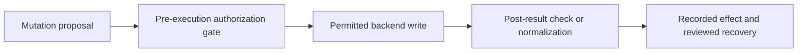

# Objective 1.5 — Use hooks to normalize results and intercept actions

[Test this decision with a supplied example](#benchmark-exercise-1-5) — predict first, then compare the fixed-fixture evidence.

**Picture the application:** Two billing systems return dates and statuses in different formats, while a proposed credit may exceed the service’s authority. The expected outcome is readable, traceable evidence and an honest action result. Hooks provide the technical vocabulary for inspecting results after execution and checking requests before their effects occur.

**Exam:** CCAR-F · **Domain 1:** 27% of exam; no separate objective weight is published here.  
**Time:** 45–65 minutes including practice; allow another 20 minutes for the production challenge.  
**Prerequisites:** Complete 1.4; know where a tool request becomes an executed action. New to the Claude API? Start with the [five-minute primer in Lesson 0](../L00-orientation.md#five-minute-primer-how-a-claude-app-works).  
**Continue from:** [Domain lesson](../L01-agentic-architecture-and-orchestration.md) · [Objective map](../../../01-Curriculum/02-Architect-Track/CCAR-F-objectives.md).  
**Scenario setting:** Financial services, synthetic; all organizations, records and amounts in examples are fictional.

**Official task statement:** Apply Agent SDK hooks for tool call interception and data normalization  


<!-- layered-episode:FV-05:start -->
<a id="learn-fv-05"></a>
### Learn the decision in context — FV-05

**Picture the job.** A tool has already changed a record. A later check notices that the change should never have happened. This is an original fictional teaching scene, not a recalled live exam question. Read and trace it; no account, installation or API call is required.

**Start small.** Follow the ordinary route: a person supplies a request or record, software passes the needed evidence to the assistant, and a receiving service or person checks the result. The first demonstration assumes the input, access and evidence are suitable. Now remove that assumption in the situation above. Predict what the receiver would see before choosing a repair.

**Original exam-style practice — choose ONE.** A post-tool callback detects an unauthorized irreversible mutation. Which correction addresses the prevention boundary?

A. Replace the tool result with an error and assume the mutation was undone.

B. Move the authorization gate before execution; separately reconcile the completed effect and follow reviewed compensation or escalation.

C. Normalize the returned date and consider authorization repaired.

<details>
<summary>What is this asking? Plain-language help, without the answer</summary>

Identify what the application needs to trust, what has actually been observed, and what remains unknown. Compare the choices against this situation, rather than choosing the most complicated design. A proposal is an intended action; evidence is what you can point to; a contract says what the receiving part expects. Decide which option fixes the stated failure without pretending another requirement has also been solved.

</details>

**Choose before opening the walkthrough.** Say your answer and the closest alternative aloud, or record them in your own notes.

<details>
<summary>Reveal the repair, evidence and changed condition</summary>

**Answer: B.** Move the authorization gate before execution; separately reconcile the completed effect and follow reviewed compensation or escalation.

**Walk it through.** The replay shows a rejected pre-execution request and no backend write. For the earlier completed write, the incident record still retains the actual effect.

**Why the alternatives fail here.** Replace the tool result with an error and assume the mutation was undone. This leaves the stated boundary or evidence requirement unsatisfied. Normalize the returned date and consider authorization repaired. This also fails to establish the required result. The closest competing mechanism fails for this specific reason: A post-action hook can change model-visible output where supported, but cannot retroactively block the completed effect.

**Inspect the small artifact.** This is an illustrative application-state note for reading, not an SDK signature or executable configuration. The application or workflow owner creates it; the receiver uses it to distinguish what is known from what still needs checking. Its labels describe this scene; do not paste it into Claude settings.

```text
trace=proposal -> precheck -> execute -> effect -> postcheck; raw_date=03/04; locale=unknown
```

**Layer added.** AI reasoning proposes, selects or summarizes where the job needs judgment. Ordinary software checks identifiers, permissions, required fields, recorded outcomes and stop conditions where applicable. A human resolves a policy or evidence gap when the story requires it. Inspect which owner actually supplies the evidence in this scene.



**Change one condition.** Keep the application in mind and consider the new situation below. Choose before opening its explanation.

**Technical transfer question — choose ONE.** The workflow no longer proposes a mutation; it only needs to normalize a successful date result after the tool returns. Which control now fits?

A. A supported post-result transformation preserving the raw value and ambiguity status.

B. Claiming the transformation retroactively prevented earlier completed writes.

<details>
<summary>Transfer check</summary>

**A.** A post-result transformation can make a returned date usable where the runtime supports it. Keep the raw date and mark unknown locale instead of guessing. This changes model-visible output; it does not undo completed effects or replace pre-action authorization.

</details>

**Recall in ordinary language.** What broke? Who can fix it? What observable result proves the repair? If you cannot answer all three, replay the concrete scene rather than memorize the option letter.

</details>

**Continue from this decision:** [objective 1.5](objective-1.5.md) · [inspect its decision map](../decision-atlas.md#diagram-d07) · [targeted practice](../../../practice/index.html?exam=CCAR-F&objective=1.5). Existing mapped question IDs: `cct-fv-05-base-v1`, `cct-fv-05-retry-v1`. The new guided question above is separate from those stored items and does not change their answers or progress.
<!-- layered-episode:FV-05:end -->

## Read this objective in both vocabularies

For reading and paper reasoning, no installation or credentials are needed. Keep this page's stated concept prerequisites; any runnable challenge still needs its own setup. If an implementation example feels abrupt, first read [how to interpret its artifact type](../architecture-studio/00-foundations.md#how-to-read-technical-examples-in-this-course), then use the relevant application bridge: [AS-01 decision bridge](../architecture-studio/AS-01-action-service.md#connect-the-simple-explanation-to-technical-design-choices).

Explain the business purpose first, name the precise mechanism second, and distinguish it from the nearest plausible alternative using the stated constraint. Return here for the objective-specific protocol, options and practice. The bridges are teaching aids, not additional official objectives.


## Big idea

Hooks turn a rule or representation convention into code at the boundary where it matters.


<a id="normalize"></a>
## Normalize successful results after execution

Different tools may encode the same information differently: one returns epoch seconds, another an ISO date string, and another a status code. A PostToolUse normalization step translates those representations into a common contract before the model reasons over them. Preserve the original value and source when conversion affects interpretation; normalization should not erase evidence.

Define units, timezone, and status mappings explicitly. Guessing whether an integer represents seconds or milliseconds can create a plausible but wrong date. Unknown status codes should remain unknown, accompanied by the original code. Apply normalization consistently across relevant MCP tools and test representative inputs and malformed values. This reduces avoidable reasoning errors without asking the model to remember every vendor's conventions.

Source: [Saved official guide, section 6 task 1.5](https://anthropic-partners.skilljar.com/page/partner-certifications) (Tier 1; July 2026 blueprint).

<a id="intercept"></a>
## Intercept outgoing actions before the side effect

An outgoing tool-call hook can inspect arguments and trusted policy state before allowing execution. For a fictional credit policy, the check considers amount, currency, account identity, and authorization, then either permits the call or denies it with a structured reason. The denied request must not first execute and then be reported as blocked.

A block also needs a useful next path. Return the policy limit and a recommended escalation route without granting the action yourself. Record the attempted call and reason so the coordinator can explain the outcome. Guarding only one tool name while equivalent side effects remain exposed leaves a bypass. Effective enforcement requires covering every relevant action path and using reliable state.

**Illustrative hook behavior — not a callback signature:**

```text
before_credit(arguments, trusted_policy):
    if policy unavailable or account verification invalid: deny with reason
    if amount exceeds authorized limit: deny and offer human-review route
    otherwise permit execution
post_result(raw, vendor_contract):
    validate units and known status mapping
    return normalized fields plus original values and source metadata
```

Use boundary tests and malformed inputs; a correct result on one happy-path call does not demonstrate enforcement.

Source: [Saved official guide, section 6 task 1.5](https://anthropic-partners.skilljar.com/page/partner-certifications) (Tier 1; July 2026 blueprint).

<a id="choose"></a>
## Choose enforcement and guidance deliberately

Use a hook or application guard for rules requiring deterministic compliance, provided the guard itself is correctly implemented and cannot be bypassed. Prompt guidance still teaches the agent how to behave, gather context, and communicate. It is appropriate for preferences such as concise explanations, where occasional variation is acceptable.

Post-result normalization cannot undo a prohibited side effect. A pre-action check cannot normalize a result that does not yet exist. Place the mechanism according to the problem. SDK callback names and return fields are version-sensitive; the examples here describe behavior rather than a runnable signature. Keep failure behavior explicit: if the policy lookup fails, a protected action should not silently pass through as though policy approved it.

Source: [Saved official guide, section 6 task 1.5](https://anthropic-partners.skilljar.com/page/partner-certifications) (Tier 1; July 2026 blueprint).

Current-doc note: PostToolUse output replacement uses version-sensitive SDK fields; current docs describe `updatedToolOutput` for any tool. The older `updatedMCPToolOutput` (MCP tools only) still works; the docs say to prefer `updatedToolOutput`. Verify your SDK before coding. [SDK hooks](https://code.claude.com/docs/en/agent-sdk/hooks) (Tier 1; checked 2026-10-07).

<a id="worked"></a>
## Worked example: decision, alternative, and trade-off

Two fictional billing tools return `created_at: 1780000000` and `opened: "2026-06-01T09:30:00Z"`; a status code of 3 means “pending” in one documented vendor contract. A result hook produces a standard timestamp and status while keeping raw values. Separately, a pre-action credit hook blocks an amount above the fictional $240 limit and returns a human-review route. Asking Claude to convert dates and obey the cap is a credible low-effort alternative for exploratory reporting, but it is insufficient for this mandatory credit rule. Hooks improve consistency at the cost of mapping maintenance and boundary testing.

This example applies [Saved official guide, section 6 task 1.5](https://anthropic-partners.skilljar.com/page/partner-certifications) (Tier 1; July 2026 blueprint); it is original teaching material, not an exam item.

**Transfer — logistics:** Carrier timestamps arrive in different zones and delay codes differ by carrier. Normalize representations but retain the carrier-specific originals. There is no credit action in this version, so a result-normalization hook suffices; adding a denial hook without a prohibited operation adds complexity without addressing a failure mechanism.


<a id="decision-variants"></a>
<a id="variant-fv-05"></a>
## Decision variant FV-05 — Separate prevention from detection

This is original fictional practice, not an official exam question. All policies, amounts and records below are synthetic.

**Choose in the base case.** A fictional service normalizes a successful date result after the tool returns while retaining the original value and parse status.

**Change one constraint.** The requirement becomes preventing an irreversible account mutation. Move the authorization check before execution, in the application or supported pre-tool control.

**What failed, and who recovers?** A post-result check finds a bad write already happened. Record the effect and invoke reviewed compensation or escalation; result replacement does not undo it.

**Inspect the artifact — illustrative contract, not a drop-in SDK implementation:**

```text
trace=proposal -> precheck -> execute -> effect -> postcheck; raw_date=03/04; locale=unknown
```

**Why not the nearest alternative?** A post-action hook can change model-visible output where supported, but cannot retroactively block the completed effect.

**Memory cue with its condition:** Before prevents; after detects; retain raw evidence.

**Proof before accepting success:** Produce a trace or artifact showing the decisive constraint, the selected mechanism, rejected alternative and observable result. Preserve unresolved status; a plausible explanation alone is not completion.

[Inspect D07 and its equivalent decision procedure](../decision-atlas.md#diagram-d07) · [See this decision at walkthrough step 7](../scenario-walkthroughs/WT-01-customer-support-agent.md#variant-fv-05) · [Return to the objective map](README.md).

**Blind transfer:** Before opening practice, explain which single change in the scene would reverse your choice and which would only require revalidation. Write the failure signal and the next safe action. The practice app provides separately authored base and later-retry items, with a free-response transfer rubric; assistance/exposure must remain visible in learning history.

**Current runtime reference:** [https://code.claude.com/docs/en/hooks](https://code.claude.com/docs/en/hooks) (reviewed 2026-10-14). The saved blueprint remains the exam coverage source; application policy in this packet is invented teaching context.

<a id="try"></a>
## Try it

Design two hook test tables: one for seconds, ISO timestamps, unknown status codes and malformed dates; one for credits below, at, and above $240 plus unavailable policy state. State expected outputs.

**Expected output and self-check:** Known formats normalize with units and provenance preserved; ambiguous or malformed inputs are flagged rather than guessed. The credit cases follow the exact fictional policy, and above-limit or unverifiable authorization cases are blocked before execution with an escalation path. A PostToolUse check alone fails the protected-action requirement. Before checking yourself, write the evidence that supports each control-flow or tool decision. If your answer differs, identify whether the difference changes correctness, reliability, or only implementation style.

<a id="production"></a>
## Production challenge and traps

Add a vendor status-code change and an unavailable policy service. Show versioned mapping recovery and fail-closed action behavior; explain the operational cost of holding a legitimate credit for review.

A convincing extension names the failure condition, who owns recovery, and the evidence that proves recovery succeeded. Do not mistake a tool request for execution, an execution for full completion, or a plausible summary for verified evidence. Compare the added reliability with its latency, maintenance, and coordination costs.

<a id="done"></a>
## Done when

- [ ] Normalize heterogeneous MCP result formats with explicit units and unknown-value handling.
- [ ] Intercept and block a prohibited action before execution, returning an alternative workflow.
- [ ] Explain why mandatory compliance uses code and identify cases where prompt guidance is sufficient.

Save your explanation, trace or design output in your own notes (or skip this step). Mark any failed check as a practice gap and revisit the mapped teaching section. These checks are observable learning tasks, not a claim that a score predicts certification success.

## Coverage checklist

The identifiers below follow the official Knowledge and Skills bullet order for this task. Each points to its teaching subsection; practice and completion checks above assess application.

| Blueprint bullet | Teaching section |
| --- | --- |
| 1.5-K1 | [Normalize successful results after execution](#normalize) |
| 1.5-K2 | [Intercept outgoing actions before the side effect](#intercept) |
| 1.5-K3 | [Choose enforcement and guidance deliberately](#choose) |
| 1.5-S1 | [Normalize successful results after execution](#normalize) |
| 1.5-S2 | [Intercept outgoing actions before the side effect](#intercept) |
| 1.5-S3 | [Choose enforcement and guidance deliberately](#choose) |

**Source boundary:** The July guide defines the assessed coverage. Current documentation notes describe implementation freshness and must be rechecked when a runtime changes.

## Sources

- [Official guide v1.0, July 2026](https://anthropic-partners.skilljar.com/page/partner-certifications), section 6 task 1.5 (Tier 1; saved blueprint; latest revision not certified).
- [SDK hooks](https://code.claude.com/docs/en/agent-sdk/hooks) (Tier 1; accessed 2026-10-02; implementation details can change).
- [Existing domain lesson](../L01-agentic-architecture-and-orchestration.md) (project-authored synthesis, not independent primary evidence).

**Go deeper:** [Deep practice 1, section 1.5](../deep-practice/01-agentic-architecture-and-orchestration.md#15-agent-sdk-hooks) · [Deep practice 3, section 1.5](../deep-practice/03-claude-code-configuration-and-workflows.md#15-posttooluse-quality-hooks-quality-hook-half)


<a id="benchmark-exercise-1-5"></a>
## Worked evidence task — 1.5: test the boundary

**Original technical decision.** A pre-execution gate denies a credit call, while a second run detects a violation only after the call. Which trace demonstrates prevention rather than detection?

**In everyday terms:** A warning after money moved is useful evidence, but it did not prevent the move.

**Before you start:** No account, API key or package installation is needed for the paper task. Optional replay needs Python 3 and the two provided lab files in the same directory. This local inspector models the stated fixture; it does not call Claude, load Claude Code rules or run an MCP server.

### Inspect the supplied input

All identifiers and business rules here are fictional application data. This is **not an SDK request schema**. Keep the input separate from your proposed decision.

```json
{
  "operation": "issue_credit",
  "before_hook": "deny",
  "after_hook": "flag",
  "service_call_count_before": 0
}
```

### Break, choose, repair, prove

1. **Break:** Run one denial before execution and one detection after execution. Name the exact failed assumption before proposing another component.
2. **Choose:** Count service invocations separately for the pre-call denial and the post-call alert. Write the nearest alternative you would reject and the requirement it fails.
3. **Repair:** Write the corrected contract or recovery step, keeping successful evidence and unknowns separate.
4. **Prove:** Denied pre-call produces no side effect; post-call inspection cannot undo an already completed action. Record `decision`, `reason`, `rejected_alternative`, `evidence` and `remaining_unknowns`.

[Open this actual task in the existing LAB](../../../06-Labs/03-CCAR-F-mcp-server-claude-code/README.md#benchmark-exercise-1-5) · [Return to the teaching subsection](#intercept)

<details><summary>Compare the offline evidence — after making your decision</summary>

The local inspector presents **controlled-fixture calculations and authored reference decisions** below. Some fields are calculated (such as counts or arithmetic); policy labels and recovery choices are supplied worked answers for this fixed example, not executed policies or a general-purpose validator. No Claude, rule loader, service or reviewer was run. `false` or `null` observations remain unresolved when no corresponding live test was performed.

```json
{
  "pre_denial_service_calls": 0,
  "post_detection_service_calls": 1,
  "post_detection_undo_proven": false
}
```

**Why this matters:** A warning after money moved is useful evidence, but it did not prevent the move. The output is a self-check for this controlled example, not certification-score evidence. To test the real mechanism, perform the existing LAB’s integration steps in a fresh disposable context and keep its actual trace beside this prediction.

**Primary-source leads for mechanism review:** [Claude Agent SDK Overview](https://platform.claude.com/docs/en/agent-sdk/overview) · [Claude Agent SDK Hooks Documentation](https://platform.claude.com/docs/en/agent-sdk/hooks). The external benchmark helped identify the exercise gap; this task and its data were authored here. Current implementation details must be verified against the installed runtime and those primary sources.

</details>