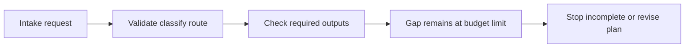

# Objective 1.6 — Choose a task decomposition pattern that fits uncertainty

[Test this decision with a supplied example](#benchmark-exercise-1-6) — predict first, then compare the fixed-fixture evidence.

**Picture the application:** A release changes an invoice calculator, its validator and the response shown to callers. Reviewers need both file-level findings and a view of how those pieces work together. The technical decision is task decomposition: choose a predictable review sequence or an investigation that adapts as dependencies emerge.

**Exam:** CCAR-F · **Domain 1:** 27% of exam; no separate objective weight is published here.  
**Time:** 45–65 minutes including practice; allow another 20 minutes for the production challenge.  
**Prerequisites:** Complete 1.2; understand dependencies and review criteria. New to the Claude API? Start with the [five-minute primer in Lesson 0](../L00-orientation.md#five-minute-primer-how-a-claude-app-works).  
**Continue from:** [Domain lesson](../L01-agentic-architecture-and-orchestration.md) · [Objective map](../../../01-Curriculum/02-Architect-Track/CCAR-F-objectives.md).  
**Scenario setting:** Software product development; all organizations, records and amounts in examples are fictional.

**Official task statement:** Design task decomposition strategies for complex workflows  


<!-- layered-episode:FV-06:start -->
<a id="learn-fv-06"></a>
### Learn the decision in context — FV-06

**Picture the job.** An intake service keeps taking steps but still has not found the information needed to route an application. This is an original fictional teaching scene, not a recalled live exam question. Read and trace it; no account, installation or API call is required.

**Start small.** Follow the ordinary route: a person supplies a request or record, software passes the needed evidence to the assistant, and a receiving service or person checks the result. The first demonstration assumes the input, access and evidence are suitable. Now remove that assumption in the situation above. Predict what the receiver would see before choosing a repair.

**Original exam-style practice — choose ONE.** A workflow reaches its iteration budget without satisfying a required output. Which completion strategy is appropriate?

A. Declare success after the configured iteration count.

B. Add more agents without defining the required result.

C. Stop or re-plan against explicit required outputs and unresolved evidence; distinguish interruption from successful completion.

<details>
<summary>What is this asking? Plain-language help, without the answer</summary>

Identify what the application needs to trust, what has actually been observed, and what remains unknown. Compare the choices against this situation, rather than choosing the most complicated design. A proposal is an intended action; evidence is what you can point to; a contract says what the receiving part expects. Decide which option fixes the stated failure without pretending another requirement has also been solved.

</details>

**Choose before opening the walkthrough.** Say your answer and the closest alternative aloud, or record them in your own notes.

<details>
<summary>Reveal the repair, evidence and changed condition</summary>

**Answer: C.** Stop or re-plan against explicit required outputs and unresolved evidence; distinguish interruption from successful completion.

**Walk it through.** A ledger says valid=true but route_assigned=false. The system reports incomplete, not done, until the missing routing requirement is resolved.

**Why the alternatives fail here.** Declare success after the configured iteration count. This leaves the stated boundary or evidence requirement unsatisfied. Add more agents without defining the required result. This also fails to establish the required result. The closest competing mechanism fails for this specific reason: Multiple agents do not cure an unclear completion contract. Fixed steps are easier to test when the process is known.

**Inspect the small artifact.** This is an illustrative application-state note for reading, not an SDK signature or executable configuration. The application or workflow owner creates it; the receiver uses it to distinguish what is known from what still needs checking. Its labels describe this scene; do not paste it into Claude settings.

```text
steps=[validate,classify,route]; done={valid:true,route_assigned:true}; missing=[]
```

**Layer added.** AI reasoning proposes, selects or summarizes where the job needs judgment. Ordinary software checks identifiers, permissions, required fields, recorded outcomes and stop conditions where applicable. A human resolves a policy or evidence gap when the story requires it. Inspect which owner actually supplies the evidence in this scene.



**Change one condition.** Keep the application in mind and consider the new situation below. Choose before opening its explanation.

**Technical transfer question — choose ONE.** The intake becomes open-ended investigation with unknown evidence paths. Which decomposition fits?

A. A fixed sequence that declares completion without checking newly discovered gaps.

B. Bounded adaptive decomposition with explicit coverage and stop states.

<details>
<summary>Transfer check</summary>

**B.** The task becomes an open-ended investigation with unknown evidence paths. Use bounded adaptive decomposition and review discovered gaps. Name the changed fact before naming a tool. Preserve unrelated access, source-validation and result checks.

</details>

**Recall in ordinary language.** What broke? Who can fix it? What observable result proves the repair? If you cannot answer all three, replay the concrete scene rather than memorize the option letter.

</details>

**Continue from this decision:** [objective 1.6](objective-1.6.md) · [inspect its decision map](../decision-atlas.md#diagram-d02) · [targeted practice](../../../practice/index.html?exam=CCAR-F&objective=1.6). Existing mapped question IDs: `cct-fv-06-base-v1`, `cct-fv-06-retry-v1`. The new guided question above is separate from those stored items and does not change their answers or progress.
<!-- layered-episode:FV-06:end -->

## Read this objective in both vocabularies

For reading and paper reasoning, no installation or credentials are needed. Keep this page's stated concept prerequisites; any runnable challenge still needs its own setup. If an implementation example feels abrupt, first read [how to interpret its artifact type](../architecture-studio/00-foundations.md#how-to-read-technical-examples-in-this-course), then use the relevant application bridge: [AS-04 decision bridge](../architecture-studio/AS-04-research-system.md#connect-the-simple-explanation-to-technical-design-choices).

Explain the business purpose first, name the precise mechanism second, and distinguish it from the nearest plausible alternative using the stated constraint. Return here for the objective-specific protocol, options and practice. The bridges are teaching aids, not additional official objectives.


## Big idea

Use a stable chain when you know the work; adapt the plan when discoveries determine the next work.


<a id="patterns"></a>
## Choose fixed or adaptive decomposition

Prompt chaining divides a predictable task into an ordered sequence, with one step's output becoming the next step's input. A document review may always need completeness, policy, and clarity passes before aggregation. Define a contract for each pass so omissions and mistakes can be traced to the stage that produced them.

Dynamic decomposition is different: the next investigation depends on intermediate findings. A legacy-system test project may discover a shared parser, an external dependency, or untested rollback behavior that changes priorities. Choose based on uncertainty and dependencies, not whether the task sounds large. A small unfamiliar incident may need adaptation; a large standardized review may fit a fixed chain. A hybrid can have a fixed outer workflow and adaptive investigation inside one stage.

**Current primary-source reading:** [Building effective agents](https://www.anthropic.com/engineering/building-effective-agents) distinguishes workflows with predefined paths from model-directed agents; its older tool examples are not a current API contract. (Tier 1; checked 2026-10-02).

Source: [Saved official guide, section 6 task 1.6](https://anthropic-partners.skilljar.com/page/partner-certifications) (Tier 1; July 2026 blueprint).

<a id="review"></a>
## Review local details, then cross-file behavior

A large code review should first analyze each changed file against local responsibilities, then run a separate integration pass. Local passes inspect details such as validation and error handling without competing with every other file for attention. Their outputs should name finding, location, consequence, and unresolved dependency.

The integration pass examines relationships the local views cannot settle: caller expectations, shared types, transaction boundaries, and ordering between modules. Do not simply concatenate per-file summaries and call that integration. For example, two locally correct functions may disagree about currency units. A dedicated cross-file pass follows that contract through both modules. This division reduces attention dilution while preserving a place to reason about interactions.

Source: [Saved official guide, section 6 task 1.6](https://anthropic-partners.skilljar.com/page/partner-certifications) (Tier 1; July 2026 blueprint).

<a id="adapt"></a>
## Build an investigation plan from discovered structure

For “add tests to this legacy repository,” start with a structural map: entry points, critical modules, existing tests, dependencies, and observed risk. Use it to select high-impact areas, then prioritize a concrete plan. The plan should state what evidence would change the order.

After discovering that many public functions delegate to one shared calculation module, testing that module may become more valuable than testing isolated wrappers first. Record the discovery and revise the plan. Adaptive does not mean unbounded improvisation: keep the original outcome, acceptance criteria, and resource limits visible. Stop mapping when there is enough evidence to take the next useful step; do not read the entire repository merely because exploration is available.

Source: [Saved official guide, section 6 task 1.6](https://anthropic-partners.skilljar.com/page/partner-certifications) (Tier 1; July 2026 blueprint).

<a id="worked"></a>
## Worked example: decision, alternative, and trade-off

A fictional release changes a validator, an invoice calculator, and an API response mapper. The architect chooses per-file review followed by a cross-file contract pass; the sequence is known in advance. Later, a request to improve test coverage starts with repository mapping and adapts when a shared rounding function is found. One monolithic review prompt is a credible alternative for a tiny change, where splitting adds needless overhead. For this multi-module release it risks losing local detail and unit mismatches. The chosen decomposition costs more handoff structure but makes both local and relational defects inspectable.

This example applies [Saved official guide, section 6 task 1.6](https://anthropic-partners.skilljar.com/page/partner-certifications) (Tier 1; July 2026 blueprint); it is original teaching material, not an exam item.

**Transfer — legal operations:** For a bounded contract package, review each document and then compare definitions and obligations across documents. For an unfamiliar acquisition document set, first map document types and missing material, then adapt review priorities. This changes evidence completeness, not just filenames; do not infer legal compliance from a completed review sequence.


<a id="decision-variants"></a>
<a id="variant-fv-06"></a>
## Decision variant FV-06 — Choose decomposition by uncertainty

This is original fictional practice, not an official exam question. All policies, amounts and records below are synthetic.

**Choose in the base case.** A government intake follows a known sequence: validate, classify, route. Use an explicit workflow with defined outputs and stop states.

**Change one constraint.** The task becomes an open-ended investigation with unknown evidence paths. Use bounded adaptive decomposition and review discovered gaps.

**What failed, and who recovers?** After ten iterations the agent has activity but no evidence for one requirement. Stop or re-plan using the coverage ledger, not iteration count alone.

**Inspect the artifact — illustrative contract, not a drop-in SDK implementation:**

```text
steps=[validate,classify,route]; done={valid:true,route_assigned:true}; missing=[]
```

**Why not the nearest alternative?** Multiple agents do not cure an unclear completion contract. Fixed steps are easier to test when the process is known.

**Memory cue with its condition:** Known path: workflow; unknown path: bounded discovery.

**Proof before accepting success:** Produce a trace or artifact showing the decisive constraint, the selected mechanism, rejected alternative and observable result. Preserve unresolved status; a plausible explanation alone is not completion.

[Inspect D02 and its equivalent decision procedure](../decision-atlas.md#diagram-d02) · [See this decision at walkthrough step 2](../scenario-walkthroughs/WT-03-multi-agent-research.md#variant-fv-06) · [Return to the objective map](README.md).

**Blind transfer:** Before opening practice, explain which single change in the scene would reverse your choice and which would only require revalidation. Write the failure signal and the next safe action. The practice app provides separately authored base and later-retry items, with a free-response transfer rubric; assistance/exposure must remain visible in learning history.

**Current runtime reference:** [https://platform.claude.com/docs/en/agent-sdk/subagents](https://platform.claude.com/docs/en/agent-sdk/subagents) (reviewed 2026-10-14). The saved blueprint remains the exam coverage source; application policy in this packet is invented teaching context.

<a id="try"></a>
## Try it

Classify a three-file contract review and an unfamiliar test-improvement project. For each, write the first three steps and the evidence that would trigger a plan change.

**Expected output and self-check:** The contract review uses local passes and a distinct integration pass. The unfamiliar test project maps structure, identifies high-impact risk, and prioritizes tests; discovery of a central dependency changes the plan. A complete answer explains why each pattern fits and does not treat all large tasks as adaptive. Before checking yourself, write the evidence that supports each control-flow or tool decision. If your answer differs, identify whether the difference changes correctness, reliability, or only implementation style.

<a id="production"></a>
## Production challenge and traps

Introduce a shared type change after local reviews finish. Reopen the affected local checks and integration pass, then compare with the cost of repeating every review.

A convincing extension names the failure condition, who owns recovery, and the evidence that proves recovery succeeded. Do not mistake a tool request for execution, an execution for full completion, or a plausible summary for verified evidence. Compare the added reliability with its latency, maintenance, and coordination costs.

<a id="done"></a>
## Done when

- [ ] Select a fixed chain, adaptive plan, or justified hybrid from task predictability.
- [ ] Produce per-file review outputs and a separate integration check on shared behavior.
- [ ] Map a legacy repository, prioritize test work, and revise the plan based on a discovered dependency.

Save your explanation, trace or design output in your own notes (or skip this step). Mark any failed check as a practice gap and revisit the mapped teaching section. These checks are observable learning tasks, not a claim that a score predicts certification success.

## Coverage checklist

The identifiers below follow the official Knowledge and Skills bullet order for this task. Each points to its teaching subsection; practice and completion checks above assess application.

| Blueprint bullet | Teaching section |
| --- | --- |
| 1.6-K1 | [Choose fixed or adaptive decomposition](#patterns) |
| 1.6-K2 | [Review local details, then cross-file behavior](#review) |
| 1.6-K3 | [Build an investigation plan from discovered structure](#adapt) |
| 1.6-S1 | [Choose fixed or adaptive decomposition](#patterns) |
| 1.6-S2 | [Review local details, then cross-file behavior](#review) |
| 1.6-S3 | [Build an investigation plan from discovered structure](#adapt) |

**Source boundary:** The July guide defines the assessed coverage. Current documentation notes describe implementation freshness and must be rechecked when a runtime changes.

## Sources

- [Official guide v1.0, July 2026](https://anthropic-partners.skilljar.com/page/partner-certifications), section 6 task 1.6 (Tier 1; saved blueprint; latest revision not certified).
- [Building effective agents](https://www.anthropic.com/engineering/building-effective-agents) (Tier 1; accessed 2026-10-02; implementation details can change).
- [Existing domain lesson](../L01-agentic-architecture-and-orchestration.md) (project-authored synthesis, not independent primary evidence).

**Go deeper:** [Deep practice 1, section 1.6](../deep-practice/01-agentic-architecture-and-orchestration.md#16-task-decomposition)


<a id="benchmark-exercise-1-6"></a>
## Worked evidence task — 1.6: test the boundary

**Original technical decision.** A stable parse–validate–publish sequence and an incident investigation have different dependencies. Which decomposition fits each job?

**In everyday terms:** A predictable checklist and an investigation do not need the same machinery.

**Before you start:** No account, API key or package installation is needed for the paper task. Optional replay needs Python 3 and the two provided lab files in the same directory. This local inspector models the stated fixture; it does not call Claude, load Claude Code rules or run an MCP server.

### Inspect the supplied input

All identifiers and business rules here are fictional application data. This is **not an SDK request schema**. Keep the input separate from your proposed decision.

```json
{
  "jobA": {
    "steps": [
      "parse",
      "validate",
      "publish"
    ],
    "stable": true
  },
  "jobB": {
    "incident_cause": "unknown",
    "next_step": "depends on logs"
  }
}
```

### Break, choose, repair, prove

1. **Break:** Compare a stable validation chain with an incident whose next step depends on evidence. Name the exact failed assumption before proposing another component.
2. **Choose:** Use the fixed dependency chain for the known process; allow evidence-driven next-step selection for diagnosis. Write the nearest alternative you would reject and the requirement it fails.
3. **Repair:** Write the corrected contract or recovery step, keeping successful evidence and unknowns separate.
4. **Prove:** Choose fixed versus adaptive decomposition from dependency and uncertainty; include integration review. Record `decision`, `reason`, `rejected_alternative`, `evidence` and `remaining_unknowns`.

[Open this actual task in the existing LAB](../../../06-Labs/08-CCAR-F-architecture-decisions/README.md#benchmark-exercise-1-6) · [Return to the teaching subsection](#patterns)

<details><summary>Compare the offline evidence — after making your decision</summary>

The local inspector presents **controlled-fixture calculations and authored reference decisions** below. Some fields are calculated (such as counts or arithmetic); policy labels and recovery choices are supplied worked answers for this fixed example, not executed policies or a general-purpose validator. No Claude, rule loader, service or reviewer was run. `false` or `null` observations remain unresolved when no corresponding live test was performed.

```json
{
  "jobA": "fixed dependency workflow",
  "jobB": "adaptive investigation",
  "integration_review_required": true
}
```

**Why this matters:** A predictable checklist and an investigation do not need the same machinery. The output is a self-check for this controlled example, not certification-score evidence. To test the real mechanism, perform the existing LAB’s integration steps in a fresh disposable context and keep its actual trace beside this prediction.

**Primary-source leads for mechanism review:** [Claude Agent SDK Overview](https://platform.claude.com/docs/en/agent-sdk/overview) · [Anthropic Prompt Engineering Guide](https://platform.claude.com/docs/en/build-with-claude/prompt-engineering/overview). The external benchmark helped identify the exercise gap; this task and its data were authored here. Current implementation details must be verified against the installed runtime and those primary sources.

</details>