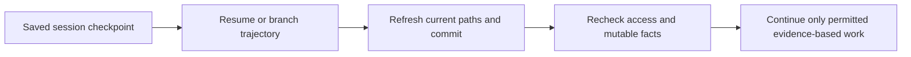

# Objective 1.7 — Resume or fork sessions without trusting stale evidence

[Test this decision with a supplied example](#benchmark-exercise-1-7) — predict first, then compare the fixed-fixture evidence.

**Picture the application:** Yesterday’s investigation mapped an export pipeline; today the CSV encoder and its tests have changed. The team wants to continue without trusting obsolete observations or repeating all discovery. Session resumption, forking and fresh summaries are the technical options for preserving useful work while rechecking what changed.

**Exam:** CCAR-F · **Domain 1:** 27% of exam; no separate objective weight is published here.  
**Time:** 45–65 minutes including practice; allow another 20 minutes for the production challenge.  
**Prerequisites:** Complete 1.3; understand conversation context and file changes. New to the Claude API? Start with the [five-minute primer in Lesson 0](../L00-orientation.md#five-minute-primer-how-a-claude-app-works).  
**Continue from:** [Domain lesson](../L01-agentic-architecture-and-orchestration.md) · [Objective map](../../../01-Curriculum/02-Architect-Track/CCAR-F-objectives.md).  
**Scenario setting:** Data engineering; all organizations, records and amounts in examples are fictional.

**Official task statement:** Manage session state, resumption, and forking  


<!-- layered-episode:FV-07:start -->
<a id="learn-fv-07"></a>
### Learn the decision in context — FV-07

**Picture the job.** Yesterday’s investigation is reopening today. One file moved and the user no longer has access to another source. This is an original fictional teaching scene, not a recalled live exam question. Read and trace it; no account, installation or API call is required.

**Start small.** Follow the ordinary route: a person supplies a request or record, software passes the needed evidence to the assistant, and a receiving service or person checks the result. The first demonstration assumes the input, access and evidence are suitable. Now remove that assumption in the situation above. Predict what the receiver would see before choosing a repair.

**Original exam-style practice — choose ONE.** A resumed session references stale paths and revoked permissions. What must precede continued investigation?

A. Refresh mutable evidence and authorization using the checkpoint source pointers before acting on the resumed state.

B. Trust prior tool outputs because the session identifier is unchanged.

C. Fork the session to restore the old access rights.

<details>
<summary>What is this asking? Plain-language help, without the answer</summary>

Identify what the application needs to trust, what has actually been observed, and what remains unknown. Compare the choices against this situation, rather than choosing the most complicated design. A proposal is an intended action; evidence is what you can point to; a contract says what the receiving part expects. Decide which option fixes the stated failure without pretending another requirement has also been solved.

</details>

**Choose before opening the walkthrough.** Say your answer and the closest alternative aloud, or record them in your own notes.

<details>
<summary>Reveal the repair, evidence and changed condition</summary>

**Answer: A.** Refresh mutable evidence and authorization using the checkpoint source pointers before acting on the resumed state.

**Walk it through.** The resumed trace records the current commit, renamed path and access denial. It cannot silently reuse the revoked source as current evidence.

**Why the alternatives fail here.** Trust prior tool outputs because the session identifier is unchanged. This leaves the stated boundary or evidence requirement unsatisfied. Fork the session to restore the old access rights. This also fails to establish the required result. The closest competing mechanism fails for this specific reason: Resume and fork preserve or branch state; neither renews authorization nor makes stale evidence current.

**Inspect the small artifact.** This is an illustrative application-state note for reading, not an SDK signature or executable configuration. The application or workflow owner creates it; the receiver uses it to distinguish what is known from what still needs checking. Its labels describe this scene; do not paste it into Claude settings.

```text
checkpoint={commit:abc,paths:[policy.md],permissions_checked:old}; current_commit:def
```

**Layer added.** AI reasoning proposes, selects or summarizes where the job needs judgment. Ordinary software checks identifiers, permissions, required fields, recorded outcomes and stop conditions where applicable. A human resolves a policy or evidence gap when the story requires it. Inspect which owner actually supplies the evidence in this scene.



**Change one condition.** Keep the application in mind and consider the new situation below. Choose before opening its explanation.

**Technical transfer question — choose ONE.** An investigator needs to explore an alternative trajectory without replacing the current one. Which approach fits?

A. Fork the session and refresh mutable evidence and permissions.

B. Resume stale state and assume a new branch renews authorization.

<details>
<summary>Transfer check</summary>

**A.** The learner wants an alternative investigation without replacing the existing trajectory. Fork the session, but revalidate the same mutable assumptions. Name the changed fact before naming a tool. Preserve unrelated access, source-validation and result checks.

</details>

**Recall in ordinary language.** What broke? Who can fix it? What observable result proves the repair? If you cannot answer all three, replay the concrete scene rather than memorize the option letter.

</details>

**Continue from this decision:** [objective 1.7](objective-1.7.md) · [inspect its decision map](../decision-atlas.md#diagram-d11) · [targeted practice](../../../practice/index.html?exam=CCAR-F&objective=1.7). Existing mapped question IDs: `cct-fv-07-base-v1`, `cct-fv-07-retry-v1`. The new guided question above is separate from those stored items and does not change their answers or progress.
<!-- layered-episode:FV-07:end -->

## Read this objective in both vocabularies

For reading and paper reasoning, no installation or credentials are needed. Keep this page's stated concept prerequisites; any runnable challenge still needs its own setup. If an implementation example feels abrupt, first read [how to interpret its artifact type](../architecture-studio/00-foundations.md#how-to-read-technical-examples-in-this-course), then use the relevant application bridge: [AS-01 decision bridge](../architecture-studio/AS-01-action-service.md#connect-the-simple-explanation-to-technical-design-choices) · [AS-04 decision bridge](../architecture-studio/AS-04-research-system.md#connect-the-simple-explanation-to-technical-design-choices) · [AS-08 decision bridge](../architecture-studio/AS-08-resumable-case.md#connect-the-simple-explanation-to-technical-design-choices).

Explain the business purpose first, name the precise mechanism second, and distinguish it from the nearest plausible alternative using the stated constraint. Return here for the objective-specific protocol, options and practice. The bridges are teaching aids, not additional official objectives.


## Big idea

A session preserves prior context, but only current evidence should govern the next decision.


<a id="resume"></a>
## Resume a named investigation and disclose changes

Named resumption reconnects work to a specific prior conversation. The saved blueprint uses `--resume <session-name>`. Use a recognizable name rather than assuming the most recent session is the right investigation. On continuation, state the current goal and changes since the previous work.

A useful change notice identifies files, what changed, and which earlier conclusions may be affected. “The code changed” makes the agent re-explore broadly or continue with stale assumptions. “The token parser and its tests changed; other modules are unchanged” supports targeted re-analysis. Resuming preserves history, including tool observations from the old state. It does not revalidate those observations automatically.

Source: [Saved official guide, section 6 task 1.7](https://anthropic-partners.skilljar.com/page/partner-certifications) (Tier 1; July 2026 blueprint).

<a id="fork"></a>
## Fork divergent approaches from a verified baseline

The blueprint's `fork_session` creates an independent branch from an existing analysis baseline. Use it to compare two testing strategies or refactoring approaches without one branch's experiments shaping the other's history. Each branch needs a clear outcome and constraints so the comparison is meaningful.

Forked conversational context is not equivalent to an isolated filesystem. If both approaches modify the same checkout, separate workspaces or another appropriate coordination mechanism may be needed. Bring the branches' findings back into a comparison with criteria and evidence. A fork copies a baseline; it does not repair a baseline that was already obsolete. Verify the shared analysis before multiplying it.

Source: [Saved official guide, section 6 task 1.7](https://anthropic-partners.skilljar.com/page/partner-certifications) (Tier 1; July 2026 blueprint).

<a id="fresh"></a>
## Choose fresh context when old tool results dominate

Resume when most prior findings remain useful and a small, known set of changes can be rechecked. Start fresh with a structured summary when the repository, requirements, or dependencies changed so much that earlier observations would confuse the investigation. A fresh summary contains current goal, verified facts with source paths and revision information, invalidated assumptions, open questions, and next actions.

Do not export every stale conclusion into the new summary. Label retained hypotheses and tell the new session what to verify. This is a judgment about evidence validity, not merely conversation length. A concise summary can be less reliable than full history if it drops crucial constraints; a long history can be less reliable than a summary if it repeatedly presents obsolete tool results as current truth.

Source: [Saved official guide, section 6 task 1.7](https://anthropic-partners.skilljar.com/page/partner-certifications) (Tier 1; July 2026 blueprint).

Current-doc note: CLI uses `--fork-session` with resumption; SDK option names differ by language. Verify the installed interface. [CLI reference](https://code.claude.com/docs/en/cli-reference) and [SDK sessions](https://code.claude.com/docs/en/agent-sdk/sessions) (Tier 1; checked 2026-10-02).

<a id="worked"></a>
## Worked example: decision, alternative, and trade-off

Yesterday's named session mapped a fictional export pipeline. Today only the CSV encoder and its tests changed. The architect resumes and requests targeted re-analysis of those files and their callers. To compare streaming and batch redesigns, the architect forks from the refreshed baseline and assigns independent criteria. A fresh session is a credible alternative after a repository-wide rewrite, supplied with a verified map and explicit unknowns. Resuming saves rediscovery cost; starting fresh reduces stale-context influence. Forking adds comparison overhead and requires explicit handling of shared files if either branch edits code.

This example applies [Saved official guide, section 6 task 1.7](https://anthropic-partners.skilljar.com/page/partner-certifications) (Tier 1; July 2026 blueprint); it is original teaching material, not an exam item.

**Transfer — insurance administration, synthetic:** A named document-analysis session can resume after one endorsement changes, provided affected conclusions are rechecked. If the entire policy packet is replaced, a fresh source-indexed summary is preferable. Forking old analysis into two branches would replicate stale coverage assumptions instead of curing them.


<a id="decision-variants"></a>
<a id="variant-fv-07"></a>
## Decision variant FV-07 — Resume with fresh permissions

This is original fictional practice, not an official exam question. All policies, amounts and records below are synthetic.

**Choose in the base case.** An interrupted legal repository investigation resumes with source pointers and a checkpoint. Re-read changed files and revalidate permissions before continuing.

**Change one constraint.** The learner wants an alternative investigation without replacing the existing trajectory. Fork the session, but revalidate the same mutable assumptions.

**What failed, and who recovers?** A stored path was renamed and prior access revoked. Reacquire current evidence; do not trust an old tool result just because the session resumed.

**Inspect the artifact — illustrative contract, not a drop-in SDK implementation:**

```text
checkpoint={commit:abc,paths:[policy.md],permissions_checked:old}; current_commit:def
```

**Why not the nearest alternative?** Resume and fork preserve or branch state; neither renews authorization nor makes stale evidence current.

**Memory cue with its condition:** Resume the reasoning; refresh the mutable evidence.

**Proof before accepting success:** Produce a trace or artifact showing the decisive constraint, the selected mechanism, rejected alternative and observable result. Preserve unresolved status; a plausible explanation alone is not completion.

[Inspect D11 and its equivalent decision procedure](../decision-atlas.md#diagram-d11) · [See this decision at walkthrough step 4](../scenario-walkthroughs/WT-04-developer-productivity.md#variant-fv-07) · [Return to the objective map](README.md).

**Blind transfer:** Before opening practice, explain which single change in the scene would reverse your choice and which would only require revalidation. Write the failure signal and the next safe action. The practice app provides separately authored base and later-retry items, with a free-response transfer rubric; assistance/exposure must remain visible in learning history.

**Current runtime reference:** [https://code.claude.com/docs/en/memory](https://code.claude.com/docs/en/memory) (reviewed 2026-10-14). The saved blueprint remains the exam coverage source; application policy in this packet is invented teaching context.

<a id="try"></a>
## Try it

Write a resume message for two changed files, a fork brief for two alternative test strategies, and a fresh-session summary for a major rewrite. State which one you would choose in each case.

**Expected output and self-check:** The resume notice names changed files and affected earlier conclusions. Fork briefs share a valid baseline but have distinct strategies and common evaluation criteria. The rewrite summary retains only verified facts, labels invalidated observations, and starts a fresh investigation. None assumes old tool results are current. Before checking yourself, write the evidence that supports each control-flow or tool decision. If your answer differs, identify whether the difference changes correctness, reliability, or only implementation style.

<a id="production"></a>
## Production challenge and traps

Let two forked approaches edit the same file and make one baseline observation obsolete. Plan workspace isolation and baseline revalidation before comparing results.

A convincing extension names the failure condition, who owns recovery, and the evidence that proves recovery succeeded. Do not mistake a tool request for execution, an execution for full completion, or a plausible summary for verified evidence. Compare the added reliability with its latency, maintenance, and coordination costs.

<a id="done"></a>
## Done when

- [ ] Continue the correct named session with the blueprint resume pattern.
- [ ] Define independent exploration branches from a checked baseline.
- [ ] Choose resume or fresh summary using evidence validity and explain the trade-off.
- [ ] Provide specific file-change information for targeted re-analysis.

Save your explanation, trace or design output in your own notes (or skip this step). Mark any failed check as a practice gap and revisit the mapped teaching section. These checks are observable learning tasks, not a claim that a score predicts certification success.

## Coverage checklist

The identifiers below follow the official Knowledge and Skills bullet order for this task. Each points to its teaching subsection; practice and completion checks above assess application.

| Blueprint bullet | Teaching section |
| --- | --- |
| 1.7-K1 | [Resume a named investigation and disclose changes](#resume) |
| 1.7-K2 | [Fork divergent approaches from a verified baseline](#fork) |
| 1.7-K3 | [Resume a named investigation and disclose changes](#resume) |
| 1.7-K4 | [Choose fresh context when old tool results dominate](#fresh) |
| 1.7-S1 | [Resume a named investigation and disclose changes](#resume) |
| 1.7-S2 | [Fork divergent approaches from a verified baseline](#fork) |
| 1.7-S3 | [Choose fresh context when old tool results dominate](#fresh) |
| 1.7-S4 | [Resume a named investigation and disclose changes](#resume) |

**Source boundary:** The July guide defines the assessed coverage. Current documentation notes describe implementation freshness and must be rechecked when a runtime changes.

## Sources

- [Official guide v1.0, July 2026](https://anthropic-partners.skilljar.com/page/partner-certifications), section 6 task 1.7 (Tier 1; saved blueprint; latest revision not certified).
- [CLI reference](https://code.claude.com/docs/en/cli-reference) (Tier 1; accessed 2026-10-02; implementation details can change).
- [SDK sessions](https://code.claude.com/docs/en/agent-sdk/sessions) (Tier 1; accessed 2026-10-02; implementation details can change).
- [Existing domain lesson](../L01-agentic-architecture-and-orchestration.md) (project-authored synthesis, not independent primary evidence).

**Go deeper:** [Deep practice 1, section 1.7](../deep-practice/01-agentic-architecture-and-orchestration.md#17-session-state-resumption-and-forking) · [Deep practice 5, section 1.7](../deep-practice/05-context-management-and-reliability.md#17-session-resumption-what-a-resumed-session-still-knows)


<a id="benchmark-exercise-1-7"></a>
## Worked evidence task — 1.7: test the boundary

**Original technical decision.** A saved checkpoint refers to file digest aa and an old approval; the current file is bb and the approval expired. Which resume policy avoids stale execution?

**In everyday terms:** Remembering the last step does not make yesterday’s evidence valid today.

**Before you start:** No account, API key or package installation is needed for the paper task. Optional replay needs Python 3 and the two provided lab files in the same directory. This local inspector models the stated fixture; it does not call Claude, load Claude Code rules or run an MCP server.

### Inspect the supplied input

All identifiers and business rules here are fictional application data. This is **not an SDK request schema**. Keep the input separate from your proposed decision.

```json
{
  "checkpoint": {
    "file_digest": "aa",
    "approval": "old"
  },
  "current": {
    "file_digest": "bb",
    "approval": "expired"
  },
  "unchanged_tasks": [
    "parse schema"
  ]
}
```

### Break, choose, repair, prove

1. **Break:** Resume after one input file and an approval changed. Name the exact failed assumption before proposing another component.
2. **Choose:** Revalidate changed input and authority, preserve genuinely reusable work, and choose continuation only after inspecting the checkpoint. Write the nearest alternative you would reject and the requirement it fails.
3. **Repair:** Write the corrected contract or recovery step, keeping successful evidence and unknowns separate.
4. **Prove:** Refresh changed evidence and revalidate authority; distinguish branch, continuation and fresh context. Record `decision`, `reason`, `rejected_alternative`, `evidence` and `remaining_unknowns`.

[Open this actual task in the existing LAB](../../../06-Labs/08-CCAR-F-architecture-decisions/README.md#benchmark-exercise-1-7) · [Return to the teaching subsection](#worked-example-decision-alternative-and-trade-off)

<details><summary>Compare the offline evidence — after making your decision</summary>

The local inspector presents **controlled-fixture calculations and authored reference decisions** below. Some fields are calculated (such as counts or arithmetic); policy labels and recovery choices are supplied worked answers for this fixed example, not executed policies or a general-purpose validator. No Claude, rule loader, service or reviewer was run. `false` or `null` observations remain unresolved when no corresponding live test was performed.

```json
{
  "file_changed": true,
  "approval_current": false,
  "revalidate": [
    "changed file",
    "action authority"
  ],
  "candidate_reuse": [
    "parse schema"
  ]
}
```

**Why this matters:** Remembering the last step does not make yesterday’s evidence valid today. The output is a self-check for this controlled example, not certification-score evidence. To test the real mechanism, perform the existing LAB’s integration steps in a fresh disposable context and keep its actual trace beside this prediction.

**Primary-source leads for mechanism review:** [Claude Code Documentation](https://code.claude.com/docs/en) · [Claude Agent SDK Overview](https://platform.claude.com/docs/en/agent-sdk/overview). The external benchmark helped identify the exercise gap; this task and its data were authored here. Current implementation details must be verified against the installed runtime and those primary sources.

</details>