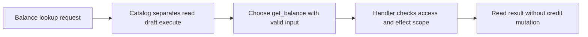

# Objective 2.1 — Design tool interfaces that are hard to confuse

[Test this decision with a supplied example](#benchmark-exercise-2-1) — predict first, then compare the fixed-fixture evidence.

**Picture the application:** A legal-document team has one function for uploaded contracts and another for approved web sources, but the assistant confuses them. An incoming document request should reach the appropriate operation and return source-linked results. Tool-interface design supplies the technical names, descriptions and boundaries that make that choice understandable.

**Exam:** CCAR-F · **Domain 2:** 18% of exam; no separate objective weight is published here.  
**Time:** 45–65 minutes including practice; allow another 20 minutes for the production challenge.  
**Prerequisites:** Complete 1.1; understand a tool schema and a system prompt. New to the Claude API? Start with the [five-minute primer in Lesson 0](../L00-orientation.md#five-minute-primer-how-a-claude-app-works).  
**Continue from:** [Domain lesson](../L02-tool-design-and-mcp-integration.md) · [Objective map](../../../01-Curriculum/02-Architect-Track/CCAR-F-objectives.md).  
**Scenario setting:** Legal operations; all organizations, records and amounts in examples are fictional.

**Official task statement:** Design effective tool interfaces with clear descriptions and boundaries  


<!-- layered-episode:FV-08:start -->
<a id="learn-fv-08"></a>
### Learn the decision in context — FV-08

**Picture the job.** A support assistant has three buttons: look up money, draft a credit and actually issue a credit. Their labels are confusing. This is an original fictional teaching scene, not a recalled live exam question. Read and trace it; no account, installation or API call is required.

**Start small.** Follow the ordinary route: a person supplies a request or record, software passes the needed evidence to the assistant, and a receiving service or person checks the result. The first demonstration assumes the input, access and evidence are suitable. Now remove that assumption in the situation above. Predict what the receiver would see before choosing a repair.

**Original exam-style practice — choose ONE.** Claude selects a mutation tool for a read-only request. Which interface redesign best reduces this failure while retaining enforcement?

A. Expose a single manage_account tool with every possible effect.

B. Separate read, proposal and mutation capabilities with precise descriptions, input schemas and handler-side access checks.

C. Remove handler validation because the new description tells Claude what to do.

<details>
<summary>What is this asking? Plain-language help, without the answer</summary>

Identify what the application needs to trust, what has actually been observed, and what remains unknown. Compare the choices against this situation, rather than choosing the most complicated design. A proposal is an intended action; evidence is what you can point to; a contract says what the receiving part expects. Decide which option fixes the stated failure without pretending another requirement has also been solved.

</details>

**Choose before opening the walkthrough.** Say your answer and the closest alternative aloud, or record them in your own notes.

<details>
<summary>Reveal the repair, evidence and changed condition</summary>

**Answer: B.** Separate read, proposal and mutation capabilities with precise descriptions, input schemas and handler-side access checks.

**Walk it through.** A balance request selects get_balance; execute_credit still rejects requests without approved proposal scope. Selection and protection both have observable checks.

**Why the alternatives fail here.** Expose a single manage_account tool with every possible effect. This leaves the stated boundary or evidence requirement unsatisfied. Remove handler validation because the new description tells Claude what to do. This also fails to establish the required result. The closest competing mechanism fails for this specific reason: A universal tool can conceal prohibited effects and confuse selection; splitting should follow real capability boundaries, not arbitrary tool-count ceilings.

**Inspect the small artifact.** This is an illustrative application-state note for reading, not an SDK signature or executable configuration. The application or workflow owner creates it; the receiver uses it to distinguish what is known from what still needs checking. Its labels describe this scene; do not paste it into Claude settings.

```text
get_balance(account_id)->amount; draft_credit(account_id,amount)->proposal; execute_credit(proposal_id,approval)->receipt
```

**Layer added.** AI reasoning proposes, selects or summarizes where the job needs judgment. Ordinary software checks identifiers, permissions, required fields, recorded outcomes and stop conditions where applicable. A human resolves a policy or evidence gap when the story requires it. Inspect which owner actually supplies the evidence in this scene.



**Change one condition.** Keep the application in mind and consider the new situation below. Choose before opening its explanation.

**Technical transfer question — choose ONE.** Two tools are both described as manage account. Which contract change is most useful?

A. Add an arbitrary number of tools without changing capability boundaries.

B. Make names, input schemas and descriptions distinguish actual capabilities and effects.

<details>
<summary>Transfer check</summary>

**B.** Two tools both say “manage account.” Rename them and tighten schemas/descriptions so capability boundaries are clear. Name the changed fact before naming a tool. Preserve unrelated access, source-validation and result checks.

</details>

**Recall in ordinary language.** What broke? Who can fix it? What observable result proves the repair? If you cannot answer all three, replay the concrete scene rather than memorize the option letter.

</details>

**Continue from this decision:** [objective 2.1](objective-2.1.md) · [inspect its decision map](../decision-atlas.md#diagram-d01) · [targeted practice](../../../practice/index.html?exam=CCAR-F&objective=2.1). Existing mapped question IDs: `cct-fv-08-base-v1`, `cct-fv-08-retry-v1`. The new guided question above is separate from those stored items and does not change their answers or progress.
<!-- layered-episode:FV-08:end -->

## Read this objective in both vocabularies

For reading and paper reasoning, no installation or credentials are needed. Keep this page's stated concept prerequisites; any runnable challenge still needs its own setup. If an implementation example feels abrupt, first read [how to interpret its artifact type](../architecture-studio/00-foundations.md#how-to-read-technical-examples-in-this-course), then use the relevant application bridge: [AS-01 decision bridge](../architecture-studio/AS-01-action-service.md#connect-the-simple-explanation-to-technical-design-choices) · [AS-03 decision bridge](../architecture-studio/AS-03-grounded-assistant.md#connect-the-simple-explanation-to-technical-design-choices).

Explain the business purpose first, name the precise mechanism second, and distinguish it from the nearest plausible alternative using the stated constraint. Return here for the objective-specific protocol, options and practice. The bridges are teaching aids, not additional official objectives.


## Big idea

Tool selection improves when each interface makes its job, inputs, outputs, and limits explicit.


<a id="contract"></a>
## Write a description as an operational contract

The blueprint treats descriptions as the primary mechanism for tool selection. A useful description explains what the tool does, which inputs it accepts, what its output means, and when it should be chosen. Include a realistic example query and important edge cases, such as unsupported file types or required identifiers. “Analyzes content” leaves the model guessing among nearby capabilities.

A schema constrains input shape; the description explains semantics. An integer field may be valid JSON while representing the wrong unit. State whether `amount` is minor currency units, whether a document locator is a URL or internal ID, and whether an empty output means no matches. These boundaries are especially valuable when neighboring tools look similar. A good contract helps the agent choose and later interpret the result.

Source: [Saved official guide, section 6 task 2.1](https://anthropic-partners.skilljar.com/page/partner-certifications) (Tier 1; July 2026 blueprint).

<a id="separate"></a>
## Rename and split overlapping capabilities

When two tools appear to perform the same function, identify the actual distinction. `extract_web_table` and `extract_pdf_table` reveal source boundaries better than `analyze_content` and `analyze_document`. Rename the tools and revise descriptions together; a precise name with a vague description still leaves ambiguity.

A generic document tool can be split into extraction, summarization, and claim verification, each with defined input/output contracts. Extraction returns attributable data points; summarization returns a scoped narrative; verification returns evidence relevant to a specified claim. Do not split solely to increase the number of tools. The goal is a meaningful decision boundary. A single tool remains sensible when its modes are clear and the workflow does not benefit from separate capabilities.

Source: [Saved official guide, section 6 task 2.1](https://anthropic-partners.skilljar.com/page/partner-certifications) (Tier 1; July 2026 blueprint).

<a id="prompt"></a>
## Audit instructions that compete with the contract

A system prompt may create unintended keyword associations: “Whenever a user says research, use web analysis” can misroute a request to research a supplied PDF. Review those instructions alongside the tool catalog. State routing in terms of source type and desired operation rather than one word appearing in the user's request.

When diagnosing misrouting, examine examples of actual calls, their inputs, and the available descriptions. Improve the contract if capabilities overlap; improve the prompt if a clear interface is being overridden by an explicit conflicting instruction. Prompt changes are an appropriate intervention when the prompt is the defect. Avoid the shortcut that every tool-selection error demands a new architecture.

Source: [Saved official guide, section 6 task 2.1](https://anthropic-partners.skilljar.com/page/partner-certifications) (Tier 1; July 2026 blueprint).

<a id="worked"></a>
## Worked example: decision, alternative, and trade-off

A fictional legal-document team has two tools called `analyze_text` and `analyze_record`. One extracts clauses from uploaded contracts; the other searches approved regulatory pages. Under a no-external-upload constraint, the architect renames and separates their contracts, specifies input locators and output source references, and removes a keyword rule that sends every “research” request online. A credible alternative is one router tool with an explicit operation enum and source validation, useful when the catalog must stay small. Separate interfaces are easier to inspect here; the router reduces selection overhead but concentrates validation responsibility. Ambiguous locators should produce validation errors instead of guessed routing.

This example applies [Saved official guide, section 6 task 2.1](https://anthropic-partners.skilljar.com/page/partner-certifications) (Tier 1; July 2026 blueprint); it is original teaching material, not an exam item.

**Transfer — retail catalog operations:** One tool retrieves authoritative inventory counts while another summarizes product descriptions. A user asking to “research stock” should not be routed by that word alone. Unlike the legal case, external approved catalog data may be allowed; tool boundaries must express authority and operation, not universally prohibit browsing.


<a id="decision-variants"></a>
<a id="variant-fv-08"></a>
## Decision variant FV-08 — Make capabilities distinguishable

This is original fictional practice, not an official exam question. All policies, amounts and records below are synthetic.

**Choose in the base case.** A support catalog separates get_balance, draft_credit and execute_credit. Descriptions specify read versus proposal versus mutation, required scope and return status.

**Change one constraint.** Two tools both say “manage account.” Rename them and tighten schemas/descriptions so capability boundaries are clear.

**What failed, and who recovers?** Claude picks execute_credit for a lookup. Reject the call at the handler, then repair the catalog rather than merely lengthening the prompt.

**Inspect the artifact — illustrative contract, not a drop-in SDK implementation:**

```text
get_balance(account_id)->amount; draft_credit(account_id,amount)->proposal; execute_credit(proposal_id,approval)->receipt
```

**Why not the nearest alternative?** A universal tool can conceal prohibited effects and confuse selection; splitting should follow real capability boundaries, not arbitrary tool-count ceilings.

**Memory cue with its condition:** Name the effect; describe the boundary; validate the arguments.

**Proof before accepting success:** Produce a trace or artifact showing the decisive constraint, the selected mechanism, rejected alternative and observable result. Preserve unresolved status; a plausible explanation alone is not completion.

[Inspect D01 and its equivalent decision procedure](../decision-atlas.md#diagram-d01) · [See this decision at walkthrough step 5](../scenario-walkthroughs/WT-01-customer-support-agent.md#variant-fv-08) · [Return to the objective map](README.md).

**Blind transfer:** Before opening practice, explain which single change in the scene would reverse your choice and which would only require revalidation. Write the failure signal and the next safe action. The practice app provides separately authored base and later-retry items, with a free-response transfer rubric; assistance/exposure must remain visible in learning history.

**Current runtime reference:** [https://platform.claude.com/docs/en/agents-and-tools/tool-use/overview](https://platform.claude.com/docs/en/agents-and-tools/tool-use/overview) (reviewed 2026-10-14). The saved blueprint remains the exam coverage source; application policy in this packet is invented teaching context.

<a id="try"></a>
## Try it

Write descriptions for clause extraction, contract summary, and claim verification. Include expected input, output, an example, edge cases, and a boundary directing the user to the neighboring tool. Then fix one conflicting system-prompt rule.

**Expected output and self-check:** Extraction yields source-linked clauses; summary yields a narrative within stated scope; verification accepts a claim and source locator and returns supporting or contradicting evidence. Each tells the agent when to use another tool. The revised prompt routes by operation and source, not the word “research.” Before checking yourself, write the evidence that supports each control-flow or tool decision. If your answer differs, identify whether the difference changes correctness, reliability, or only implementation style.

<a id="production"></a>
## Production challenge and traps

Add a scanned PDF and a malformed source locator. Compare a router tool with separate interfaces, including validation, auditability, and behavior when extraction cannot proceed.

A convincing extension names the failure condition, who owns recovery, and the evidence that proves recovery succeeded. Do not mistake a tool request for execution, an execution for full completion, or a plausible summary for verified evidence. Compare the added reliability with its latency, maintenance, and coordination costs.

<a id="done"></a>
## Done when

- [ ] Write distinguishable contracts with inputs, outputs, examples, and boundaries.
- [ ] Rename overlapping tools and justify a split or retained generic interface.
- [ ] Find and correct a keyword-sensitive system instruction that causes misrouting.

Save your explanation, trace or design output in your own notes (or skip this step). Mark any failed check as a practice gap and revisit the mapped teaching section. These checks are observable learning tasks, not a claim that a score predicts certification success.

## Coverage checklist

The identifiers below follow the official Knowledge and Skills bullet order for this task. Each points to its teaching subsection; practice and completion checks above assess application.

| Blueprint bullet | Teaching section |
| --- | --- |
| 2.1-K1 | [Write a description as an operational contract](#contract) |
| 2.1-K2 | [Write a description as an operational contract](#contract) |
| 2.1-K3 | [Rename and split overlapping capabilities](#separate) |
| 2.1-K4 | [Audit instructions that compete with the contract](#prompt) |
| 2.1-S1 | [Write a description as an operational contract](#contract) |
| 2.1-S2 | [Rename and split overlapping capabilities](#separate) |
| 2.1-S3 | [Rename and split overlapping capabilities](#separate) |
| 2.1-S4 | [Audit instructions that compete with the contract](#prompt) |

**Source boundary:** The July guide defines the assessed coverage. Current documentation notes describe implementation freshness and must be rechecked when a runtime changes.

## Sources

- [Official guide v1.0, July 2026](https://anthropic-partners.skilljar.com/page/partner-certifications), section 6 task 2.1 (Tier 1; saved blueprint; latest revision not certified).
- [Existing domain lesson](../L02-tool-design-and-mcp-integration.md) (project-authored synthesis, not independent primary evidence).

**Go deeper:** [Deep practice 2, section 2.1](../deep-practice/02-tool-design-and-mcp-integration.md#21-tool-interfaces-and-descriptions)


<a id="benchmark-exercise-2-1"></a>
## Worked evidence task — 2.1: test the boundary

**Original technical decision.** Read-only delivery questions and authorized credit requests share a tool catalog. Which routing evaluation distinguishes description quality from prompt conflict?

**In everyday terms:** Count the actual choices. Do not report an improvement before testing it.

**Before you start:** No account, API key or package installation is needed for the paper task. Optional replay needs Python 3 and the two provided lab files in the same directory. This local inspector models the stated fixture; it does not call Claude, load Claude Code rules or run an MCP server.

### Inspect the supplied input

All identifiers and business rules here are fictional application data. This is **not an SDK request schema**. Keep the input separate from your proposed decision.

```json
{
  "tools": {
    "read_status": "lookup only",
    "issue_credit": "mutates; authorization required"
  },
  "requests": [
    "Where is order O17?",
    "Was O17 delivered?",
    "Show tracking for O17",
    "Which carrier has O17?",
    "Read the status of O17",
    "Has O17 shipped?",
    "Apply the approved credit for case C17",
    "Issue the authorized credit on O17",
    "Execute the approved refund for C18",
    "Read order O18"
  ],
  "oracle": [
    "read_status",
    "read_status",
    "read_status",
    "read_status",
    "read_status",
    "read_status",
    "issue_credit",
    "issue_credit",
    "issue_credit",
    "read_status"
  ],
  "method": "count chosen tool equal to oracle / 10; retain unparseable/abstain separately; repeat only in an isolated new session"
}
```

### Break, choose, repair, prove

1. **Break:** Test confusing read/write descriptions with a held-out set of requests. Name the exact failed assumption before proposing another component.
2. **Choose:** Record one chosen tool per held-out request, keep abstentions visible and compare with the supplied oracle in an isolated run. Write the nearest alternative you would reject and the requirement it fails.
3. **Repair:** Write the corrected contract or recovery step, keeping successful evidence and unknowns separate.
4. **Prove:** Compare observed routing before/after without promising a fixed improvement rate; inspect conflicting instructions. Record `decision`, `reason`, `rejected_alternative`, `evidence` and `remaining_unknowns`.

[Open this actual task in the existing LAB](../../../06-Labs/03-CCAR-F-mcp-server-claude-code/README.md#benchmark-exercise-2-1) · [Return to the teaching subsection](#worked-example-decision-alternative-and-trade-off)

<details><summary>Compare the offline evidence — after making your decision</summary>

The local inspector presents **controlled-fixture calculations and authored reference decisions** below. Some fields are calculated (such as counts or arithmetic); policy labels and recovery choices are supplied worked answers for this fixed example, not executed policies or a general-purpose validator. No Claude, rule loader, service or reviewer was run. `false` or `null` observations remain unresolved when no corresponding live test was performed.

```json
{
  "request_count": 10,
  "oracle_read_count": 7,
  "oracle_write_count": 3,
  "observed_choices": null,
  "observed_accuracy": null,
  "reason": "No model routing run performed; compare actual choices with this oracle later"
}
```

**Why this matters:** Count the actual choices. Do not report an improvement before testing it. The output is a self-check for this controlled example, not certification-score evidence. To test the real mechanism, perform the existing LAB’s integration steps in a fresh disposable context and keep its actual trace beside this prediction.

**Primary-source leads for mechanism review:** [tool search docs](https://platform.claude.com/docs/en/agents-and-tools/tool-use/tool-search-tool) · [Tool use — Anthropic API Documentation](https://platform.claude.com/docs/en/agents-and-tools/tool-use/overview). The external benchmark helped identify the exercise gap; this task and its data were authored here. Current implementation details must be verified against the installed runtime and those primary sources.

</details>