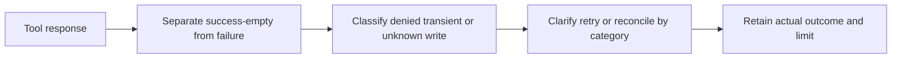

# Objective 2.2 — Return errors that support the right recovery

[Test this decision with a supplied example](#benchmark-exercise-2-2) — predict first, then compare the fixed-fixture evidence.

**Picture the application:** A retail customer asks whether an item can be returned. The lookup may succeed, find nothing, reject the request or fail to reach the service; the customer needs an accurate next step in each case. Structured tool errors are the technical mechanism for distinguishing these outcomes instead of collapsing them into “failed.”

**Exam:** CCAR-F · **Domain 2:** 18% of exam; no separate objective weight is published here.  
**Time:** 45–65 minutes including practice; allow another 20 minutes for the production challenge.  
**Prerequisites:** Complete 1.2; know how a tool result reaches the coordinator. New to the Claude API? Start with the [five-minute primer in Lesson 0](../L00-orientation.md#five-minute-primer-how-a-claude-app-works).  
**Continue from:** [Domain lesson](../L02-tool-design-and-mcp-integration.md) · [Objective map](../../../01-Curriculum/02-Architect-Track/CCAR-F-objectives.md).  
**Scenario setting:** Retail operations; all organizations, records and amounts in examples are fictional.

**Official task statement:** Implement structured error responses for MCP tools  


<!-- layered-episode:FV-09:start -->
<a id="learn-fv-09"></a>
### Learn the decision in context — FV-09

**Picture the job.** A lookup returns no records. A different call cannot be accessed. A third call may have written data before timing out. This is an original fictional teaching scene, not a recalled live exam question. Read and trace it; no account, installation or API call is required.

**Start small.** Follow the ordinary route: a person supplies a request or record, software passes the needed evidence to the assistant, and a receiving service or person checks the result. The first demonstration assumes the input, access and evidence are suitable. Now remove that assumption in the situation above. Predict what the receiver would see before choosing a repair.

**Original exam-style practice — choose ONE.** Which recovery policy correctly distinguishes empty results, permission failures and uncertain mutation outcomes?

A. Retry all three because none returned the desired record.

B. Treat every empty array as an MCP protocol outage.

C. Preserve typed application outcomes; clarify an empty result, resolve denied access and reconcile a timed-out write before replay.

<details>
<summary>What is this asking? Plain-language help, without the answer</summary>

Identify what the application needs to trust, what has actually been observed, and what remains unknown. Compare the choices against this situation, rather than choosing the most complicated design. A proposal is an intended action; evidence is what you can point to; a contract says what the receiving part expects. Decide which option fixes the stated failure without pretending another requirement has also been solved.

</details>

**Choose before opening the walkthrough.** Say your answer and the closest alternative aloud, or record them in your own notes.

<details>
<summary>Reveal the repair, evidence and changed condition</summary>

**Answer: C.** Preserve typed application outcomes; clarify an empty result, resolve denied access and reconcile a timed-out write before replay.

**Walk it through.** The log records success/empty, permission/nonretryable and write/status_unknown separately. No second mutation is issued until the operation is reconciled.

**Why the alternatives fail here.** Retry all three because none returned the desired record. This leaves the stated boundary or evidence requirement unsatisfied. Treat every empty array as an MCP protocol outage. This also fails to establish the required result. The closest competing mechanism fails for this specific reason: MCP protocol errors and the application payload are different layers; error strings alone do not define a safe recovery policy.

**Inspect the small artifact.** This is an illustrative application-state note for reading, not an SDK signature or executable configuration. The application or workflow owner creates it; the receiver uses it to distinguish what is known from what still needs checking. Its labels describe this scene; do not paste it into Claude settings.

```text
application_result={status:success,records:[]}; failure={category:permission,retryable:false}
```

**Layer added.** AI reasoning proposes, selects or summarizes where the job needs judgment. Ordinary software checks identifiers, permissions, required fields, recorded outcomes and stop conditions where applicable. A human resolves a policy or evidence gap when the story requires it. Inspect which owner actually supplies the evidence in this scene.



**Change one condition.** Keep the application in mind and consider the new situation below. Choose before opening its explanation.

**Technical transfer question — choose ONE.** A failed call is read-only, transient and safe to repeat. Which recovery is proportionate?

A. A bounded retry with observable outcome and limits.

B. Treat this as permission to retry every uncertain mutation too.

<details>
<summary>Transfer check</summary>

**A.** A timeout is transient and read-only. Retry with a bounded policy. A permission refusal instead requires changed authorization or escalation. Name the changed fact before naming a tool. Preserve unrelated access, source-validation and result checks.

</details>

**Recall in ordinary language.** What broke? Who can fix it? What observable result proves the repair? If you cannot answer all three, replay the concrete scene rather than memorize the option letter.

</details>

**Continue from this decision:** [objective 2.2](objective-2.2.md) · [inspect its decision map](../decision-atlas.md#diagram-d04) · [targeted practice](../../../practice/index.html?exam=CCAR-F&objective=2.2). Existing mapped question IDs: `cct-fv-09-base-v1`, `cct-fv-09-retry-v1`. The new guided question above is separate from those stored items and does not change their answers or progress.
<!-- layered-episode:FV-09:end -->

## Read this objective in both vocabularies

For reading and paper reasoning, no installation or credentials are needed. Keep this page's stated concept prerequisites; any runnable challenge still needs its own setup. If an implementation example feels abrupt, first read [how to interpret its artifact type](../architecture-studio/00-foundations.md#how-to-read-technical-examples-in-this-course), then use the relevant application bridge: [AS-01 decision bridge](../architecture-studio/AS-01-action-service.md#connect-the-simple-explanation-to-technical-design-choices) · [AS-07 decision bridge](../architecture-studio/AS-07-work-queue.md#connect-the-simple-explanation-to-technical-design-choices).

Explain the business purpose first, name the precise mechanism second, and distinguish it from the nearest plausible alternative using the stated constraint. Return here for the objective-specific protocol, options and practice. The bridges are teaching aids, not additional official objectives.


## Big idea

An error is information for a recovery decision, not merely a red light.


<a id="categories"></a>
## Classify the failure instead of hiding it

MCP uses `isError` on a tool result to indicate an execution error. Application-level metadata then tells the agent what happened. Distinguish transient failures such as timeouts, validation failures such as malformed identifiers, business failures such as an ineligible return, and permission failures such as an unauthorized account scope.

The category affects recovery. A timeout may justify a bounded retry. Invalid input requires correction, not repeated identical calls. A policy violation needs explanation or escalation. A permission failure needs the appropriate access path rather than fabricated results. A uniform “Operation failed” removes these distinctions. Avoid revealing sensitive implementation details in the customer-facing message; retain diagnostic context where the authorized coordinator can use it.

Source: [Saved official guide, section 6 task 2.2](https://anthropic-partners.skilljar.com/page/partner-certifications) (Tier 1; July 2026 blueprint).

<a id="payload"></a>
## Design a stable retry contract

Return a category, retryability, and readable description. Add attempted operation, safe identifiers, and partial results where helpful. The blueprint uses both `isRetryable` and `retriable`; those are application payload conventions, not mandated MCP protocol field names. Choose one documented internal convention, or normalize adapters, rather than accidentally treating two spellings as different policies.

For a business-rule rejection, make retryability false and explain the customer-relevant reason: “This item is outside the return window,” rather than only “rule 17.” If a different authorized workflow exists, include it. Retryability should describe whether repeating this operation can help, not whether the customer might someday obtain a different outcome after an exception approval.

**Illustrative application payload inside an MCP tool result:**

```json
{
  "isError": true,
  "content": [{"type": "text", "text": "Return is outside the permitted window."}],
  "structuredContent": {
    "errorCategory": "business",
    "isRetryable": false,
    "message": "This return needs exception review.",
    "attemptedOperation": "check_return_eligibility",
    "partialResults": {"itemIdentified": true},
    "alternative": "human_exception_review"
  }
}
```

This is a teaching contract, not proof that an arbitrary server accepts these application fields. Match it to the server’s output schema and adapter conventions.

Source: [Saved official guide, section 6 task 2.2](https://anthropic-partners.skilljar.com/page/partner-certifications) (Tier 1; July 2026 blueprint).

<a id="recover"></a>
## Recover locally and distinguish empty success

A subagent can retry a transient read locally under a bounded policy, with backoff and a clear deadline. If it cannot recover, send the coordinator what was attempted, how it failed, available partial results, and alternatives. Do not escalate every first timeout or conceal exhaustion by returning a success flag.

A successful search with zero matches is different from an inaccessible search. The first is evidence that the query found nothing in the searched scope. The second leaves that scope unknown. That distinction prevents synthesis from concluding “there are no records” when the records service was unavailable. For side-effecting calls, retries also need idempotency or confirmation safeguards; a timeout may occur after the remote system already performed the action.

Source: [Saved official guide, section 6 task 2.2](https://anthropic-partners.skilljar.com/page/partner-certifications) (Tier 1; July 2026 blueprint).

Protocol distinction: `isError` is an MCP result field; the category and retry flags in this lesson are application-defined. [MCP tools specification](https://modelcontextprotocol.io/specification/2026-07-28/server/tools) (Tier 1 primary protocol source; the rule dates from 2025-11-25 and is unchanged in 2026-07-28; checked 2026-10-07).

<a id="worked"></a>
## Worked example: decision, alternative, and trade-off

A fictional retail assistant looks up return eligibility. A service outage is retryable; an invalid order format asks for correction; an expired return window is a non-retryable business rejection; missing account permission follows an access workflow. The subagent retries the outage within a short deadline, then returns partial item details and failure context. A credible alternative is coordinator-owned retry policy for every tool, which centralizes behavior but adds messages and delays. Local recovery is efficient when the subagent knows the operation; centralized recovery helps when failures span dependencies. Neither may map a timeout to an empty eligible-items list.

This example applies [Saved official guide, section 6 task 2.2](https://anthropic-partners.skilljar.com/page/partner-certifications) (Tier 1; July 2026 blueprint); it is original teaching material, not an exam item.

**Transfer — healthcare administration, synthetic:** A scheduling search that finds no open slots is successful, while a permission failure leaves availability unknown. The agent can offer alternate dates after a genuine empty search; after an access failure it reports the limit and follows an authorized recovery path. It must not infer that a clinic is fully booked.


<a id="decision-variants"></a>
<a id="variant-fv-09"></a>
## Decision variant FV-09 — Route the actual error category

This is original fictional practice, not an official exam question. All policies, amounts and records below are synthetic.

**Choose in the base case.** An MCP lookup succeeds with records=[]; report no matching record and clarify filters rather than retrying a supposed outage.

**Change one constraint.** A timeout is transient and read-only. Retry with a bounded policy. A permission refusal instead requires changed authorization or escalation.

**What failed, and who recovers?** A write times out after submission. Query operation status before retrying; a transient category alone does not establish safe re-execution.

**Inspect the artifact — illustrative contract, not a drop-in SDK implementation:**

```text
application_result={status:success,records:[]}; failure={category:permission,retryable:false}
```

**Why not the nearest alternative?** MCP protocol errors and the application payload are different layers; error strings alone do not define a safe recovery policy.

**Memory cue with its condition:** Empty is evidence; timeout is uncertainty; denied needs authority.

**Proof before accepting success:** Produce a trace or artifact showing the decisive constraint, the selected mechanism, rejected alternative and observable result. Preserve unresolved status; a plausible explanation alone is not completion.

[Inspect D04 and its equivalent decision procedure](../decision-atlas.md#diagram-d04) · [See this decision at walkthrough step 5](../scenario-walkthroughs/WT-01-customer-support-agent.md#variant-fv-09) · [Return to the objective map](README.md).

**Blind transfer:** Before opening practice, explain which single change in the scene would reverse your choice and which would only require revalidation. Write the failure signal and the next safe action. The practice app provides separately authored base and later-retry items, with a free-response transfer rubric; assistance/exposure must remain visible in learning history.

**Current runtime reference:** [https://platform.claude.com/docs/en/agents-and-tools/tool-use/overview](https://platform.claude.com/docs/en/agents-and-tools/tool-use/overview) (reviewed 2026-10-14). The saved blueprint remains the exam coverage source; application policy in this packet is invented teaching context.

<a id="try"></a>
## Try it

Create four illustrative error payloads and one successful empty result for a fictional returns tool. Write the next action for each, including a case where local retries are exhausted.

**Expected output and self-check:** The four errors carry `isError`, category, retryability and a useful message. The business case is non-retryable and customer-readable. The empty success remains successful. Exhaustion reaches the coordinator with attempts and partial results. No identical retry is proposed for malformed input or a policy rejection. Before checking yourself, write the evidence that supports each control-flow or tool decision. If your answer differs, identify whether the difference changes correctness, reliability, or only implementation style.

<a id="production"></a>
## Production challenge and traps

Introduce a timeout after a side-effecting return authorization may already have succeeded. Design an idempotency or status-check recovery path and avoid issuing the operation twice blindly.

A convincing extension names the failure condition, who owns recovery, and the evidence that proves recovery succeeded. Do not mistake a tool request for execution, an execution for full completion, or a plausible summary for verified evidence. Compare the added reliability with its latency, maintenance, and coordination costs.

<a id="done"></a>
## Done when

- [ ] Return structured category, retryability and readable details.
- [ ] Represent a business-rule violation with a non-retryable customer explanation.
- [ ] Demonstrate bounded local recovery and rich propagation on exhaustion.
- [ ] Distinguish unavailable access from a valid no-match result.

Save your explanation, trace or design output in your own notes (or skip this step). Mark any failed check as a practice gap and revisit the mapped teaching section. These checks are observable learning tasks, not a claim that a score predicts certification success.

## Coverage checklist

The identifiers below follow the official Knowledge and Skills bullet order for this task. Each points to its teaching subsection; practice and completion checks above assess application.

| Blueprint bullet | Teaching section |
| --- | --- |
| 2.2-K1 | [Classify the failure instead of hiding it](#categories) |
| 2.2-K2 | [Classify the failure instead of hiding it](#categories) |
| 2.2-K3 | [Classify the failure instead of hiding it](#categories) |
| 2.2-K4 | [Design a stable retry contract](#payload) |
| 2.2-S1 | [Design a stable retry contract](#payload) |
| 2.2-S2 | [Design a stable retry contract](#payload) |
| 2.2-S3 | [Recover locally and distinguish empty success](#recover) |
| 2.2-S4 | [Recover locally and distinguish empty success](#recover) |

**Source boundary:** The July guide defines the assessed coverage. Current documentation notes describe implementation freshness and must be rechecked when a runtime changes.

## Sources

- [Official guide v1.0, July 2026](https://anthropic-partners.skilljar.com/page/partner-certifications), section 6 task 2.2 (Tier 1; saved blueprint; latest revision not certified).
- [MCP tools specification](https://modelcontextprotocol.io/specification/2026-07-28/server/tools) (Tier 1; accessed 2026-10-07; implementation details can change).
- [Existing domain lesson](../L02-tool-design-and-mcp-integration.md) (project-authored synthesis, not independent primary evidence).

**Go deeper:** [Deep practice 2, section 2.2](../deep-practice/02-tool-design-and-mcp-integration.md#22-structured-error-responses-for-mcp-tools)


<a id="benchmark-exercise-2-2"></a>
## Worked evidence task — 2.2: test the boundary

**Original technical decision.** A request stream contains an unknown tool, access denial, timeout and successful empty search. Which recovery policy preserves protocol and execution distinctions?

**In everyday terms:** No matches is different from being unable to search.

**Before you start:** No account, API key or package installation is needed for the paper task. Optional replay needs Python 3 and the two provided lab files in the same directory. This local inspector models the stated fixture; it does not call Claude, load Claude Code rules or run an MCP server.

### Inspect the supplied input

All identifiers and business rules here are fictional application data. This is **not an SDK request schema**. Keep the input separate from your proposed decision.

```json
{
  "results": [
    {
      "jsonrpc_error": "unknown tool"
    },
    {
      "isError": true,
      "cause": "access_denied"
    },
    {
      "isError": true,
      "cause": "timeout"
    },
    {
      "isError": false,
      "matches": []
    }
  ]
}
```

### Break, choose, repair, prove

1. **Break:** Inject unknown tool name, denied call, timeout and successful empty search. Name the exact failed assumption before proposing another component.
2. **Choose:** Classify each cause first; repair the name, resolve authority, retry only a justified transient failure, and preserve empty success. Write the nearest alternative you would reject and the requirement it fails.
3. **Repair:** Write the corrected contract or recovery step, keeping successful evidence and unknowns separate.
4. **Prove:** Identify protocol versus execution failure; preserve unknown and empty distinctions and recovery evidence. Record `decision`, `reason`, `rejected_alternative`, `evidence` and `remaining_unknowns`.

[Open this actual task in the existing LAB](../../../06-Labs/03-CCAR-F-mcp-server-claude-code/README.md#benchmark-exercise-2-2) · [Return to the teaching subsection](#objective-22--return-errors-that-support-the-right-recovery)

<details><summary>Compare the offline evidence — after making your decision</summary>

The local inspector presents **controlled-fixture calculations and authored reference decisions** below. Some fields are calculated (such as counts or arithmetic); policy labels and recovery choices are supplied worked answers for this fixed example, not executed policies or a general-purpose validator. No Claude, rule loader, service or reviewer was run. `false` or `null` observations remain unresolved when no corresponding live test was performed.

```json
{
  "classification": [
    "protocol error: unknown tool",
    "execution error: denied",
    "execution error: timeout",
    "success: empty matches"
  ],
  "retry_candidate_indexes": [
    2
  ],
  "empty_is_failure": false
}
```

**Why this matters:** No matches is different from being unable to search. The output is a self-check for this controlled example, not certification-score evidence. To test the real mechanism, perform the existing LAB’s integration steps in a fresh disposable context and keep its actual trace beside this prediction.

**Primary-source leads for mechanism review:** [MCP Specification — Tool Results](https://modelcontextprotocol.io/docs/concepts/tools) · [MCP Specification — Tools, Error Handling](https://modelcontextprotocol.io/specification/2025-06-18/server/tools#error-handling). The external benchmark helped identify the exercise gap; this task and its data were authored here. Current implementation details must be verified against the installed runtime and those primary sources.

</details>