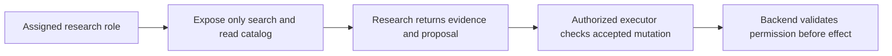

# Objective 2.3 — Scope each agent’s tools and control tool choice

[Test this decision with a supplied example](#benchmark-exercise-2-3) — predict first, then compare the fixed-fixture evidence.

**Picture the application:** An insurance-document service offers many possible operations, although its extraction and report-writing workers have different jobs. Incoming documents should move through the needed steps without irrelevant actions or unsupported assumptions. Scoped tool access and tool choice are the technical decisions; neither substitutes for checking whether prerequisites actually completed.

**Exam:** CCAR-F · **Domain 2:** 18% of exam; no separate objective weight is published here.  
**Time:** 45–65 minutes including practice; allow another 20 minutes for the production challenge.  
**Prerequisites:** Complete 1.3 and 2.1; distinguish selection from authorization. New to the Claude API? Start with the [five-minute primer in Lesson 0](../L00-orientation.md#five-minute-primer-how-a-claude-app-works).  
**Continue from:** [Domain lesson](../L02-tool-design-and-mcp-integration.md) · [Objective map](../../../01-Curriculum/02-Architect-Track/CCAR-F-objectives.md).  
**Scenario setting:** Insurance, synthetic; all organizations, records and amounts in examples are fictional.

**Official task statement:** Distribute tools appropriately across agents and configure tool choice  


<!-- layered-episode:FV-10:start -->
<a id="learn-fv-10"></a>
### Learn the decision in context — FV-10

**Picture the job.** A researcher only needs search and read. The same toolbox also includes a button that can publish changes. This is an original fictional teaching scene, not a recalled live exam question. Read and trace it; no account, installation or API call is required.

**Start small.** Follow the ordinary route: a person supplies a request or record, software passes the needed evidence to the assistant, and a receiving service or person checks the result. The first demonstration assumes the input, access and evidence are suitable. Now remove that assumption in the situation above. Predict what the receiver would see before choosing a repair.

**Original exam-style practice — choose ONE.** A research role receives an unrelated mutation capability. Which design best limits tool exposure without confusing invocation with authorization?

A. Give the specialist only relevant read tools; route approved mutations to a separately authorized executor with handler validation.

B. Force a named write tool so that its arguments and authorization must be correct.

C. Keep every tool available and rely solely on a role reminder.

<details>
<summary>What is this asking? Plain-language help, without the answer</summary>

Identify what the application needs to trust, what has actually been observed, and what remains unknown. Compare the choices against this situation, rather than choosing the most complicated design. A proposal is an intended action; evidence is what you can point to; a contract says what the receiving part expects. Decide which option fixes the stated failure without pretending another requirement has also been solved.

</details>

**Choose before opening the walkthrough.** Say your answer and the closest alternative aloud, or record them in your own notes.

<details>
<summary>Reveal the repair, evidence and changed condition</summary>

**Answer: A.** Give the specialist only relevant read tools; route approved mutations to a separately authorized executor with handler validation.

**Walk it through.** The researcher cannot propose the removed write tool from its catalog. The executor still checks permission and input meaning when a request reaches it.

**Why the alternatives fail here.** Force a named write tool so that its arguments and authorization must be correct. This leaves the stated boundary or evidence requirement unsatisfied. Keep every tool available and rely solely on a role reminder. This also fails to establish the required result. The closest competing mechanism fails for this specific reason: tool_choice governs invocation; it does not prove business permission, factual truth or a sound result.

**Inspect the small artifact.** This is an illustrative application-state note for reading, not an SDK signature or executable configuration. The application or workflow owner creates it; the receiver uses it to distinguish what is known from what still needs checking. Its labels describe this scene; do not paste it into Claude settings.

```text
tools={research:[search,read],executor:[approved_write]}; proposal_owner=coordinator
```

**Layer added.** AI reasoning proposes, selects or summarizes where the job needs judgment. Ordinary software checks identifiers, permissions, required fields, recorded outcomes and stop conditions where applicable. A human resolves a policy or evidence gap when the story requires it. Inspect which owner actually supplies the evidence in this scene.



**Change one condition.** Keep the application in mind and consider the new situation below. Choose before opening its explanation.

**Technical transfer question — choose ONE.** One bounded request needs only two relevant read tools. Which organization is justified?

A. Multiple agents are mandatory because more than one tool exists.

B. One scoped agent can handle the request if it supplies the required evidence.

<details>
<summary>Transfer check</summary>

**B.** One bounded read-only lookup fits a single agent with two relevant tools. Do not add agents merely to satisfy a tool-count slogan. Name the changed fact before naming a tool. Preserve unrelated access, source-validation and result checks.

</details>

**Recall in ordinary language.** What broke? Who can fix it? What observable result proves the repair? If you cannot answer all three, replay the concrete scene rather than memorize the option letter.

</details>

**Continue from this decision:** [objective 2.3](objective-2.3.md) · [inspect its decision map](../decision-atlas.md#diagram-d02) · [targeted practice](../../../practice/index.html?exam=CCAR-F&objective=2.3). Existing mapped question IDs: `cct-fv-10-base-v1`, `cct-fv-10-retry-v1`. The new guided question above is separate from those stored items and does not change their answers or progress.
<!-- layered-episode:FV-10:end -->

## Read this objective in both vocabularies

For reading and paper reasoning, no installation or credentials are needed. Keep this page's stated concept prerequisites; any runnable challenge still needs its own setup. If an implementation example feels abrupt, first read [how to interpret its artifact type](../architecture-studio/00-foundations.md#how-to-read-technical-examples-in-this-course), then use the relevant application bridge: [AS-02 decision bridge](../architecture-studio/AS-02-document-pipeline.md#connect-the-simple-explanation-to-technical-design-choices).

Explain the business purpose first, name the precise mechanism second, and distinguish it from the nearest plausible alternative using the stated constraint. Return here for the objective-specific protocol, options and practice. The bridges are teaching aids, not additional official objectives.


## Big idea

Give each role enough capability for its job, and make mandatory first steps explicit where supported.


<a id="scope"></a>
## Restrict capabilities to the agent’s role

A broad tool catalog creates more similar choices and encourages agents to drift outside their specialization. The blueprint illustrates this with eighteen tools versus four or five; that is a design example, not a universal maximum. Inventory what each role actually needs. A synthesis agent mainly merges evidence; a search agent retrieves it. Giving both every mutation and browsing tool creates avoidable selection and scope risks.

Tool restrictions also express responsibility. Replace a generic URL fetcher with `load_approved_document`, which validates the locator and returns known metadata. Merely renaming a tool does not constrain it; the handler must enforce the contract. Restrict tool access at configuration and execution boundaries, while making unavailable capabilities clear enough that the agent can request coordinator help.

Source: [Saved official guide, section 6 task 2.3](https://anthropic-partners.skilljar.com/page/partner-certifications) (Tier 1; July 2026 blueprint).

<a id="cross"></a>
## Allow narrow cross-role needs without role drift

Sometimes synthesis repeatedly needs a small factual check. A scoped `verify_fact` tool can accept one claim and an approved source locator without offering an unrestricted search workflow. This reduces coordinator round trips for a frequent, bounded operation.

Complex gaps still return to the coordinator for investigation and routing. Define the threshold: a missing publication date may fit a scoped check; a missing risk analysis requires a researcher. This is a balance between specialization and handoff cost. Excessive restriction makes specialists ineffective, while unrestricted cross-role tools erase the reason for having specialists. Evaluate misuse and unnecessary escalation together rather than optimizing only the number of tools.

Source: [Saved official guide, section 6 task 2.3](https://anthropic-partners.skilljar.com/page/partner-certifications) (Tier 1; July 2026 blueprint).

<a id="choice"></a>
## Choose auto, any, or a specific first tool

In the July blueprint, `auto` allows a model to choose whether to call a tool; `any` requires some provided tool; forced selection specifies one named tool. The API expresses these as objects such as `{"type":"auto"}`, `{"type":"any"}`, and `{"type":"tool","name":"extract_metadata"}`. A bare string in a study table is shorthand, not a runnable API payload.

To enforce metadata extraction first, force that tool for the initial supported request, process its result, then make a follow-up request with the appropriate subsequent choice. Forcing a tool does not validate business authorization or establish every later workflow prerequisite. `any` cannot guarantee that the agent selects your preferred tool. Check current model and thinking-mode support before relying on forced choice; the saved exam's capability model and current deployment compatibility are distinct.

Source: [Saved official guide, section 6 task 2.3](https://anthropic-partners.skilljar.com/page/partner-certifications) (Tier 1; July 2026 blueprint).

Current-doc caveat: forced `any`/named choices are not supported by every current model or thinking configuration. Verify deployment compatibility. [Define tools](https://platform.claude.com/docs/en/agents-and-tools/tool-use/define-tools) (Tier 1; checked 2026-10-02).

<a id="worked"></a>
## Worked example: decision, alternative, and trade-off

A fictional insurance-document pipeline has eighteen available tools. The architect gives extraction document loading and field extraction, synthesis merge and a narrow citation check, and the coordinator broader routing. Metadata extraction must precede enrichment, so supported requests force that first tool, then proceed in a later turn. An alternative is one generalist with a broad catalog, sensible for a low-volume exploratory prototype. The specialized design improves inspectability under strict document-scope constraints but adds handoffs. If deployment does not support forced selection, enforce the prerequisite in application control flow rather than pretending an unsupported parameter guarantees it.

This example applies [Saved official guide, section 6 task 2.3](https://anthropic-partners.skilljar.com/page/partner-certifications) (Tier 1; July 2026 blueprint); it is original teaching material, not an exam item.

**Transfer — manufacturing support:** A diagnostic specialist has read-only telemetry tools, while a maintenance coordinator owns the authorized work-order workflow. Adding a narrow manual citation check may avoid handoffs; giving diagnostics equipment-control tools changes authority and requires a separate design review. Tool-choice controls alone cannot provide that authorization.


<a id="decision-variants"></a>
<a id="variant-fv-10"></a>
## Decision variant FV-10 — Scope tools to the assigned role

This is original fictional practice, not an official exam question. All policies, amounts and records below are synthetic.

**Choose in the base case.** Research specialists get only their relevant read tools. A separate authorized executor handles accepted mutations; the coordinator tracks ownership.

**Change one constraint.** One bounded read-only lookup fits a single agent with two relevant tools. Do not add agents merely to satisfy a tool-count slogan.

**What failed, and who recovers?** Forced tool choice invokes the named tool with invalid semantics. Authorization and application validation still reject it.

**Inspect the artifact — illustrative contract, not a drop-in SDK implementation:**

```text
tools={research:[search,read],executor:[approved_write]}; proposal_owner=coordinator
```

**Why not the nearest alternative?** tool_choice governs invocation; it does not prove business permission, factual truth or a sound result.

**Memory cue with its condition:** Choose the call; separately prove permission and meaning.

**Proof before accepting success:** Produce a trace or artifact showing the decisive constraint, the selected mechanism, rejected alternative and observable result. Preserve unresolved status; a plausible explanation alone is not completion.

[Inspect D02 and its equivalent decision procedure](../decision-atlas.md#diagram-d02) · [See this decision at walkthrough step 3](../scenario-walkthroughs/WT-03-multi-agent-research.md#variant-fv-10) · [Return to the objective map](README.md).

**Blind transfer:** Before opening practice, explain which single change in the scene would reverse your choice and which would only require revalidation. Write the failure signal and the next safe action. The practice app provides separately authored base and later-retry items, with a free-response transfer rubric; assistance/exposure must remain visible in learning history.

**Current runtime reference:** [https://platform.claude.com/docs/en/agents-and-tools/tool-use/overview](https://platform.claude.com/docs/en/agents-and-tools/tool-use/overview) (reviewed 2026-10-14). The saved blueprint remains the exam coverage source; application policy in this packet is invented teaching context.

<a id="try"></a>
## Try it

Partition a catalog into investigator, extractor and synthesis roles. Replace one broad tool with a constrained alternative, add one justified cross-role tool, and write tool-choice payloads for optional use, required use of any tool, and required metadata first.

**Expected output and self-check:** Each role gets tools justified by its work. The constrained handler validates document scope. The cross-role tool handles a narrow frequent need while broad investigation routes centrally. Payloads use the correct type objects; metadata is processed before later turns. Include a compatibility check and an application gate if ordering must hold independently of model support. Before checking yourself, write the evidence that supports each control-flow or tool decision. If your answer differs, identify whether the difference changes correctness, reliability, or only implementation style.

<a id="production"></a>
## Production challenge and traps

Give synthesis one missing date and one missing coverage analysis. Route the first through a narrow check and the second through the coordinator; test an unsupported forced-tool deployment.

A convincing extension names the failure condition, who owns recovery, and the evidence that proves recovery succeeded. Do not mistake a tool request for execution, an execution for full completion, or a plausible summary for verified evidence. Compare the added reliability with its latency, maintenance, and coordination costs.

<a id="done"></a>
## Done when

- [ ] Restrict each role’s tool access using actual responsibilities.
- [ ] Replace a generic capability with an enforced constrained interface.
- [ ] Provide a narrow cross-role tool and route complex work centrally.
- [ ] Force a supported named first tool and process subsequent steps separately.
- [ ] Explain when `any` is useful and what it does not guarantee.

Save your explanation, trace or design output in your own notes (or skip this step). Mark any failed check as a practice gap and revisit the mapped teaching section. These checks are observable learning tasks, not a claim that a score predicts certification success.

## Coverage checklist

The identifiers below follow the official Knowledge and Skills bullet order for this task. Each points to its teaching subsection; practice and completion checks above assess application.

| Blueprint bullet | Teaching section |
| --- | --- |
| 2.3-K1 | [Restrict capabilities to the agent’s role](#scope) |
| 2.3-K2 | [Restrict capabilities to the agent’s role](#scope) |
| 2.3-K3 | [Allow narrow cross-role needs without role drift](#cross) |
| 2.3-K4 | [Choose auto, any, or a specific first tool](#choice) |
| 2.3-S1 | [Restrict capabilities to the agent’s role](#scope) |
| 2.3-S2 | [Restrict capabilities to the agent’s role](#scope) |
| 2.3-S3 | [Allow narrow cross-role needs without role drift](#cross) |
| 2.3-S4 | [Choose auto, any, or a specific first tool](#choice) |
| 2.3-S5 | [Choose auto, any, or a specific first tool](#choice) |

**Source boundary:** The July guide defines the assessed coverage. Current documentation notes describe implementation freshness and must be rechecked when a runtime changes.

## Sources

- [Official guide v1.0, July 2026](https://anthropic-partners.skilljar.com/page/partner-certifications), section 6 task 2.3 (Tier 1; saved blueprint; latest revision not certified).
- [Define tools](https://platform.claude.com/docs/en/agents-and-tools/tool-use/define-tools) (Tier 1; accessed 2026-10-02; implementation details can change).
- [Existing domain lesson](../L02-tool-design-and-mcp-integration.md) (project-authored synthesis, not independent primary evidence).

**Go deeper:** [Deep practice 2, section 2.3](../deep-practice/02-tool-design-and-mcp-integration.md#23-tool-distribution-across-agents) · [Deep practice 4, section 2.3](../deep-practice/04-prompt-engineering-and-structured-output.md#23-tool-choice-and-tool-order-the-rest-of-23-is-in-deep-practice-2)


<a id="benchmark-exercise-2-3"></a>
## Worked evidence task — 2.3: test the boundary

**Original technical decision.** A synthesis worker needs merge and source-date verification but also sees refund and delete tools. Which capability boundary reduces unnecessary mutation risk?

**In everyday terms:** Give the worker what it needs for this job, not every available tool.

**Before you start:** No account, API key or package installation is needed for the paper task. Optional replay needs Python 3 and the two provided lab files in the same directory. This local inspector models the stated fixture; it does not call Claude, load Claude Code rules or run an MCP server.

### Inspect the supplied input

All identifiers and business rules here are fictional application data. This is **not an SDK request schema**. Keep the input separate from your proposed decision.

```json
{
  "role": "synthesis",
  "needs": [
    "merge",
    "verify source date"
  ],
  "unneeded": [
    "issue_credit",
    "delete_record",
    "unrestricted_search"
  ]
}
```

### Break, choose, repair, prove

1. **Break:** Give a synthesizer unnecessary mutating tools, then a narrow fact-check capability. Name the exact failed assumption before proposing another component.
2. **Choose:** Keep the needed synthesis and checking capabilities; remove unrelated write capabilities from this role. Write the nearest alternative you would reject and the requirement it fails.
3. **Repair:** Write the corrected contract or recovery step, keeping successful evidence and unknowns separate.
4. **Prove:** Justify capability scope and distinguish role overload from ambiguous descriptions. Record `decision`, `reason`, `rejected_alternative`, `evidence` and `remaining_unknowns`.

[Open this actual task in the existing LAB](../../../06-Labs/03-CCAR-F-mcp-server-claude-code/README.md#benchmark-exercise-2-3) · [Return to the teaching subsection](#scope)

<details><summary>Compare the offline evidence — after making your decision</summary>

The local inspector presents **controlled-fixture calculations and authored reference decisions** below. Some fields are calculated (such as counts or arithmetic); policy labels and recovery choices are supplied worked answers for this fixed example, not executed policies or a general-purpose validator. No Claude, rule loader, service or reviewer was run. `false` or `null` observations remain unresolved when no corresponding live test was performed.

```json
{
  "retain": [
    "merge",
    "verify source date"
  ],
  "remove": [
    "issue_credit",
    "delete_record",
    "unrestricted_search"
  ],
  "role": "synthesis"
}
```

**Why this matters:** Give the worker what it needs for this job, not every available tool. The output is a self-check for this controlled example, not certification-score evidence. To test the real mechanism, perform the existing LAB’s integration steps in a fresh disposable context and keep its actual trace beside this prediction.

**Primary-source leads for mechanism review:** [define-tools page](https://platform.claude.com/docs/en/agents-and-tools/tool-use/define-tools#forcing-tool-use) · [tool search docs](https://platform.claude.com/docs/en/agents-and-tools/tool-use/tool-search-tool). The external benchmark helped identify the exercise gap; this task and its data were authored here. Current implementation details must be verified against the installed runtime and those primary sources.

</details>