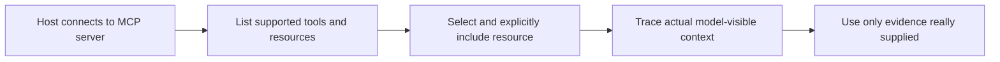

# Objective 2.4 — Integrate MCP with the right scope and discoverability

[Test this decision with a supplied example](#benchmark-exercise-2-4) — predict first, then compare the fixed-fixture evidence.

**Picture the application:** A manufacturing team needs shared access to machine manuals and issue records, while one engineer experiments with a separate connector. Teammates should find the approved information without receiving personal settings or exposed secrets. MCP integration supplies the technical connection, configuration scope and content-catalog choices behind that familiar setup problem.

**Exam:** CCAR-F · **Domain 2:** 18% of exam; no separate objective weight is published here.  
**Time:** 45–65 minutes including practice; allow another 20 minutes for the production challenge.  
**Prerequisites:** Complete 2.1–2.3; understand configuration files and environment variables. New to the Claude API? Start with the [five-minute primer in Lesson 0](../L00-orientation.md#five-minute-primer-how-a-claude-app-works).  
**Continue from:** [Domain lesson](../L02-tool-design-and-mcp-integration.md) · [Objective map](../../../01-Curriculum/02-Architect-Track/CCAR-F-objectives.md).  
**Scenario setting:** Manufacturing; all organizations, records and amounts in examples are fictional.

**Official task statement:** Integrate MCP servers into Claude Code and agent workflows  


<!-- layered-episode:FV-11:start -->
<a id="learn-fv-11"></a>
### Learn the decision in context — FV-11

**Picture the job.** The CRM connection is green, but the assistant still cannot see the report the user expects. This is an original fictional teaching scene, not a recalled live exam question. Read and trace it; no account, installation or API call is required.

**Start small.** Follow the ordinary route: a person supplies a request or record, software passes the needed evidence to the assistant, and a receiving service or person checks the result. The first demonstration assumes the input, access and evidence are suitable. Now remove that assumption in the situation above. Predict what the receiver would see before choosing a repair.

**Original exam-style practice — choose ONE.** An MCP server connects successfully but its resource is absent from model context. What should be checked next?

A. Assume every connected resource was automatically included.

B. Inspect host-supported discovery and explicit resource inclusion, separately from connection establishment.

C. Commit the CRM secret into the shared project so all resources become visible.

<details>
<summary>What is this asking? Plain-language help, without the answer</summary>

Identify what the application needs to trust, what has actually been observed, and what remains unknown. Compare the choices against this situation, rather than choosing the most complicated design. A proposal is an intended action; evidence is what you can point to; a contract says what the receiving part expects. Decide which option fixes the stated failure without pretending another requirement has also been solved.

</details>

**Choose before opening the walkthrough.** Say your answer and the closest alternative aloud, or record them in your own notes.

<details>
<summary>Reveal the repair, evidence and changed condition</summary>

**Answer: B.** Inspect host-supported discovery and explicit resource inclusion, separately from connection establishment.

**Walk it through.** The trace distinguishes connected, listed and included. Only the final inclusion step supports a claim that this report was available to the model.

**Why the alternatives fail here.** Assume every connected resource was automatically included. This leaves the stated boundary or evidence requirement unsatisfied. Commit the CRM secret into the shared project so all resources become visible. This also fails to establish the required result. The closest competing mechanism fails for this specific reason: Connectivity is not proof that every resource was discovered or supplied. Resource behavior depends on host support and invocation.

**Inspect the small artifact.** This is an illustrative application-state note for reading, not an SDK signature or executable configuration. The application or workflow owner creates it; the receiver uses it to distinguish what is known from what still needs checking. Its labels describe this scene; do not paste it into Claude settings.

```text
project_config={server:crm,secret:environment}; trace=[connected,listed,included]
```

**Layer added.** AI reasoning proposes, selects or summarizes where the job needs judgment. Ordinary software checks identifiers, permissions, required fields, recorded outcomes and stop conditions where applicable. A human resolves a policy or evidence gap when the story requires it. Inspect which owner actually supplies the evidence in this scene.



**Change one condition.** Keep the application in mind and consider the new situation below. Choose before opening its explanation.

**Technical transfer question — choose ONE.** A developer tests a personal MCP server with private credentials. Which configuration placement fits?

A. Appropriate personal or local scope with secrets supplied outside committed files.

B. Commit credentials into shared project configuration for convenience.

<details>
<summary>Transfer check</summary>

**A.** A developer tests a personal server. Keep its configuration in the appropriate personal/local scope instead of committing credentials to the team project. Name the changed fact before naming a tool. Preserve unrelated access, source-validation and result checks.

</details>

**Recall in ordinary language.** What broke? Who can fix it? What observable result proves the repair? If you cannot answer all three, replay the concrete scene rather than memorize the option letter.

</details>

**Continue from this decision:** [objective 2.4](objective-2.4.md) · [inspect its decision map](../decision-atlas.md#diagram-d05) · [targeted practice](../../../practice/index.html?exam=CCAR-F&objective=2.4). Existing mapped question IDs: `cct-fv-11-base-v1`, `cct-fv-11-retry-v1`. The new guided question above is separate from those stored items and does not change their answers or progress.
<!-- layered-episode:FV-11:end -->

## Read this objective in both vocabularies

For reading and paper reasoning, no installation or credentials are needed. Keep this page's stated concept prerequisites; any runnable challenge still needs its own setup. If an implementation example feels abrupt, first read [how to interpret its artifact type](../architecture-studio/00-foundations.md#how-to-read-technical-examples-in-this-course), then use the relevant application bridge: [AS-03 decision bridge](../architecture-studio/AS-03-grounded-assistant.md#connect-the-simple-explanation-to-technical-design-choices).

Explain the business purpose first, name the precise mechanism second, and distinguish it from the nearest plausible alternative using the stated constraint. Return here for the objective-specific protocol, options and practice. The bridges are teaching aids, not additional official objectives.


## Big idea

A useful MCP integration combines shared configuration, safe credentials, understandable capabilities, and discoverable content.


<a id="config"></a>
## Choose project or user scope and externalize secrets

The July blueprint places shared team servers in project `.mcp.json` and personal or experimental servers in user-scoped `~/.claude.json`. Project configuration travels with the repository; user configuration follows the individual. Claude Code also distinguishes project-specific local scope, so do not equate every entry stored in `~/.claude.json` with globally available user scope.

Reference credentials through environment expansion such as `${DOCS_TOKEN}` rather than placing the token itself into committed configuration. Expansion is a substitution mechanism, not a secret manager: the environment still needs secure provisioning. Document required variable names, server purpose, and setup checks without recording values. Validate which scope was actually selected after registration; a working personal setup is not proof that teammates received the shared server.

**Illustrative project `.mcp.json` using a fictional endpoint:**

```json
{
  "mcpServers": {
    "manuals": {
      "type": "http",
      "url": "https://manuals.example.com/mcp",
      "headers": {"Authorization": "Bearer ${DOCS_TOKEN}"}
    }
  }
}
```

For a personal fictional HTTP server, the documented registration pattern is `claude mcp add --transport http experiment --scope user https://experiment.example.com/mcp`. Confirm the registration with `claude mcp get experiment` and inspect connection state; the endpoint is illustrative and has not been run. [MCP configuration](https://code.claude.com/docs/en/mcp) (Tier 1; checked 2026-10-02).

Source: [Saved official guide, section 6 task 2.4](https://anthropic-partners.skilljar.com/page/partner-certifications) (Tier 1; July 2026 blueprint).

<a id="discover"></a>
## Make capabilities and content discoverable

The saved blueprint describes tools from configured servers as discovered at connection time and available together. Learn that architectural idea: a server connection exposes a catalog of capabilities, rather than requiring a separate server choice for every task. However, current Claude Code can defer full tool definitions through tool search. Availability, connection readiness, and eager loading into context are different concepts.

Descriptions should explain the MCP tool's purpose, inputs, output and advantage over built-in alternatives. A semantic documentation lookup may be better than Grep for a remote approved corpus, but “search stuff” does not reveal that advantage. MCP resources can expose document trees, issue summaries, or database schemas so the agent knows what content exists without repeatedly issuing exploratory searches. A catalog supplies orientation; it does not establish that every entry has already been fetched or verified.

Source: [Saved official guide, section 6 task 2.4](https://anthropic-partners.skilljar.com/page/partner-certifications) (Tier 1; July 2026 blueprint).

<a id="build"></a>
## Prefer a suitable existing integration, customize deliberately

For a standard integration, first assess existing servers rather than immediately building a custom implementation. Confirm supported operations, authentication, permissions, maintenance, deployment requirements and data handling. “Community” is not by itself an assurance of quality or suitability. Select an existing server when it meets those needs; reserve custom servers for team-specific workflows or requirements it cannot satisfy.

A custom content catalog can complement a standard connector. Keep resource locators stable and include enough metadata for the agent to choose relevant material. Test unavailable servers, missing environment variables, and outdated catalog entries. If discovery fails, report that the capability is unavailable rather than interpreting the failure as absence of documents. Shared configuration also needs a repeatable onboarding path.

Source: [Saved official guide, section 6 task 2.4](https://anthropic-partners.skilljar.com/page/partner-certifications) (Tier 1; July 2026 blueprint).

Current-doc note: Claude Code supports local, project and user scopes and can defer tool definitions with MCP tool search. This updates deployment behavior without replacing the saved July exam wording. [MCP](https://code.claude.com/docs/en/mcp) (Tier 1; checked 2026-10-02).

<a id="worked"></a>
## Worked example: decision, alternative, and trade-off

A fictional manufacturing team needs maintenance documentation and issue tracking. The architect registers a shared project server using an environment-provided token, keeps a personal experimental server in user scope, and exposes a resource catalog of machine manuals. A suitable existing issue-tracker server handles standard operations; a custom adapter covers proprietary maintenance identifiers. The alternative is an all-custom server, which offers one tailored interface but increases maintenance and authentication work. Under a two-week delivery constraint, reuse is attractive only after capability and permission review. A missing token produces a setup failure, not a claim that no manuals exist.

This example applies [Saved official guide, section 6 task 2.4](https://anthropic-partners.skilljar.com/page/partner-certifications) (Tier 1; July 2026 blueprint); it is original teaching material, not an exam item.

**Transfer — professional-services research:** A consultant’s experimental public-document server remains user-scoped, while a shared approved-document catalog lives in project configuration. Team reproducibility matters more than a locally convenient setup. Compare reuse with a custom adapter when required source-location metadata is absent; improving descriptions cannot supply data the server does not return.


<a id="decision-variants"></a>
<a id="variant-fv-11"></a>
## Decision variant FV-11 — Separate connection from inclusion

This is original fictional practice, not an official exam question. All policies, amounts and records below are synthetic.

**Choose in the base case.** A shared marketing repository uses safe project MCP configuration with secrets provided outside committed files. Inspect the actual host’s tool/resource discovery behavior.

**Change one constraint.** A developer tests a personal server. Keep its configuration in the appropriate personal/local scope instead of committing credentials to the team project.

**What failed, and who recovers?** The server connects but the expected resource is not in model context. Check listing, host support and explicit inclusion; do not claim automatic availability.

**Inspect the artifact — illustrative contract, not a drop-in SDK implementation:**

```text
project_config={server:crm,secret:environment}; trace=[connected,listed,included]
```

**Why not the nearest alternative?** Connectivity is not proof that every resource was discovered or supplied. Resource behavior depends on host support and invocation.

**Memory cue with its condition:** Connect, discover, include: prove each stage.

**Proof before accepting success:** Produce a trace or artifact showing the decisive constraint, the selected mechanism, rejected alternative and observable result. Preserve unresolved status; a plausible explanation alone is not completion.

[Inspect D05 and its equivalent decision procedure](../decision-atlas.md#diagram-d05) · [See this decision at walkthrough step 5](../scenario-walkthroughs/WT-04-developer-productivity.md#variant-fv-11) · [Return to the objective map](README.md).

**Blind transfer:** Before opening practice, explain which single change in the scene would reverse your choice and which would only require revalidation. Write the failure signal and the next safe action. The practice app provides separately authored base and later-retry items, with a free-response transfer rubric; assistance/exposure must remain visible in learning history.

**Current runtime reference:** [https://code.claude.com/docs/en/mcp](https://code.claude.com/docs/en/mcp) (reviewed 2026-10-14). The saved blueprint remains the exam coverage source; application policy in this packet is invented teaching context.

<a id="try"></a>
## Try it

Write an illustrative project configuration containing an environment placeholder, describe user-scoped experimental setup, and design a resource catalog entry. Explain what you would check before selecting an existing server.

**Expected output and self-check:** The project configuration contains no credential value. Personal experiments use actual user scope, not accidental project-local scope. The catalog names a document, stable locator, scope and freshness information. Selection checks functionality, access and maintenance; current tool-search behavior is recorded separately from July blueprint wording. Before checking yourself, write the evidence that supports each control-flow or tool decision. If your answer differs, identify whether the difference changes correctness, reliability, or only implementation style.

<a id="production"></a>
## Production challenge and traps

Add missing credentials, a server connection outage and a stale manual locator. Explain the separate setup, availability and content-freshness failures; define an onboarding acceptance check.

A convincing extension names the failure condition, who owns recovery, and the evidence that proves recovery succeeded. Do not mistake a tool request for execution, an execution for full completion, or a plausible summary for verified evidence. Compare the added reliability with its latency, maintenance, and coordination costs.

<a id="done"></a>
## Done when

- [ ] Configure a shared project server with environment-based authentication and verify scope.
- [ ] Configure a personal server in user scope and distinguish local scope.
- [ ] Improve a description so its capability and output are clear relative to built-in tools.
- [ ] Justify an existing server or custom implementation from concrete requirements.
- [ ] Expose a content catalog as resources and handle unavailable discovery explicitly.

Save your explanation, trace or design output in your own notes (or skip this step). Mark any failed check as a practice gap and revisit the mapped teaching section. These checks are observable learning tasks, not a claim that a score predicts certification success.

## Coverage checklist

The identifiers below follow the official Knowledge and Skills bullet order for this task. Each points to its teaching subsection; practice and completion checks above assess application.

| Blueprint bullet | Teaching section |
| --- | --- |
| 2.4-K1 | [Choose project or user scope and externalize secrets](#config) |
| 2.4-K2 | [Choose project or user scope and externalize secrets](#config) |
| 2.4-K3 | [Make capabilities and content discoverable](#discover) |
| 2.4-K4 | [Make capabilities and content discoverable](#discover) |
| 2.4-S1 | [Choose project or user scope and externalize secrets](#config) |
| 2.4-S2 | [Choose project or user scope and externalize secrets](#config) |
| 2.4-S3 | [Make capabilities and content discoverable](#discover) |
| 2.4-S4 | [Prefer a suitable existing integration, customize deliberately](#build) |
| 2.4-S5 | [Make capabilities and content discoverable](#discover) |

**Source boundary:** The July guide defines the assessed coverage. Current documentation notes describe implementation freshness and must be rechecked when a runtime changes.

## Sources

- [Official guide v1.0, July 2026](https://anthropic-partners.skilljar.com/page/partner-certifications), section 6 task 2.4 (Tier 1; saved blueprint; latest revision not certified).
- [MCP in Claude Code](https://code.claude.com/docs/en/mcp) (Tier 1; accessed 2026-10-02; implementation details can change).
- [Existing domain lesson](../L02-tool-design-and-mcp-integration.md) (project-authored synthesis, not independent primary evidence).

**Go deeper:** [Deep practice 2, section 2.4](../deep-practice/02-tool-design-and-mcp-integration.md#24-mcp-servers-in-claude-code-and-agent-workflows)


<a id="benchmark-exercise-2-4"></a>
## Worked evidence task — 2.4: test the boundary

**Original technical decision.** Project MCP configuration references a token variable, but the environment is unprovisioned and no resource was read. Which evidence supports a successful integration claim?

**In everyday terms:** A configuration file is a plan to connect. It is not proof of a connection or retrieved content.

**Before you start:** No account, API key or package installation is needed for the paper task. Optional replay needs Python 3 and the two provided lab files in the same directory. This local inspector models the stated fixture; it does not call Claude, load Claude Code rules or run an MCP server.

### Inspect the supplied input

All identifiers and business rules here are fictional application data. This is **not an SDK request schema**. Keep the input separate from your proposed decision.

```json
{
  "scope": "project",
  "config_file": ".mcp.json",
  "token_variable": "DOCS_TOKEN",
  "token_provisioned": false,
  "server_connected": false,
  "resource_read": false
}
```

### Break, choose, repair, prove

1. **Break:** Use project-shared server configuration with missing environment provisioning and disconnected content. Name the exact failed assumption before proposing another component.
2. **Choose:** Verify provisioning, connection, discovery and actual resource inclusion separately without embedding secrets. Write the nearest alternative you would reject and the requirement it fails.
3. **Repair:** Write the corrected contract or recovery step, keeping successful evidence and unknowns separate.
4. **Prove:** Separate configuration scope, connection, discovery and actual resource inclusion; no embedded secret. Record `decision`, `reason`, `rejected_alternative`, `evidence` and `remaining_unknowns`.

[Open this actual task in the existing LAB](../../../06-Labs/03-CCAR-F-mcp-server-claude-code/README.md#benchmark-exercise-2-4) · [Return to the teaching subsection](#config)

<details><summary>Compare the offline evidence — after making your decision</summary>

The local inspector presents **controlled-fixture calculations and authored reference decisions** below. Some fields are calculated (such as counts or arithmetic); policy labels and recovery choices are supplied worked answers for this fixed example, not executed policies or a general-purpose validator. No Claude, rule loader, service or reviewer was run. `false` or `null` observations remain unresolved when no corresponding live test was performed.

```json
{
  "configuration_scope": "project",
  "secret_value_in_fixture": false,
  "provisioned": false,
  "connected": false,
  "resource_included": false,
  "integration_proven": false
}
```

**Why this matters:** A configuration file is a plan to connect. It is not proof of a connection or retrieved content. The output is a self-check for this controlled example, not certification-score evidence. To test the real mechanism, perform the existing LAB’s integration steps in a fresh disposable context and keep its actual trace beside this prediction.

**Primary-source leads for mechanism review:** [MCP documentation](https://code.claude.com/docs/en/mcp) · [MCP Server Configuration — Claude Code Documentation](https://code.claude.com/docs/en/mcp). The external benchmark helped identify the exercise gap; this task and its data were authored here. Current implementation details must be verified against the installed runtime and those primary sources.

</details>