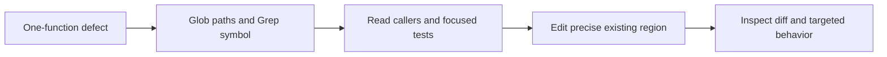

# Objective 2.5 — Use built-in tools to investigate and edit incrementally

[Test this decision with a supplied example](#benchmark-exercise-2-5) — predict first, then compare the fixed-fixture evidence.

**Picture the application:** A scheduling application exposes the same booking behavior under two public function names. A developer investigating a fault needs to find both caller paths, their tests and the relevant setting before changing anything. Built-in search, reading and editing tools provide the technical operations for building that trace safely.

**Exam:** CCAR-F · **Domain 2:** 18% of exam; no separate objective weight is published here.  
**Time:** 45–65 minutes including practice; allow another 20 minutes for the production challenge.  
**Prerequisites:** Complete 2.1; understand a repository path, file contents and exported symbol. New to the Claude API? Start with the [five-minute primer in Lesson 0](../L00-orientation.md#five-minute-primer-how-a-claude-app-works).  
**Continue from:** [Domain lesson](../L02-tool-design-and-mcp-integration.md) · [Objective map](../../../01-Curriculum/02-Architect-Track/CCAR-F-objectives.md).  
**Scenario setting:** Healthcare software, synthetic; all organizations, records and amounts in examples are fictional.

**Official task statement:** Select and apply built-in tools (Read, Write, Edit, Bash, Grep, Glob) effectively  


<!-- layered-episode:FV-12:start -->
<a id="learn-fv-12"></a>
### Learn the decision in context — FV-12

**Picture the job.** You need to fix one retry condition in an unfamiliar codebase without changing other handlers. This is an original fictional teaching scene, not a recalled live exam question. Read and trace it; no account, installation or API call is required.

**Start small.** Follow the ordinary route: a person supplies a request or record, software passes the needed evidence to the assistant, and a receiving service or person checks the result. The first demonstration assumes the input, access and evidence are suitable. Now remove that assumption in the situation above. Predict what the receiver would see before choosing a repair.

**Original exam-style practice — choose ONE.** Which tool sequence best supports a scoped existing-code edit when repository structure and callers are not yet known?

A. Overwrite the entire handler using Write before reading its callers.

B. Dump all repository files into context and make a global replacement.

C. Locate paths and symbols, read relevant callers and tests, apply a focused Edit, then inspect the diff and behavior.

<details>
<summary>What is this asking? Plain-language help, without the answer</summary>

Identify what the application needs to trust, what has actually been observed, and what remains unknown. Compare the choices against this situation, rather than choosing the most complicated design. A proposal is an intended action; evidence is what you can point to; a contract says what the receiving part expects. Decide which option fixes the stated failure without pretending another requirement has also been solved.

</details>

**Choose before opening the walkthrough.** Say your answer and the closest alternative aloud, or record them in your own notes.

<details>
<summary>Reveal the repair, evidence and changed condition</summary>

**Answer: C.** Locate paths and symbols, read relevant callers and tests, apply a focused Edit, then inspect the diff and behavior.

**Walk it through.** The diff changes only the intended condition, the caller contract is preserved and a targeted failing case now passes alongside adjacent cases.

**Why the alternatives fail here.** Overwrite the entire handler using Write before reading its callers. This leaves the stated boundary or evidence requirement unsatisfied. Dump all repository files into context and make a global replacement. This also fails to establish the required result. The closest competing mechanism fails for this specific reason: Dumping or rewriting the repository risks losing context and unrelated code. Tool selection follows the task, not a fixed ritual for every edit.

**Inspect the small artifact.** This is an illustrative application-state note for reading, not an SDK signature or executable configuration. The application or workflow owner creates it; the receiver uses it to distinguish what is known from what still needs checking. Its labels describe this scene; do not paste it into Claude settings.

```text
evidence=[paths,symbol_hits,caller_read,test_read]; change={file:handler.py,region:retry_condition}
```

**Layer added.** AI reasoning proposes, selects or summarizes where the job needs judgment. Ordinary software checks identifiers, permissions, required fields, recorded outcomes and stop conditions where applicable. A human resolves a policy or evidence gap when the story requires it. Inspect which owner actually supplies the evidence in this scene.



**Change one condition.** Keep the application in mind and consider the new situation below. Choose before opening its explanation.

**Technical transfer question — choose ONE.** The task now requires a genuinely new standalone artifact. Which built-in tool action fits?

A. Use broad replacement across existing files because every change must be an Edit.

B. Use Write after confirming the new file location and contract.

<details>
<summary>Transfer check</summary>

**B.** A genuinely new standalone artifact has no existing file to patch. Write the new file after verifying its placement and contract. Name the changed fact before naming a tool. Preserve unrelated access, source-validation and result checks.

</details>

**Recall in ordinary language.** What broke? Who can fix it? What observable result proves the repair? If you cannot answer all three, replay the concrete scene rather than memorize the option letter.

</details>

**Continue from this decision:** [objective 2.5](objective-2.5.md) · [inspect its decision map](../decision-atlas.md#diagram-d11) · [targeted practice](../../../practice/index.html?exam=CCAR-F&objective=2.5). Existing mapped question IDs: `cct-fv-12-base-v1`, `cct-fv-12-retry-v1`. The new guided question above is separate from those stored items and does not change their answers or progress.
<!-- layered-episode:FV-12:end -->

## Read this objective in both vocabularies

For reading and paper reasoning, no installation or credentials are needed. Keep this page's stated concept prerequisites; any runnable challenge still needs its own setup. If an implementation example feels abrupt, first read [how to interpret its artifact type](../architecture-studio/00-foundations.md#how-to-read-technical-examples-in-this-course), then use the relevant application bridge: [AS-05: choose file search, read and edit tools](../architecture-studio/AS-05-code-change.md#connect-the-simple-explanation-to-technical-design-choices).

Explain the business purpose first, name the precise mechanism second, and distinguish it from the nearest plausible alternative using the stated constraint. Return here for the objective-specific protocol, options and practice. The bridges are teaching aids, not additional official objectives.


## Big idea

Choose a tool by the kind of evidence needed, then expand the investigation only along relevant dependencies.


<a id="search"></a>
## Separate content search from path matching

Grep searches file contents: a function name, error text, import statement or configuration key. Glob matches paths: a test extension, a folder pattern or a filename. If you need all `*.test.tsx` files, Glob expresses that directly. If you need files mentioning `recalculatePremium`, Grep answers the content question.

Begin with the narrowest useful search and inspect results before broadening it. A filename match identifies a candidate, not what the file does. A text match identifies a occurrence, not necessarily a call: it may be a comment, import, declaration, or test fixture. Use Read to resolve those distinctions. Bash executes commands when command execution is needed; it is not a substitute for interpreting what a search result proves.

Source: [Saved official guide, section 6 task 2.5](https://anthropic-partners.skilljar.com/page/partner-certifications) (Tier 1; July 2026 blueprint).

<a id="edit"></a>
## Use whole-file and targeted operations deliberately

Read loads contents for understanding. Write creates or replaces full-file content. Edit changes a targeted region anchored by matching text. A unique anchor prevents accidental replacement of the wrong repeated block. Read the relevant context before editing and inspect the result afterward.

If Edit cannot identify a unique match, the blueprint's fallback is Read followed by Write. Preserve the entire intended file, changing only the required region in the constructed output. Whole-file replacement can lose unrelated work, especially with concurrent editors, so re-read current contents and coordinate ownership before writing. A non-unique match is a reason to disambiguate or use a careful whole-file operation, not to blindly replace every occurrence. Verification should inspect the actual change and run relevant checks.

Source: [Saved official guide, section 6 task 2.5](https://anthropic-partners.skilljar.com/page/partner-certifications) (Tier 1; July 2026 blueprint).

<a id="trace"></a>
## Follow entry points and wrapper exports

Build understanding incrementally. Grep for an entry point, Read the module, inspect imports, and follow the relevant dependency. Keep a small trace of caller, wrapper, implementation and effect. Reading every repository file up front consumes attention without establishing the path that matters.

Wrapper modules can obscure usage because the exported public name differs from the underlying implementation. First identify all relevant exported names and aliases, then search for each across the codebase. Read callers to distinguish real runtime usage from definitions or fixtures. Continue through the wrapper to the underlying function before changing behavior. Missing one alias can make a usage analysis look complete while silently omitting an important entry path.

Source: [Saved official guide, section 6 task 2.5](https://anthropic-partners.skilljar.com/page/partner-certifications) (Tier 1; July 2026 blueprint).

<a id="worked"></a>
## Worked example: decision, alternative, and trade-off

A fictional healthcare scheduling repository wraps `reserveSlot` as `bookVisit` and `allocateAppointment`. Using synthetic records only, the investigator Greps the error message, Reads the booking handler, inventories wrapper exports, and searches both public names. Glob locates their tests. A repeated configuration block makes Edit ambiguous, so the author rereads and carefully rewrites the full small file, then reviews the diff. An alternative is targeted Edit with a larger unique anchor, safer for a large file and concurrent work. The decision depends on reliable matching and ownership, not a preference for one tool. A missed alias would leave one booking path untested.

This example applies [Saved official guide, section 6 task 2.5](https://anthropic-partners.skilljar.com/page/partner-certifications) (Tier 1; July 2026 blueprint); it is original teaching material, not an exam item.

**Transfer — logistics software:** A routing wrapper exports old and new API names during migration. Search both names and follow their callers before deleting the old route. A filename inventory alone cannot prove the deprecated interface is unused; the content trace must distinguish imports, active calls and test fixtures.


<a id="decision-variants"></a>
<a id="variant-fv-12"></a>
## Decision variant FV-12 — Search before making a scoped edit

This is original fictional practice, not an official exam question. All policies, amounts and records below are synthetic.

**Choose in the base case.** An unfamiliar education repository needs a one-function fix. Glob relevant paths, Grep the symbol, Read callers and tests, then Edit the precise existing region.

**Change one constraint.** A genuinely new standalone artifact has no existing file to patch. Write the new file after verifying its placement and contract.

**What failed, and who recovers?** A broad replacement changes unrelated handlers. Restore the unintended changes and inspect the focused diff and targeted behavior.

**Inspect the artifact — illustrative contract, not a drop-in SDK implementation:**

```text
evidence=[paths,symbol_hits,caller_read,test_read]; change={file:handler.py,region:retry_condition}
```

**Why not the nearest alternative?** Dumping or rewriting the repository risks losing context and unrelated code. Tool selection follows the task, not a fixed ritual for every edit.

**Memory cue with its condition:** Locate, inspect, change, prove; create only when new.

**Proof before accepting success:** Produce a trace or artifact showing the decisive constraint, the selected mechanism, rejected alternative and observable result. Preserve unresolved status; a plausible explanation alone is not completion.

[Inspect D11 and its equivalent decision procedure](../decision-atlas.md#diagram-d11) · [See this decision at walkthrough step 4](../scenario-walkthroughs/WT-02-code-generation-claude-code.md#variant-fv-12) · [Return to the objective map](README.md).

**Blind transfer:** Before opening practice, explain which single change in the scene would reverse your choice and which would only require revalidation. Write the failure signal and the next safe action. The practice app provides separately authored base and later-retry items, with a free-response transfer rubric; assistance/exposure must remain visible in learning history.

**Current runtime reference:** [https://platform.claude.com/docs/en/agents-and-tools/tool-use/overview](https://platform.claude.com/docs/en/agents-and-tools/tool-use/overview) (reviewed 2026-10-14). The saved blueprint remains the exam coverage source; application policy in this packet is invented teaching context.

<a id="try"></a>
## Try it

Use this synthetic repository fixture; file labels and content are complete for the paper trace:

```text
src/reservation.ts: export function reserveSlot(slotId) { return storage.reserve(slotId); }
src/booking.ts: export { reserveSlot as bookVisit, reserveSlot as allocateAppointment } from "./reservation";
src/web.ts: import { bookVisit } from "./booking"; bookVisit("S-1");
src/batch.ts: import { allocateAppointment } from "./booking"; allocateAppointment("S-2");
src/booking.test.tsx: import { bookVisit } from "./booking"; test("booking", () => bookVisit("S-3"));
src/settings.ts: web = {timeout: 20}; batch = {timeout: 20};
```

Change only the batch timeout to 30. The repeated text `timeout: 20` is intentionally ambiguous; preserve the web value. This fixture illustrates tool choice and trace reasoning, not executable production code.

Given this fictional wrapper exporting `bookVisit` and `allocateAppointment`, create a tool plan to locate tests, find callers, trace the implementation, and fix one repeated setting. Include what you inspect after the change.

**Expected output and self-check:** Glob locates test paths; Grep finds content and both export names; Read follows wrappers and imports. For ambiguous Edit, either establish a unique anchor or use the blueprint Read/Write fallback with current whole-file contents preserved. The readback checks only intended changes and relevant tests, with both aliases represented. The expected trace finds web and its test through `bookVisit`, batch through `allocateAppointment`, and both through `reserveSlot` to storage. Final settings preserve web timeout 20 and change batch timeout to 30. Before checking yourself, write the evidence that supports each control-flow or tool decision. If your answer differs, identify whether the difference changes correctness, reliability, or only implementation style.

**Multiple-response self-check — project-authored:** To find callers through wrappers, select all useful steps: A: inventory exported aliases; B: search each alias in contents; C: treat every filename match as a call; D: read matching callers to distinguish imports and fixtures. **Answer:** A, B and D establish the usage trace. C confuses a candidate path with behavioral evidence.

<a id="production"></a>
## Production challenge and traps

Add a third re-export and a concurrent edit. Update the caller inventory, reread before mutation, and justify a unique-anchor Edit versus whole-file Write under the new constraint.

A convincing extension names the failure condition, who owns recovery, and the evidence that proves recovery succeeded. Do not mistake a tool request for execution, an execution for full completion, or a plausible summary for verified evidence. Compare the added reliability with its latency, maintenance, and coordination costs.

<a id="done"></a>
## Done when

- [ ] Select Grep for content and Glob for filename or path patterns.
- [ ] Use Read then careful Write when unique Edit matching is unavailable.
- [ ] Trace relevant entry points and imports incrementally without loading the entire repository.
- [ ] Inventory exported wrapper names and search every relevant alias for callers.

Save your explanation, trace or design output in your own notes (or skip this step). Mark any failed check as a practice gap and revisit the mapped teaching section. These checks are observable learning tasks, not a claim that a score predicts certification success.

## Coverage checklist

The identifiers below follow the official Knowledge and Skills bullet order for this task. Each points to its teaching subsection; practice and completion checks above assess application.

| Blueprint bullet | Teaching section |
| --- | --- |
| 2.5-K1 | [Separate content search from path matching](#search) |
| 2.5-K2 | [Separate content search from path matching](#search) |
| 2.5-K3 | [Use whole-file and targeted operations deliberately](#edit) |
| 2.5-K4 | [Use whole-file and targeted operations deliberately](#edit) |
| 2.5-S1 | [Separate content search from path matching](#search) |
| 2.5-S2 | [Separate content search from path matching](#search) |
| 2.5-S3 | [Use whole-file and targeted operations deliberately](#edit) |
| 2.5-S4 | [Follow entry points and wrapper exports](#trace) |
| 2.5-S5 | [Follow entry points and wrapper exports](#trace) |

**Source boundary:** The July guide defines the assessed coverage. Current documentation notes describe implementation freshness and must be rechecked when a runtime changes.

## Sources

- [Official guide v1.0, July 2026](https://anthropic-partners.skilljar.com/page/partner-certifications), section 6 task 2.5 (Tier 1; saved blueprint; latest revision not certified).
- [Existing domain lesson](../L02-tool-design-and-mcp-integration.md) (project-authored synthesis, not independent primary evidence).

**Go deeper:** [Deep practice 2, section 2.5](../deep-practice/02-tool-design-and-mcp-integration.md#25-built-in-tools-read-write-edit-bash-grep-glob)


<a id="benchmark-exercise-2-5"></a>
## Worked evidence task — 2.5: test the boundary

**Original technical decision.** A call reaches legacyPrice through two re-export files, and the edit anchor appears more than once. Which inspection sequence prevents an unrelated replacement?

**In everyday terms:** Find where the value is used before changing a repeated line.

**Before you start:** No account, API key or package installation is needed for the paper task. Optional replay needs Python 3 and the two provided lab files in the same directory. This local inspector models the stated fixture; it does not call Claude, load Claude Code rules or run an MCP server.

### Inspect the supplied input

All identifiers and business rules here are fictional application data. This is **not an SDK request schema**. Keep the input separate from your proposed decision.

```json
{
  "entry": "src/main.ts",
  "export_chain": [
    "src/index.ts",
    "src/api.ts"
  ],
  "target": "legacyPrice",
  "repeated_anchor": "return amount;",
  "test_path": "src/__tests__/price.test.ts"
}
```

### Break, choose, repair, prove

1. **Break:** Find a caller through a re-export and a repeated edit anchor. Name the exact failed assumption before proposing another component.
2. **Choose:** Trace definitions and callers through the export chain, locate the exact edit context and preserve unrelated occurrences. Write the nearest alternative you would reject and the requirement it fails.
3. **Repair:** Write the corrected contract or recovery step, keeping successful evidence and unknowns separate.
4. **Prove:** Distinguish path/content search; inspect actual call sites; preserve unrelated file content. Record `decision`, `reason`, `rejected_alternative`, `evidence` and `remaining_unknowns`.

[Open this actual task in the existing LAB](../../../06-Labs/08-CCAR-F-architecture-decisions/README.md#benchmark-exercise-2-5) · [Return to the teaching subsection](#search)

<details><summary>Compare the offline evidence — after making your decision</summary>

The local inspector presents **controlled-fixture calculations and authored reference decisions** below. Some fields are calculated (such as counts or arithmetic); policy labels and recovery choices are supplied worked answers for this fixed example, not executed policies or a general-purpose validator. No Claude, rule loader, service or reviewer was run. `false` or `null` observations remain unresolved when no corresponding live test was performed.

```json
{
  "inspect_order": [
    "src/main.ts",
    "src/index.ts",
    "src/api.ts",
    "src/__tests__/price.test.ts"
  ],
  "target": "legacyPrice",
  "unscoped_replace_safe": false,
  "call_sites_observed": false
}
```

**Why this matters:** Find where the value is used before changing a repeated line. The output is a self-check for this controlled example, not certification-score evidence. To test the real mechanism, perform the existing LAB’s integration steps in a fresh disposable context and keep its actual trace beside this prediction.

**Primary-source leads for mechanism review:** [Edit tool docs](https://code.claude.com/docs/en/tools-reference#edit-tool-behavior) · [Edit tool reference](https://code.claude.com/docs/en/tools-reference#edit-tool-behavior). The external benchmark helped identify the exercise gap; this task and its data were authored here. Current implementation details must be verified against the installed runtime and those primary sources.

</details>