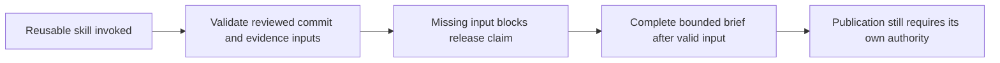

# Objective 3.2 — Create and configure custom slash commands and skills

[Test this decision with a supplied example](#benchmark-exercise-3-2) — predict first, then compare the fixed-fixture evidence.

**Picture the application:** A team wants a repeatable migration audit that accepts a file path and returns a concise risk table without overwhelming implementation work. The same request should work for teammates as well as its author. Commands, skills and isolated execution supply the technical choices for packaging that recurring activity.


**Exam:** CCAR-F · **Domain 3:** 20% of exam; no separate objective weight is published here.  
**Time:** 30–40 minutes foundation/applied; 15–25 additional minutes production extension.  
**Prerequisites:** 3.1 configuration scope and 1.3 isolated subagents. New to the Claude API? Start with the [five-minute primer in Lesson 0](../L00-orientation.md#five-minute-primer-how-a-claude-app-works).  
**Continue from:** [Domain lesson](../L03-claude-code-configuration-and-workflows.md) · [Objective map](../../../01-Curriculum/02-Architect-Track/CCAR-F-objectives.md).

**Official task statement:** Create and configure custom slash commands and skills


<!-- layered-episode:FV-14:start -->
<a id="learn-fv-14"></a>
### Learn the decision in context — FV-14

**Picture the job.** A release-note helper keeps being asked to summarize the same evidence, but today nobody supplied the reviewed commit. This is an original fictional teaching scene, not a recalled live exam question. Read and trace it; no account, installation or API call is required.

**Start small.** Follow the ordinary route: a person supplies a request or record, software passes the needed evidence to the assistant, and a receiving service or person checks the result. The first demonstration assumes the input, access and evidence are suitable. Now remove that assumption in the situation above. Predict what the receiver would see before choosing a repair.

**Original exam-style practice — choose ONE.** A reusable skill lacks a required reviewed commit input. Which behavior preserves its output contract?

A. Invent the most likely commit from the conversation.

B. Stop with a missing-input response; require commit and evidence before producing the reviewed-release output.

C. Treat skill invocation itself as permission to publish a release.

<details>
<summary>What is this asking? Plain-language help, without the answer</summary>

Identify what the application needs to trust, what has actually been observed, and what remains unknown. Compare the choices against this situation, rather than choosing the most complicated design. A proposal is an intended action; evidence is what you can point to; a contract says what the receiving part expects. Decide which option fixes the stated failure without pretending another requirement has also been solved.

</details>

**Choose before opening the walkthrough.** Say your answer and the closest alternative aloud, or record them in your own notes.

<details>
<summary>Reveal the repair, evidence and changed condition</summary>

**Answer: B.** Stop with a missing-input response; require commit and evidence before producing the reviewed-release output.

**Walk it through.** The output names the missing reviewed_commit and produces no claim of verified release. A valid replay binds the summary to actual test evidence.

**Why the alternatives fail here.** Invent the most likely commit from the conversation. This leaves the stated boundary or evidence requirement unsatisfied. Treat skill invocation itself as permission to publish a release. This also fails to establish the required result. The closest competing mechanism fails for this specific reason: A reusable skill is not permission to publish. Invocation and downstream authorization remain separate.

**Inspect the small artifact.** This is an illustrative application-state note for reading, not an SDK signature or executable configuration. The application or workflow owner creates it; the receiver uses it to distinguish what is known from what still needs checking. Its labels describe this scene; do not paste it into Claude settings.

```text
skill_input={reviewed_commit,tests,evidence}; output={changes,limits,next_action}
```

**Layer added.** AI reasoning proposes, selects or summarizes where the job needs judgment. Ordinary software checks identifiers, permissions, required fields, recorded outcomes and stop conditions where applicable. A human resolves a policy or evidence gap when the story requires it. Inspect which owner actually supplies the evidence in this scene.



**Change one condition.** Keep the application in mind and consider the new situation below. Choose before opening its explanation.

**Technical transfer question — choose ONE.** The task is now a one-off explanation with no repeated workflow. What is proportionate?

A. Create a publishing-capable skill and treat invocation as deployment approval.

B. A direct bounded brief rather than an unnecessary reusable skill.

<details>
<summary>Transfer check</summary>

**B.** A single ad hoc explanation is needed. Use a brief rather than creating a reusable asset without repeated need. Name the changed fact before naming a tool. Preserve unrelated access, source-validation and result checks.

</details>

**Recall in ordinary language.** What broke? Who can fix it? What observable result proves the repair? If you cannot answer all three, replay the concrete scene rather than memorize the option letter.

</details>

**Continue from this decision:** [objective 3.2](objective-3.2.md) · [inspect its decision map](../decision-atlas.md#diagram-d11) · [targeted practice](../../../practice/index.html?exam=CCAR-F&objective=3.2). Existing mapped question IDs: `cct-fv-14-base-v1`, `cct-fv-14-retry-v1`. The new guided question above is separate from those stored items and does not change their answers or progress.
<!-- layered-episode:FV-14:end -->

## Read this objective in both vocabularies

For reading and paper reasoning, no installation or credentials are needed. Keep this page's stated concept prerequisites; any runnable challenge still needs its own setup. If an implementation example feels abrupt, first read [how to interpret its artifact type](../architecture-studio/00-foundations.md#how-to-read-technical-examples-in-this-course), then use the relevant application bridge: [AS-05 decision bridge](../architecture-studio/AS-05-code-change.md#connect-the-simple-explanation-to-technical-design-choices).

Explain the business purpose first, name the precise mechanism second, and distinguish it from the nearest plausible alternative using the stated constraint. Return here for the objective-specific protocol, options and practice. The bridges are teaching aids, not additional official objectives.


## Big idea

A reusable procedure should load when needed; a universal standard should be available throughout work. Scope, isolation, arguments and permissions are separate design choices.

## Foundation

### 3.2-K1

**Blueprint focus:** Project-scoped commands in .claude/commands/ (shared via version control) vs user-scoped commands in ~/.claude/commands/ (personal)

The July blueprint distinguishes .claude/commands/ for version-controlled team commands from ~/.claude/commands/ for personal commands. A home-directory command can work perfectly for its author yet remain unavailable to teammates. Current documentation merges custom commands into skills while retaining these legacy command files.

[Exam guide v1.0, section 6 task 3.2](https://anthropic-partners.skilljar.com/page/partner-certifications) (Tier 1, July 2026 blueprint).

### 3.2-K2

**Blueprint focus:** Skills in .claude/skills/ with SKILL.md files that support frontmatter configuration including context: fork, allowed-tools, and argument-hint

A skill directory holds SKILL.md and can carry supporting material. Frontmatter describes invocation behavior and arguments. Keep the body focused on one reusable workflow, such as reviewing a migration, rather than repeating universal project standards that belong in CLAUDE.md.

[Exam guide v1.0, section 6 task 3.2](https://anthropic-partners.skilljar.com/page/partner-certifications) (Tier 1, July 2026 blueprint).

### 3.2-K3

**Blueprint focus:** The context: fork frontmatter option for running skills in an isolated sub-agent context, preventing skill outputs from polluting the main conversation

A forked skill executes in a separate subagent context. That is useful for discovery that produces hundreds of file references: the parent receives a useful result rather than all intermediate exploration. The child still needs a clear task and the right inputs.

[Exam guide v1.0, section 6 task 3.2](https://anthropic-partners.skilljar.com/page/partner-certifications) (Tier 1, July 2026 blueprint).

### 3.2-K4

**Blueprint focus:** Personal skill customization: creating personal variants in ~/.claude/skills/ with different names to avoid affecting teammates

Personal variants should use distinct names in ~/.claude/skills/. Naming a customized workflow review-personal makes its purpose visible and avoids silently changing what teammates expect from the shared review skill. Document any behavior difference rather than relying on memory.

[Exam guide v1.0, section 6 task 3.2](https://anthropic-partners.skilljar.com/page/partner-certifications) (Tier 1, July 2026 blueprint).

## Applied skills

These are design applications. Pseudocode and schemas are illustrative unless separately dry-run; a saved design is not a completed implementation.

### 3.2-S1

**Blueprint focus:** Creating project-scoped slash commands in .claude/commands/ for team-wide availability via version control

Create a repository command such as .claude/commands/review-migration.md, commit it with its supporting standards, and verify it appears in a teammate checkout. The current skills equivalent is .claude/skills/review-migration/SKILL.md; choose one maintained definition instead of accidental duplicates.

[Exam guide v1.0, section 6 task 3.2](https://anthropic-partners.skilljar.com/page/partner-certifications) (Tier 1, July 2026 blueprint).

### 3.2-S2

**Blueprint focus:** Using context: fork to isolate skills that produce verbose output (e.g., codebase analysis) or exploratory context (e.g., brainstorming alternatives) from the main session

Set context: fork for an investigative skill whose intermediate output is noisy. Ask it to return findings, evidence and unresolved questions. Check that the returned summary contains the necessary conclusions; isolation is ineffective if it discards evidence needed for the next decision.

[Exam guide v1.0, section 6 task 3.2](https://anthropic-partners.skilljar.com/page/partner-certifications) (Tier 1, July 2026 blueprint).

### 3.2-S3

**Blueprint focus:** Configuring allowed-tools in skill frontmatter to restrict tool access during skill execution (e.g., limiting to file write operations to prevent destructive actions)

The blueprint describes allowed-tools as restriction. Current docs explicitly describe it as permission pre-approval, not removal of other tools. Use actual restrictions such as disallowed-tools or applicable permission deny rules for prohibited actions, and test a prohibited call before treating a skill as safe. [Current permission semantics](https://code.claude.com/docs/en/skills) (Tier 1, checked 2026-10-02).

[Exam guide v1.0, section 6 task 3.2](https://anthropic-partners.skilljar.com/page/partner-certifications) (Tier 1, July 2026 blueprint).

### 3.2-S4

**Blueprint focus:** Using argument-hint frontmatter to prompt developers for required parameters when they invoke the skill without arguments

Use argument-hint to show expected input, for example a package path and review focus. This is an invocation aid, not a required-argument validator. Have the workflow stop and request missing essential input instead of inventing a target directory.

[Exam guide v1.0, section 6 task 3.2](https://anthropic-partners.skilljar.com/page/partner-certifications) (Tier 1, July 2026 blueprint).

### 3.2-S5

**Blueprint focus:** Choosing between skills (on-demand invocation for task-specific workflows) and CLAUDE.md (always-loaded universal standards)

Place persistent rules such as “reuse fixtures” in CLAUDE.md; place a multi-step migration review in a skill. Explain when the procedure loads and which personal or project location supplies it. Moving all standards into skills risks them being absent when needed.

[Exam guide v1.0, section 6 task 3.2](https://anthropic-partners.skilljar.com/page/partner-certifications) (Tier 1, July 2026 blueprint).

## Worked example

A team wants /migration-audit to inspect changed migrations without drowning out implementation work. Its legacy command is committed in .claude/commands/; a current implementation uses a project skill with context: fork and argument-hint: [migration-path]. The workflow asks for missing paths, inspects evidence and returns a concise risk table. It pre-approves only needed reads, while separate restrictions prevent changes. A personal variant is named migration-audit-notes. Keeping the audit in the main conversation is a credible alternative for a two-file change because its evidence is small and immediately useful. Forking is preferable once discovery becomes verbose. Putting the entire procedure into CLAUDE.md would make every task carry it, including unrelated edits. The trade-off is an explicit handoff contract and additional context setup for the isolated run.

Original synthetic scenario; decision principles: [Exam guide v1.0, section 6 task 3.2](https://anthropic-partners.skilljar.com/page/partner-certifications) (Tier 1, July 2026 blueprint).

### Illustrative project skill artifact

```yaml
---
name: migration-audit
argument-hint: "[migration-path]"
context: fork
allowed-tools: Read, Grep, Glob
---
```

The body asks for the target path, reports findings with evidence, and requests clarification when the path is absent. In current Claude Code, this `allowed-tools` list pre-approves those tools; it does not remove every other tool. Add and verify actual restrictions for your intended safety boundary before use. The YAML is a teaching artifact, not a tested installed skill.

## Production transfer

**Financial operations; enrichment beyond the blueprint examples.** A synthetic reconciliation audit must inspect ledgers without initiating transfers. A forked project skill produces evidence and unresolved mismatches; a personal commentary variant has a distinct name. Compare a read-only audit workflow with a broader workflow that also drafts corrections: the latter needs stronger restrictions and separate authorization. Test a prohibited write in a disposable environment rather than inferring safety from frontmatter. Recovery preserves partial findings if discovery fails. Extension: require approval before any correction is executed and identify the actual enforcement boundary.

In your own notes, save your decision, rejected alternative, evidence and recovery path. Re-run the decision with the changed constraint before calling the pattern transferable. This is a design exercise, not industry compliance advice.

## Traps and counterexamples

Argument hints do not guarantee validation. Forking does not magically provide parent history. Permission pre-approval and tool restriction are different concepts; retain the exam wording while learning the current distinction.

<a id="decision-variants"></a>
<a id="variant-fv-14"></a>
## Decision variant FV-14 — Give reusable skills a contract

This is original fictional practice, not an official exam question. All policies, amounts and records below are synthetic.

**Choose in the base case.** A repeated reviewed-release brief becomes a scoped skill with required commit, evidence paths and output expectations. Check discovery and allowed dependencies.

**Change one constraint.** A single ad hoc explanation is needed. Use a brief rather than creating a reusable asset without repeated need.

**What failed, and who recovers?** The skill is invoked without the reviewed commit. Stop with a missing-input message instead of inventing a build identity.

**Inspect the artifact — illustrative contract, not a drop-in SDK implementation:**

```text
skill_input={reviewed_commit,tests,evidence}; output={changes,limits,next_action}
```

**Why not the nearest alternative?** A reusable skill is not permission to publish. Invocation and downstream authorization remain separate.

**Memory cue with its condition:** Reuse the workflow; require its inputs; preserve permission.

**Proof before accepting success:** Produce a trace or artifact showing the decisive constraint, the selected mechanism, rejected alternative and observable result. Preserve unresolved status; a plausible explanation alone is not completion.

[Inspect D11 and its equivalent decision procedure](../decision-atlas.md#diagram-d11) · [See this decision at walkthrough step 7](../scenario-walkthroughs/WT-04-developer-productivity.md#variant-fv-14) · [Return to the objective map](README.md).

**Blind transfer:** Before opening practice, explain which single change in the scene would reverse your choice and which would only require revalidation. Write the failure signal and the next safe action. The practice app provides separately authored base and later-retry items, with a free-response transfer rubric; assistance/exposure must remain visible in learning history.

**Current runtime reference:** [https://code.claude.com/docs/en/memory](https://code.claude.com/docs/en/memory) (reviewed 2026-10-14). The saved blueprint remains the exam coverage source; application policy in this packet is invented teaching context.


## Try it

Design a shared audit workflow, a personal variant and a universal standard. State their paths, frontmatter, required argument handling and one forbidden action. Explain how you would verify isolation and the forbidden action.

Attempt your design before reading the self-check. Save the artifact and the decision rationale so an independent reviewer can inspect them.

### Expected output and self-check

The shared workflow is committed; the personal variant has a different name. The standard stays in project memory. Forking returns a concise evidence-bearing summary. Missing target paths trigger clarification. Current implementation must enforce the forbidden action with real restrictions; allowed-tools alone is insufficient.

## Done when

- [ ] **3.2-S1:** Save the shared command/skill path and teammate-availability check; personal customization uses a distinct name.
- [ ] **3.2-S2:** Configure context: fork and a returned evidence summary; explain which verbose discovery remains outside the parent conversation.
- [ ] **3.2-S3:** Separate allowed-tools pre-approval from actual restriction; name the restrictive rule and a prohibited-action verification.
- [ ] **3.2-S4:** Include argument-hint plus missing-required-argument handling; an absent target is clarified rather than invented.
- [ ] **3.2-S5:** Place the universal standard in CLAUDE.md and the on-demand procedure in a skill; justify when each loads.

In your own notes, save each stated artifact and check against the supplied expected outputs. Written design evidence and actual implementation evidence remain separate; learner mastery is not inferred from reading.

## Coverage checklist

| Official bullet, in guide order | Exact teaching section |
| --- | --- |
| 3.2-K1: Project-scoped commands in .claude/commands/ (shared via version control) vs user-scoped commands in ~/.claude/commands/ (personal) | [3.2-K1](#32-k1) |
| 3.2-K2: Skills in .claude/skills/ with SKILL.md files that support frontmatter configuration including context: fork, allowed-tools, and argument-hint | [3.2-K2](#32-k2) |
| 3.2-K3: The context: fork frontmatter option for running skills in an isolated sub-agent context, preventing skill outputs from polluting the main conversation | [3.2-K3](#32-k3) |
| 3.2-K4: Personal skill customization: creating personal variants in ~/.claude/skills/ with different names to avoid affecting teammates | [3.2-K4](#32-k4) |
| 3.2-S1: Creating project-scoped slash commands in .claude/commands/ for team-wide availability via version control | [3.2-S1](#32-s1) |
| 3.2-S2: Using context: fork to isolate skills that produce verbose output (e.g., codebase analysis) or exploratory context (e.g., brainstorming alternatives) from the main session | [3.2-S2](#32-s2) |
| 3.2-S3: Configuring allowed-tools in skill frontmatter to restrict tool access during skill execution (e.g., limiting to file write operations to prevent destructive actions) | [3.2-S3](#32-s3) |
| 3.2-S4: Using argument-hint frontmatter to prompt developers for required parameters when they invoke the skill without arguments | [3.2-S4](#32-s4) |
| 3.2-S5: Choosing between skills (on-demand invocation for task-specific workflows) and CLAUDE.md (always-loaded universal standards) | [3.2-S5](#32-s5) |

## Sources and freshness

[Exam guide v1.0, section 6 task 3.2](https://anthropic-partners.skilljar.com/page/partner-certifications) (Tier 1, July 2026 blueprint).

The official objective wording is reproduced for traceability; explanations and all scenarios are project-authored. Existing L03–L05 provide domain synthesis; this module expands each bullet into a teachable decision. The saved July guide is the blueprint baseline, not a claim that no newer guide exists.

**Version note, checked 2026-10-02:** legacy command files remain supported; current skills and permission behavior differ from simplified July terminology. [Skills documentation](https://code.claude.com/docs/en/skills) (Tier 1).

**Go deeper:** [Deep practice 3, section 3.2](../deep-practice/03-claude-code-configuration-and-workflows.md#32-custom-slash-commands-and-skills)


<a id="benchmark-exercise-3-2"></a>
## Worked evidence task — 3.2: test the boundary

**Original technical decision.** A reusable release procedure accepts a candidate ID and should execute in an isolated context with Read access. Which artifacts separate procedure, universal rule and actual permission?

**In everyday terms:** A written instruction can request a boundary, but the runtime has to enforce it.

**Before you start:** No account, API key or package installation is needed for the paper task. Optional replay needs Python 3 and the two provided lab files in the same directory. This local inspector models the stated fixture; it does not call Claude, load Claude Code rules or run an MCP server.

### Inspect the supplied input

All identifiers and business rules here are fictional application data. This is **not an SDK request schema**. Keep the input separate from your proposed decision.

```json
{
  "workflow": "release_check",
  "argument": "candidate_id",
  "universal_rule": "do not expose secrets",
  "isolated_output": true,
  "required_capability": "Read"
}
```

### Break, choose, repair, prove

1. **Break:** Move a reusable procedure into a skill with an argument and a limited execution context. Name the exact failed assumption before proposing another component.
2. **Choose:** Define the reusable procedure and argument, preserve the universal secret rule, and test isolation and permissions in the actual installed runtime. Write the nearest alternative you would reject and the requirement it fails.
3. **Repair:** Write the corrected contract or recovery step, keeping successful evidence and unknowns separate.
4. **Prove:** Identify actual loading/invocation behavior and verify permission behavior independently of prompt text. Record `decision`, `reason`, `rejected_alternative`, `evidence` and `remaining_unknowns`.

[Open this actual task in the existing LAB](../../../06-Labs/03-CCAR-F-mcp-server-claude-code/README.md#benchmark-exercise-3-2) · [Return to the teaching subsection](#foundation)

<details><summary>Compare the offline evidence — after making your decision</summary>

The local inspector presents **controlled-fixture calculations and authored reference decisions** below. Some fields are calculated (such as counts or arithmetic); policy labels and recovery choices are supplied worked answers for this fixed example, not executed policies or a general-purpose validator. No Claude, rule loader, service or reviewer was run. `false` or `null` observations remain unresolved when no corresponding live test was performed.

```json
{
  "procedure": "release_check",
  "argument": "candidate_id",
  "universal_rule": "do not expose secrets",
  "requested_capability": "Read",
  "runtime_isolation_verified": false,
  "runtime_permissions_verified": false
}
```

**Why this matters:** A written instruction can request a boundary, but the runtime has to enforce it. The output is a self-check for this controlled example, not certification-score evidence. To test the real mechanism, perform the existing LAB’s integration steps in a fresh disposable context and keep its actual trace beside this prediction.

**Primary-source leads for mechanism review:** [skills frontmatter reference](https://code.claude.com/docs/en/skills) · [Claude Code skills docs](https://code.claude.com/docs/en/skills). The external benchmark helped identify the exercise gap; this task and its data were authored here. Current implementation details must be verified against the installed runtime and those primary sources.

</details>