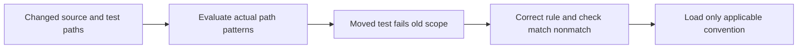

# Objective 3.3 — Apply path-specific rules for conditional convention loading

[Test this decision with a supplied example](#benchmark-exercise-3-3) — predict first, then compare the fixed-fixture evidence.

**Picture the application:** A storefront keeps tests beside ordinary source files in several folders. Its team wants a shared clock-testing convention to reach relevant tests without adding unrelated instructions to every edit. Path-specific rules are the technical mechanism; the practical output is one maintained convention applied to the intended files.


**Exam:** CCAR-F · **Domain 3:** 20% of exam; no separate objective weight is published here.  
**Time:** 30–40 minutes foundation/applied; 15–25 additional minutes production extension.  
**Prerequisites:** 3.1 configuration hierarchy and basic glob patterns. New to the Claude API? Start with the [five-minute primer in Lesson 0](../L00-orientation.md#five-minute-primer-how-a-claude-app-works).  
**Continue from:** [Domain lesson](../L03-claude-code-configuration-and-workflows.md) · [Objective map](../../../01-Curriculum/02-Architect-Track/CCAR-F-objectives.md).

**Official task statement:** Apply path-specific rules for conditional convention loading


<!-- layered-episode:FV-15:start -->
<a id="learn-fv-15"></a>
### Learn the decision in context — FV-15

**Picture the job.** A test moved into a new folder and stopped receiving the testing instructions that used to apply. This is an original fictional teaching scene, not a recalled live exam question. Read and trace it; no account, installation or API call is required.

**Start small.** Follow the ordinary route: a person supplies a request or record, software passes the needed evidence to the assistant, and a receiving service or person checks the result. The first demonstration assumes the input, access and evidence are suitable. Now remove that assumption in the situation above. Predict what the receiver would see before choosing a repair.

**Original exam-style practice — choose ONE.** A moved file no longer matches a path-specific rule. Which remediation verifies scope rather than masking the issue?

A. Paste every repository rule into the main prompt.

B. Assume the rule follows file history even when its path changes.

C. Correct the relevant path pattern and check both matching and nonmatching files under the actual loading behavior.

<details>
<summary>What is this asking? Plain-language help, without the answer</summary>

Identify what the application needs to trust, what has actually been observed, and what remains unknown. Compare the choices against this situation, rather than choosing the most complicated design. A proposal is an intended action; evidence is what you can point to; a contract says what the receiving part expects. Decide which option fixes the stated failure without pretending another requirement has also been solved.

</details>

**Choose before opening the walkthrough.** Say your answer and the closest alternative aloud, or record them in your own notes.

<details>
<summary>Reveal the repair, evidence and changed condition</summary>

**Answer: C.** Correct the relevant path pattern and check both matching and nonmatching files under the actual loading behavior.

**Walk it through.** The scope check lists the moved test as matched and an unrelated source file as unmatched. The intended convention applies without flooding all tasks.

**Why the alternatives fail here.** Paste every repository rule into the main prompt. This leaves the stated boundary or evidence requirement unsatisfied. Assume the rule follows file history even when its path changes. This also fails to establish the required result. The closest competing mechanism fails for this specific reason: Duplicating every rule into the main prompt can hide mismatches and flood context; path scope must match actual files.

**Inspect the small artifact.** This is an illustrative application-state note for reading, not an SDK signature or executable configuration. The application or workflow owner creates it; the receiver uses it to distinguish what is known from what still needs checking. Its labels describe this scene; do not paste it into Claude settings.

```text
paths=[services/api.py,tests/test_api.py]; rules={backend:services/**,testing:tests/**}
```

**Layer added.** AI reasoning proposes, selects or summarizes where the job needs judgment. Ordinary software checks identifiers, permissions, required fields, recorded outcomes and stop conditions where applicable. A human resolves a policy or evidence gap when the story requires it. Inspect which owner actually supplies the evidence in this scene.



**Change one condition.** Keep the application in mind and consider the new situation below. Choose before opening its explanation.

**Technical transfer question — choose ONE.** A security requirement applies across the repository. Which scope matches it?

A. An appropriate broader instruction or enforcement scope.

B. Only the old tests glob, even for unrelated protected paths.

<details>
<summary>Transfer check</summary>

**A.** A security policy genuinely applies across the repository. Move that requirement to an appropriate broader scope. Name the changed fact before naming a tool. Preserve unrelated access, source-validation and result checks.

</details>

**Recall in ordinary language.** What broke? Who can fix it? What observable result proves the repair? If you cannot answer all three, replay the concrete scene rather than memorize the option letter.

</details>

**Continue from this decision:** [objective 3.3](objective-3.3.md) · [inspect its decision map](../decision-atlas.md#diagram-d11) · [targeted practice](../../../practice/index.html?exam=CCAR-F&objective=3.3). Existing mapped question IDs: `cct-fv-15-base-v1`, `cct-fv-15-retry-v1`. The new guided question above is separate from those stored items and does not change their answers or progress.
<!-- layered-episode:FV-15:end -->

## Read this objective in both vocabularies

For reading and paper reasoning, no installation or credentials are needed. Keep this page's stated concept prerequisites; any runnable challenge still needs its own setup. If an implementation example feels abrupt, first read [how to interpret its artifact type](../architecture-studio/00-foundations.md#how-to-read-technical-examples-in-this-course), then use the relevant application bridge: [AS-05 decision bridge](../architecture-studio/AS-05-code-change.md#connect-the-simple-explanation-to-technical-design-choices) · [AS-06 decision bridge](../architecture-studio/AS-06-ci-review.md#connect-the-simple-explanation-to-technical-design-choices).

Explain the business purpose first, name the precise mechanism second, and distinguish it from the nearest plausible alternative using the stated constraint. Return here for the objective-specific protocol, options and practice. The bridges are teaching aids, not additional official objectives.


## Big idea

Use the shape of the files to decide when conventions apply. A test convention can cross package boundaries without becoming a universal instruction.

## Foundation

### 3.3-K1

**Blueprint focus:** .claude/rules/ files with YAML frontmatter paths fields containing glob patterns for conditional rule activation

Path rules live in .claude/rules/ and use YAML frontmatter paths containing glob patterns. The pattern is a selection rule: it identifies which file work needs the associated convention. Keep the body about behavior, such as fixture reuse, rather than listing every matching filename.

[Exam guide v1.0, section 6 task 3.3](https://anthropic-partners.skilljar.com/page/partner-certifications) (Tier 1, July 2026 blueprint).

### 3.3-K2

**Blueprint focus:** How path-scoped rules load only when editing matching files, reducing irrelevant context and token usage

Conditional loading avoids making unrelated work carry specialized guidance. A database rule should not occupy the context of a CSS edit merely because it exists in the repository. This saves attention as well as tokens. Today's docs say a path-scoped rule triggers when Claude uses Read, Write or Edit on a matching file ([Claude Code memory docs](https://code.claude.com/docs/en/memory), Tier 1); the guide says "when editing".

[Exam guide v1.0, section 6 task 3.3](https://anthropic-partners.skilljar.com/page/partner-certifications) (Tier 1, July 2026 blueprint).

### 3.3-K3

**Blueprint focus:** The advantage of glob-pattern rules over directory-level CLAUDE.md files for conventions that span multiple directories (e.g., test files spread throughout a codebase)

Directory memory follows a location hierarchy. Globs follow a file characteristic across locations. If tests are colocated with application code in many packages, **/*.test.tsx expresses the convention more accurately than dozens of subdirectory files containing duplicated text.

[Exam guide v1.0, section 6 task 3.3](https://anthropic-partners.skilljar.com/page/partner-certifications) (Tier 1, July 2026 blueprint).

## Applied skills

These are design applications. Pseudocode and schemas are illustrative unless separately dry-run; a saved design is not a completed implementation.

### 3.3-S1

**Blueprint focus:** Creating .claude/rules/ files with YAML frontmatter path scoping (e.g., paths: ["terraform/**/*"]) so rules load only when editing matching files

Create a Terraform rule with paths: ["terraform/**/*"] and a body describing reviewable change plans. Exercise one matching and one nonmatching path. Inspect the loaded guidance so a syntactically valid YAML file is not mistaken for successful activation.

[Exam guide v1.0, section 6 task 3.3](https://anthropic-partners.skilljar.com/page/partner-certifications) (Tier 1, July 2026 blueprint).

### 3.3-S2

**Blueprint focus:** Using glob patterns in path-specific rules to apply conventions to files by type regardless of directory location (e.g., **/*.test.tsx for all test files)

For distributed test files, use a quoted glob such as "**/*.test.tsx". Check root-level and nested examples against your intended pattern behavior. Add another pattern only when the convention truly applies to that extension or naming scheme.

[Exam guide v1.0, section 6 task 3.3](https://anthropic-partners.skilljar.com/page/partner-certifications) (Tier 1, July 2026 blueprint).

### 3.3-S3

**Blueprint focus:** Choosing path-specific rules over subdirectory CLAUDE.md files when conventions must apply to files spread across the codebase

Choose a path rule when the same convention spans packages; choose a package CLAUDE.md when a directory owns a coherent collection of standards. Record the scope rationale. If a package has a genuine exception, state it explicitly and test its interaction with the broader rule.

[Exam guide v1.0, section 6 task 3.3](https://anthropic-partners.skilljar.com/page/partner-certifications) (Tier 1, July 2026 blueprint).

## Worked example

A fictional storefront keeps component tests beside source files in ui/, checkout/ and account/. The team requires deterministic clocks in all *.test.tsx files. Instead of repeating the instruction in each directory, it creates one rules/testing.md file with a matching paths frontmatter. The learner checks ui/cart.test.tsx, account/profile.test.tsx and ui/cart.tsx: the first two need the test rule; the third does not. A package-specific CLAUDE.md remains appropriate for checkout's payment-domain terminology. The alternative of a universal root test rule is easier to set up, but it loads guidance into work that is not writing tests. Duplicated package rules create maintenance risk when one copy changes. The design costs a small glob-validation task and gains one clear owner for the shared test convention.

Original synthetic scenario; decision principles: [Exam guide v1.0, section 6 task 3.3](https://anthropic-partners.skilljar.com/page/partner-certifications) (Tier 1, July 2026 blueprint).

### Illustrative conditional rule

```yaml
---
paths:
  - "**/*.test.tsx"
---
```

The rule body says: “Use the existing deterministic-clock fixture; do not call wall-clock time in assertions.” Example matches are `ui/cart.test.tsx` and `account/profile.test.tsx`; `ui/cart.tsx` should not receive this test-specific rule. Save the observed activation alongside your predicted matches.

## Production transfer

**Legal document software; enrichment beyond the blueprint examples.** A synthetic contract-review application stores snapshot tests and ordinary fixtures throughout several packages. Snapshot-update conventions apply to matching test types, while contract parser rules belong to the parser package. Compare a cross-directory glob with a directory-only rule by enumerating matches. An overly broad pattern can load irrelevant rules; an overly narrow one misses tests. Recovery fixes scope and rechecks affected examples. Extension: introduce a new test naming scheme and show that it receives the intended convention without duplicating rule text.

In your own notes, save your decision, rejected alternative, evidence and recovery path. Re-run the decision with the changed constraint before calling the pattern transferable. This is a design exercise, not industry compliance advice.

## Traps and counterexamples

Unquoted YAML wildcards can be misread. A directory boundary is not always a convention boundary. Conditional instructions reduce irrelevant context but are not an access-control mechanism.

<a id="decision-variants"></a>
<a id="variant-fv-15"></a>
## Decision variant FV-15 — Load rules for the affected paths

This is original fictional practice, not an official exam question. All policies, amounts and records below are synthetic.

**Choose in the base case.** Backend and test conventions are scoped to their respective path patterns. Predict applicable rules for a change touching both areas and verify actual loading.

**Change one constraint.** A security policy genuinely applies across the repository. Move that requirement to an appropriate broader scope.

**What failed, and who recovers?** A test file moved outside the expected glob, so its rule was not loaded. Correct the scope and check a matching and nonmatching path.

**Inspect the artifact — illustrative contract, not a drop-in SDK implementation:**

```text
paths=[services/api.py,tests/test_api.py]; rules={backend:services/**,testing:tests/**}
```

**Why not the nearest alternative?** Duplicating every rule into the main prompt can hide mismatches and flood context; path scope must match actual files.

**Memory cue with its condition:** Match the path; verify the rule; broaden only when shared.

**Proof before accepting success:** Produce a trace or artifact showing the decisive constraint, the selected mechanism, rejected alternative and observable result. Preserve unresolved status; a plausible explanation alone is not completion.

[Inspect D11 and its equivalent decision procedure](../decision-atlas.md#diagram-d11) · [See this decision at walkthrough step 1](../scenario-walkthroughs/WT-02-code-generation-claude-code.md#variant-fv-15) · [Return to the objective map](README.md).

**Blind transfer:** Before opening practice, explain which single change in the scene would reverse your choice and which would only require revalidation. Write the failure signal and the next safe action. The practice app provides separately authored base and later-retry items, with a free-response transfer rubric; assistance/exposure must remain visible in learning history.

**Current runtime reference:** [https://code.claude.com/docs/en/memory](https://code.claude.com/docs/en/memory) (reviewed 2026-10-14). The saved blueprint remains the exam coverage source; application policy in this packet is invented teaching context.


## Try it

Write two path-scoped rules: one for Terraform and one for colocated component tests. Provide six sample paths, predict the rules for each, and identify one package convention better placed in directory memory.

Attempt your design before reading the self-check. Save the artifact and the decision rationale so an independent reviewer can inspect them.

### Expected output and self-check

Terraform paths receive only the infrastructure rule; matching test files receive only the testing rule; unrelated implementation files do not inherit those specialized rules. The package convention remains in its package memory. Compare predictions with loaded rules in Claude Code, and revise any pattern whose actual matches differ.

## Done when

- [ ] **3.3-S1:** Write a Terraform path rule and predict one matching and one nonmatching file; compare with observed activation when run.
- [ ] **3.3-S2:** Write the cross-directory test glob and enumerate root/nested matches and excluded implementation files.
- [ ] **3.3-S3:** Choose a glob for distributed tests and package memory for package-owned conventions; explain ownership and exceptions.

In your own notes, save each stated artifact and check against the supplied expected outputs. Written design evidence and actual implementation evidence remain separate; learner mastery is not inferred from reading.

## Coverage checklist

| Official bullet, in guide order | Exact teaching section |
| --- | --- |
| 3.3-K1: .claude/rules/ files with YAML frontmatter paths fields containing glob patterns for conditional rule activation | [3.3-K1](#33-k1) |
| 3.3-K2: How path-scoped rules load only when editing matching files, reducing irrelevant context and token usage | [3.3-K2](#33-k2) |
| 3.3-K3: The advantage of glob-pattern rules over directory-level CLAUDE.md files for conventions that span multiple directories (e.g., test files spread throughout a codebase) | [3.3-K3](#33-k3) |
| 3.3-S1: Creating .claude/rules/ files with YAML frontmatter path scoping (e.g., paths: ["terraform/**/*"]) so rules load only when editing matching files | [3.3-S1](#33-s1) |
| 3.3-S2: Using glob patterns in path-specific rules to apply conventions to files by type regardless of directory location (e.g., **/*.test.tsx for all test files) | [3.3-S2](#33-s2) |
| 3.3-S3: Choosing path-specific rules over subdirectory CLAUDE.md files when conventions must apply to files spread across the codebase | [3.3-S3](#33-s3) |

## Sources and freshness

[Exam guide v1.0, section 6 task 3.3](https://anthropic-partners.skilljar.com/page/partner-certifications) (Tier 1, July 2026 blueprint).

The official objective wording is reproduced for traceability; explanations and all scenarios are project-authored. Existing L03–L05 provide domain synthesis; this module expands each bullet into a teachable decision. The saved July guide is the blueprint baseline, not a claim that no newer guide exists.

**Current implementation:** see [memory and path rules](https://code.claude.com/docs/en/memory) (Tier 1; checked 2026-10-02). Verify glob activation in your installed version before depending on it.

**Go deeper:** [Deep practice 3, section 3.3](../deep-practice/03-claude-code-configuration-and-workflows.md#33-path-specific-rules)


<a id="benchmark-exercise-3-3"></a>
## Worked evidence task — 3.3: test the boundary

**Original technical decision.** A test-only path rule is evaluated in two fresh sessions, one matching and one not. Which experiment avoids attributing cached guidance to new conditional loading?

**In everyday terms:** Start clean so yesterday’s loaded rule cannot confuse today’s test.

**Before you start:** No account, API key or package installation is needed for the paper task. Optional replay needs Python 3 and the two provided lab files in the same directory. This local inspector models the stated fixture; it does not call Claude, load Claude Code rules or run an MCP server.

### Inspect the supplied input

All identifiers and business rules here are fictional application data. This is **not an SDK request schema**. Keep the input separate from your proposed decision.

```json
{
  "rule_path": "**/*.test.ts",
  "match": "packages/a/x.test.ts",
  "nonmatch": "packages/b/main.ts",
  "sessions": [
    "fresh-A",
    "fresh-B"
  ],
  "no_cross_session_history": true
}
```

### Break, choose, repair, prove

1. **Break:** Put tests in several packages, then compare a global convention with a path-scoped rule. Name the exact failed assumption before proposing another component.
2. **Choose:** Record the matched path per fresh session and inspect loaded guidance; do not treat path matching as a security boundary. Write the nearest alternative you would reject and the requirement it fails.
3. **Repair:** Write the corrected contract or recovery step, keeping successful evidence and unknowns separate.
4. **Prove:** Use fresh isolated sessions for matching and nonmatching paths, inspect loaded guidance, and record observed loading. Previously loaded guidance is not automatically revoked; conditional loading is not a security boundary. Record `decision`, `reason`, `rejected_alternative`, `evidence` and `remaining_unknowns`.

[Open this actual task in the existing LAB](../../../06-Labs/03-CCAR-F-mcp-server-claude-code/README.md#benchmark-exercise-3-3) · [Return to the teaching subsection](#foundation)

<details><summary>Compare the offline evidence — after making your decision</summary>

The local inspector presents **controlled-fixture calculations and authored reference decisions** below. Some fields are calculated (such as counts or arithmetic); policy labels and recovery choices are supplied worked answers for this fixed example, not executed policies or a general-purpose validator. No Claude, rule loader, service or reviewer was run. `false` or `null` observations remain unresolved when no corresponding live test was performed.

```json
{
  "match_path": true,
  "nonmatch_path": false,
  "isolated_sessions": true,
  "actual_guidance_loading_observed": false
}
```

**Why this matters:** Start clean so yesterday’s loaded rule cannot confuse today’s test. The output is a self-check for this controlled example, not certification-score evidence. To test the real mechanism, perform the existing LAB’s integration steps in a fresh disposable context and keep its actual trace beside this prediction.

**Primary-source leads for mechanism review:** [Claude Code Memory and Rules Documentation](https://code.claude.com/docs/en/memory). The external benchmark helped identify the exercise gap; this task and its data were authored here. Current implementation details must be verified against the installed runtime and those primary sources.

</details>