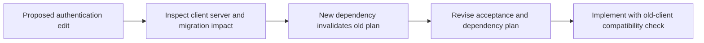

# Objective 3.4 — Determine when to use plan mode vs direct execution

[Test this decision with a supplied example](#benchmark-exercise-3-4) — predict first, then compare the fixed-fixture evidence.

**Picture the application:** A reporting application must replace a client library used across many files. The team needs an approach that preserves caller behavior and makes verification manageable before edits spread. Plan mode and direct execution are the technical alternatives for deciding how much discovery and design this change needs.


**Exam:** CCAR-F · **Domain 3:** 20% of exam; no separate objective weight is published here.  
**Time:** 30–40 minutes foundation/applied; 15–25 additional minutes production extension.  
**Prerequisites:** 1.6 decomposition and 3.1 repository context. New to the Claude API? Start with the [five-minute primer in Lesson 0](../L00-orientation.md#five-minute-primer-how-a-claude-app-works).  
**Continue from:** [Domain lesson](../L03-claude-code-configuration-and-workflows.md) · [Objective map](../../../01-Curriculum/02-Architect-Track/CCAR-F-objectives.md).

**Official task statement:** Determine when to use plan mode vs direct execution


<!-- layered-episode:FV-16:start -->
<a id="learn-fv-16"></a>
### Learn the decision in context — FV-16

**Picture the job.** A small authentication change turns out to affect both the client and server, including old clients still in use. This is an original fictional teaching scene, not a recalled live exam question. Read and trace it; no account, installation or API call is required.

**Start small.** Follow the ordinary route: a person supplies a request or record, software passes the needed evidence to the assistant, and a receiving service or person checks the result. The first demonstration assumes the input, access and evidence are suitable. Now remove that assumption in the situation above. Predict what the receiver would see before choosing a repair.

**Original exam-style practice — choose ONE.** An implementation reveals an unplanned cross-service dependency. What is the appropriate next step?

A. Pause to inspect dependencies and revise the plan and acceptance checks before continuing the change.

B. Continue direct execution because the initial request sounded small.

C. Require a full architecture plan for every isolated comment typo.

<details>
<summary>What is this asking? Plain-language help, without the answer</summary>

Identify what the application needs to trust, what has actually been observed, and what remains unknown. Compare the choices against this situation, rather than choosing the most complicated design. A proposal is an intended action; evidence is what you can point to; a contract says what the receiving part expects. Decide which option fixes the stated failure without pretending another requirement has also been solved.

</details>

**Choose before opening the walkthrough.** Say your answer and the closest alternative aloud, or record them in your own notes.

<details>
<summary>Reveal the repair, evidence and changed condition</summary>

**Answer: A.** Pause to inspect dependencies and revise the plan and acceptance checks before continuing the change.

**Walk it through.** The revised plan names client, server, migration uncertainty and an old-client compatibility test. Work resumes against these explicit checks.

**Why the alternatives fail here.** Continue direct execution because the initial request sounded small. This leaves the stated boundary or evidence requirement unsatisfied. Require a full architecture plan for every isolated comment typo. This also fails to establish the required result. The closest competing mechanism fails for this specific reason: Always planning adds overhead to bounded simple work; always executing can miss uncertain dependencies.

**Inspect the small artifact.** This is an illustrative application-state note for reading, not an SDK signature or executable configuration. The application or workflow owner creates it; the receiver uses it to distinguish what is known from what still needs checking. Its labels describe this scene; do not paste it into Claude settings.

```text
plan={affected:[client,server,tests],unknown:[migration],acceptance:[old_client_works]}
```

**Layer added.** AI reasoning proposes, selects or summarizes where the job needs judgment. Ordinary software checks identifiers, permissions, required fields, recorded outcomes and stop conditions where applicable. A human resolves a policy or evidence gap when the story requires it. Inspect which owner actually supplies the evidence in this scene.



**Change one condition.** Keep the application in mind and consider the new situation below. Choose before opening its explanation.

**Technical transfer question — choose ONE.** The change is now a precise typo in an isolated documented comment. Which mode fits?

A. A cross-service migration plan is always required.

B. Direct execution with a focused check is proportionate.

<details>
<summary>Transfer check</summary>

**B.** The task becomes a precise typo in an isolated documented comment. Direct execution and a focused check are proportionate. Name the changed fact before naming a tool. Preserve unrelated access, source-validation and result checks.

</details>

**Recall in ordinary language.** What broke? Who can fix it? What observable result proves the repair? If you cannot answer all three, replay the concrete scene rather than memorize the option letter.

</details>

**Continue from this decision:** [objective 3.4](objective-3.4.md) · [inspect its decision map](../decision-atlas.md#diagram-d02) · [targeted practice](../../../practice/index.html?exam=CCAR-F&objective=3.4). Existing mapped question IDs: `cct-fv-16-base-v1`, `cct-fv-16-retry-v1`. The new guided question above is separate from those stored items and does not change their answers or progress.
<!-- layered-episode:FV-16:end -->

## Read this objective in both vocabularies

For reading and paper reasoning, no installation or credentials are needed. Keep this page's stated concept prerequisites; any runnable challenge still needs its own setup. If an implementation example feels abrupt, first read [how to interpret its artifact type](../architecture-studio/00-foundations.md#how-to-read-technical-examples-in-this-course), then use the relevant application bridge: [AS-05 decision bridge](../architecture-studio/AS-05-code-change.md#connect-the-simple-explanation-to-technical-design-choices).

Explain the business purpose first, name the precise mechanism second, and distinguish it from the nearest plausible alternative using the stated constraint. Return here for the objective-specific protocol, options and practice. The bridges are teaching aids, not additional official objectives.


## Big idea

Choose a workflow based on uncertainty and consequences. Planning creates a decision before implementation; direct execution handles a change whose decision is already clear.

## Foundation

### 3.4-K1

**Blueprint focus:** Plan mode is designed for complex tasks involving large-scale changes, multiple valid approaches, architectural decisions, and multi-file modifications

Large migrations, architectural choices and multi-file changes contain decisions that are expensive to reverse. Plan mode lets you inspect dependencies, compare approaches and define acceptance criteria before modifying the implementation. The relevant signal is unresolved design scope, not merely the number of lines in the request.

[Exam guide v1.0, section 6 task 3.4](https://anthropic-partners.skilljar.com/page/partner-certifications) (Tier 1, July 2026 blueprint).

### 3.4-K2

**Blueprint focus:** Direct execution is appropriate for simple, well-scoped changes (e.g., adding a single validation check to one function)

A narrow fix with a clear cause and expected result can go directly to implementation. For example, adding an already-specified invalid-date check in one function does not require an architectural investigation. You still verify the behavior and inspect nearby callers for a hidden contract.

[Exam guide v1.0, section 6 task 3.4](https://anthropic-partners.skilljar.com/page/partner-certifications) (Tier 1, July 2026 blueprint).

### 3.4-K3

**Blueprint focus:** Plan mode enables safe codebase exploration and design before committing to changes, preventing costly rework

Exploration before commitment exposes constraints: deployment compatibility, data migration ordering, test gaps and package owners. A useful plan names the chosen approach and why alternatives lose. A vague checklist such as “inspect, fix, test” does not resolve the expensive decision.

[Exam guide v1.0, section 6 task 3.4](https://anthropic-partners.skilljar.com/page/partner-certifications) (Tier 1, July 2026 blueprint).

### 3.4-K4

**Blueprint focus:** The Explore subagent for isolating verbose discovery output and returning summaries to preserve main conversation context

The Explore subagent can absorb verbose read-only discovery and return a summary. Ask it a bounded question and require file references. The coordinator retains the high-level decision and requests more evidence if the summary does not establish the dependency.

[Exam guide v1.0, section 6 task 3.4](https://anthropic-partners.skilljar.com/page/partner-certifications) (Tier 1, July 2026 blueprint).

## Applied skills

These are design applications. Pseudocode and schemas are illustrative unless separately dry-run; a saved design is not a completed implementation.

### 3.4-S1

**Blueprint focus:** Selecting plan mode for tasks with architectural implications (e.g., microservice restructuring, library migrations affecting 45+ files, choosing between integration approaches with different infrastructure requirements)

Select planning for a library migration affecting several packages or for integration options with different infrastructure requirements. Define the decision to resolve, inputs to inspect and acceptance bar. Do not start broad edits while still deciding whether the target design fits.

[Exam guide v1.0, section 6 task 3.4](https://anthropic-partners.skilljar.com/page/partner-certifications) (Tier 1, July 2026 blueprint).

### 3.4-S2

**Blueprint focus:** Selecting direct execution for well-understood changes with clear scope (e.g., a single-file bug fix with a clear stack trace, adding a date validation conditional)

Select direct execution for a reproducible single-function defect. State the trigger, expected behavior and narrow change. If investigation reveals wider contract changes, reassess the scope rather than continuing under an outdated assumption that the task is simple.

[Exam guide v1.0, section 6 task 3.4](https://anthropic-partners.skilljar.com/page/partner-certifications) (Tier 1, July 2026 blueprint).

### 3.4-S3

**Blueprint focus:** Using the Explore subagent for verbose discovery phases to prevent context window exhaustion during multi-phase tasks

Delegate noisy discovery as a precise question, such as which callers rely on the legacy client return type. Require a list of callers, evidence locations and unknowns. Avoid requesting an unbounded tour of the repository that produces another context problem.

[Exam guide v1.0, section 6 task 3.4](https://anthropic-partners.skilljar.com/page/partner-certifications) (Tier 1, July 2026 blueprint).

### 3.4-S4

**Blueprint focus:** Combining plan mode for investigation with direct execution for implementation (e.g., planning a library migration, then executing the planned approach)

Move from planning to implementation once the chosen approach, migration order and checks are concrete. Keep the plan accessible during execution and update it when evidence invalidates an assumption. Planning is useful only if its decisions guide the actual work.

[Exam guide v1.0, section 6 task 3.4](https://anthropic-partners.skilljar.com/page/partner-certifications) (Tier 1, July 2026 blueprint).

## Worked example

A fictional reporting app must replace a client library used in 28 files. One option wraps the new client behind an adapter; another rewrites all callers. The coordinator first uses Explore to identify return-type dependencies, then plans the adapter migration because it limits immediate caller changes and permits staged rollout. Its acceptance bar includes contract tests and removal of the old dependency. Direct execution would be sensible for changing one validation condition with a failing example; here it risks inconsistent caller updates. Planning costs discovery time and an explicit comparison, but avoids committing to a rewrite before compatibility is understood. Implementation begins after the plan identifies the adapter contract, affected files and verification steps. A plan does not itself establish that the migration works.

Original synthetic scenario; decision principles: [Exam guide v1.0, section 6 task 3.4](https://anthropic-partners.skilljar.com/page/partner-certifications) (Tier 1, July 2026 blueprint).

## Production transfer

**Warehouse operations; enrichment beyond the blueprint examples.** A barcode parser bug has a reproducible failing input; a warehouse inventory migration changes reconciliation ordering across services. The parser merits direct execution, while the migration needs a dependency map and rollback plan. A plan for every fix wastes operator time; direct execution for the migration risks inconsistent stock counts. Explore returns referenced dependency evidence. Recovery revisits the plan if a downstream consumer cannot accept the new contract. Extension: an initial one-file fix reveals three incompatible callers; explain exactly when you switch workflows.

In your own notes, save your decision, rejected alternative, evidence and recovery path. Re-run the decision with the changed constraint before calling the pattern transferable. This is a design exercise, not industry compliance advice.

## Traps and counterexamples

Do not turn every trivial task into a planning ceremony. Do not use a clear user request as evidence that all technical decisions are settled. A discovery summary needs references; a confident narrative is not enough.

<a id="decision-variants"></a>
<a id="variant-fv-16"></a>
## Decision variant FV-16 — Plan when uncertainty crosses boundaries

This is original fictional practice, not an official exam question. All policies, amounts and records below are synthetic.

**Choose in the base case.** A cross-service authentication change has unclear callers and migration impact. Inspect evidence, produce a plan and review dependencies before editing.

**Change one constraint.** The task becomes a precise typo in an isolated documented comment. Direct execution and a focused check are proportionate.

**What failed, and who recovers?** An apparently small edit reveals a shared API dependency. Pause to revise the plan rather than continuing under the old assumption.

**Inspect the artifact — illustrative contract, not a drop-in SDK implementation:**

```text
plan={affected:[client,server,tests],unknown:[migration],acceptance:[old_client_works]}
```

**Why not the nearest alternative?** Always planning adds overhead to bounded simple work; always executing can miss uncertain dependencies.

**Memory cue with its condition:** Plan the unknown boundaries; execute the bounded known edit.

**Proof before accepting success:** Produce a trace or artifact showing the decisive constraint, the selected mechanism, rejected alternative and observable result. Preserve unresolved status; a plausible explanation alone is not completion.

[Inspect D02 and its equivalent decision procedure](../decision-atlas.md#diagram-d02) · [See this decision at walkthrough step 3](../scenario-walkthroughs/WT-02-code-generation-claude-code.md#variant-fv-16) · [Return to the objective map](README.md).

**Blind transfer:** Before opening practice, explain which single change in the scene would reverse your choice and which would only require revalidation. Write the failure signal and the next safe action. The practice app provides separately authored base and later-retry items, with a free-response transfer rubric; assistance/exposure must remain visible in learning history.

**Current runtime reference:** [https://code.claude.com/docs/en/memory](https://code.claude.com/docs/en/memory) (reviewed 2026-10-14). The saved blueprint remains the exam coverage source; application policy in this packet is invented teaching context.


## Try it

Classify a one-line date-validation bug, a 30-file SDK migration and an unfamiliar authentication redesign. For each, state the first action and finish line. For the migration, write one Explore request and one decision that must precede edits.

Attempt your design before reading the self-check. Save the artifact and the decision rationale so an independent reviewer can inspect them.

### Expected output and self-check

The validation bug goes directly to a scoped fix and behavior check. The migration and authentication redesign need investigation and a plan. Explore returns caller evidence, not a giant transcript. The migration decision compares an adapter with caller rewrites and records the verification contract before execution.

## Done when

- [ ] **3.4-S1:** Choose plan mode for the migration and authentication redesign; provide the unresolved architectural decision and acceptance bar.
- [ ] **3.4-S2:** Choose direct execution for the date-validation defect; state failing input, narrow scope and expected result.
- [ ] **3.4-S3:** Write a bounded Explore request returning caller evidence, file references and unknowns rather than a repository transcript.
- [ ] **3.4-S4:** Save migration plan, chosen alternative and checks, then specify the transition to implementation and trigger for replanning.

In your own notes, save each stated artifact and check against the supplied expected outputs. Written design evidence and actual implementation evidence remain separate; learner mastery is not inferred from reading.

## Coverage checklist

| Official bullet, in guide order | Exact teaching section |
| --- | --- |
| 3.4-K1: Plan mode is designed for complex tasks involving large-scale changes, multiple valid approaches, architectural decisions, and multi-file modifications | [3.4-K1](#34-k1) |
| 3.4-K2: Direct execution is appropriate for simple, well-scoped changes (e.g., adding a single validation check to one function) | [3.4-K2](#34-k2) |
| 3.4-K3: Plan mode enables safe codebase exploration and design before committing to changes, preventing costly rework | [3.4-K3](#34-k3) |
| 3.4-K4: The Explore subagent for isolating verbose discovery output and returning summaries to preserve main conversation context | [3.4-K4](#34-k4) |
| 3.4-S1: Selecting plan mode for tasks with architectural implications (e.g., microservice restructuring, library migrations affecting 45+ files, choosing between integration approaches with different infrastructure requirements) | [3.4-S1](#34-s1) |
| 3.4-S2: Selecting direct execution for well-understood changes with clear scope (e.g., a single-file bug fix with a clear stack trace, adding a date validation conditional) | [3.4-S2](#34-s2) |
| 3.4-S3: Using the Explore subagent for verbose discovery phases to prevent context window exhaustion during multi-phase tasks | [3.4-S3](#34-s3) |
| 3.4-S4: Combining plan mode for investigation with direct execution for implementation (e.g., planning a library migration, then executing the planned approach) | [3.4-S4](#34-s4) |

## Sources and freshness

[Exam guide v1.0, section 6 task 3.4](https://anthropic-partners.skilljar.com/page/partner-certifications) (Tier 1, July 2026 blueprint).

The official objective wording is reproduced for traceability; explanations and all scenarios are project-authored. Existing L03–L05 provide domain synthesis; this module expands each bullet into a teachable decision. The saved July guide is the blueprint baseline, not a claim that no newer guide exists.

**Version-sensitive mechanisms:** [subagents](https://code.claude.com/docs/en/sub-agents) (Tier 1, checked 2026-10-02). The July guide uses Task terminology; current Claude Code uses Agent for subagent invocation.

**Go deeper:** [Deep practice 3, section 3.4](../deep-practice/03-claude-code-configuration-and-workflows.md#34-plan-mode-vs-direct-execution)


<a id="benchmark-exercise-3-4"></a>
## Worked evidence task — 3.4: test the boundary

**Original technical decision.** A one-file identifier correction is known, while a persistence migration has an unresolved rollback policy. Which planning choice follows uncertainty and consequence?

**In everyday terms:** The risk is the unresolved decision, not simply how many lines change.

**Before you start:** No account, API key or package installation is needed for the paper task. Optional replay needs Python 3 and the two provided lab files in the same directory. This local inspector models the stated fixture; it does not call Claude, load Claude Code rules or run an MCP server.

### Inspect the supplied input

All identifiers and business rules here are fictional application data. This is **not an SDK request schema**. Keep the input separate from your proposed decision.

```json
{
  "taskA": "fix known misspelled identifier in one file",
  "taskB": "migrate persistence adapter; rollback policy undecided"
}
```

### Break, choose, repair, prove

1. **Break:** Compare a known one-line fix with an ambiguous dependency migration. Name the exact failed assumption before proposing another component.
2. **Choose:** Apply the bounded correction with its check; resolve migration design and rollback before broad edits. Write the nearest alternative you would reject and the requirement it fails.
3. **Repair:** Write the corrected contract or recovery step, keeping successful evidence and unknowns separate.
4. **Prove:** Choose based on unresolved design and consequence rather than line count alone. Record `decision`, `reason`, `rejected_alternative`, `evidence` and `remaining_unknowns`.

[Open this actual task in the existing LAB](../../../06-Labs/08-CCAR-F-architecture-decisions/README.md#benchmark-exercise-3-4) · [Return to the teaching subsection](#foundation)

<details><summary>Compare the offline evidence — after making your decision</summary>

The local inspector presents **controlled-fixture calculations and authored reference decisions** below. Some fields are calculated (such as counts or arithmetic); policy labels and recovery choices are supplied worked answers for this fixed example, not executed policies or a general-purpose validator. No Claude, rule loader, service or reviewer was run. `false` or `null` observations remain unresolved when no corresponding live test was performed.

```json
{
  "taskA": "bounded edit plus check",
  "taskB": "resolve design and rollback first",
  "line_count_is_sole_rule": false
}
```

**Why this matters:** The risk is the unresolved decision, not simply how many lines change. The output is a self-check for this controlled example, not certification-score evidence. To test the real mechanism, perform the existing LAB’s integration steps in a fresh disposable context and keep its actual trace beside this prediction.

**Primary-source leads for mechanism review:** [Claude Code Plan Mode Documentation](https://code.claude.com/docs/en/commands#plan) · [Claude Code Permission Modes — Plan mode](https://code.claude.com/docs/en/permission-modes#analyze-before-you-edit-with-plan-mode). The external benchmark helped identify the exercise gap; this task and its data were authored here. Current implementation details must be verified against the installed runtime and those primary sources.

</details>