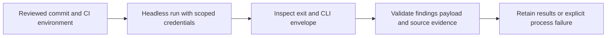

# Objective 3.6 — Integrate Claude Code into CI/CD pipelines

[Test this decision with a supplied example](#benchmark-exercise-3-6) — predict first, then compare the fixed-fixture evidence.

**Picture the application:** A review bot keeps repeating a null-handling finding after each pull-request commit. The team needs fresh, traceable findings that account for prior review and changed code before anything is posted. Noninteractive review, project context and finding deduplication are the technical pieces behind that workflow.


**Exam:** CCAR-F · **Domain 3:** 20% of exam; no separate objective weight is published here.  
**Time:** 30–40 minutes foundation/applied; 15–25 additional minutes production extension.  
**Prerequisites:** 3.1 project context, 4.3 schemas and 4.6 independent review. New to the Claude API? Start with the [five-minute primer in Lesson 0](../L00-orientation.md#five-minute-primer-how-a-claude-app-works).  
**Continue from:** [Domain lesson](../L03-claude-code-configuration-and-workflows.md) · [Objective map](../../../01-Curriculum/02-Architect-Track/CCAR-F-objectives.md).

**Official task statement:** Integrate Claude Code into CI/CD pipelines


<!-- layered-episode:FV-18:start -->
<a id="learn-fv-18"></a>
### Learn the decision in context — FV-18

**Picture the job.** An unattended code review produces no findings. Was the code clean, or did the review fail to run? This is an original fictional teaching scene, not a recalled live exam question. Read and trace it; no account, installation or API call is required.

**Start small.** Follow the ordinary route: a person supplies a request or record, software passes the needed evidence to the assistant, and a receiving service or person checks the result. The first demonstration assumes the input, access and evidence are suitable. Now remove that assumption in the situation above. Predict what the receiver would see before choosing a repair.

**Original exam-style practice — choose ONE.** A headless CI review lacks credentials or returns malformed findings. Which acceptance policy avoids a false clean result?

A. Interpret an empty report as a passing review regardless of process errors.

B. Use Messages Batch solely because the CI job is nonblocking.

C. Validate environment, exit outcome, CLI envelope and findings payload separately; retain artifacts and fail or repair within bounds.

<details>
<summary>What is this asking? Plain-language help, without the answer</summary>

Identify what the application needs to trust, what has actually been observed, and what remains unknown. Compare the choices against this situation, rather than choosing the most complicated design. A proposal is an intended action; evidence is what you can point to; a contract says what the receiving part expects. Decide which option fixes the stated failure without pretending another requirement has also been solved.

</details>

**Choose before opening the walkthrough.** Say your answer and the closest alternative aloud, or record them in your own notes.

<details>
<summary>Reveal the repair, evidence and changed condition</summary>

**Answer: C.** Validate environment, exit outcome, CLI envelope and findings payload separately; retain artifacts and fail or repair within bounds.

**Walk it through.** A missing-credential run is recorded as failed, not zero findings. A valid run binds parsed findings to the reviewed commit and retained evidence.

**Why the alternatives fail here.** Interpret an empty report as a passing review regardless of process errors. This leaves the stated boundary or evidence requirement unsatisfied. Use Messages Batch solely because the CI job is nonblocking. This also fails to establish the required result. The closest competing mechanism fails for this specific reason: Nonblocking alone does not justify Messages Batch. JSON CLI output alone does not prove the findings schema or source accuracy.

**Inspect the small artifact.** This is an illustrative application-state note for reading, not an SDK signature or executable configuration. The application or workflow owner creates it; the receiver uses it to distinguish what is known from what still needs checking. Its labels describe this scene; do not paste it into Claude settings.

```text
ci_packet={commit,permissions,environment,prompt,exit_code,envelope,findings}; accept=all_required_checks_pass
```

**Layer added.** AI reasoning proposes, selects or summarizes where the job needs judgment. Ordinary software checks identifiers, permissions, required fields, recorded outcomes and stop conditions where applicable. A human resolves a policy or evidence gap when the story requires it. Inspect which owner actually supplies the evidence in this scene.



**Change one condition.** Keep the application in mind and consider the new situation below. Choose before opening its explanation.

**Technical transfer question — choose ONE.** Work becomes independent eligible Messages requests with no local iterative state and a tolerant deadline. Which option becomes plausible?

A. A local Claude Code loop solely because the previous task used CI.

B. Messages Batch, subject to documented eligibility and per-item recovery.

<details>
<summary>Transfer check</summary>

**B.** The work becomes independent eligible Messages requests with no local iterative state and a tolerant deadline. Consider batch; an urgent dependent tool loop remains a different runtime. Name the changed fact before naming a tool. Preserve unrelated access, source-validation and result checks.

</details>

**Recall in ordinary language.** What broke? Who can fix it? What observable result proves the repair? If you cannot answer all three, replay the concrete scene rather than memorize the option letter.

</details>

**Continue from this decision:** [objective 3.6](objective-3.6.md) · [inspect its decision map](../decision-atlas.md#diagram-d08) · [targeted practice](../../../practice/index.html?exam=CCAR-F&objective=3.6). Existing mapped question IDs: `cct-fv-18-base-v1`, `cct-fv-18-retry-v1`. The new guided question above is separate from those stored items and does not change their answers or progress.
<!-- layered-episode:FV-18:end -->

## Read this objective in both vocabularies

For reading and paper reasoning, no installation or credentials are needed. Keep this page's stated concept prerequisites; any runnable challenge still needs its own setup. If an implementation example feels abrupt, first read [how to interpret its artifact type](../architecture-studio/00-foundations.md#how-to-read-technical-examples-in-this-course), then use the relevant application bridge: [AS-06 decision bridge](../architecture-studio/AS-06-ci-review.md#connect-the-simple-explanation-to-technical-design-choices).

Explain the business purpose first, name the precise mechanism second, and distinguish it from the nearest plausible alternative using the stated constraint. Return here for the objective-specific protocol, options and practice. The bridges are teaching aids, not additional official objectives.


## Big idea

An automated review needs unattended execution, a parseable contract and enough repository context to produce useful findings without repeated comments.

## Foundation

### 3.6-K1

**Blueprint focus:** The -p (or --print) flag for running Claude Code in non-interactive mode in automated pipelines

The -p or --print invocation runs Claude Code without an interactive chat session. A pipeline should supply its prompt and context explicitly rather than waiting for a developer to answer questions. Set operational limits and handle process failure outside the model's prose.

[Exam guide v1.0, section 6 task 3.6](https://anthropic-partners.skilljar.com/page/partner-certifications) (Tier 1, July 2026 blueprint).

### 3.6-K2

**Blueprint focus:** --output-format json and --json-schema CLI flags for enforcing structured output in CI contexts

JSON output and a JSON schema give automation a contract for fields such as path, line, category and explanation. Parse the documented response envelope rather than assuming all printed JSON is the finding object. Reject missing or invalid results before posting comments.

[Exam guide v1.0, section 6 task 3.6](https://anthropic-partners.skilljar.com/page/partner-certifications) (Tier 1, July 2026 blueprint).

### 3.6-K3

**Blueprint focus:** CLAUDE.md as the mechanism for providing project context (testing standards, fixture conventions, review criteria) to CI-invoked Claude Code

Project CLAUDE.md gives automated runs shared context: test commands, valuable test criteria, fixture locations and review expectations. A CI job still needs the relevant changed files and existing tests. Context files cannot compensate for a checkout that lacks the evidence.

[Exam guide v1.0, section 6 task 3.6](https://anthropic-partners.skilljar.com/page/partner-certifications) (Tier 1, July 2026 blueprint).

### 3.6-K4

**Blueprint focus:** Session context isolation: why the same Claude session that generated code is less effective at reviewing its own changes compared to an independent review instance

An independent reviewer does not inherit the generator's persuasive reasoning. Give it requirements, the diff and repository evidence, rather than the generator's explanation of why everything is correct. Independence reduces correlated blind spots; it does not guarantee defect detection.

[Exam guide v1.0, section 6 task 3.6](https://anthropic-partners.skilljar.com/page/partner-certifications) (Tier 1, July 2026 blueprint).

## Applied skills

These are design applications. Pseudocode and schemas are illustrative unless separately dry-run; a saved design is not a completed implementation.

### 3.6-S1

**Blueprint focus:** Running Claude Code in CI with the -p flag to prevent interactive input hangs

Invoke CI with -p and a complete review request. Confirm the process exits and failures are surfaced. Use the installed CLI help and official reference to verify flags, because an illustrative shell command is not a dry-run of your actual pipeline.

[Exam guide v1.0, section 6 task 3.6](https://anthropic-partners.skilljar.com/page/partner-certifications) (Tier 1, July 2026 blueprint).

### 3.6-S2

**Blueprint focus:** Using --output-format json with --json-schema to produce machine-parseable structured findings for automated posting as inline PR comments

Request JSON plus an explicit findings schema, then validate output before translating findings into PR comments. Require actionable location and evidence. Keep posting as a separate authorized step so malformed findings cannot become public comments accidentally.

[Exam guide v1.0, section 6 task 3.6](https://anthropic-partners.skilljar.com/page/partner-certifications) (Tier 1, July 2026 blueprint).

### 3.6-S3

**Blueprint focus:** Including prior review findings in context when re-running reviews after new commits, instructing Claude to report only new or still-unaddressed issues to avoid duplicate comments

When reviewing a new commit, pass prior findings with stable identities and resolution status. Ask for new or still-unaddressed issues. Compare results in application code before posting, since prompt guidance alone does not guarantee deduplication.

[Exam guide v1.0, section 6 task 3.6](https://anthropic-partners.skilljar.com/page/partner-certifications) (Tier 1, July 2026 blueprint).

### 3.6-S4

**Blueprint focus:** Providing existing test files in context so test generation avoids suggesting duplicate scenarios already covered by the test suite

Provide existing tests alongside code being changed. Ask for missing behavior coverage rather than more test count. Check proposed scenarios against the existing suite and reject tests that duplicate an already-covered branch or mirror implementation details.

[Exam guide v1.0, section 6 task 3.6](https://anthropic-partners.skilljar.com/page/partner-certifications) (Tier 1, July 2026 blueprint).

### 3.6-S5

**Blueprint focus:** Documenting testing standards, valuable test criteria, and available fixtures in CLAUDE.md to improve test generation quality and reduce low-value test output

Document fixture ownership, test commands and valuable assertions in project memory. Include an example of a worthwhile regression test and an example of a low-value duplicate. Verify the CI checkout receives these standards.

[Exam guide v1.0, section 6 task 3.6](https://anthropic-partners.skilljar.com/page/partner-certifications) (Tier 1, July 2026 blueprint).

## Worked example

A fictional PR bot reports the same null-handling problem after every commit. Its next run receives the changed diff, existing importer tests, project standards and a prior-finding ledger. It runs with -p and requests schema-shaped findings. The publisher validates the result and deduplicates by finding identity and location before any approved comment posting. A fresh review instance is used instead of continuing the code-writing session. Reviewing every file from scratch is a credible alternative after a major rewrite, but wastes effort and repeats resolved comments for small changes. The design costs ledger maintenance and a parser. It gains unattended operation, traceable findings and a clear separation between review generation and external publication.

Original synthetic scenario; decision principles: [Exam guide v1.0, section 6 task 3.6](https://anthropic-partners.skilljar.com/page/partner-certifications) (Tier 1, July 2026 blueprint).

## Production transfer

**Industrial software; enrichment beyond the blueprint examples.** A manufacturing equipment SDK runs reviews after every pull request. The review job receives fixtures and historical findings, while its publisher validates locations and suppresses duplicates. Compare all-files review with changed-files plus targeted dependency context: the latter is faster, but may miss untouched consumers without an integration pass. Malformed output fails the job visibly; empty validated findings do not. Recovery reruns with preserved identity after a transient process failure. Extension: a file rename moves a still-unaddressed defect; explain how its identity survives.

In your own notes, save your decision, rejected alternative, evidence and recovery path. Re-run the decision with the changed constraint before calling the pattern transferable. This is a design exercise, not industry compliance advice.

## Traps and counterexamples

A successful process exit does not prove valid review output. Do not post every generated finding without validation. An independent reviewer still needs the actual requirements and changed code.

## Supplied CI review packet and worked output

Use these synthetic files and prior findings; no publication is authorized by this exercise.

```text
src/importer.ts line 12: export function amount(x) { return Number(x.amount); }
src/importer.ts line 18: export function currency(x) { return x.currency || "USD"; }
tests/importer.test.ts:
  existing test: amount({amount:"12.50"}) equals 12.50
  available fixture: validInvoice(overrides) supplies required invoice fields
CLAUDE.md criterion:
  Reuse validInvoice; report reachable data-corruption bugs with input/result;
  skip style preferences and duplicate existing scenarios.
prior-findings.json:
  F-1 resolved: path=src/importer.ts, former line=8, duplicate string conversion
  F-2 unaddressed: path=src/importer.ts, line=18, missing currency silently becomes USD
```

### Illustrative invocation and contract

Create `review-packet.txt` containing the above packet, changed diff and instruction: “Return only new or unaddressed findings. Do not repeat F-1; assess F-2 against the current code. Propose only missing test behavior.” This command assumes authenticated Claude Code and supplied local files. It is **documented syntax, not an executed pipeline**:

```sh
claude --bare -p "Review the supplied stdin packet; return findings matching the schema." \
  --append-system-prompt-file CLAUDE.md \
  --output-format json \
  --json-schema '{"type":"object","properties":{"findings":{"type":"array","items":{"type":"object","properties":{"id":{"type":"string"},"path":{"type":"string"},"line":{"type":"integer"},"issue":{"type":"string"},"severity":{"type":"string"},"suggested_fix":{"type":"string"}},"required":["id","path","line","issue","severity","suggested_fix"],"additionalProperties":false}}},"required":["findings"],"additionalProperties":false}' \
  < review-packet.txt > review-result.json
```

`--bare` skips automatic project context; the explicit CLAUDE.md input restores these review standards. Auth must be configured separately. Inspect process status and parse the documented `structured_output` field; do not treat any JSON envelope as successful findings. [Programmatic usage](https://code.claude.com/docs/en/headless) and [CLI reference](https://code.claude.com/docs/en/cli-reference) (Tier 1; checked 2026-10-02).

### Worked expected reduced envelope

```json
{"type":"result","subtype":"success","is_error":false,"structured_output":{"findings":[{"id":"F-2","path":"src/importer.ts","line":18,"issue":"Missing currency is silently assigned USD; an unknown-currency invoice is misrepresented.","severity":"review-required","suggested_fix":"Represent missing currency explicitly and route for clarification."}]}}
```

This is a reduced illustrative envelope; real CLI metadata is omitted. F-1 is suppressed because it is resolved; F-2 remains because the current code still defaults. Application deduplication keys on stable finding identity plus current evidence, with rename/line changes accounted for.

**Three consumer fixtures:** `not-json` is a parsing failure; `{"structured_output":{"findings":[]},"is_error":false}` is a valid empty payload only after success-envelope checks; `{"structured_output":{"findings":[{"path":"src/importer.ts"}]}}` fails the findings schema. None may be converted into the same “zero issues” outcome.

**Test decision:** reject another amount("12.50") test because it duplicates the existing scenario. A valuable fixture-aware specification is: `validInvoice({currency:null})` must retain unknown currency or raise the chosen validation outcome, never silently become USD. Document the agreed unknown-currency contract in CLAUDE.md. Add a separate nonnumeric amount case only if the new diff or requirements makes it relevant.

**Your deliverable:** schema, packet, expected findings, parser branches, ledger update and one fixture-aware test criterion. For implementation evidence, separately run the actual authenticated command, capture exit status, validate the envelope/payload and show duplicate suppression; do not infer success from this paper fixture. No PR comments are sent in this exercise.

<a id="decision-variants"></a>
<a id="variant-fv-18"></a>
## Decision variant FV-18 — Run CI with observable failure

This is original fictional practice, not an official exam question. All policies, amounts and records below are synthetic.

**Choose in the base case.** A scheduled repository-dependent Code review runs headless with available credentials, scoped permissions, project context, exit handling and retained artifacts. Parse its CLI envelope before validating the findings payload.

**Change one constraint.** The work becomes independent eligible Messages requests with no local iterative state and a tolerant deadline. Consider batch; an urgent dependent tool loop remains a different runtime.

**What failed, and who recovers?** Missing credentials or malformed findings must produce an observable failure or bounded repair, never an empty “passed” report.

**Inspect the artifact — illustrative contract, not a drop-in SDK implementation:**

```text
ci_packet={commit,permissions,environment,prompt,exit_code,envelope,findings}; accept=all_required_checks_pass
```

**Why not the nearest alternative?** Nonblocking alone does not justify Messages Batch. JSON CLI output alone does not prove the findings schema or source accuracy.

**Memory cue with its condition:** Runtime by dependency; gate by validated evidence.

**Proof before accepting success:** Produce a trace or artifact showing the decisive constraint, the selected mechanism, rejected alternative and observable result. Preserve unresolved status; a plausible explanation alone is not completion.

[Inspect D08 and its equivalent decision procedure](../decision-atlas.md#diagram-d08) · [See this decision at walkthrough step 2](../scenario-walkthroughs/WT-05-claude-code-ci-cd.md#variant-fv-18) · [Return to the objective map](README.md).

**Blind transfer:** Before opening practice, explain which single change in the scene would reverse your choice and which would only require revalidation. Write the failure signal and the next safe action. The practice app provides separately authored base and later-retry items, with a free-response transfer rubric; assistance/exposure must remain visible in learning history.

**Current runtime reference:** [https://platform.claude.com/docs/en/build-with-claude/batch-processing](https://platform.claude.com/docs/en/build-with-claude/batch-processing) (reviewed 2026-10-14). The saved blueprint remains the exam coverage source; application policy in this packet is invented teaching context.


## Try it

Use the supplied fixture above for the required skill outputs first. The following design activity is an extension, not a substitute for those concrete checks.

Design the inputs and output schema for a CI review job. Include one prior resolved finding, one unaddressed finding and existing tests. Describe how a malformed result and an empty result differ, and how duplicate comments are prevented.

Attempt your design before reading the self-check. Save the artifact and the decision rationale so an independent reviewer can inspect them.

### Expected output and self-check

The job runs unattended, receives project standards, diff, tests and prior findings, and returns findings with required locations and explanations. Invalid output fails validation; a valid empty list means no reported issues. The publication layer deduplicates and preserves authorization. Review uses a fresh instance.

## Done when

- [ ] **3.6-S1:** Provide the documented print-mode command and complete stdin packet; for implementation evidence separately capture actual authenticated process status.
- [ ] **3.6-S2:** Provide findings schema and parse structured_output; distinguish malformed text, invalid finding and valid success-empty payload.
- [ ] **3.6-S3:** Apply the prior ledger: suppress resolved F-1, retain current unaddressed F-2, and record stable-identity deduplication logic.
- [ ] **3.6-S4:** Reject the existing amount("12.50") duplicate scenario; specify the missing-currency test with validInvoice.
- [ ] **3.6-S5:** Write project testing standards that identify fixture reuse, meaningful regression behavior and exclusions for low-value duplicates.

In your own notes, save each stated artifact and check against the supplied expected outputs. Written design evidence and actual implementation evidence remain separate; learner mastery is not inferred from reading.

## Coverage checklist

| Official bullet, in guide order | Exact teaching section |
| --- | --- |
| 3.6-K1: The -p (or --print) flag for running Claude Code in non-interactive mode in automated pipelines | [3.6-K1](#36-k1) |
| 3.6-K2: --output-format json and --json-schema CLI flags for enforcing structured output in CI contexts | [3.6-K2](#36-k2) |
| 3.6-K3: CLAUDE.md as the mechanism for providing project context (testing standards, fixture conventions, review criteria) to CI-invoked Claude Code | [3.6-K3](#36-k3) |
| 3.6-K4: Session context isolation: why the same Claude session that generated code is less effective at reviewing its own changes compared to an independent review instance | [3.6-K4](#36-k4) |
| 3.6-S1: Running Claude Code in CI with the -p flag to prevent interactive input hangs | [3.6-S1](#36-s1) |
| 3.6-S2: Using --output-format json with --json-schema to produce machine-parseable structured findings for automated posting as inline PR comments | [3.6-S2](#36-s2) |
| 3.6-S3: Including prior review findings in context when re-running reviews after new commits, instructing Claude to report only new or still-unaddressed issues to avoid duplicate comments | [3.6-S3](#36-s3) |
| 3.6-S4: Providing existing test files in context so test generation avoids suggesting duplicate scenarios already covered by the test suite | [3.6-S4](#36-s4) |
| 3.6-S5: Documenting testing standards, valuable test criteria, and available fixtures in CLAUDE.md to improve test generation quality and reduce low-value test output | [3.6-S5](#36-s5) |

## Sources and freshness

[Exam guide v1.0, section 6 task 3.6](https://anthropic-partners.skilljar.com/page/partner-certifications) (Tier 1, July 2026 blueprint).

The official objective wording is reproduced for traceability; explanations and all scenarios are project-authored. Existing L03–L05 provide domain synthesis; this module expands each bullet into a teachable decision. The saved July guide is the blueprint baseline, not a claim that no newer guide exists.

**CLI checked 2026-10-02:** -p, --output-format json and --json-schema are documented in [programmatic usage](https://code.claude.com/docs/en/headless) and [CLI reference](https://code.claude.com/docs/en/cli-reference) (Tier 1). Check installed-version behavior before implementing the CI job.

**Go deeper:** [Deep practice 3, section 3.6](../deep-practice/03-claude-code-configuration-and-workflows.md#36-claude-code-in-cicd)


<a id="benchmark-exercise-3-6"></a>
## Worked evidence task — 3.6: test the boundary

**Original technical decision.** A review accepts digest A1, but the release candidate is B2 under a no-carry-forward policy. Which gate decision follows the candidate-specific contract?

**In everyday terms:** This fictional team chose that rule. A report for A1 cannot pass B2 under that rule.

**Before you start:** No account, API key or package installation is needed for the paper task. Optional replay needs Python 3 and the two provided lab files in the same directory. This local inspector models the stated fixture; it does not call Claude, load Claude Code rules or run an MCP server.

### Inspect the supplied input

All identifiers and business rules here are fictional application data. This is **not an SDK request schema**. Keep the input separate from your proposed decision.

```json
{
  "review_digest": "A1",
  "candidate_digest": "B2",
  "policy": "no carry-forward; any candidate change requires fresh acceptance evidence",
  "stdout": "structured review envelope"
}
```

### Break, choose, repair, prove

1. **Break:** Produce a review for snapshot A, then change code to snapshot B. Name the exact failed assumption before proposing another component.
2. **Choose:** Reject stale acceptance evidence and require a fresh review envelope for the exact candidate. Write the nearest alternative you would reject and the requirement it fails.
3. **Repair:** Write the corrected contract or recovery step, keeping successful evidence and unknowns separate.
4. **Prove:** Under this fictional no-carry-forward gate policy, evidence must match the exact candidate snapshot. Parse the envelope and handle process/permission failure. This is not a universal CI rule. Record `decision`, `reason`, `rejected_alternative`, `evidence` and `remaining_unknowns`.

[Open this actual task in the existing LAB](../../../06-Labs/08-CCAR-F-architecture-decisions/README.md#benchmark-exercise-3-6) · [Return to the teaching subsection](#supplied-ci-review-packet-and-worked-output)

<details><summary>Compare the offline evidence — after making your decision</summary>

The local inspector presents **controlled-fixture calculations and authored reference decisions** below. Some fields are calculated (such as counts or arithmetic); policy labels and recovery choices are supplied worked answers for this fixed example, not executed policies or a general-purpose validator. No Claude, rule loader, service or reviewer was run. `false` or `null` observations remain unresolved when no corresponding live test was performed.

```json
{
  "digest_matches": false,
  "accept": false,
  "policy": "no carry-forward; any candidate change requires fresh acceptance evidence",
  "process_success_implies_review_pass": false
}
```

**Why this matters:** This fictional team chose that rule. A report for A1 cannot pass B2 under that rule. The output is a self-check for this controlled example, not certification-score evidence. To test the real mechanism, perform the existing LAB’s integration steps in a fresh disposable context and keep its actual trace beside this prediction.

**Primary-source leads for mechanism review:** [Claude Code CLI Reference](https://code.claude.com/docs/en/cli-reference) · [Claude Code GitHub Actions](https://code.claude.com/docs/en/github-actions). The external benchmark helped identify the exercise gap; this task and its data were authored here. Current implementation details must be verified against the installed runtime and those primary sources.

</details>