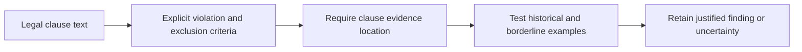

# Objective 4.1 — Design prompts with explicit criteria to improve precision and reduce false positives

[Test this decision with a supplied example](#benchmark-exercise-4-1) — predict first, then compare the fixed-fixture evidence.

**Picture the application:** A logistics reviewer reports so many naming and comment concerns that a route-cutoff defect becomes hard to notice. Its output should help developers identify consequential behavior rather than sift through preferences. Explicit review criteria are the technical intervention for defining which findings deserve attention and how to evaluate the change.


**Exam:** CCAR-F · **Domain 4:** 20% of exam; no separate objective weight is published here.  
**Time:** 30–40 minutes foundation/applied; 15–25 additional minutes production extension.  
**Prerequisites:** L00 orientation and basic code-review vocabulary. New to the Claude API? Start with the [five-minute primer in Lesson 0](../L00-orientation.md#five-minute-primer-how-a-claude-app-works).  
**Continue from:** [Domain lesson](../L04-prompt-engineering-and-structured-output.md) · [Objective map](../../../01-Curriculum/02-Architect-Track/CCAR-F-objectives.md).

**Official task statement:** Design prompts with explicit criteria to improve precision and reduce false positives


<!-- layered-episode:FV-19:start -->
<a id="learn-fv-19"></a>
### Learn the decision in context — FV-19

**Picture the job.** A legal review flags historical examples as if they were current contract rights. This is an original fictional teaching scene, not a recalled live exam question. Read and trace it; no account, installation or API call is required.

**Start small.** Follow the ordinary route: a person supplies a request or record, software passes the needed evidence to the assistant, and a receiving service or person checks the result. The first demonstration assumes the input, access and evidence are suitable. Now remove that assumption in the situation above. Predict what the receiver would see before choosing a repair.

**Original exam-style practice — choose ONE.** False positives cluster around historical termination examples. Which prompt revision is most testable?

A. Define explicit trigger, notice requirement, exclusions and source-location criteria; test borderline and historical examples.

B. Add be more careful without changing the decision criteria.

C. Flag every occurrence of termination to maximize apparent coverage.

<details>
<summary>What is this asking? Plain-language help, without the answer</summary>

Identify what the application needs to trust, what has actually been observed, and what remains unknown. Compare the choices against this situation, rather than choosing the most complicated design. A proposal is an intended action; evidence is what you can point to; a contract says what the receiving part expects. Decide which option fixes the stated failure without pretending another requirement has also been solved.

</details>

**Choose before opening the walkthrough.** Say your answer and the closest alternative aloud, or record them in your own notes.

<details>
<summary>Reveal the repair, evidence and changed condition</summary>

**Answer: A.** Define explicit trigger, notice requirement, exclusions and source-location criteria; test borderline and historical examples.

**Walk it through.** A current unilateral right without notice is flagged with a clause locator. A historical illustration is excluded; ambiguous policy is marked unresolved.

**Why the alternatives fail here.** Add be more careful without changing the decision criteria. This leaves the stated boundary or evidence requirement unsatisfied. Flag every occurrence of termination to maximize apparent coverage. This also fails to establish the required result. The closest competing mechanism fails for this specific reason: “Be careful” does not operationalize the criterion. A longer prompt without measurable boundaries can preserve the same errors.

**Inspect the small artifact.** This is an illustrative application-state note for reading, not an SDK signature or executable configuration. The application or workflow owner creates it; the receiver uses it to distinguish what is known from what still needs checking. Its labels describe this scene; do not paste it into Claude settings.

```text
finding_rule={trigger:unilateral_right,required:notice,evidence:clause_locator,exclude:historical_example}
```

**Layer added.** AI reasoning proposes, selects or summarizes where the job needs judgment. Ordinary software checks identifiers, permissions, required fields, recorded outcomes and stop conditions where applicable. A human resolves a policy or evidence gap when the story requires it. Inspect which owner actually supplies the evidence in this scene.



**Change one condition.** Keep the application in mind and consider the new situation below. Choose before opening its explanation.

**Technical transfer question — choose ONE.** Policy is ambiguous about mutual termination clauses. Which output is justified?

A. Clarify the criterion or mark uncertainty instead of inventing a violation rule.

B. Flag all termination language as an established violation.

<details>
<summary>Transfer check</summary>

**A.** The policy wording is ambiguous about mutual termination. Ask for clarification or label the case uncertain instead of treating every termination mention as a violation. Name the changed fact before naming a tool. Preserve unrelated access, source-validation and result checks.

</details>

**Recall in ordinary language.** What broke? Who can fix it? What observable result proves the repair? If you cannot answer all three, replay the concrete scene rather than memorize the option letter.

</details>

**Continue from this decision:** [objective 4.1](objective-4.1.md) · [inspect its decision map](../decision-atlas.md#diagram-d10) · [targeted practice](../../../practice/index.html?exam=CCAR-F&objective=4.1). Existing mapped question IDs: `cct-fv-19-base-v1`, `cct-fv-19-retry-v1`. The new guided question above is separate from those stored items and does not change their answers or progress.
<!-- layered-episode:FV-19:end -->

## Read this objective in both vocabularies

For reading and paper reasoning, no installation or credentials are needed. Keep this page's stated concept prerequisites; any runnable challenge still needs its own setup. If an implementation example feels abrupt, first read [how to interpret its artifact type](../architecture-studio/00-foundations.md#how-to-read-technical-examples-in-this-course), then use the relevant application bridge: [AS-06 decision bridge](../architecture-studio/AS-06-ci-review.md#connect-the-simple-explanation-to-technical-design-choices).

Explain the business purpose first, name the precise mechanism second, and distinguish it from the nearest plausible alternative using the stated constraint. Return here for the objective-specific protocol, options and practice. The bridges are teaching aids, not additional official objectives.


## Big idea

A useful review policy defines observable reportable behavior. Precision comes from criteria that distinguish actual defects from acceptable patterns.

## Foundation

### 4.1-K1

**Blueprint focus:** The importance of explicit criteria over vague instructions (e.g., "flag comments only when claimed behavior contradicts actual code behavior" vs "check that comments are accurate")

“Check whether comments are accurate” does not define an error. A categorical criterion can: report a comment only when its claimed behavior contradicts executable behavior reachable in the reviewed code. This makes both positive and negative decisions explainable.

[Exam guide v1.0, section 6 task 4.1](https://anthropic-partners.skilljar.com/page/partner-certifications) (Tier 1, July 2026 blueprint).

### 4.1-K2

**Blueprint focus:** How general instructions like "be conservative" or "only report high-confidence findings" fail to improve precision compared to specific categorical criteria

“Be conservative” and “only high confidence” leave the judgment boundary unspecified. Confidence is a judgment about a claim, not a definition of what matters. Specify categories, evidence and exclusions before asking the model to classify findings.

[Exam guide v1.0, section 6 task 4.1](https://anthropic-partners.skilljar.com/page/partner-certifications) (Tier 1, July 2026 blueprint).

### 4.1-K3

**Blueprint focus:** The impact of false positive rates on developer trust: high false positive categories undermine confidence in accurate categories

Repeated false positives cost reviewer time and erode trust in true findings. Measure dismissals by category; a noisy style category can cause developers to ignore accurate security reports from the same tool. Category-level improvement is more actionable than a single acceptance rate.

[Exam guide v1.0, section 6 task 4.1](https://anthropic-partners.skilljar.com/page/partner-certifications) (Tier 1, July 2026 blueprint).

## Applied skills

These are design applications. Pseudocode and schemas are illustrative unless separately dry-run; a saved design is not a completed implementation.

### 4.1-S1

**Blueprint focus:** Writing specific review criteria that define which issues to report (bugs, security) versus skip (minor style, local patterns) rather than relying on confidence-based filtering

Write reporting rules for bugs and security issues, and exclusions for minor style and accepted local conventions. Require the triggering input and observable consequence. Test examples on both sides of the rule so exclusions do not hide genuine defects.

[Exam guide v1.0, section 6 task 4.1](https://anthropic-partners.skilljar.com/page/partner-certifications) (Tier 1, July 2026 blueprint).

### 4.1-S2

**Blueprint focus:** Temporarily disabling high false-positive categories to restore developer trust while improving prompts for those categories

Temporarily disable a demonstrably noisy category while repairing its criteria. Preserve a labeled sample of accepted and dismissed findings to evaluate the revised prompt. Re-enable only after evidence improves; suppression is a containment measure, not a permanent quality claim.

[Exam guide v1.0, section 6 task 4.1](https://anthropic-partners.skilljar.com/page/partner-certifications) (Tier 1, July 2026 blueprint).

### 4.1-S3

**Blueprint focus:** Defining explicit severity criteria with concrete code examples for each severity level to achieve consistent classification

Define severity by consequence and reachability, with examples. A destructive action without authorization may be severe; a rare display mismatch may be lower severity. Use local business context and calibrated examples rather than a universal label detached from impact.

<a id="severity-calibration"></a>
**Supplied severity calibration — original synthetic policy, not an Anthropic severity standard.** This fictional shipment service has two severity levels. High means a reachable defect changes the booked dispatch day; Low means an informational label is wrong while the execution path remains correct. The adapter has already normalized the business-local hour to an integer from 0 to 23. Cutoff is 17:00; at or after it, dispatch is next day.

```python
def wrong_dispatch_offset(hour):
    return int(hour > 17)  # Incorrect: the boundary hour books same day.

def correct_dispatch_offset(hour):
    return int(hour >= 17)

def wrong_information_label(hour):
    return "Same day" if hour <= 17 else "Next day"

assert wrong_dispatch_offset(17) == 0
assert correct_dispatch_offset(17) == 1
assert wrong_information_label(17) == "Same day"
assert correct_dispatch_offset(16) == 0
assert correct_dispatch_offset(18) == 1
```

| Reachable example | Required finding and evidence | Why this severity |
|---|---|---|
| Booking calls `wrong_dispatch_offset(17)` | High; function and boundary input; expected offset `1`, observed `0` | The wrong booked day changes an operational action. Fix the comparison and test the boundary. |
| Booking calls `correct_dispatch_offset(17)`, but an informational page calls `wrong_information_label(17)` | Low; display function and boundary input; expected label “Next day”, observed “Same day”; booked offset remains `1` | The label is incorrect, yet the stated contract keeps it outside the execution decision. Fix the label and test it separately. |
| A local variable is named `h` rather than `business_local_hour`, with identical behavior and no breached convention | No finding under this rubric | Naming preference alone supplies no contradicted behavioral claim or observable consequence. |

**Changed constraint:** A warehouse operator now uses the displayed label to release parcels. Reassess the second example; it can change the dispatch action and therefore meets this fictional High criterion. Do not keep the Low label after its consequence changes. Model confidence and the word “minor” are not severity evidence.

**Check before moving on:** Provide function, triggering input, expected/observed result and execution consequence for both findings. Classify the changed-label case again. Expected: High booking defect, Low informational defect, no naming finding; changed-label execution case is High. These labels apply only to the supplied fictional policy.


[Exam guide v1.0, section 6 task 4.1](https://anthropic-partners.skilljar.com/page/partner-certifications) (Tier 1, July 2026 blueprint).

## Worked example

A logistics code reviewer flags every mismatch between a comment and variable naming as a defect. Drivers need correct route cutoff calculations, so noisy style alerts bury an actual timezone bug. The new criterion reports contradicted behavioral claims with a reachable input and consequence; naming preferences are excluded. Severity examples distinguish an incorrect next-day dispatch from a cosmetic label. A credible alternative is a confidence threshold, but it can leave confidently reported style complaints untouched. Another is human triage of every alert, which preserves coverage at substantial reviewer cost. The decision temporarily disables comment-style findings, evaluates revised criteria against accepted and dismissed cases, and restores only the proven category. If the revised category still misfires, retain suppression and investigate the specific detected patterns.

Original synthetic scenario; decision principles: [Exam guide v1.0, section 6 task 4.1](https://anthropic-partners.skilljar.com/page/partner-certifications) (Tier 1, July 2026 blueprint).

## Production transfer

**Financial reconciliation; enrichment beyond the blueprint examples.** A synthetic ledger reviewer distinguishes material arithmetic inconsistencies from formatting preferences. A rare error that moves funds deserves different severity than a mislabeled report column. Compare categorical criteria with threshold filtering using a labeled sample containing both. Review capacity constrains alert volume, but suppressing a category creates a coverage gap that must remain visible. Recovery temporarily disables a noisy category and measures the replacement on held-out cases. Extension: the business changes its materiality threshold; update examples and assess which prior labels must be revisited.

In your own notes, save your decision, rejected alternative, evidence and recovery path. Re-run the decision with the changed constraint before calling the pattern transferable. This is a design exercise, not industry compliance advice.

## Traps and counterexamples

Do not trade away all recall without recording the effect. Confidence wording can supplement explicit criteria but cannot replace them. A suppressed category must remain visible in coverage reporting.

<a id="decision-variants"></a>
<a id="variant-fv-19"></a>
## Decision variant FV-19 — Define a finding with evidence criteria

This is original fictional practice, not an official exam question. All policies, amounts and records below are synthetic.

**Choose in the base case.** A legal clause review flags only an explicit unilateral termination right without the fictional required notice. Provide threshold, exclusions and source locator expectations.

**Change one constraint.** The policy wording is ambiguous about mutual termination. Ask for clarification or label the case uncertain instead of treating every termination mention as a violation.

**What failed, and who recovers?** False positives cluster around historical examples. Add the exclusion and test borderline cases against actual text.

**Inspect the artifact — illustrative contract, not a drop-in SDK implementation:**

```text
finding_rule={trigger:unilateral_right,required:notice,evidence:clause_locator,exclude:historical_example}
```

**Why not the nearest alternative?** “Be careful” does not operationalize the criterion. A longer prompt without measurable boundaries can preserve the same errors.

**Memory cue with its condition:** Name trigger, exclusion and evidence before flagging.

**Proof before accepting success:** Produce a trace or artifact showing the decisive constraint, the selected mechanism, rejected alternative and observable result. Preserve unresolved status; a plausible explanation alone is not completion.

[Inspect D10 and its equivalent decision procedure](../decision-atlas.md#diagram-d10) · [See this decision at walkthrough step 7](../scenario-walkthroughs/WT-06-structured-data-extraction.md#variant-fv-19) · [Return to the objective map](README.md).

**Blind transfer:** Before opening practice, explain which single change in the scene would reverse your choice and which would only require revalidation. Write the failure signal and the next safe action. The practice app provides separately authored base and later-retry items, with a free-response transfer rubric; assistance/exposure must remain visible in learning history.

**Current runtime reference:** [https://platform.claude.com/docs/en/agents-and-tools/tool-use/overview](https://platform.claude.com/docs/en/agents-and-tools/tool-use/overview) (reviewed 2026-10-14). The saved blueprint remains the exam coverage source; application policy in this packet is invented teaching context.


## Try it

Write a review rubric for a shipment cutoff function. Give one reportable defect, one acceptable local pattern and two severity examples. Describe how to detect a noisy category and when it may return to production.

Attempt your design before reading the self-check. Save the artifact and the decision rationale so an independent reviewer can inspect them.

### Expected output and self-check

The rubric ties the defect to an input and wrong shipment date, excludes harmless style variation and bases severity on impact. A held-out labeled sample measures category precision and missed issues. Re-enable decisions require measured improvement, not a prompt that merely sounds stricter.

## Done when

- [ ] **4.1-S1:** Write explicit bug/security reporting and style exclusions; demonstrate reportable shipment-cutoff input and acceptable local pattern.
- [ ] **4.1-S2:** Design category-level accepted/dismissed evaluation and temporary suppression; re-enable only against held-out evidence.
- [ ] **4.1-S3:** Provide two concrete severity examples tied to impact and reachability, not confidence alone.

In your own notes, save each stated artifact and check against the supplied expected outputs. Written design evidence and actual implementation evidence remain separate; learner mastery is not inferred from reading.

## Coverage checklist

| Official bullet, in guide order | Exact teaching section |
| --- | --- |
| 4.1-K1: The importance of explicit criteria over vague instructions (e.g., "flag comments only when claimed behavior contradicts actual code behavior" vs "check that comments are accurate") | [4.1-K1](#41-k1) |
| 4.1-K2: How general instructions like "be conservative" or "only report high-confidence findings" fail to improve precision compared to specific categorical criteria | [4.1-K2](#41-k2) |
| 4.1-K3: The impact of false positive rates on developer trust: high false positive categories undermine confidence in accurate categories | [4.1-K3](#41-k3) |
| 4.1-S1: Writing specific review criteria that define which issues to report (bugs, security) versus skip (minor style, local patterns) rather than relying on confidence-based filtering | [4.1-S1](#41-s1) |
| 4.1-S2: Temporarily disabling high false-positive categories to restore developer trust while improving prompts for those categories | [4.1-S2](#41-s2) |
| 4.1-S3: Defining explicit severity criteria with concrete code examples for each severity level to achieve consistent classification | [4.1-S3](#41-s3) |

## Sources and freshness

[Exam guide v1.0, section 6 task 4.1](https://anthropic-partners.skilljar.com/page/partner-certifications) (Tier 1, July 2026 blueprint).

The official objective wording is reproduced for traceability; explanations and all scenarios are project-authored. Existing L03–L05 provide domain synthesis; this module expands each bullet into a teachable decision. The saved July guide is the blueprint baseline, not a claim that no newer guide exists.

**Go deeper:** [Deep practice 4, section 4.1](../deep-practice/04-prompt-engineering-and-structured-output.md#41-explicit-criteria-to-cut-false-positives)


<a id="benchmark-exercise-4-1"></a>
## Worked evidence task — 4.1: test the boundary

**Original technical decision.** A review finds a reachable null dereference, an accepted style difference and an unsupported comment claim. Which reporting policy reduces unsupported findings?

**In everyday terms:** Keep real problems distinct from personal preferences and guesses.

**Before you start:** No account, API key or package installation is needed for the paper task. Optional replay needs Python 3 and the two provided lab files in the same directory. This local inspector models the stated fixture; it does not call Claude, load Claude Code rules or run an MCP server.

### Inspect the supplied input

All identifiers and business rules here are fictional application data. This is **not an SDK request schema**. Keep the input separate from your proposed decision.

```json
{
  "cases": [
    {
      "kind": "reachable null dereference",
      "evidence": "unguarded call"
    },
    {
      "kind": "style difference",
      "evidence": "local convention accepts it"
    },
    {
      "kind": "comment mismatch",
      "evidence": "no execution trace supplied"
    }
  ]
}
```

### Break, choose, repair, prove

1. **Break:** Review a real behavioral defect, acceptable style difference and unsupported comment claim. Name the exact failed assumption before proposing another component.
2. **Choose:** Report the evidenced behavioral defect, suppress the accepted style issue, and request proof for the uncertain claim. Write the nearest alternative you would reject and the requirement it fails.
3. **Repair:** Write the corrected contract or recovery step, keeping successful evidence and unknowns separate.
4. **Prove:** Categorical policy separates reportable evidence from unsupported findings; measure false positives. Record `decision`, `reason`, `rejected_alternative`, `evidence` and `remaining_unknowns`.

[Open this actual task in the existing LAB](../../../06-Labs/08-CCAR-F-architecture-decisions/README.md#benchmark-exercise-4-1) · [Return to the teaching subsection](#foundation)

<details><summary>Compare the offline evidence — after making your decision</summary>

The local inspector presents **controlled-fixture calculations and authored reference decisions** below. Some fields are calculated (such as counts or arithmetic); policy labels and recovery choices are supplied worked answers for this fixed example, not executed policies or a general-purpose validator. No Claude, rule loader, service or reviewer was run. `false` or `null` observations remain unresolved when no corresponding live test was performed.

```json
{
  "report": [
    "reachable null dereference"
  ],
  "suppress": [
    "style difference"
  ],
  "needs_evidence": [
    "comment mismatch"
  ],
  "review_detection_run": false
}
```

**Why this matters:** Keep real problems distinct from personal preferences and guesses. The output is a self-check for this controlled example, not certification-score evidence. To test the real mechanism, perform the existing LAB’s integration steps in a fresh disposable context and keep its actual trace beside this prediction.

**Primary-source leads for mechanism review:** [Prompt Engineering Overview](https://platform.claude.com/docs/en/build-with-claude/prompt-engineering/overview). The external benchmark helped identify the exercise gap; this task and its data were authored here. Current implementation details must be verified against the installed runtime and those primary sources.

</details>