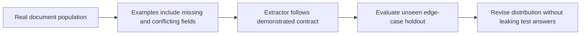

# Objective 4.2 — Apply few-shot prompting to improve output consistency and quality

[Test this decision with a supplied example](#benchmark-exercise-4-2) — predict first, then compare the fixed-fixture evidence.

**Picture the application:** An insurance intake service reads coverage dates correctly from tables but misses dates written in prose. The expected record must identify the current policy’s date, preserve its evidence and leave absent information unresolved. Few-shot prompting is the technical choice for teaching the relevant variation when clear instructions alone are insufficient.


**Exam:** CCAR-F · **Domain 4:** 20% of exam; no separate objective weight is published here.  
**Time:** 30–40 minutes foundation/applied; 15–25 additional minutes production extension.  
**Prerequisites:** 4.1 explicit criteria. New to the Claude API? Start with the [five-minute primer in Lesson 0](../L00-orientation.md#five-minute-primer-how-a-claude-app-works).  
**Continue from:** [Domain lesson](../L04-prompt-engineering-and-structured-output.md) · [Objective map](../../../01-Curriculum/02-Architect-Track/CCAR-F-objectives.md).

**Official task statement:** Apply few-shot prompting to improve output consistency and quality


<!-- layered-episode:FV-20:start -->
<a id="learn-fv-20"></a>
### Learn the decision in context — FV-20

**Picture the job.** Invoice examples all look perfect. Real invoices sometimes omit tax IDs or contain conflicting totals. This is an original fictional teaching scene, not a recalled live exam question. Read and trace it; no account, installation or API call is required.

**Start small.** Follow the ordinary route: a person supplies a request or record, software passes the needed evidence to the assistant, and a receiving service or person checks the result. The first demonstration assumes the input, access and evidence are suitable. Now remove that assumption in the situation above. Predict what the receiver would see before choosing a repair.

**Original exam-style practice — choose ONE.** A few-shot extraction prompt invents rare missing fields after seeing only clean positive examples. What change best addresses the distribution gap?

A. Add more copies of the same clean invoice example.

B. Add representative missing-field, conflict and credit-note examples with allowed unresolved outputs; evaluate on unseen cases.

C. Insert held-out answers into the prompt and report the resulting score as independent validation.

<details>
<summary>What is this asking? Plain-language help, without the answer</summary>

Identify what the application needs to trust, what has actually been observed, and what remains unknown. Compare the choices against this situation, rather than choosing the most complicated design. A proposal is an intended action; evidence is what you can point to; a contract says what the receiving part expects. Decide which option fixes the stated failure without pretending another requirement has also been solved.

</details>

**Choose before opening the walkthrough.** Say your answer and the closest alternative aloud, or record them in your own notes.

<details>
<summary>Reveal the repair, evidence and changed condition</summary>

**Answer: B.** Add representative missing-field, conflict and credit-note examples with allowed unresolved outputs; evaluate on unseen cases.

**Walk it through.** A missing tax ID remains absent under the contract. A source conflict is retained, and unseen credit notes are evaluated separately.

**Why the alternatives fail here.** Add more copies of the same clean invoice example. This leaves the stated boundary or evidence requirement unsatisfied. Insert held-out answers into the prompt and report the resulting score as independent validation. This also fails to establish the required result. The closest competing mechanism fails for this specific reason: Few-shot consistency is not a factual guarantee. Examples should represent the relevant error modes, not leak held-out answers.

**Inspect the small artifact.** This is an illustrative application-state note for reading, not an SDK signature or executable configuration. The application or workflow owner creates it; the receiver uses it to distinguish what is known from what still needs checking. Its labels describe this scene; do not paste it into Claude settings.

```text
examples=[ordinary,missing_field,conflict,credit_note]; holdout=unseen_edge_cases
```

**Layer added.** AI reasoning proposes, selects or summarizes where the job needs judgment. Ordinary software checks identifiers, permissions, required fields, recorded outcomes and stop conditions where applicable. A human resolves a policy or evidence gap when the story requires it. Inspect which owner actually supplies the evidence in this scene.



**Change one condition.** Keep the application in mind and consider the new situation below. Choose before opening its explanation.

**Technical transfer question — choose ONE.** The extraction population shifts to negative-amount credit notes. What should change?

A. Nothing, because clean positive invoice examples cover every document population.

B. Representative examples and evaluation slices, with unseen holdout retained.

<details>
<summary>Transfer check</summary>

**B.** A new document population uses credit notes and negative amounts. Revise the example distribution and validate on unseen cases. Name the changed fact before naming a tool. Preserve unrelated access, source-validation and result checks.

</details>

**Recall in ordinary language.** What broke? Who can fix it? What observable result proves the repair? If you cannot answer all three, replay the concrete scene rather than memorize the option letter.

</details>

**Continue from this decision:** [objective 4.2](objective-4.2.md) · [inspect its decision map](../decision-atlas.md#diagram-d10) · [targeted practice](../../../practice/index.html?exam=CCAR-F&objective=4.2). Existing mapped question IDs: `cct-fv-20-base-v1`, `cct-fv-20-retry-v1`. The new guided question above is separate from those stored items and does not change their answers or progress.
<!-- layered-episode:FV-20:end -->

## Read this objective in both vocabularies

For reading and paper reasoning, no installation or credentials are needed. Keep this page's stated concept prerequisites; any runnable challenge still needs its own setup. If an implementation example feels abrupt, first read [how to interpret its artifact type](../architecture-studio/00-foundations.md#how-to-read-technical-examples-in-this-course), then use the relevant application bridge: [AS-02 decision bridge](../architecture-studio/AS-02-document-pipeline.md#connect-the-simple-explanation-to-technical-design-choices) · [AS-03 decision bridge](../architecture-studio/AS-03-grounded-assistant.md#connect-the-simple-explanation-to-technical-design-choices).

Explain the business purpose first, name the precise mechanism second, and distinguish it from the nearest plausible alternative using the stated constraint. Return here for the objective-specific protocol, options and practice. The bridges are teaching aids, not additional official objectives.


## Big idea

Examples teach the decision boundary and output shape. Use targeted variation so Claude can generalize a principle rather than imitate superficial wording.

## Foundation

### 4.2-K1

**Blueprint focus:** Few-shot examples as the most effective technique for achieving consistently formatted, actionable output when detailed instructions alone produce inconsistent results

Detailed instructions can still yield inconsistent formatting or ambiguous decisions. A few-shot example pairs an input with the desired output and a short rationale. It shows what an actionable finding looks like without requiring the model to infer the format from prose alone.

[Exam guide v1.0, section 6 task 4.2](https://anthropic-partners.skilljar.com/page/partner-certifications) (Tier 1, July 2026 blueprint).

### 4.2-K2

**Blueprint focus:** The role of few-shot examples in demonstrating ambiguous-case handling (e.g., tool selection for ambiguous requests, branch-level test coverage gaps)

Ambiguous cases deserve examples because they reveal competing interpretations. A missing test for an unreachable branch is different from an untested reachable failure path. The rationale should explain the relevant distinction, not just identify the chosen label.

[Exam guide v1.0, section 6 task 4.2](https://anthropic-partners.skilljar.com/page/partner-certifications) (Tier 1, July 2026 blueprint).

### 4.2-K3

**Blueprint focus:** How few-shot examples enable the model to generalize judgment to novel patterns rather than matching only pre-specified cases

Variation makes the examples transferable. Change surface details while preserving the rule, and include a nearby negative case. If every positive example has the same keyword, the model may learn that keyword instead of the underlying judgment boundary.

[Exam guide v1.0, section 6 task 4.2](https://anthropic-partners.skilljar.com/page/partner-certifications) (Tier 1, July 2026 blueprint).

### 4.2-K4

**Blueprint focus:** The effectiveness of few-shot examples for reducing hallucination in extraction tasks (e.g., handling informal measurements, varied document structures)

Extraction examples can demonstrate meaning across informal units, tables and narrative sections. They reduce unsupported inference by showing when to use a source value, normalize it or leave a field unknown. Examples cannot supply a fact absent from the document.

[Exam guide v1.0, section 6 task 4.2](https://anthropic-partners.skilljar.com/page/partner-certifications) (Tier 1, July 2026 blueprint).

## Applied skills

These are design applications. Pseudocode and schemas are illustrative unless separately dry-run; a saved design is not a completed implementation.

### 4.2-S1

**Blueprint focus:** Creating 2-4 targeted few-shot examples for ambiguous scenarios that show reasoning for why one action was chosen over plausible alternatives

Create two to four targeted examples around actual ambiguous decisions. Show the chosen action, a plausible alternative and the reason the choice follows the policy. Reserve an unseen case for evaluation rather than declaring success on the examples embedded in the prompt.

[Exam guide v1.0, section 6 task 4.2](https://anthropic-partners.skilljar.com/page/partner-certifications) (Tier 1, July 2026 blueprint).

### 4.2-S2

**Blueprint focus:** Including few-shot examples that demonstrate specific desired output format (location, issue, severity, suggested fix) to achieve consistency

Demonstrate the exact finding structure: location, issue, severity and suggested fix. Include enough evidence for an independent reader to reproduce the problem. Keep field naming and level of detail consistent across examples.

[Exam guide v1.0, section 6 task 4.2](https://anthropic-partners.skilljar.com/page/partner-certifications) (Tier 1, July 2026 blueprint).

### 4.2-S3

**Blueprint focus:** Providing few-shot examples distinguishing acceptable code patterns from genuine issues to reduce false positives while enabling generalization

Pair a genuine defect with an acceptable local pattern that looks similar. Explain why only the defect meets the reporting criterion. Evaluate on new patterns so reducing false positives does not simply suppress the whole class.

[Exam guide v1.0, section 6 task 4.2](https://anthropic-partners.skilljar.com/page/partner-certifications) (Tier 1, July 2026 blueprint).

### 4.2-S4

**Blueprint focus:** Using few-shot examples to demonstrate correct handling of varied document structures (inline citations vs bibliographies, methodology sections vs embedded details)

Show evidence located in different document structures, such as methodology text, inline citations and a bibliography. Attach extraction to the specific source passage. Teach the model to distinguish references to prior studies from the current document's own method.

[Exam guide v1.0, section 6 task 4.2](https://anthropic-partners.skilljar.com/page/partner-certifications) (Tier 1, July 2026 blueprint).

### 4.2-S5

**Blueprint focus:** Adding few-shot examples showing correct extraction from documents with varied formats to address empty/null extraction of required fields

When required information is present but repeatedly extracted as null, include examples of that field in varied layouts. Compare against a separate sample. If the information is genuinely absent, demonstrate an unknown output instead of manufacturing an example that pretends it exists.

[Exam guide v1.0, section 6 task 4.2](https://anthropic-partners.skilljar.com/page/partner-certifications) (Tier 1, July 2026 blueprint).

## Worked example

A synthetic insurance intake system misses coverage dates embedded in prose while handling table dates correctly. Three examples show a table, a narrative sentence and a referenced earlier policy whose date must not be used for the current policy. Each returns the same structured field plus evidence location. A credible alternative is a more explicit prose instruction listing where dates may occur; it is inexpensive and may suffice, so it is evaluated first. Few-shot examples are added when ambiguity persists. Fine-tuning would require more data and operational work than this bounded issue justifies. The system is tested on unseen layouts; documents with no current policy date remain unknown and route for clarification. The cost is prompt tokens and careful example maintenance, balanced against consistency across real variation.

Original synthetic scenario; decision principles: [Exam guide v1.0, section 6 task 4.2](https://anthropic-partners.skilljar.com/page/partner-certifications) (Tier 1, July 2026 blueprint).

## Production transfer

**Scientific publishing; enrichment beyond the blueprint examples.** A literature intake extracts study dates from methods paragraphs and distinguishes them from bibliography dates. Examples include inline references, a separate references section and no collection date. Compare instructions alone with targeted few-shot examples on unseen layouts; select the smallest prompt that meets evidence-based criteria. Recovery routes documents whose field is absent, while a layout parsing failure triggers a better example or extraction path. Extension: a paper reports two study cohorts with different dates; show why one global date loses meaning.

In your own notes, save your decision, rejected alternative, evidence and recovery path. Re-run the decision with the changed constraint before calling the pattern transferable. This is a design exercise, not industry compliance advice.

## Traps and counterexamples

Do not provide only easy positives. Avoid examples that conflict with your written policy. Few-shot prompting improves behavior but does not establish schema validity or eliminate the need for evidence checks.

## Supplied few-shot pairs and unseen case

Each snippet is synthetic. Extraction contract: current policy effective date with evidence locator; null if not present; never borrow a date from a cited older policy.

| Input | Desired output | Why / wrong interpretation |
| --- | --- | --- |
| Table at p1 row3: `Current policy effective: 2026-10-01` | `{date:"2026-10-01", evidence:"p1 row3", state:"found"}` | Table value belongs to current policy; no inference needed. |
| p2 paragraph4: `The coverage described here commences October 15, 2026.` | `{date:"2026-10-15", evidence:"p2 paragraph4", state:"found"}` | Normalize the prose date while preserving evidence; layout alone is not grounds for null. |
| p3 reference2: `See prior policy effective 2025-09-01`; current date absent | `{date:null, evidence:"current date not supplied", state:"absent"}` | A referenced older policy is a nearby negative; using its date would be plausible but wrong. |

### Code judgment and output-format pair

Reporting criterion: flag a missing-case branch only when a reachable input causes the specified behavior to fail. Illustrative parser contract: null input returns a validation error; empty list is valid.

**Reportable input:** `src/parser.ts:20` reads `input.items.length` before checking null. Expected finding:

```json
{"location":"src/parser.ts:20","issue":"Null input throws before validation; input=null reproduces the wrong behavior.","severity":"bug","suggested_fix":"Validate input before dereferencing items."}
```

**Acceptable input:** `src/parser.ts:27` checks null first and returns the validation error, then accepts `items:[]`. Expected output is `[]`, not a complaint that the empty list must be forbidden. A plausible wrong interpretation is to flag every untested-looking branch or treat empty as null; the contract distinguishes them.

### Unseen case — try before checking

A new document says at p1 paragraph2: “Coverage commences 2026-11-01.” Its bibliography cites a 2024 policy, and p2 lists the document's publication date as 2026-10-20. Extract the current effective date and locator. Then format one code finding for a null-dereference at `src/loader.ts:9`, and decide whether a safe guarded dereference needs a finding.

**Expected outputs:** current date 2026-11-01 with p1 paragraph2; neither bibliography nor publication date is used. The code finding has location, reachable null trigger, issue, bug severity and concrete fix; the guarded code yields no finding. To practice S1–S5, submit all extraction pairs, the acceptable/reportable code outputs, a brief competing-interpretation rationale and the unseen outputs. Examples improve missing-layout extraction, but source absence remains null rather than fabricated evidence.

[Guide section 6 task 4.2](https://anthropic-partners.skilljar.com/page/partner-certifications) (Tier 1).

<a id="decision-variants"></a>
<a id="variant-fv-20"></a>
## Decision variant FV-20 — Teach the edges with representative examples

This is original fictional practice, not an official exam question. All policies, amounts and records below are synthetic.

**Choose in the base case.** A finance extraction prompt includes ordinary invoices, absent tax IDs and source conflicts, with explanations of allowed nulls and unresolved values.

**Change one constraint.** A new document population uses credit notes and negative amounts. Revise the example distribution and validate on unseen cases.

**What failed, and who recovers?** All examples are clean positive invoices; the model invents rare fields. Add realistic counterexamples rather than simply adding more clean examples.

**Inspect the artifact — illustrative contract, not a drop-in SDK implementation:**

```text
examples=[ordinary,missing_field,conflict,credit_note]; holdout=unseen_edge_cases
```

**Why not the nearest alternative?** Few-shot consistency is not a factual guarantee. Examples should represent the relevant error modes, not leak held-out answers.

**Memory cue with its condition:** Examples teach boundaries; holdouts test transfer.

**Proof before accepting success:** Produce a trace or artifact showing the decisive constraint, the selected mechanism, rejected alternative and observable result. Preserve unresolved status; a plausible explanation alone is not completion.

[Inspect D10 and its equivalent decision procedure](../decision-atlas.md#diagram-d10) · [See this decision at walkthrough step 5](../scenario-walkthroughs/WT-06-structured-data-extraction.md#variant-fv-20) · [Return to the objective map](README.md).

**Blind transfer:** Before opening practice, explain which single change in the scene would reverse your choice and which would only require revalidation. Write the failure signal and the next safe action. The practice app provides separately authored base and later-retry items, with a free-response transfer rubric; assistance/exposure must remain visible in learning history.

**Current runtime reference:** [https://platform.claude.com/docs/en/agents-and-tools/tool-use/overview](https://platform.claude.com/docs/en/agents-and-tools/tool-use/overview) (reviewed 2026-10-14). The saved blueprint remains the exam coverage source; application policy in this packet is invented teaching context.


## Try it

Use the supplied fixture above for the required skill outputs first. The following design activity is an extension, not a substitute for those concrete checks.

Write three original extraction examples for dates in a table, prose and a citation to an earlier document. Include one acceptable unknown value and a brief rationale. Test the rule mentally on an unseen mixed-layout case.

Attempt your design before reading the self-check. Save the artifact and the decision rationale so an independent reviewer can inspect them.

### Expected output and self-check

Examples preserve the same output schema, cite the relevant source passage and avoid borrowing dates from the earlier policy. Unknown means evidence is absent, not a parsing failure. The unseen case is resolved by the rule rather than matching a memorized sentence.

## Done when

- [ ] **4.2-S1:** Return two varied extraction pairs and the nearby-negative output with rationales distinguishing current date from cited policy.
- [ ] **4.2-S2:** Produce the specified location/issue/severity/fix JSON for the reportable code case.
- [ ] **4.2-S3:** Return no finding for the guarded acceptable code; explain the reachable-input distinction and unseen case judgment.
- [ ] **4.2-S4:** Extract the current date across table, prose and citation structures with correct locators and source ownership.
- [ ] **4.2-S5:** Correct present-in-prose null extraction while preserving true absence as null; output the unseen 2026-11-01 case without borrowing publication/reference dates.

In your own notes, save each stated artifact and check against the supplied expected outputs. Written design evidence and actual implementation evidence remain separate; learner mastery is not inferred from reading.

## Coverage checklist

| Official bullet, in guide order | Exact teaching section |
| --- | --- |
| 4.2-K1: Few-shot examples as the most effective technique for achieving consistently formatted, actionable output when detailed instructions alone produce inconsistent results | [4.2-K1](#42-k1) |
| 4.2-K2: The role of few-shot examples in demonstrating ambiguous-case handling (e.g., tool selection for ambiguous requests, branch-level test coverage gaps) | [4.2-K2](#42-k2) |
| 4.2-K3: How few-shot examples enable the model to generalize judgment to novel patterns rather than matching only pre-specified cases | [4.2-K3](#42-k3) |
| 4.2-K4: The effectiveness of few-shot examples for reducing hallucination in extraction tasks (e.g., handling informal measurements, varied document structures) | [4.2-K4](#42-k4) |
| 4.2-S1: Creating 2-4 targeted few-shot examples for ambiguous scenarios that show reasoning for why one action was chosen over plausible alternatives | [4.2-S1](#42-s1) |
| 4.2-S2: Including few-shot examples that demonstrate specific desired output format (location, issue, severity, suggested fix) to achieve consistency | [4.2-S2](#42-s2) |
| 4.2-S3: Providing few-shot examples distinguishing acceptable code patterns from genuine issues to reduce false positives while enabling generalization | [4.2-S3](#42-s3) |
| 4.2-S4: Using few-shot examples to demonstrate correct handling of varied document structures (inline citations vs bibliographies, methodology sections vs embedded details) | [4.2-S4](#42-s4) |
| 4.2-S5: Adding few-shot examples showing correct extraction from documents with varied formats to address empty/null extraction of required fields | [4.2-S5](#42-s5) |

## Sources and freshness

[Exam guide v1.0, section 6 task 4.2](https://anthropic-partners.skilljar.com/page/partner-certifications) (Tier 1, July 2026 blueprint).

The official objective wording is reproduced for traceability; explanations and all scenarios are project-authored. Existing L03–L05 provide domain synthesis; this module expands each bullet into a teachable decision. The saved July guide is the blueprint baseline, not a claim that no newer guide exists.

**Go deeper:** [Deep practice 4, section 4.2](../deep-practice/04-prompt-engineering-and-structured-output.md#42-few-shot-prompting)


<a id="benchmark-exercise-4-2"></a>
## Worked evidence task — 4.2: test the boundary

**Original technical decision.** An extraction prompt has table and prose examples, but a field is split across two paragraphs. Which evaluation establishes transfer beyond memorized formatting?

**In everyday terms:** The new layout checks whether the rule was learned rather than one example copied.

**Before you start:** No account, API key or package installation is needed for the paper task. Optional replay needs Python 3 and the two provided lab files in the same directory. This local inspector models the stated fixture; it does not call Claude, load Claude Code rules or run an MCP server.

### Inspect the supplied input

All identifiers and business rules here are fictional application data. This is **not an SDK request schema**. Keep the input separate from your proposed decision.

```json
{
  "source_examples": [
    "amount in table",
    "amount in prose"
  ],
  "unseen": "same field split across two paragraphs",
  "format": "fixed record; missing evidence nullable"
}
```

### Break, choose, repair, prove

1. **Break:** Teach one extraction boundary with varied examples and test an unseen arrangement. Name the exact failed assumption before proposing another component.
2. **Choose:** Use the unseen arrangement as a separate test and require supporting text for the fixed record. Write the nearest alternative you would reject and the requirement it fails.
3. **Repair:** Write the corrected contract or recovery step, keeping successful evidence and unknowns separate.
4. **Prove:** Improve consistency without treating examples as proof of truth or a universal remedy. Record `decision`, `reason`, `rejected_alternative`, `evidence` and `remaining_unknowns`.

[Open this actual task in the existing LAB](../../../06-Labs/02-CCAR-F-coordinator-extraction/README.md#benchmark-exercise-4-2) · [Return to the teaching subsection](#worked-example)

<details><summary>Compare the offline evidence — after making your decision</summary>

The local inspector presents **controlled-fixture calculations and authored reference decisions** below. Some fields are calculated (such as counts or arithmetic); policy labels and recovery choices are supplied worked answers for this fixed example, not executed policies or a general-purpose validator. No Claude, rule loader, service or reviewer was run. `false` or `null` observations remain unresolved when no corresponding live test was performed.

```json
{
  "source_layouts": 2,
  "unseen_layout": "same field split across two paragraphs",
  "record_rule": "fixed record; missing evidence nullable",
  "unseen_accuracy_observed": false
}
```

**Why this matters:** The new layout checks whether the rule was learned rather than one example copied. The output is a self-check for this controlled example, not certification-score evidence. To test the real mechanism, perform the existing LAB’s integration steps in a fresh disposable context and keep its actual trace beside this prediction.

**Primary-source leads for mechanism review:** [Prompt Engineering Overview](https://platform.claude.com/docs/en/build-with-claude/prompt-engineering/overview). The external benchmark helped identify the exercise gap; this task and its data were authored here. Current implementation details must be verified against the installed runtime and those primary sources.

</details>