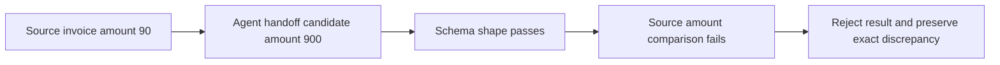

# Objective 4.3 — Enforce structured output using tool use and JSON schemas

[Test this decision with a supplied example](#benchmark-exercise-4-3) — predict first, then compare the fixed-fixture evidence.

**Picture the application:** A manufacturer receives purchase orders and inspection certificates through the same intake channel. Each document should become an appropriately shaped record, retaining uncertainty instead of filling irrelevant fields with guesses. Schema-based extraction and tool selection are the technical decisions; factual validation still asks whether each value matches its source.


**Exam:** CCAR-F · **Domain 4:** 20% of exam; no separate objective weight is published here.  
**Time:** 30–40 minutes foundation/applied; 15–25 additional minutes production extension.  
**Prerequisites:** 2.1 tool contracts and 1.1 agentic loops. New to the Claude API? Start with the [five-minute primer in Lesson 0](../L00-orientation.md#five-minute-primer-how-a-claude-app-works).  
**Continue from:** [Domain lesson](../L04-prompt-engineering-and-structured-output.md) · [Objective map](../../../01-Curriculum/02-Architect-Track/CCAR-F-objectives.md).

**Official task statement:** Enforce structured output using tool use and JSON schemas


<!-- layered-episode:FV-21:start -->
<a id="learn-fv-21"></a>
### Learn the decision in context — FV-21

**Picture the job.** A specialist returns a neat money record. The receiving service can read it, but the amount is ten times the invoice. This is an original fictional teaching scene, not a recalled live exam question. Read and trace it; no account, installation or API call is required.

**Start small.** Follow the ordinary route: a person supplies a request or record, software passes the needed evidence to the assistant, and a receiving service or person checks the result. The first demonstration assumes the input, access and evidence are suitable. Now remove that assumption in the situation above. Predict what the receiver would see before choosing a repair.

**Original exam-style practice — choose ONE.** An agent handoff is schema-valid but contains amount=900 where the source says 90. Which receiving-boundary design addresses the failure?

A. Force tool invocation and treat the returned fields as factually correct.

B. Make the amount nullable and accept the wrong non-null value.

C. Keep supported structural enforcement and independently compare fields with source evidence and business rules before accepting the result.

<details>
<summary>What is this asking? Plain-language help, without the answer</summary>

Identify what the application needs to trust, what has actually been observed, and what remains unknown. Compare the choices against this situation, rather than choosing the most complicated design. A proposal is an intended action; evidence is what you can point to; a contract says what the receiving part expects. Decide which option fixes the stated failure without pretending another requirement has also been solved.

</details>

**Choose before opening the walkthrough.** Say your answer and the closest alternative aloud, or record them in your own notes.

<details>
<summary>Reveal the repair, evidence and changed condition</summary>

**Answer: C.** Keep supported structural enforcement and independently compare fields with source evidence and business rules before accepting the result.

**Walk it through.** The receiving validator records shape=pass and source_match=fail, rejects acceptance and cites the exact source amount. A later corrected result must pass both checks.

**Why the alternatives fail here.** Force tool invocation and treat the returned fields as factually correct. This leaves the stated boundary or evidence requirement unsatisfied. Make the amount nullable and accept the wrong non-null value. This also fails to establish the required result. The closest competing mechanism fails for this specific reason: Forcing a tool call does not prove schema adherence unless the applicable mechanism enforces it; even conforming output can be wrong.

**Inspect the small artifact.** This is an illustrative application-state note for reading, not an SDK signature or executable configuration. The application or workflow owner creates it; the receiver uses it to distinguish what is known from what still needs checking. Its labels describe this scene; do not paste it into Claude settings.

```text
candidate={amount:900,currency:USD}; source={amount:90}; shape=pass; source_match=fail
```

**Layer added.** AI reasoning proposes, selects or summarizes where the job needs judgment. Ordinary software checks identifiers, permissions, required fields, recorded outcomes and stop conditions where applicable. A human resolves a policy or evidence gap when the story requires it. Inspect which owner actually supplies the evidence in this scene.



**Change one condition.** Keep the application in mind and consider the new situation below. Choose before opening its explanation.

**Technical transfer question — choose ONE.** A required extraction field is truly absent from the source. Which contract response is appropriate?

A. Represent absence only as permitted by the declared schema, or return a validation failure for review.

B. Invent a plausible non-null value to satisfy the required type.

<details>
<summary>Transfer check</summary>

**A.** A field truly absent from the source may be null only when the declared contract allows it. A wrong non-null amount does not call for a nullable-only repair. Name the changed fact before naming a tool. Preserve unrelated access, source-validation and result checks.

</details>

**Recall in ordinary language.** What broke? Who can fix it? What observable result proves the repair? If you cannot answer all three, replay the concrete scene rather than memorize the option letter.

</details>

**Continue from this decision:** [objective 4.3](objective-4.3.md) · [inspect its decision map](../decision-atlas.md#diagram-d09) · [targeted practice](../../../practice/index.html?exam=CCAR-F&objective=4.3). Existing mapped question IDs: `cct-fv-21-base-v1`, `cct-fv-21-retry-v1`. The new guided question above is separate from those stored items and does not change their answers or progress.
<!-- layered-episode:FV-21:end -->

## Read this objective in both vocabularies

For reading and paper reasoning, no installation or credentials are needed. Keep this page's stated concept prerequisites; any runnable challenge still needs its own setup. If an implementation example feels abrupt, first read [how to interpret its artifact type](../architecture-studio/00-foundations.md#how-to-read-technical-examples-in-this-course), then use the relevant application bridge: [AS-02 decision bridge](../architecture-studio/AS-02-document-pipeline.md#connect-the-simple-explanation-to-technical-design-choices) · [AS-06 decision bridge](../architecture-studio/AS-06-ci-review.md#connect-the-simple-explanation-to-technical-design-choices).

Explain the business purpose first, name the precise mechanism second, and distinguish it from the nearest plausible alternative using the stated constraint. Return here for the objective-specific protocol, options and practice. The bridges are teaching aids, not additional official objectives.


## Big idea

Structured output is a contract for shape, not a guarantee of truth. Select the tool deliberately and give the schema honest ways to represent missing or ambiguous evidence.

## Foundation

### 4.3-K1

**Blueprint focus:** Tool use (tool_use) with JSON schemas as the most reliable approach for guaranteed schema-compliant structured output, eliminating JSON syntax errors

The blueprint teaches extraction through schema-defined tool inputs. An application reads the tool_use input rather than scraping a prose answer. A normal tool schema alone is not a syntax guarantee; `strict: true` on the tool enforces names, types and required fields (Strict tool use docs, Tier 1, checked 2026-10-12). [Current structured-output distinction](https://platform.claude.com/docs/en/build-with-claude/structured-outputs) (Tier 1, checked 2026-10-12).

[Exam guide v1.0, section 6 task 4.3](https://anthropic-partners.skilljar.com/page/partner-certifications) (Tier 1, July 2026 blueprint).

### 4.3-K2

**Blueprint focus:** The distinction between tool_choice: "auto" (model may return text instead of calling a tool), "any" (model must call a tool but can choose which), and forced tool selection (model must call a specific named tool)

Automatic tool choice permits an ordinary text response. Any-tool choice requires a tool while allowing selection among available tools. Forced choice names one extraction tool. Choose based on whether the document type is unknown or a specific extraction must precede enrichment. **Compatibility:** any and named-tool choice are July blueprint patterns supported only by compatible model/settings combinations. Manual extended thinking and some current models reject forced choice. [Tool-choice documentation](https://platform.claude.com/docs/en/agents-and-tools/tool-use/define-tools) (Tier 1, checked 2026-10-02).

[Exam guide v1.0, section 6 task 4.3](https://anthropic-partners.skilljar.com/page/partner-certifications) (Tier 1, July 2026 blueprint).

### 4.3-K3

**Blueprint focus:** That strict JSON schemas via tool use eliminate syntax errors but do not prevent semantic errors (e.g., line items that don't sum to total, values in wrong fields)

A schema can constrain types and required keys but cannot establish that values are correct. Two valid numbers can contradict each other, and a date can belong to the wrong event. Use source evidence and semantic validators after parsing.

[Exam guide v1.0, section 6 task 4.3](https://anthropic-partners.skilljar.com/page/partner-certifications) (Tier 1, July 2026 blueprint).

### 4.3-K4

**Blueprint focus:** Schema design considerations: required vs optional fields, enum fields with "other" + detail string patterns for extensible categories

Required presence and known value are separate concepts. A required field can permit null where supported; optional fields can be absent. Enums need explicit ambiguous states and an other-plus-detail path when valid source categories exceed the initial controlled vocabulary.

[Exam guide v1.0, section 6 task 4.3](https://anthropic-partners.skilljar.com/page/partner-certifications) (Tier 1, July 2026 blueprint).

## Applied skills

These are design applications. Pseudocode and schemas are illustrative unless separately dry-run; a saved design is not a completed implementation.

### 4.3-S1

**Blueprint focus:** Defining extraction tools with JSON schemas as input parameters and extracting structured data from the tool_use response

Define an extraction tool with named fields, types and evidence locations. Read the tool_use input using the SDK's documented response blocks. `strict: true` on the tool enforces names, types and required fields (Strict tool use docs, Tier 1, checked 2026-10-12).

[Exam guide v1.0, section 6 task 4.3](https://anthropic-partners.skilljar.com/page/partner-certifications) (Tier 1, July 2026 blueprint).

### 4.3-S2

**Blueprint focus:** Setting tool_choice: "any" to guarantee structured output when multiple extraction schemas exist and the document type is unknown

When several extraction schemas exist and document type is unknown, use any-tool choice with a well-differentiated tool set. Validate that the selected type agrees with the evidence. Forced tool selection would prematurely assume the document class. Check model/thinking compatibility first; when unsupported, use a compatible workflow rather than claiming the force succeeded.

[Exam guide v1.0, section 6 task 4.3](https://anthropic-partners.skilljar.com/page/partner-certifications) (Tier 1, July 2026 blueprint).

### 4.3-S3

**Blueprint focus:** Forcing a specific tool with tool_choice: {"type": "tool", "name": "extract_metadata"} to ensure a particular extraction runs before enrichment steps

Force extract_metadata when metadata is a prerequisite for later processing. Examine its tool result before enrichment rather than assuming a named choice means every requested field was found. Sequence enforcement belongs in the application loop. This is a blueprint pattern, not a universal current-model capability; verify compatibility and handle a rejected request.

[Exam guide v1.0, section 6 task 4.3](https://anthropic-partners.skilljar.com/page/partner-certifications) (Tier 1, July 2026 blueprint).

### 4.3-S4

**Blueprint focus:** Designing schema fields as optional (nullable) when source documents may not contain the information, preventing the model from fabricating values to satisfy required fields

Nullable handles missing evidence only. A wrong non-null value still matches the schema, because structured outputs guarantee shape, not correctness, so a semantic check is still needed (Anthropic docs, Structured outputs, Tier 1, checked 2026-10-12).

Allow missing-source fields to be absent or null as appropriate to the contract. Explain the difference between not present, not applicable and extraction failed if the application needs it. Do not demand an invented value merely to satisfy a required property.

[Exam guide v1.0, section 6 task 4.3](https://anthropic-partners.skilljar.com/page/partner-certifications) (Tier 1, July 2026 blueprint).

### 4.3-S5

**Blueprint focus:** Adding enum values like "unclear" for ambiguous cases and "other" + detail fields for extensible categorization

Use unclear for ambiguous classification, and other with a detail field for valid unlisted categories. Check consistency between category and detail. A category escape hatch needs validation, otherwise it becomes a bucket for every difficult decision.

[Exam guide v1.0, section 6 task 4.3](https://anthropic-partners.skilljar.com/page/partner-certifications) (Tier 1, July 2026 blueprint).

### 4.3-S6

**Blueprint focus:** Including format normalization rules in prompts alongside strict output schemas to handle inconsistent source formatting

Specify normalization alongside the schema: currency codes, ISO-style dates and unit conversion rules. Retain raw values or evidence when conversion affects interpretation. Schema shape cannot decide whether 03/04 means March 4 or April 3 without context.

[Exam guide v1.0, section 6 task 4.3](https://anthropic-partners.skilljar.com/page/partner-certifications) (Tier 1, July 2026 blueprint).

## Worked example

A manufacturing intake receives purchase orders and inspection certificates. A tool is required, but the document type is initially unknown, so any-tool selection allows the appropriate schema. The order schema includes stated_total, currency and nullable delivery_date; category supports unclear and other with detail. Once the type is established, metadata extraction is forced before enrichment. Strict schema enforcement prevents malformed inputs but a validator still checks item sums and date meaning. A credible alternative is one unified schema: simpler integration, but many irrelevant nullable fields and weaker type boundaries. Forced order extraction is reasonable only if upstream classification is reliable. On ambiguous dates, the system preserves raw text and requests clarification instead of guessing. The design costs tool contracts and semantic checks, and yields explicit, recoverable uncertainty. Any/forced-choice stages here assume a compatible model and settings; an unsupported combination must be redesigned before use.

Original synthetic scenario; decision principles: [Exam guide v1.0, section 6 task 4.3](https://anthropic-partners.skilljar.com/page/partner-certifications) (Tier 1, July 2026 blueprint).

### Illustrative output contract

```json
{
  "document_type": "purchase_order",
  "delivery_date": null,
  "date_evidence": "not present in supplied pages",
  "category": "other",
  "category_detail": "prototype inspection order",
  "stated_total": 126,
  "currency": "USD"
}
```

The schema must explicitly permit `delivery_date` to be null and the category extension. The example demonstrates output meaning, not a complete verified API request. Application checks still need to establish whether 126 matches the source and whether the currency is supported by evidence.

## Production transfer

**Healthcare administration; enrichment beyond the blueprint examples.** A synthetic benefits intake distinguishes authorization letters from invoices. A nullable field preserves missing coverage evidence, while unclear categorization stops inappropriate downstream routing. Compare separate schemas with a unified schema under limited tool budget: the unified contract may simplify operations but increases irrelevant fields. Never use schema validity as permission to approve a benefit. Recovery preserves source excerpts and routes contradictions. Extension: a third document type arrives; design an other-plus-detail route before deciding whether it needs its own schema.

In your own notes, save your decision, rejected alternative, evidence and recovery path. Re-run the decision with the changed constraint before calling the pattern transferable. This is a design exercise, not industry compliance advice.

## Traps and counterexamples

Do not equate required with known. Tool choice controls selection, not semantic accuracy. Inspect refusal, truncation and other exceptional responses rather than assuming every request yields usable extraction.

<a id="decision-variants"></a>
<a id="variant-fv-21"></a>
## Decision variant FV-21 — Validate shape and truth separately

This is original fictional practice, not an official exam question. All policies, amounts and records below are synthetic.

**Choose in the base case.** Use supported strict schema enforcement for an extraction tool, then independently validate source evidence and arithmetic. Tool selection, structural conformance and semantic validity are separate checks.

**Change one constraint.** A field truly absent from the source may be null only when the declared contract allows it. A wrong non-null amount does not call for a nullable-only repair.

**What failed, and who recovers?** The JSON is well typed but says 900 where the source says 90. Reject the semantic mismatch and return the exact failed check.

**Inspect the artifact — illustrative contract, not a drop-in SDK implementation:**

```text
candidate={amount:900,currency:USD}; source={amount:90}; shape=pass; source_match=fail
```

**Why not the nearest alternative?** Forcing a tool call does not prove schema adherence unless the applicable mechanism enforces it; even conforming output can be wrong.

**Memory cue with its condition:** Call, shape, truth: three proofs, not one.

**Proof before accepting success:** Produce a trace or artifact showing the decisive constraint, the selected mechanism, rejected alternative and observable result. Preserve unresolved status; a plausible explanation alone is not completion.

[Inspect D09 and its equivalent decision procedure](../decision-atlas.md#diagram-d09) · [See this decision at walkthrough step 4](../scenario-walkthroughs/WT-06-structured-data-extraction.md#variant-fv-21) · [Return to the objective map](README.md).

**Blind transfer:** Before opening practice, explain which single change in the scene would reverse your choice and which would only require revalidation. Write the failure signal and the next safe action. The practice app provides separately authored base and later-retry items, with a free-response transfer rubric; assistance/exposure must remain visible in learning history.

**Current runtime reference:** [https://platform.claude.com/docs/en/agents-and-tools/tool-use/overview](https://platform.claude.com/docs/en/agents-and-tools/tool-use/overview) (reviewed 2026-10-14). The saved blueprint remains the exam coverage source; application policy in this packet is invented teaching context.


## Try it

Design two extraction schemas and choose auto, any or forced choice for three stages: unknown type, mandatory metadata and optional enrichment. Show absent evidence, ambiguous category and normalization rules. Identify two errors a valid schema cannot catch.

Attempt your design before reading the self-check. Save the artifact and the decision rationale so an independent reviewer can inspect them.

### Expected output and self-check

Unknown type uses any when a tool response is mandatory; known mandatory metadata uses forced selection; optional enrichment may use auto. Missing dates are representable, other requires detail and ambiguous dates preserve evidence. Wrong-field assignment and inconsistent totals still need semantic validation. These choices assume compatibility; incompatible current models/settings require a supported alternative and explicit orchestration.

## Done when

- [ ] **4.3-S1:** Provide a schema-defined extraction contract and identify where tool_use input is read; state whether strict enforcement was verified.
- [ ] **4.3-S2:** Choose any for mandatory unknown-type extraction only with compatible model/settings; explain the supported fallback when forced choice is rejected.
- [ ] **4.3-S3:** Choose named metadata extraction before enrichment with compatible configuration; preserve the application prerequisite check.
- [ ] **4.3-S4:** Represent missing delivery evidence as null/absence without inventing a value; distinguish source absence from extraction failure.
- [ ] **4.3-S5:** Provide unclear and other-plus-detail outputs and validate their consistency.
- [ ] **4.3-S6:** Specify date/currency normalization with raw evidence; identify ambiguous dates that require clarification rather than guessing.

In your own notes, save each stated artifact and check against the supplied expected outputs. Written design evidence and actual implementation evidence remain separate; learner mastery is not inferred from reading.

## Coverage checklist

| Official bullet, in guide order | Exact teaching section |
| --- | --- |
| 4.3-K1: Tool use (tool_use) with JSON schemas as the most reliable approach for guaranteed schema-compliant structured output, eliminating JSON syntax errors | [4.3-K1](#43-k1) |
| 4.3-K2: The distinction between tool_choice: "auto" (model may return text instead of calling a tool), "any" (model must call a tool but can choose which), and forced tool selection (model must call a specific named tool) | [4.3-K2](#43-k2) |
| 4.3-K3: That strict JSON schemas via tool use eliminate syntax errors but do not prevent semantic errors (e.g., line items that don't sum to total, values in wrong fields) | [4.3-K3](#43-k3) |
| 4.3-K4: Schema design considerations: required vs optional fields, enum fields with "other" + detail string patterns for extensible categories | [4.3-K4](#43-k4) |
| 4.3-S1: Defining extraction tools with JSON schemas as input parameters and extracting structured data from the tool_use response | [4.3-S1](#43-s1) |
| 4.3-S2: Setting tool_choice: "any" to guarantee structured output when multiple extraction schemas exist and the document type is unknown | [4.3-S2](#43-s2) |
| 4.3-S3: Forcing a specific tool with tool_choice: {"type": "tool", "name": "extract_metadata"} to ensure a particular extraction runs before enrichment steps | [4.3-S3](#43-s3) |
| 4.3-S4: Designing schema fields as optional (nullable) when source documents may not contain the information, preventing the model from fabricating values to satisfy required fields | [4.3-S4](#43-s4) |
| 4.3-S5: Adding enum values like "unclear" for ambiguous cases and "other" + detail fields for extensible categorization | [4.3-S5](#43-s5) |
| 4.3-S6: Including format normalization rules in prompts alongside strict output schemas to handle inconsistent source formatting | [4.3-S6](#43-s6) |

## Sources and freshness

[Exam guide v1.0, section 6 task 4.3](https://anthropic-partners.skilljar.com/page/partner-certifications) (Tier 1, July 2026 blueprint).

The official objective wording is reproduced for traceability; explanations and all scenarios are project-authored. Existing L03–L05 provide domain synthesis; this module expands each bullet into a teachable decision. The saved July guide is the blueprint baseline, not a claim that no newer guide exists.

**Implementation check, 2026-10-12:** [structured outputs](https://platform.claude.com/docs/en/build-with-claude/structured-outputs) distinguishes strict tool inputs from JSON response formatting (Tier 1). July exam wording simplifies the guarantee; `strict: true` on the tool enforces names, types and required fields (Strict tool use docs, Tier 1, checked 2026-10-12). [Current tool choice and compatibility](https://platform.claude.com/docs/en/agents-and-tools/tool-use/define-tools) (Tier 1, checked 2026-10-02).

**Go deeper:** [Deep practice 4, section 4.3](../deep-practice/04-prompt-engineering-and-structured-output.md#43-enforce-structured-output)


<a id="benchmark-exercise-4-3"></a>
## Worked evidence task — 4.3: test the boundary

**Original technical decision.** An extraction object passes schema validation but reports 12000 minor units where the source supports 1200 and no reference. Which validator must still fail?

**In everyday terms:** The JSON can be well formed and still say the wrong amount.

**Before you start:** No account, API key or package installation is needed for the paper task. Optional replay needs Python 3 and the two provided lab files in the same directory. This local inspector models the stated fixture; it does not call Claude, load Claude Code rules or run an MCP server.

### Inspect the supplied input

All identifiers and business rules here are fictional application data. This is **not an SDK request schema**. Keep the input separate from your proposed decision.

```json
{
  "schema_valid": true,
  "output": {
    "amount_minor": 12000,
    "reference": null
  },
  "source_supported_amount_minor": 1200,
  "source_reference_absent": true
}
```

### Break, choose, repair, prove

1. **Break:** Return schema-valid data with an unsupported amount and an absent optional field. Name the exact failed assumption before proposing another component.
2. **Choose:** Validate evidence and units after shape validation; retain a nullable absent reference. Write the nearest alternative you would reject and the requirement it fails.
3. **Repair:** Write the corrected contract or recovery step, keeping successful evidence and unknowns separate.
4. **Prove:** Shape validation passes while evidence validation fails; unknown remains representable. Record `decision`, `reason`, `rejected_alternative`, `evidence` and `remaining_unknowns`.

[Open this actual task in the existing LAB](../../../06-Labs/02-CCAR-F-coordinator-extraction/README.md#benchmark-exercise-4-3) · [Return to the teaching subsection](#illustrative-output-contract)

<details><summary>Compare the offline evidence — after making your decision</summary>

The local inspector presents **controlled-fixture calculations and authored reference decisions** below. Some fields are calculated (such as counts or arithmetic); policy labels and recovery choices are supplied worked answers for this fixed example, not executed policies or a general-purpose validator. No Claude, rule loader, service or reviewer was run. `false` or `null` observations remain unresolved when no corresponding live test was performed.

```json
{
  "shape_pass": true,
  "amount_supported": false,
  "reference_unknown_preserved": true,
  "accept": false
}
```

**Why this matters:** The JSON can be well formed and still say the wrong amount. The output is a self-check for this controlled example, not certification-score evidence. To test the real mechanism, perform the existing LAB’s integration steps in a fresh disposable context and keep its actual trace beside this prediction.

**Primary-source leads for mechanism review:** [define-tools page](https://platform.claude.com/docs/en/agents-and-tools/tool-use/define-tools#forcing-tool-use) · [Tool Use (Function Calling)](https://platform.claude.com/docs/en/build-with-claude/tool-use). The external benchmark helped identify the exercise gap; this task and its data were authored here. Current implementation details must be verified against the installed runtime and those primary sources.

</details>