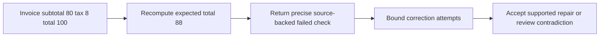

# Objective 4.4 — Implement validation, retry, and feedback loops for extraction quality

[Test this decision with a supplied example](#benchmark-exercise-4-4) — predict first, then compare the fixed-fixture evidence.

**Picture the application:** An invoice shows line items that do not agree with its printed total. The accounting team needs a record that preserves the evidence and identifies the discrepancy rather than quietly rewriting it. Validation and bounded feedback loops are the technical mechanisms for separating extraction mistakes from genuinely conflicting source information.


**Exam:** CCAR-F · **Domain 4:** 20% of exam; no separate objective weight is published here.  
**Time:** 30–40 minutes foundation/applied; 15–25 additional minutes production extension.  
**Prerequisites:** 4.3 schemas and basic arithmetic validators. New to the Claude API? Start with the [five-minute primer in Lesson 0](../L00-orientation.md#five-minute-primer-how-a-claude-app-works).  
**Continue from:** [Domain lesson](../L04-prompt-engineering-and-structured-output.md) · [Objective map](../../../01-Curriculum/02-Architect-Track/CCAR-F-objectives.md).

**Official task statement:** Implement validation, retry, and feedback loops for extraction quality


<!-- layered-episode:FV-22:start -->
<a id="learn-fv-22"></a>
### Learn the decision in context — FV-22

**Picture the job.** An invoice says subtotal 80, tax 8 and total 100. The arithmetic does not add up. This is an original fictional teaching scene, not a recalled live exam question. Read and trace it; no account, installation or API call is required.

**Start small.** Follow the ordinary route: a person supplies a request or record, software passes the needed evidence to the assistant, and a receiving service or person checks the result. The first demonstration assumes the input, access and evidence are suitable. Now remove that assumption in the situation above. Predict what the receiver would see before choosing a repair.

**Original exam-style practice — choose ONE.** An extraction fails a semantic arithmetic check. Which bounded repair preserves correct evidence?

A. Return the source, prior extraction and precise failed check; retry within budget and route unresolved contradictions for review.

B. Retry the entire document indefinitely without saying which check failed.

C. Overwrite the stated total with 88 even if the source really says 100.

<details>
<summary>What is this asking? Plain-language help, without the answer</summary>

Identify what the application needs to trust, what has actually been observed, and what remains unknown. Compare the choices against this situation, rather than choosing the most complicated design. A proposal is an intended action; evidence is what you can point to; a contract says what the receiving part expects. Decide which option fixes the stated failure without pretending another requirement has also been solved.

</details>

**Choose before opening the walkthrough.** Say your answer and the closest alternative aloud, or record them in your own notes.

<details>
<summary>Reveal the repair, evidence and changed condition</summary>

**Answer: A.** Return the source, prior extraction and precise failed check; retry within budget and route unresolved contradictions for review.

**Walk it through.** The validator recomputes 88 and preserves stated_total=100. If the source contradicts itself, the result remains unresolved with the discrepancy attached.

**Why the alternatives fail here.** Retry the entire document indefinitely without saying which check failed. This leaves the stated boundary or evidence requirement unsatisfied. Overwrite the stated total with 88 even if the source really says 100. This also fails to establish the required result. The closest competing mechanism fails for this specific reason: Retrying the whole document without diagnostic feedback can repeat the error or mutate correct fields.

**Inspect the small artifact.** This is an illustrative application-state note for reading, not an SDK signature or executable configuration. The application or workflow owner creates it; the receiver uses it to distinguish what is known from what still needs checking. Its labels describe this scene; do not paste it into Claude settings.

```text
failed_check={subtotal:80,tax:8,total:100,expected:88}; retry_budget=2; status=unresolved
```

**Layer added.** AI reasoning proposes, selects or summarizes where the job needs judgment. Ordinary software checks identifiers, permissions, required fields, recorded outcomes and stop conditions where applicable. A human resolves a policy or evidence gap when the story requires it. Inspect which owner actually supplies the evidence in this scene.



**Change one condition.** Keep the application in mind and consider the new situation below. Choose before opening its explanation.

**Technical transfer question — choose ONE.** The original source itself contains contradictory totals. What should correction preserve?

A. A fabricated reconciled value chosen to make arithmetic pass.

B. Both source values, the detected discrepancy and unresolved review status.

<details>
<summary>Transfer check</summary>

**B.** The source itself contains contradictory totals. Preserve both values and route review instead of asking Claude to manufacture reconciliation. Name the changed fact before naming a tool. Preserve unrelated access, source-validation and result checks.

</details>

**Recall in ordinary language.** What broke? Who can fix it? What observable result proves the repair? If you cannot answer all three, replay the concrete scene rather than memorize the option letter.

</details>

**Continue from this decision:** [objective 4.4](objective-4.4.md) · [inspect its decision map](../decision-atlas.md#diagram-d10) · [targeted practice](../../../practice/index.html?exam=CCAR-F&objective=4.4). Existing mapped question IDs: `cct-fv-22-base-v1`, `cct-fv-22-retry-v1`. The new guided question above is separate from those stored items and does not change their answers or progress.
<!-- layered-episode:FV-22:end -->

## Read this objective in both vocabularies

For reading and paper reasoning, no installation or credentials are needed. Keep this page's stated concept prerequisites; any runnable challenge still needs its own setup. If an implementation example feels abrupt, first read [how to interpret its artifact type](../architecture-studio/00-foundations.md#how-to-read-technical-examples-in-this-course), then use the relevant application bridge: [AS-02 decision bridge](../architecture-studio/AS-02-document-pipeline.md#connect-the-simple-explanation-to-technical-design-choices).

Explain the business purpose first, name the precise mechanism second, and distinguish it from the nearest plausible alternative using the stated constraint. Return here for the objective-specific protocol, options and practice. The bridges are teaching aids, not additional official objectives.


## Big idea

A retry should supply new diagnostic information. Validation tells you whether the output is malformed, internally inconsistent or unsupported by the source.

## Foundation

### 4.4-K1

**Blueprint focus:** Retry-with-error-feedback: appending specific validation errors to the prompt on retry to guide the model toward correction

A precise error message creates a correction target: “item amounts sum to 126, but stated_total is 162” is more useful than “try again.” Include the original source and failed output so the model can identify whether it transposed digits or misunderstood a field.

[Exam guide v1.0, section 6 task 4.4](https://anthropic-partners.skilljar.com/page/partner-certifications) (Tier 1, July 2026 blueprint).

### 4.4-K2

**Blueprint focus:** The limits of retry: retries are ineffective when the required information is simply absent from the source document (vs format or structural errors)

Repeating the same request cannot discover a missing document. If a required delivery term appears only in an unavailable attachment, retries should stop and the application should request that attachment. Format and mapping mistakes may be correctable; evidence absence requires a different action.

[Exam guide v1.0, section 6 task 4.4](https://anthropic-partners.skilljar.com/page/partner-certifications) (Tier 1, July 2026 blueprint).

### 4.4-K3

**Blueprint focus:** Feedback loop design: tracking which code constructs trigger findings (detected_pattern field) to enable systematic analysis of dismissal patterns

A detected_pattern field links dismissed findings to code constructs or conditions. It supports systematic analysis such as identifying that defensive null checks are repeatedly misclassified. Record developer dispositions separately so the model's label is not treated as proof of a true defect.

[Exam guide v1.0, section 6 task 4.4](https://anthropic-partners.skilljar.com/page/partner-certifications) (Tier 1, July 2026 blueprint).

### 4.4-K4

**Blueprint focus:** The difference between semantic validation errors (values don't sum, wrong field placement) and schema syntax errors (eliminated by tool use)

Schema validation checks structure; semantic validation checks relationships and meaning. Strict output can prevent invalid syntax yet still produce an incorrect sum or wrong field assignment. Keep these failures distinct to choose a useful correction rather than changing the schema unnecessarily.

[Exam guide v1.0, section 6 task 4.4](https://anthropic-partners.skilljar.com/page/partner-certifications) (Tier 1, July 2026 blueprint).

## Applied skills

These are design applications. Pseudocode and schemas are illustrative unless separately dry-run; a saved design is not a completed implementation.

### 4.4-S1

**Blueprint focus:** Implementing follow-up requests that include the original document, the failed extraction, and specific validation errors for model self-correction

Build a follow-up containing the source, prior extraction and specific failed checks. Ask for a corrected extraction with evidence, then rerun validation. Bound repeated attempts and route unresolved contradictions instead of creating an endless self-correction loop.

[Exam guide v1.0, section 6 task 4.4](https://anthropic-partners.skilljar.com/page/partner-certifications) (Tier 1, July 2026 blueprint).

### 4.4-S2

**Blueprint focus:** Identifying when retries will be ineffective (e.g., information exists only in an external document not provided) versus when they will succeed (format mismatches, structural output errors)

Classify each failure before retrying. Retry a date-format mismatch with normalization feedback; obtain missing evidence for an absent attachment; escalate a genuine source contradiction. Document why another model call can or cannot change the outcome.

[Exam guide v1.0, section 6 task 4.4](https://anthropic-partners.skilljar.com/page/partner-certifications) (Tier 1, July 2026 blueprint).

### 4.4-S3

**Blueprint focus:** Adding detected_pattern fields to structured findings to enable analysis of false positive patterns when developers dismiss findings

Add detected_pattern to the findings contract, and aggregate accepted versus dismissed findings by that label. Use examples from recurrent dismissal patterns to revise criteria. Preserve the reviewer outcome because model-generated labels can themselves be inconsistent.

[Exam guide v1.0, section 6 task 4.4](https://anthropic-partners.skilljar.com/page/partner-certifications) (Tier 1, July 2026 blueprint).

### 4.4-S4

**Blueprint focus:** Designing self-correction validation flows: extracting "calculated_total" alongside "stated_total" to flag discrepancies, adding "conflict_detected" booleans for inconsistent source data

Extract stated_total separately from calculated_total and include conflict_detected when source values disagree. Recalculate in application code. Do not let the model silently rewrite the stated amount to make arithmetic pass; preserve a contradiction for review.

[Exam guide v1.0, section 6 task 4.4](https://anthropic-partners.skilljar.com/page/partner-certifications) (Tier 1, July 2026 blueprint).

## Worked example

A fictional invoice lists items of 40 and 86 but a stated total of 162. The extractor returns the same values, so the output is valid JSON but semantically inconsistent. The validator reports calculated_total=126 and conflict_detected=true. A correction request includes the source and prior output; if the source genuinely says 162, the discrepancy remains rather than being “fixed” to 126. A credible alternative is human review immediately, appropriate for high-impact payments or illegible documents. A bounded retry is cheaper when a transcription error is plausible. Repeated blind retries waste money and risk inventing a reconciled value. Recovery preserves both totals, records the failed check and routes the unresolved invoice to review. A missing tax attachment would require evidence retrieval instead of another extraction attempt.

Original synthetic scenario; decision principles: [Exam guide v1.0, section 6 task 4.4](https://anthropic-partners.skilljar.com/page/partner-certifications) (Tier 1, July 2026 blueprint).

## Production transfer

**Retail settlement; enrichment beyond the blueprint examples.** A marketplace settlement includes stated totals, refunds and fee subtotals from different pages. Application arithmetic detects inconsistency; retry feedback points to the exact failing relationship. Compare bounded correction with immediate review when payment impact is high. Missing pages require retrieval, while contradictory source amounts require human judgment rather than repeated calls. Monitor validation failures by field and detected pattern. Extension: a source is internally inconsistent but extraction is faithful; show the output that preserves the conflict instead of concealing it.

In your own notes, save your decision, rejected alternative, evidence and recovery path. Re-run the decision with the changed constraint before calling the pattern transferable. This is a design exercise, not industry compliance advice.

## Traps and counterexamples

Never overwrite source facts just to satisfy a validator. A retry budget is operational protection, not a reason to call an unsupported extraction successful. Schema validity is only the first quality layer.

<a id="decision-variants"></a>
<a id="variant-fv-22"></a>
## Decision variant FV-22 — Repair the failed check within a budget

This is original fictional practice, not an official exam question. All policies, amounts and records below are synthetic.

**Choose in the base case.** An invoice candidate’s subtotal plus tax differs from total. Return the precise values, source locators and failed arithmetic check for a bounded correction.

**Change one constraint.** The source itself contains contradictory totals. Preserve both values and route review instead of asking Claude to manufacture reconciliation.

**What failed, and who recovers?** The retry budget is exhausted. Escalate with source, previous outputs, failed checks and unresolved discrepancy.

**Inspect the artifact — illustrative contract, not a drop-in SDK implementation:**

```text
failed_check={subtotal:80,tax:8,total:100,expected:88}; retry_budget=2; status=unresolved
```

**Why not the nearest alternative?** Retrying the whole document without diagnostic feedback can repeat the error or mutate correct fields.

**Memory cue with its condition:** Repair the named failure; stop when evidence cannot resolve it.

**Proof before accepting success:** Produce a trace or artifact showing the decisive constraint, the selected mechanism, rejected alternative and observable result. Preserve unresolved status; a plausible explanation alone is not completion.

[Inspect D10 and its equivalent decision procedure](../decision-atlas.md#diagram-d10) · [See this decision at walkthrough step 6](../scenario-walkthroughs/WT-06-structured-data-extraction.md#variant-fv-22) · [Return to the objective map](README.md).

**Blind transfer:** Before opening practice, explain which single change in the scene would reverse your choice and which would only require revalidation. Write the failure signal and the next safe action. The practice app provides separately authored base and later-retry items, with a free-response transfer rubric; assistance/exposure must remain visible in learning history.

**Current runtime reference:** [https://platform.claude.com/docs/en/agents-and-tools/tool-use/overview](https://platform.claude.com/docs/en/agents-and-tools/tool-use/overview) (reviewed 2026-10-14). The saved blueprint remains the exam coverage source; application policy in this packet is invented teaching context.


## Try it

Write three validation errors: malformed type, inconsistent arithmetic and absent supporting evidence. Design the next action for each. Add a detected_pattern label to a code finding and explain how dismissal data would improve its category.

Attempt your design before reading the self-check. Save the artifact and the decision rationale so an independent reviewer can inspect them.

### Expected output and self-check

Type errors receive precise structural feedback, arithmetic errors retain stated and calculated values, and absent evidence triggers retrieval or review. Retries contain the source, failed output and exact errors. Pattern-level dismissal analysis changes criteria without declaring all findings in the class wrong.

## Done when

- [ ] **4.4-S1:** Write a correction request including source, failed extraction and exact validation error; show the next semantic validation.
- [ ] **4.4-S2:** Classify structural, arithmetic and absent-evidence failures; retry only where new feedback can help.
- [ ] **4.4-S3:** Add detected_pattern and accepted/dismissed outcomes; describe one category revision justified by recurring dismissals.
- [ ] **4.4-S4:** Preserve stated_total and application-calculated_total, with conflict_detected for the supplied inconsistent invoice; do not rewrite source facts.

In your own notes, save each stated artifact and check against the supplied expected outputs. Written design evidence and actual implementation evidence remain separate; learner mastery is not inferred from reading.

## Coverage checklist

| Official bullet, in guide order | Exact teaching section |
| --- | --- |
| 4.4-K1: Retry-with-error-feedback: appending specific validation errors to the prompt on retry to guide the model toward correction | [4.4-K1](#44-k1) |
| 4.4-K2: The limits of retry: retries are ineffective when the required information is simply absent from the source document (vs format or structural errors) | [4.4-K2](#44-k2) |
| 4.4-K3: Feedback loop design: tracking which code constructs trigger findings (detected_pattern field) to enable systematic analysis of dismissal patterns | [4.4-K3](#44-k3) |
| 4.4-K4: The difference between semantic validation errors (values don't sum, wrong field placement) and schema syntax errors (eliminated by tool use) | [4.4-K4](#44-k4) |
| 4.4-S1: Implementing follow-up requests that include the original document, the failed extraction, and specific validation errors for model self-correction | [4.4-S1](#44-s1) |
| 4.4-S2: Identifying when retries will be ineffective (e.g., information exists only in an external document not provided) versus when they will succeed (format mismatches, structural output errors) | [4.4-S2](#44-s2) |
| 4.4-S3: Adding detected_pattern fields to structured findings to enable analysis of false positive patterns when developers dismiss findings | [4.4-S3](#44-s3) |
| 4.4-S4: Designing self-correction validation flows: extracting "calculated_total" alongside "stated_total" to flag discrepancies, adding "conflict_detected" booleans for inconsistent source data | [4.4-S4](#44-s4) |

## Sources and freshness

[Exam guide v1.0, section 6 task 4.4](https://anthropic-partners.skilljar.com/page/partner-certifications) (Tier 1, July 2026 blueprint).

The official objective wording is reproduced for traceability; explanations and all scenarios are project-authored. Existing L03–L05 provide domain synthesis; this module expands each bullet into a teachable decision. The saved July guide is the blueprint baseline, not a claim that no newer guide exists.

**Go deeper:** [Deep practice 4, section 4.4](../deep-practice/04-prompt-engineering-and-structured-output.md#44-validation-retry-and-feedback-loops)


<a id="benchmark-exercise-4-4"></a>
## Worked evidence task — 4.4: test the boundary

**Original technical decision.** Two line items total 50 while the output claims 60, and one retry is allowed. Which correction request stays grounded when no missing item exists?

**In everyday terms:** Tell it exactly what disagrees; do not ask it to make the numbers look right.

**Before you start:** No account, API key or package installation is needed for the paper task. Optional replay needs Python 3 and the two provided lab files in the same directory. This local inspector models the stated fixture; it does not call Claude, load Claude Code rules or run an MCP server.

### Inspect the supplied input

All identifiers and business rules here are fictional application data. This is **not an SDK request schema**. Keep the input separate from your proposed decision.

```json
{
  "line_items": [
    20,
    30
  ],
  "stated_total": 60,
  "retry_budget": 1,
  "source_has_missing_item": false
}
```

### Break, choose, repair, prove

1. **Break:** Provide failed output, precise validation error and source, then remove the supporting fact. Name the exact failed assumption before proposing another component.
2. **Choose:** Send the exact arithmetic mismatch and source, bound the correction attempt, and never invent a balancing item. Write the nearest alternative you would reject and the requirement it fails.
3. **Repair:** Write the corrected contract or recovery step, keeping successful evidence and unknowns separate.
4. **Prove:** Bound correction attempts; stop inventing values when evidence is absent; preserve failed result for diagnosis. Record `decision`, `reason`, `rejected_alternative`, `evidence` and `remaining_unknowns`.

[Open this actual task in the existing LAB](../../../06-Labs/02-CCAR-F-coordinator-extraction/README.md#benchmark-exercise-4-4) · [Return to the teaching subsection](#foundation)

<details><summary>Compare the offline evidence — after making your decision</summary>

The local inspector presents **controlled-fixture calculations and authored reference decisions** below. Some fields are calculated (such as counts or arithmetic); policy labels and recovery choices are supplied worked answers for this fixed example, not executed policies or a general-purpose validator. No Claude, rule loader, service or reviewer was run. `false` or `null` observations remain unresolved when no corresponding live test was performed.

```json
{
  "computed_sum": 50,
  "stated_total": 60,
  "mismatch": true,
  "retry_budget": 1,
  "invent_missing_item": false,
  "preserve_failed_output": true
}
```

**Why this matters:** Tell it exactly what disagrees; do not ask it to make the numbers look right. The output is a self-check for this controlled example, not certification-score evidence. To test the real mechanism, perform the existing LAB’s integration steps in a fresh disposable context and keep its actual trace beside this prediction.

**Primary-source leads for mechanism review:** [Structured Outputs](https://platform.claude.com/docs/en/build-with-claude/structured-outputs) · [Tool Use (Function Calling)](https://platform.claude.com/docs/en/build-with-claude/tool-use). The external benchmark helped identify the exercise gap; this task and its data were authored here. Current implementation details must be verified against the installed runtime and those primary sources.

</details>