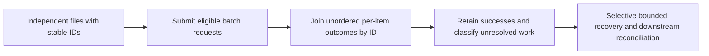

# Objective 4.5 — Design efficient batch processing strategies

[Test this decision with a supplied example](#benchmark-exercise-4-5) — predict first, then compare the fixed-fixture evidence.

**Picture the application:** A manufacturing team needs an inventory exception report after a large set of documents arrives. The finished report must identify missing coverage as well as processed records and fit its deadline. Batch processing is the technical option for deferred work; monitoring and recovery determine whether it suits this particular delivery requirement.


**Exam:** CCAR-F · **Domain 4:** 20% of exam; no separate objective weight is published here.  
**Time:** 30–40 minutes foundation/applied; 15–25 additional minutes production extension.  
**Prerequisites:** 4.3 extraction and 4.4 validation. New to the Claude API? Start with the [five-minute primer in Lesson 0](../L00-orientation.md#five-minute-primer-how-a-claude-app-works).  
**Continue from:** [Domain lesson](../L04-prompt-engineering-and-structured-output.md) · [Objective map](../../../01-Curriculum/02-Architect-Track/CCAR-F-objectives.md).

**Official task statement:** Design efficient batch processing strategies


<!-- layered-episode:FV-23:start -->
<a id="learn-fv-23"></a>
### Learn the decision in context — FV-23

**Picture the job.** Thousands of independent files need processing overnight. Some succeed, others fail or expire, and results arrive in a different order. This is an original fictional teaching scene, not a recalled live exam question. Read and trace it; no account, installation or API call is required.

**Start small.** Follow the ordinary route: a person supplies a request or record, software passes the needed evidence to the assistant, and a receiving service or person checks the result. The first demonstration assumes the input, access and evidence are suitable. Now remove that assumption in the situation above. Predict what the receiver would see before choosing a repair.

**Original exam-style practice — choose ONE.** A Messages Batch has mixed per-request outcomes. Which reconciliation and recovery strategy is appropriate?

A. Resubmit every item and assume downstream writes cannot duplicate.

B. Match each result by stable custom_id, preserve successes and recover eligible failed or expired items from their recorded input and deadline policy.

C. Pair results with requests by arrival position and mark submission as completion.

<details>
<summary>What is this asking? Plain-language help, without the answer</summary>

Identify what the application needs to trust, what has actually been observed, and what remains unknown. Compare the choices against this situation, rather than choosing the most complicated design. A proposal is an intended action; evidence is what you can point to; a contract says what the receiving part expects. Decide which option fixes the stated failure without pretending another requirement has also been solved.

</details>

**Choose before opening the walkthrough.** Say your answer and the closest alternative aloud, or record them in your own notes.

<details>
<summary>Reveal the repair, evidence and changed condition</summary>

**Answer: B.** Match each result by stable custom_id, preserve successes and recover eligible failed or expired items from their recorded input and deadline policy.

**Walk it through.** The ledger retains i1 succeeded, i2 expired and i3 errored. Only eligible unresolved work is selected; downstream acknowledgments are tracked separately from API completion.

**Why the alternatives fail here.** Resubmit every item and assume downstream writes cannot duplicate. This leaves the stated boundary or evidence requirement unsatisfied. Pair results with requests by arrival position and mark submission as completion. This also fails to establish the required result. The closest competing mechanism fails for this specific reason: A 24-hour processing window is not a guaranteed finish time. Batch does not substitute for a local Code agent loop with filesystem state.

**Inspect the small artifact.** This is an illustrative application-state note for reading, not an SDK signature or executable configuration. The application or workflow owner creates it; the receiver uses it to distinguish what is known from what still needs checking. Its labels describe this scene; do not paste it into Claude settings.

```text
items={i1:succeeded,i2:expired,i3:errored}; recovery=[i2,i3]; deadline_policy=explicit
```

**Layer added.** AI reasoning proposes, selects or summarizes where the job needs judgment. Ordinary software checks identifiers, permissions, required fields, recorded outcomes and stop conditions where applicable. A human resolves a policy or evidence gap when the story requires it. Inspect which owner actually supplies the evidence in this scene.



**Change one condition.** Keep the application in mind and consider the new situation below. Choose before opening its explanation.

**Technical transfer question — choose ONE.** Each result is needed before the next local tool step under a tight deadline. Which runtime fits?

A. An appropriate immediate interactive or synchronous workflow.

B. Batch solely because many requests will eventually occur.

<details>
<summary>Transfer check</summary>

**A.** A result is needed before the next dependent local tool step or a tight user deadline. Use the appropriate immediate/interactive runtime instead. Name the changed fact before naming a tool. Preserve unrelated access, source-validation and result checks.

</details>

**Recall in ordinary language.** What broke? Who can fix it? What observable result proves the repair? If you cannot answer all three, replay the concrete scene rather than memorize the option letter.

</details>

**Continue from this decision:** [objective 4.5](objective-4.5.md) · [inspect its decision map](../decision-atlas.md#diagram-d06) · [targeted practice](../../../practice/index.html?exam=CCAR-F&objective=4.5). Existing mapped question IDs: `cct-fv-23-base-v1`, `cct-fv-23-retry-v1`. The new guided question above is separate from those stored items and does not change their answers or progress.
<!-- layered-episode:FV-23:end -->

## Read this objective in both vocabularies

For reading and paper reasoning, no installation or credentials are needed. Keep this page's stated concept prerequisites; any runnable challenge still needs its own setup. If an implementation example feels abrupt, first read [how to interpret its artifact type](../architecture-studio/00-foundations.md#how-to-read-technical-examples-in-this-course), then use the relevant application bridge: [AS-02 decision bridge](../architecture-studio/AS-02-document-pipeline.md#connect-the-simple-explanation-to-technical-design-choices) · [AS-07 decision bridge](../architecture-studio/AS-07-work-queue.md#connect-the-simple-explanation-to-technical-design-choices).

Explain the business purpose first, name the precise mechanism second, and distinguish it from the nearest plausible alternative using the stated constraint. Return here for the objective-specific protocol, options and practice. The bridges are teaching aids, not additional official objectives.


## Big idea

Choose latency before price. Batch processing reduces cost for independent work that can wait; synchronous requests serve decisions that block people or pipelines.

## Foundation

### 4.5-K1

**Blueprint focus:** The Message Batches API: 50% cost savings, up to 24-hour processing window, no guaranteed latency SLA

The July guide describes a 50% batch discount and a processing window up to 24 hours without a guaranteed latency SLA. Current documentation also allows expiry. Treat the window as a capacity-planning assumption and failure boundary, not a promise that every request succeeds.

[Exam guide v1.0, section 6 task 4.5](https://anthropic-partners.skilljar.com/page/partner-certifications) (Tier 1, July 2026 blueprint).

### 4.5-K2

**Blueprint focus:** Batch processing is appropriate for non-blocking, latency-tolerant workloads (overnight reports, weekly audits, nightly test generation) and inappropriate for blocking workflows (pre-merge checks)

Overnight reporting and weekly audits can tolerate delayed results. A pre-merge security check usually cannot. The same analysis may use synchronous requests for immediate gating and batches for deeper periodic review; one cheap interface need not serve both workloads.

[Exam guide v1.0, section 6 task 4.5](https://anthropic-partners.skilljar.com/page/partner-certifications) (Tier 1, July 2026 blueprint).

### 4.5-K3

**Blueprint focus:** The batch API does not support multi-turn tool calling within a single request (cannot execute tools mid-request and return results)

A batch request does not run your client tools mid-request and return their results in a live agentic loop. Precompute required evidence or orchestrate multiple stages outside the batch. Tool definitions alone do not give a submitted request access to your external execution environment.

[Exam guide v1.0, section 6 task 4.5](https://anthropic-partners.skilljar.com/page/partner-certifications) (Tier 1, July 2026 blueprint).

### 4.5-K4

**Blueprint focus:** custom_id fields for correlating batch request/response pairs

custom_id is the correlation key between submitted work and results. Preserve it with source identity and processing version, because results need not arrive in input order. Correlation by list position risks assigning an extraction to the wrong document.

[Exam guide v1.0, section 6 task 4.5](https://anthropic-partners.skilljar.com/page/partner-certifications) (Tier 1, July 2026 blueprint).

## Applied skills

These are design applications. Pseudocode and schemas are illustrative unless separately dry-run; a saved design is not a completed implementation.

### 4.5-S1

**Blueprint focus:** Matching API approach to workflow latency requirements: synchronous API for blocking pre-merge checks, batch API for overnight/weekly analysis

Classify work by maximum acceptable delay and whether a human or deployment waits on the result. Use synchronous processing for blocking checks and batches for independent deferred analysis. Record expiry and fallback handling when batch output supports an operational deadline.

[Exam guide v1.0, section 6 task 4.5](https://anthropic-partners.skilljar.com/page/partner-certifications) (Tier 1, July 2026 blueprint).

### 4.5-S2

**Blueprint focus:** Calculating batch submission frequency based on SLA constraints (e.g., 4-hour windows to guarantee 30-hour SLA with 24-hour batch processing)

Budget collection delay, processing time and downstream validation. If the target is 30 hours and processing may consume 24, collection plus validation must fit six hours. A four-hour submission cadence leaves two hours for downstream work; it does not guarantee completion if requests expire.

[Exam guide v1.0, section 6 task 4.5](https://anthropic-partners.skilljar.com/page/partner-certifications) (Tier 1, July 2026 blueprint).

### 4.5-S3

**Blueprint focus:** Handling batch failures: resubmitting only failed documents (identified by custom_id) with appropriate modifications (e.g., chunking documents that exceeded context limits)

Inspect each result by custom_id and status. Resubmit only failed documents with a cause-specific change, such as chunking an oversized source. Preserve successful results and idempotency identifiers so a partial retry does not double-count the completed work.

[Exam guide v1.0, section 6 task 4.5](https://anthropic-partners.skilljar.com/page/partner-certifications) (Tier 1, July 2026 blueprint).

### 4.5-S4

**Blueprint focus:** Using prompt refinement on a sample set before batch-processing large volumes to maximize first-pass success rates and reduce iterative resubmission costs

Refine prompts on a representative sample before a large batch. Include unusual layouts and long documents, then measure semantic validity and missing evidence. Freeze a processing version for the main run so outcomes remain comparable and failures can be diagnosed.

[Exam guide v1.0, section 6 task 4.5](https://anthropic-partners.skilljar.com/page/partner-certifications) (Tier 1, July 2026 blueprint).

## Worked example

A manufacturing firm needs an inventory exception report within 30 hours of document arrival. Submission occurs every four hours; nominal worst-case batch processing consumes 24 hours, leaving two hours for validation and report assembly. Each document has a stable custom_id. Only failed or expired requests are queued again, and oversized documents are chunked with their identity preserved. A synchronous API is a credible alternative when the deadline is binding and expiry cannot be tolerated; it costs more but permits faster retry handling. Batch processing fits the routine report only with explicit monitoring and a fallback path. The pre-merge validator remains synchronous. Recovery reports missing coverage rather than publishing a complete-looking report that silently lacks expired inputs. A sample set is tuned before the large run.

Original synthetic scenario; decision principles: [Exam guide v1.0, section 6 task 4.5](https://anthropic-partners.skilljar.com/page/partner-certifications) (Tier 1, July 2026 blueprint).

## Production transfer

**Legal research operations; enrichment beyond the blueprint examples.** A synthetic legal research team accepts overnight document indexing but requires live deadline checks immediately. Batch indexing can cut processing cost; deadline checks need synchronous responses and explicit failure handling. Correlate each result with document identity and prompt version. If a batch expires, publish partial coverage with missing IDs and use a selected fallback rather than pretending indexing completed. Extension: the overnight deadline shrinks to eight hours; explain why merely increasing submission frequency does not solve the processing-window constraint.

In your own notes, save your decision, rejected alternative, evidence and recovery path. Re-run the decision with the changed constraint before calling the pattern transferable. This is a design exercise, not industry compliance advice.

## Traps and counterexamples

Do not call a nominal window a guaranteed SLA. Do not correlate by response order or resubmit every successful document. Do not expect a batch to execute your external tools during its single request.

## Supplied batch pilot and result fixtures

Synthetic purchase-order sample:

| ID | Source | First-pass output | Failure |
| --- | --- | --- | --- |
| P-table | p1 table: delivery 2026-10-08 | correct date | none |
| P-prose | p2 sentence: delivery is October 9, 2026 | date=null | evidence present in prose |
| P-reference | p3 cites older order due 2025-10-09; current due date absent | date=2025-10-09 | copied an unrelated reference |

Before scaling, revise the prompt: “Extract the current order's delivery date from tables or narrative; normalize an explicit source date; cite its location. Do not use a referenced older order. If absent, return null with an absent-evidence state.” Re-evaluate the pilot, then test a held-out mixed-layout order: p1 issue date 2026-10-02; p2 current delivery November 3, 2026; bibliography cites a 2024 order. Expected held-out delivery is 2026-11-03 at p2. A prompt that fixes prose dates while still borrowing old reference dates is not ready for a large batch.

### Out-of-order result stream

```text
custom_id=PO-104: succeeded, valid extraction
custom_id=PO-102: errored, document exceeded context
custom_id=PO-105: expired, no completed result
custom_id=PO-101: succeeded, valid extraction
custom_id=PO-103: errored, invalid input payload
```

Preserve PO-101 and PO-104. Retry PO-102 only after chunking with source-page identity retained; retry PO-105 with expiry handling and available deadline budget; correct the invalid payload before retrying PO-103. Do not blindly resubmit a noncorrected validation failure. Result order does not determine source order. If expired work supports a binding deadline, choose an explicit synchronous fallback or report incomplete coverage rather than promising eventual batch completion.

**Your outputs:** pilot failure analysis, revised prompt, held-out expected extraction, ID/status reconciliation table and retry plan with cause-specific modifications. Also calculate the existing 32-hour budget with 24-hour processing and three-hour validation: collection must be no more than five hours; four-hour cadence gives one nominal hour of margin. This does not guarantee success, because expiry remains possible.

[Guide section 6 task 4.5](https://anthropic-partners.skilljar.com/page/partner-certifications) and [current batches](https://platform.claude.com/docs/en/build-with-claude/batch-processing) (Tier 1; checked 2026-10-02).

<a id="decision-variants"></a>
<a id="variant-fv-23"></a>
## Decision variant FV-23 — Choose batch by dependencies and deadline

This is original fictional practice, not an official exam question. All policies, amounts and records below are synthetic.

**Choose in the base case.** Independent eligible document requests tolerate delayed completion and have per-item recovery. Messages Batch is a candidate; retain custom IDs and item states.

**Change one constraint.** A result is needed before the next dependent local tool step or a tight user deadline. Use the appropriate immediate/interactive runtime instead.

**What failed, and who recovers?** Some items expire or fail. Recover those items with their recorded inputs; do not treat a submission as completed work.

**Inspect the artifact — illustrative contract, not a drop-in SDK implementation:**

```text
items={i1:succeeded,i2:expired,i3:errored}; recovery=[i2,i3]; deadline_policy=explicit
```

**Why not the nearest alternative?** A 24-hour processing window is not a guaranteed finish time. Batch does not substitute for a local Code agent loop with filesystem state.

**Memory cue with its condition:** Independent plus tolerant plus recoverable; otherwise another lane.

**Proof before accepting success:** Produce a trace or artifact showing the decisive constraint, the selected mechanism, rejected alternative and observable result. Preserve unresolved status; a plausible explanation alone is not completion.

[Inspect D06 and its equivalent decision procedure](../decision-atlas.md#diagram-d06) · [See this decision at walkthrough step 1](../scenario-walkthroughs/WT-05-claude-code-ci-cd.md#variant-fv-23) · [Return to the objective map](README.md).

**Blind transfer:** Before opening practice, explain which single change in the scene would reverse your choice and which would only require revalidation. Write the failure signal and the next safe action. The practice app provides separately authored base and later-retry items, with a free-response transfer rubric; assistance/exposure must remain visible in learning history.

**Current runtime reference:** [https://platform.claude.com/docs/en/build-with-claude/batch-processing](https://platform.claude.com/docs/en/build-with-claude/batch-processing) (reviewed 2026-10-14). The saved blueprint remains the exam coverage source; application policy in this packet is invented teaching context.


## Try it

Use the supplied fixture above for the required skill outputs first. The following design activity is an extension, not a substitute for those concrete checks.

Calculate a cadence for a 32-hour target, a 24-hour planning window and three hours of validation. Define custom_id, statuses and partial retry rules for 100 documents. Identify a case that must use synchronous processing.

Attempt your design before reading the self-check. Save the artifact and the decision rationale so an independent reviewer can inspect them.

### Expected output and self-check

At most five hours remain for collection; a four-hour cadence leaves one hour of nominal margin. That arithmetic is not a success guarantee. Failed items alone are retried with cause-specific changes. Stable IDs preserve source/result linkage, and blocking decisions remain synchronous.

## Done when

- [ ] **4.5-S1:** Choose synchronous processing for a blocking decision and batch for deferred reporting, with deadline/expiry recovery.
- [ ] **4.5-S2:** Calculate collection budget and cadence: 32−24−3=5 hours maximum; four-hour cadence gives one nominal hour, not a guarantee.
- [ ] **4.5-S3:** Reconcile out-of-order statuses by ID, preserve PO-101/104, chunk PO-102, handle PO-105 expiry and correct PO-103 before retry.
- [ ] **4.5-S4:** Write the targeted pilot prompt revision and held-out 2026-11-03 extraction; verify old-reference rejection before scaling.

In your own notes, save each stated artifact and check against the supplied expected outputs. Written design evidence and actual implementation evidence remain separate; learner mastery is not inferred from reading.

## Coverage checklist

| Official bullet, in guide order | Exact teaching section |
| --- | --- |
| 4.5-K1: The Message Batches API: 50% cost savings, up to 24-hour processing window, no guaranteed latency SLA | [4.5-K1](#45-k1) |
| 4.5-K2: Batch processing is appropriate for non-blocking, latency-tolerant workloads (overnight reports, weekly audits, nightly test generation) and inappropriate for blocking workflows (pre-merge checks) | [4.5-K2](#45-k2) |
| 4.5-K3: The batch API does not support multi-turn tool calling within a single request (cannot execute tools mid-request and return results) | [4.5-K3](#45-k3) |
| 4.5-K4: custom_id fields for correlating batch request/response pairs | [4.5-K4](#45-k4) |
| 4.5-S1: Matching API approach to workflow latency requirements: synchronous API for blocking pre-merge checks, batch API for overnight/weekly analysis | [4.5-S1](#45-s1) |
| 4.5-S2: Calculating batch submission frequency based on SLA constraints (e.g., 4-hour windows to guarantee 30-hour SLA with 24-hour batch processing) | [4.5-S2](#45-s2) |
| 4.5-S3: Handling batch failures: resubmitting only failed documents (identified by custom_id) with appropriate modifications (e.g., chunking documents that exceeded context limits) | [4.5-S3](#45-s3) |
| 4.5-S4: Using prompt refinement on a sample set before batch-processing large volumes to maximize first-pass success rates and reduce iterative resubmission costs | [4.5-S4](#45-s4) |

## Sources and freshness

[Exam guide v1.0, section 6 task 4.5](https://anthropic-partners.skilljar.com/page/partner-certifications) (Tier 1, July 2026 blueprint).

The official objective wording is reproduced for traceability; explanations and all scenarios are project-authored. Existing L03–L05 provide domain synthesis; this module expands each bullet into a teachable decision. The saved July guide is the blueprint baseline, not a claim that no newer guide exists.

**Price and timing checked 2026-10-02:** [Message Batches documentation](https://platform.claude.com/docs/en/build-with-claude/batch-processing) (Tier 1). Recheck pricing, supported features and expiry before a production cost estimate.

**Go deeper:** [Deep practice 4, section 4.5](../deep-practice/04-prompt-engineering-and-structured-output.md#45-batch-processing-strategy)


<a id="benchmark-exercise-4-5"></a>
## Worked evidence task — 4.5: test the boundary

**Original technical decision.** Batch results arrive `D3`,`D1`,`D2` with success, denial and timeout outcomes. Which retry strategy preserves completed work and item identity?

**In everyday terms:** Do not match results by their arrival position or rerun everything.

**Before you start:** No account, API key or package installation is needed for the paper task. Optional replay needs Python 3 and the two provided lab files in the same directory. This local inspector models the stated fixture; it does not call Claude, load Claude Code rules or run an MCP server.

### Inspect the supplied input

All identifiers and business rules here are fictional application data. This is **not an SDK request schema**. Keep the input separate from your proposed decision.

```json
{
  "input_ids": [
    "D1",
    "D2",
    "D3"
  ],
  "output_order": [
    "D3",
    "D1",
    "D2"
  ],
  "outcomes": {
    "D1": "success",
    "D2": "permission_denied",
    "D3": "timeout"
  },
  "retry_budget": 1,
  "deadline": "next-day review"
}
```

### Break, choose, repair, prove

1. **Break:** Process an out-of-order mixed result stream with success, permanent error and retryable error. Name the exact failed assumption before proposing another component.
2. **Choose:** Join by document ID, retain success, route denial to authorization and retry only the transient item within budget. Write the nearest alternative you would reject and the requirement it fails.
3. **Repair:** Write the corrected contract or recovery step, keeping successful evidence and unknowns separate.
4. **Prove:** Join by request identity, preserve successes and resubmit only justified failures; report partial completion. Record `decision`, `reason`, `rejected_alternative`, `evidence` and `remaining_unknowns`.

[Open this actual task in the existing LAB](../../../06-Labs/02-CCAR-F-coordinator-extraction/README.md#benchmark-exercise-4-5) · [Return to the teaching subsection](#supplied-batch-pilot-and-result-fixtures)

<details><summary>Compare the offline evidence — after making your decision</summary>

The local inspector presents **controlled-fixture calculations and authored reference decisions** below. Some fields are calculated (such as counts or arithmetic); policy labels and recovery choices are supplied worked answers for this fixed example, not executed policies or a general-purpose validator. No Claude, rule loader, service or reviewer was run. `false` or `null` observations remain unresolved when no corresponding live test was performed.

```json
{
  "joined": {
    "D1": "success",
    "D2": "permission_denied",
    "D3": "timeout"
  },
  "preserve": [
    "D1"
  ],
  "authorization_queue": [
    "D2"
  ],
  "retry": [
    "D3"
  ],
  "rerun_successes": false,
  "completion": "partial"
}
```

**Why this matters:** Do not match results by their arrival position or rerun everything. The output is a self-check for this controlled example, not certification-score evidence. To test the real mechanism, perform the existing LAB’s integration steps in a fresh disposable context and keep its actual trace beside this prediction.

**Primary-source leads for mechanism review:** [batch processing docs](https://platform.claude.com/docs/en/build-with-claude/batch-processing) · [Message Batches API](https://platform.claude.com/docs/en/build-with-claude/batch-processing). The external benchmark helped identify the exercise gap; this task and its data were authored here. Current implementation details must be verified against the installed runtime and those primary sources.

</details>