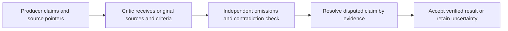

# Objective 4.6 — Design multi-instance and multi-pass review architectures

[Test this decision with a supplied example](#benchmark-exercise-4-6) — predict first, then compare the fixed-fixture evidence.

**Picture the application:** A checkout change crosses price calculation, tax lookup and receipt rendering. Each file may look reasonable while the customer-facing receipt still misinterprets a value passed between them. Multi-pass and independent review are the technical approaches for checking local details and shared contracts without treating a polished review as proof.


**Exam:** CCAR-F · **Domain 4:** 20% of exam; no separate objective weight is published here.  
**Time:** 30–40 minutes foundation/applied; 15–25 additional minutes production extension.  
**Prerequisites:** 1.6 decomposition and 4.1 criteria. New to the Claude API? Start with the [five-minute primer in Lesson 0](../L00-orientation.md#five-minute-primer-how-a-claude-app-works).  
**Continue from:** [Domain lesson](../L04-prompt-engineering-and-structured-output.md) · [Objective map](../../../01-Curriculum/02-Architect-Track/CCAR-F-objectives.md).

**Official task statement:** Design multi-instance and multi-pass review architectures


<!-- layered-episode:FV-24:start -->
<a id="learn-fv-24"></a>
### Learn the decision in context — FV-24

**Picture the job.** Two reviewers agree, but both only read the same misleading summary instead of the source documents. This is an original fictional teaching scene, not a recalled live exam question. Read and trace it; no account, installation or API call is required.

**Start small.** Follow the ordinary route: a person supplies a request or record, software passes the needed evidence to the assistant, and a receiving service or person checks the result. The first demonstration assumes the input, access and evidence are suitable. Now remove that assumption in the situation above. Predict what the receiver would see before choosing a repair.

**Original exam-style practice — choose ONE.** Producer and critic agree despite shared incorrect evidence. Which change improves review independence?

A. Run the identical prompt against the same summary several more times.

B. Accept agreement between model instances as proof of correctness.

C. Give the critic original sources and explicit omission/contradiction checks; resolve disagreements against evidence.

<details>
<summary>What is this asking? Plain-language help, without the answer</summary>

Identify what the application needs to trust, what has actually been observed, and what remains unknown. Compare the choices against this situation, rather than choosing the most complicated design. A proposal is an intended action; evidence is what you can point to; a contract says what the receiving part expects. Decide which option fixes the stated failure without pretending another requirement has also been solved.

</details>

**Choose before opening the walkthrough.** Say your answer and the closest alternative aloud, or record them in your own notes.

<details>
<summary>Reveal the repair, evidence and changed condition</summary>

**Answer: C.** Give the critic original sources and explicit omission/contradiction checks; resolve disagreements against evidence.

**Walk it through.** The critic cites the source passage contradicting the producer. The dispute record retains claim, source and resolved or unresolved status.

**Why the alternatives fail here.** Run the identical prompt against the same summary several more times. This leaves the stated boundary or evidence requirement unsatisfied. Accept agreement between model instances as proof of correctness. This also fails to establish the required result. The closest competing mechanism fails for this specific reason: Repeated identical prompts can amplify the same blind spot. Independence needs evidence and criteria, not just another instance.

**Inspect the small artifact.** This is an illustrative application-state note for reading, not an SDK signature or executable configuration. The application or workflow owner creates it; the receiver uses it to distinguish what is known from what still needs checking. Its labels describe this scene; do not paste it into Claude settings.

```text
producer={claims,sources}; critic={criteria,original_sources,failed_checks}; dispute={claim,source,verdict}
```

**Layer added.** AI reasoning proposes, selects or summarizes where the job needs judgment. Ordinary software checks identifiers, permissions, required fields, recorded outcomes and stop conditions where applicable. A human resolves a policy or evidence gap when the story requires it. Inspect which owner actually supplies the evidence in this scene.



**Change one condition.** Keep the application in mind and consider the new situation below. Choose before opening its explanation.

**Technical transfer question — choose ONE.** The task is low-risk formatting with a reliable deterministic validator. Which review design is proportionate?

A. Always run several identical critics regardless of evidence or cost.

B. Use that validator and add model review only if it supplies a justified check.

<details>
<summary>Transfer check</summary>

**B.** A simple low-risk formatting task has deterministic validation. Extra model passes may not justify their cost. Name the changed fact before naming a tool. Preserve unrelated access, source-validation and result checks.

</details>

**Recall in ordinary language.** What broke? Who can fix it? What observable result proves the repair? If you cannot answer all three, replay the concrete scene rather than memorize the option letter.

</details>

**Continue from this decision:** [objective 4.6](objective-4.6.md) · [inspect its decision map](../decision-atlas.md#diagram-d12) · [targeted practice](../../../practice/index.html?exam=CCAR-F&objective=4.6). Existing mapped question IDs: `cct-fv-24-base-v1`, `cct-fv-24-retry-v1`. The new guided question above is separate from those stored items and does not change their answers or progress.
<!-- layered-episode:FV-24:end -->

## Read this objective in both vocabularies

For reading and paper reasoning, no installation or credentials are needed. Keep this page's stated concept prerequisites; any runnable challenge still needs its own setup. If an implementation example feels abrupt, first read [how to interpret its artifact type](../architecture-studio/00-foundations.md#how-to-read-technical-examples-in-this-course), then use the relevant application bridge: [AS-06 decision bridge](../architecture-studio/AS-06-ci-review.md#connect-the-simple-explanation-to-technical-design-choices).

Explain the business purpose first, name the precise mechanism second, and distinguish it from the nearest plausible alternative using the stated constraint. Return here for the objective-specific protocol, options and practice. The bridges are teaching aids, not additional official objectives.


## Big idea

Review needs both independent judgment and complete scope. A fresh reviewer catches different assumptions; separate local and integration passes catch different defect classes.

## Foundation

### 4.6-K1

**Blueprint focus:** Self-review limitations: a model retains reasoning context from generation, making it less likely to question its own decisions in the same session

A generator retains the rationale behind its choices, which can anchor self-review. Asking it to “be more critical” does not remove that context. Same-session checks can still find obvious mistakes, but should not be your only verification for consequential changes.

[Exam guide v1.0, section 6 task 4.6](https://anthropic-partners.skilljar.com/page/partner-certifications) (Tier 1, July 2026 blueprint).

### 4.6-K2

**Blueprint focus:** Independent review instances (without prior reasoning context) are more effective at catching subtle issues than self-review instructions or extended thinking

An independent instance receives requirements, artifacts and evidence without the generator's private reasoning. It must independently justify findings. Independence costs another context setup and review pass; it reduces shared assumptions without proving the reviewer is right.

[Exam guide v1.0, section 6 task 4.6](https://anthropic-partners.skilljar.com/page/partner-certifications) (Tier 1, July 2026 blueprint).

### 4.6-K3

**Blueprint focus:** Multi-pass review: splitting large reviews into per-file local analysis passes plus cross-file integration passes to avoid attention dilution and contradictory findings

Per-file review preserves attention for local logic. Integration review traces contracts and data flow across files. These are complementary: a producer and consumer may each look correct locally while disagreeing about units or error states across their boundary.

[Exam guide v1.0, section 6 task 4.6](https://anthropic-partners.skilljar.com/page/partner-certifications) (Tier 1, July 2026 blueprint).

## Applied skills

These are design applications. Pseudocode and schemas are illustrative unless separately dry-run; a saved design is not a completed implementation.

### 4.6-S1

**Blueprint focus:** Using a second independent Claude instance to review generated code without the generator's reasoning context

Start a separate review instance with the diff, requirements and relevant repository files. Exclude the generator's argument that the approach is correct. Ask for reproducible consequences and evidence, then validate findings against tests or code paths.

[Exam guide v1.0, section 6 task 4.6](https://anthropic-partners.skilljar.com/page/partner-certifications) (Tier 1, July 2026 blueprint).

### 4.6-S2

**Blueprint focus:** Splitting large multi-file reviews into focused per-file passes for local issues plus separate integration passes for cross-file data flow analysis

Assign focused local passes and a distinct integration pass. Provide a shared findings format and boundary inventory. Deduplicate related findings without dropping the cross-file issue merely because its symptoms already appeared in a local report.

[Exam guide v1.0, section 6 task 4.6](https://anthropic-partners.skilljar.com/page/partner-certifications) (Tier 1, July 2026 blueprint).

### 4.6-S3

**Blueprint focus:** Running verification passes where the model self-reports confidence alongside each finding to enable calibrated review routing

Require each finding to report confidence plus its evidence and remaining uncertainty. Calibrate how confidence relates to accepted findings on labeled examples. Use it to prioritize verification, not to treat a high score as a correctness certificate or a low score as automatic dismissal.

[Exam guide v1.0, section 6 task 4.6](https://anthropic-partners.skilljar.com/page/partner-certifications) (Tier 1, July 2026 blueprint).

## Worked example

A retail checkout change spans price calculation, tax lookup and receipt rendering. Local reviews find no syntax defect, but an independent integration reviewer notices the calculator returns cents while the receipt interprets dollars. The review contract requires the triggering cart, boundary evidence and confidence with uncertainty. A same-session self-review is a credible cheaper first pass for basic mistakes; it does not replace the independent pass for this payment-sensitive change. One giant fresh review has less setup overhead, but can dilute attention across many files. Local plus integration passes cost coordination and deduplication, and make coverage explicit. Recovery asks a targeted reviewer to validate the unit contract and runs a regression example before accepting the finding. Confidence supports routing while arithmetic and code evidence establish the defect.

Original synthetic scenario; decision principles: [Exam guide v1.0, section 6 task 4.6](https://anthropic-partners.skilljar.com/page/partner-certifications) (Tier 1, July 2026 blueprint).

## Production transfer

**Insurance software; enrichment beyond the blueprint examples.** A synthetic premium engine changes pricing, rounding and display modules. Local reviewers inspect each formula; an independent integration pass checks that the displayed premium agrees with the charged amount. Compare one broad review with focused passes under reviewer budget: choose passes when boundary risk dominates, but consolidate duplicated findings. Failure recovery requests evidence for disputed findings and tests the boundary before escalating severity. Extension: every local test passes while one boundary has a unit mismatch; identify the missing integration assertion.

In your own notes, save your decision, rejected alternative, evidence and recovery path. Re-run the decision with the changed constraint before calling the pattern transferable. This is a design exercise, not industry compliance advice.

## Traps and counterexamples

A fresh context without requirements is uninformed, not independent verification. Do not equate confidence with calibration. Do not stop after every file passes locally; the system contract still needs a pass.

<a id="decision-variants"></a>
<a id="variant-fv-24"></a>
## Decision variant FV-24 — Give the critic independent evidence

This is original fictional practice, not an official exam question. All policies, amounts and records below are synthetic.

**Choose in the base case.** A producer proposes extracted claims; a separate critic checks source locators, omissions and contradictions under explicit criteria. Resolve disagreement by evidence.

**Change one constraint.** A simple low-risk formatting task has deterministic validation. Extra model passes may not justify their cost.

**What failed, and who recovers?** Both instances share a misleading summary and agree. Give the critic original sources or a different check; agreement alone is not validation.

**Inspect the artifact — illustrative contract, not a drop-in SDK implementation:**

```text
producer={claims,sources}; critic={criteria,original_sources,failed_checks}; dispute={claim,source,verdict}
```

**Why not the nearest alternative?** Repeated identical prompts can amplify the same blind spot. Independence needs evidence and criteria, not just another instance.

**Memory cue with its condition:** Separate the reviewer’s evidence; resolve with the source.

**Proof before accepting success:** Produce a trace or artifact showing the decisive constraint, the selected mechanism, rejected alternative and observable result. Preserve unresolved status; a plausible explanation alone is not completion.

[Inspect D12 and its equivalent decision procedure](../decision-atlas.md#diagram-d12) · [See this decision at walkthrough step 8](../scenario-walkthroughs/WT-06-structured-data-extraction.md#variant-fv-24) · [Return to the objective map](README.md).

**Blind transfer:** Before opening practice, explain which single change in the scene would reverse your choice and which would only require revalidation. Write the failure signal and the next safe action. The practice app provides separately authored base and later-retry items, with a free-response transfer rubric; assistance/exposure must remain visible in learning history.

**Current runtime reference:** [https://code.claude.com/docs/en/memory](https://code.claude.com/docs/en/memory) (reviewed 2026-10-14). The saved blueprint remains the exam coverage source; application policy in this packet is invented teaching context.


## Try it

Design a review for a producer, serializer and consumer. Specify inputs for independent review, local-pass outputs and an integration question. Give a finding with confidence, evidence and a verification action. Explain one issue neither local review alone would establish.

Attempt your design before reading the self-check. Save the artifact and the decision rationale so an independent reviewer can inspect them.

### Expected output and self-check

The independent reviewer gets requirements and code, not generator reasoning. Local passes report file-specific issues; integration checks units, types and failures across boundaries. A confidence label includes uncertainty and leads to a concrete check. The cross-file contract mismatch remains visible after deduplication.

## Done when

- [ ] **4.6-S1:** Define a fresh reviewer packet containing requirements and code without generator reasoning; preserve reproducible findings.
- [ ] **4.6-S2:** Produce local-pass scope plus an integration pass that detects the cents/dollars boundary mismatch and deduplicates symptoms.
- [ ] **4.6-S3:** Give finding confidence with evidence and uncertainty; specify calibrated routing and an actual verification action.

In your own notes, save each stated artifact and check against the supplied expected outputs. Written design evidence and actual implementation evidence remain separate; learner mastery is not inferred from reading.

## Coverage checklist

| Official bullet, in guide order | Exact teaching section |
| --- | --- |
| 4.6-K1: Self-review limitations: a model retains reasoning context from generation, making it less likely to question its own decisions in the same session | [4.6-K1](#46-k1) |
| 4.6-K2: Independent review instances (without prior reasoning context) are more effective at catching subtle issues than self-review instructions or extended thinking | [4.6-K2](#46-k2) |
| 4.6-K3: Multi-pass review: splitting large reviews into per-file local analysis passes plus cross-file integration passes to avoid attention dilution and contradictory findings | [4.6-K3](#46-k3) |
| 4.6-S1: Using a second independent Claude instance to review generated code without the generator's reasoning context | [4.6-S1](#46-s1) |
| 4.6-S2: Splitting large multi-file reviews into focused per-file passes for local issues plus separate integration passes for cross-file data flow analysis | [4.6-S2](#46-s2) |
| 4.6-S3: Running verification passes where the model self-reports confidence alongside each finding to enable calibrated review routing | [4.6-S3](#46-s3) |

## Sources and freshness

[Exam guide v1.0, section 6 task 4.6](https://anthropic-partners.skilljar.com/page/partner-certifications) (Tier 1, July 2026 blueprint).

The official objective wording is reproduced for traceability; explanations and all scenarios are project-authored. Existing L03–L05 provide domain synthesis; this module expands each bullet into a teachable decision. The saved July guide is the blueprint baseline, not a claim that no newer guide exists.

**Go deeper:** [Deep practice 4, section 4.6](../deep-practice/04-prompt-engineering-and-structured-output.md#46-multi-instance-and-multi-pass-review)


<a id="benchmark-exercise-4-6"></a>
## Worked evidence task — 4.6: test the boundary

**Original technical decision.** Two modules accept integer amounts locally, but one interprets minor units as dollars. Which additional evidence detects the integration contract failure?

**In everyday terms:** Both parts can look right alone while disagreeing about what the number means.

**Before you start:** No account, API key or package installation is needed for the paper task. Optional replay needs Python 3 and the two provided lab files in the same directory. This local inspector models the stated fixture; it does not call Claude, load Claude Code rules or run an MCP server.

### Inspect the supplied input

All identifiers and business rules here are fictional application data. This is **not an SDK request schema**. Keep the input separate from your proposed decision.

```json
{
  "fixture_A": "module A emits amount_minor=12000",
  "fixture_B": "module B reads amount_minor as dollars",
  "local_checks": "both accept integers",
  "integration_check": "expected USD120; actual USD12000",
  "review_context": "fresh artifact packet, not author rationale"
}
```

### Break, choose, repair, prove

1. **Break:** Run local review and integration review on files that pass alone but fail together. Name the exact failed assumption before proposing another component.
2. **Choose:** Test the cross-module monetary meaning with an independent artifact packet; record actual detection rather than assuming reviewer independence guarantees it. Write the nearest alternative you would reject and the requirement it fails.
3. **Repair:** Write the corrected contract or recovery step, keeping successful evidence and unknowns separate.
4. **Prove:** Test whether local and independent integration review detect the seeded amount-unit defect. Record observed detection and false positives; independent review is not guaranteed to find it. Record `decision`, `reason`, `rejected_alternative`, `evidence` and `remaining_unknowns`.

[Open this actual task in the existing LAB](../../../06-Labs/08-CCAR-F-architecture-decisions/README.md#benchmark-exercise-4-6) · [Return to the teaching subsection](#foundation)

<details><summary>Compare the offline evidence — after making your decision</summary>

The local inspector presents **controlled-fixture calculations and authored reference decisions** below. Some fields are calculated (such as counts or arithmetic); policy labels and recovery choices are supplied worked answers for this fixed example, not executed policies or a general-purpose validator. No Claude, rule loader, service or reviewer was run. `false` or `null` observations remain unresolved when no corresponding live test was performed.

```json
{
  "expected_usd": 120,
  "actual_usd": 12000,
  "factor_error": 100,
  "local_integer_checks_sufficient": false,
  "independent_reviewer_detection_observed": false
}
```

**Why this matters:** Both parts can look right alone while disagreeing about what the number means. The output is a self-check for this controlled example, not certification-score evidence. To test the real mechanism, perform the existing LAB’s integration steps in a fresh disposable context and keep its actual trace beside this prediction.

**Primary-source leads for mechanism review:** [Prompt Engineering Overview](https://platform.claude.com/docs/en/build-with-claude/prompt-engineering/overview). The external benchmark helped identify the exercise gap; this task and its data were authored here. Current implementation details must be verified against the installed runtime and those primary sources.

</details>