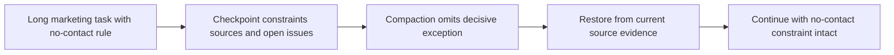

# Objective 5.1 — Manage conversation context to preserve critical information across long interactions

[Test this decision with a supplied example](#benchmark-exercise-5-1) — predict first, then compare the fixed-fixture evidence.

**Picture the application:** A support conversation covers a damaged lamp and a delayed desk with different amounts and desired outcomes. After many turns, the assistant still needs to associate each issue with the right facts and action. Structured case state and context management are the technical mechanisms for preserving that distinction through summarization.


**Exam:** CCAR-F · **Domain 5:** 15% of exam; no separate objective weight is published here.  
**Time:** 30–40 minutes foundation/applied; 15–25 additional minutes production extension.  
**Prerequisites:** 1.3 context passing and 2.1 tool outputs. New to the Claude API? Start with the [five-minute primer in Lesson 0](../L00-orientation.md#five-minute-primer-how-a-claude-app-works).  
**Continue from:** [Domain lesson](../L05-context-management-and-reliability.md) · [Objective map](../../../01-Curriculum/02-Architect-Track/CCAR-F-objectives.md).

**Official task statement:** Manage conversation context to preserve critical information across long interactions


<!-- layered-episode:FV-25:start -->
<a id="learn-fv-25"></a>
### Learn the decision in context — FV-25

**Picture the job.** A long marketing investigation is shortened into notes. The notes accidentally omit a do-not-contact exception. This is an original fictional teaching scene, not a recalled live exam question. Read and trace it; no account, installation or API call is required.

**Start small.** Follow the ordinary route: a person supplies a request or record, software passes the needed evidence to the assistant, and a receiving service or person checks the result. The first demonstration assumes the input, access and evidence are suitable. Now remove that assumption in the situation above. Predict what the receiver would see before choosing a repair.

**Original exam-style practice — choose ONE.** Compaction drops a decisive consent constraint. Which recovery preserves decision state safely?

A. Restore the constraint from authoritative evidence and retain constraints, source pointers, unresolved issues and next action in the checkpoint.

B. Treat the omitted exception as revoked.

C. Keep only a fluent summary without evidence pointers or exceptions.

<details>
<summary>What is this asking? Plain-language help, without the answer</summary>

Identify what the application needs to trust, what has actually been observed, and what remains unknown. Compare the choices against this situation, rather than choosing the most complicated design. A proposal is an intended action; evidence is what you can point to; a contract says what the receiving part expects. Decide which option fixes the stated failure without pretending another requirement has also been solved.

</details>

**Choose before opening the walkthrough.** Say your answer and the closest alternative aloud, or record them in your own notes.

<details>
<summary>Reveal the repair, evidence and changed condition</summary>

**Answer: A.** Restore the constraint from authoritative evidence and retain constraints, source pointers, unresolved issues and next action in the checkpoint.

**Walk it through.** The resumed state still contains no_contact and links to CRM42. The proposed contact is blocked until current consent evidence permits it.

**Why the alternatives fail here.** Treat the omitted exception as revoked. This leaves the stated boundary or evidence requirement unsatisfied. Keep only a fluent summary without evidence pointers or exceptions. This also fails to establish the required result. The closest competing mechanism fails for this specific reason: Keeping every transcript token can overwhelm context. A compact record must retain decisive exceptions and reacquisition paths.

**Inspect the small artifact.** This is an illustrative application-state note for reading, not an SDK signature or executable configuration. The application or workflow owner creates it; the receiver uses it to distinguish what is known from what still needs checking. Its labels describe this scene; do not paste it into Claude settings.

```text
state={question,constraints:[no_contact],sources:[CRM42],unresolved:[consent_age],next:verify}
```

**Layer added.** AI reasoning proposes, selects or summarizes where the job needs judgment. Ordinary software checks identifiers, permissions, required fields, recorded outcomes and stop conditions where applicable. A human resolves a policy or evidence gap when the story requires it. Inspect which owner actually supplies the evidence in this scene.



**Change one condition.** Keep the application in mind and consider the new situation below. Choose before opening its explanation.

**Technical transfer question — choose ONE.** Consent policy changes after a correct checkpoint was saved. What should happen on continuation?

A. Refresh the relevant source and update the decision state.

B. Treat faithful recall of the old state as current authorization.

<details>
<summary>Transfer check</summary>

**A.** Source consent or policy changes. Refresh the relevant evidence and revise the stored decision state. Name the changed fact before naming a tool. Preserve unrelated access, source-validation and result checks.

</details>

**Recall in ordinary language.** What broke? Who can fix it? What observable result proves the repair? If you cannot answer all three, replay the concrete scene rather than memorize the option letter.

</details>

**Continue from this decision:** [objective 5.1](objective-5.1.md) · [inspect its decision map](../decision-atlas.md#diagram-d11) · [targeted practice](../../../practice/index.html?exam=CCAR-F&objective=5.1). Existing mapped question IDs: `cct-fv-25-base-v1`, `cct-fv-25-retry-v1`. The new guided question above is separate from those stored items and does not change their answers or progress.
<!-- layered-episode:FV-25:end -->

## Read this objective in both vocabularies

For reading and paper reasoning, no installation or credentials are needed. Keep this page's stated concept prerequisites; any runnable challenge still needs its own setup. If an implementation example feels abrupt, first read [how to interpret its artifact type](../architecture-studio/00-foundations.md#how-to-read-technical-examples-in-this-course), then use the relevant application bridge: [AS-03 decision bridge](../architecture-studio/AS-03-grounded-assistant.md#connect-the-simple-explanation-to-technical-design-choices) · [AS-08 decision bridge](../architecture-studio/AS-08-resumable-case.md#connect-the-simple-explanation-to-technical-design-choices).

Explain the business purpose first, name the precise mechanism second, and distinguish it from the nearest plausible alternative using the stated constraint. Return here for the objective-specific protocol, options and practice. The bridges are teaching aids, not additional official objectives.


## Big idea

Keep exact facts separate from compressible narrative. Context reduction should remove noise without changing the amounts, dates, identities or evidence that determine the next action.

## Foundation

### 5.1-K1

**Blueprint focus:** Progressive summarization risks: condensing numerical values, percentages, dates, and customer-stated expectations into vague summaries

A summary that turns “refund 83.47 by October 12” into “customer wants a prompt refund” changes the task. Preserve transactional values and explicit expectations verbatim in a structured facts layer, while the narrative summary describes how the case developed.

[Exam guide v1.0, section 6 task 5.1](https://anthropic-partners.skilljar.com/page/partner-certifications) (Tier 1, July 2026 blueprint).

### 5.1-K2

**Blueprint focus:** The "lost in the middle" effect: models reliably process information at the beginning and end of long inputs but may omit findings from middle sections

Important facts embedded deep inside a long input can be missed. A key-findings summary at the start plus labeled detail sections makes the information easier to locate. This is a mitigation, not a guarantee: critical facts still need explicit validation after synthesis.

[Exam guide v1.0, section 6 task 5.1](https://anthropic-partners.skilljar.com/page/partner-certifications) (Tier 1, July 2026 blueprint).

### 5.1-K3

**Blueprint focus:** How tool results accumulate in context and consume tokens disproportionately to their relevance (e.g., 40+ fields per order lookup when only 5 are relevant)

Verbose tool responses consume context even when most fields are irrelevant. An order lookup may return dozens of fields while the return decision needs identity, amount, status, dates and eligibility. Filter for the task before appending results, preserving evidence necessary for the decision.

[Exam guide v1.0, section 6 task 5.1](https://anthropic-partners.skilljar.com/page/partner-certifications) (Tier 1, July 2026 blueprint).

### 5.1-K4

**Blueprint focus:** The importance of passing complete conversation history in subsequent API requests to maintain conversational coherence

For stateless API requests, the application supplies relevant conversation history for continuity, including tool calls and results. A bare new user message cannot reliably reconstruct prior decisions. Current context-management features may change transport details; the application's responsibility is to preserve the facts and valid conversation structure.

[Exam guide v1.0, section 6 task 5.1](https://anthropic-partners.skilljar.com/page/partner-certifications) (Tier 1, July 2026 blueprint).

## Applied skills

These are design applications. Pseudocode and schemas are illustrative unless separately dry-run; a saved design is not a completed implementation.

### 5.1-S1

**Blueprint focus:** Extracting transactional facts (amounts, dates, order numbers, statuses) into a persistent "case facts" block included in each prompt, outside summarized history

Maintain a persistent case-facts block containing identifiers, amounts, dates, statuses and customer expectations. Include it in each decision prompt outside the compressed narrative. Track source and update time so a new tool result does not overwrite a fact silently.

[Exam guide v1.0, section 6 task 5.1](https://anthropic-partners.skilljar.com/page/partner-certifications) (Tier 1, July 2026 blueprint).

### 5.1-S2

**Blueprint focus:** Extracting and persisting structured issue data (order IDs, amounts, statuses) into a separate context layer for multi-issue sessions

Represent each issue separately with its own order ID, amount and status. Use a common customer reference without merging issue-specific values. Verify that an action on one issue cannot accidentally use another issue's amount or eligibility.

[Exam guide v1.0, section 6 task 5.1](https://anthropic-partners.skilljar.com/page/partner-certifications) (Tier 1, July 2026 blueprint).

### 5.1-S3

**Blueprint focus:** Trimming verbose tool outputs to only relevant fields before they accumulate in context (e.g., keeping only return-relevant fields from order lookups)

Project tool responses into task-relevant fields before they accumulate. Preserve raw output elsewhere if needed for audit or re-analysis. Check that filtering retains both the decision inputs and their source references; fewer tokens are not useful if they remove the exception condition.

[Exam guide v1.0, section 6 task 5.1](https://anthropic-partners.skilljar.com/page/partner-certifications) (Tier 1, July 2026 blueprint).

### 5.1-S4

**Blueprint focus:** Placing key findings summaries at the beginning of aggregated inputs and organizing detailed results with explicit section headers to mitigate position effects

Put the key-findings summary first and use explicit headings for detailed evidence. Include unresolved gaps near the decision summary. Test whether a downstream reader can locate a critical mid-document fact without rereading every paragraph.

[Exam guide v1.0, section 6 task 5.1](https://anthropic-partners.skilljar.com/page/partner-certifications) (Tier 1, July 2026 blueprint).

### 5.1-S5

**Blueprint focus:** Requiring subagents to include metadata (dates, source locations, methodological context) in structured outputs to support accurate downstream synthesis

Require subagents to return source locations, dates and methodological context with findings. A percentage without its population or collection date can be misleading even when copied accurately. Structured metadata keeps these qualifiers connected to the claim.

[Exam guide v1.0, section 6 task 5.1](https://anthropic-partners.skilljar.com/page/partner-certifications) (Tier 1, July 2026 blueprint).

### 5.1-S6

**Blueprint focus:** Modifying upstream agents to return structured data (key facts, citations, relevance scores) instead of verbose content and reasoning chains when downstream agents have limited context budgets

Have upstream agents return key facts, citations and relevance scores rather than long exploration transcripts. Define the score's purpose and preserve high-impact uncertainty even if relevance is low. Compare the compact output with the source to detect lost qualifiers.

[Exam guide v1.0, section 6 task 5.1](https://anthropic-partners.skilljar.com/page/partner-certifications) (Tier 1, July 2026 blueprint).

## Worked example

A retail support session handles a damaged lamp worth 83.47 and a delayed desk worth 412.00. After many turns, a narrative summary calls both “refund requests.” The agent instead stores issue records with separate IDs, amounts, dates and desired outcomes, then adds a short narrative. Order tools return only return-relevant fields to the working context; raw responses remain available for audit. The opening summary highlights the lamp refund and the desk's requested delivery update. A credible alternative is keeping the full transcript indefinitely, which preserves detail but consumes tokens and makes important facts harder to find. Increasing context capacity helps briefly, but does not protect meaning during later summarization. Recovery compares the facts block with recent tool results and flags conflicting statuses rather than guessing. The design costs structured updates and delivers correct issue-to-action linkage.

Original synthetic scenario; decision principles: [Exam guide v1.0, section 6 task 5.1](https://anthropic-partners.skilljar.com/page/partner-certifications) (Tier 1, July 2026 blueprint).

## Production transfer

**Financial operations; enrichment beyond the blueprint examples.** A synthetic dispute desk handles several transfers with different dates and amounts. A persistent issue ledger preserves each exact value, while the narrative summary compresses conversation. Compare keeping every raw response in active context with projected facts plus archived evidence: the latter is leaner but requires an auditable projection. Recovery rechecks source records when status changes. Privacy limits which fields appear in subagent prompts. Extension: a customer corrects an amount after summarization; preserve the correction history and show which downstream decision must be recomputed.

In your own notes, save your decision, rejected alternative, evidence and recovery path. Re-run the decision with the changed constraint before calling the pattern transferable. This is a design exercise, not industry compliance advice.

## Traps and counterexamples

Summaries are not authoritative replacements for source facts. Do not merge separate issues into one amount. A larger context window can help but does not eliminate attention or evidence-loss problems.

## Supplied context-preservation fixture

**Short synthetic transcript:**

```text
Oct 2 customer: Lamp order L-204 cost $83.47; damaged on delivery Oct 1.
Customer: Refund that lamp by Oct 12. Desk order D-411 cost $412.00;
  due Oct 5. I want a delivery update for the desk, not a refund.
Tool: Lamp return eligible, but hazardous-battery flag requires manual handling.
Tool: Desk in transit, expected Oct 5, no refund requested.
```

Noisy lamp tool response:

```json
{"order_id":"L-204","amount":83.47,"currency":"USD","delivered_at":"2026-10-01","return_eligible":true,"hazardous_battery":true,"required_route":"manual_handling","status":"damaged","source":"orders.lookup/L-204","observed_at":"2026-10-02T09:00:00Z","theme":"blue","promo_banner":"fall","tracking_pixels":7,"marketing_segment":"home","image_count":6}
```

Deliberately faulty summary: “Customer wants refunds for both orders totaling about $500; both are ordinary returns.” Identify every changed or lost decision fact before writing your own summary.

### Worked retained state and projection

```text
issue lamp: L-204;83.47 USD;delivered 2026-10-01;damaged;
  customer wants refund by 2026-10-12;
  return_eligible=true;hazardous_battery=true;required_route=manual_handling;
  source orders.lookup/L-204;observed 2026-10-02T09:00:00Z
issue desk: D-411;412.00 USD;due 2026-10-05;in transit;
  customer wants delivery update;no refund requested
```

Drop theme, banner, pixels, segment and image count from active decision context. **Retain the hazardous-battery exception** even though normal return eligibility is true. Do not merge the exact amounts or invent a second refund. Archive the raw response if your workflow needs audit/re-analysis.

Changed-status record: `{order_id:"D-411", status:"delayed", expected_at:"2026-10-08", source:"carrier.lookup/D-411", observed_at:"2026-10-03T09:00:00Z"}`. Update only the desk's operational status and expected date; preserve the original promised date and customer expectation as historical context.

Upstream research record supplied for practice: `{claim:"hazardous returns use manual handling", citation:"synthetic-policy-v3", location:"section 4", collected_at:"2026-10-02", method:"policy lookup for battery flag", relevance:1.0}`. Return this structured metadata alongside the fact; a relevance score must not strip its exception or source.

**Your outputs:** corrected two-issue ledger, filtered tool projection, opening key-findings summary, changed-status update and upstream metadata packet. Expected opening: “Lamp refund request needs manual handling; deadline Oct 12. Desk needs a delivery update; now expected Oct 8 rather than promised Oct 5.” Explain why a compact version that drops the exception fails even if amounts survive.

[Guide section 6 task 5.1](https://anthropic-partners.skilljar.com/page/partner-certifications) (Tier 1).

<a id="decision-variants"></a>
<a id="variant-fv-25"></a>
## Decision variant FV-25 — Compact the decision state, not just prose

This is original fictional practice, not an official exam question. All policies, amounts and records below are synthetic.

**Choose in the base case.** A long marketing investigation stores the current question, accepted constraints, unresolved issues, source pointers and next bounded action before compaction.

**Change one constraint.** Source consent or policy changes. Refresh the relevant evidence and revise the stored decision state.

**What failed, and who recovers?** A summary drops the “do not contact” exception. Restore it from the source before proceeding; never infer that omitted means revoked.

**Inspect the artifact — illustrative contract, not a drop-in SDK implementation:**

```text
state={question,constraints:[no_contact],sources:[CRM42],unresolved:[consent_age],next:verify}
```

**Why not the nearest alternative?** Keeping every transcript token can overwhelm context. A compact record must retain decisive exceptions and reacquisition paths.

**Memory cue with its condition:** Keep decisions and exceptions; reacquire the detail.

**Proof before accepting success:** Produce a trace or artifact showing the decisive constraint, the selected mechanism, rejected alternative and observable result. Preserve unresolved status; a plausible explanation alone is not completion.

[Inspect D11 and its equivalent decision procedure](../decision-atlas.md#diagram-d11) · [See this decision at walkthrough step 5](../scenario-walkthroughs/WT-03-multi-agent-research.md#variant-fv-25) · [Return to the objective map](README.md).

**Blind transfer:** Before opening practice, explain which single change in the scene would reverse your choice and which would only require revalidation. Write the failure signal and the next safe action. The practice app provides separately authored base and later-retry items, with a free-response transfer rubric; assistance/exposure must remain visible in learning history.

**Current runtime reference:** [https://code.claude.com/docs/en/memory](https://code.claude.com/docs/en/memory) (reviewed 2026-10-14). The saved blueprint remains the exam coverage source; application policy in this packet is invented teaching context.


## Try it

Use the supplied fixture above for the required skill outputs first. The following design activity is an extension, not a substitute for those concrete checks.

Create two issue records from a synthetic transcript with distinct amounts and expectations. Trim a verbose tool result, write an opening findings summary and specify the metadata a research subagent must return. Then inject a changed status for one issue.

Attempt your design before reading the self-check. Save the artifact and the decision rationale so an independent reviewer can inspect them.

### Expected output and self-check

Amounts and identifiers remain exact; each expectation stays attached to its issue. Filtered output retains action-critical eligibility and evidence. The updated status carries its source/time and changes only the affected issue. The subagent contract includes claim, citation, date, context and relevance rather than an unbounded narrative.

## Done when

- [ ] **5.1-S1:** Save exact lamp facts, $83.47 and Oct12 deadline outside narrative; reject the faulty approximate combined-refund summary.
- [ ] **5.1-S2:** Keep L-204 and D-411 separate; desk remains a delivery-update request rather than an invented refund.
- [ ] **5.1-S3:** Project the noisy tool result while retaining hazardous_battery and manual_handling plus decision evidence.
- [ ] **5.1-S4:** Write the opening key-findings summary and labeled detail; retain promised versus changed desk date.
- [ ] **5.1-S5:** Return the supplied policy fact with citation, location, collection date and method connected to the claim.
- [ ] **5.1-S6:** Produce compact upstream key-fact/citation/relevance records; compare against source and preserve the critical exception.

In your own notes, save each stated artifact and check against the supplied expected outputs. Written design evidence and actual implementation evidence remain separate; learner mastery is not inferred from reading.

## Coverage checklist

| Official bullet, in guide order | Exact teaching section |
| --- | --- |
| 5.1-K1: Progressive summarization risks: condensing numerical values, percentages, dates, and customer-stated expectations into vague summaries | [5.1-K1](#51-k1) |
| 5.1-K2: The "lost in the middle" effect: models reliably process information at the beginning and end of long inputs but may omit findings from middle sections | [5.1-K2](#51-k2) |
| 5.1-K3: How tool results accumulate in context and consume tokens disproportionately to their relevance (e.g., 40+ fields per order lookup when only 5 are relevant) | [5.1-K3](#51-k3) |
| 5.1-K4: The importance of passing complete conversation history in subsequent API requests to maintain conversational coherence | [5.1-K4](#51-k4) |
| 5.1-S1: Extracting transactional facts (amounts, dates, order numbers, statuses) into a persistent "case facts" block included in each prompt, outside summarized history | [5.1-S1](#51-s1) |
| 5.1-S2: Extracting and persisting structured issue data (order IDs, amounts, statuses) into a separate context layer for multi-issue sessions | [5.1-S2](#51-s2) |
| 5.1-S3: Trimming verbose tool outputs to only relevant fields before they accumulate in context (e.g., keeping only return-relevant fields from order lookups) | [5.1-S3](#51-s3) |
| 5.1-S4: Placing key findings summaries at the beginning of aggregated inputs and organizing detailed results with explicit section headers to mitigate position effects | [5.1-S4](#51-s4) |
| 5.1-S5: Requiring subagents to include metadata (dates, source locations, methodological context) in structured outputs to support accurate downstream synthesis | [5.1-S5](#51-s5) |
| 5.1-S6: Modifying upstream agents to return structured data (key facts, citations, relevance scores) instead of verbose content and reasoning chains when downstream agents have limited context budgets | [5.1-S6](#51-s6) |

## Sources and freshness

[Exam guide v1.0, section 6 task 5.1](https://anthropic-partners.skilljar.com/page/partner-certifications) (Tier 1, July 2026 blueprint).

The official objective wording is reproduced for traceability; explanations and all scenarios are project-authored. Existing L03–L05 provide domain synthesis; this module expands each bullet into a teachable decision. The saved July guide is the blueprint baseline, not a claim that no newer guide exists.

**Go deeper:** [Deep practice 5, section 5.1](../deep-practice/05-context-management-and-reliability.md#51-preserving-context-in-long-interactions)


<a id="benchmark-exercise-5-1"></a>
## Worked evidence task — 5.1: test the boundary

**Original technical decision.** A summary replaces exact amount, deadline, case ID and disputed source state with “refund soon.” Which state preservation contract supports reliable continuation?

**In everyday terms:** A shorter note must still preserve the facts the next decision depends on.

**Before you start:** No account, API key or package installation is needed for the paper task. Optional replay needs Python 3 and the two provided lab files in the same directory. This local inspector models the stated fixture; it does not call Claude, load Claude Code rules or run an MCP server.

### Inspect the supplied input

All identifiers and business rules here are fictional application data. This is **not an SDK request schema**. Keep the input separate from your proposed decision.

```json
{
  "facts": {
    "amount": "83.47",
    "deadline": "2026-10-30",
    "case_id": "C17",
    "source_state": "disputed"
  },
  "summary": "customer wants refund soon"
}
```

### Break, choose, repair, prove

1. **Break:** Compact a conversation containing exact amount, deadline, identifiers and changing source status. Name the exact failed assumption before proposing another component.
2. **Choose:** Retain critical literal values and dispute state while dropping irrelevant wording. Write the nearest alternative you would reject and the requirement it fails.
3. **Repair:** Write the corrected contract or recovery step, keeping successful evidence and unknowns separate.
4. **Prove:** Retain critical facts and source state verbatim; reduce irrelevant text without deleting required tool history. Record `decision`, `reason`, `rejected_alternative`, `evidence` and `remaining_unknowns`.

[Open this actual task in the existing LAB](../../../06-Labs/08-CCAR-F-architecture-decisions/README.md#benchmark-exercise-5-1) · [Return to the teaching subsection](#worked-example)

<details><summary>Compare the offline evidence — after making your decision</summary>

The local inspector presents **controlled-fixture calculations and authored reference decisions** below. Some fields are calculated (such as counts or arithmetic); policy labels and recovery choices are supplied worked answers for this fixed example, not executed policies or a general-purpose validator. No Claude, rule loader, service or reviewer was run. `false` or `null` observations remain unresolved when no corresponding live test was performed.

```json
{
  "retained": {
    "amount": "83.47",
    "deadline": "2026-10-30",
    "case_id": "C17",
    "source_state": "disputed"
  },
  "summary_sufficient": false,
  "required_fact_keys": [
    "amount",
    "case_id",
    "deadline",
    "source_state"
  ]
}
```

**Why this matters:** A shorter note must still preserve the facts the next decision depends on. The output is a self-check for this controlled example, not certification-score evidence. To test the real mechanism, perform the existing LAB’s integration steps in a fresh disposable context and keep its actual trace beside this prediction.

**Primary-source leads for mechanism review:** [Anthropic API Documentation — Messages](https://platform.claude.com/docs/en/api/messages) · [Prompt caching](https://platform.claude.com/docs/en/build-with-claude/prompt-caching). The external benchmark helped identify the exercise gap; this task and its data were authored here. Current implementation details must be verified against the installed runtime and those primary sources.

</details>