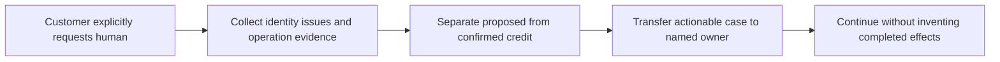

# Objective 5.2 — Design effective escalation and ambiguity resolution patterns

[Test this decision with a supplied example](#benchmark-exercise-5-2) — predict first, then compare the fixed-fixture evidence.

**Picture the application:** A subscription support desk receives frustration, requests for staff, policy exceptions and ambiguous account matches. Customers need either a supported resolution, a useful clarification or a genuine handoff appropriate to their situation. Escalation criteria are the technical topic; a customer’s tone alone does not describe the decision that remains unresolved.


**Exam:** CCAR-F · **Domain 5:** 15% of exam; no separate objective weight is published here.  
**Time:** 30–40 minutes foundation/applied; 15–25 additional minutes production extension.  
**Prerequisites:** 1.4 handoffs and 2.2 structured errors. New to the Claude API? Start with the [five-minute primer in Lesson 0](../L00-orientation.md#five-minute-primer-how-a-claude-app-works).  
**Continue from:** [Domain lesson](../L05-context-management-and-reliability.md) · [Objective map](../../../01-Curriculum/02-Architect-Track/CCAR-F-objectives.md).

**Official task statement:** Design effective escalation and ambiguity resolution patterns


<!-- layered-episode:FV-26:start -->
<a id="learn-fv-26"></a>
### Learn the decision in context — FV-26

**Picture the job.** A customer asks for a person. The transfer note says a credit was issued, but the system only drafted it. This is an original fictional teaching scene, not a recalled live exam question. Read and trace it; no account, installation or API call is required.

**Start small.** Follow the ordinary route: a person supplies a request or record, software passes the needed evidence to the assistant, and a receiving service or person checks the result. The first demonstration assumes the input, access and evidence are suitable. Now remove that assumption in the situation above. Predict what the receiver would see before choosing a repair.

**Original exam-style practice — choose ONE.** An escalation packet overstates an unexecuted proposal as a completed credit. Which handoff repair is required?

A. Delay an explicit human request until the assistant attempts every automation.

B. Correct the action status and transfer issues, verified evidence, attempted or blocked actions and the next owner promptly.

C. Forward the raw transcript and leave the next person to infer which actions actually happened.

<details>
<summary>What is this asking? Plain-language help, without the answer</summary>

Identify what the application needs to trust, what has actually been observed, and what remains unknown. Compare the choices against this situation, rather than choosing the most complicated design. A proposal is an intended action; evidence is what you can point to; a contract says what the receiving part expects. Decide which option fixes the stated failure without pretending another requirement has also been solved.

</details>

**Choose before opening the walkthrough.** Say your answer and the closest alternative aloud, or record them in your own notes.

<details>
<summary>Reveal the repair, evidence and changed condition</summary>

**Answer: B.** Correct the action status and transfer issues, verified evidence, attempted or blocked actions and the next owner promptly.

**Walk it through.** The packet lists proposed credit separately from confirmed effects and includes the operation ledger. The receiving owner can continue without guessing.

**Why the alternatives fail here.** Delay an explicit human request until the assistant attempts every automation. This leaves the stated boundary or evidence requirement unsatisfied. Forward the raw transcript and leave the next person to infer which actions actually happened. This also fails to establish the required result. The closest competing mechanism fails for this specific reason: A transcript dump does not ensure an actionable handoff; a vague complaint is not identical to an explicit human request.

**Inspect the small artifact.** This is an illustrative application-state note for reading, not an SDK signature or executable configuration. The application or workflow owner creates it; the receiver uses it to distinguish what is known from what still needs checking. Its labels describe this scene; do not paste it into Claude settings.

```text
handoff={identity_status,issues,confirmed,proposed,blocked,reason,next_owner}
```

**Layer added.** AI reasoning proposes, selects or summarizes where the job needs judgment. Ordinary software checks identifiers, permissions, required fields, recorded outcomes and stop conditions where applicable. A human resolves a policy or evidence gap when the story requires it. Inspect which owner actually supplies the evidence in this scene.



**Change one condition.** Keep the application in mind and consider the new situation below. Choose before opening its explanation.

**Technical transfer question — choose ONE.** The customer says this is frustrating but does not request a human. Which response fits?

A. Invent an explicit transfer request that the customer did not make.

B. Clarify or continue under the support policy while remaining alert to escalation needs.

<details>
<summary>Transfer check</summary>

**B.** The customer says “this is frustrating” without requesting a person. Clarify or continue according to the fictional support policy; do not invent an escalation mandate. Name the changed fact before naming a tool. Preserve unrelated access, source-validation and result checks.

</details>

**Recall in ordinary language.** What broke? Who can fix it? What observable result proves the repair? If you cannot answer all three, replay the concrete scene rather than memorize the option letter.

</details>

**Continue from this decision:** [objective 5.2](objective-5.2.md) · [inspect its decision map](../decision-atlas.md#diagram-d01) · [targeted practice](../../../practice/index.html?exam=CCAR-F&objective=5.2). Existing mapped question IDs: `cct-fv-26-base-v1`, `cct-fv-26-retry-v1`. The new guided question above is separate from those stored items and does not change their answers or progress.
<!-- layered-episode:FV-26:end -->

## Read this objective in both vocabularies

For reading and paper reasoning, no installation or credentials are needed. Keep this page's stated concept prerequisites; any runnable challenge still needs its own setup. If an implementation example feels abrupt, first read [how to interpret its artifact type](../architecture-studio/00-foundations.md#how-to-read-technical-examples-in-this-course), then use the relevant application bridge: [AS-08 decision bridge](../architecture-studio/AS-08-resumable-case.md#connect-the-simple-explanation-to-technical-design-choices).

Explain the business purpose first, name the precise mechanism second, and distinguish it from the nearest plausible alternative using the stated constraint. Return here for the objective-specific protocol, options and practice. The bridges are teaching aids, not additional official objectives.


## Big idea

Escalate because the customer requests it, policy cannot answer the case or progress is blocked. Resolve ambiguity with clarification rather than guessing from emotion or confidence.

## Foundation

### 5.2-K1

**Blueprint focus:** Appropriate escalation triggers: customer requests for a human, policy exceptions/gaps (not just complex cases), and inability to make meaningful progress

Explicit human requests, policy exceptions or gaps, and inability to make meaningful progress are distinct escalation triggers. A complex case may still be within the agent's tools and policy; a simple case may require a human because the customer asks for one.

[Exam guide v1.0, section 6 task 5.2](https://anthropic-partners.skilljar.com/page/partner-certifications) (Tier 1, July 2026 blueprint).

### 5.2-K2

**Blueprint focus:** The distinction between escalating immediately when a customer explicitly demands it versus offering to resolve when the issue is straightforward

A clear “connect me to a person” should trigger handoff immediately. Frustration alone can be acknowledged while offering a straightforward resolution. If the customer then asks for a human, honor that preference rather than treating another investigation as a prerequisite.

[Exam guide v1.0, section 6 task 5.2](https://anthropic-partners.skilljar.com/page/partner-certifications) (Tier 1, July 2026 blueprint).

### 5.2-K3

**Blueprint focus:** Why sentiment-based escalation and self-reported confidence scores are unreliable proxies for actual case complexity

Angry sentiment does not establish technical complexity, and model confidence does not establish policy authority. These signals may help understand communication, but should not substitute for actual escalation criteria or evidence that the agent can resolve the case.

[Exam guide v1.0, section 6 task 5.2](https://anthropic-partners.skilljar.com/page/partner-certifications) (Tier 1, July 2026 blueprint).

### 5.2-K4

**Blueprint focus:** How multiple customer matches require clarification (requesting additional identifiers) rather than heuristic selection

Multiple customer matches create identity ambiguity. Choosing the newest record, the nearest address or the first list entry introduces an unsupported identity decision. Ask for an additional identifier and use the verified match before account-specific action.

[Exam guide v1.0, section 6 task 5.2](https://anthropic-partners.skilljar.com/page/partner-certifications) (Tier 1, July 2026 blueprint).

## Applied skills

These are design applications. Pseudocode and schemas are illustrative unless separately dry-run; a saved design is not a completed implementation.

### 5.2-S1

**Blueprint focus:** Adding explicit escalation criteria with few-shot examples to the system prompt demonstrating when to escalate versus resolve autonomously

Write explicit escalation criteria and few-shot examples for a direct human request, a resolvable frustrated customer, a policy gap and stalled investigation. Explain the reason for each decision. Test a new case where sentiment and actual scope point in different directions.

[Exam guide v1.0, section 6 task 5.2](https://anthropic-partners.skilljar.com/page/partner-certifications) (Tier 1, July 2026 blueprint).

### 5.2-S2

**Blueprint focus:** Honoring explicit customer requests for human agents immediately without first attempting investigation

On an explicit human request, acknowledge and begin the handoff with available facts. Do not launch investigation first. Share relevant known details and unresolved points so the receiving person can act without reading the entire transcript.

[Exam guide v1.0, section 6 task 5.2](https://anthropic-partners.skilljar.com/page/partner-certifications) (Tier 1, July 2026 blueprint).

### 5.2-S3

**Blueprint focus:** Acknowledging frustration while offering resolution when the issue is within the agent's capability, escalating only if the customer reiterates their preference

Acknowledge frustration and offer a concrete resolution when policy and tools permit it and no human has been requested. If the customer chooses escalation, follow that choice. Avoid wording that pressures them to stay with the agent.

[Exam guide v1.0, section 6 task 5.2](https://anthropic-partners.skilljar.com/page/partner-certifications) (Tier 1, July 2026 blueprint).

### 5.2-S4

**Blueprint focus:** Escalating when policy is ambiguous or silent on the customer's specific request (e.g., competitor price matching when policy only addresses own-site adjustments)

When policy addresses own-site adjustments but says nothing about another seller's offer, preserve the policy gap and escalate rather than inventing eligibility. Provide the request, the policy evidence and the decision that needs authority.

[Exam guide v1.0, section 6 task 5.2](https://anthropic-partners.skilljar.com/page/partner-certifications) (Tier 1, July 2026 blueprint).

### 5.2-S5

**Blueprint focus:** Instructing the agent to ask for additional identifiers when tool results return multiple matches, rather than selecting based on heuristics

If lookup yields several matches, request a discriminating identifier appropriate to the workflow. Do not expose unrelated records while asking. Continue only after a unique verified identity or an authorized human resolution.

[Exam guide v1.0, section 6 task 5.2](https://anthropic-partners.skilljar.com/page/partner-certifications) (Tier 1, July 2026 blueprint).

## Worked example

A synthetic subscription support bot sees four cases: an angry customer with a known invoice-download issue; a calm customer requesting a human; a competitor-discount request absent from policy; and two matching account records. It offers the first customer the supported download fix, immediately hands off the second, escalates the policy gap and asks the last customer for an additional identifier. A credible alternative is escalating every upset customer, which can be appropriate if they ask but otherwise wastes capacity and delays easy resolution. A confidence threshold is another plausible routing aid, yet cannot grant authority where policy is silent. The handoff preserves known facts and the unresolved decision. Recovery from unavailable routing states the failure and seeks another authorized channel rather than claiming a person has received the case.

Original synthetic scenario; decision principles: [Exam guide v1.0, section 6 task 5.2](https://anthropic-partners.skilljar.com/page/partner-certifications) (Tier 1, July 2026 blueprint).

## Production transfer

**Healthcare administration; enrichment beyond the blueprint examples.** A synthetic appointment desk can reschedule within published hours, but cannot invent exceptions to eligibility rules. A frustrated caller with a routine change can receive a concrete offer; a direct human request proceeds to handoff. Compare immediate escalation with clarification when several records match: identity uncertainty needs more evidence and safe handling, not heuristic selection. Recovery reports a failed handoff honestly and seeks an authorized route. Extension: the policy changes during the session; show how you preserve the old decision context and verify the new rule before acting.

In your own notes, save your decision, rejected alternative, evidence and recovery path. Re-run the decision with the changed constraint before calling the pattern transferable. This is a design exercise, not industry compliance advice.

## Traps and counterexamples

Do not require investigation before honoring a human request. Do not treat every difficult case as outside scope. Clarification may be the correct next action; more autonomy is not always progress.

<a id="decision-variants"></a>
<a id="variant-fv-26"></a>
## Decision variant FV-26 — Honor explicit escalation with context

This is original fictional practice, not an official exam question. All policies, amounts and records below are synthetic.

**Choose in the base case.** A customer explicitly asks for a human. Route promptly with verified identity status, issues, evidence, attempted and blocked actions, and next owner.

**Change one constraint.** The customer says “this is frustrating” without requesting a person. Clarify or continue according to the fictional support policy; do not invent an escalation mandate.

**What failed, and who recovers?** The handoff says credit issued, but only a proposal exists. Correct status and include the operation ledger before transferring.

**Inspect the artifact — illustrative contract, not a drop-in SDK implementation:**

```text
handoff={identity_status,issues,confirmed,proposed,blocked,reason,next_owner}
```

**Why not the nearest alternative?** A transcript dump does not ensure an actionable handoff; a vague complaint is not identical to an explicit human request.

**Memory cue with its condition:** Hear the trigger; hand over facts, status and next action.

**Proof before accepting success:** Produce a trace or artifact showing the decisive constraint, the selected mechanism, rejected alternative and observable result. Preserve unresolved status; a plausible explanation alone is not completion.

[Inspect D01 and its equivalent decision procedure](../decision-atlas.md#diagram-d01) · [See this decision at walkthrough step 2](../scenario-walkthroughs/WT-01-customer-support-agent.md#variant-fv-26) · [Return to the objective map](README.md).

**Blind transfer:** Before opening practice, explain which single change in the scene would reverse your choice and which would only require revalidation. Write the failure signal and the next safe action. The practice app provides separately authored base and later-retry items, with a free-response transfer rubric; assistance/exposure must remain visible in learning history.

**Current runtime reference:** [https://code.claude.com/docs/en/hooks](https://code.claude.com/docs/en/hooks) (reviewed 2026-10-14). The saved blueprint remains the exam coverage source; application policy in this packet is invented teaching context.


## Try it

Write four few-shot routing examples and one new ambiguous case. Include a direct human request and multiple matches. For a multiple-response check, select the 3 valid triggers: explicit human request; angry language alone; policy gap; high confidence; no meaningful progress.

Attempt your design before reading the self-check. Save the artifact and the decision rationale so an independent reviewer can inspect them.

### Expected output and self-check

Select human request, policy gap and no meaningful progress. Angry language alone and confidence alone are insufficient. Your examples demonstrate acknowledgment plus resolution where appropriate, immediate handoff on request, clarification for identity and evidence-bearing escalation for policy gaps.

## Done when

- [ ] **5.2-S1:** Write four few-shot routing examples with explicit criteria; a new ambiguous case follows the criteria rather than sentiment.
- [ ] **5.2-S2:** Show immediate handoff on direct human request without first investigating; known facts and unresolved points survive.
- [ ] **5.2-S3:** Acknowledge the frustrated routine case and offer a supported resolution; honor subsequent human preference.
- [ ] **5.2-S4:** Escalate the competitor-discount policy gap with request and policy evidence; do not invent authority.
- [ ] **5.2-S5:** Request a discriminating identifier for multiple matches without disclosing unrelated account details.

In your own notes, save each stated artifact and check against the supplied expected outputs. Written design evidence and actual implementation evidence remain separate; learner mastery is not inferred from reading.

## Coverage checklist

| Official bullet, in guide order | Exact teaching section |
| --- | --- |
| 5.2-K1: Appropriate escalation triggers: customer requests for a human, policy exceptions/gaps (not just complex cases), and inability to make meaningful progress | [5.2-K1](#52-k1) |
| 5.2-K2: The distinction between escalating immediately when a customer explicitly demands it versus offering to resolve when the issue is straightforward | [5.2-K2](#52-k2) |
| 5.2-K3: Why sentiment-based escalation and self-reported confidence scores are unreliable proxies for actual case complexity | [5.2-K3](#52-k3) |
| 5.2-K4: How multiple customer matches require clarification (requesting additional identifiers) rather than heuristic selection | [5.2-K4](#52-k4) |
| 5.2-S1: Adding explicit escalation criteria with few-shot examples to the system prompt demonstrating when to escalate versus resolve autonomously | [5.2-S1](#52-s1) |
| 5.2-S2: Honoring explicit customer requests for human agents immediately without first attempting investigation | [5.2-S2](#52-s2) |
| 5.2-S3: Acknowledging frustration while offering resolution when the issue is within the agent's capability, escalating only if the customer reiterates their preference | [5.2-S3](#52-s3) |
| 5.2-S4: Escalating when policy is ambiguous or silent on the customer's specific request (e.g., competitor price matching when policy only addresses own-site adjustments) | [5.2-S4](#52-s4) |
| 5.2-S5: Instructing the agent to ask for additional identifiers when tool results return multiple matches, rather than selecting based on heuristics | [5.2-S5](#52-s5) |

## Sources and freshness

[Exam guide v1.0, section 6 task 5.2](https://anthropic-partners.skilljar.com/page/partner-certifications) (Tier 1, July 2026 blueprint).

The official objective wording is reproduced for traceability; explanations and all scenarios are project-authored. Existing L03–L05 provide domain synthesis; this module expands each bullet into a teachable decision. The saved July guide is the blueprint baseline, not a claim that no newer guide exists.

**Go deeper:** [Deep practice 1, section 5.2](../deep-practice/01-agentic-architecture-and-orchestration.md#52-escalation-and-ambiguity-resolution)


<a id="benchmark-exercise-5-2"></a>
## Worked evidence task — 5.2: test the boundary

**Original technical decision.** Messages express frustration, request a human, collide on identity and ask for a policy exception. Which triage distinguishes clarification from escalation?

**In everyday terms:** Being upset alone is not the same as explicitly asking for a person or having an unresolved identity.

**Before you start:** No account, API key or package installation is needed for the paper task. Optional replay needs Python 3 and the two provided lab files in the same directory. This local inspector models the stated fixture; it does not call Claude, load Claude Code rules or run an MCP server.

### Inspect the supplied input

All identifiers and business rules here are fictional application data. This is **not an SDK request schema**. Keep the input separate from your proposed decision.

```json
{
  "messages": [
    "I am upset; where is my order?",
    "Please transfer me to a human",
    "Two customer accounts share this name",
    "Policy does not cover this exception"
  ]
}
```

### Break, choose, repair, prove

1. **Break:** Contrast frustration, explicit human request, ambiguous identity and a policy gap. Name the exact failed assumption before proposing another component.
2. **Choose:** Handle each trigger separately and provide a factual, actionable handoff where escalation is required. Write the nearest alternative you would reject and the requirement it fails.
3. **Repair:** Write the corrected contract or recovery step, keeping successful evidence and unknowns separate.
4. **Prove:** Choose clarification/escalation with an actionable handoff; no guessed customer or fabricated policy. Record `decision`, `reason`, `rejected_alternative`, `evidence` and `remaining_unknowns`.

[Open this actual task in the existing LAB](../../../06-Labs/08-CCAR-F-architecture-decisions/README.md#benchmark-exercise-5-2) · [Return to the teaching subsection](#foundation)

<details><summary>Compare the offline evidence — after making your decision</summary>

The local inspector presents **controlled-fixture calculations and authored reference decisions** below. Some fields are calculated (such as counts or arithmetic); policy labels and recovery choices are supplied worked answers for this fixed example, not executed policies or a general-purpose validator. No Claude, rule loader, service or reviewer was run. `false` or `null` observations remain unresolved when no corresponding live test was performed.

```json
{
  "actions": [
    "normal lookup with empathy",
    "human handoff",
    "identity clarification before account action",
    "authorized policy escalation"
  ],
  "guess_account": false,
  "invent_policy": false
}
```

**Why this matters:** Being upset alone is not the same as explicitly asking for a person or having an unresolved identity. The output is a self-check for this controlled example, not certification-score evidence. To test the real mechanism, perform the existing LAB’s integration steps in a fresh disposable context and keep its actual trace beside this prediction.

**Primary-source leads for mechanism review:** [Anthropic Agent SDK Documentation — Human-in-the-loop](https://code.claude.com/docs/en/agent-sdk/user-input) · [Anthropic Customer Support Best Practices](https://platform.claude.com/docs/en/docs/about-claude/use-case-guides/customer-support-chat). The external benchmark helped identify the exercise gap; this task and its data were authored here. Current implementation details must be verified against the installed runtime and those primary sources.

</details>