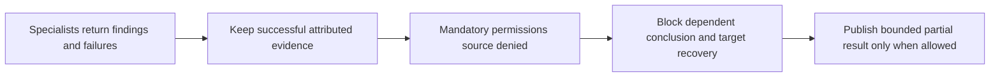

# Objective 5.3 — Implement error propagation strategies across multi-agent systems

[Test this decision with a supplied example](#benchmark-exercise-5-3) — predict first, then compare the fixed-fixture evidence.

**Picture the application:** A route-risk report combines weather, port notices and carrier status, but one source becomes unavailable. Its reader needs to know which findings are supported and which remain incomplete before using the report. Error propagation is the technical mechanism for preserving partial results and making the next recovery decision possible.


**Exam:** CCAR-F · **Domain 5:** 15% of exam; no separate objective weight is published here.  
**Time:** 30–40 minutes foundation/applied; 15–25 additional minutes production extension.  
**Prerequisites:** 1.2 coordination and 2.2 errors. New to the Claude API? Start with the [five-minute primer in Lesson 0](../L00-orientation.md#five-minute-primer-how-a-claude-app-works).  
**Continue from:** [Domain lesson](../L05-context-management-and-reliability.md) · [Objective map](../../../01-Curriculum/02-Architect-Track/CCAR-F-objectives.md).

**Official task statement:** Implement error propagation strategies across multi-agent systems


<!-- layered-episode:FV-27:start -->
<a id="learn-fv-27"></a>
### Learn the decision in context — FV-27

**Picture the job.** Two specialists finish their research, but the permissions source cannot be accessed. The final answer needs that permission evidence. This is an original fictional teaching scene, not a recalled live exam question. Read and trace it; no account, installation or API call is required.

**Start small.** Follow the ordinary route: a person supplies a request or record, software passes the needed evidence to the assistant, and a receiving service or person checks the result. The first demonstration assumes the input, access and evidence are suitable. Now remove that assumption in the situation above. Predict what the receiver would see before choosing a repair.

**Original exam-style practice — choose ONE.** A mandatory specialist dimension returns access_denied while other dimensions succeed. Which aggregation behavior is correct?

A. Silently drop the missing permissions dimension and publish a complete answer.

B. Discard every successful finding and restart all specialists regardless of failure scope.

C. Preserve valid findings, propagate the structured failure and block or qualify the affected conclusion while targeting permitted recovery.

<details>
<summary>What is this asking? Plain-language help, without the answer</summary>

Identify what the application needs to trust, what has actually been observed, and what remains unknown. Compare the choices against this situation, rather than choosing the most complicated design. A proposal is an intended action; evidence is what you can point to; a contract says what the receiving part expects. Decide which option fixes the stated failure without pretending another requirement has also been solved.

</details>

**Choose before opening the walkthrough.** Say your answer and the closest alternative aloud, or record them in your own notes.

<details>
<summary>Reveal the repair, evidence and changed condition</summary>

**Answer: C.** Preserve valid findings, propagate the structured failure and block or qualify the affected conclusion while targeting permitted recovery.

**Walk it through.** The aggregate says partial, names permissions as failed and does not make the unsupported authorization conclusion. Other cited findings remain usable.

**Why the alternatives fail here.** Silently drop the missing permissions dimension and publish a complete answer. This leaves the stated boundary or evidence requirement unsatisfied. Discard every successful finding and restart all specialists regardless of failure scope. This also fails to establish the required result. The closest competing mechanism fails for this specific reason: Discarding all successes wastes evidence; silently dropping a failed mandatory dimension fabricates completeness.

**Inspect the small artifact.** This is an illustrative application-state note for reading, not an SDK signature or executable configuration. The application or workflow owner creates it; the receiver uses it to distinguish what is known from what still needs checking. Its labels describe this scene; do not paste it into Claude settings.

```text
result={dimension:permissions,status:failed,reason:access_denied,retryable:false}; aggregate=partial
```

**Layer added.** AI reasoning proposes, selects or summarizes where the job needs judgment. Ordinary software checks identifiers, permissions, required fields, recorded outcomes and stop conditions where applicable. A human resolves a policy or evidence gap when the story requires it. Inspect which owner actually supplies the evidence in this scene.



**Change one condition.** Keep the application in mind and consider the new situation below. Choose before opening its explanation.

**Technical transfer question — choose ONE.** The unavailable source is explicitly optional for the requested answer. Which aggregation is permitted?

A. A bounded partial answer with the omission and limitations visible.

B. A complete answer that silently implies the source was checked.

<details>
<summary>Transfer check</summary>

**A.** The unavailable source is explicitly optional. Publish a bounded partial answer with the omission and limitations visible. Name the changed fact before naming a tool. Preserve unrelated access, source-validation and result checks.

</details>

**Recall in ordinary language.** What broke? Who can fix it? What observable result proves the repair? If you cannot answer all three, replay the concrete scene rather than memorize the option letter.

</details>

**Continue from this decision:** [objective 5.3](objective-5.3.md) · [inspect its decision map](../decision-atlas.md#diagram-d03) · [targeted practice](../../../practice/index.html?exam=CCAR-F&objective=5.3). Existing mapped question IDs: `cct-fv-27-base-v1`, `cct-fv-27-retry-v1`. The new guided question above is separate from those stored items and does not change their answers or progress.
<!-- layered-episode:FV-27:end -->

## Read this objective in both vocabularies

For reading and paper reasoning, no installation or credentials are needed. Keep this page's stated concept prerequisites; any runnable challenge still needs its own setup. If an implementation example feels abrupt, first read [how to interpret its artifact type](../architecture-studio/00-foundations.md#how-to-read-technical-examples-in-this-course), then use the relevant application bridge: [AS-03 decision bridge](../architecture-studio/AS-03-grounded-assistant.md#connect-the-simple-explanation-to-technical-design-choices) · [AS-04 decision bridge](../architecture-studio/AS-04-research-system.md#connect-the-simple-explanation-to-technical-design-choices) · [AS-07 decision bridge](../architecture-studio/AS-07-work-queue.md#connect-the-simple-explanation-to-technical-design-choices).

Explain the business purpose first, name the precise mechanism second, and distinguish it from the nearest plausible alternative using the stated constraint. Return here for the objective-specific protocol, options and practice. The bridges are teaching aids, not additional official objectives.


## Big idea

A failure report is a decision input. Preserve what failed, what succeeded and what remains uncovered so the coordinator can recover without inventing a complete answer.

## Foundation

### 5.3-K1

**Blueprint focus:** Structured error context (failure type, attempted query, partial results, alternative approaches) as enabling intelligent coordinator recovery decisions

A coordinator needs the failure type, attempted query, partial results and alternatives. “Research failed” omits the information required to choose retry, substitute source, narrower query or partial answer. Structured context makes the recovery decision inspectable.

[Exam guide v1.0, section 6 task 5.3](https://anthropic-partners.skilljar.com/page/partner-certifications) (Tier 1, July 2026 blueprint).

### 5.3-K2

**Blueprint focus:** The distinction between access failures (timeouts needing retry decisions) and valid empty results (successful queries with no matches)

An empty successful query establishes that no matching records were found within its scope. An access failure establishes nothing about matches. Combining them into the same empty list makes downstream synthesis mistake unavailable evidence for evidence of absence.

[Exam guide v1.0, section 6 task 5.3](https://anthropic-partners.skilljar.com/page/partner-certifications) (Tier 1, July 2026 blueprint).

### 5.3-K3

**Blueprint focus:** Why generic error statuses ("search unavailable") hide valuable context from the coordinator

Generic statuses conceal distinctions such as authorization failure, timeout and malformed input. Recovery differs for each: credentials or permission may be needed, transient failure may justify a retry, and invalid input requires correction. Include relevant diagnostics without leaking secrets.

[Exam guide v1.0, section 6 task 5.3](https://anthropic-partners.skilljar.com/page/partner-certifications) (Tier 1, July 2026 blueprint).

### 5.3-K4

**Blueprint focus:** Why silently suppressing errors (returning empty results as success) or terminating entire workflows on single failures are both anti-patterns

Silently suppressing a failure creates false completeness; terminating the entire workflow after one failure discards usable work. A reliable design preserves valid partial results and explicitly marks the failed area, with a recovery policy appropriate to the task's required coverage.

[Exam guide v1.0, section 6 task 5.3](https://anthropic-partners.skilljar.com/page/partner-certifications) (Tier 1, July 2026 blueprint).

## Applied skills

These are design applications. Pseudocode and schemas are illustrative unless separately dry-run; a saved design is not a completed implementation.

### 5.3-S1

**Blueprint focus:** Returning structured error context including failure type, what was attempted, partial results, and potential alternatives to enable coordinator recovery

Return a structured envelope with status, failure category, attempted query, attempts, partial findings, source scope and proposed alternatives. Verify that each field helps a coordinator decide an action. Preserve the original error where appropriate, redacting credentials.

[Exam guide v1.0, section 6 task 5.3](https://anthropic-partners.skilljar.com/page/partner-certifications) (Tier 1, July 2026 blueprint).

### 5.3-S2

**Blueprint focus:** Distinguishing access failures from valid empty results in error reporting so the coordinator can make appropriate decisions

Use distinct statuses for success-empty and failed-access. A test coordinator should make different decisions for those cases. Never infer a missing claim or absent document from a timeout simply because both produce no findings.

[Exam guide v1.0, section 6 task 5.3](https://anthropic-partners.skilljar.com/page/partner-certifications) (Tier 1, July 2026 blueprint).

### 5.3-S3

**Blueprint focus:** Having subagents implement local recovery for transient failures and only propagate errors they cannot resolve, including what was attempted and partial results

Have subagents attempt bounded local recovery for transient problems before escalating. On escalation, include the failed attempts and surviving findings. Respect nonretryable categories and avoid several agents independently retrying the same blocked source without coordination.

[Exam guide v1.0, section 6 task 5.3](https://anthropic-partners.skilljar.com/page/partner-certifications) (Tier 1, July 2026 blueprint).

### 5.3-S4

**Blueprint focus:** Structuring synthesis output with coverage annotations indicating which findings are well-supported versus which topic areas have gaps due to unavailable sources

Annotate synthesis coverage by topic or source: supported, partially supported or unavailable. Tie conclusions to surviving evidence and disclose gaps. If required coverage cannot be met, return a partial or blocked result instead of a polished complete-looking answer.

[Exam guide v1.0, section 6 task 5.3](https://anthropic-partners.skilljar.com/page/partner-certifications) (Tier 1, July 2026 blueprint).

## Worked example

A logistics research coordinator needs weather, port notices and carrier status for a route-risk report. The carrier lookup succeeds with no disruptions; the port feed times out twice; weather evidence is available. The port subagent sends its query, failure type, attempts, partial older notices and a suggested alternate official source. The coordinator retains carrier success-empty, searches the alternative and marks port coverage partial if recovery fails. A credible alternative is aborting the report when all three sources are mandatory for a dispatch decision. Publishing a partial report is appropriate for exploratory planning but must not be mislabeled complete. The design costs explicit status handling; it prevents a timeout from being represented as “no port disruptions.” Recovery decisions depend on the use of the report, not on a universal retry rule.

Original synthetic scenario; decision principles: [Exam guide v1.0, section 6 task 5.3](https://anthropic-partners.skilljar.com/page/partner-certifications) (Tier 1, July 2026 blueprint).

### Illustrative error envelope

```json
{
  "status": "failed_access",
  "failure_type": "timeout",
  "attempted_query": "current port notices for route R7",
  "attempts": 2,
  "partial_findings": ["older notice retained with its observation date"],
  "alternatives": ["check alternate official notices endpoint"],
  "coverage": "current port status unavailable"
}
```

A successful empty response would instead say `status: success_empty` with the query scope. Do not copy a timeout envelope into a no-disruption conclusion. This is an application convention, not a required SDK error schema.

## Production transfer

**Multi-source public research; enrichment beyond the blueprint examples.** A synthetic infrastructure report draws on statistical tables, notices and technical studies. One source is inaccessible while the other two succeed. Compare a partial explanatory report with blocking a decision that requires all sources: coverage requirements determine the outcome. A valid empty search result cannot fill the failed area. Recovery records attempts, retained findings and alternate evidence, with no credentials in diagnostics. Extension: an alternate source is available but uses a different population; explain why availability alone does not close the original coverage gap.

In your own notes, save your decision, rejected alternative, evidence and recovery path. Re-run the decision with the changed constraint before calling the pattern transferable. This is a design exercise, not industry compliance advice.

## Traps and counterexamples

Do not hide failure as an empty success. Do not throw away unrelated successful work automatically. More retries are useful only when the failure category and available alternative justify them.

<a id="decision-variants"></a>
<a id="variant-fv-27"></a>
## Decision variant FV-27 — Propagate partial success without hiding failure

This is original fictional practice, not an official exam question. All policies, amounts and records below are synthetic.

**Choose in the base case.** Specialists return findings and structured failures to the coordinator. Preserve successful evidence and decide which missing dimensions block the final claim.

**Change one constraint.** The unavailable source is explicitly optional. Publish a bounded partial answer with the omission and limitations visible.

**What failed, and who recovers?** A mandatory permissions source fails. Target that recovery or stop the affected conclusion; do not replace its facts with another specialist’s guess.

**Inspect the artifact — illustrative contract, not a drop-in SDK implementation:**

```text
result={dimension:permissions,status:failed,reason:access_denied,retryable:false}; aggregate=partial
```

**Why not the nearest alternative?** Discarding all successes wastes evidence; silently dropping a failed mandatory dimension fabricates completeness.

**Memory cue with its condition:** Keep the successes; name the gap; block dependent claims.

**Proof before accepting success:** Produce a trace or artifact showing the decisive constraint, the selected mechanism, rejected alternative and observable result. Preserve unresolved status; a plausible explanation alone is not completion.

[Inspect D03 and its equivalent decision procedure](../decision-atlas.md#diagram-d03) · [See this decision at walkthrough step 4](../scenario-walkthroughs/WT-03-multi-agent-research.md#variant-fv-27) · [Return to the objective map](README.md).

**Blind transfer:** Before opening practice, explain which single change in the scene would reverse your choice and which would only require revalidation. Write the failure signal and the next safe action. The practice app provides separately authored base and later-retry items, with a free-response transfer rubric; assistance/exposure must remain visible in learning history.

**Current runtime reference:** [https://platform.claude.com/docs/en/agent-sdk/subagents](https://platform.claude.com/docs/en/agent-sdk/subagents) (reviewed 2026-10-14). The saved blueprint remains the exam coverage source; application policy in this packet is invented teaching context.


## Try it

Design three envelopes: success-empty, transient failure after local retries and permission failure with partial findings. Write the coordinator action for each and a synthesis coverage annotation. Inject a failed mandatory source and explain whether a partial output is permitted.

Attempt your design before reading the self-check. Save the artifact and the decision rationale so an independent reviewer can inspect them.

### Expected output and self-check

Success-empty preserves query scope without retrying by default. Transient failure carries attempts and alternatives. Permission failure does not loop blindly. Coverage annotations distinguish known absence from unknown coverage; mandatory missing evidence can block the decision even when a partial explanatory report is useful.

## Done when

- [ ] **5.3-S1:** Produce the failure envelope containing type, query, attempts, partial results and alternatives; the coordinator chooses a supported recovery.
- [ ] **5.3-S2:** Give success-empty and failed-access different statuses and conclusions; timeout never means no matches.
- [ ] **5.3-S3:** Show bounded local retry followed by propagated unresolved error with surviving findings; nonretryable errors do not loop.
- [ ] **5.3-S4:** Write coverage annotations for weather/carrier/port and block a mandatory dispatch decision if required source coverage remains missing.

In your own notes, save each stated artifact and check against the supplied expected outputs. Written design evidence and actual implementation evidence remain separate; learner mastery is not inferred from reading.

## Coverage checklist

| Official bullet, in guide order | Exact teaching section |
| --- | --- |
| 5.3-K1: Structured error context (failure type, attempted query, partial results, alternative approaches) as enabling intelligent coordinator recovery decisions | [5.3-K1](#53-k1) |
| 5.3-K2: The distinction between access failures (timeouts needing retry decisions) and valid empty results (successful queries with no matches) | [5.3-K2](#53-k2) |
| 5.3-K3: Why generic error statuses ("search unavailable") hide valuable context from the coordinator | [5.3-K3](#53-k3) |
| 5.3-K4: Why silently suppressing errors (returning empty results as success) or terminating entire workflows on single failures are both anti-patterns | [5.3-K4](#53-k4) |
| 5.3-S1: Returning structured error context including failure type, what was attempted, partial results, and potential alternatives to enable coordinator recovery | [5.3-S1](#53-s1) |
| 5.3-S2: Distinguishing access failures from valid empty results in error reporting so the coordinator can make appropriate decisions | [5.3-S2](#53-s2) |
| 5.3-S3: Having subagents implement local recovery for transient failures and only propagate errors they cannot resolve, including what was attempted and partial results | [5.3-S3](#53-s3) |
| 5.3-S4: Structuring synthesis output with coverage annotations indicating which findings are well-supported versus which topic areas have gaps due to unavailable sources | [5.3-S4](#53-s4) |

## Sources and freshness

[Exam guide v1.0, section 6 task 5.3](https://anthropic-partners.skilljar.com/page/partner-certifications) (Tier 1, July 2026 blueprint).

The official objective wording is reproduced for traceability; explanations and all scenarios are project-authored. Existing L03–L05 provide domain synthesis; this module expands each bullet into a teachable decision. The saved July guide is the blueprint baseline, not a claim that no newer guide exists.

**Go deeper:** [Deep practice 5, section 5.3](../deep-practice/05-context-management-and-reliability.md#53-error-propagation-across-multi-agent-systems)


<a id="benchmark-exercise-5-3"></a>
## Worked evidence task — 5.3: test the boundary

**Original technical decision.** Two specialists succeed, one lacks access and one times out; one retry remains. Which synthesis/recovery policy avoids erasing partial progress?

**In everyday terms:** Use the good work and say clearly what is still missing.

**Before you start:** No account, API key or package installation is needed for the paper task. Optional replay needs Python 3 and the two provided lab files in the same directory. This local inspector models the stated fixture; it does not call Claude, load Claude Code rules or run an MCP server.

### Inspect the supplied input

All identifiers and business rules here are fictional application data. This is **not an SDK request schema**. Keep the input separate from your proposed decision.

```json
{
  "specialists": {
    "A": {
      "success": "supported finding"
    },
    "B": {
      "success": "supported finding"
    },
    "C": {
      "error": "access_denied"
    },
    "D": {
      "error": "timeout"
    }
  },
  "remaining_retry_budget": 1
}
```

### Break, choose, repair, prove

1. **Break:** Return two successful specialist findings, one access denial and one transient failure. Name the exact failed assumption before proposing another component.
2. **Choose:** Keep supported results, mark uncovered scope and apply cause-specific recovery only within the remaining budget. Write the nearest alternative you would reject and the requirement it fails.
3. **Repair:** Write the corrected contract or recovery step, keeping successful evidence and unknowns separate.
4. **Prove:** Preserve successful findings, identify uncovered scope and apply cause-specific recovery within budget. Record `decision`, `reason`, `rejected_alternative`, `evidence` and `remaining_unknowns`.

[Open this actual task in the existing LAB](../../../06-Labs/08-CCAR-F-architecture-decisions/README.md#benchmark-exercise-5-3) · [Return to the teaching subsection](#illustrative-error-envelope)

<details><summary>Compare the offline evidence — after making your decision</summary>

The local inspector presents **controlled-fixture calculations and authored reference decisions** below. Some fields are calculated (such as counts or arithmetic); policy labels and recovery choices are supplied worked answers for this fixed example, not executed policies or a general-purpose validator. No Claude, rule loader, service or reviewer was run. `false` or `null` observations remain unresolved when no corresponding live test was performed.

```json
{
  "preserve": [
    "A",
    "B"
  ],
  "access_queue": [
    "C"
  ],
  "retry": [
    "D"
  ],
  "complete": false
}
```

**Why this matters:** Use the good work and say clearly what is still missing. The output is a self-check for this controlled example, not certification-score evidence. To test the real mechanism, perform the existing LAB’s integration steps in a fresh disposable context and keep its actual trace beside this prediction.

**Primary-source leads for mechanism review:** [Anthropic multi-agent engineering report](https://www.anthropic.com/engineering/built-multi-agent-research-system). The external benchmark helped identify the exercise gap; this task and its data were authored here. Current implementation details must be verified against the installed runtime and those primary sources.

</details>