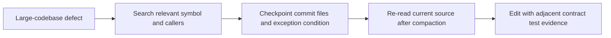

# Objective 5.4 — Manage context effectively in large codebase exploration

[Test this decision with a supplied example](#benchmark-exercise-5-4) — predict first, then compare the fixed-fixture evidence.

**Picture the application:** An investigation traces maintenance alerts across three services, then stops unexpectedly. The team wants to recover useful findings, check changed code and avoid repeating an action whose outcome is uncertain. Scratchpads, saved state and a recovery manifest are the technical tools for reconstructing what remains to be done.


**Exam:** CCAR-F · **Domain 5:** 15% of exam; no separate objective weight is published here.  
**Time:** 30–40 minutes foundation/applied; 15–25 additional minutes production extension.  
**Prerequisites:** 1.3 delegation, 1.7 sessions and 3.4 exploration. New to the Claude API? Start with the [five-minute primer in Lesson 0](../L00-orientation.md#five-minute-primer-how-a-claude-app-works).  
**Continue from:** [Domain lesson](../L05-context-management-and-reliability.md) · [Objective map](../../../01-Curriculum/02-Architect-Track/CCAR-F-objectives.md).

**Official task statement:** Manage context effectively in large codebase exploration


<!-- layered-episode:FV-28:start -->
<a id="learn-fv-28"></a>
### Learn the decision in context — FV-28

**Picture the job.** You found the bug yesterday, but after shortening the conversation you no longer remember the exception in the affected function. This is an original fictional teaching scene, not a recalled live exam question. Read and trace it; no account, installation or API call is required.

**Start small.** Follow the ordinary route: a person supplies a request or record, software passes the needed evidence to the assistant, and a receiving service or person checks the result. The first demonstration assumes the input, access and evidence are suitable. Now remove that assumption in the situation above. Predict what the receiver would see before choosing a repair.

**Original exam-style practice — choose ONE.** A compacted code investigation loses an exception condition at a mutable commit. Which action should precede editing?

A. Re-read the relevant current source and caller contract from the evidence ledger, expanding scope only where dependencies require.

B. Reconstruct the exception from the model’s summary.

C. Read every repository file before any focused change.

<details>
<summary>What is this asking? Plain-language help, without the answer</summary>

Identify what the application needs to trust, what has actually been observed, and what remains unknown. Compare the choices against this situation, rather than choosing the most complicated design. A proposal is an intended action; evidence is what you can point to; a contract says what the receiving part expects. Decide which option fixes the stated failure without pretending another requirement has also been solved.

</details>

**Choose before opening the walkthrough.** Say your answer and the closest alternative aloud, or record them in your own notes.

<details>
<summary>Reveal the repair, evidence and changed condition</summary>

**Answer: A.** Re-read the relevant current source and caller contract from the evidence ledger, expanding scope only where dependencies require.

**Walk it through.** The ledger records current commit, function, caller and unresolved ownership. A focused test exercises the recovered exception before and after the edit.

**Why the alternatives fail here.** Reconstruct the exception from the model’s summary. This leaves the stated boundary or evidence requirement unsatisfied. Read every repository file before any focused change. This also fails to establish the required result. The closest competing mechanism fails for this specific reason: A guessed summary cannot replace current code evidence. Reading the whole repository also makes the decisive detail harder to retain.

**Inspect the small artifact.** This is an illustrative application-state note for reading, not an SDK signature or executable configuration. The application or workflow owner creates it; the receiver uses it to distinguish what is known from what still needs checking. Its labels describe this scene; do not paste it into Claude settings.

```text
ledger={commit,files:[handler,caller],symbols:[retry],unresolved:[ownership],next:test_contract}
```

**Layer added.** AI reasoning proposes, selects or summarizes where the job needs judgment. Ordinary software checks identifiers, permissions, required fields, recorded outcomes and stop conditions where applicable. A human resolves a policy or evidence gap when the story requires it. Inspect which owner actually supplies the evidence in this scene.



**Change one condition.** Keep the application in mind and consider the new situation below. Choose before opening its explanation.

**Technical transfer question — choose ONE.** The defect crosses the client-server API boundary. How should evidence scope change?

A. Keep only the original file even though the failure crosses its boundary.

B. Add adjacent dependencies and contract checks to the ledger.

<details>
<summary>Transfer check</summary>

**B.** The failure crosses the API boundary. Add the adjacent client/server dependencies and contract tests rather than preserving an artificially narrow scope. Name the changed fact before naming a tool. Preserve unrelated access, source-validation and result checks.

</details>

**Recall in ordinary language.** What broke? Who can fix it? What observable result proves the repair? If you cannot answer all three, replay the concrete scene rather than memorize the option letter.

</details>

**Continue from this decision:** [objective 5.4](objective-5.4.md) · [inspect its decision map](../decision-atlas.md#diagram-d11) · [targeted practice](../../../practice/index.html?exam=CCAR-F&objective=5.4). Existing mapped question IDs: `cct-fv-28-base-v1`, `cct-fv-28-retry-v1`. The new guided question above is separate from those stored items and does not change their answers or progress.
<!-- layered-episode:FV-28:end -->

## Read this objective in both vocabularies

For reading and paper reasoning, no installation or credentials are needed. Keep this page's stated concept prerequisites; any runnable challenge still needs its own setup. If an implementation example feels abrupt, first read [how to interpret its artifact type](../architecture-studio/00-foundations.md#how-to-read-technical-examples-in-this-course), then use the relevant application bridge: [AS-05 decision bridge](../architecture-studio/AS-05-code-change.md#connect-the-simple-explanation-to-technical-design-choices) · [AS-08 decision bridge](../architecture-studio/AS-08-resumable-case.md#connect-the-simple-explanation-to-technical-design-choices).

Explain the business purpose first, name the precise mechanism second, and distinguish it from the nearest plausible alternative using the stated constraint. Return here for the objective-specific protocol, options and practice. The bridges are teaching aids, not additional official objectives.


## Big idea

A long investigation should leave recoverable evidence outside conversation memory. Scratchpads preserve findings; structured manifests preserve the state needed to resume work safely.

## Foundation

### 5.4-K1

**Blueprint focus:** Context degradation in extended sessions: models start giving inconsistent answers and referencing "typical patterns" rather than specific classes discovered earlier

Context degradation appears when a session stops referring to discovered classes and falls back to generic patterns or inconsistent answers. Re-read the actual code and evidence instead of trusting a compressed recollection. A coherent explanation can still be stale or unsupported.

[Exam guide v1.0, section 6 task 5.4](https://anthropic-partners.skilljar.com/page/partner-certifications) (Tier 1, July 2026 blueprint).

### 5.4-K2

**Blueprint focus:** The role of scratchpad files for persisting key findings across context boundaries

A scratchpad records durable findings, file locations, unresolved questions and decisions. It should be concise enough to reload and precise enough to verify. Treat it as an index into evidence rather than an authoritative substitute for files that may have changed.

[Exam guide v1.0, section 6 task 5.4](https://anthropic-partners.skilljar.com/page/partner-certifications) (Tier 1, July 2026 blueprint).

### 5.4-K3

**Blueprint focus:** Subagent delegation for isolating verbose exploration output while the main agent coordinates high-level understanding

Subagents can investigate narrow questions and absorb verbose tool output while the main agent preserves the system map. Their returned summaries need references and unknowns. Delegating everything without synthesis merely distributes confusion across separate contexts.

[Exam guide v1.0, section 6 task 5.4](https://anthropic-partners.skilljar.com/page/partner-certifications) (Tier 1, July 2026 blueprint).

### 5.4-K4

**Blueprint focus:** Structured state persistence for crash recovery: each agent exports state to a known location, and the coordinator loads a manifest on resume

Crash recovery requires known state locations and a coordinator manifest identifying agents, task status, artifacts, evidence freshness and pending decisions. Each agent exports structured state. On resume, the coordinator validates the manifest and injects relevant state into restarted agents rather than assuming the interrupted conversation survived.

[Exam guide v1.0, section 6 task 5.4](https://anthropic-partners.skilljar.com/page/partner-certifications) (Tier 1, July 2026 blueprint).

## Applied skills

These are design applications. Pseudocode and schemas are illustrative unless separately dry-run; a saved design is not a completed implementation.

### 5.4-S1

**Blueprint focus:** Spawning subagents to investigate specific questions (e.g., "find all test files," "trace refund flow dependencies") while the main agent preserves high-level coordination

Delegate questions such as finding test files or tracing the refund dependency chain with bounded scope and required references. The main agent records how each result changes the system map. Reject a broad repository tour that returns thousands of unfiltered lines.

[Exam guide v1.0, section 6 task 5.4](https://anthropic-partners.skilljar.com/page/partner-certifications) (Tier 1, July 2026 blueprint).

### 5.4-S2

**Blueprint focus:** Having agents maintain scratchpad files recording key findings, referencing them for subsequent questions to counteract context degradation

Have each agent maintain a scratchpad containing verified file references, conclusions and open questions. For a later query, reload the relevant entries and inspect changed files. Record observation time or commit so old findings can be distinguished from current code.

[Exam guide v1.0, section 6 task 5.4](https://anthropic-partners.skilljar.com/page/partner-certifications) (Tier 1, July 2026 blueprint).

### 5.4-S3

**Blueprint focus:** Summarizing key findings from one exploration phase before spawning sub-agents for the next phase, injecting summaries into initial context

Before the next phase, synthesize a compact baseline of established findings and remaining uncertainty. Pass it explicitly to new subagents with their question and quality criteria. Context is not automatically inherited, and a summary needs enough evidence to avoid repeating exploration.

[Exam guide v1.0, section 6 task 5.4](https://anthropic-partners.skilljar.com/page/partner-certifications) (Tier 1, July 2026 blueprint).

### 5.4-S4

**Blueprint focus:** Designing crash recovery using structured agent state exports (manifests) that the coordinator loads on resume and injects into agent prompts

Design a coordinator manifest containing agent ID, state path, completed steps, in-flight operations, source revision and recovery action. Save state at checkpoints, preferably with atomic replacement. Resume by validating references and revision, rechecking uncertain side effects, then injecting each relevant state into its agent prompt.

[Exam guide v1.0, section 6 task 5.4](https://anthropic-partners.skilljar.com/page/partner-certifications) (Tier 1, July 2026 blueprint).

### 5.4-S5

**Blueprint focus:** Using /compact to reduce context usage during extended exploration sessions when context fills with verbose discovery output

Use /compact when verbose exploration fills the conversation, supplying critical facts to retain. Reload scratchpads and verify the condensed summary before consequential work. Compaction helps context size; it does not replace state export or guarantee recovery after a crash.

[Exam guide v1.0, section 6 task 5.4](https://anthropic-partners.skilljar.com/page/partner-certifications) (Tier 1, July 2026 blueprint).

## Worked example

An industrial maintenance repository investigation traces alert generation across three services. Each subagent records discovered classes, source revision and unresolved boundaries in a scratchpad. The coordinator saves a manifest whose entries point to state files and mark tracing complete, integration review pending and one tool action interrupted. After a crash, it loads the manifest, compares the checkout revision and rechecks the interrupted action before restarting agents with their saved findings. A credible alternative is resuming the previous session when context and code remain valid; this is quicker but insufficient if tool results are stale or state is missing. Starting fresh with structured summaries is preferable after substantial code changes. The design costs checkpointing and freshness checks. Recovery avoids both full rediscovery and blindly repeating an action that may already have completed.

Original synthetic scenario; decision principles: [Exam guide v1.0, section 6 task 5.4](https://anthropic-partners.skilljar.com/page/partner-certifications) (Tier 1, July 2026 blueprint).

### Illustrative checkpoint and resume contract

```json
{
  "run_id": "maintenance-map-07",
  "source_revision": "record-the-real-commit-here",
  "phase": "integration_pending",
  "agents": [
    {"id": "trace-alerts", "state_path": "state/trace-alerts.json", "status": "complete"},
    {"id": "trace-dispatch", "state_path": "state/trace-dispatch.json", "status": "interrupted"}
  ],
  "pending_operations": [{"id": "operation-12", "completion": "unknown", "check_before_retry": true}]
}
```

An agent state contains the task, findings, evidence paths, unresolved questions and last verified revision. Write state before atomically replacing the manifest pointer. Resume sequence: validate files; compare revision; verify uncertain operation completion; refresh stale evidence; inject relevant state into each restarted agent; re-run the integration check. A partial or corrupt checkpoint must be reported as missing state, not treated as complete. This manifest is original illustrative architecture, not a built-in Claude API signature.

## Production transfer

**Legal document software; enrichment beyond the blueprint examples.** A synthetic contract-processing repository contains a parser, classifier and document renderer. Agents investigate separate dependency questions and checkpoint evidence without copying contract data into general scratchpads. Compare named-session resumption with a fresh session loaded from structured state after a major checkout change. Recovery validates file paths and source revision, then rechecks any operation with uncertain completion. Extension: the manifest exists but one agent state file is truncated; design a partial recovery that preserves valid work without silently inventing the missing findings.

In your own notes, save your decision, rejected alternative, evidence and recovery path. Re-run the decision with the changed constraint before calling the pattern transferable. This is a design exercise, not industry compliance advice.

## Traps and counterexamples

A scratchpad without evidence locations becomes another vague summary. Do not replay side effects solely because a manifest says pending. Do not equate /compact with durable storage or assume child context persists across invocations.

## Supplied compaction failure fixture

**Before summarization:** “Checkout revision rev-A. Trace alert producer and dispatch consumer. Preserve IDs operation-12 and state/trace-dispatch.json. Integration review is pending. Never repeat operation-12 until actual completion is checked. Alert severity is expressed in integer levels 1–5; dispatch currently expects labels. Deadline is Oct 7. Evidence was collected Oct 2 from producer.ts:18 and dispatch.ts:41.”

**Lossy compacted summary:** “Investigated maintenance alerts; most tracing complete. Finish review and retry pending work soon.”

Write a `/compact` preservation instruction and a post-compaction comparison. Illustrative instruction: `/compact Preserve revision rev-A, exact operation ID and state path, uncertain completion/no-repeat gate, integer-versus-label contract mismatch, pending integration phase, deadline Oct 7 and dated evidence locations. Compress discovery narration, not these facts.` This instruction is illustrative; actual compaction output must be inspected.

### Expected post-compaction diff

| Lost fact | Why it changes the next action | Recovery |
| --- | --- | --- |
| rev-A | Evidence may be stale after checkout change | Compare current revision |
| operation-12; completion unknown | Blind retry can repeat an effect | Check actual completion first |
| state/trace-dispatch.json | Resume cannot locate saved work | Reload validated manifest/state |
| levels 1–5 versus labels | Cross-file contract remains unresolved | Re-read producer.ts:18 and dispatch.ts:41 |
| Oct 7 deadline; Oct 2 evidence | Scheduling and freshness become vague | Restore exact dates |
| integration pending | “Most complete” may imply finished review | Restore explicit phase |

The manifest persists task state beyond a crash; compaction reduces the active conversation. A good compacted summary does not replace the manifest, and a manifest does not establish that current conversation still contains the decision-critical details. If state is corrupt, preserve valid checkpoints and re-investigate the missing scope explicitly.

**Your outputs:** preservation command, diff table, repaired compacted summary and resume sequence from the earlier manifest. Expected repaired summary states all six rows' facts, with noise omitted. Paper design is evidence of reasoning; observed `/compact` output and a checkpoint recovery run are separately required for an implementation claim.

[Guide section 6 task 5.4](https://anthropic-partners.skilljar.com/page/partner-certifications) (Tier 1).

<a id="decision-variants"></a>
<a id="variant-fv-28"></a>
## Decision variant FV-28 — Build a minimal code evidence ledger

This is original fictional practice, not an official exam question. All policies, amounts and records below are synthetic.

**Choose in the base case.** A large codebase bug starts with targeted symbol search, relevant caller reads and a file/dependency ledger. Expand only the evidence path needed for the defect.

**Change one constraint.** The failure crosses the API boundary. Add the adjacent client/server dependencies and contract tests rather than preserving an artificially narrow scope.

**What failed, and who recovers?** Compaction loses a function’s exception condition. Re-read the actual file at the current commit before editing.

**Inspect the artifact — illustrative contract, not a drop-in SDK implementation:**

```text
ledger={commit,files:[handler,caller],symbols:[retry],unresolved:[ownership],next:test_contract}
```

**Why not the nearest alternative?** A guessed summary cannot replace current code evidence. Reading the whole repository also makes the decisive detail harder to retain.

**Memory cue with its condition:** Map the path; read the dependency; refresh before edit.

**Proof before accepting success:** Produce a trace or artifact showing the decisive constraint, the selected mechanism, rejected alternative and observable result. Preserve unresolved status; a plausible explanation alone is not completion.

[Inspect D11 and its equivalent decision procedure](../decision-atlas.md#diagram-d11) · [See this decision at walkthrough step 4](../scenario-walkthroughs/WT-02-code-generation-claude-code.md#variant-fv-28) · [Return to the objective map](README.md).

**Blind transfer:** Before opening practice, explain which single change in the scene would reverse your choice and which would only require revalidation. Write the failure signal and the next safe action. The practice app provides separately authored base and later-retry items, with a free-response transfer rubric; assistance/exposure must remain visible in learning history.

**Current runtime reference:** [https://code.claude.com/docs/en/memory](https://code.claude.com/docs/en/memory) (reviewed 2026-10-14). The saved blueprint remains the exam coverage source; application policy in this packet is invented teaching context.


## Try it

Use the supplied fixture above for the required skill outputs first. The following design activity is an extension, not a substitute for those concrete checks.

Create a manifest and two state records for a three-phase repository investigation. Include source revision, evidence paths, completed/pending work and one interrupted operation. Simulate a crash followed by a changed file, and write the exact resume sequence.

Attempt your design before reading the self-check. Save the artifact and the decision rationale so an independent reviewer can inspect them.

### Expected output and self-check

Resume loads and validates the manifest, checks state files and compares revision. Completed evidence is reused only if still valid; changed-file findings are re-investigated. The interrupted operation is checked for actual completion before retry. New prompts contain the relevant state and open question. Compaction is separate from checkpoint recovery.

## Done when

- [ ] **5.4-S1:** Write two bounded investigation tasks with evidence/unknowns contracts and a coordinator system-map update.
- [ ] **5.4-S2:** Save scratchpad findings with file locations and revision; re-read changed evidence rather than treating notes as current truth.
- [ ] **5.4-S3:** Produce the phase baseline and explicit next-agent prompt containing findings, uncertainties and question.
- [ ] **5.4-S4:** Create manifest/state records and the crash-resume sequence; verify uncertain operation-12 completion before retry and refresh changed-file evidence.
- [ ] **5.4-S5:** Write the supplied /compact preservation instruction, six-fact loss diff and repaired summary; distinguish compaction from durable crash state.

In your own notes, save each stated artifact and check against the supplied expected outputs. Written design evidence and actual implementation evidence remain separate; learner mastery is not inferred from reading.

## Coverage checklist

| Official bullet, in guide order | Exact teaching section |
| --- | --- |
| 5.4-K1: Context degradation in extended sessions: models start giving inconsistent answers and referencing "typical patterns" rather than specific classes discovered earlier | [5.4-K1](#54-k1) |
| 5.4-K2: The role of scratchpad files for persisting key findings across context boundaries | [5.4-K2](#54-k2) |
| 5.4-K3: Subagent delegation for isolating verbose exploration output while the main agent coordinates high-level understanding | [5.4-K3](#54-k3) |
| 5.4-K4: Structured state persistence for crash recovery: each agent exports state to a known location, and the coordinator loads a manifest on resume | [5.4-K4](#54-k4) |
| 5.4-S1: Spawning subagents to investigate specific questions (e.g., "find all test files," "trace refund flow dependencies") while the main agent preserves high-level coordination | [5.4-S1](#54-s1) |
| 5.4-S2: Having agents maintain scratchpad files recording key findings, referencing them for subsequent questions to counteract context degradation | [5.4-S2](#54-s2) |
| 5.4-S3: Summarizing key findings from one exploration phase before spawning sub-agents for the next phase, injecting summaries into initial context | [5.4-S3](#54-s3) |
| 5.4-S4: Designing crash recovery using structured agent state exports (manifests) that the coordinator loads on resume and injects into agent prompts | [5.4-S4](#54-s4) |
| 5.4-S5: Using /compact to reduce context usage during extended exploration sessions when context fills with verbose discovery output | [5.4-S5](#54-s5) |

## Sources and freshness

[Exam guide v1.0, section 6 task 5.4](https://anthropic-partners.skilljar.com/page/partner-certifications) (Tier 1, July 2026 blueprint).

The official objective wording is reproduced for traceability; explanations and all scenarios are project-authored. Existing L03–L05 provide domain synthesis; this module expands each bullet into a teachable decision. The saved July guide is the blueprint baseline, not a claim that no newer guide exists.

**Current terminology checked 2026-10-02:** the July guide names the Task tool; [current subagent documentation](https://code.claude.com/docs/en/sub-agents) uses Agent (Tier 1). Manifest design above is illustrative application architecture, not a claimed built-in crash-recovery API.

**Go deeper:** [Deep practice 5, section 5.4](../deep-practice/05-context-management-and-reliability.md#54-context-in-large-codebase-exploration)


<a id="benchmark-exercise-5-4"></a>
## Worked evidence task — 5.4: test the boundary

**Original technical decision.** A saved manifest marks schema review finished at digest A1; current code is A2 and call-site review remains pending. Which resume ledger is defensible?

**In everyday terms:** A done label is historical evidence, not permission to skip checking changed code.

**Before you start:** No account, API key or package installation is needed for the paper task. Optional replay needs Python 3 and the two provided lab files in the same directory. This local inspector models the stated fixture; it does not call Claude, load Claude Code rules or run an MCP server.

### Inspect the supplied input

All identifiers and business rules here are fictional application data. This is **not an SDK request schema**. Keep the input separate from your proposed decision.

```json
{
  "manifest": {
    "finished": [
      "schema review"
    ],
    "pending": [
      "call-site review"
    ],
    "source_digest": "A1"
  },
  "current_digest": "A2"
}
```

### Break, choose, repair, prove

1. **Break:** Resume from a manifest with an obsolete file digest and a completed task. Name the exact failed assumption before proposing another component.
2. **Choose:** Revalidate changed-source evidence, retain the recorded task history and schedule the uncompleted review. Write the nearest alternative you would reject and the requirement it fails.
3. **Repair:** Write the corrected contract or recovery step, keeping successful evidence and unknowns separate.
4. **Prove:** Revalidate changed facts, avoid duplicate completed work and distinguish evidence from generic recollection. Record `decision`, `reason`, `rejected_alternative`, `evidence` and `remaining_unknowns`.

[Open this actual task in the existing LAB](../../../06-Labs/08-CCAR-F-architecture-decisions/README.md#benchmark-exercise-5-4) · [Return to the teaching subsection](#supplied-compaction-failure-fixture)

<details><summary>Compare the offline evidence — after making your decision</summary>

The local inspector presents **controlled-fixture calculations and authored reference decisions** below. Some fields are calculated (such as counts or arithmetic); policy labels and recovery choices are supplied worked answers for this fixed example, not executed policies or a general-purpose validator. No Claude, rule loader, service or reviewer was run. `false` or `null` observations remain unresolved when no corresponding live test was performed.

```json
{
  "source_changed": true,
  "history_finished": [
    "schema review"
  ],
  "pending": [
    "call-site review"
  ],
  "fresh_acceptance_needed": true
}
```

**Why this matters:** A done label is historical evidence, not permission to skip checking changed code. The output is a self-check for this controlled example, not certification-score evidence. To test the real mechanism, perform the existing LAB’s integration steps in a fresh disposable context and keep its actual trace beside this prediction.

**Primary-source leads for mechanism review:** [subagents docs](https://code.claude.com/docs/en/sub-agents#resume-subagents) · [Claude Code Documentation — Context Management](https://code.claude.com/docs/en/context-window). The external benchmark helped identify the exercise gap; this task and its data were authored here. Current implementation details must be verified against the installed runtime and those primary sources.

</details>