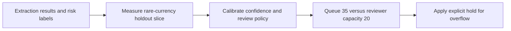

# Objective 5.5 — Design human review workflows and confidence calibration

[Test this decision with a supplied example](#benchmark-exercise-5-5) — predict first, then compare the fixed-fixture evidence.

**Picture the application:** An insurance-document service extracts identifiers, dates and amounts, but its overall accuracy hides weaker performance on amendments. The expected operating plan directs limited reviewer time toward meaningful risks while checking apparently reliable outputs too. Confidence calibration and stratified sampling are the technical methods for testing that plan against labeled evidence.


**Exam:** CCAR-F · **Domain 5:** 15% of exam; no separate objective weight is published here.  
**Time:** 30–40 minutes foundation/applied; 15–25 additional minutes production extension.  
**Prerequisites:** 4.4 validation and labeled evaluation data. New to the Claude API? Start with the [five-minute primer in Lesson 0](../L00-orientation.md#five-minute-primer-how-a-claude-app-works).  
**Continue from:** [Domain lesson](../L05-context-management-and-reliability.md) · [Objective map](../../../01-Curriculum/02-Architect-Track/CCAR-F-objectives.md).

**Official task statement:** Design human review workflows and confidence calibration


<!-- layered-episode:FV-29:start -->
<a id="learn-fv-29"></a>
### Learn the decision in context — FV-29

**Picture the job.** Overall extraction looks excellent, but rare currencies are often wrong and the human review queue is overflowing. This is an original fictional teaching scene, not a recalled live exam question. Read and trace it; no account, installation or API call is required.

**Start small.** Follow the ordinary route: a person supplies a request or record, software passes the needed evidence to the assistant, and a receiving service or person checks the result. The first demonstration assumes the input, access and evidence are suitable. Now remove that assumption in the situation above. Predict what the receiver would see before choosing a repair.

**Original exam-style practice — choose ONE.** Overall accuracy masks a weak high-risk slice and queue volume exceeds review capacity. Which policy is appropriate?

A. Accept the overall average and auto-approve overflow items.

B. Evaluate risk slices on independent holdout, calibrate thresholds and apply an explicit overflow hold or reduced-scope policy.

C. Treat the model’s confidence as an already calibrated correctness probability.

<details>
<summary>What is this asking? Plain-language help, without the answer</summary>

Identify what the application needs to trust, what has actually been observed, and what remains unknown. Compare the choices against this situation, rather than choosing the most complicated design. A proposal is an intended action; evidence is what you can point to; a contract says what the receiving part expects. Decide which option fixes the stated failure without pretending another requirement has also been solved.

</details>

**Choose before opening the walkthrough.** Say your answer and the closest alternative aloud, or record them in your own notes.

<details>
<summary>Reveal the repair, evidence and changed condition</summary>

**Answer: B.** Evaluate risk slices on independent holdout, calibrate thresholds and apply an explicit overflow hold or reduced-scope policy.

**Walk it through.** A report separates overall 0.98 from rare_currency 0.70. With 35 queued and capacity 20, 15 follow the declared hold policy rather than silent acceptance.

**Why the alternatives fail here.** Accept the overall average and auto-approve overflow items. This leaves the stated boundary or evidence requirement unsatisfied. Treat the model’s confidence as an already calibrated correctness probability. This also fails to establish the required result. The closest competing mechanism fails for this specific reason: The average can hide dangerous categories; confidence scores alone are not calibrated correctness probabilities.

**Inspect the small artifact.** This is an illustrative application-state note for reading, not an SDK signature or executable configuration. The application or workflow owner creates it; the receiver uses it to distinguish what is known from what still needs checking. Its labels describe this scene; do not paste it into Claude settings.

```text
metrics={overall:0.98,rare_currency:0.70}; capacity=20; queued=35; overflow=hold
```

**Layer added.** AI reasoning proposes, selects or summarizes where the job needs judgment. Ordinary software checks identifiers, permissions, required fields, recorded outcomes and stop conditions where applicable. A human resolves a policy or evidence gap when the story requires it. Inspect which owner actually supplies the evidence in this scene.



**Change one condition.** Keep the application in mind and consider the new situation below. Choose before opening its explanation.

**Technical transfer question — choose ONE.** A new population of credit notes invalidates the earlier confidence calibration, even though reviewer capacity is unchanged. What should happen?

A. Keep the previous thresholds because the queue capacity did not change.

B. Recalibrate using suitable representative data, then evaluate separately on a held-out sample.

<details>
<summary>Transfer check</summary>

**B.** A different population can change which confidence scores are reliable. Recheck error rates and review policy for credit notes using independent evidence. The final holdout is for evaluating the selected policy, not for repeatedly tuning it; the overflow rule still applies.

</details>

**Recall in ordinary language.** What broke? Who can fix it? What observable result proves the repair? If you cannot answer all three, replay the concrete scene rather than memorize the option letter.

</details>

**Continue from this decision:** [objective 5.5](objective-5.5.md) · [inspect its decision map](../decision-atlas.md#diagram-d12) · [targeted practice](../../../practice/index.html?exam=CCAR-F&objective=5.5). Existing mapped question IDs: `cct-fv-29-base-v1`, `cct-fv-29-retry-v1`. The new guided question above is separate from those stored items and does not change their answers or progress.
<!-- layered-episode:FV-29:end -->

## Read this objective in both vocabularies

For reading and paper reasoning, no installation or credentials are needed. Keep this page's stated concept prerequisites; any runnable challenge still needs its own setup. If an implementation example feels abrupt, first read [how to interpret its artifact type](../architecture-studio/00-foundations.md#how-to-read-technical-examples-in-this-course), then use the relevant application bridge: [AS-02 decision bridge](../architecture-studio/AS-02-document-pipeline.md#connect-the-simple-explanation-to-technical-design-choices) · [AS-08 decision bridge](../architecture-studio/AS-08-resumable-case.md#connect-the-simple-explanation-to-technical-design-choices).

Explain the business purpose first, name the precise mechanism second, and distinguish it from the nearest plausible alternative using the stated constraint. Return here for the objective-specific protocol, options and practice. The bridges are teaching aids, not additional official objectives.


## Big idea

Confidence becomes useful when measured against labeled outcomes. Segment accuracy and sample high-confidence outputs before reducing human review.

## Foundation

### 5.5-K1

**Blueprint focus:** The risk that aggregate accuracy metrics (e.g., 97% overall) may mask poor performance on specific document types or fields

A 97% overall score can hide a weak document class or field. If most records are simple invoices, they can overwhelm poor accuracy on handwritten amendments. Segment evaluation by document type and field before using aggregate performance to justify automation.

[Exam guide v1.0, section 6 task 5.5](https://anthropic-partners.skilljar.com/page/partner-certifications) (Tier 1, July 2026 blueprint).

### 5.5-K2

**Blueprint focus:** Stratified random sampling for measuring error rates in high-confidence extractions and detecting novel error patterns

Stratified random sampling selects examples from meaningful groups, including high-confidence outputs. It estimates error rates and exposes novel failure patterns that selective review of only uncertain records will miss. Keep the sampling method and sample sizes visible.

[Exam guide v1.0, section 6 task 5.5](https://anthropic-partners.skilljar.com/page/partner-certifications) (Tier 1, July 2026 blueprint).

### 5.5-K3

**Blueprint focus:** Field-level confidence scores calibrated using labeled validation sets for routing review attention

A model confidence score is an uncalibrated signal until compared with labeled examples. Field-level scores let a system distinguish a reliable identifier from an ambiguous date in the same document. Calibration links score ranges to observed correctness and review outcomes.

[Exam guide v1.0, section 6 task 5.5](https://anthropic-partners.skilljar.com/page/partner-certifications) (Tier 1, July 2026 blueprint).

### 5.5-K4

**Blueprint focus:** The importance of validating accuracy by document type and field segment before automating high-confidence extractions

Before automating high-confidence extractions, inspect performance in each important type/field segment. Low-volume but high-impact groups may need continued review even when the overall score is strong. Evaluation coverage and uncertainty matter alongside the measured point estimate.

[Exam guide v1.0, section 6 task 5.5](https://anthropic-partners.skilljar.com/page/partner-certifications) (Tier 1, July 2026 blueprint).

## Applied skills

These are design applications. Pseudocode and schemas are illustrative unless separately dry-run; a saved design is not a completed implementation.

### 5.5-S1

**Blueprint focus:** Implementing stratified random sampling of high-confidence extractions for ongoing error rate measurement and novel pattern detection

Randomly sample high-confidence results within document/field strata, then have reviewers label correctness. Track selection and inclusion rates so the sample is not merely convenient records. Use newly observed error patterns to update evaluation and review policy.

[Exam guide v1.0, section 6 task 5.5](https://anthropic-partners.skilljar.com/page/partner-certifications) (Tier 1, July 2026 blueprint).

### 5.5-S2

**Blueprint focus:** Analyzing accuracy by document type and field to verify consistent performance across all segments before reducing human review

Calculate performance separately for each important document type and field. Compare sample size and consequence of errors before reducing review. Report unsupported or poorly sampled segments as unresolved instead of borrowing accuracy from the dominant segment.

[Exam guide v1.0, section 6 task 5.5](https://anthropic-partners.skilljar.com/page/partner-certifications) (Tier 1, July 2026 blueprint).

### 5.5-S3

**Blueprint focus:** Having models output field-level confidence scores, then calibrating review thresholds using labeled validation sets

Request field-level confidence and compare it with labeled validation outcomes. Choose thresholds using observed error rates and reviewer capacity; keep a held-out set for evaluation. Revisit calibration when templates, source quality or model configuration changes.

[Exam guide v1.0, section 6 task 5.5](https://anthropic-partners.skilljar.com/page/partner-certifications) (Tier 1, July 2026 blueprint).

### 5.5-S4

**Blueprint focus:** Routing extractions with low model confidence or ambiguous/contradictory source documents to human review, prioritizing limited reviewer capacity

Route low-confidence, ambiguous and contradictory-source extractions to humans, prioritizing consequential fields. Continue random review of apparently high-confidence results. If review capacity is exceeded, expose the backlog or narrow automation rather than silently approving uncertain records.

[Exam guide v1.0, section 6 task 5.5](https://anthropic-partners.skilljar.com/page/partner-certifications) (Tier 1, July 2026 blueprint).

## Worked example

A synthetic insurance document service extracts policy ID, effective date and insured amount. Overall accuracy is 97%, but amendment dates are correct only 82% of the time. The system calibrates confidence by field on labeled examples, retains review of amendment dates and samples high-confidence results within every important document stratum. A credible alternative is reviewing everything, appropriate during launch but expensive at scale. Routing only low-confidence outputs is cheaper, yet cannot detect confident new errors or a shifted template. The decision balances capacity with field impact and keeps unsupported segments manual. Recovery increases review when a new template causes error rates to rise. No threshold is called safe merely because the model reports 0.99; labeled outcomes and sample uncertainty remain the evidence.

Original synthetic scenario; decision principles: [Exam guide v1.0, section 6 task 5.5](https://anthropic-partners.skilljar.com/page/partner-certifications) (Tier 1, July 2026 blueprint).

### Example segment check

| Synthetic segment | Correct / reviewed | Observed accuracy | Decision |
| --- | --- | --- | --- |
| Printed identifiers | 194 / 200 | 97% | Consider calibrated routing; continue sampling |
| Amendment dates | 41 / 50 | 82% | Retain review; investigate date ambiguity |

These unequal samples do not support claiming that every field is 97% accurate. Report sample sizes and uncertainty; validate thresholds on held-out labeled examples. A field score of 0.99 is only a model signal until measured against outcomes.

## Production transfer

**Manufacturing inspection; enrichment beyond the blueprint examples.** A synthetic inspection system extracts lot IDs, tolerances and measured dimensions from printed and handwritten certificates. A dominant printed-document sample can hide weak handwritten dimension accuracy. Compare field-specific review with whole-document review under limited capacity: field routing saves effort but must preserve cross-field contradictions. Recovery expands sampling when a new supplier template arrives and retains manual review of poorly measured segments. Extension: one high-confidence dimension error causes an out-of-tolerance item to appear valid; explain how ongoing stratified review discovers and contains that pattern.

In your own notes, save your decision, rejected alternative, evidence and recovery path. Re-run the decision with the changed constraint before calling the pattern transferable. This is a design exercise, not industry compliance advice.

## Traps and counterexamples

Do not assume a confidence score is a probability. Do not validate only records the model already considers uncertain. A pooled accuracy percentage cannot establish safety for a sparsely measured, high-impact field.

## Supplied calibration and stratified-review fixture

Each row is a synthetic validation stratum; confidence bins are model signals. Reviewed labels are independently supplied, and calibration data is separate from the holdout set.

| Type / field | Model confidence bin | Reviewed | Correct | High-confidence population |
| --- | --- | --- | --- | --- |
| Printed / policy ID | 0.90–1.00 | 100 | 99 | 1,000 |
| Printed / effective date | 0.90–1.00 | 50 | 49 | 500 |
| Amendment / effective date | 0.90–1.00 | 20 | 14 | 100 |
| Amendment / effective date | 0.60–0.89 | 20 | 12 | not high-confidence |
| Handwritten / amount | 0.90–1.00 | 20 | 15 | 80 |

### Worked bin and segment calculations

Observed correctness is correct/reviewed: printed IDs 99/100=99%; printed dates 49/50=98%; high-confidence amendment dates 14/20=70%; lower-confidence amendment dates 12/20=60%; high-confidence handwritten amounts 15/20=75%. Pooled correctness is 189/210=90%, but pooling hides the two confidently wrong segments. A score above 0.90 did not make amendment dates or handwritten amounts reliable.

For this **synthetic** workflow, suppose the business proposes a provisional 98% observed correctness criterion for a low-impact automation pilot. A global confidence threshold of 0.90 fails: the high bin contains 70% and 75% segments. Printed IDs and printed dates meet that point-estimate criterion on calibration data, but must still pass a separate held-out evaluation and sample-uncertainty review. Keep amendments and handwritten amounts under human review. Do not call the threshold safe from these small samples or extrapolate it to other fields.

### Random selection within strata

List all IDs in each high-confidence type/field stratum, use a recorded random seed to sample without replacement, and retain selected IDs and inclusion probabilities. Example audit sizes: 20/1,000 printed IDs (2% inclusion), 20/500 printed dates (4%), 20/100 amendment dates (20%) and 20/80 handwritten amounts (25%). Oversampling weak small strata helps detect patterns, but a naïvely averaged audit rate is not a population rate. For a population estimate, weight stratum error rates by population sizes or use inclusion-probability weighting. Avoid selecting the first 20 convenient records.

### Holdout and capacity exercise

Held-out labels: printed IDs 97/100 correct; printed dates 47/50; amendment dates 13/20; handwritten amounts 14/20. Calculate 97%, 94%, 65% and 70%: the proposed 98% pilot bar is not met even for the printed segments. Retain review and investigate error patterns; do not tune on the holdout and then reuse it as independent proof.

If 30 mandatory/ambiguous records and 20 scheduled audit records need review but capacity is 35, preserve all 30 mandatory records, review five audit records now and explicitly carry 15 audits into the next window, or restrict intake/automation scope to restore the audit plan. Preserve the preselected audit IDs and random sampling design when deferring work; do not replace them with easier records. Do not silently auto-approve ambiguous records or claim a completed sample. Keep field impact and contradictions visible when prioritizing.

**Your outputs:** five calibration calculations, four holdout calculations, provisional routing rule with its limits, random sampling design and capacity backlog decision. Explain why high-confidence sampling remains necessary after deployment and when drift requires recalibration.

[Guide section 6 task 5.5](https://anthropic-partners.skilljar.com/page/partner-certifications) (Tier 1). Counts, thresholds and capacity are original synthetic teaching inputs, not Anthropic performance claims.

<a id="decision-variants"></a>
<a id="variant-fv-29"></a>
## Decision variant FV-29 — Test risk slices and review capacity

This is original fictional practice, not an official exam question. All policies, amounts and records below are synthetic.

**Choose in the base case.** A finance extractor has high overall accuracy but weaker rare-currency performance. Evaluate severity-weighted slices on independent holdout and calibrate review thresholds with actual human capacity.

**Change one constraint.** A review queue exceeds available capacity. Apply a declared overflow policy or reduce scope; do not silently accept low-confidence items.

**What failed, and who recovers?** Distribution drift breaks calibration. Recalibrate on suitable data and evaluate on a separate holdout; do not tune against the final test set.

**Inspect the artifact — illustrative contract, not a drop-in SDK implementation:**

```text
metrics={overall:0.98,rare_currency:0.70}; capacity=20; queued=35; overflow=hold
```

**Why not the nearest alternative?** The average can hide dangerous categories; confidence scores alone are not calibrated correctness probabilities.

**Memory cue with its condition:** Average, slice, severity, capacity: check all four.

**Proof before accepting success:** Produce a trace or artifact showing the decisive constraint, the selected mechanism, rejected alternative and observable result. Preserve unresolved status; a plausible explanation alone is not completion.

[Inspect D12 and its equivalent decision procedure](../decision-atlas.md#diagram-d12) · [See this decision at walkthrough step 8](../scenario-walkthroughs/WT-06-structured-data-extraction.md#variant-fv-29) · [Return to the objective map](README.md).

**Blind transfer:** Before opening practice, explain which single change in the scene would reverse your choice and which would only require revalidation. Write the failure signal and the next safe action. The practice app provides separately authored base and later-retry items, with a free-response transfer rubric; assistance/exposure must remain visible in learning history.

**Current mechanism reference:** https://platform.claude.com/docs/en/test-and-evaluate/develop-tests (reviewed 2026-10-14). The saved blueprint remains the exam coverage source; application policy in this packet is invented teaching context.


## Try it

Use the supplied fixture above for the required skill outputs first. The following design activity is an extension, not a substitute for those concrete checks.

Design a validation table with two document types and three fields. Show how a strong aggregate hides one weak segment. Propose field-level threshold calibration, a high-confidence sampling plan and a review queue when capacity is limited.

Attempt your design before reading the self-check. Save the artifact and the decision rationale so an independent reviewer can inspect them.

### Expected output and self-check

The weak segment remains visible and reviewed. Thresholds follow labeled outcomes rather than arbitrary confidence numbers. Sampling includes high-confidence records across strata and records sample sizes. Ambiguous or contradictory evidence goes to review; capacity constraints produce an explicit backlog or reduced automation scope.

## Done when

- [ ] **5.5-S1:** Specify random sampling without replacement inside four high-confidence strata; record selected IDs, seed and inclusion rates, not convenient first records.
- [ ] **5.5-S2:** Compute document/field accuracies with sample sizes; identify 70%/75% high-confidence segments and reject pooled accuracy as automation proof.
- [ ] **5.5-S3:** Compute calibration and separate holdout results; justify provisional field thresholds and retain review when holdout fails.
- [ ] **5.5-S4:** Route ambiguous/contradictory and weak segments to review; show the 35-capacity decision with an explicit 15-audit backlog or reduced intake.

In your own notes, save each stated artifact and check against the supplied expected outputs. Written design evidence and actual implementation evidence remain separate; learner mastery is not inferred from reading.

## Coverage checklist

| Official bullet, in guide order | Exact teaching section |
| --- | --- |
| 5.5-K1: The risk that aggregate accuracy metrics (e.g., 97% overall) may mask poor performance on specific document types or fields | [5.5-K1](#55-k1) |
| 5.5-K2: Stratified random sampling for measuring error rates in high-confidence extractions and detecting novel error patterns | [5.5-K2](#55-k2) |
| 5.5-K3: Field-level confidence scores calibrated using labeled validation sets for routing review attention | [5.5-K3](#55-k3) |
| 5.5-K4: The importance of validating accuracy by document type and field segment before automating high-confidence extractions | [5.5-K4](#55-k4) |
| 5.5-S1: Implementing stratified random sampling of high-confidence extractions for ongoing error rate measurement and novel pattern detection | [5.5-S1](#55-s1) |
| 5.5-S2: Analyzing accuracy by document type and field to verify consistent performance across all segments before reducing human review | [5.5-S2](#55-s2) |
| 5.5-S3: Having models output field-level confidence scores, then calibrating review thresholds using labeled validation sets | [5.5-S3](#55-s3) |
| 5.5-S4: Routing extractions with low model confidence or ambiguous/contradictory source documents to human review, prioritizing limited reviewer capacity | [5.5-S4](#55-s4) |

## Sources and freshness

[Exam guide v1.0, section 6 task 5.5](https://anthropic-partners.skilljar.com/page/partner-certifications) (Tier 1, July 2026 blueprint).

The official objective wording is reproduced for traceability; explanations and all scenarios are project-authored. Existing L03–L05 provide domain synthesis; this module expands each bullet into a teachable decision. The saved July guide is the blueprint baseline, not a claim that no newer guide exists.

**Go deeper:** [Deep practice 4, section 5.5](../deep-practice/04-prompt-engineering-and-structured-output.md#55-human-review-and-confidence-calibration)


<a id="benchmark-exercise-5-5"></a>
## Worked evidence task — 5.5: test the boundary

**Original technical decision.** Typed and handwritten fields show different training and holdout accuracy under limited review capacity. Which validation policy avoids an aggregate-only confidence claim?

**In everyday terms:** A strong large group can hide a weak small one.

**Before you start:** No account, API key or package installation is needed for the paper task. Optional replay needs Python 3 and the two provided lab files in the same directory. This local inspector models the stated fixture; it does not call Claude, load Claude Code rules or run an MCP server.

### Inspect the supplied input

All identifiers and business rules here are fictional application data. This is **not an SDK request schema**. Keep the input separate from your proposed decision.

```json
{
  "training_bins": [
    {
      "segment": "typed_amount",
      "correct": 98,
      "n": 100
    },
    {
      "segment": "handwritten_amount",
      "correct": 6,
      "n": 10
    }
  ],
  "separate_holdout": [
    {
      "segment": "typed_amount",
      "correct": 19,
      "n": 20
    },
    {
      "segment": "handwritten_amount",
      "correct": 2,
      "n": 5
    }
  ],
  "review_capacity": 8,
  "operation": "calculate per-segment accuracy; propose a policy; do not fit and assess on the same sample"
}
```

### Break, choose, repair, prove

1. **Break:** Give a high aggregate score with a weak document/field segment and finite reviewer capacity. Name the exact failed assumption before proposing another component.
2. **Choose:** Calculate each segment separately, evaluate on held-out records and allocate review without reusing tuning evidence as validation. Write the nearest alternative you would reject and the requirement it fails.
3. **Repair:** Write the corrected contract or recovery step, keeping successful evidence and unknowns separate.
4. **Prove:** Calculate segment performance, validate holdout thresholds and sample high-confidence records. Record `decision`, `reason`, `rejected_alternative`, `evidence` and `remaining_unknowns`.

[Open this actual task in the existing LAB](../../../06-Labs/08-CCAR-F-architecture-decisions/README.md#benchmark-exercise-5-5) · [Return to the teaching subsection](#worked-example)

<details><summary>Compare the offline evidence — after making your decision</summary>

The local inspector presents **controlled-fixture calculations and authored reference decisions** below. Some fields are calculated (such as counts or arithmetic); policy labels and recovery choices are supplied worked answers for this fixed example, not executed policies or a general-purpose validator. No Claude, rule loader, service or reviewer was run. `false` or `null` observations remain unresolved when no corresponding live test was performed.

```json
{
  "training": {
    "typed_amount": 0.98,
    "handwritten_amount": 0.6
  },
  "holdout": {
    "typed_amount": 0.95,
    "handwritten_amount": 0.4
  },
  "review_capacity": 8,
  "threshold_proven": false,
  "review_policy": "validate per segment on separate holdout; retain sampling"
}
```

**Why this matters:** A strong large group can hide a weak small one. The output is a self-check for this controlled example, not certification-score evidence. To test the real mechanism, perform the existing LAB’s integration steps in a fresh disposable context and keep its actual trace beside this prediction.

**Primary-source leads for mechanism review:** [Anthropic Structured Data Extraction Guide](https://code.claude.com/docs/en/agent-sdk/structured-outputs) · [Anthropic Human-in-the-Loop Patterns](https://code.claude.com/docs/en/agent-sdk/user-input). The external benchmark helped identify the exercise gap; this task and its data were authored here. Current implementation details must be verified against the installed runtime and those primary sources.

</details>