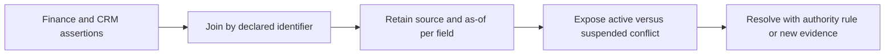

# Objective 5.6 — Preserve information provenance and handle uncertainty in multi-source synthesis

[Test this decision with a supplied example](#benchmark-exercise-5-6) — predict first, then compare the fixed-fixture evidence.

**Picture the application:** An energy report combines two credible capacity estimates collected at different times and using different definitions. Its reader needs an inspectable comparison, not a number that silently merges unlike measurements. Claim-source mappings and provenance are the technical mechanisms for retaining dates, scope and disagreement throughout the final synthesis.


**Exam:** CCAR-F · **Domain 5:** 15% of exam; no separate objective weight is published here.  
**Time:** 30–40 minutes foundation/applied; 15–25 additional minutes production extension.  
**Prerequisites:** 1.3 structured context and 5.1 facts preservation. New to the Claude API? Start with the [five-minute primer in Lesson 0](../L00-orientation.md#five-minute-primer-how-a-claude-app-works).  
**Continue from:** [Domain lesson](../L05-context-management-and-reliability.md) · [Objective map](../../../01-Curriculum/02-Architect-Track/CCAR-F-objectives.md).

**Official task statement:** Preserve information provenance and handle uncertainty in multi-source synthesis


<!-- layered-episode:FV-30:start -->
<a id="learn-fv-30"></a>
### Learn the decision in context — FV-30

**Picture the job.** A customer table combines finance and CRM records taken on different dates. The two sources disagree about status. This is an original fictional teaching scene, not a recalled live exam question. Read and trace it; no account, installation or API call is required.

**Start small.** Follow the ordinary route: a person supplies a request or record, software passes the needed evidence to the assistant, and a receiving service or person checks the result. The first demonstration assumes the input, access and evidence are suitable. Now remove that assumption in the situation above. Predict what the receiver would see before choosing a repair.

**Original exam-style practice — choose ONE.** A federated join contains conflicting status assertions with different timestamps. Which synthesis preserves provenance?

A. Keep whichever status makes the joined row look consistent.

B. Assume retrieval federation establishes factual truth.

C. Retain origin, as-of time and join rule for each assertion; resolve by current authoritative evidence or expose the unresolved conflict.

<details>
<summary>What is this asking? Plain-language help, without the answer</summary>

Identify what the application needs to trust, what has actually been observed, and what remains unknown. Compare the choices against this situation, rather than choosing the most complicated design. A proposal is an intended action; evidence is what you can point to; a contract says what the receiving part expects. Decide which option fixes the stated failure without pretending another requirement has also been solved.

</details>

**Choose before opening the walkthrough.** Say your answer and the closest alternative aloud, or record them in your own notes.

<details>
<summary>Reveal the repair, evidence and changed condition</summary>

**Answer: C.** Retain origin, as-of time and join rule for each assertion; resolve by current authoritative evidence or expose the unresolved conflict.

**Walk it through.** The output retains CRM active at d2 and finance suspended at d1, with source identifiers. No single current status is asserted without a governing rule or new evidence.

**Why the alternatives fail here.** Keep whichever status makes the joined row look consistent. This leaves the stated boundary or evidence requirement unsatisfied. Assume retrieval federation establishes factual truth. This also fails to establish the required result. The closest competing mechanism fails for this specific reason: A joined table can erase provenance and make mismatched-age sources look consistent. Federation does not establish truth by itself.

**Inspect the small artifact.** This is an illustrative application-state note for reading, not an SDK signature or executable configuration. The application or workflow owner creates it; the receiver uses it to distinguish what is known from what still needs checking. Its labels describe this scene; do not paste it into Claude settings.

```text
row={customer_id:C7,revenue:{value:120,source:FIN9,as_of:d1},status:{value:active,source:CRM4,as_of:d2}}
```

**Layer added.** AI reasoning proposes, selects or summarizes where the job needs judgment. Ordinary software checks identifiers, permissions, required fields, recorded outcomes and stop conditions where applicable. A human resolves a policy or evidence gap when the story requires it. Inspect which owner actually supplies the evidence in this scene.



**Change one condition.** Keep the application in mind and consider the new situation below. Choose before opening its explanation.

**Technical transfer question — choose ONE.** The host now supports a federated retrieval interface. Which checks remain necessary?

A. None, because federation establishes factual truth.

B. Field origin, as-of time, join rule and conflict handling.

<details>
<summary>Transfer check</summary>

**B.** The host offers supported federation. It may simplify retrieval, but still retain origin, time and conflict checks. Name the changed fact before naming a tool. Preserve unrelated access, source-validation and result checks.

</details>

**Recall in ordinary language.** What broke? Who can fix it? What observable result proves the repair? If you cannot answer all three, replay the concrete scene rather than memorize the option letter.

</details>

**Continue from this decision:** [objective 5.6](objective-5.6.md) · [inspect its decision map](../decision-atlas.md#diagram-d05) · [targeted practice](../../../practice/index.html?exam=CCAR-F&objective=5.6). Existing mapped question IDs: `cct-fv-30-base-v1`, `cct-fv-30-retry-v1`. The new guided question above is separate from those stored items and does not change their answers or progress.
<!-- layered-episode:FV-30:end -->

## Read this objective in both vocabularies

For reading and paper reasoning, no installation or credentials are needed. Keep this page's stated concept prerequisites; any runnable challenge still needs its own setup. If an implementation example feels abrupt, first read [how to interpret its artifact type](../architecture-studio/00-foundations.md#how-to-read-technical-examples-in-this-course), then use the relevant application bridge: [AS-03 decision bridge](../architecture-studio/AS-03-grounded-assistant.md#connect-the-simple-explanation-to-technical-design-choices) · [AS-04 decision bridge](../architecture-studio/AS-04-research-system.md#connect-the-simple-explanation-to-technical-design-choices) · [AS-08 decision bridge](../architecture-studio/AS-08-resumable-case.md#connect-the-simple-explanation-to-technical-design-choices).

Explain the business purpose first, name the precise mechanism second, and distinguish it from the nearest plausible alternative using the stated constraint. Return here for the objective-specific protocol, options and practice. The bridges are teaching aids, not additional official objectives.


## Big idea

A synthesis must preserve the relationship between each claim and its evidence. Conflicting sources and different observation dates are information to explain, not noise to erase.

## Foundation

### 5.6-K1

**Blueprint focus:** How source attribution is lost during summarization steps when findings are compressed without preserving claim-source mappings

Compression can retain a number while dropping who reported it, the population measured or the date. The final report then cannot distinguish independent corroboration from several summaries of the same source. Preserve claim-source relationships before every summarization boundary.

[Exam guide v1.0, section 6 task 5.6](https://anthropic-partners.skilljar.com/page/partner-certifications) (Tier 1, July 2026 blueprint).

### 5.6-K2

**Blueprint focus:** The importance of structured claim-source mappings that the synthesis agent must preserve and merge when combining findings

Structured mappings attach claim ID, source URL or document, excerpt, location, dates and method. Merge by meaning carefully while retaining separate source records. Similar wording does not establish identical populations or measurements, and multiple citations do not automatically establish independent evidence.

[Exam guide v1.0, section 6 task 5.6](https://anthropic-partners.skilljar.com/page/partner-certifications) (Tier 1, July 2026 blueprint).

### 5.6-K3

**Blueprint focus:** How to handle conflicting statistics from credible sources: annotating conflicts with source attribution rather than arbitrarily selecting one value

Credible sources can disagree. Keep both values and their characterization, then investigate definitions, sampling methods and dates. Arbitrarily choosing the newest or largest value manufactures certainty. A reconciled conclusion should explain why values differ and what evidence supports the reconciliation.

[Exam guide v1.0, section 6 task 5.6](https://anthropic-partners.skilljar.com/page/partner-certifications) (Tier 1, July 2026 blueprint).

### 5.6-K4

**Blueprint focus:** Temporal data: requiring publication/collection dates in structured outputs to prevent temporal differences from being misinterpreted as contradictions

Publication date and collection date answer different questions. A report published this year may describe data collected several years earlier. Distinct observation periods can explain an apparent contradiction, so preserve both dates and indicate when either is unknown.

[Exam guide v1.0, section 6 task 5.6](https://anthropic-partners.skilljar.com/page/partner-certifications) (Tier 1, July 2026 blueprint).

## Applied skills

These are design applications. Pseudocode and schemas are illustrative unless separately dry-run; a saved design is not a completed implementation.

### 5.6-S1

**Blueprint focus:** Requiring subagents to output structured claim-source mappings (source URLs, document names, relevant excerpts) that downstream agents preserve through synthesis

Require subagents to output claim-source records with source names, URLs, excerpts and relevant locations. Keep the mapping through synthesis and verify final claims against it. A citation list detached from individual claims is insufficient for precise review.

[Exam guide v1.0, section 6 task 5.6](https://anthropic-partners.skilljar.com/page/partner-certifications) (Tier 1, July 2026 blueprint).

### 5.6-S2

**Blueprint focus:** Structuring reports with explicit sections distinguishing well-established findings from contested ones, preserving original source characterizations and methodological context

Separate well-established findings from contested findings and unavailable evidence. Preserve qualifiers such as estimated, surveyed or unaudited with methodological context. A claim cannot become stronger simply because a later summary uses more confident prose.

[Exam guide v1.0, section 6 task 5.6](https://anthropic-partners.skilljar.com/page/partner-certifications) (Tier 1, July 2026 blueprint).

### 5.6-S3

**Blueprint focus:** Completing document analysis with conflicting values included and explicitly annotated, letting the coordinator decide how to reconcile before passing to synthesis

Complete source analysis with conflicting values intact and annotated. Hand the coordinator both claims, definitions, methods and dates for reconciliation before synthesis. If reconciliation fails, state the conflict rather than silently selecting a convenient statistic.

[Exam guide v1.0, section 6 task 5.6](https://anthropic-partners.skilljar.com/page/partner-certifications) (Tier 1, July 2026 blueprint).

### 5.6-S4

**Blueprint focus:** Requiring subagents to include publication or data collection dates in structured outputs to enable correct temporal interpretation

Include publication and collection dates in every source record where available. Explain missing dates and avoid treating publication time as observation time. Compare like periods before concluding that two sources contradict each other.

[Exam guide v1.0, section 6 task 5.6](https://anthropic-partners.skilljar.com/page/partner-certifications) (Tier 1, July 2026 blueprint).

### 5.6-S5

**Blueprint focus:** Rendering different content types appropriately in synthesis outputs—financial data as tables, news as prose, technical findings as structured lists—rather than converting everything to a uniform format

Use tables for comparable financial values, prose for a news narrative and structured lists for technical findings. Preserve meaning while changing presentation. A uniform paragraph format can obscure comparability, uncertainty or actionability across heterogeneous evidence.

[Exam guide v1.0, section 6 task 5.6](https://anthropic-partners.skilljar.com/page/partner-certifications) (Tier 1, July 2026 blueprint).

## Worked example

A synthetic energy market report combines a regulator's capacity estimate of 420 units collected in March and an operator's 455-unit figure collected in September. Both sources are credible, but one measures licensed capacity while the other includes provisional facilities. Subagents return claim IDs, source excerpts, definitions and both publication/collection dates. The coordinator keeps the values separate and explains the period and scope difference instead of averaging them. Financial values appear in a table; recent policy events remain prose; technical measurement limitations become a list. A credible alternative is selecting one source for a narrowly defined regulator-only question, provided the scope and exclusion are explicit. For a broad synthesis, that would hide relevant evidence. Recovery marks unresolved definitions as contested and requests clarification rather than inventing a common denominator. The design costs a provenance ledger and yields inspectable conclusions.

Original synthetic scenario; decision principles: [Exam guide v1.0, section 6 task 5.6](https://anthropic-partners.skilljar.com/page/partner-certifications) (Tier 1, July 2026 blueprint).

### Illustrative claim-source mapping

```json
{
  "claim_id": "capacity-regulator-march",
  "value": 420,
  "unit": "licensed capacity units",
  "source_document": "synthetic regulator report",
  "source_location": "table 2",
  "source_url": "record-real-source-url-here",
  "excerpt": "synthetic excerpt retained for audit",
  "published_at": "2026-04-15",
  "collected_at": "2026-03-31",
  "method": "licensed facilities only",
  "characterization": "estimate",
  "conflicts_with": ["operator-september-provisional"]
}
```

The coordinator compares definitions and dates before merging records. The final report preserves the estimated qualifier and source mapping; a synthetic placeholder URL is not a usable citation. Add the real link when working with an actual public source.

## Production transfer

**Public policy research; enrichment beyond the blueprint examples.** A synthetic urban mobility study combines ticketing revenue, policy announcements and technical sensor performance. Financial comparisons need aligned periods and units; news needs publication chronology; technical claims need measurement conditions. Compare a uniform prose summary with type-specific exhibits: the latter makes disagreement and comparability easier to inspect. Recovery retains contested values and requests missing collection dates. Extension: two reports quote the same underlying study; show why the synthesis should not count them as two independent measurements, while preserving both publication references.

In your own notes, save your decision, rejected alternative, evidence and recovery path. Re-run the decision with the changed constraint before calling the pattern transferable. This is a design exercise, not industry compliance advice.

## Traps and counterexamples

A newer publication may contain older data. Several summaries of one report are not independent corroboration. Do not drop a source's estimated qualifier or turn a genuine conflict into a falsely precise average.

## Supplied multi-source evidence and worked synthesis

All records are synthetic public-research fixtures, with no customer facts.

| Source ID | Evidence and locator | Published / collected | Population and qualifier |
| --- | --- | --- | --- |
| REG-MAR | 420 licensed capacity units; report p4 table2 | Apr 15, 2026 / Mar 31, 2026 | Licensed facilities only; estimate |
| OPS-SEP | 455 operating/provisional units; briefing p2 paragraph3 | Oct 1, 2026 / Sep 15, 2026 | Includes provisional facilities; unaudited count |
| TECH-1 | Sensor detection 91% in dry conditions; appendix p9 | Sep 20, 2026 / Aug 2026 | Synthetic test set; wet-weather performance not measured |
| NEWS-1 | Authority announced a provisional-facility review on Sep 30; notice paragraph1 | Sep 30, 2026 / event Sep 30, 2026 | Announcement, not a completed review |

### Expected attributable packet

```text
C1: value420;unit licensed capacity;source REG-MAR;locator p4 table2;
  publication 2026-04-15;collection 2026-03-31;qualifier estimate;
  method licensed-facility scope;excerpt "420 licensed capacity units"
C2: value455;unit operating/provisional;source OPS-SEP;locator p2 paragraph3;
  publication 2026-10-01;collection 2026-09-15;qualifier unaudited;
  method includes provisional;excerpt "455 operating/provisional units"
C3: detection91%;source TECH-1;appendix p9;dry-only synthetic test;
  publication2026-09-20;collection2026-08;wet-weather unknown
C4: review announced;source NEWS-1;paragraph1;event/publication2026-09-30;
  completion not asserted
```

Before synthesis, the coordinator records that C1 and C2 use different populations and times. Their difference is 35 units, but it **cannot be called growth of 35** without an aligned denominator. The appendix fixture does not provide real URLs; an actual report must resolve public source links before treating them as citations.

### Established versus contested output

**Established:** the two reports publish differently scoped figures with the stated qualifiers; the authority announced a review; the dry-condition test reports 91% detection. These are established statements about the supplied records, not independently validated real-world measurements.

**Contested/unresolved:** a comparable total for one common date/population cannot be determined; wet-weather performance is unknown; review completion is not evidenced. Do not average 420 and 455 or silently prefer the newer report.

**Financial-format transfer:** supplied budget records add REG-MAR estimate 12.0 million USD for March scope and OPS-SEP unaudited 13.4 million USD for September scope. Render:

| Claim | Amount / currency | Collection | Scope / confidence character | Source |
| --- | --- | --- | --- | --- |
| Licensed-facility budget estimate | 12.0 million USD | Mar 31 | Licensed only; estimated | REG-MAR p4 table2 budget row |
| Operating/provisional budget count | 13.4 million USD | Sep 15 | Includes provisional; unaudited | OPS-SEP p2 paragraph3 budget sentence |

**News prose:** “On September 30 the authority announced a provisional-facility review (NEWS-1, paragraph1). The notice does not establish that the review was completed.”

**Technical list:**

- Dry-condition detection: 91%, TECH-1 appendix p9, collected August 2026.
- Wet-weather detection: not measured in the supplied test; no performance claim can be made.

**Your outputs:** all four source mappings, the coordinator reconciliation note, established/contested sections and the actual table/prose/list. Check that source qualifiers and both dates survive every transformation. Add original source URLs only when real sources are supplied; never invent a link to fill a required field.

[Guide section 6 task 5.6](https://anthropic-partners.skilljar.com/page/partner-certifications) (Tier 1).

<a id="decision-variants"></a>
<a id="variant-fv-30"></a>
## Decision variant FV-30 — Keep sources through a join

This is original fictional practice, not an official exam question. All policies, amounts and records below are synthetic.

**Choose in the base case.** Separate finance and CRM interfaces return revenue and customer records with timestamps and field-level provenance. Join only under a declared identifier rule.

**Change one constraint.** The host offers supported federation. It may simplify retrieval, but still retain origin, time and conflict checks.

**What failed, and who recovers?** CRM says customer active while finance reports suspended at a different date. Preserve both assertions and their scope; ask for policy or current authoritative evidence.

**Inspect the artifact — illustrative contract, not a drop-in SDK implementation:**

```text
row={customer_id:C7,revenue:{value:120,source:FIN9,as_of:d1},status:{value:active,source:CRM4,as_of:d2}}
```

**Why not the nearest alternative?** A joined table can erase provenance and make mismatched-age sources look consistent. Federation does not establish truth by itself.

**Memory cue with its condition:** Join identifiers; retain origins; expose disagreement.

**Proof before accepting success:** Produce a trace or artifact showing the decisive constraint, the selected mechanism, rejected alternative and observable result. Preserve unresolved status; a plausible explanation alone is not completion.

[Inspect D05 and its equivalent decision procedure](../decision-atlas.md#diagram-d05) · [See this decision at walkthrough step 6](../scenario-walkthroughs/WT-03-multi-agent-research.md#variant-fv-30) · [Return to the objective map](README.md).

**Blind transfer:** Before opening practice, explain which single change in the scene would reverse your choice and which would only require revalidation. Write the failure signal and the next safe action. The practice app provides separately authored base and later-retry items, with a free-response transfer rubric; assistance/exposure must remain visible in learning history.

**Current runtime reference:** [https://code.claude.com/docs/en/mcp](https://code.claude.com/docs/en/mcp) (reviewed 2026-10-14). The saved blueprint remains the exam coverage source; application policy in this packet is invented teaching context.


## Try it

Use the supplied fixture above for the required skill outputs first. The following design activity is an extension, not a substitute for those concrete checks.

Build claim-source records for two conflicting statistics with different dates and populations, plus one technical finding. Write established and contested sections, choose suitable presentation formats and explain what the coordinator must decide before synthesis.

Attempt your design before reading the self-check. Save the artifact and the decision rationale so an independent reviewer can inspect them.

### Expected output and self-check

Each claim retains source, location, excerpt, qualifiers, publication date and collection date. The report distinguishes an explained scope difference from an unresolved conflict. Financial comparisons use a table and technical limitations a list. No averaging, arbitrary selection or unsupported certainty occurs. The coordinator's reconciliation rationale stays linked to the original evidence.

## Done when

- [ ] **5.6-S1:** Produce all supplied claim-source mappings with locator/excerpt and missing-real-URL state; preserve mappings through synthesis.
- [ ] **5.6-S2:** Write established and contested sections retaining estimated/unaudited qualifiers, source scope and technical uncertainty.
- [ ] **5.6-S3:** Pass both 420 and 455 records to the coordinator; explain why 35 cannot be asserted as comparable growth or averaged away.
- [ ] **5.6-S4:** Retain publication and collection/event dates separately; do not substitute the newer publication for the observation period.
- [ ] **5.6-S5:** Render the supplied actual financial table, news paragraph and technical list with source labels and unresolved evidence visible.

In your own notes, save each stated artifact and check against the supplied expected outputs. Written design evidence and actual implementation evidence remain separate; learner mastery is not inferred from reading.

## Coverage checklist

| Official bullet, in guide order | Exact teaching section |
| --- | --- |
| 5.6-K1: How source attribution is lost during summarization steps when findings are compressed without preserving claim-source mappings | [5.6-K1](#56-k1) |
| 5.6-K2: The importance of structured claim-source mappings that the synthesis agent must preserve and merge when combining findings | [5.6-K2](#56-k2) |
| 5.6-K3: How to handle conflicting statistics from credible sources: annotating conflicts with source attribution rather than arbitrarily selecting one value | [5.6-K3](#56-k3) |
| 5.6-K4: Temporal data: requiring publication/collection dates in structured outputs to prevent temporal differences from being misinterpreted as contradictions | [5.6-K4](#56-k4) |
| 5.6-S1: Requiring subagents to output structured claim-source mappings (source URLs, document names, relevant excerpts) that downstream agents preserve through synthesis | [5.6-S1](#56-s1) |
| 5.6-S2: Structuring reports with explicit sections distinguishing well-established findings from contested ones, preserving original source characterizations and methodological context | [5.6-S2](#56-s2) |
| 5.6-S3: Completing document analysis with conflicting values included and explicitly annotated, letting the coordinator decide how to reconcile before passing to synthesis | [5.6-S3](#56-s3) |
| 5.6-S4: Requiring subagents to include publication or data collection dates in structured outputs to enable correct temporal interpretation | [5.6-S4](#56-s4) |
| 5.6-S5: Rendering different content types appropriately in synthesis outputs—financial data as tables, news as prose, technical findings as structured lists—rather than converting everything to a uniform format | [5.6-S5](#56-s5) |

## Sources and freshness

[Exam guide v1.0, section 6 task 5.6](https://anthropic-partners.skilljar.com/page/partner-certifications) (Tier 1, July 2026 blueprint).

The official objective wording is reproduced for traceability; explanations and all scenarios are project-authored. Existing L03–L05 provide domain synthesis; this module expands each bullet into a teachable decision. The saved July guide is the blueprint baseline, not a claim that no newer guide exists.

**Go deeper:** [Deep practice 5, section 5.6](../deep-practice/05-context-management-and-reliability.md#56-provenance-and-uncertainty-in-multi-source-synthesis)


<a id="benchmark-exercise-5-6"></a>
## Worked evidence task — 5.6: test the boundary

**Original technical decision.** A September all-account value is compared with an October premium-account value. Which synthesis preserves comparability and source attribution?

**In everyday terms:** The newer number describes a different group, so it cannot prove the whole population changed.

**Before you start:** No account, API key or package installation is needed for the paper task. Optional replay needs Python 3 and the two provided lab files in the same directory. This local inspector models the stated fixture; it does not call Claude, load Claude Code rules or run an MCP server.

### Inspect the supplied input

All identifiers and business rules here are fictional application data. This is **not an SDK request schema**. Keep the input separate from your proposed decision.

```json
{
  "sources": [
    {
      "id": "S1",
      "date": "2026-09-01",
      "population": "all accounts",
      "value": 20
    },
    {
      "id": "S2",
      "date": "2026-10-01",
      "population": "premium accounts",
      "value": 30
    }
  ],
  "claim": "value increased from 20 to 30 across all accounts"
}
```

### Break, choose, repair, prove

1. **Break:** Merge sources with different dates, populations and contradictory claims. Name the exact failed assumption before proposing another component.
2. **Choose:** Keep populations and dates attached to each value; decline the unsupported all-account trend claim. Write the nearest alternative you would reject and the requirement it fails.
3. **Repair:** Write the corrected contract or recovery step, keeping successful evidence and unknowns separate.
4. **Prove:** Keep attributable support and conflict distinct; do not choose solely by recency or average incompatible values. Record `decision`, `reason`, `rejected_alternative`, `evidence` and `remaining_unknowns`.

[Open this actual task in the existing LAB](../../../06-Labs/08-CCAR-F-architecture-decisions/README.md#benchmark-exercise-5-6) · [Return to the teaching subsection](#worked-example)

<details><summary>Compare the offline evidence — after making your decision</summary>

The local inspector presents **controlled-fixture calculations and authored reference decisions** below. Some fields are calculated (such as counts or arithmetic); policy labels and recovery choices are supplied worked answers for this fixed example, not executed policies or a general-purpose validator. No Claude, rule loader, service or reviewer was run. `false` or `null` observations remain unresolved when no corresponding live test was performed.

```json
{
  "comparable_population": false,
  "sources": [
    {
      "id": "S1",
      "date": "2026-09-01",
      "population": "all accounts",
      "value": 20
    },
    {
      "id": "S2",
      "date": "2026-10-01",
      "population": "premium accounts",
      "value": 30
    }
  ],
  "all_account_trend_supported": false,
  "average_incompatible_values": false
}
```

**Why this matters:** The newer number describes a different group, so it cannot prove the whole population changed. The output is a self-check for this controlled example, not certification-score evidence. To test the real mechanism, perform the existing LAB’s integration steps in a fresh disposable context and keep its actual trace beside this prediction.

**Primary-source leads for mechanism review:** [Anthropic Prompt Engineering — Citation and Attribution](https://platform.claude.com/docs/en/build-with-claude/citations). The external benchmark helped identify the exercise gap; this task and its data were authored here. Current implementation details must be verified against the installed runtime and those primary sources.

</details>