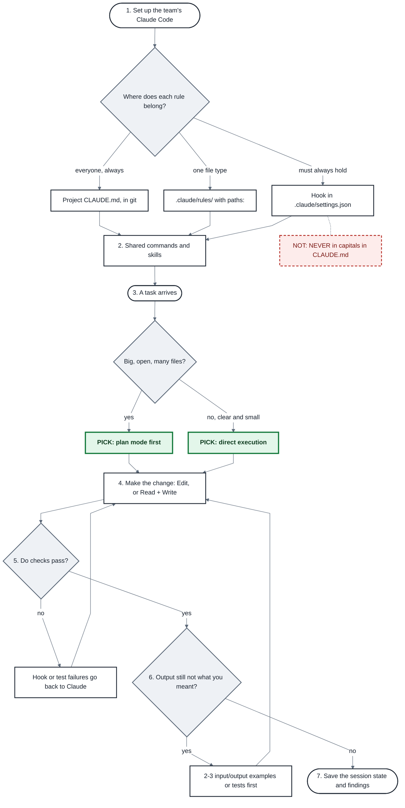
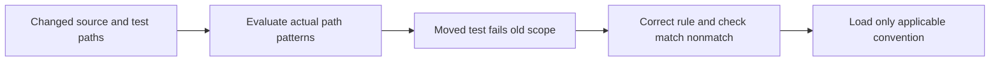
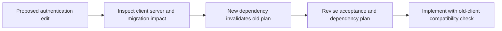
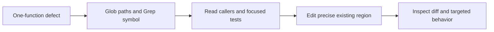
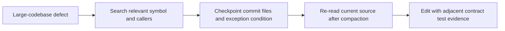
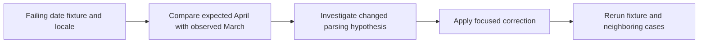

# Walkthrough 2: Code Generation with Claude Code, start to finish

**Exam scenario 2 · Primary domains: 3 Claude Code Configuration and Workflows, 5 Context Management and Reliability**

**The job (from the exam guide v1.0, Tier 1, paraphrased):** your team uses Claude Code for code
generation, refactoring, debugging and documentation. You fit it into the team's workflow with custom
slash commands and `CLAUDE.md` files, and you know when to use plan mode and when to just make the change.

**Picture it:** a team of eight adopts Claude Code next week. Monday's first task: move the payment
module from one library to another, across about 40 files.

## How to use this page

Read each **Learn the decision in context** episode in the step-by-step story. Picture the job, choose an answer to its technical question, then open the plain-language repair and proof. Try the changed-condition question before opening its answer. The whole-system chart below is a reference for review; it is closed initially so its recommended branches do not give away the decisions.

The existing detailed steps, what-if questions, sources and variant references remain available below. No setup is needed to read these fictional scenes. If you later choose a linked lab, read its own setup before running code.

<details>
<summary>Earlier walkthrough reading guide and source marks</summary>

<a id="how-to-use-this-page-1"></a>
## Earlier chart-first reading guide

1. Read the big chart once. Each box is a step. Each diamond is a decision. A green **PICK** box is
   the right move. A pink dashed **NOT** box is the tempting trap.
2. Then read the steps: **what you decide**, **the design rule** and **what can go wrong**.
3. Then try the 10 **what if** questions with the answers closed.

**You're done when** you can say, for each what-if, the decision and the failure move with the answer
still closed. Then open each one and fix any miss.

**Marks used.** `[Guide 3.4]` = exam guide task statement 3.4, Tier 1. `(practice, not doc)` = a common
habit no Anthropic page states as a rule. "Exam wording" = quoted word for word from the guide. Hook,
settings and session facts come from [conditions and errors](../deep-practice/conditions-and-errors.md) (Claude Code docs, Tier 1).


</details>

## The whole job in one chart

<details>
<summary>Open the full reference chart after trying the decisions</summary>



</details>

**Remember it as:** rules for everyone go in `CLAUDE.md`, rules for one file type go in path rules, and rules
that must always hold go in hooks. Plan the big jobs, just do the small ones, and show examples when
words fail.

## Step by step

### Step 1. Set up where the rules live

<a id="variant-fv-15"></a>

<!-- layered-episode:FV-15:start -->
### Learn the decision in context — FV-15

**Picture the job.** A test moved into a new folder and stopped receiving the testing instructions that used to apply. This is an original fictional teaching scene, not a recalled live exam question. Read and trace it; no account, installation or API call is required.

**Start small.** Follow the ordinary route: a person supplies a request or record, software passes the needed evidence to the assistant, and a receiving service or person checks the result. The first demonstration assumes the input, access and evidence are suitable. Now remove that assumption in the situation above. Predict what the receiver would see before choosing a repair.

**Original exam-style practice — choose ONE.** A moved file no longer matches a path-specific rule. Which remediation verifies scope rather than masking the issue?

A. Paste every repository rule into the main prompt.

B. Assume the rule follows file history even when its path changes.

C. Correct the relevant path pattern and check both matching and nonmatching files under the actual loading behavior.

<details>
<summary>What is this asking? Plain-language help, without the answer</summary>

Identify what the application needs to trust, what has actually been observed, and what remains unknown. Compare the choices against this situation, rather than choosing the most complicated design. A proposal is an intended action; evidence is what you can point to; a contract says what the receiving part expects. Decide which option fixes the stated failure without pretending another requirement has also been solved.

</details>

**Choose before opening the walkthrough.** Say your answer and the closest alternative aloud, or record them in your own notes.

<details>
<summary>Reveal the repair, evidence and changed condition</summary>

**Answer: C.** Correct the relevant path pattern and check both matching and nonmatching files under the actual loading behavior.

**Walk it through.** The scope check lists the moved test as matched and an unrelated source file as unmatched. The intended convention applies without flooding all tasks.

**Why the alternatives fail here.** Paste every repository rule into the main prompt. This leaves the stated boundary or evidence requirement unsatisfied. Assume the rule follows file history even when its path changes. This also fails to establish the required result. The closest competing mechanism fails for this specific reason: Duplicating every rule into the main prompt can hide mismatches and flood context; path scope must match actual files.

**Inspect the small artifact.** This is an illustrative application-state note for reading, not an SDK signature or executable configuration. The application or workflow owner creates it; the receiver uses it to distinguish what is known from what still needs checking. Its labels describe this scene; do not paste it into Claude settings.

```text
paths=[services/api.py,tests/test_api.py]; rules={backend:services/**,testing:tests/**}
```

**Layer added.** AI reasoning proposes, selects or summarizes where the job needs judgment. Ordinary software checks identifiers, permissions, required fields, recorded outcomes and stop conditions where applicable. A human resolves a policy or evidence gap when the story requires it. Inspect which owner actually supplies the evidence in this scene.



**Change one condition.** Keep the application in mind and consider the new situation below. Choose before opening its explanation.

**Technical transfer question — choose ONE.** A security requirement applies across the repository. Which scope matches it?

A. An appropriate broader instruction or enforcement scope.

B. Only the old tests glob, even for unrelated protected paths.

<details>
<summary>Transfer check</summary>

**A.** A security policy genuinely applies across the repository. Move that requirement to an appropriate broader scope. Name the changed fact before naming a tool. Preserve unrelated access, source-validation and result checks.

</details>

**Recall in ordinary language.** What broke? Who can fix it? What observable result proves the repair? If you cannot answer all three, replay the concrete scene rather than memorize the option letter.

</details>

**Continue from this decision:** [objective 3.3](../objectives/objective-3.3.md) · [inspect its decision map](../decision-atlas.md#diagram-d11) · [targeted practice](../../../practice/index.html?exam=CCAR-F&objective=3.3). Existing mapped question IDs: `cct-fv-15-base-v1`, `cct-fv-15-retry-v1`. The new guided question above is separate from those stored items and does not change their answers or progress.
<!-- layered-episode:FV-15:end -->

<details>
<summary>Existing variant reference</summary>

**FV-15 — Load rules for the affected paths:** A security policy genuinely applies across the repository. Move that requirement to an appropriate broader scope. [Inspect the artifact, failure recovery and alternative here](../objectives/objective-3.3.md#variant-fv-15) · [Open D11](../decision-atlas.md#diagram-d11).

</details>


- **You decide:** for each rule or convention, where should it go?
- **Design rule:**
  - Team-wide conventions → the project `CLAUDE.md`, checked into git [Guide 3.1]. A personal
    `~/.claude/CLAUDE.md` is not shared with teammates.
  - Rules for one file type spread across folders (tests, Terraform) → a file in `.claude/rules/` with
    `paths:` in its front matter. It loads only when matching files are touched [Guide 3.3].
  - A rule that must hold every time (never edit `migrations/`) → a hook or a permission rule, not a
    sentence in `CLAUDE.md`. Hooks give "deterministic guarantees" (exam wording) [Guide 1.5].
  - `@path/to/file` in `CLAUDE.md` imports another file [Guide 3.1].
- **What can go wrong:**

| What went wrong | Signal you see | What the design does |
|---|---|---|
| A new teammate's Claude ignores the team rules | rules sit in someone's `~/.claude/CLAUDE.md` | Move them to the project `CLAUDE.md` in git [Guide 3.1]. |
| You don't know which memory files loaded | odd behaviour | `/memory` (exam answer). Today `/context` also lists the loaded `CLAUDE.md` files [Guide 3.1]. |
| Test rules load in every session, wasting context | rules sit in the root `CLAUDE.md` | Move them to `.claude/rules/` with `paths:` such as `**/*.test.tsx` [Guide 3.3]. |

### Step 2. Shared commands and skills

- **You decide:** how does the team share repeatable tasks?
- **Design rule:**
  - Team commands → `.claude/commands/`, shared through git. Personal commands → `~/.claude/commands/`
    [Guide 3.2].
  - Skills in `.claude/skills/` with a `SKILL.md`. `context: fork` runs a skill in an isolated sub-agent so
    its long output doesn't flood the main session [Guide 3.2]. `argument-hint` prompts for a missing
    argument; `allowed-tools` limits tools (exam answer) [Guide 3.2].
- **What changed since:** today `allowed-tools` only pre-approves tools; `disallowed-tools` blocks them.
  Custom commands are now part of skills, but `.claude/commands/` still works. **On the exam: pick
  `allowed-tools` and `.claude/commands/`.** See [exam answer vs today](../deep-practice/conditions-and-errors.md#exam-answer-vs-today).
- **What can go wrong:**

| What went wrong | Signal you see | What the design does |
|---|---|---|
| A new hire doesn't have the team's `/review` command | it lives in someone's `~/.claude/commands/` | Move it to `.claude/commands/` in git [Guide 3.2]. |
| A skill floods the main chat | thousands of tokens of output each run | `context: fork` in its front matter [Guide 3.2]. |
| A skill runs without the input it needs | it guesses the missing argument | `argument-hint`, so the user is asked for it [Guide 3.2]. |

### Step 3. A task arrives: plan or just do it?

<a id="variant-fv-16"></a>

<!-- layered-episode:FV-16:start -->
### Learn the decision in context — FV-16

**Picture the job.** A small authentication change turns out to affect both the client and server, including old clients still in use. This is an original fictional teaching scene, not a recalled live exam question. Read and trace it; no account, installation or API call is required.

**Start small.** Follow the ordinary route: a person supplies a request or record, software passes the needed evidence to the assistant, and a receiving service or person checks the result. The first demonstration assumes the input, access and evidence are suitable. Now remove that assumption in the situation above. Predict what the receiver would see before choosing a repair.

**Original exam-style practice — choose ONE.** An implementation reveals an unplanned cross-service dependency. What is the appropriate next step?

A. Pause to inspect dependencies and revise the plan and acceptance checks before continuing the change.

B. Continue direct execution because the initial request sounded small.

C. Require a full architecture plan for every isolated comment typo.

<details>
<summary>What is this asking? Plain-language help, without the answer</summary>

Identify what the application needs to trust, what has actually been observed, and what remains unknown. Compare the choices against this situation, rather than choosing the most complicated design. A proposal is an intended action; evidence is what you can point to; a contract says what the receiving part expects. Decide which option fixes the stated failure without pretending another requirement has also been solved.

</details>

**Choose before opening the walkthrough.** Say your answer and the closest alternative aloud, or record them in your own notes.

<details>
<summary>Reveal the repair, evidence and changed condition</summary>

**Answer: A.** Pause to inspect dependencies and revise the plan and acceptance checks before continuing the change.

**Walk it through.** The revised plan names client, server, migration uncertainty and an old-client compatibility test. Work resumes against these explicit checks.

**Why the alternatives fail here.** Continue direct execution because the initial request sounded small. This leaves the stated boundary or evidence requirement unsatisfied. Require a full architecture plan for every isolated comment typo. This also fails to establish the required result. The closest competing mechanism fails for this specific reason: Always planning adds overhead to bounded simple work; always executing can miss uncertain dependencies.

**Inspect the small artifact.** This is an illustrative application-state note for reading, not an SDK signature or executable configuration. The application or workflow owner creates it; the receiver uses it to distinguish what is known from what still needs checking. Its labels describe this scene; do not paste it into Claude settings.

```text
plan={affected:[client,server,tests],unknown:[migration],acceptance:[old_client_works]}
```

**Layer added.** AI reasoning proposes, selects or summarizes where the job needs judgment. Ordinary software checks identifiers, permissions, required fields, recorded outcomes and stop conditions where applicable. A human resolves a policy or evidence gap when the story requires it. Inspect which owner actually supplies the evidence in this scene.



**Change one condition.** Keep the application in mind and consider the new situation below. Choose before opening its explanation.

**Technical transfer question — choose ONE.** The change is now a precise typo in an isolated documented comment. Which mode fits?

A. A cross-service migration plan is always required.

B. Direct execution with a focused check is proportionate.

<details>
<summary>Transfer check</summary>

**B.** The task becomes a precise typo in an isolated documented comment. Direct execution and a focused check are proportionate. Name the changed fact before naming a tool. Preserve unrelated access, source-validation and result checks.

</details>

**Recall in ordinary language.** What broke? Who can fix it? What observable result proves the repair? If you cannot answer all three, replay the concrete scene rather than memorize the option letter.

</details>

**Continue from this decision:** [objective 3.4](../objectives/objective-3.4.md) · [inspect its decision map](../decision-atlas.md#diagram-d02) · [targeted practice](../../../practice/index.html?exam=CCAR-F&objective=3.4). Existing mapped question IDs: `cct-fv-16-base-v1`, `cct-fv-16-retry-v1`. The new guided question above is separate from those stored items and does not change their answers or progress.
<!-- layered-episode:FV-16:end -->

<details>
<summary>Existing variant reference</summary>

**FV-16 — Plan when uncertainty crosses boundaries:** The task becomes a precise typo in an isolated documented comment. Direct execution and a focused check are proportionate. [Inspect the artifact, failure recovery and alternative here](../objectives/objective-3.4.md#variant-fv-16) · [Open D02](../decision-atlas.md#diagram-d02).

</details>


- **You decide:** plan mode, or direct execution?
- **Design rule:** plan mode for large changes with many valid approaches, architecture choices or many
  files (the library move across 40 files). Direct execution for a simple fix with clear scope, like a
  one-file bug with a clear stack trace [Guide 3.4].
- **Long discovery:** the Explore subagent keeps verbose discovery output out of the main session and
  returns a summary [Guide 3.4].
- **What can go wrong:**

| What went wrong | Signal you see | What the design does |
|---|---|---|
| A big change was started with no plan | half-done edits, rework across many files | Stop, switch to plan mode, agree the approach, then make the changes [Guide 3.4]. |
| Plan mode for a one-line fix | slow, extra back-and-forth | Direct execution [Guide 3.4]. |
| Discovery output fills the main session | pages of search results in the chat | Use the Explore subagent; it returns a summary [Guide 3.4]. |

### Step 4. Make the change

<a id="variant-fv-12"></a>

<!-- layered-episode:FV-12:start -->
### Learn the decision in context — FV-12

**Picture the job.** You need to fix one retry condition in an unfamiliar codebase without changing other handlers. This is an original fictional teaching scene, not a recalled live exam question. Read and trace it; no account, installation or API call is required.

**Start small.** Follow the ordinary route: a person supplies a request or record, software passes the needed evidence to the assistant, and a receiving service or person checks the result. The first demonstration assumes the input, access and evidence are suitable. Now remove that assumption in the situation above. Predict what the receiver would see before choosing a repair.

**Original exam-style practice — choose ONE.** Which tool sequence best supports a scoped existing-code edit when repository structure and callers are not yet known?

A. Overwrite the entire handler using Write before reading its callers.

B. Dump all repository files into context and make a global replacement.

C. Locate paths and symbols, read relevant callers and tests, apply a focused Edit, then inspect the diff and behavior.

<details>
<summary>What is this asking? Plain-language help, without the answer</summary>

Identify what the application needs to trust, what has actually been observed, and what remains unknown. Compare the choices against this situation, rather than choosing the most complicated design. A proposal is an intended action; evidence is what you can point to; a contract says what the receiving part expects. Decide which option fixes the stated failure without pretending another requirement has also been solved.

</details>

**Choose before opening the walkthrough.** Say your answer and the closest alternative aloud, or record them in your own notes.

<details>
<summary>Reveal the repair, evidence and changed condition</summary>

**Answer: C.** Locate paths and symbols, read relevant callers and tests, apply a focused Edit, then inspect the diff and behavior.

**Walk it through.** The diff changes only the intended condition, the caller contract is preserved and a targeted failing case now passes alongside adjacent cases.

**Why the alternatives fail here.** Overwrite the entire handler using Write before reading its callers. This leaves the stated boundary or evidence requirement unsatisfied. Dump all repository files into context and make a global replacement. This also fails to establish the required result. The closest competing mechanism fails for this specific reason: Dumping or rewriting the repository risks losing context and unrelated code. Tool selection follows the task, not a fixed ritual for every edit.

**Inspect the small artifact.** This is an illustrative application-state note for reading, not an SDK signature or executable configuration. The application or workflow owner creates it; the receiver uses it to distinguish what is known from what still needs checking. Its labels describe this scene; do not paste it into Claude settings.

```text
evidence=[paths,symbol_hits,caller_read,test_read]; change={file:handler.py,region:retry_condition}
```

**Layer added.** AI reasoning proposes, selects or summarizes where the job needs judgment. Ordinary software checks identifiers, permissions, required fields, recorded outcomes and stop conditions where applicable. A human resolves a policy or evidence gap when the story requires it. Inspect which owner actually supplies the evidence in this scene.



**Change one condition.** Keep the application in mind and consider the new situation below. Choose before opening its explanation.

**Technical transfer question — choose ONE.** The task now requires a genuinely new standalone artifact. Which built-in tool action fits?

A. Use broad replacement across existing files because every change must be an Edit.

B. Use Write after confirming the new file location and contract.

<details>
<summary>Transfer check</summary>

**B.** A genuinely new standalone artifact has no existing file to patch. Write the new file after verifying its placement and contract. Name the changed fact before naming a tool. Preserve unrelated access, source-validation and result checks.

</details>

**Recall in ordinary language.** What broke? Who can fix it? What observable result proves the repair? If you cannot answer all three, replay the concrete scene rather than memorize the option letter.

</details>

**Continue from this decision:** [objective 2.5](../objectives/objective-2.5.md) · [inspect its decision map](../decision-atlas.md#diagram-d11) · [targeted practice](../../../practice/index.html?exam=CCAR-F&objective=2.5). Existing mapped question IDs: `cct-fv-12-base-v1`, `cct-fv-12-retry-v1`. The new guided question above is separate from those stored items and does not change their answers or progress.
<!-- layered-episode:FV-12:end -->

<details>
<summary>Existing variant reference</summary>

**FV-12 — Search before making a scoped edit:** A genuinely new standalone artifact has no existing file to patch. Write the new file after verifying its placement and contract. [Inspect the artifact, failure recovery and alternative here](../objectives/objective-2.5.md#variant-fv-12) · [Open D11](../decision-atlas.md#diagram-d11).

</details>


<a id="variant-fv-28"></a>

<!-- layered-episode:FV-28:start -->
### Learn the decision in context — FV-28

**Picture the job.** You found the bug yesterday, but after shortening the conversation you no longer remember the exception in the affected function. This is an original fictional teaching scene, not a recalled live exam question. Read and trace it; no account, installation or API call is required.

**Start small.** Follow the ordinary route: a person supplies a request or record, software passes the needed evidence to the assistant, and a receiving service or person checks the result. The first demonstration assumes the input, access and evidence are suitable. Now remove that assumption in the situation above. Predict what the receiver would see before choosing a repair.

**Original exam-style practice — choose ONE.** A compacted code investigation loses an exception condition at a mutable commit. Which action should precede editing?

A. Re-read the relevant current source and caller contract from the evidence ledger, expanding scope only where dependencies require.

B. Reconstruct the exception from the model’s summary.

C. Read every repository file before any focused change.

<details>
<summary>What is this asking? Plain-language help, without the answer</summary>

Identify what the application needs to trust, what has actually been observed, and what remains unknown. Compare the choices against this situation, rather than choosing the most complicated design. A proposal is an intended action; evidence is what you can point to; a contract says what the receiving part expects. Decide which option fixes the stated failure without pretending another requirement has also been solved.

</details>

**Choose before opening the walkthrough.** Say your answer and the closest alternative aloud, or record them in your own notes.

<details>
<summary>Reveal the repair, evidence and changed condition</summary>

**Answer: A.** Re-read the relevant current source and caller contract from the evidence ledger, expanding scope only where dependencies require.

**Walk it through.** The ledger records current commit, function, caller and unresolved ownership. A focused test exercises the recovered exception before and after the edit.

**Why the alternatives fail here.** Reconstruct the exception from the model’s summary. This leaves the stated boundary or evidence requirement unsatisfied. Read every repository file before any focused change. This also fails to establish the required result. The closest competing mechanism fails for this specific reason: A guessed summary cannot replace current code evidence. Reading the whole repository also makes the decisive detail harder to retain.

**Inspect the small artifact.** This is an illustrative application-state note for reading, not an SDK signature or executable configuration. The application or workflow owner creates it; the receiver uses it to distinguish what is known from what still needs checking. Its labels describe this scene; do not paste it into Claude settings.

```text
ledger={commit,files:[handler,caller],symbols:[retry],unresolved:[ownership],next:test_contract}
```

**Layer added.** AI reasoning proposes, selects or summarizes where the job needs judgment. Ordinary software checks identifiers, permissions, required fields, recorded outcomes and stop conditions where applicable. A human resolves a policy or evidence gap when the story requires it. Inspect which owner actually supplies the evidence in this scene.



**Change one condition.** Keep the application in mind and consider the new situation below. Choose before opening its explanation.

**Technical transfer question — choose ONE.** The defect crosses the client-server API boundary. How should evidence scope change?

A. Keep only the original file even though the failure crosses its boundary.

B. Add adjacent dependencies and contract checks to the ledger.

<details>
<summary>Transfer check</summary>

**B.** The failure crosses the API boundary. Add the adjacent client/server dependencies and contract tests rather than preserving an artificially narrow scope. Name the changed fact before naming a tool. Preserve unrelated access, source-validation and result checks.

</details>

**Recall in ordinary language.** What broke? Who can fix it? What observable result proves the repair? If you cannot answer all three, replay the concrete scene rather than memorize the option letter.

</details>

**Continue from this decision:** [objective 5.4](../objectives/objective-5.4.md) · [inspect its decision map](../decision-atlas.md#diagram-d11) · [targeted practice](../../../practice/index.html?exam=CCAR-F&objective=5.4). Existing mapped question IDs: `cct-fv-28-base-v1`, `cct-fv-28-retry-v1`. The new guided question above is separate from those stored items and does not change their answers or progress.
<!-- layered-episode:FV-28:end -->

<details>
<summary>Existing variant reference</summary>

**FV-28 — Build a minimal code evidence ledger:** The failure crosses the API boundary. Add the adjacent client/server dependencies and contract tests rather than preserving an artificially narrow scope. [Inspect the artifact, failure recovery and alternative here](../objectives/objective-5.4.md#variant-fv-28) · [Open D11](../decision-atlas.md#diagram-d11).

</details>


- **You decide:** which edit tool?
- **Design rule:** Edit for a targeted change where the text you're replacing is unique. If Edit can't
  find unique text, Read the whole file, then Write it back [Guide 2.5].
- **What changed since:** today Edit also has `replace_all: true`. **On the exam: pick Read + Write when
  Edit can't find unique text.**
- **What can go wrong:**

| What went wrong | Signal you see | What the design does |
|---|---|---|
| The text isn't unique | Edit returns an error | Read the whole file, then Write it back (exam answer) [Guide 2.5]. |
| The text isn't there any more | Edit can't find it; the file changed since Claude last read it | Read the file again, then Edit (practice, not doc). |

### Step 5. Check the result automatically

- **You decide:** how do formatting, lint and tests get enforced?
- **Design rule:** a `PostToolUse` hook on `Edit|Write` runs the checks and sends failures back to Claude
  so it fixes them. A `PreToolUse` hook blocks forbidden edits [Guide 1.5 covers hooks that intercept
  tool calls].
- **Two ways a hook blocks (Claude Code docs):** exit code `2`, or JSON output. For `PreToolUse`, the
  JSON is `hookSpecificOutput.permissionDecision` set to `"deny"`, with `permissionDecisionReason`. For
  other events it's a top-level `"decision": "block"`. See
  [conditions and errors, section 7](../deep-practice/conditions-and-errors.md#7-claude-code-hooks-json-fields-and-what-each-event-can-block).
- **What can go wrong (hook exit codes, from the Claude Code docs):**

| What went wrong | Signal you see | What the design does |
|---|---|---|
| The block didn't block | the script exits `1` with plain-text output | Exit `1` is a non-blocking error; the edit goes through. Use exit `2` to block. |
| The hook never ran | wrong path or not executable (shell exit like `127`) | Also non-blocking, so the gate is silently off. Test the hook. |
| The edit already happened | a `PostToolUse` hook exits `2` | It can't undo the edit; it shows the reason to Claude so Claude fixes it. |
| A project MCP server isn't loaded | `⏸ Pending approval` in `claude mcp list` | Run `claude` interactively and approve it. |

### Step 6. The output isn't what you meant

<a id="variant-fv-17"></a>

<!-- layered-episode:FV-17:start -->
### Learn the decision in context — FV-17

**Picture the job.** The same date keeps coming out wrong even after the assistant was asked twice to try again. This is an original fictional teaching scene, not a recalled live exam question. Read and trace it; no account, installation or API call is required.

**Start small.** Follow the ordinary route: a person supplies a request or record, software passes the needed evidence to the assistant, and a receiving service or person checks the result. The first demonstration assumes the input, access and evidence are suitable. Now remove that assumption in the situation above. Predict what the receiver would see before choosing a repair.

**Original exam-style practice — choose ONE.** Repeated identical retries preserve a locale-dependent parsing failure. Which refinement is most useful?

A. Repeat make it better until the model changes its answer.

B. Provide the actual fixture, locale, expected result and failing assertion, then investigate a changed hypothesis and rerun neighboring cases.

C. Increase iteration count and treat effort as evidence of improvement.

<details>
<summary>What is this asking? Plain-language help, without the answer</summary>

Identify what the application needs to trust, what has actually been observed, and what remains unknown. Compare the choices against this situation, rather than choosing the most complicated design. A proposal is an intended action; evidence is what you can point to; a contract says what the receiving part expects. Decide which option fixes the stated failure without pretending another requirement has also been solved.

</details>

**Choose before opening the walkthrough.** Say your answer and the closest alternative aloud, or record them in your own notes.

<details>
<summary>Reveal the repair, evidence and changed condition</summary>

**Answer: B.** Provide the actual fixture, locale, expected result and failing assertion, then investigate a changed hypothesis and rerun neighboring cases.

**Walk it through.** For 03/04 under en_GB, the expected April 3 result is compared with the observed March 4 result. The corrected rule must also pass nearby dates.

**Why the alternatives fail here.** Repeat make it better until the model changes its answer. This leaves the stated boundary or evidence requirement unsatisfied. Increase iteration count and treat effort as evidence of improvement. This also fails to establish the required result. The closest competing mechanism fails for this specific reason: More iterations do not imply learning. Narrow evidence and hypothesis changes matter more than request length.

**Inspect the small artifact.** This is an illustrative application-state note for reading, not an SDK signature or executable configuration. The application or workflow owner creates it; the receiver uses it to distinguish what is known from what still needs checking. Its labels describe this scene; do not paste it into Claude settings.

```text
feedback={input:03/04,locale:en_GB,expected:2026-04-03,actual:2026-03-04,check:date_locale}
```

**Layer added.** AI reasoning proposes, selects or summarizes where the job needs judgment. Ordinary software checks identifiers, permissions, required fields, recorded outcomes and stop conditions where applicable. A human resolves a policy or evidence gap when the story requires it. Inspect which owner actually supplies the evidence in this scene.



**Change one condition.** Keep the application in mind and consider the new situation below. Choose before opening its explanation.

**Technical transfer question — choose ONE.** The only refinement request is make it better. What is needed first?

A. A reproducible expected outcome and observable criterion.

B. More unmeasured iterations until the answer looks different.

<details>
<summary>Transfer check</summary>

**A.** Feedback says only “make it better.” First obtain a reproducible criterion rather than guessing a redesign. Name the changed fact before naming a tool. Preserve unrelated access, source-validation and result checks.

</details>

**Recall in ordinary language.** What broke? Who can fix it? What observable result proves the repair? If you cannot answer all three, replay the concrete scene rather than memorize the option letter.

</details>

**Continue from this decision:** [objective 3.5](../objectives/objective-3.5.md) · [inspect its decision map](../decision-atlas.md#diagram-d12) · [targeted practice](../../../practice/index.html?exam=CCAR-F&objective=3.5). Existing mapped question IDs: `cct-fv-17-base-v1`, `cct-fv-17-retry-v1`. The new guided question above is separate from those stored items and does not change their answers or progress.
<!-- layered-episode:FV-17:end -->

<details>
<summary>Existing variant reference</summary>

**FV-17 — Change the hypothesis after repeated failure:** Feedback says only “make it better.” First obtain a reproducible criterion rather than guessing a redesign. [Inspect the artifact, failure recovery and alternative here](../objectives/objective-3.5.md#variant-fv-17) · [Open D12](../decision-atlas.md#diagram-d12).

</details>


- **You decide:** how do you get Claude to the right result faster?
- **Design rule [Guide 3.5], exam wording where quoted:**
  - "Concrete input/output examples as the most effective way to communicate expected transformations
    when prose descriptions are interpreted inconsistently". Give 2 to 3.
  - "Test-driven iteration: writing test suites first, then iterating by sharing test failures to guide
    progressive improvement".
  - The interview pattern: let Claude ask you questions first in an unfamiliar area.
  - Problems that affect each other → one detailed message. Independent problems → fix one at a time.
- **What can go wrong:**

| What went wrong | Signal you see | What the design does |
|---|---|---|
| Your prose is read a different way each time | outputs vary between runs | 2 to 3 input/output examples [Guide 3.5]. |
| Fixing one case breaks another | regressions after each change | Write the tests first, then share the failures [Guide 3.5]. |
| Claude assumes the wrong approach in an area you don't know | confident code built on a wrong guess | Interview pattern: let Claude ask questions first [Guide 3.5]. |

### Step 7. Save your place

- **You decide:** how does work survive a long session or tomorrow?
- **Design rule:**
  - Resume a named session with `--resume <session-name>` when its earlier file reads are still true;
    tell it which files changed [Guide 1.7].
  - Code changed a lot → start a new session with a structured summary [Guide 1.7].
  - Comparing two approaches → `fork_session` from the shared starting point [Guide 1.7].
  - Context filling up → `/compact`, plus a scratchpad file of key findings [Guide 5.4].
- **What can go wrong:**

| What went wrong | Signal you see | What the design does |
|---|---|---|
| A resumed session quotes old code | answers don't match the current files | Start fresh with a structured summary, or tell it exactly which files changed [Guide 1.7]. |
| A long session starts forgetting | early decisions get contradicted | `/compact`, and keep key findings in a scratchpad file [Guide 5.4]. |

## Run it for real: 10 what-if questions

These are **project-written practice questions**, not real exam questions. Each was checked against the
exam guide's 12 sample questions so none repeats one.

<details><summary><b>1. A new hire's Claude Code doesn't follow the team's naming rules. Everyone else's does. What's the likely cause?</b></summary>

The rules live in other people's personal `~/.claude/CLAUDE.md`, not in the project `CLAUDE.md` in
git. Move them into the project file [Guide 3.1].
</details>

<details><summary><b>2. Your <code>CLAUDE.md</code> says "NEVER edit files in <code>generated/</code>" in capitals. Claude still did it twice this week. What's the fix?</b></summary>

A `PreToolUse` hook (or a deny permission rule) that blocks `Edit` and `Write` on `generated/`. A
prompt instruction is probabilistic; a hook is deterministic [Guide 1.5].
</details>

<details><summary><b>3. Your block-hook script prints "blocked" and exits <code>1</code>. The edit still happens. Why?</b></summary>

With plain-text output, exit `1` is a non-blocking error in Claude Code, so the edit goes ahead.
To block, exit `2`, or print JSON with `hookSpecificOutput.permissionDecision: "deny"` and a
`permissionDecisionReason` (Claude Code hooks docs, see
[conditions and errors, section 7](../deep-practice/conditions-and-errors.md#7-claude-code-hooks-json-fields-and-what-each-event-can-block)).
A hook gives a deterministic block where a prompt can't [Guide 1.5].
</details>

<details><summary><b>4. The task is "rename one variable in one file, stack trace attached". Plan mode or direct?</b></summary>

Direct execution. It's small and the scope is clear [Guide 3.4]. Plan mode is for big, open changes
across many files.
</details>

<details><summary><b>5. You explain a date-formatting change in prose three times; Claude interprets it differently each time. What now?</b></summary>

Give 2 to 3 concrete input/output examples ("2026-03-04T10:00Z → 4 Mar 2026"). Examples beat prose
when wording is read inconsistently [Guide 3.5].
</details>

<details><summary><b>6. You have a <code>.claude/rules/terraform.md</code> file with <code>paths: ["**/*.tf"]</code>. A tool writes generated <code>.tf</code> files into <code>infra/generated/</code>, and those must not follow the hand-written conventions. Claude keeps applying them there. What do you change?</b></summary>

The `paths:` patterns. A path rule loads only for files that match its patterns [Guide 3.3], and
`**/*.tf` matches everything. List only the folders where the conventions belong, for example
`infra/modules/**/*.tf` and `services/*/deploy/**/*.tf`.
</details>

<details><summary><b>7. A codebase-analysis skill dumps 20,000 tokens into the main chat every time. What front matter fixes that?</b></summary>

`context: fork`, which runs the skill in an isolated sub-agent and returns only the result
[Guide 3.2].
</details>

<details><summary><b>8. You resume yesterday's session, but since then a teammate merged 30 changed files. Claude keeps quoting old code. What should you have done?</b></summary>

Started a new session with a structured summary, because the earlier tool results were stale.
Resume only when most earlier reads are still true, and then name the files that changed
[Guide 1.7].
</details>

<details><summary><b>9. Edit fails with "text not unique" because the same line appears 4 times, and you only want to change the third one. What's the exam answer?</b></summary>

Read the whole file, then Write it back with the change [Guide 2.5]. (In real work today, a longer
`old_string` that includes surrounding lines also works (practice, not doc). See
[exam answer vs today](../deep-practice/conditions-and-errors.md#exam-answer-vs-today).)
</details>

<details><summary><b>10. You want to try two different refactoring strategies from the same analysis and compare them. How?</b></summary>

Fork the session (`fork_session`) twice from the shared starting point, one branch per strategy
[Guide 1.7]. Each branch starts from the same baseline, so neither sees the other's attempt
(practice, not doc: the guide states the fork, not this reason).
</details>

## In real life (beyond the exam)

> **Beyond the exam.** This is real-world best practice. Where it differs from the exam guide, this page's exam answer wins on exam day. A line marked `(practice, not doc)` is a habit teams use; no Anthropic page states it as a rule. Anthropic pages checked 2026-10-09.

The exam picture is a team using Claude Code to write, refactor, debug and document code, with `CLAUDE.md`, shared commands and a choice between plan mode and direct execution [Guide, Scenario 2].

### Where you meet this at work

- **A payments repo where migrations must not be edited.** That rule is a hook or a permission deny, not a sentence in `CLAUDE.md`. Same split as Walkthrough 2, Step 1.
- **A mobile team with an "add a screen" skill.** The skill lives in the repo so a new hire gets it. A command that exists only in one person's home folder does not travel (Step 2).
- **A library upgrade across dozens of files.** Plan mode, because there are many valid approaches (Step 3). A one-line null check stays direct execution.
- **A data-pipeline repo that must stay formatted.** A `PostToolUse` hook on Edit and Write runs the formatter and sends failures back to Claude (Step 5).

### What production adds

1. **Two people "fix" the same rule in two places, and they drift.** **Design move:** team conventions live in the project `CLAUDE.md` in git [Guide 3.1]. A personal `~/.claude/CLAUDE.md` is not the team source.
2. **A skill that can run the shell can also run a dangerous command.** Exam answer: `allowed-tools` in the skill's front matter (the short header at the top of the skill file) limits tools during the skill [Guide 3.2]. **Today:** `allowed-tools` only pre-approves tools. `disallowed-tools` is what blocks them. On the exam, pick `allowed-tools`. See [exam answer vs today](../deep-practice/conditions-and-errors.md#exam-answer-vs-today). [Skills](https://code.claude.com/docs/en/skills).
3. **A hook you trust is silently off.** Exit code `1` does not block a `PreToolUse` hook. Exit code `2` does (Walkthrough 2, Step 5). [Hooks](https://code.claude.com/docs/en/hooks). **Design move:** run the hook against a forbidden path in a scratch repo before you rely on it `(practice, not doc)`.
4. **The session that wrote the change is a weak reviewer of that change.** A separate instance reviews it [Guide 4.6]. A person reviewing the diff is a team habit `(practice, not doc)`.
5. **Tomorrow's session trusts yesterday's file reads after someone else merged.** **Design move:** if the code changed a lot, start a new session with a structured summary. Do not resume a stale one [Guide 1.7].
6. **Test rules eat context on every unrelated task.** **Design move:** put them in `.claude/rules/` with `paths:`, so they load when those files are touched [Guide 3.3].

### An architect's checklist

- Are team conventions in the project `CLAUDE.md` in git? [Guide 3.1]
- Is "never edit this folder" a hook [Guide 1.5], or a permission deny `(practice, not doc)`?
- Do many-file changes start in plan mode? [Guide 3.4]
- If Edit fails because the text is not unique, do you Read the file and then Write it? [Guide 2.5] Today, Edit can also take `replace_all` when every copy should change. On the exam, pick Read + Write. See [exam answer vs today](../deep-practice/conditions-and-errors.md#exam-answer-vs-today).
- Do shared tasks live in `.claude/commands/` or `.claude/skills/` in the repo? [Guide 3.2]
- Can you see which memory files loaded? On the exam, that command is `/memory` [Guide 3.1].

### Two real-life what-ifs

<details><summary><b>1. Extends Step 1.</b> A contractor's Claude Code rewrites a file under <code>migrations/</code> even though <code>CLAUDE.md</code> says not to. What is missing?</summary>

A sentence in `CLAUDE.md` is not a guarantee. Block that path in code: a hook [Guide 1.5], or a permission deny `(practice, not doc)`.

</details>

<details><summary><b>2. Extends Steps 3 and 6.</b> A login function throws. The stack trace points at one file. A teammate still wants plan mode before anyone edits. What do you choose?</summary>

This is one known bug in one file, and the trace is already attached. Use direct execution [Guide 3.4].

</details>

## Go deeper

- [Code-level flow 5: hooks](../deep-practice/code-level-flows.md#flow-5-how-does-a-hook-block-a-tool-call)
- [Code-level flow 6: resume, fork or fresh](../deep-practice/code-level-flows.md#flow-6-resume-fork-or-start-fresh-when-you-come-back)
- [Decision chart 8b: where does a team rule live?](../deep-practice/decision-charts.md#8b-where-does-a-team-rule-live)
- [Decision chart 9: plan mode or just make the change?](../deep-practice/decision-charts.md#9-plan-mode-or-just-make-the-change)
- [Simulation 3: Code Generation with Claude Code](../../../04-Simulations/02-CCAR-F-Architect-Foundations/SIM-03-code-generation-claude-code.md)
- Lessons: [Lesson 3](../L03-claude-code-configuration-and-workflows.md), [Lesson 5](../L05-context-management-and-reliability.md)

## Sources

- Claude Certified Architect – Foundations exam guide v1.0 (Anthropic, July 2026), Scenario 2 and task
  statements 1.5, 1.7, 2.5, 3.1, 3.2, 3.3, 3.4, 3.5, 5.4 (Tier 1).
- Claude Code docs (Tier 1), as cited in [conditions and errors](../deep-practice/conditions-and-errors.md#link-key):
  hooks, memory, settings, skills, tools, CLI, MCP. Checked 2026-10-07.
- Real-life section:
  - [Building effective agents](https://www.anthropic.com/engineering/building-effective-agents) (Anthropic, 19 Dec 2024; page notes that tooling has moved on) (Tier 1).
  - [Mitigate jailbreaks and prompt injections](https://platform.claude.com/docs/en/test-and-evaluate/strengthen-guardrails/mitigate-jailbreaks) (Tier 1). Checked 2026-10-09.
  - [Prompt caching](https://platform.claude.com/docs/en/build-with-claude/prompt-caching) (Tier 1). Checked 2026-10-09.
  - [Strict tool use](https://platform.claude.com/docs/en/agents-and-tools/tool-use/strict-tool-use) (Tier 1).
  - [Skills](https://code.claude.com/docs/en/skills), [Hooks](https://code.claude.com/docs/en/hooks), [Headless](https://code.claude.com/docs/en/headless) (Tier 1).
  - Exam-versus-today table: [conditions and errors](../deep-practice/conditions-and-errors.md#exam-answer-vs-today). Docs checked there on 2026-10-07.

---

[Previous walkthrough](WT-01-customer-support-agent.md) · [Walkthrough home](README.md) · [Next walkthrough](WT-03-multi-agent-research.md)