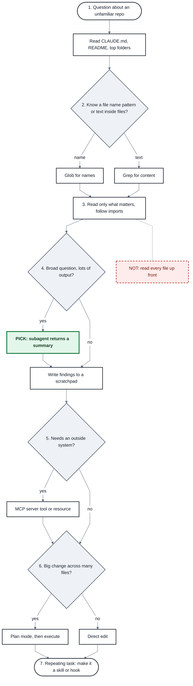
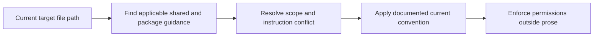
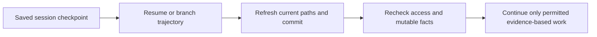
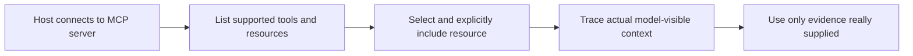
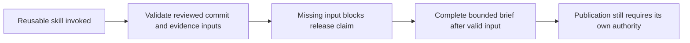

# Walkthrough 4: Developer Productivity with Claude, start to finish

**Exam scenario 4 · Primary domains: 2 Tool Design and MCP Integration, 3 Claude Code Configuration and Workflows, 1 Agentic Architecture and Orchestration**

**The job (from the exam guide v1.0, Tier 1, paraphrased):** an Agent SDK tool helps engineers explore
unfamiliar codebases, understand legacy systems, generate boilerplate and automate repetitive tasks. It
uses the built-in tools (Read, Write, Bash, Grep, Glob) and connects to MCP servers.

**Picture it:** "I just joined. Explain how refunds flow through this 15-year-old billing system, then
add a new refund reason code everywhere it's needed."

## How to use this page

Read each **Learn the decision in context** episode in the step-by-step story. Picture the job, choose an answer to its technical question, then open the plain-language repair and proof. Try the changed-condition question before opening its answer. The whole-system chart below is a reference for review; it is closed initially so its recommended branches do not give away the decisions.

The existing detailed steps, what-if questions, sources and variant references remain available below. No setup is needed to read these fictional scenes. If you later choose a linked lab, read its own setup before running code.

<details>
<summary>Earlier walkthrough reading guide and source marks</summary>

<a id="how-to-use-this-page-1"></a>
## Earlier chart-first reading guide

1. Read the big chart once. Each box is a step. Each diamond is a decision. A green **PICK** box is
   the right move. A pink dashed **NOT** box is the tempting trap.
2. Then read the steps: **what you decide**, **the design rule** and **what can go wrong**.
3. Then try the 10 **what if** questions with the answers closed.

**You're done when** you can say, for each what-if, the decision and the failure move with the answer
still closed. Then open each one and fix any miss.

**Marks used.** `[Guide 2.5]` = exam guide task statement 2.5, Tier 1. `(practice, not doc)` = a common
habit no Anthropic page states as a rule. "Exam wording" = quoted word for word from the guide. MCP and
tool facts come from [conditions and errors](../deep-practice/conditions-and-errors.md) (Anthropic docs, Tier 1).


</details>

## The whole job in one chart

<details>
<summary>Open the full reference chart after trying the decisions</summary>



</details>

**Remember it as:** names mean Glob and text means Grep. Read in slices, hand big questions to a
subagent, and write it down. Connect outside systems through MCP, and automate anything you repeat.

## Step by step

### Step 1. Start from the map

<a id="variant-fv-13"></a>

<!-- layered-episode:FV-13:start -->
### Learn the decision in context — FV-13

**Picture the job.** The whole team shares one convention, but a package has a special rule and one developer has a personal preference. This is an original fictional teaching scene, not a recalled live exam question. Read and trace it; no account, installation or API call is required.

**Start small.** Follow the ordinary route: a person supplies a request or record, software passes the needed evidence to the assistant, and a receiving service or person checks the result. The first demonstration assumes the input, access and evidence are suitable. Now remove that assumption in the situation above. Predict what the receiver would see before choosing a repair.

**Original exam-style practice — choose ONE.** How should repository, package and personal guidance be organized to avoid instruction drift?

A. Place conventions at their actual supported scope and resolve applicable conflicts using documented loading rules.

B. Copy every instruction into every folder to guarantee consistency.

C. Use personal preferences as the team’s enforced authorization policy.

<details>
<summary>What is this asking? Plain-language help, without the answer</summary>

Identify what the application needs to trust, what has actually been observed, and what remains unknown. Compare the choices against this situation, rather than choosing the most complicated design. A proposal is an intended action; evidence is what you can point to; a contract says what the receiving part expects. Decide which option fixes the stated failure without pretending another requirement has also been solved.

</details>

**Choose before opening the walkthrough.** Say your answer and the closest alternative aloud, or record them in your own notes.

<details>
<summary>Reveal the repair, evidence and changed condition</summary>

**Answer: A.** Place conventions at their actual supported scope and resolve applicable conflicts using documented loading rules.

**Walk it through.** For services/api.py, the learner identifies the applicable shared and package guidance, flags a conflicting test instruction and resolves it explicitly.

**Why the alternatives fail here.** Copy every instruction into every folder to guarantee consistency. This leaves the stated boundary or evidence requirement unsatisfied. Use personal preferences as the team’s enforced authorization policy. This also fails to establish the required result. The closest competing mechanism fails for this specific reason: More copies increase drift. Instruction files guide model behavior; they do not replace enforced permission checks.

**Inspect the small artifact.** This is an illustrative application-state note for reading, not an SDK signature or executable configuration. The application or workflow owner creates it; the receiver uses it to distinguish what is known from what still needs checking. Its labels describe this scene; do not paste it into Claude settings.

```text
instructions={shared:CLAUDE.md,package:services/CLAUDE.md,personal:user}; target=services/api.py
```

**Layer added.** AI reasoning proposes, selects or summarizes where the job needs judgment. Ordinary software checks identifiers, permissions, required fields, recorded outcomes and stop conditions where applicable. A human resolves a policy or evidence gap when the story requires it. Inspect which owner actually supplies the evidence in this scene.



**Change one condition.** Keep the application in mind and consider the new situation below. Choose before opening its explanation.

**Technical transfer question — choose ONE.** A convention applies only to one package. Where should it be maintained?

A. The supported package-level scope, with conflicts resolved explicitly.

B. Every instruction file, including unrelated packages.

<details>
<summary>Transfer check</summary>

**A.** A package-specific convention is added. Put it at the package scope rather than copying it into every project instruction file. Name the changed fact before naming a tool. Preserve unrelated access, source-validation and result checks.

</details>

**Recall in ordinary language.** What broke? Who can fix it? What observable result proves the repair? If you cannot answer all three, replay the concrete scene rather than memorize the option letter.

</details>

**Continue from this decision:** [objective 3.1](../objectives/objective-3.1.md) · [inspect its decision map](../decision-atlas.md#diagram-d11) · [targeted practice](../../../practice/index.html?exam=CCAR-F&objective=3.1). Existing mapped question IDs: `cct-fv-13-base-v1`, `cct-fv-13-retry-v1`. The new guided question above is separate from those stored items and does not change their answers or progress.
<!-- layered-episode:FV-13:end -->

<details>
<summary>Existing variant reference</summary>

**FV-13 — Put instructions at their real scope:** A package-specific convention is added. Put it at the package scope rather than copying it into every project instruction file. [Inspect the artifact, failure recovery and alternative here](../objectives/objective-3.1.md#variant-fv-13) · [Open D11](../decision-atlas.md#diagram-d11).

</details>


- **You decide:** where do you look first?
- **Design rule:** read `CLAUDE.md`, the README and the top-level folders before searching (practice,
  not doc). `CLAUDE.md` is where a project keeps its standing instructions and context [Guide 3.1].
- **What can go wrong:**

| What went wrong | Signal you see | What the design does |
|---|---|---|
| Searching before knowing the layout | hundreds of matches across tests, fixtures and docs | Read the map first, then search inside the folder that matters (practice, not doc). |

### Step 2. Find the right files

- **You decide:** Glob or Grep?
- **Design rule (exam wording):** Glob for "file path pattern matching" (for example `**/*.test.tsx`);
  Grep for "content search" (function names, error messages, imports) [Guide 2.5].
- **What changed since:** today Glob and Grep are off by default on macOS, Linux and WSL; Claude searches
  through Bash, and naming them in `--tools` or `--allowedTools` brings them back. **On the exam: pick Glob
  for names, Grep for content.**
- **What can go wrong:**

| What went wrong | Signal you see | What the design does |
|---|---|---|
| Glob used to find callers | matches files named `*refund*`, misses the real callers | Grep for the call text [Guide 2.5]. |
| Grep used to find a file type | noisy content matches instead of a file list | Glob with a name pattern [Guide 2.5]. |

### Step 3. Read selectively and trace

- **You decide:** whole files, or slices?
- **Design rule:** find entry points with Grep, then Read to follow imports "rather than reading all
  files upfront" (exam wording) [Guide 2.5]. For a wrapper module, list every name it exports, then Grep
  for each one [Guide 2.5].
- **What can go wrong:**

| What went wrong | Signal you see | What the design does |
|---|---|---|
| Whole large files read first | context fills before the real question starts | Grep for the entry point, then Read only that part [Guide 2.5]. |
| A wrapper hides real usage | Grep for the wrapper finds only import lines | List every name it exports, then Grep for each one [Guide 2.5]. |

### Step 4. Don't flood the context

<a id="variant-fv-07"></a>

<!-- layered-episode:FV-07:start -->
### Learn the decision in context — FV-07

**Picture the job.** Yesterday’s investigation is reopening today. One file moved and the user no longer has access to another source. This is an original fictional teaching scene, not a recalled live exam question. Read and trace it; no account, installation or API call is required.

**Start small.** Follow the ordinary route: a person supplies a request or record, software passes the needed evidence to the assistant, and a receiving service or person checks the result. The first demonstration assumes the input, access and evidence are suitable. Now remove that assumption in the situation above. Predict what the receiver would see before choosing a repair.

**Original exam-style practice — choose ONE.** A resumed session references stale paths and revoked permissions. What must precede continued investigation?

A. Refresh mutable evidence and authorization using the checkpoint source pointers before acting on the resumed state.

B. Trust prior tool outputs because the session identifier is unchanged.

C. Fork the session to restore the old access rights.

<details>
<summary>What is this asking? Plain-language help, without the answer</summary>

Identify what the application needs to trust, what has actually been observed, and what remains unknown. Compare the choices against this situation, rather than choosing the most complicated design. A proposal is an intended action; evidence is what you can point to; a contract says what the receiving part expects. Decide which option fixes the stated failure without pretending another requirement has also been solved.

</details>

**Choose before opening the walkthrough.** Say your answer and the closest alternative aloud, or record them in your own notes.

<details>
<summary>Reveal the repair, evidence and changed condition</summary>

**Answer: A.** Refresh mutable evidence and authorization using the checkpoint source pointers before acting on the resumed state.

**Walk it through.** The resumed trace records the current commit, renamed path and access denial. It cannot silently reuse the revoked source as current evidence.

**Why the alternatives fail here.** Trust prior tool outputs because the session identifier is unchanged. This leaves the stated boundary or evidence requirement unsatisfied. Fork the session to restore the old access rights. This also fails to establish the required result. The closest competing mechanism fails for this specific reason: Resume and fork preserve or branch state; neither renews authorization nor makes stale evidence current.

**Inspect the small artifact.** This is an illustrative application-state note for reading, not an SDK signature or executable configuration. The application or workflow owner creates it; the receiver uses it to distinguish what is known from what still needs checking. Its labels describe this scene; do not paste it into Claude settings.

```text
checkpoint={commit:abc,paths:[policy.md],permissions_checked:old}; current_commit:def
```

**Layer added.** AI reasoning proposes, selects or summarizes where the job needs judgment. Ordinary software checks identifiers, permissions, required fields, recorded outcomes and stop conditions where applicable. A human resolves a policy or evidence gap when the story requires it. Inspect which owner actually supplies the evidence in this scene.



**Change one condition.** Keep the application in mind and consider the new situation below. Choose before opening its explanation.

**Technical transfer question — choose ONE.** An investigator needs to explore an alternative trajectory without replacing the current one. Which approach fits?

A. Fork the session and refresh mutable evidence and permissions.

B. Resume stale state and assume a new branch renews authorization.

<details>
<summary>Transfer check</summary>

**A.** The learner wants an alternative investigation without replacing the existing trajectory. Fork the session, but revalidate the same mutable assumptions. Name the changed fact before naming a tool. Preserve unrelated access, source-validation and result checks.

</details>

**Recall in ordinary language.** What broke? Who can fix it? What observable result proves the repair? If you cannot answer all three, replay the concrete scene rather than memorize the option letter.

</details>

**Continue from this decision:** [objective 1.7](../objectives/objective-1.7.md) · [inspect its decision map](../decision-atlas.md#diagram-d11) · [targeted practice](../../../practice/index.html?exam=CCAR-F&objective=1.7). Existing mapped question IDs: `cct-fv-07-base-v1`, `cct-fv-07-retry-v1`. The new guided question above is separate from those stored items and does not change their answers or progress.
<!-- layered-episode:FV-07:end -->

<details>
<summary>Existing variant reference</summary>

**FV-07 — Resume with fresh permissions:** The learner wants an alternative investigation without replacing the existing trajectory. Fork the session, but revalidate the same mutable assumptions. [Inspect the artifact, failure recovery and alternative here](../objectives/objective-1.7.md#variant-fv-07) · [Open D11](../decision-atlas.md#diagram-d11).

</details>


- **You decide:** keep exploring in the main session, or hand it off?
- **Design rule:**
  - A broad question ("find every caller of the refund API") → a subagent that returns a short summary.
    The Explore subagent isolates verbose discovery output [Guide 3.4, 5.4].
  - Keep a scratchpad file of entry points and key classes; re-read it later [Guide 5.4].
  - Use `/compact` when discovery output piles up [Guide 5.4].
- **What can go wrong:**

| What went wrong | Signal you see | What the design does |
|---|---|---|
| Answers drift to "typical patterns" | the agent stops naming the specific classes it found | Exam wording: "Context degradation in extended sessions" [Guide 5.4]. Scratchpad, subagents, `/compact`. |
| Big tool output | over 10,000 tokens of MCP output: a warning; capped at 25,000 by default | Page or filter results; `MAX_MCP_OUTPUT_TOKENS` raises the cap. |

### Step 5. Connect outside systems through MCP

<a id="variant-fv-11"></a>

<!-- layered-episode:FV-11:start -->
### Learn the decision in context — FV-11

**Picture the job.** The CRM connection is green, but the assistant still cannot see the report the user expects. This is an original fictional teaching scene, not a recalled live exam question. Read and trace it; no account, installation or API call is required.

**Start small.** Follow the ordinary route: a person supplies a request or record, software passes the needed evidence to the assistant, and a receiving service or person checks the result. The first demonstration assumes the input, access and evidence are suitable. Now remove that assumption in the situation above. Predict what the receiver would see before choosing a repair.

**Original exam-style practice — choose ONE.** An MCP server connects successfully but its resource is absent from model context. What should be checked next?

A. Assume every connected resource was automatically included.

B. Inspect host-supported discovery and explicit resource inclusion, separately from connection establishment.

C. Commit the CRM secret into the shared project so all resources become visible.

<details>
<summary>What is this asking? Plain-language help, without the answer</summary>

Identify what the application needs to trust, what has actually been observed, and what remains unknown. Compare the choices against this situation, rather than choosing the most complicated design. A proposal is an intended action; evidence is what you can point to; a contract says what the receiving part expects. Decide which option fixes the stated failure without pretending another requirement has also been solved.

</details>

**Choose before opening the walkthrough.** Say your answer and the closest alternative aloud, or record them in your own notes.

<details>
<summary>Reveal the repair, evidence and changed condition</summary>

**Answer: B.** Inspect host-supported discovery and explicit resource inclusion, separately from connection establishment.

**Walk it through.** The trace distinguishes connected, listed and included. Only the final inclusion step supports a claim that this report was available to the model.

**Why the alternatives fail here.** Assume every connected resource was automatically included. This leaves the stated boundary or evidence requirement unsatisfied. Commit the CRM secret into the shared project so all resources become visible. This also fails to establish the required result. The closest competing mechanism fails for this specific reason: Connectivity is not proof that every resource was discovered or supplied. Resource behavior depends on host support and invocation.

**Inspect the small artifact.** This is an illustrative application-state note for reading, not an SDK signature or executable configuration. The application or workflow owner creates it; the receiver uses it to distinguish what is known from what still needs checking. Its labels describe this scene; do not paste it into Claude settings.

```text
project_config={server:crm,secret:environment}; trace=[connected,listed,included]
```

**Layer added.** AI reasoning proposes, selects or summarizes where the job needs judgment. Ordinary software checks identifiers, permissions, required fields, recorded outcomes and stop conditions where applicable. A human resolves a policy or evidence gap when the story requires it. Inspect which owner actually supplies the evidence in this scene.



**Change one condition.** Keep the application in mind and consider the new situation below. Choose before opening its explanation.

**Technical transfer question — choose ONE.** A developer tests a personal MCP server with private credentials. Which configuration placement fits?

A. Appropriate personal or local scope with secrets supplied outside committed files.

B. Commit credentials into shared project configuration for convenience.

<details>
<summary>Transfer check</summary>

**A.** A developer tests a personal server. Keep its configuration in the appropriate personal/local scope instead of committing credentials to the team project. Name the changed fact before naming a tool. Preserve unrelated access, source-validation and result checks.

</details>

**Recall in ordinary language.** What broke? Who can fix it? What observable result proves the repair? If you cannot answer all three, replay the concrete scene rather than memorize the option letter.

</details>

**Continue from this decision:** [objective 2.4](../objectives/objective-2.4.md) · [inspect its decision map](../decision-atlas.md#diagram-d05) · [targeted practice](../../../practice/index.html?exam=CCAR-F&objective=2.4). Existing mapped question IDs: `cct-fv-11-base-v1`, `cct-fv-11-retry-v1`. The new guided question above is separate from those stored items and does not change their answers or progress.
<!-- layered-episode:FV-11:end -->

<details>
<summary>Existing variant reference</summary>

**FV-11 — Separate connection from inclusion:** A developer tests a personal server. Keep its configuration in the appropriate personal/local scope instead of committing credentials to the team project. [Inspect the artifact, failure recovery and alternative here](../objectives/objective-2.4.md#variant-fv-11) · [Open D05](../decision-atlas.md#diagram-d05).

</details>


- **You decide:** which server, configured where, and how does Claude know to use it?
- **Design rule:**
  - Shared with the team → project `.mcp.json` in git. Personal or experimental → user-level
    `~/.claude.json` [Guide 2.4].
  - Secrets → `${VAR}` expansion, for example `${GITHUB_TOKEN}`; never paste a token into the file [Guide 2.4].
  - A standard system like Jira → use an existing community server, not a custom one [Guide 2.4].
  - Claude keeps using Grep instead of your better MCP tool → improve the MCP tool's description [Guide 2.4].
  - Read-only catalogs (issue lists, schemas) → expose them as MCP **resources** [Guide 2.4].
  - All tools from all configured servers are found at connection time and available at once (exam
    answer) [Guide 2.4].
- **What can go wrong (`claude mcp list` and `/mcp`):**

| What went wrong | Signal you see | What the design does |
|---|---|---|
| Server didn't start | `✘ Failed to connect` | Check the command, the URL and the `Issue:` line (`claude mcp get <name>`). |
| Project server not approved | `⏸ Pending approval` | Run `claude` interactively and approve it. |
| Needs login | `! Needs authentication` | Authenticate from `/mcp`. |
| Token variable not set | a warning naming the variable; the server loads with the literal `${VAR}` text | Set the variable, or use `${VAR:-default}`. Symptom: failed auth calls, not a missing server. |
| A slow tool is cut off | timeout | Set `MCP_TOOL_TIMEOUT` or a per-server `"timeout"` in `.mcp.json`. |
| Tool failed but the model can act on it | result with `isError: true` | Return a clear message: what went wrong, whether a retry helps [Guide 2.2]. |

### Step 6. Generate the code

- **You decide:** plan first, or just edit? Which edit tool?
- **Design rule:** plan mode for big changes across many files; direct execution for small clear ones
  [Guide 3.4]. Edit for a unique match; Read + Write when Edit can't find unique text [Guide 2.5].
- **Tool count:** give each agent about 4 to 5 tools for its role, not 18 [Guide 2.3].
- **What can go wrong:**

| What went wrong | Signal you see | What the design does |
|---|---|---|
| Generated code doesn't follow the house pattern | your prose was read two different ways | Show a concrete example: one existing case done end to end [Guide 3.5]. |
| A big change was started with no plan | rework across many files | Stop, switch to plan mode, then make the changes [Guide 3.4]. |
| Edit can't find unique text | Edit returns an error | Read the whole file, then Write it back (exam answer) [Guide 2.5]. |

### Step 7. Automate the repeating parts

<a id="variant-fv-14"></a>

<!-- layered-episode:FV-14:start -->
### Learn the decision in context — FV-14

**Picture the job.** A release-note helper keeps being asked to summarize the same evidence, but today nobody supplied the reviewed commit. This is an original fictional teaching scene, not a recalled live exam question. Read and trace it; no account, installation or API call is required.

**Start small.** Follow the ordinary route: a person supplies a request or record, software passes the needed evidence to the assistant, and a receiving service or person checks the result. The first demonstration assumes the input, access and evidence are suitable. Now remove that assumption in the situation above. Predict what the receiver would see before choosing a repair.

**Original exam-style practice — choose ONE.** A reusable skill lacks a required reviewed commit input. Which behavior preserves its output contract?

A. Invent the most likely commit from the conversation.

B. Stop with a missing-input response; require commit and evidence before producing the reviewed-release output.

C. Treat skill invocation itself as permission to publish a release.

<details>
<summary>What is this asking? Plain-language help, without the answer</summary>

Identify what the application needs to trust, what has actually been observed, and what remains unknown. Compare the choices against this situation, rather than choosing the most complicated design. A proposal is an intended action; evidence is what you can point to; a contract says what the receiving part expects. Decide which option fixes the stated failure without pretending another requirement has also been solved.

</details>

**Choose before opening the walkthrough.** Say your answer and the closest alternative aloud, or record them in your own notes.

<details>
<summary>Reveal the repair, evidence and changed condition</summary>

**Answer: B.** Stop with a missing-input response; require commit and evidence before producing the reviewed-release output.

**Walk it through.** The output names the missing reviewed_commit and produces no claim of verified release. A valid replay binds the summary to actual test evidence.

**Why the alternatives fail here.** Invent the most likely commit from the conversation. This leaves the stated boundary or evidence requirement unsatisfied. Treat skill invocation itself as permission to publish a release. This also fails to establish the required result. The closest competing mechanism fails for this specific reason: A reusable skill is not permission to publish. Invocation and downstream authorization remain separate.

**Inspect the small artifact.** This is an illustrative application-state note for reading, not an SDK signature or executable configuration. The application or workflow owner creates it; the receiver uses it to distinguish what is known from what still needs checking. Its labels describe this scene; do not paste it into Claude settings.

```text
skill_input={reviewed_commit,tests,evidence}; output={changes,limits,next_action}
```

**Layer added.** AI reasoning proposes, selects or summarizes where the job needs judgment. Ordinary software checks identifiers, permissions, required fields, recorded outcomes and stop conditions where applicable. A human resolves a policy or evidence gap when the story requires it. Inspect which owner actually supplies the evidence in this scene.



**Change one condition.** Keep the application in mind and consider the new situation below. Choose before opening its explanation.

**Technical transfer question — choose ONE.** The task is now a one-off explanation with no repeated workflow. What is proportionate?

A. Create a publishing-capable skill and treat invocation as deployment approval.

B. A direct bounded brief rather than an unnecessary reusable skill.

<details>
<summary>Transfer check</summary>

**B.** A single ad hoc explanation is needed. Use a brief rather than creating a reusable asset without repeated need. Name the changed fact before naming a tool. Preserve unrelated access, source-validation and result checks.

</details>

**Recall in ordinary language.** What broke? Who can fix it? What observable result proves the repair? If you cannot answer all three, replay the concrete scene rather than memorize the option letter.

</details>

**Continue from this decision:** [objective 3.2](../objectives/objective-3.2.md) · [inspect its decision map](../decision-atlas.md#diagram-d11) · [targeted practice](../../../practice/index.html?exam=CCAR-F&objective=3.2). Existing mapped question IDs: `cct-fv-14-base-v1`, `cct-fv-14-retry-v1`. The new guided question above is separate from those stored items and does not change their answers or progress.
<!-- layered-episode:FV-14:end -->

<details>
<summary>Existing variant reference</summary>

**FV-14 — Give reusable skills a contract:** A single ad hoc explanation is needed. Use a brief rather than creating a reusable asset without repeated need. [Inspect the artifact, failure recovery and alternative here](../objectives/objective-3.2.md#variant-fv-14) · [Open D11](../decision-atlas.md#diagram-d11).

</details>


- **You decide:** what becomes reusable, and in which form?
- **Design rule:**
  - A workflow you run on demand → a skill in `.claude/skills/`; add `context: fork` if its output is
    long [Guide 3.2].
  - A standard that should always be loaded → `CLAUDE.md` [Guide 3.1, 3.2].
  - A convention for matching files spread across the tree → a path rule in `.claude/rules/` [Guide 3.3].
  - Blocking or changing a tool call every time it happens → a hook [Guide 1.5].
- **What can go wrong:**

| What went wrong | Signal you see | What the design does |
|---|---|---|
| The same long checklist is pasted in every week | repeated prompts, long output in the main chat | A shared skill with `context: fork` [Guide 3.2]. |
| A rule that must never be broken lives in `CLAUDE.md` | it's followed most of the time, not always | A hook that blocks the tool call [Guide 1.5]. |
| An on-demand workflow sits in `CLAUDE.md` | it loads into every session and wastes context | Move it to a skill [Guide 3.2]. |

## Run it for real: 10 what-if questions

These are **project-written practice questions**, not real exam questions. Each was checked against the
exam guide's 12 sample questions so none repeats one.

<details><summary><b>1. You need every place that calls <code>applyRefund(</code>. The agent runs Glob for <code>*refund*</code>. What's wrong?</b></summary>

Glob only matches file names. Callers are found by content, so use Grep for `applyRefund(`
[Guide 2.5].
</details>

<details><summary><b>2. First question in a repo you've never seen: "where does refund logic live?" The agent's very first move is a search for "refund", which returns 900 matches across tests, fixtures and docs. What should have come first?</b></summary>

The map first. `CLAUDE.md` holds the project's own instructions and context [Guide 3.1]. Reading
it, the README and the top-level folders before any wide search, then searching inside the folder
that matters, is a house habit (practice, not doc).
</details>

<details><summary><b>3. You describe the new reason code in prose. Claude adds it to the enum but registers it differently from every existing code, and misses the test. What's the quickest way to get it right?</b></summary>

Show one concrete example: an existing reason code end to end (enum entry, where it's registered,
its test), and ask for the new one in the same shape. Examples beat prose when wording is read
inconsistently [Guide 3.5].
</details>

<details><summary><b>4. Two hours into exploring, the agent starts saying "this probably uses a standard repository pattern" instead of naming the classes it found earlier. What's happening, and what helps?</b></summary>

Context degradation over a long session [Guide 5.4]. Use a scratchpad of findings it re-reads, send
broad questions to subagents, and `/compact`.
</details>

<details><summary><b>5. A teammate clones the repo. The shared database MCP server in the repo's <code>.mcp.json</code> works for everyone else, but no tools from it appear in their session. One person says copy the server into their user config; another says their token must be missing. What do you tell them?</b></summary>

Inspect the actual connection, approval and discovery state before choosing a cause. Project-scoped configuration requires the user's approval; a pending approval is one possible cause. Authentication or initial discovery failures can also prevent tools from appearing. Check `/mcp` and `claude mcp list`, resolve the observed failure and reconnect or retry discovery as appropriate. Keep the shared server in project `.mcp.json` rather than copying it into user configuration merely to bypass diagnosis [Guide 2.4]. [Current MCP connection and scope documentation](https://code.claude.com/docs/en/mcp) (Tier 1, checked 2026-10-14).
</details>

<details><summary><b>6. The GitHub MCP server loads, but every call fails with an auth error. <code>.mcp.json</code> has <code>${GITHUB_TOKEN}</code>. What's likely?</b></summary>

A missing, expired or insufficiently scoped credential is a hypothesis, not a confirmed cause. Inspect the actual server configuration and credential source, then fix the observed authentication failure without printing the secret. For ordinary unset `${VAR}` references without defaults, current Claude Code warns and retains unexpanded text; some credential variables in remote `url`/`headers` instead expand as empty without a warning. Do not generalize one transport's behavior to every server. Set or refresh the correct credential, reconnect, and verify an authorized call [Guide 2.4]. [Current environment expansion exceptions](https://code.claude.com/docs/en/mcp#environment-variable-expansion-in-mcpjson) (Tier 1, checked 2026-10-14).
</details>

<details><summary><b>7. You built a great <code>search_codebase</code> MCP tool, but the agent keeps using built-in Grep. What do you fix first?</b></summary>

The MCP tool's description: say what it does better and when to use it instead of Grep
[Guide 2.4]. Fix descriptions before adding routing logic.
</details>

<details><summary><b>8. The agent makes many exploratory calls just to learn which Jira projects exist. What's a better design?</b></summary>

Expose the list of projects as an MCP **resource**, so the agent can see what exists without making
exploratory tool calls [Guide 2.4].
</details>

<details><summary><b>9. Every Friday a developer pastes the same 40-line release checklist into Claude Code. Each run dumps pages of output into the main chat. What should the team build?</b></summary>

A skill in `.claude/skills/`, shared through git, with `context: fork` so the long output stays in
its own sub-agent and only the result comes back [Guide 3.2]. It's an on-demand workflow, so it
doesn't belong in `CLAUDE.md`, which loads every session.
</details>

<details><summary><b>10. A search tool returns 40,000 tokens of log lines. What do you change?</b></summary>

Make the tool page, filter and return only the fields needed. Claude Code warns above 10,000 tokens
of MCP output and caps it at 25,000 by default. Trimming also protects context [Guide 5.1].
</details>

## In real life (beyond the exam)

> **Beyond the exam.** This is real-world best practice. Where it differs from the exam guide, this page's exam answer wins on exam day. A line marked `(practice, not doc)` is a habit teams use; no Anthropic page states it as a rule. Anthropic pages checked 2026-10-09.

The exam picture is an assistant that helps an engineer explore a codebase, understand old code, generate boilerplate and automate repeated tasks, using Read, Write, Bash, Grep and Glob, plus MCP servers [Guide, Scenario 4].

### Where you meet this at work

- **A new engineer on a ten-year billing repo.** They read `CLAUDE.md`, the README and the top folders before a wide search (Walkthrough 4, Step 1, practice). Callers of a function are a Grep, not a Glob on the file name [Guide 2.5].
- **"Which test files match this path?" versus "where is this error string?"** Glob for the path pattern. Grep for the text [Guide 2.5]. On the exam, that split is the answer. The walkthrough notes a product change about those tools defaulting off. Follow [WT-04](WT-04-developer-productivity.md) for that note. Do not treat it as a new exam answer.
- **Tickets and pull requests from an existing MCP server.** Use a community server for a standard system. Put the token in an environment variable, not in the file [Guide 2.4].
- **A small new endpoint versus a cross-cutting rename.** The endpoint can be direct execution. The rename is plan mode [Guide 3.4].

### What production adds

1. **A token gets committed in `.mcp.json`.** **Design move:** reference it as `${GITHUB_TOKEN}` (or the variable you actually use) and keep the value in the secret store [Guide 2.4]. A project server the whole team needs is committed. A personal experiment stays in that person's own settings (user scope), not in the shared project file [Guide 2.4].
2. **Claude keeps using Grep when you built a better MCP tool.** **Design move:** rewrite that tool's description so it says when to use it instead of Grep [Guide 2.1, 2.4].
3. **Ticket text and README text can carry hidden instructions.** **Design move:** same untrusted-content rule as Walkthrough 1. The agent that reads tickets should not also hold production deploy tools. [Mitigate jailbreaks](https://platform.claude.com/docs/en/test-and-evaluate/strengthen-guardrails/mitigate-jailbreaks).
4. **A "find every caller" question floods the main session.** **Design move:** hand broad discovery to a subagent that returns a short summary, keep a scratchpad of entry points, and use `/compact` when the session fills [Guide 3.4, 5.4].
5. **One agent is handed every tool you own.** **Design move:** about four or five tools for that role [Guide 2.3]. Read-only catalogs (issue lists, schemas) can be MCP resources rather than tools that take actions [Guide 2.4].
6. **Generated code merges with no person looking.** A separate instance reviews the change [Guide 4.6]. A person reviews the diff before merge `(practice, not doc)`.

### An architect's checklist

- For a content search, is the tool Grep, and for a path pattern, Glob? [Guide 2.5]
- Does broad discovery return a summary instead of dumping every file into the main session? [Guide 5.4]
- Is the shared MCP server in project `.mcp.json`, with secrets outside the file? [Guide 2.4]
- If Claude ignores your MCP tool, did you fix the description before adding more prompt text? [Guide 2.4]
- Does each agent get a small tool set for its role? [Guide 2.3]
- Is a many-file change in plan mode, and a one-file fix in direct execution? [Guide 3.4]
- Does a person see the diff before generated code merges? `(practice, not doc)`

### Two real-life what-ifs

<details><summary><b>1. Extends Step 2.</b> You need every test file whose name ends in .test.tsx, in any folder. The agent searches the file contents for the words test and tsx and comes back with almost nothing. What do you change?</summary>

That need is a path pattern. Use Glob [Guide 2.5].

</details>

<details><summary><b>2. Extends Step 5.</b> A teammate pastes a personal-access token into <code>.mcp.json</code> and commits it so "CI will work." The server is a shared issue tracker. What do you change?</summary>

Take the token out of the file. Reference an environment variable with `${VAR}` syntax [Guide 2.4].

</details>

## Go deeper

- [Code-level flow 8: exploring a big codebase](../deep-practice/code-level-flows.md#flow-8-how-do-you-explore-a-big-codebase-without-flooding-context)
- [Code-level flow 3: MCP tool results](../deep-practice/code-level-flows.md#flow-3-how-should-an-mcp-tool-report-each-kind-of-result)
- [Sequence diagrams, tree A: which built-in tool?](../deep-practice/sequence-diagrams.md#tree-a-which-built-in-tool-for-this-file-job)
- [Decision chart 8a: where does an MCP server's config live?](../deep-practice/decision-charts.md#8a-where-does-an-mcp-servers-config-live)
- [Simulation 5: Developer Productivity](../../../04-Simulations/02-CCAR-F-Architect-Foundations/SIM-05-developer-productivity.md)
- Lessons: [Lesson 2](../L02-tool-design-and-mcp-integration.md), [Lesson 3](../L03-claude-code-configuration-and-workflows.md)

## Sources

- Claude Certified Architect – Foundations exam guide v1.0 (Anthropic, July 2026), Scenario 4 and task
  statements 1.5, 2.2, 2.3, 2.4, 2.5, 3.1, 3.2, 3.3, 3.4, 3.5, 5.1, 5.4 (Tier 1).
- Claude Code docs (Tier 1), as cited in [conditions and errors](../deep-practice/conditions-and-errors.md#link-key):
  MCP, tools, skills. Checked 2026-10-07.
- Real-life section:
  - [Building effective agents](https://www.anthropic.com/engineering/building-effective-agents) (Anthropic, 19 Dec 2024; page notes that tooling has moved on) (Tier 1).
  - [Mitigate jailbreaks and prompt injections](https://platform.claude.com/docs/en/test-and-evaluate/strengthen-guardrails/mitigate-jailbreaks) (Tier 1). Checked 2026-10-09.
  - [Prompt caching](https://platform.claude.com/docs/en/build-with-claude/prompt-caching) (Tier 1). Checked 2026-10-09.
  - [Strict tool use](https://platform.claude.com/docs/en/agents-and-tools/tool-use/strict-tool-use) (Tier 1).
  - [Skills](https://code.claude.com/docs/en/skills), [Hooks](https://code.claude.com/docs/en/hooks), [Headless](https://code.claude.com/docs/en/headless) (Tier 1).
  - Exam-versus-today table: [conditions and errors](../deep-practice/conditions-and-errors.md#exam-answer-vs-today). Docs checked there on 2026-10-07.

---

[Previous walkthrough](WT-03-multi-agent-research.md) · [Walkthrough home](README.md) · [Next walkthrough](WT-05-claude-code-ci-cd.md)